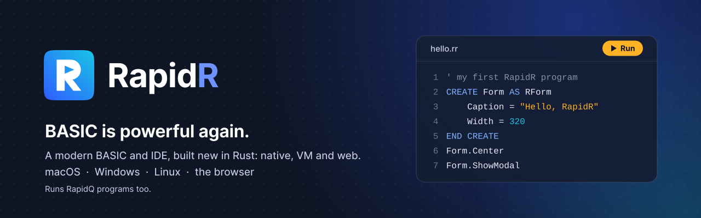
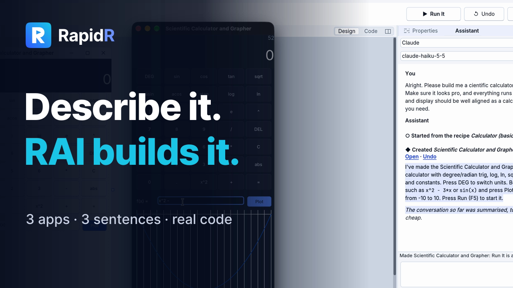

<p align="center"></p>

# RapidR

[](https://github.com/iBobX/RapidR/releases)
[](LICENSE)
[](https://www.rust-lang.org/)
[](https://www.youtube.com/@RapidRBASIC)
[](https://github.com/sponsors/iBobX)
[](https://www.buymeacoffee.com/roanbema)

<sub>Support is voluntary; monthly support renews monthly and is cancelled any time in your GitHub Sponsors or Buy Me a Coffee settings.</sub>

**BASIC is powerful again.** RapidR is a modern BASIC with its own IDE,
RapidR Studio: draw a window, write a few readable lines, press Run. The same
program becomes a native app for Windows, macOS or Linux, a standalone app
with no extra software, or a web app in any browser.

It's easy enough for a student on day one, and fast and strong enough for an
engineer:
- a multicore data engine that handles a million rows in about 20 ms;
- a debugger that shows you everything;
- a designer that shows your real data while you design;
- AI help when you want it;
- accessibility built in.

RapidR is an original implementation, written from the ground up in Rust, and
**RapidR Studio itself is written in RapidR**. Free and MIT-licensed; the apps
you build are yours.

👉 **Try it in your browser: [rapidr.dev](https://rapidr.dev)**, nothing to install.

### New in 2.120: describe it, RAI builds it 🤖

Tell RapidR Studio what you want, in your own words, and **RAI**, its assistant,
builds the program, checks it with RapidR's compiler, fixes its own errors, and
opens it ready to **▶ Run**. The code is plain, commented RapidR BASIC: read it,
learn from it, make it yours. Claude, OpenAI, DeepSeek or a free model on your
own computer; off until you turn it on.

<p align="center"><a href="https://youtu.be/B0hq28e6iy0"></a><br>
<sub>▶ <b><a href="https://youtu.be/B0hq28e6iy0">Watch the 2-minute demo</a></b>: a graphing calculator, an Excel-like CSV plotter and a snake game, from three sentences · <a href="https://youtu.be/0imZYHo9OnA">en español</a> · <a href="https://youtu.be/rd8cKOSa8n4">em português</a></sub></p>

## What's inside

- **Three runtimes, one behaviour.** Native code (via generated Rust), a
  bytecode interpreter (the RapidR Runtime, and standalone executables) and
  the browser (WebAssembly). The same conformance suite runs on all three.
- **A rich set of components**: forms and every visual component
  (`RForm`, `RButton`, `RStringGrid` …), the dialogs, menus, grids, list and
  tree views, MDI, the tray icon, `RRegistry`, the printer, sockets, MySQL,
  CGI, serial ports, downloads, `RMIDI` / `RWave` / `RVideo`, and the DirectX
  2D and Direct3D objects (reimplemented by RapidR on its own renderer).
- **Older programs keep working**: RapidR includes a compatibility layer to
  import programs written for RapidQ, include files and all.
- **RapidR's own UI kernel** draws every window, the same on every system:
  RapidR Studio's look by default (light, dark or high contrast, as the
  system is set), a classic Windows look with `$THEME Classic`,
  sharp on high-DPI screens, accessible to screen readers and the keyboard.
- **The web on the same kernel**: a program's windows drawn on a canvas
  (their pixels and accessibility trees checked against the desktop's),
  from a static `.zip` you can host anywhere.
- **Extensions**: SQLite with parameter binding, `RJson`, `RHttp`, data
  science (`RNum`, `RDataFrame`, `RPlot`), responsive layouts (`Anchors`),
  web-only components.
- **Your programs are yours**: MIT-licensed, and every build ships the
  `THIRD-PARTY-NOTICES.txt` its components ask for. Nothing copyleft and no
  TLS library is compiled into your program (HTTPS is the operating
  system's); the little standard cryptography it does contain is listed in
  [LEGAL.md](LEGAL.md).

## Why RapidR

Measured, not promised — each number has its conditions on
**[the Why RapidR page](docs/manual/why-rapidr.md)**, and the scripts that made
them are in [`tools/bench/`](tools/bench/README.md):

- **Data at speed.** RapidR's own multicore data engine loads, filters, sorts
  and groups a table of **1,000,000 rows in 23 ms** on an Apple silicon Mac
  (M4 Max), where pandas 3.0.1 takes 372 ms on the same table; 10,000,000 rows
  take 0.27 s. A browser gives a page one core, and in Chrome a million rows
  still load in about 0.15 s and sort in 60 ms.
- **A lean VM.** A 10-million-iteration loop runs in about 0.6 s; RapidR Studio
  waiting for you uses a quarter of one percent of a core; a debugger step
  takes 14 to 21 ms on the desktop and 19 to 44 ms in the browser, as busy as
  the computer is (the budget is 50 ms).
- **One program, every system.** Windows, macOS, Linux and the web from one
  source, and the desktop's and the browser's windows are checked pixel for
  pixel against each other.
- **Accessible and secure by default**, and **AI that never holds your keys**:
  Studio's assistant stays off until you turn it on, proposes changes as diffs,
  and an API key is never written into a project or a program.

<table>
<tr>
<td width="50%"><a href="docs/manual/data-science-with-rapidr.md"></a><br /><sub><b>Data, live in the designer</b>: a CSV in a grid before the program runs</sub></td>
<td width="50%"><a href="docs/manual/debugging.md"></a><br /><sub><b>The debugger</b>: any value opens like a tree</sub></td>
</tr>
<tr>
<td width="50%"><a href="docs/manual/ai-assistant.md"></a><br /><sub><b>AI in your programs</b>: the code says where the key is, never the key</sub></td>
<td width="50%"><a href="docs/manual/data-science.md#tutorial-the-csv-explorer"></a><br /><sub><b>The CSV Explorer</b>: drop a CSV, see a table, statistics and a chart</sub></td>
</tr>
</table>

## Install

Download from **[the latest release](https://github.com/iBobX/RapidR/releases/latest)**.
Each system has two packages (**most people want the SDK**):

- **RapidR (the SDK)** — the IDE, the `rapidr` compiler and runtime, and
  everything needed to build. Install this to write programs.
- **RapidR Runtime** — only runs programs (`.rrbc`, `.rr`, `.bas`), like a
  Java runtime, for people you give programs to.

| System | SDK | Runtime only |
|---|---|---|
| **Windows** 10 / 11, x64 or ARM64 | `RapidR-2.120.0-windows-x64-setup.exe` / `…-arm64-setup.exe` | `RapidR-Runtime-2.120.0-windows-<arch>-setup.exe` |
| **macOS** 11 or newer, Apple silicon and Intel (one universal app) | `RapidR-2.120.0-macos-universal.dmg` | `RapidR-Runtime-2.120.0-macos-universal.dmg` |
| **Linux** x86_64 or aarch64: Ubuntu 22.04, Debian 12 or newer | `rapidr_2.120.0_<amd64\|arm64>.deb` or `rapidr-2.120.0-linux-<arch>.tar.gz` | `rapidr-runtime_…` |
| **Web** | `rapidr-web-2.120.0.zip`: the web IDE, for any static host | |

- **Windows**: run the installer (per user, no administrator rights). It
  adds *RapidR Studio* to the Start menu and, if you keep the box ticked,
  `rapidr` to your PATH.
- **macOS**: drag *RapidR* (and/or *RapidR Runtime*) to Applications. Then
  `/Applications/RapidR Studio.app/Contents/MacOS/rapidr setup` offers to put
  `rapidr` on your PATH.
- **Linux**: `sudo apt install ./rapidr_2.120.0_amd64.deb`, or unpack the
  `.tar.gz` and run `./install.sh` (into `~/.local`, no root). Linux needs
  OpenSSL 3 (HTTPS uses the system's), hence Ubuntu 22.04 / Debian 12 and
  newer.

**The downloads aren't code-signed yet.** macOS: the first time, it says
“RapidR Studio” Not Opened: click **Done**, then System Settings > Privacy &
Security > **Open Anyway** (right-click > Open no longer works on current
macOS). Windows: SmartScreen says "Windows protected your PC": **More info >
Run anyway**. Check downloads against `SHA256SUMS`
(`shasum -a 256 -c SHA256SUMS --ignore-missing`). Step by step, with
screenshots: [docs/manual/getting-started.md](docs/manual/getting-started.md).

**Rust is needed only for native builds.** Running programs, the IDE,
standalone interpreted executables and web bundles need nothing else. For
native builds, `rapidr setup` installs the exact Rust RapidR was tested
with — beside your own toolchain if you have one (never changing your
default), or rustup itself after asking if you have none. On Windows the
SDK ships its own linker (LLVM-MinGW): no Visual Studio needed.

After installing, `.rrbc` files run on a double click and `.rr` / `.bas`
files open in the IDE (with a *Run* action); a program downloaded from the
internet asks once before it runs.

## Quick start

`hello.bas`:

```basic
PRINT "Hello, World!"
DIM name AS STRING
name = "RapidR"
PRINT "Hi from "; name
```

```sh
rapidr run hello.bas                   # run it now (the RapidR Runtime)
rapidr build-bc hello.bas              # hello.rrbc: runs with `rapidr hello.rrbc` or a double click
rapidr build hello.bas --interp        # a standalone executable, no Rust needed
rapidr build hello.bas                 # a native executable, optimized (needs Rust once: rapidr setup)
rapidr bundle-bc hello.bas -o hello-web.zip   # a web bundle for any static host
```

A window:

```basic
DECLARE SUB ButtonClick (Sender AS RButton)

CREATE Form AS RForm
    Caption = "Hello"
    Width = 320 : Height = 160
    Center
    CREATE Label1 AS RLabel
        Caption = "Not clicked yet"
        Left = 20 : Top = 20
    END CREATE
    CREATE Button1 AS RButton
        Caption = "Click me"
        Left = 20 : Top = 60
        OnClick = ButtonClick
    END CREATE
END CREATE

SUB ButtonClick (Sender AS RButton)
    Label1.Caption = "Clicked!"
END SUB

Form.ShowModal
```

`rapidr run form.bas` opens it; `rapidr bundle-bc form.bas -o form.zip`,
unzipped and served (`python3 -m http.server -d form 8080`), shows the same
window in a browser. Every build writes `THIRD-PARTY-NOTICES.txt` beside
the executable (or into the bundle): ship it with your program.

### Bringing an existing program over

Older programs run as they are (`.bas`, `.rqw`, `.rqb`, `.rq`). To move one to
RapidR's own names (`RForm` for `QFORM`, and so on), run
`rapidr import-rapidq form.bas -o converted`. It writes a converted copy, and
a report (`rapidr-import-report.md`) of every change it made. Your original is
left untouched, and each program is proved to compile to the same bytecode
before and after.

Next: **[the user manual](docs/manual/README.md)** and
**[the examples](examples/README.md)**.

## What's in it

| | |
|---|---|
| **The language** | a readable, modern BASIC: SUBs, FUNCTIONs, TYPEs with methods, constructors, events and inheritance, `CREATE` blocks, `WITH`, `GOSUB`, `DATA`, `$INCLUDE` / `$DEFINE` / `$MACRO` / `$RESOURCE`, function pointers, memory functions (memory-safe), console statements — plus VB's `#If`, `i++`, `+=` |
| **Components** | Dozens of components with RapidR's names (`RForm`, `RButton` …), each also answering to its classic `Q` name (`QFORM`, `QBUTTON` …) for older programs ([reference](docs/manual/reference/components.md)) |
| **RapidR Studio** | the IDE, on the desktop and in the browser: a form designer, a code editor with completion and hover help, a debugger whose values open like trees (Set Next Statement, Step Into Specific), linked data live in the designer, Markdown shown formatted, and an AI assistant that stays off until you turn it on |
| **UI** | RapidR's own UI kernel on winit, vello, parley and AccessKit: the same look everywhere — RapidR's own look by default (light, dark or high contrast as the system is set), a classic Windows look with `$THEME Classic` — high-DPI, keyboard and screen readers (VoiceOver, Narrator, NVDA; ARIA on the web), `Anchors` and size constraints |
| **DirectX & media** | `RDXScreen`, `RDXImageList`, `RDXTimer`, `RDXSound`, `RDXJoystick` (gamepads), Direct3D retained mode (`.X` models, lights, textures, shadows) on the GPU through wgpu (Metal, Direct3D 12, Vulkan, WebGL 2); `RMIDI` with a built-in synthesizer, `RWave`, `RVideo` (AVI), MP3 / Ogg / FLAC / WAV |
| **The web** | the UI kernel on a canvas; SQLite in WebAssembly; web-only components (`RWebView`, `RDOM`, `RJavaScript`, `RWebStorage`, …); a web IDE that compiles in the browser |
| **Databases** | `RSQLite` (SQLite itself, everywhere) and `RMySQL`, with `?` parameter binding |
| **Data science** | `RNum` (arrays), `RDataFrame` (tables, on RapidR's own multicore engine), `RPlot` (charts), `RJson`, and linked components — `RCSV`, `RDataSource`, `RDBGrid`, `DataSource` / `DataField` on edits and labels — one implementation on every runtime ([Data science](docs/manual/data-science.md)) |
| **AI** | `RAI`: Anthropic (Claude), OpenAI, DeepSeek or any OpenAI-compatible server (a model on your own computer too) in your programs and in Studio's assistant; keys kept in the system's keychain, never in a program ([The AI assistant and RAI](docs/manual/ai-assistant.md)) |
| **Rich text and Markdown** | `RRichEdit` formats text per character and paragraph and reads and writes RTF; `RMarkdownView` shows Markdown ([Rich text](docs/manual/rich-text.md)) |
| **The RapidR Runtime** | runs `.rrbc` programs and sources directly; file associations per user; bytecode that says which runtime it needs; `#!/usr/bin/env rapidr` scripts |
| **Builds** | native (Rust; universal on macOS), standalone interpreted executables with no Rust needed (on Windows for x64 and ARM64 alike, on macOS universal), web bundles, `--web` native WebAssembly |

## Coming next

From [the roadmap](ROADMAP.md), in no order and with no dates:

- **RapidR in four languages**: the manual, Studio, the messages and the
  website in English, Spanish, Portuguese and Chinese.
- **A native look** (`$THEME native`): programs that look like the system they
  run on — Windows 11, macOS, Linux.
- **RapidR on the ESP32**: BASIC running on the board itself, flashed from
  Studio (today a program talks to a board over a serial port).
- **More RAI**: an assistant that can look at and test-run what it builds (with
  your permission), a coach mode that teaches as it helps, and a drop-in chat
  component (RChat).
- **More data connectors**: Excel, Parquet, PostgreSQL and more, as linked
  components.
- **Constants with no include**: in `.rr` programs `clRed`, `mbYes` and the
  rest are simply there (only the ones used are compiled in), and grouped
  names like `Color.Red` help autocomplete; `.bas` programs keep their
  include file as before.
- **A stack panel**: a container that lines its children up and closes the
  gap when one is hidden, with no layout code.
- **`$UNSAFEMEM`** (raw memory for older memory helpers) and **calls into
  native libraries on macOS and Linux**, like DLL calls on Windows.

## Platforms checked

Each release is checked on macOS (Apple silicon), Windows 11 (ARM64) and
Ubuntu 24.04 (ARM64, Wayland and X11): the conformance suite on every
backend, the GUI test programs headless and with real windows, the unit
tests, and what a screen reader sees (macOS Accessibility, Windows UI
Automation). The browser suites run in Chromium. The installers are
smoke-tested on each system — the x64 Windows and x86_64 Linux packages
under emulation on ARM machines. The Intel slice of the macOS apps is
checked by inspection only (no Intel Mac in the loop yet).

## Documentation

- **[User manual](docs/manual/README.md)**: [why RapidR](docs/manual/why-rapidr.md),
  getting started, RapidR Studio (editor, designer, debugger, AI assistant),
  the language, components, data science, rich text, building apps, importing
  older programs, the web, the CLI and Runtime, compatibility notes,
  troubleshooting.
- **[Examples](examples/README.md)**, in the order to read them.
- **[CHANGELOG.md](CHANGELOG.md)**: every version's changes;
  **[ROADMAP.md](ROADMAP.md)**: what comes next.
- **[COMPILER_MANUAL.md](COMPILER_MANUAL.md)**: for contributors — the
  architecture, building and testing.
- **[LEGAL.md](LEGAL.md)**: what you may do with RapidR and your programs.

## Building from source

```sh
git clone https://github.com/iBobX/RapidR.git
cd RapidR
cargo build --release -p rapidr-cli && cp target/release/rapidr .
./rapidr run examples/basics/hello.rr
```

You need Rust (via [rustup](https://rustup.rs/)) and a C compiler (some
bundled C libraries: SQLite, zstd, …):

- **macOS**: `xcode-select --install`
- **Linux (Debian/Ubuntu)**: `sudo apt install build-essential pkg-config
  libfontconfig1-dev libasound2-dev libssl-dev` (windows also need
  xkbcommon and X11 or Wayland, which a desktop has)
- **Windows**: Visual Studio Build Tools (MSVC), or LLVM-MinGW with Rust's
  `*-pc-windows-gnullvm` toolchain as the releases use

A checkout works like an install: `./rapidr` finds the runtime sources
next to it, builds its own runners for `--interp`, and builds the web
interpreter with `tools/build_web_artifacts.sh` (needs `wasm-pack`). The
contributor manual covers the tests (`tools/regress.sh`) and the release
tooling.

## Support RapidR

RapidR is free and open source (MIT), made by one developer in his spare time.
If it's useful to you, you can support its development:

[](https://github.com/sponsors/iBobX)
[](https://www.buymeacoffee.com/roanbema)

Support is voluntary, received by Ruta Internet S.R.L., and comes with nothing in return: RapidR stays free for everyone. You can give once or monthly; monthly support renews every month until you cancel, any time, in your GitHub Sponsors or Buy Me a Coffee settings. Payment is handled by GitHub or Buy Me a Coffee, never by RapidR.

Every coffee helps pay for the tools and compute that build RapidR. Thank
you! A ⭐ and a share help just as much, and so does testing: try your
programs and [report what differs](https://github.com/iBobX/RapidR/issues/new/choose).

## Credits

- **Roberto Berrospe** ([@iBobX](https://github.com/iBobX)) — Creator, architect, and lead developer
- **VS Code Copilot/Claude + Antigravity/Gemini** — AI pair-programming assistant for feature implementation, testing, and documentation

RapidQ was created by William Yu. RapidR is an independent implementation
that is compatible with RapidQ: it contains nothing of RapidQ's (no code,
manual text, include files or examples), and it is not affiliated with,
endorsed or sponsored by RapidQ's author, anyone holding rights in RapidQ, or
any vendor it names ([LEGAL.md](LEGAL.md)). Contributions follow
[CONTRIBUTING.md](CONTRIBUTING.md).

RapidR stands on the shoulders of open-source software: winit, wgpu, vello,
parley and AccessKit (the UI), wasm-bindgen, plotters, SQLite and hundreds of Rust crates. The
full list, with licenses and links, is in
[THIRD_PARTY_NOTICES.md](THIRD_PARTY_NOTICES.md) (generated from the
dependency graph) and [LICENSES.md](LICENSES.md) (vendored JavaScript and
license texts). New dependencies must be open source under a permissive
license accepted by `deny.toml`.

## Licensing

**The programs you build with RapidR are yours**: sell them, give them away,
keep their source closed. Ship each one with the `THIRD-PARTY-NOTICES.txt`
RapidR writes beside it (native and interpreted executables) or into it (web
builds): it carries the notices and licence texts of RapidR's runtime and of
the open-source components inside, generated from the build's real
dependency graph (`rapidr notices` prints it). That is all their licences ask;
none restricts commercial or closed-source use, and nothing GPL, LGPL, MPL
or AGPL is compiled into a program.

- [LEGAL.md](LEGAL.md): what you may do with RapidR and your programs, what
  to ship, trademarks (RapidR is compatible with RapidQ and not affiliated
  with its author or any vendor it names), no warranty.
- [docs/licensing.md](docs/licensing.md): what each kind of output contains,
  licence by licence, and what each licence asks; codecs and patents; the
  checks (`tools/regress.sh legal`).

RapidR itself is licensed under the [MIT License](LICENSE), copyright © 2025–2026
Ruta Internet SRL (Uruguay).
