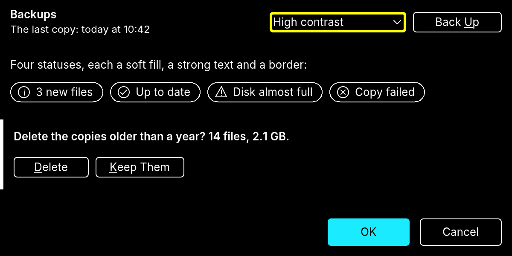

# RapidR design guide

How RapidR Studio's own screens are put together: which sizes, which colours, which words. Every agent and every contributor who touches Studio's UI (`ide/*.inc`) reads this first and runs [the checklist](#checklist-before-you-merge-ui) before merging. The colours themselves are in [theme-tokens.md](theme-tokens.md); the brand (logo, palette) in [design/brand/README.md](../design/brand/README.md); the icons in [design/icons/README.md](../design/icons/README.md). This page says how to use them.

The numbers here were measured from Studio as it is (October 2026), not invented. Where Studio still differs, `tools/check_design.py` lists it (its baseline) and the [offenders](#known-gaps) section names it.

The patterns, in a program anyone can run ([examples/gui/status_colors.rr](../examples/gui/status_colors.rr); the pictures: `node tools/manual/shots.mjs status-colors`): a pane's header (title and line at the left; a menu and a compact button, 24 px, on its centre line), the four status chips, a question's strip (a card, its 4-pixel mark in the warning colour, compact buttons) and a dialog's buttons (32 px, one primary), in light, dark and high contrast. RapidR Studio's AI Apps pane is the same in Studio ([the manual](manual/ai-apps.md)).




## Principles

- **Beautiful.** Calm surfaces, one family of sizes, everything on a centre line. A screen looks finished at 1× and at 2×, in light, dark and high contrast.
- **Easy.** Plain words, one obvious next step. **One primary action per surface** (the accent-filled button); everything else is secondary or quiet.
- **Accessible.** Every control works by keyboard and is named for a screen reader. Text reads at 4.5:1 (7:1 in high contrast). Colour never says something alone: a word or an icon says it too.
- **Calm and responsible.** Nothing shouts. No solid blocks of saturated colour, no blinking, no red for something that isn't wrong. A risk is said clearly, once, in a soft warning colour.
- **WOW.** The small things are right: aligned edges, equal gaps, a pill that is round, text that never clips.

## Colour

- **Only theme tokens in `ide/*.inc`.** Every colour is `TC("token")` (Studio's helper for `Application.ThemeColor`), taken again when the look changes (`ApplyChrome`, `StudioThemeChanged`). Never `&H…`, `RGB(…)` or a number: it would be wrong in another look. `tools/check_design.py` fails on a new one, and on a token name no theme has.
- **Surfaces:** `face` (panes, headers, dialogs), `window` (fields, lists), `card` (a raised strip or card), `page` (the start page). **Text:** `page.text` (Ink), `page.dim` (secondary: subtitles, hints), `page.link`. **What's chosen:** `accent` (RapidR Blue: the primary button, a selection, the focus).
- **Brand roles** ([design/brand/README.md](../design/brand/README.md)): RapidR Blue is "chosen / primary"; Run Amber is "run" and, softened, "warning"; BASIC Teal Deep is "success" and running; Ink and Slate are text; Paper and Board are surfaces. Spark Cyan and the blue-to-cyan gradient belong to the mark and to AI only.
- **Status colours** (`status.info`, `status.success`, `status.warning`, `status.danger`; [theme-tokens.md](theme-tokens.md#status)): each has a soft fill (`status.warning`), a strong text and icon colour (`status.warning.text`), and a border (`status.warning.border`).

| Status | Means | Light | Dark |
|---|---|---|---|
| info | something to know | blue fill, Blue Deep text | blue tint, light blue text |
| success | done, safe, up to date | teal fill, deep teal text | teal tint, mint text |
| warning | needs care; a risk the person chose | soft amber fill, dark amber text | amber tint, Run Amber text |
| danger | failed, lost, cannot be undone | soft red fill, dark red text | red tint, light red text |

  High contrast frames every status in white on black (the word and the icon say which); the classic look draws them on the window, framed in its dark shadow.

| Do | Don't |
|---|---|
| A soft warning chip: `status.warning` fill, `status.warning.text` words, `status.warning.border` edge, the `warning` icon | A solid `#B45309` block with white text |
| `TC("status.danger.text")` for "Copy failed" | `Font.Color = &H1C2BC4` |
| The paused/running/failed status bar colours only in the status bar (`statusbar.*`) | Borrowing `statusbar.debugging` for a badge |

## Type

Inter everywhere in RapidR's look (MS Sans Serif in the classic one); JetBrains Mono for code. Sizes are points as RapidR reads them (96 dpi: 10 pt = 13 px). Set in `chrome.inc`'s `ApplyFonts`; use the fonts by name, never a new size.

| Font | Inter | Pixels | For |
|---|---|---|---|
| `UIFont` | 10 pt | 13 | body text, controls, lists, a pane's title (bold), a question (bold) |
| `DimFont` | 9 pt | 12 | secondary text: a pane's subtitle, captions, hints |
| `StatusFont` | 9 pt | 12 | the status bar |
| `CardFont` | 10 pt bold | 13 | a card's title |
| `SubFont` | 11 pt bold | 15 | a section heading (the start page's Start, Recent, Examples) |
| `HeadFont` | 20 pt bold | 27 | the start page's title only |
| `MonoFont` | JetBrains Mono 10 pt | 13 | code, Immediate, Output |

Bold is for titles and the one sentence that asks something; never a whole paragraph. A list's or tree's row is 22 px (16 classic).

## Spacing

The scale: **4 · 8 · 12 · 16 · 20 · 24**.

| Gap | Use |
|---|---|
| 4 | a label and its field; an icon and its words inside a control |
| 8 | between controls in a row; a narrow pane's edge (the Assistant, Search, Help) |
| 12 | a pane's content inset; a header's left and right edges |
| 16 | between groups in a pane or dialog; a strip's text after its mark |
| 20 | a dialog's padding |
| 24 | between sections of a page (the start page) |

Studio still has 6-px edges in the Assistant pane (older); new work uses 8.

## Controls by context

Heights at 1× (RapidR look / classic). `chrome.inc` names them: `UiCompactH`, `UiButtonH`, `UiPaneHeadH` — use the names, not numbers.

| Context | Controls | Height | Notes |
|---|---|---|---|
| **Compact**: a pane's header, a tool strip, an inline question strip | button, combo box, field, chip | **24** / 21 (`UiCompactH`) | All the same height, on the row's centre line, 8 apart. 24 is the height RapidR gives a combo box and a field in `UIFont` (its line + 8), so a button matches them. 24 × 24 is also WCAG 2.5.8's minimum target. |
| **Dialog** | command buttons (OK, Cancel, Apply, Copy Address…) | **32** / 25 (`UiButtonH`) | Fields and combo boxes are 24 / 21 (their font sets it: RapidQ's AutoSize); a button beside a field is centred on it. |
| **Start page** | cards, links | cards as `LayOutWelcome` | Links are `LinkFont`; icons 16 in a row, 24 on a card. |
| **Rows** | check boxes, radio buttons, one-line labels | 18–22 | |

Widths: a compact button at least 72 (Deny), a dialog button at least 96 (84 classic); a caption has 12 px on each side at least. Never stretch a button to fill a row.

| Do | Don't |
|---|---|
| Stop 24 tall beside a 24-tall combo box, tops equal | A 30-px button beside a 24-px combo box in a pane header |
| `ch = UiCompactH` | `bh = 28` |

## Buttons

- **Primary**: accent-filled, `Default = 1` (Enter presses it). One per surface, the action the surface is for (OK, Create, Send) — except a consent, where the safe answer (Cancel) is the default ([Confirmations and consent](#confirmations-and-consent)). In a **pane** (not a dialog), use `Primary = 1`: the same accent fill, without Enter pressing it from wherever the keyboard is (the Versions pane's Save a Version...).
- **Secondary**: the theme's plain button. Everything else.
- **Destructive**: a secondary button whose words say what is lost ("Delete", "Reject All"), confirmed when it can't be undone. Never red-filled, never the default.
- **Quiet**: a link (`LinkFont`, `page.link`) for "see more", "Get a key".
- **Captions** in Title Case, the verb first ("Allow for This Session", "Reset Token", "Back Up"). `...` when the button asks for more before doing it ("Review...", "Turn On..."). Every button but OK and Cancel (Enter and Esc press those) has a mnemonic (`&`), unique on its surface; `Cancel = 1` on the button Esc should press.

## Chips, badges and status pills

A chip says a state that lasts (a mode, a result), never an action.

- **Shape:** a pill, `UiCompactH` tall, radius half its height, 1-px border.
- **Colours:** the status's soft fill, its border, its text colour for the words; never a solid saturated block, never white on a strong colour.
- **Inside:** 8, an optional 16-px icon from RapidR's icons (`info`, `success`, `warning`, `error`), 6, the words (`UIFont`, regular), 12.
- **Never colour alone:** the words say it ("No questions asked"), the icon says it again.
- **For screen readers:** the chip's container carries `AccessibleName` (the whole warning in a sentence); its parts are `AccessibleHidden`.
- **How in Studio:** an `RCanvas` with `OnPaint = ChipPaint` (chrome.inc), `Tag` the status (0 info, 1 success, 2 warning, 3 danger), `Color` the ground; an `RImage` for the icon and a `Transparent` `RLabel` on top. The AI Apps pane's `McpBadge` is the reference; [status_colors.rr](../examples/gui/status_colors.rr) does the same in a program.
- **In the status bar** (shorter than a header): the chip is as tall as the bar allows and its icon 12 px, in `StatusFont`; it is a child of the bar (never of the window, whose aligned parts it would push), at the right end of the project's panel. School Lock's chip is the reference (schoollock.inc).

## Pane anatomy

```
┌──────────────────────────────────────────────────────────────────────────┐
│ 12 Title (UIFont bold)               [! chip]  [menu        v]  [Button] 12│  header: UiPaneHeadH (52 / 44)
│    Subtitle, one line (DimFont, dim)                                       │  controls UiCompactH, centred
├▌─────────────────────────────────────────────────────────────────────────┤
│▌ 16 The question, bold, up to three lines                                  │  ask strip: card, 4-px mark
│▌    [Allow Once] [Allow for This Session] [Deny] [Review...]               │  compact buttons, 8 apart
├──────────────────────────────────────────────────────────────────────────┤
│ content (a list, a tree, a page)                                           │
└──────────────────────────────────────────────────────────────────────────┘
```

- **Header:** the title and a one-line subtitle at the left, centred together on the header; the controls at the right, right to left in order of weight (the pane's main control nearest the edge), all compact, 8 apart, 12 from the edge. The title's width ends 12 before the first control: it never runs under it.
- **Content:** fills the rest (`Align = 5`).
- **Empty state:** one line of secondary text saying what goes here and how to get it ("Nothing to inspect" / "Select a component on a form to see its properties.").
- **Inline question strip:** a `card` strip under the header, a 4-px mark in the status's border colour at its left (`status.warning.border` for something waiting for the person), the question in bold, compact buttons under it. It grows with its text (up to three lines) and goes away when answered. The pane comes to the front without taking the keyboard, and `Application.Announce` says it.
- **Layout runs on resize:** `Pane.OnResize = LayOutX`, so controls follow the pane's width.

## Confirmations and consent

Before something with consequences is turned on (AI apps working in Studio, a lock, sharing), ask once, so it can be read in ten seconds. `ide/consent.inc` does it: `ConsentBegin`, `ConsentRow` for each row, `ConsentAsk`.

- **Title:** a short question ("Let AI apps use RapidR Studio?").
- **One lead sentence:** what turning it on means.
- **Rows that scan:** three to five, each a 16-px icon, a bold head of one to three words ("It can see", "It never sees", "Keep in mind") and a line or two. Every point the legal review requires stays; only the shape changes.
- **A footer line** for how to undo it, and **Learn more** (a link: the manual's page in the browser).
- **Buttons are verbs:** "Turn On", never "OK". The **safe answer is the default** (Cancel: Enter and Esc both choose it); the other button is secondary.
- **Never** a wall of text in a message box, a generic warning triangle, or OK / Cancel for a choice that has a name.
- The same rows can sit in Settings (`InfoRowLayOut`), so the page and the question say the same thing.
- A small confirmation (delete, clear, discard) is the same dialog with no rows: a question, one sentence, verb buttons ("Clear" / "Cancel"). Studio has no message box left that says OK to a named choice.

| Do | Don't |
|---|---|
| "Let AI apps use RapidR Studio?" + four rows + Turn On / **Cancel** | A 12-line paragraph in a warning message box with OK / Cancel |

## Tabs

- **Every tab has an icon and its name** (16 px icon, 6, the name in Title Case), in pane tab strips, dialogs and documents alike — never a bare word.
- **Selected tab:** the accent underline (2 px) and the text in the normal colour; the others dim. No box around a tab's text: the keyboard focus ring goes around the whole tab.
- **When narrow:** a tab strip that can't fit every name shows icons only, each with its name as tooltip and `AccessibleName` — never a cut name ("P…").
- **More than five pages** (Settings, Project Options): a category list at the left (icon + name, one row each) with a search box, not a row of tabs.
- Tab order: Ctrl+Tab / Ctrl+Shift+Tab move between tabs; the arrows move along the strip when it has the focus.

## Dialogs and resizing

- **A dialog fits the screen:** at most 85 % of the screen's work area in height and width; its content scrolls, its buttons stay pinned at the bottom. It must work at 1280 × 720 and at 200 % text.
- **Long lists fold:** a list a person rarely edits (paths, folders) shows a one-line summary ("14 folders · Show") and opens as a small list (about five rows) with its own scroll bar.
- **Smooth:** scrolling, resizing and dragging never show a half-drawn frame, a fallback rendering or sizes bouncing back and forth; a frame takes about 8 ms (120 Hz).

## Icons

- RapidR's own set only: [design/icons](../design/icons/README.md). 16 px in panes, menus, tool bars, trees and chips; 24 on cards. `RBitmap.LoadIcon "name", 16` in the current look, again when the look changes.
- An icon never stands alone without a name: a tooltip, an `AccessibleName`, or words beside it.
- A new icon follows design/icons/README.md (the 24-px master, 1.5-px strokes, colour tokens, no text) and goes in `inventory.toml` when it names a command or a marker. Nothing traced or borrowed.

## Motion

- Calm and short: a working indicator pulses slowly (the Assistant's dots: a 1.2-second cycle); nothing blinks faster than three times a second (WCAG 2.3.1).
- Follows `Application.ReducedMotion`: when it is on, the indicator stands still and transitions end at once.
- Motion never carries meaning alone: the status line says it too.

## Focus and keyboard

- Every control is reachable by Tab, in reading order (left to right, top to bottom); the focus ring is the theme's (2 px, 3 px in high contrast) — never hidden.
- Mnemonics on every button (but OK and Cancel) and every labelled field; Enter presses the default button, Esc the cancel button.
- A strip or pane that appears doesn't take the focus from where the person is typing.

## Accessibility

- `AccessibleName` on every control whose caption doesn't say it all (an icon button, a combo box, a chip); `AccessibleDescription` for what happens ("Calls of this kind are allowed until Studio closes").
- Text 4.5:1 on what's under it (7:1 in high contrast); icons, borders and marks 3:1. The tokens are tested for this (`ide_theme`'s `status_colours_read`, `text_reads_on_every_ground`); `tests/studio_shell.mjs` and `tests/studio_flows.mjs` check what's drawn.
- High contrast: every control framed, no meaning in hue.
- Decorations (a chip's canvas, a strip's mark) are `AccessibleHidden`.

## Words

- Plain words a person would say; no jargon where a word will do. Studio's casing: **Title Case** for buttons, menu commands, dialog titles, pane and tab names ("Allow for This Session", "AI Apps", "Project Options"); **sentence case** for check boxes, radio buttons, field labels, chips, notes and the status bar ("Let AI apps use RapidR Studio", "What AI apps may do:", "No questions asked", "AI apps: allow everything"). A field's label ends with `:`.
- Say what happens, not how it's built. A risk once, plainly ("Nothing waits for you").
- No other product's name, ever, as a model or comparison: RapidR's own terms. A third party is named only where the person must recognise it (an AI provider to pick). `tools/check_words.py` checks.

## Light, dark, high contrast

Every change is looked at in all three (and the classic look when it touches dialogs): a capture of each, side by side. Studio's goldens (`python3 tools/visual/gallery.py studio check`) capture its scenes in the three looks; the manual's scenes (`tools/manual/scenes`) take a `theme`.

## Known gaps

Measured against this guide (2026-10-29); `tools/check_design.py --list` lists the code ones.

- Dialogs set `fh = 28` for fields, but a field's height is its font's (24): the 28 never shows (chrome.inc, settings.inc, build.inc).
- The Assistant pane's buttons are 28 (classic 23) beside 24-px combo boxes, with 6-px edges (ai.inc, aichats.inc); its banner's buttons 34.
- The review windows' buttons are 30 (ai.inc, mcp.inc), the save prompt's and safety's 23 in classic (prompts.inc, safety.inc).
- Search and Help fields are 26 (search.inc).
- The status bar's paused colour (`statusbar.debugging`, `#B45309`) is outside the brand palette.
- Settings > AI: the links block (an `RMarkdownView`) draws a white `window` block across the dialog's face (settings.inc).
- Pane headers differ: the review window's 44, A New Program's 64, Set Up RAI's 56 (ai.inc, aisetup.inc); a two-line pane header is 52.

## Checklist before you merge UI

1. Colours only from tokens (`TC("…")`); a new token added to `ide_theme.rs` with a contrast test and a line in theme-tokens.md.
2. Every control in a header or strip is `UiCompactH` tall, on one centre line, 8 apart; dialog buttons `UiButtonH`.
3. Spacing on the scale (4, 8, 12, 16, 20, 24); the pane lays out again on resize.
4. Type from the named fonts; nothing clips at the default window size (1280 × 800) or at the pane's narrowest.
5. One primary action; captions in Title Case with a mnemonic; `...` where more is asked.
6. Chips soft, with words and an icon; nothing solid and saturated; nothing said by colour alone.
7. `AccessibleName` / `AccessibleDescription` where the caption isn't enough; decorations hidden; Tab order reads left to right.
8. Looked at in light, dark and high contrast (and classic for dialogs), at 1× and 2×: captures kept, the manual's pictures made again if they show it.
9. `python3 tools/check_design.py` passes; `node tests/studio_shell.mjs`, `node tests/studio_flows.mjs` and the goldens pass (approve only the scenes you changed, and say which).
10. Plain words, no other product's name (`python3 tools/check_words.py`); a consent is a question with rows and verb buttons, the safe one the default.
11. Text in a list or log can be copied: a right-click menu with "&Copy" (Ctrl+C) and "Copy &All".
12. Tabs have icons and names (icons only when narrow, never a cut name); a dialog fits 1280 × 720 with scrolling content and pinned buttons.
13. Scrolled, resized and dragged: smooth, no flicker, no jumping sizes.
