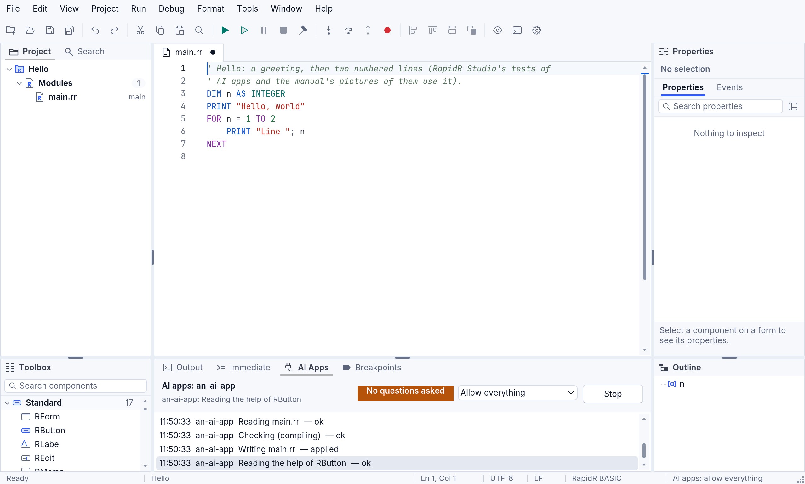
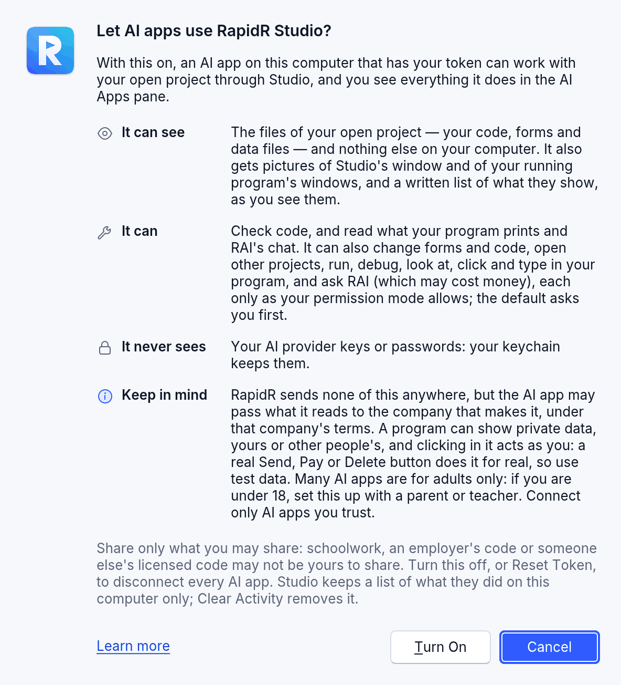
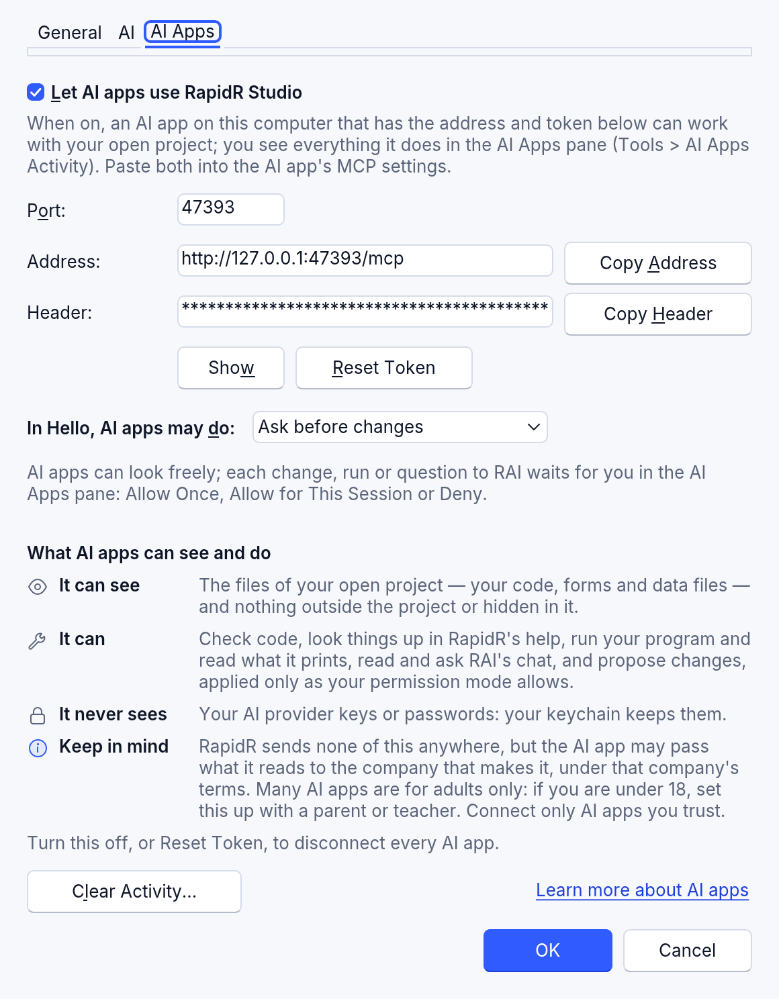
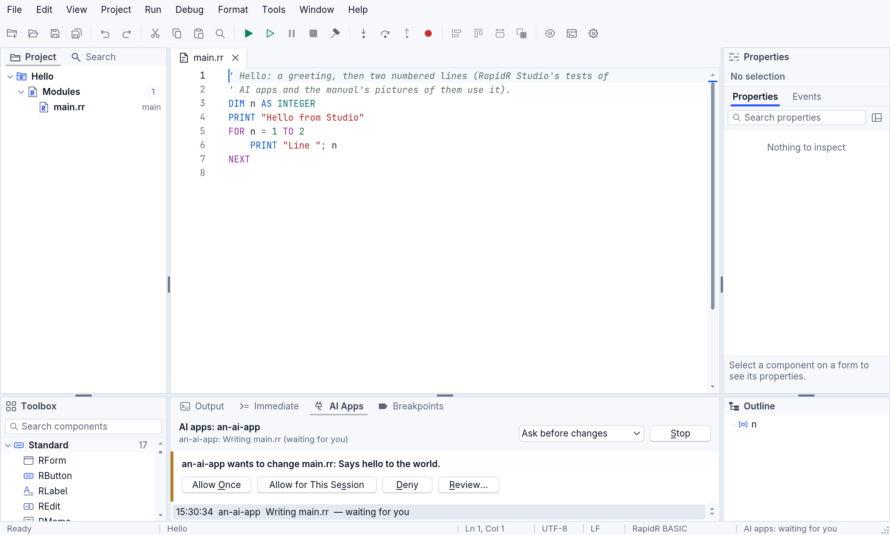

# Let AI apps work in Studio

RapidR Studio can let an AI app on your computer work with the project you
have open — read it, check it, change it, run it, debug it, ask RAI — while
you watch every step in the **AI Apps** pane. Studio is then an MCP server:
MCP is the protocol AI apps use to call tools. It's off until you turn it
on, it listens on your computer only (`127.0.0.1`), and every request must
carry a token only you have.

In a classroom, a teacher can keep AI apps (and RAI) off behind a password:
[For teachers: School Lock](for-teachers.md).

Model Context Protocol® and MCP™ are marks of LF Projects, LLC
(https://www.lfprojects.org/policies/). RapidR uses them only to say which
protocol it speaks. Claude Code is a product of Anthropic, PBC. RapidR is
independent of both and is not sponsored or endorsed by them.

This is RapidR Studio on the desktop. Studio in a browser can't listen for
AI apps (a web page can't open a port); a browser way to do the same is
planned.



## Turn it on

1. **Tools > AI Apps Settings…** (or **Tools > Settings**, the **AI Apps**
   tab).
2. Tick **Let AI apps use RapidR Studio**. The first time, Studio asks
   **Let AI apps use RapidR Studio?** and says, in four rows, what an AI app
   can see, what it can do, what it never sees and what to keep in mind
   (the same rows are on the Settings page); **Learn more** opens this
   page. **Turn On** turns it on; **Cancel**, the default (Enter and Esc
   both), leaves it off. When what AI apps can do grows — since they can
   look at and use your running program — Studio asks once more as it
   starts, even if you turned it on before (Cancel turns it off), and a
   project you had left in **Allow everything** is back in **Ask before
   changes**: choose it again if you want it.
3. Press **OK**. Studio listens at the **Address** shown —
   `http://127.0.0.1:47330/mcp` unless you change the **Port**.
4. Give your AI app the **Address** and the **Header**
   (`Authorization: Bearer …` with your token): **Copy Address** and
   **Copy Header** put them on the clipboard. **Show** shows the token;
   it's hidden otherwise.





The token is kept in your system's keychain (the macOS Keychain, Windows
Credential Manager, the Secret Service on Linux), never in a project or in
Studio's settings. **Reset Token** makes a new one at once: every AI app
that had the old one is out until you give it the new header. Turn the
switch off, or press **Stop** in the AI Apps pane, and every AI app is
disconnected.

## Set up your AI app

Any AI app that supports MCP can connect with the address and token from
Settings. As an example, here is how Claude Code (a product of Anthropic)
takes them:

```sh
claude mcp add --transport http rapidr-studio http://127.0.0.1:47330/mcp --header "Authorization: Bearer <token>"
```

Other AI apps ask for the same two things in their own settings; see their
documentation for the current steps. RapidR is independent: it is not made,
sponsored or endorsed by Anthropic, by LF Projects or by the MCP project.

The token you type into a command stays in your shell history and in the
AI app's own settings file. If you shared it by mistake, press **Reset
Token** in Settings.

Studio speaks the current revision of the protocol (2026-07-28, no
handshake: each request says its version) and the earlier ones that start
with `initialize` (2025-11-25, 2025-06-18, 2025-03-26), so older AI apps
connect too.

## What AI apps may do: the permission menu

One choice says what AI apps may do in the project open now. It's in the
AI Apps pane's header and in **Settings > AI Apps**, it's kept for each
project, and a project starts with **Ask before changes**.

| Choice | What AI apps may do |
|---|---|
| **Read only** | Look: read the project, check code, look things up in RapidR's help, see the program's output, the layout of its forms and a picture of Studio. A change, a run, or looking at or using your running program is refused, and the AI app is told why in plain words. |
| **Ask before changes** | Look freely at the project. Each change, run, look at your running program or question to RAI waits for you in the pane: **Allow Once**, **Allow for This Session** (that kind of call until Studio closes, the server stops or another project opens) or **Deny**; **Review…** shows a change as a diff first. |
| **Allow edits** | Changes to files are made at once — each is one **Edit > Undo** step, listed in the pane, in the activity log. Running the program, looking at or using it, and asking RAI still wait for you. |
| **Allow everything** | Nothing waits for you. Studio asks you to confirm when you choose it, shows a soft amber **No questions asked** chip, with a warning sign, in the pane's header and **AI apps: allow everything** in the status bar. Everything is still listed and logged, **Stop** ends it, Studio's own tools still never hand over keys or files outside the project — but a program they run can do anything you can on this computer. Choose it only while you watch an AI app you trust. |

In every mode a project outside your Projects folder, RapidR's examples and
your recent list is asked about before it opens, and nothing is ever
opened over unsaved changes.

A project an AI app creates or opens (`create_project`, `open_project`)
keeps the permission of the project that was open before — the pane and
the status bar say "New project: same permission as before (Allow edits)"
— unless it has a permission of its own. **Allow everything** is the one
exception: it is never passed on, so the new project starts with **Allow
edits**; choose Allow everything again for it in the pane if you want it.
With no project open before, it starts with **Ask before changes**.



## Watch it work: the AI Apps pane

**Tools > AI Apps Activity** shows it; it also appears, beside Output, the
first time an AI app works, and comes to the front when something waits for
you (the keyboard stays where you were). It shows:

- who is connected, and what the last call did ("an-ai-app: Reading main.rr");
- a line for every call: the time, the AI app, what it did, how it went
  (ok, applied, refused, denied by you);
- the call waiting for you, marked in amber at its left, with its buttons;
- the permission menu, and **Stop**.

Right-click the list for **Copy** (the line picked; Ctrl+C, ⌘C on a Mac,
too) and **Copy All**, as plain text — "time  AI app  what — how it went",
a line each —, and **Clear Activity…**.

The status bar's last panel says it too: "AI apps: on", "AI apps: waiting
for you", "AI apps: allow everything". A screen reader hears when an AI app
connects and, at once, when something waits for you.

Changes an AI app makes go into Studio's editors, unsaved, as yours would:
**Edit > Undo** takes each back, and **Run** saves them (as it always does).

## The tools

The tools are RapidR Studio's one tool set — the same RAI, Studio's own
assistant, uses (only the last group is AI apps' alone):

| Tool | What it does | Kind |
|---|---|---|
| `studio_status` | What Studio has open: the project and its files, the documents (unsaved ones marked), whether the program runs, its errors, RAI, the permission | look |
| `list_files`, `read_file` | The project's files, a file's text (the editor's, unsaved changes included) | look |
| `project_outline` | Files in include order, forms, SUBs and FUNCTIONs, globals | look |
| `rapidr_list`, `rapidr_get` | The forms' components and their properties, from the source | look |
| `rapidr_describe`, `search_manual`, `find_example` | RapidR's help: a component or builtin, the manual, working code — a recipe, or RapidR's examples found by their file name, the components they use or their words | look |
| `how_do_i` | The steps, with the exact tools, for a task: change code, fix an error, debug a crash, add a form, learn a component, start a new app, test the running app, versions | look |
| `check_code` | The compiler's errors and warnings, each with a hint in RapidR's form | look |
| `layout_report` | Each form's components with their places and sizes, and what looks wrong (cut off, on top of each other, a caption too long) | look |
| `button_grid` | A grid of buttons laid out (a keypad): the code to paste, nothing changed | look |
| `list_documents` | The documents open, the active one, unsaved changes | look |
| `read_output` | What the program printed since the last read | look |
| `list_versions`, `compare_versions` | The project's saved versions (Versions), and what changed between two of them or since one | look |
| `propose_edit`, `write_file`, `create_project` | A change to a file (only the parts that change), a new file, a new program — checked by the compiler first | change |
| `set_property` | A component's property set as the Properties pane sets it — a change like the others: under **Ask before changes** you see it as a diff | change |
| `save_version`, `restore_version`, `start_versions` | Save a Version (the open files saved first, Versions started if the project had none; the version is the AI app's, not yours), go back to a version (a new version: nothing is lost, Undo in Versions takes it back), start Versions in a project | change |
| `report_gap` | Writes one short line in the project's `RAPIDR-ISSUES.md`: a tool the AI app missed, a question the manual didn't answer. Nothing else is written | change (a note: allowed in every choice but Read only) |
| `run_program` | Saves, runs the program, waits a few seconds, gives back its output (or where it paused). Not while the code has errors: the AI app is told the first ones, and that Problems must be 0 | run |
| `debug` | Breakpoints, continue, step over / into / out, pause, the call stack and the variables | run |
| `app_layout`, `app_screenshot` | The running program's windows and controls in words (and what looks wrong), a picture of its windows with the same in words beside it | run (looking at or using the running program) |
| `app_click`, `app_type`, `app_key`, `app_drag`, `app_scroll` | Clicks, types, presses keys, drags and scrolls in the running program, with a pointer you see; a message box's buttons by their caption or short name (b0); a menu item by what it says (`menu`: `File > Open`, any menu, a pop-up menu's too) | run (looking at or using the running program) |
| `app_wait` | Lets the running program work on its own a moment, or until it is idle | look |
| `open_project` | Opens a project or a program (AI apps only) | change |
| `capture` | A picture (PNG) of Studio's window as you see it — Studio's own window only, and never while a dialog is open (Settings and Set Up RAI can show your token or a key): the AI app is told to ask again later (AI apps only) | look |
| `ask_rai` | Asks RAI as you would in its panel, and gives back its answer and steps. RAI only proposes for an AI app, even when you let it work on its own: its changes wait for your review, a run for your yes in its chat (AI apps only) | run (it may cost money: it uses your AI provider) |
| `get_rai_steps`, `get_rai_transcript`, `get_rai_audit` | RAI's work: its steps, its chat, its audit log (AI apps only) | look |

Older names keep working for AI apps that still call them: `get_problems` is
`check_code`, `recipe` is `find_example`. They aren't listed.

A call with a missing or wrong argument is answered at once with what the
tool needs ("Call read_file again: it needs `path` (a string)…"), so even a
small model can correct itself.

## What Studio tells your AI app

When an AI app connects, Studio hands it a short text (under about 1,200
tokens) with the way to work — the same for every AI app, small or large, and
the same rules RAI follows: twelve numbered one-line rules, each naming its
tool. Among them:

1. `studio_status` first. On an empty project it ends with *This project is
   empty: call find_example first*.
2. Learn with `rapidr_describe`, `find_example` and `search_manual` — never
   RapidR's own source code, never a member `rapidr_describe` didn't list.
3. To change code: `save_version`, `read_file`, `propose_edit` (only the lines
   that change), `check_code`, `run_program`, `app_screenshot` or
   `app_layout`, `save_version`. **The open project is the user's program**:
   `create_project` only makes a separate new project.
4. `check_code` after every change: **Problems must be 0** before running,
   measuring or reporting. An error that is another language's habit has a
   **hint** line under it with the RapidR form
   ([Coming from another language?](language.md#coming-from-another-language)).
   The same error twice in a row for a file: the refusal changes to *Same
   error again. Stop rewriting the whole file. Call find_example(…) and start
   from that recipe*, with the nearest recipe's first lines.
5. **Never git or a shell** for your project: the Versions tools.
6. Not sure what comes next: `how_do_i`. A tool or an answer is missing:
   `report_gap`, then go on.

AI apps that use them also get two ready-made instructions (MCP prompts) —
*Work on this project the RapidR way* and *Start a new RapidR app* — and
three guides to read (MCP resources): the core rules, every task's steps,
and this manual's page on designing forms.

…and a language card of about 25 lines: the rules small models break most
(`x = 1` and not `SET x = 1`, `<>` and not `!=`, `MOD` and not `%`, `FOR i =
1 TO 10 … NEXT`, `ELSEIF`, `END IF`, no braces). A path may be written as the
project's own (`main.rr`), with the project folder before it (`project/main.rr`,
`MyApp/main.rr`, `./main.rr`) or as the absolute path inside the project; one
outside it is refused with the list of the project's files. Argument names
are lower case (`path`); the capitalised ones older tool lists had are still
taken. A change is answered in one sentence: *Waiting for the user to apply
the change to main.rr* (Ask before changes) or *Changed main.rr in Studio's
editor (not on disk yet: Run saves it)* — never both.

### Building an AI app on these tools

Found by running small local models through the tools (the evaluation in
`tools/ai_eval`, `tests/ai-eval/README.md`):

- **Retry an empty reply.** Some model servers answer a request with neither
  text nor a tool call (a malformed call dropped by the server's own parser,
  or a context that ran out). It is not "done": send the request again
  (after at most two tries, say so to the person) before ending the turn.
  (RAI's own turn does not retry yet: a follow-up.)
- A list, an object, a number or a flag sent as JSON *text*
  (`"edits": "[{…}]"`) is taken as that value; tools without arguments are
  listed with `"properties": {}`, which strict servers need.
- Give the model the server's instructions as they are: they are what makes
  it look at an example before it writes.

## What AI apps can see

With this on, an AI app that has your token can, through Studio:

- list and read the files in your open project (your code, forms and data
  files), and nothing outside the project or hidden in it (a file or folder
  whose name starts with a dot) — whichever tool reads: a file, the
  outline, a check, the forms, a comparison of versions; a project file
  that lists `../elsewhere`, or a folder that is a link out of the project,
  doesn't change that;
- get pictures of Studio's window and of your running program's windows,
  and a written list of what they show, as you see them;
- look at and change forms and code, open other projects, and build, run and
  debug your program, as the permission menu allows — Studio asks you first
  under **Ask before changes**. A run an AI app starts is *sandboxed*: a DLL
  call (`DECLARE … LIB`), `SENDMESSAGE` and `SHELL` / `RUN` stop the
  program with an error that says so (the AI app is told why), unless you
  turned on **Tools > Settings > AI > Programs the AI runs may use DLLs and
  SHELL**; your own **Run** (F5) always has them;
- look at, click and type in your running program, each only as the
  permission menu allows (the default asks you first): see
  [A program's eyes and hands](app-eyes-and-hands.md#in-rapidr-studio-ai-apps-and-rai-look-at-your-running-program);
- read what your program prints and Studio's error messages;
- read RAI's chat, and ask RAI (which may cost money: it uses your AI
  provider).

It cannot see your AI provider keys or passwords (they stay in your
system's keychain), or files outside the project. RapidR sends none of this
anywhere. The AI app may pass what it reads to the company that makes it,
under that company's terms and privacy rules. A program can show private
data, yours or other people's, and clicking in it acts as you: a real
Send, Pay or Delete button does it for real, so use test data. Many AI apps are for adults
only; if you are under 18, set this up with a parent or teacher. Connect
only AI apps you trust, and share only what you are allowed to share
(schoolwork, an employer's code or someone else's licensed code may not be
yours to share).

## The activity log

Every call is written to the audit log RAI uses, on this computer only:
`~/Library/Application Support/RapidR/ai-audit.jsonl` on macOS,
`%APPDATA%\RapidR\ai-audit.jsonl` on Windows, `~/.config/rapidr/` on
Linux — never in your project. It keeps when, which AI app, which tool, the
project's file it touched (never the file's text, or a picture, the text an
AI app typed, or anything your program showed) and how it went; never a
key, the token or your code. **Clear Activity…** in Settings > AI Apps
removes the AI apps' lines (after asking).

## Your own programs can do this too

`RMcpServer` gives a program of yours its own tools for AI apps, with the
same protocol and the same protections: see
[Networking](network.md#rmcpserver-your-programs-tools-for-ai-apps) and
[examples/network/mcp_tools.rr](../../examples/network/mcp_tools.rr).

## Notes

- The pictures here are made by `node tools/manual/shots.mjs ai-apps`
  (Studio with the tests' AI app, `tests/http_client_probe.mjs`); the
  behaviour is checked by `node tests/studio_mcp.mjs`.
- RAI's permission choices (Settings > AI) and the four choices here are
  decided by the same rules: Read only is RAI's *Only read the project and
  answer*, Ask before changes its *Read the project, propose changes you
  review*, Allow everything its *Work on its own*. Showing RAI the same four
  words is planned.
