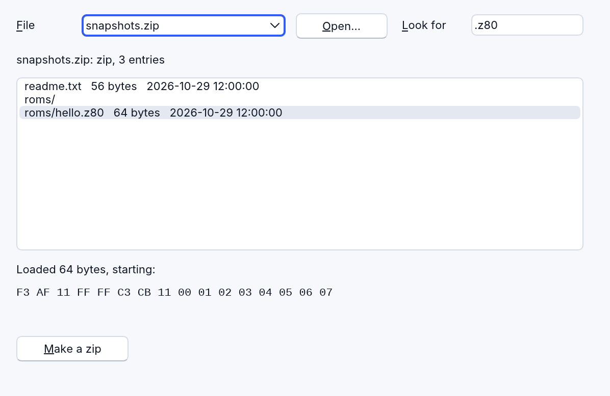
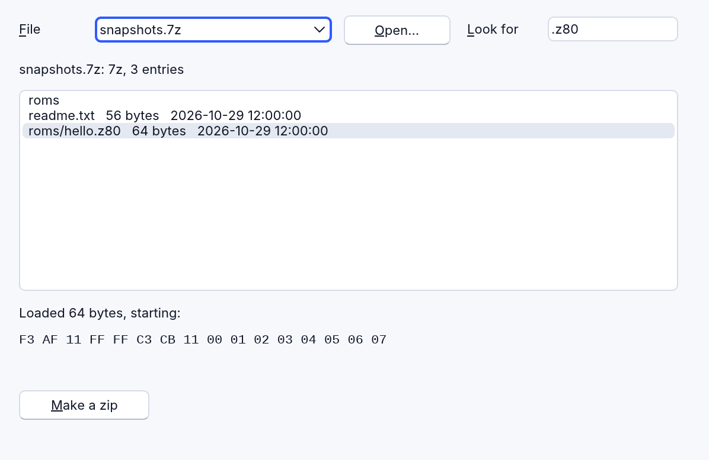

# Archives: zip, 7z, tar and gzip files

`RArchive` opens archives and compressed files, lists what they hold and
unpacks it, and makes zip, tar, tar.gz and .gz files. It works out the
format from a file's first bytes, never from its name, so a program can
take a game snapshot as it is, or the same snapshot inside a `.zip`, a
`.7z` or a `.gz`, as emulators do.



The example is [examples/data/archives.rr](../../examples/data/archives.rr):
from `examples/data`, `rapidr run archives.rr`. Pick a sample, or open your
own file, and click an entry to see its first bytes.

## What it reads and makes

| Format | Opens | Makes | Notes |
|---|---|---|---|
| zip (`.zip`) | yes | yes | Stored and Deflate entries, zip64, UTF-8 names and older code page 437 names |
| tar (`.tar`) | yes | yes | Long and UTF-8 names |
| tar.gz (`.tar.gz`, `.tgz`) | yes | yes | |
| gzip (`.gz`) | yes | yes | One file: an archive of one entry |
| 7z (`.7z`) | yes | no | LZMA, LZMA2, Deflate |
| xz and tar.xz | yes | no | |
| zstd and tar.zst | yes | no | |
| bzip2 | no | no | Recognised; `Error` says it can't be opened yet |
| RAR | no | no | Refused: "RAR files can't be opened: the format isn't open. Ask for a .zip or .7z." |

`Format` says what was opened: `"zip"`, `"7z"`, `"tar"`, `"tar.gz"`,
`"gzip"`, `"tar.xz"`, `"xz"`, `"tar.zst"` or `"zstd"`.

## Opening and unpacking

```basic
DIM Archive AS RArchive

IF Archive.Open("games.zip") THEN
    FOR i = 0 TO Archive.Count - 1
        PRINT Archive.Name(i); "  "; Archive.Size(i); " bytes"
    NEXT
    Snapshot$ = Archive.Extract("roms/game.z80")   ' its bytes
    PRINT LEN(Snapshot$); " bytes, the first one "; ASC(Snapshot$)
ELSE
    PRINT "Couldn't open it: "; Archive.Error
END IF
```

An archive can come from a file, a stream, a string of bytes (a download)
or the program itself:

```basic
$RESOURCE GAMES AS "games.zip"       ' built into the program
Archive.Open GAMES                   ' a $RESOURCE's handle
Archive.OpenStream Mem               ' all of a memory or file stream
Archive.OpenData Downloaded$         ' a string of bytes
```

An entry is named by its index (0 the first) or by its name, in any case
unless `CaseSensitive` is True. `Extract` gives an entry's bytes as a
string, one character a byte (`LEN` is its size, `ASC(MID$(...))` reads a
byte). `ExtractText` gives text (UTF-8 when it is). `ExtractToStream`,
`ExtractToFile` and `ExtractAll` write it out.

| Member | What it does |
|---|---|
| `Open(FileName)` | Opens an archive file, or a `$RESOURCE`. True when it opened. |
| `OpenStream(Stream)`, `OpenData(Data$)` | The same, from a stream's bytes or a string's. |
| `FormatOf(FileName)` | What a file is from its first bytes, without opening it: `"zip"`, `"7z"`, `"gzip"`, `"rar"` …, or `""` when it isn't an archive. |
| `Count`, `Format`, `FileName` | How many entries, which format, which file. |
| `Name(i)`, `Size(i)`, `CompressedSize(i)`, `DateTime(i)` | An entry's name (folders with `/`), sizes, and when it changed (`"2026-10-29 14:05:00"`, local time). |
| `IsFolder(i)`, `IsEncrypted(i)` | What it is. |
| `Find(Name)` | An entry's index, or -1. |
| `Extract(i)`, `ExtractText(i)` | Its bytes, or its text. |
| `ExtractToStream(i, Stream)`, `ExtractToFile(i, FileName)` | Writes it to a stream or a file. |
| `ExtractAll(Folder)` | Unpacks everything into a folder (made if needed). |
| `Close` | Writes an archive being made, and lets go of an open one. |
| `Error` | Why the last call failed, in plain words; `""` when it worked. |

## A snapshot, or an archive that holds one

This is the pattern an emulator needs: the file people give it may be the
snapshot itself or any archive with one inside.

```basic
DIM Archive AS RArchive
DIM File AS RFileStream

FUNCTION LoadSnapshot (FileName AS STRING) AS STRING
    DIM i AS INTEGER
    IF Archive.FormatOf(FileName) = "" THEN
        ' not an archive: the snapshot itself
        File.Open FileName, 0
        LoadSnapshot = File.ReadBinStr(File.Size)
        File.Close
    ELSEIF Archive.Open(FileName) THEN
        FOR i = 0 TO Archive.Count - 1
            IF LCASE$(RIGHT$(Archive.Name(i), 4)) = ".z80" THEN
                LoadSnapshot = Archive.Extract(i)
                EXIT FUNCTION
            END IF
        NEXT
    END IF
END FUNCTION
```



## Making archives

```basic
Archive.Level = 9                          ' 0 stores, 9 is the smallest
IF Archive.Create("notes.zip") THEN        ' .zip, .tar, .tar.gz or .gz
    Archive.AddText "notes/hello.txt", "Hello from RapidR!"
    Archive.AddFile "photo.jpg"             ' under its own name
    Archive.AddFile "save.dat", "saves/slot1.dat"
    Archive.AddFolder "levels"              ' a folder and all it holds
    IF Archive.Close = 0 THEN PRINT Archive.Error
END IF
```

`CreateStream(Stream, "zip")` makes the archive in a stream instead of a
file. `AddData(Name, Data$)` adds a string of bytes, `AddStream(Name,
Stream)` a stream's. A `.gz` holds one file. Names never start with `/`
or hold `..`: RapidR never makes an archive that another program would
unpack outside its folder.

## Packing data: COMPRESS$ and DECOMPRESS$

For data rather than files:

```basic
Packed$ = COMPRESS$(Text$)                  ' gzip, level 6
Packed$ = COMPRESS$(Text$, "zlib", 9)       ' "gzip", "zlib" or "deflate"
Text$ = DECOMPRESS$(Packed$)                ' gzip, zlib, xz, zstd found
Text$ = DECOMPRESS$(Raw$, "deflate")        ' raw Deflate must be named
Text$ = DECOMPRESS$(Packed$, "", 1000000)   ' at most 1,000,000 bytes
```

`DECOMPRESS$` unpacks at most 256 MB unless you give another limit. Data
that isn't packed, or is damaged, stops the program with an error saying
why. For data from outside that may be damaged, use `OpenData`, which
reports in `Error` instead.

## Safe with files from anywhere

An archive from a download or a stranger is untrusted. RArchive is built
for that:

- **Zip bombs.** A few kilobytes can claim gigabytes. RArchive counts the
  bytes it really unpacks, not the sizes the archive claims. It stops at
  `MaxSize` (1 GB, 256 MB in a browser: one entry, all of `ExtractAll`, a
  whole `.tar.gz` at `Open`), and at `MaxRatio` (1000: an entry past 1 MB
  that grows more than 1000 times). Both give an error, never a full
  memory. Raise them when you expect huge files; `MaxRatio = 0` turns the
  ratio check off.
- **Paths that leave the folder.** An entry called `../../evil.txt`,
  `/etc/passwd`, `C:\Windows\x.dll` or `CON` is listed but never written:
  `ExtractAll` checks every name first, so such an archive writes
  nothing.
- **Links.** Links and devices in an archive are never extracted, and
  `ExtractAll` never writes through a link already in the folder.
- **Half-written folders.** `ExtractAll` unpacks and checks everything
  before writing anything, so a bomb or a damaged entry leaves no half
  of the archive behind.
- **Passwords.** Encrypted entries are listed (`IsEncrypted`) and refused.
  RArchive doesn't open password-protected archives.
- **Damaged files** give an error, never a crash. The readers are tested
  against many thousands of damaged archives.

```basic
IF Archive.Open(Download$) = 0 THEN
    ShowMessage "That file can't be used: " + Archive.Error
ELSEIF Archive.ExtractAll("downloads") = 0 THEN
    ShowMessage Archive.Error     ' e.g. "../evil.txt" goes up a folder (..)
END IF
```

## In a browser

RArchive works the same in a browser: archives come from the page's files
(`Open`), from a stream or a download (`OpenData`), or are built in with
`$RESOURCE`. `ExtractAll` and `Create` write to the page's files.
`AddFolder` needs a folder on disk, so in a browser you add each file.

## Smaller programs

A native build carries RArchive's code only when the program uses
`RArchive`, `COMPRESS$` or `DECOMPRESS$`. Other programs don't grow.
