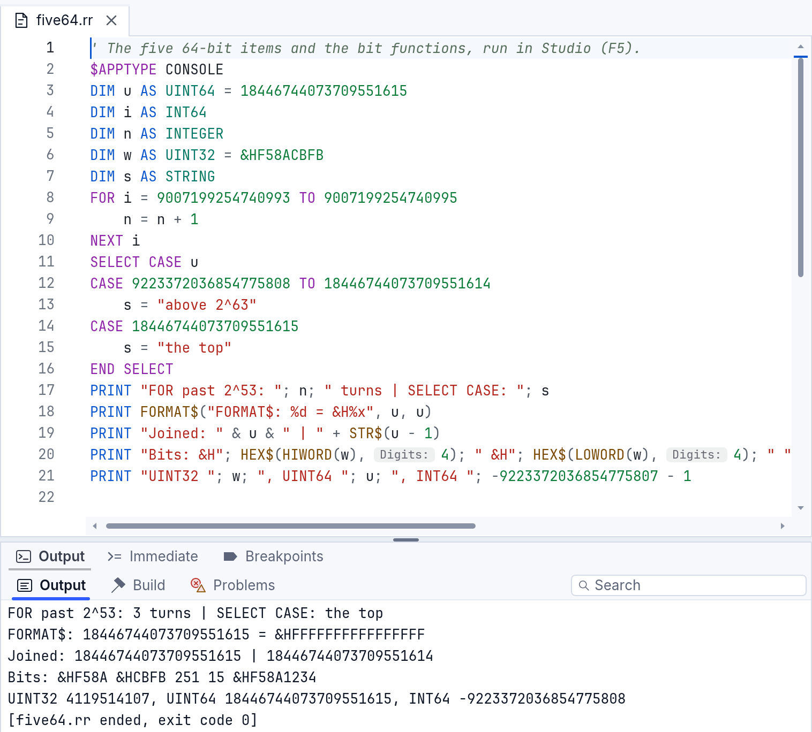
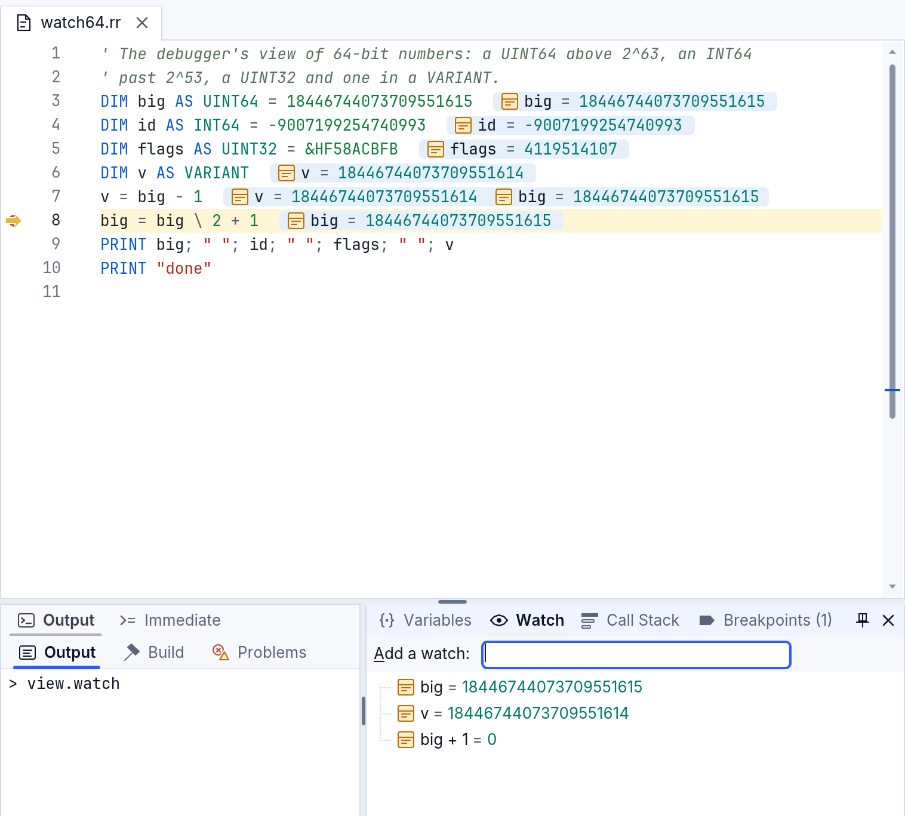

# Big numbers: INT64, UINT64, UINT32 and the bit functions

RapidR's whole numbers go beyond 32 bits: **INT64** (signed, 64 bits),
**UINT64** (unsigned, 64 bits) and **UINT32** (unsigned, 32 bits). A 64-bit
number keeps every digit wherever it goes: in a `VARIANT`, an array, a
`TYPE` field, a parameter, a component's property, a file, JSON, a database
parameter, the debugger. Nothing is cut to 32 bits or rounded through a
`DOUBLE`; where a number can't fit, you get an error that says so.

The example `examples/basics/bits_and_64bit.rr` shows everything on this
page in one program (`rapidr run bits_and_64bit.rr`).

## The types

| Type | Range | Notes |
|---|---|---|
| `INT64` | -9223372036854775808 … 9223372036854775807 | |
| `UINT64` | 0 … 18446744073709551615 | read unsigned everywhere |
| `UINT32` | 0 … 4294967295 | a store keeps the low 32 bits; worked out in 64 bits |
| `DWORD` | -2147483648 … 2147483647 | 32-bit *signed* (as RapidQ has it) |

```basic
DIM size AS INT64 = 5 * 3221225472        ' five 3 GB files
DIM hash AS UINT64 = &HCBF29CE484222325
DIM flags AS UINT32 = &HF58ACBFB
PRINT size; " "; hash; " "; flags         ' 16106127360 14695981039346656037 4119514107
```



## What works on them

- **Showing.** `PRINT`, `STR$`, joining with `&` or `+`, `FORMAT$("%d")`,
  a VARIANT, the debugger: every digit, a `UINT64` unsigned.
- **Arithmetic.** `+ - *` wrap at 64 bits (as a hash or checksum needs:
  `18446744073709551615 + 1` is 0 in a `UINT64`). A `UINT64` on either side
  makes a `UINT64`, else an `INT64`; a `DOUBLE` on either side makes a
  `DOUBLE`; `/` and `^` are always `DOUBLE`.
- **`\` and `MOD`** are exact, each side with its own sign.
- **Comparisons** are exact: a `UINT64` above 9223372036854775807 is above
  every `INT64`, `u > -1` is true, and `9007199254740993 > 9007199254740992.0`
  is true (a `DOUBLE` can't tell those two apart; RapidR compares exactly).
- **`AND OR XOR NOT SHL SHR`** work on all 64 bits (`SHR` is logical).
- **`FOR`** compares its counter exactly, and a 64-bit counter stops at its
  type's end: `FOR u = 10 TO 0 STEP -1` on a `UINT64` ends after 0, and a
  loop up to 18446744073709551615 ends there (the counter keeps its last
  value).
- **`SELECT CASE`** on one: exact `CASE` values, ranges and `CASE IS`.
- **`INPUT`** into one reads the typed number to its last digit.
- **Files and streams.** `PRINT #`, `WRITE #`, `INPUT #` and `LINE INPUT #`
  keep every digit; a stream's `WriteNum(n, Num_INT64)` / `ReadNum(Num_INT64)`
  (also `Num_UINT64`, `Num_UINT32`) write and read the 8 (or 4) bytes, and
  `Write v` / `Read v` of a 64-bit variable take 8 bytes. `FILELEN` and
  `LOF` of a file past 2 GB give its size in full.
- **JSON.** `RJson.Get` reads a whole number exactly (an `INT64`, or a
  `UINT64` above 9223372036854775807), `RJson.Set` writes one exactly, on
  the desktop and on the web (where JavaScript itself would round it).
- **Databases.** An `INT64` is an SQLite or MySQL integer; a `UINT64` goes
  to MySQL as `BIGINT UNSIGNED`. SQLite's integers are 64-bit signed, so a
  `UINT64` above 9223372036854775807 is refused with a message (pass it as
  text, `STR$(u)`, to keep it whole).
- **Memory.** `SIZEOF`, `VARPTR`, `MEMCPY` and a TYPE passed to a DLL give
  an `INT64` / `UINT64` field its 8 bytes, a `UINT32` its 4.

### Text in, text out

`STR$(u)` gives the digits; storing text into one reads it exactly
(`u = "18446744073709551615"`), and so does `u = VAL(s$)`. `HEX$` shows 8
digits, 16 when the number needs more than 32 bits (a negative `INT64`
needs all 64); `HEX$(x, digits)` gives at least that many (`HEX$(255, 16)`
is `00000000000000FF`) and never cuts a number. `BIN$` and `OCT$` show all
the bits without leading zeros.

### Literals

In a program that uses `INT64`, `UINT64` or `UINT32`, a whole-number literal
beyond 32 bits is an `INT64` (above 9223372036854775807 a `UINT64`):
`PRINT 3000000000` shows 3000000000. Beside a 64-bit or `UINT32` value an
`&H` literal is read as written, up to 16 digits: `i AND &HFFFFFFFF` keeps
the low 32 bits, and `IF flags = &HF58ACBFB` is true for a `UINT32`. A
program without these types reads numbers as RapidQ does (`PRINT
3000000000` shows -2147483648, `&HFFFFFFFF` is -1).

## The bit functions

Bit 0 is the rightmost. On a classic number (`INTEGER`, `LONG`, `DWORD`, a
`DOUBLE`) they work on its 32 bits; on an `INT64`, `UINT64` or `UINT32` on 64
(a `UINT32` stored back keeps its low 32).

| Function | Gives |
|---|---|
| `LOWORD(x)`, `HIWORD(x)` | bits 0–15, bits 16–31 (0 to 65535) |
| `LOBYTE(x)`, `HIBYTE(x)` | bits 0–7, bits 8–15 (0 to 255) |
| `GETBITS(x, start, count)` | `count` bits from bit `start`, as a number from 0 |
| `SETBITS(x, start, count, bits)` | `x` with those `count` bits replaced by the low bits of `bits` |

```basic
DIM w AS UINT32 = &HF58ACBFB
PRINT HEX$(HIWORD(w)); " "; HEX$(LOWORD(w))     ' 0000F58A 0000CBFB
PRINT GETBITS(w, 28, 4)                          ' 15
PRINT HEX$(SETBITS(w, 0, 16, &H1234))            ' F58A1234
```

A range outside the value's bits (`GETBITS(n, 30, 4)` on a `LONG`) stops the
program with a message naming the bits; nothing is silently cut.

## In the debugger

The Variables and Watch panes and the values beside the code show every
digit; a watch is worked out as the program would (`big + 1` of the largest
`UINT64` is 0). Set Value on one reads the number typed exactly and refuses
one that doesn't fit, naming the type's range.



## What stays as it was

- `INTEGER`, `LONG` and `DWORD` are 32-bit signed, as in RapidQ: storing
  4119514107 into a `DWORD` gives -2147483648, as RapidQ's own compiler
  does. Use `UINT32` for 0 … 4294967295.
- `CINT`, `CLNG`, `ROUND` of a `DOUBLE`, `CEIL`, `FLOOR` give 32-bit
  numbers (of a 64-bit value: the value itself). `SIN`, `SQR`, `LOG` and
  the other maths functions work in `DOUBLE`, as their results are.
- A `DOUBLE` stored into an `INT64` is truncated toward zero; out of range
  it gives -9223372036854775808 (a `UINT64`: 0). `ABS(-9223372036854775808)`
  is that number again, as `ABS` of RapidQ's smallest `LONG` is.
- `PRINT 1, 2` prints `12`: the comma in `PRINT` doesn't make columns,
  as in RapidQ.

## On every runtime

`rapidr run` (with the JIT on or off), native builds (`rapidr build`), the
web and the Windows 7 (32-bit) alpha give the same answers; the
conformance cases `big_numbers_*` in `tests/conformance/cases` check it.
On 32-bit Windows a `DECLARE`d DLL function gets an `INT64` / `UINT64`
argument as its 8 bytes and returns one whole.
The full list of places checked is in the developer notes
(`docs/big-numbers-audit.md`).
