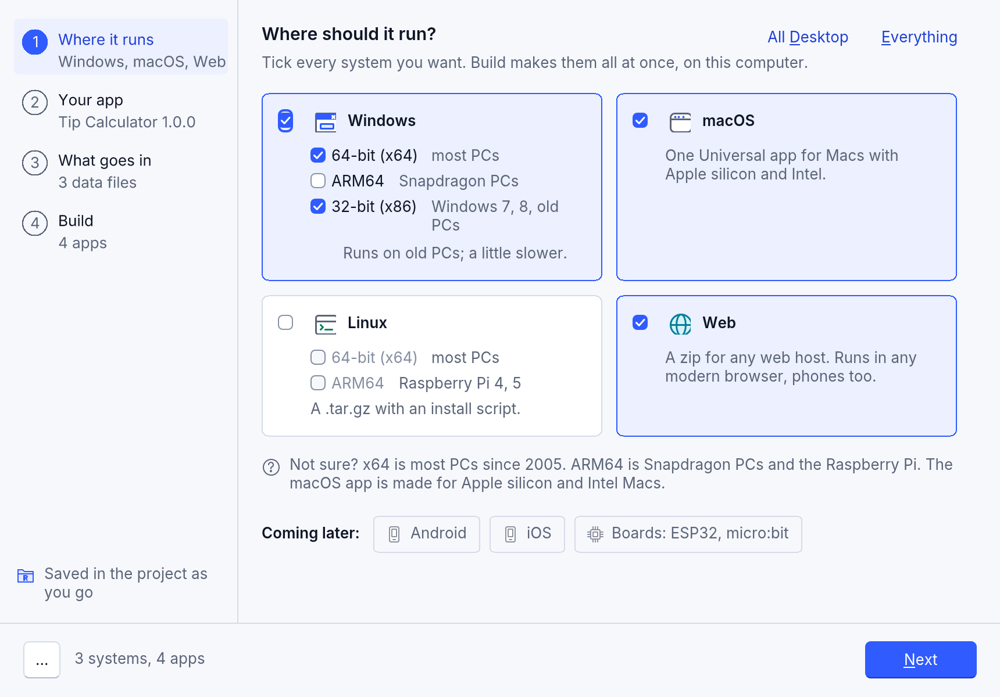
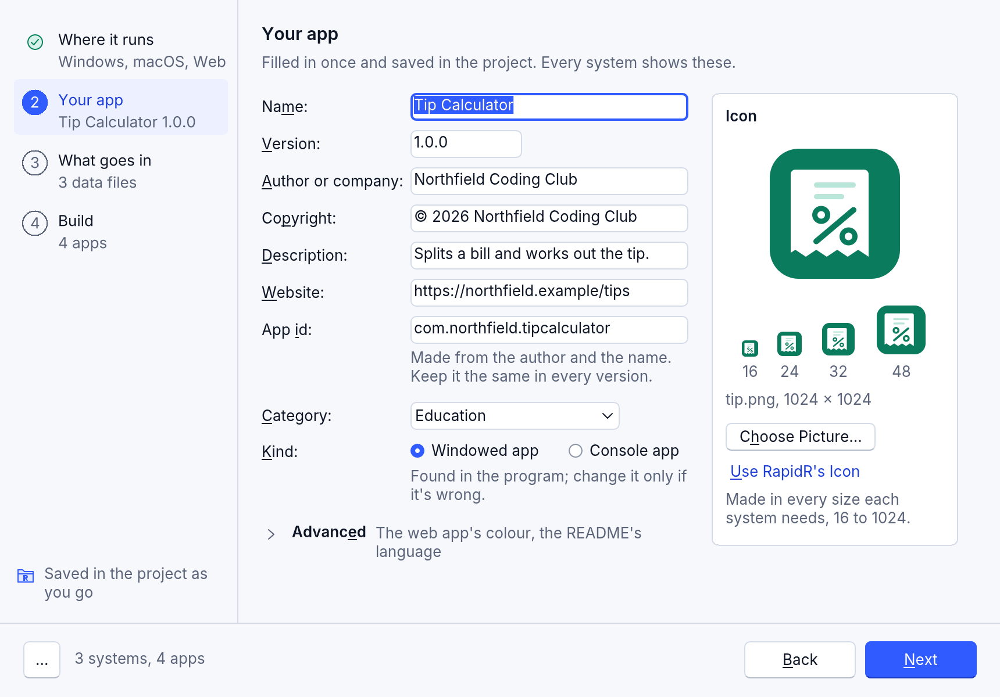
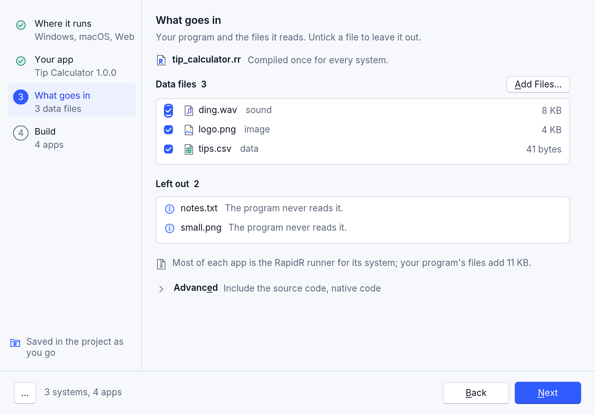
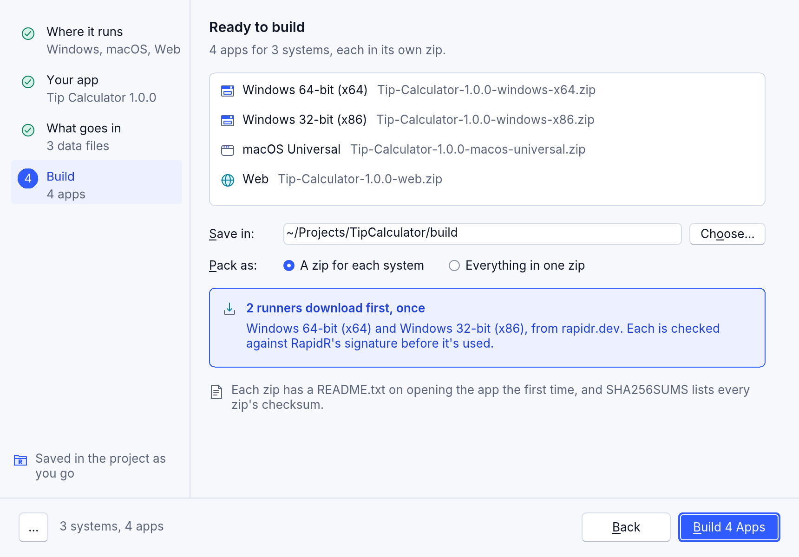
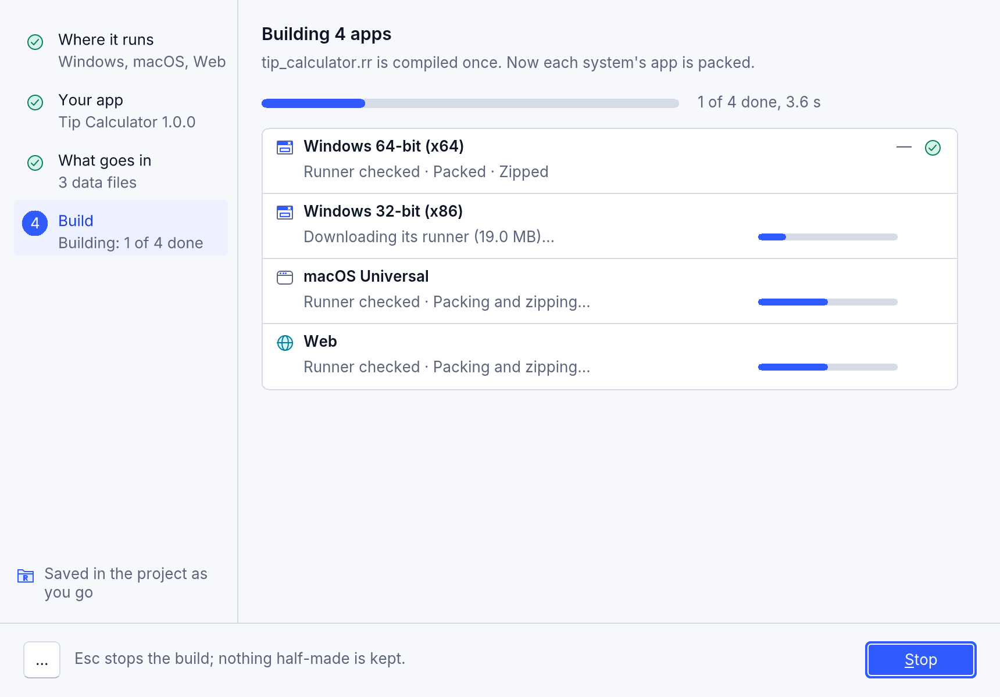
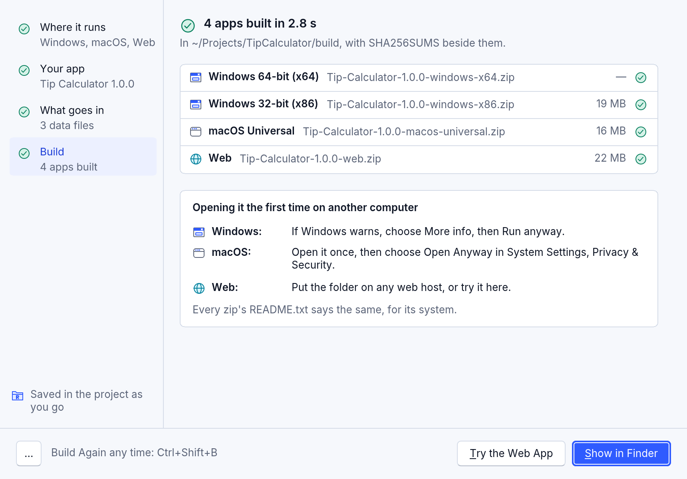

# Build your app for every system

Write your program once, and RapidR makes it into an app for Windows, macOS,
Linux and the web, all from the computer you are on. Each app is a zip (a
`.tar.gz` for Linux) that you can give to people: they unpack it and open
the app. You don't need the other computers, a compiler or anyone's SDK.

## In RapidR Studio: Run > Build

**Run > Build...** opens the Build dialog. It is the same in RapidR Studio on
the desktop and in the browser. Four steps sit on a list at the left; click
one (or press Ctrl+Tab) to go to it, and **Next** at the foot goes on.



1. **Where it runs.** Tick the systems you want: Windows (64-bit x64 for most
   PCs, ARM64 for Snapdragon PCs, 32-bit x86 for old PCs: it runs a little
   slower), macOS (one Universal app for Apple silicon and Intel Macs), Linux (x64, ARM64) and
   the web. **All Desktop** and **Everything** tick several at once. The
   first time, only this computer's system is ticked, so a first build works
   even with no internet. Android, iOS and boards are shown as coming later.
2. **Your app.** The name, version, author or company, copyright,
   description, website, app id (made from the author and the name: keep it
   the same in every version), category and kind (an app with windows, or a
   console tool), and the icon: one picture, made into every size each
   system needs, shown at 16 to 48 pixels. A field with a problem says so
   under it, and the step's name in the list says "Needs attention".
   **Advanced** holds the web app's colour and the README's language.
   **Project > Project Options** opens this same step: there is one form for
   your app's details.
3. **What goes in.** Your program, compiled once for every system; the data
   files it reads (untick one to leave it out; **Add Files...** adds more to
   the project) and what is left out, with the reason ("The program never
   reads it", "The program writes it"). **Advanced** has **Include the source
   code** and, in RapidR Studio on the desktop, **Native code**: this
   computer's app compiled with Rust (the other systems' apps always run the
   bytecode).
4. **Build.** One row per app with its zip's name; **Save in** (the
   project's `build` folder unless you choose another); **Pack as** a zip for
   each system or everything in one zip as well; and which runners download
   first, once, from rapidr.dev, each checked against RapidR's signature
   before it is used.







Every choice is saved in the project as you make it ("Saved in the project as
you go"), so there is no Cancel: the close X and Esc close the dialog and
nothing is lost.

**Build 4 Apps** (it counts them) builds. Each app gets its own row: its
runner checked, packed, zipped, with its own bar; a screen reader hears one
message per app as it is ready. Esc or **Stop** stops the build, and nothing
half-made is kept. A failed app says why in its row, with **Try Again**; the
others are fine.



When it is done, the dialog lists the zips and says how to open the app the
first time on each system (the same words are in every zip's `README.txt`).
**Show in Finder** (File Explorer on Windows, Files on Linux) shows them;
**Try the Web App** opens the web one in your browser.



- **Build Again** (Ctrl+Shift+B) builds the same choices again with no
  dialog: the status bar says how it goes and a note in the corner says how
  it ended (**Show**; **Open Build** when an app was not built).
- **More** (the three dots at the bottom left): **Copy Command Line** (the
  `rapidr build ... --targets ...` command that does the same, for a script
  or a terminal), **Save All in One Zip**, **Help**.
- The keys: Tab and Shift+Tab move through the step's controls, Ctrl+Tab and
  Ctrl+Shift+Tab between steps, Space ticks, Alt and the underlined letter
  presses a control, Enter the main button, Esc closes (or stops a build),
  F1 opens this page.
- Under 640 pixels wide (a small window, a phone) the steps become one page
  that scrolls, with the Build button pinned at the bottom.

**In RapidR Studio in the browser** the same dialog packs the apps in the
page: nothing leaves your computer, the runners come from the web Studio's
own address and are checked against RapidR's signature before they are used,
and the browser saves the zips.

## From the command line

```sh
rapidr build tips.rr --targets windows-x64,macos,linux-x64,web
rapidr build Tips.rrproj --all            # every system RapidR builds for
```

The output folder (the project's `build` folder, or the program's own
folder) then holds:

```text
Tip-Calculator-1.2.0-windows-x64.zip
Tip-Calculator-1.2.0-macos-universal.zip
Tip-Calculator-1.2.0-linux-x64.tar.gz
Tip-Calculator-1.2.0-web.zip
SHA256SUMS
```

`SHA256SUMS` lists each file's SHA-256, so people can check that what they
downloaded is what you built (`sha256sum -c SHA256SUMS` on Linux,
`shasum -a 256 -c SHA256SUMS` on a Mac). Building again for one system
updates its line and keeps the others.

The other systems' runners (the program each app starts from) come from your
install, from the ones downloaded before, or from a checked download:
[Where runners come from](building-apps.md#where-runners-come-from).

## The systems

| `--targets` | What it makes | Runs on |
|---|---|---|
| `windows-x64` | `Name.exe`, with its icon and version | 64-bit Windows 10 and 11, most PCs |
| `windows-arm64` | the same | Windows PCs with an ARM processor (Snapdragon and others) |
| `windows-x86` | the same, with the fast interpreter (no JIT) | 32-bit and 64-bit Windows 7, 8, 8.1, 10 and 11 |
| `macos` (`macos-universal`) | `Name.app`, one app for both kinds of Mac | Apple silicon (macOS 11 and later) and Intel Macs (macOS 10.13 and later) |
| `linux-x64` | `Name/`: the app, its menu entry and icons, `install.sh` | 64-bit Linux on PCs |
| `linux-arm64` | the same | 64-bit Linux on ARM, Raspberry Pi 4 and 5 too |
| `web` | the page, the runtime and your program | any static web host, every modern browser |

`--all` builds the first seven. `macos-arm64` and `macos-x64` make a smaller
Mac app for one kind of Mac only.

`--targets` makes interpreted apps: each system's runner, the program that
runs RapidR's bytecode (with the JIT on 64-bit systems), and your program.
That is why one computer can build for all of them.

## What each zip holds

- **Windows:** `Name.exe`, your program's data files beside it,
  `THIRD-PARTY-NOTICES.txt` and `README.txt`.
- **macOS:** `Name.app` (your data files and the notices are inside it) and
  `README.txt`.
- **Linux:** one folder, `Name-1.0.0-linux-x64/`, with `AppRun` (run it to
  start the app), `install.sh` (puts the app in the applications menu, for
  you alone, no root needed; `./install.sh --uninstall` takes it out
  again), the app, its desktop entry, its icons from 16 to 512 pixels, the
  notices and `README.txt`. The `.tar.gz` keeps the "executable" mark, which
  a zip would lose.
- **The web:** the page and everything it needs, plus `manifest.webmanifest`
  and `icons/`, so browsers that install web apps can install it.

`README.txt` tells the person who gets the app how to open it the first time
on their system. It is in English, or in Spanish with `--language es` (or
`language = "es"` in the project).

## Your app's details

Every system shows the same details, from the project (`.rrproj`, `[build]`)
or the command line:

| Option | Project setting | What it is | Default |
|---|---|---|---|
| `--name` | `app_name` | The name in the title, the Dock, the Start menu | the project's name |
| `--app-version` | `version` | Up to four numbers: `1.2.0` | `1.0.0` |
| `--company` | `company` | Who makes it | none |
| `--copyright` | `copyright` | The copyright line | `© <company>` |
| `--description` | `description` | One line about the app (Windows' description, the Linux menu's comment, the web page's) | none |
| `--website` | `website` | Its web site, `https://…` (in the README) | none |
| `--icon` | `icon` | One picture: a PNG of 1024 × 1024 or an SVG; every size is made from it | RapidR's |
| `--bundle-id` | `bundle_id` | The app's id, `com.example.tips` | `dev.rapidr.app.<name>` |
| `--category` | `category` | utilities, productivity, education, games, developer-tools, graphics, music, video, business, finance or science | utilities |
| `--kind` | `kind` | `window` (an app with windows) or `console` | what the program is |
| `--theme-color` | `theme_color` | The web app's colour, `#RRGGBB` | the page's |
| `--include-source` | | Your program's source in the zips, under `source/` | not included |

```toml
[build]
app_name = "Tip Calculator"
version = "1.2.0"
company = "Example Ltd"
description = "Splits the bill"
website = "https://example.com/tips"
icon = "art/tips.svg"
category = "finance"
```

RapidR warns when the icon is small (under 512 pixels: large sizes look
blurry) or not square (it is centred on a transparent square).

AI assistants (RAI, and the AI apps connected to RapidR Studio) have the
`build_app` tool: "build it for Windows and the web" saves the details it is
given in the project, ticks those systems in the Build dialog's choices, and
builds them as Build Again does: the same zips.

## Safe by design

- Only the data files your program names go in, never a file it writes
  (your own copy may hold your data), and never your source unless you ask
  with `--include-source`. Files the project leaves out (`leave_out` in
  `[build]`: the Build dialog's step 3) stay out; data files added to the
  project (**Add Files...**, `kind = "data"`) go in.
- A data file's path can't leave the app's folder (`..`, absolute paths,
  drives), and links are never followed.
- A runner for the wrong system is refused, so a mixed-up file can't make a
  broken app.
- With `SOURCE_DATE_EPOCH` set (the files' time, in seconds since 1970),
  the same program and details make the same zip, byte for byte; without
  it, the files carry the time of the build.

## Opening it the first time

Apps you build are not signed with a certificate, so each system asks once:

- **Windows:** "Windows protected your PC". Click **More info**, then
  **Run anyway**.
- **macOS:** the app is signed ad hoc, which Apple silicon needs, but not
  with an Apple Developer ID. RapidR makes that signature itself, on
  whichever system builds the app: Windows, Linux or a Mac. macOS says
  “Name” Not Opened (*Apple could not verify “Name” is free of malware…*).
  Click **Done**, then in **System Settings > Privacy & Security** click
  **Open Anyway** and confirm with your password or Touch ID.
- **Linux:** nothing to confirm. If the files lost their "executable" mark,
  `chmod +x AppRun install.sh`.

The README in each zip says this in plain words. Signing apps with your own
certificate, so that nothing is asked, is up to you (`signtool` on Windows;
`codesign` with your Developer ID and notarization on a Mac).
