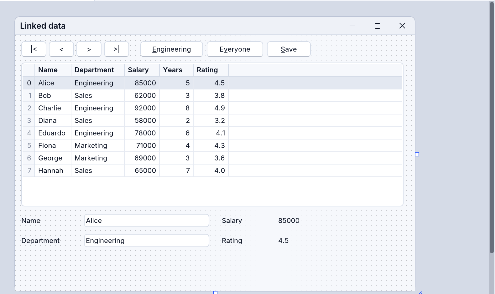
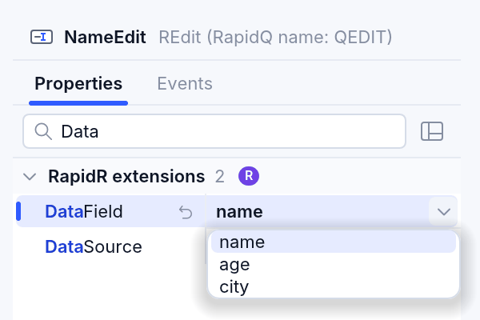
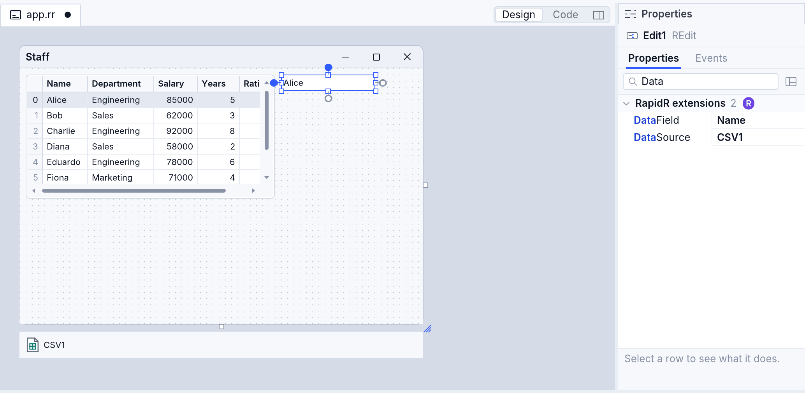
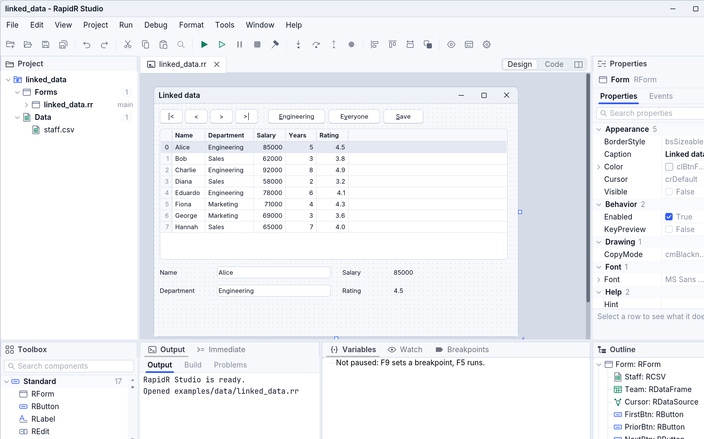
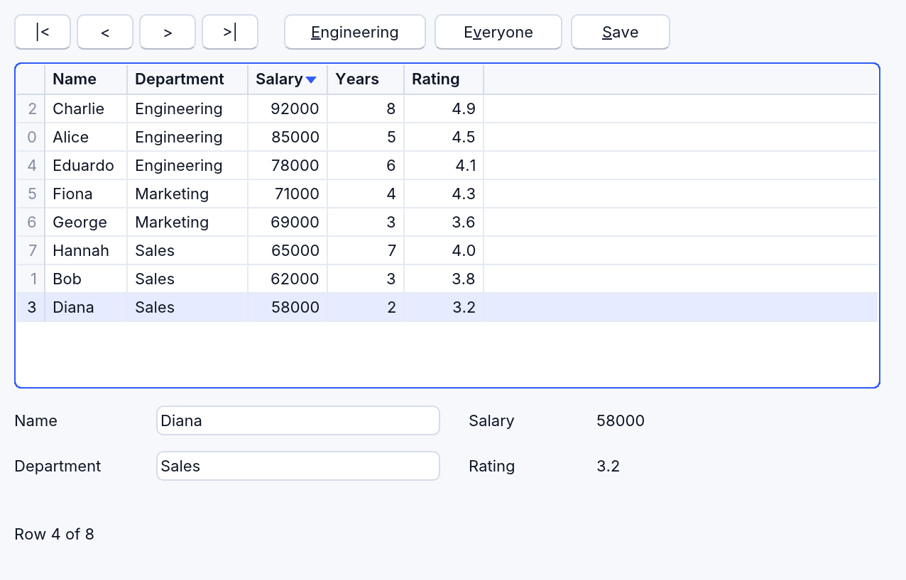
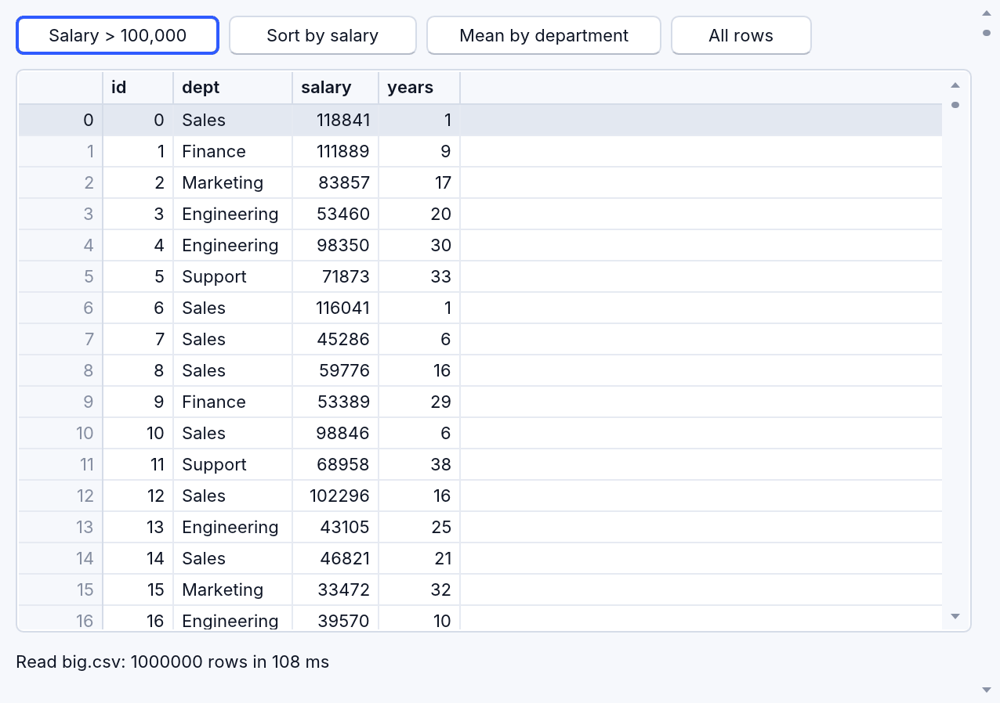
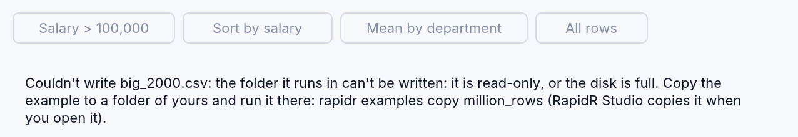
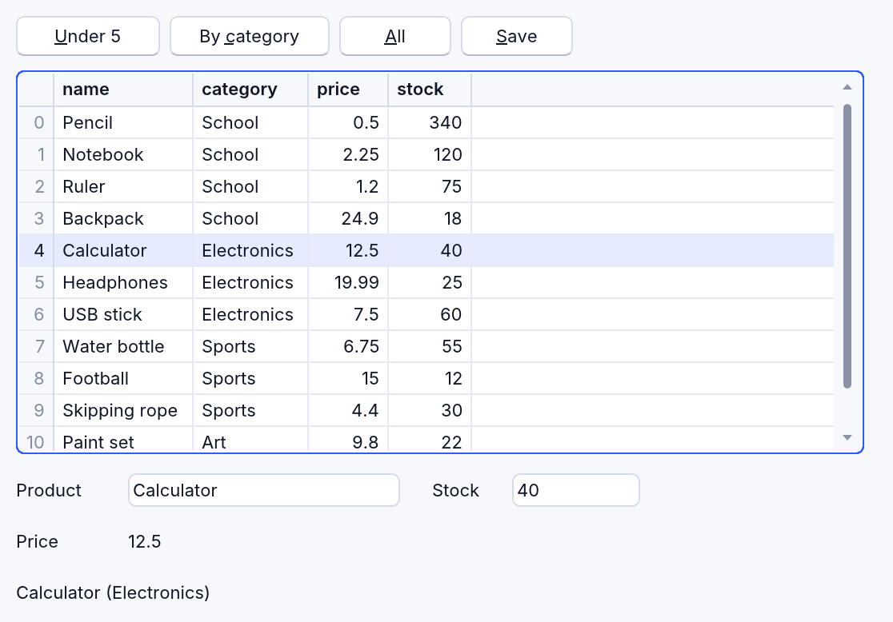

# Data science with RapidR

This chapter is a step-by-step start: a table from a file on a form, live
in the designer, without writing code — then the code that filters,
sorts and groups it, a million rows, and JSON. Everything here works the
same in a native app, an interpreted one and a web browser.

The components (all RapidR's own):

| Component | What it is |
|---|---|
| `RCSV` | a CSV file as a data source: set `FileName` and its table is ready |
| `RJson` | a JSON document — its records are a data source too |
| `RDataFrame` | a table you can filter, sort, group, join and summarise (see [Data science](data-science.md)); its `Source` takes the rows of an `RCSV`, an `RJson` or another frame |
| `RDataSource` | the current row of a data set, shared by the controls bound to it |
| `RDBGrid` | a grid that shows a data set straight from its table, a million rows as easily as ten |
| `REdit`, `RLabel` | with `DataSource` and `DataField`, they show (and an edit changes) a column of the current row |

They are *linked components*, as in Delphi and Xojo: you connect them with
properties, in the designer or in code, and they keep each other up to
date.

## 1. A table on a form, in the designer

Open [`examples/data/linked_data.rr`](../../examples/data/linked_data.rr)
in RapidR Studio (the Welcome page lists it as **linked_data.rr**, "CSV,
grid and edits, linked"). The designer shows the form **with the data
already in it**: the grid lists the rows of `staff.csv`, and the edits and
labels show the first row's values. Nothing has run yet — the designer
reads the file itself.



To build it yourself, in a new form:

1. From the toolbox's **Data** group, drop an **RCSV** on the form. It is
   not visible when the program runs, so it goes to the tray under the
   form. In the inspector set its **FileName** to a CSV file in your
   project, e.g. `staff.csv`.
2. Drop an **RDBGrid** on the form and set its **DataSource** to the RCSV
   (the inspector offers the components that fit). The rows appear.
3. Drop an **REdit**; set its **DataSource** to the RCSV too, and its
   **DataField** to a column's name, e.g. `Name` — DataField's list (its
   arrow, or F4) offers the file's columns. The edit shows the first row's
   name.

   



The code the designer writes is plain BASIC:

```basic
CREATE Form AS RForm
    CREATE Staff AS RCSV
        FileName = "staff.csv"
    END CREATE
    CREATE Grid AS RDBGrid
        Left = 10: Top = 44: Width = 610: Height = 230
        DataSource = Staff
    END CREATE
    CREATE NameEdit AS REdit
        Left = 110: Top = 286: Width = 200
        DataSource = Staff: DataField = "Name"
    END CREATE
END CREATE
Form.ShowModal
```

At design time the designer reads only files inside your project (next to
the program), never writes, and shows up to a million rows. RapidR Studio
on the web does the same, with the project's files in the page:



## 2. Run it: the current row

Press **F5**. Click a row of the grid: the edit shows that row's name. The
grid and the edit share the RCSV's **current row**. Type a new name in the
edit and the grid shows it at once — the table changed. Click a column's
**heading** to sort the grid by it (an arrow shows the order); click again
for the other way, a third time for the file's own order. Sorting the grid
only changes what the grid shows; the table itself stays in its order (the
numbers on the left are each row's number in the table).



The keyboard works too: the arrows, Page Up, Page Down, Home and End move
the current row; the mouse wheel and the scroll bar scroll.

## 3. A data source in the middle

`linked_data.rr` puts two more components between the file and the
controls:

```basic
CREATE Team AS RDataFrame
    Source = Staff            ' the frame takes the file's rows
END CREATE
CREATE Cursor AS RDataSource
    DataSet = Team            ' the current row of the frame
    OnDataChange = RowChanged
END CREATE
```

and binds the grid, the edits and the labels to `Cursor`. Why?

- **An RDataFrame** can be changed: `Team.Filter "Department", "=",
  "Engineering"` keeps three rows — the grid and the edits follow at once.
  `Team.Refresh` takes the file's rows again. (`Staff` itself is
  untouched: the frame has its own copy, which costs nothing until it
  changes.)
- **An RDataSource** moves through the rows with `First`, `Prior`, `Next`
  and `Last`, says where it is (`Row`, from 0, and `RecordCount`), reads
  the current row (`Field("Name")`) and changes it (`SetField "Name",
  "Ann"`), and tells you when anything changed (`OnDataChange`). Its
  `EOF` is True after `Next` couldn't go further, so this walks every row:

```basic
Cursor.First
WHILE NOT Cursor.EOF
    PRINT Cursor.Field("Name"), Cursor.Field("Salary")
    Cursor.Next
WEND
```

Everything bound to `Cursor` follows it; another RDataSource on the same
frame would have a current row of its own.

## 4. Filter, sort and group

The buttons of `linked_data.rr` are one line each:

```basic
SUB ShowEngineering
    Team.Filter "Department", "=", "Engineering"
END SUB

SUB ShowEveryone
    Team.Refresh
END SUB

SUB SaveTable
    Team.SaveToCSV "staff_edited.csv"
    IF Team.Error <> "" THEN
        Status.Caption = "Couldn't save " + Team.Error
    ELSE
        Status.Caption = "Saved " + STR$(Team.RowCount) + " rows to staff_edited.csv"
    END IF
END SUB
```

A save can fail — the folder may be read-only (an app's own folder, RapidR's
examples where it's installed) — so check `Error` afterwards and tell the
user: it says why in plain words (`staff_edited.csv: this folder can't be
written (it is read-only, or not yours)`), and is `""` when the file was
written. `LoadFromCSV`, `LoadFromJSON` and `SaveToJSON` set it too.

Everything RDataFrame can do works on a linked frame — `Sort`, `GroupBy`,
`Select`, `Describe`, `Merge` … ([Data science](data-science.md#rdataframe));
the controls bound to it show the result.

## 5. A million rows

[`examples/data/million_rows.rr`](../../examples/data/million_rows.rr)
writes a file of a million made-up staff records once, then reads it with
an RCSV into an RDataFrame shown by an RDBGrid. Scroll it: the grid draws
only the rows on the screen, so it is as quick with a million rows as with
ten. The buttons filter, sort and group the whole million and say how long
each took.



On this manual's Mac (an Apple M4 Max) the program reads the 25 MB file in
about 15 ms, keeps the rows with a salary over 100,000 (219,912 of them) in
2 ms, sorts the million in 11 ms and groups them by department in 5 ms —
RDataFrame works by columns and shares big jobs out to every core. Writing
the file the first time takes longer (about 3 seconds: that is BASIC
writing a million lines one by one). A browser runs it on one core: in
Chrome on the same Mac reading takes 0.15 s, the filter 10 ms, the sort
60 ms and the grouping 33 ms — still a fraction of a second.

Run where its folder can't be written (RapidR's examples where it's
installed — RapidR Studio opens your copy instead), it can't write
`big.csv`: the window says so and why, with the buttons off, rather than an
empty grid. It checks the way any program can: `FILEEXISTS` and `FILELEN`
after the file is closed.



## 6. JSON records

An `RJson` holding an array of records (`[{"name": "Pencil", "price":
0.5}, …]`), JSON Lines, or columns (`{"name": [...], "price": [...]}`) is
a data source too:

```basic
CREATE Products AS RJson
    FileName = "products.json"
END CREATE
CREATE Stock AS RDataFrame
    Source = Products
END CREATE
CREATE Grid AS RDBGrid
    DataSource = Stock        ' a frame straight: its own current row
END CREATE
```

[`examples/data/json_source.rr`](../../examples/data/json_source.rr)
shows the products in a grid, edits for the current one, a filter, totals
by category, and saves the table back as JSON (`Stock.SaveToJSON`).



When the program changes the document (`Products.Parse`, `LoadFile` …),
the frame takes the records again.

## Good to know

- **Where files are found**: a `FileName` without a folder is looked for in
  the current folder, then next to the program. In a browser, it is one of
  the page's files (the project's, or one the program saved).
- **Errors** don't stop the program: an RCSV whose file isn't there has no
  rows, its `Error` says why (`there is no file "people.csv"`) and its
  `OnError(Message)` fires; an RJson's `Error` says why its records
  couldn't be read, an RDataFrame's why its last load or save failed. Show
  them in the window — an empty grid alone says nothing:

  ```basic
  IF Staff.Error <> "" THEN Status.Caption = "Couldn't read the staff: " + Staff.Error
  ```

- **What the user types** into an edit bound to a number column must be a
  number: `"4x"` isn't taken (the table keeps its value, the edit keeps
  the text until it's fixed or the row changes), and the edit's
  `DataError` says why — `stock is a whole number: "4x" isn't one` — for
  its `OnChange` to show.
- **Delimiters and headers**: `Delimiter = ";"` (or `"tab"`, `"|"` …);
  `HasHeader = False` when the first line is data (the columns are then
  `column_1`, `column_2` …).
- **Numbers and text**: a cell reads as the text it was written as
  (`"30.50"` stays `"30.50"`); a column's type is what its cells are, so
  numbers sort and compare as numbers. A missing value (an empty field,
  `NA`, JSON's `null`) shows dimmed as `null` in a grid.
- **Every member** of these components, with what it does, is in the
  reference: [components](reference/components.md),
  [members](reference/members.md).

Coming next (docs/data-science-plan.md): Excel, Parquet and database
sources as components, editing in the grid, a navigator bar, charts bound
to columns, conditions written as BASIC expressions, joins and pivots, and
SQL over frames.
