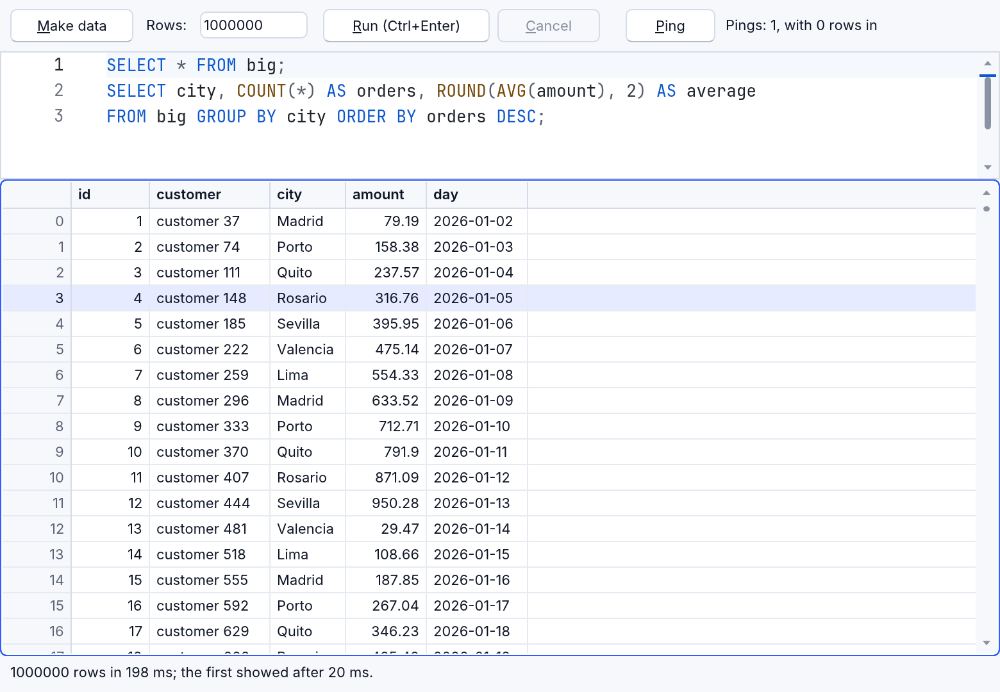
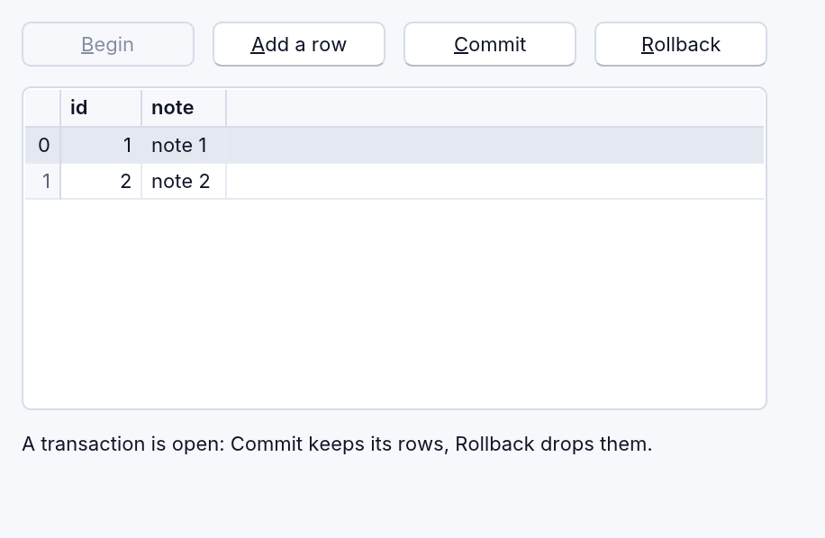

# Databases

| Component | Database | Where |
|---|---|---|
| `RSQLite` (RapidR's) | SQLite itself (rusqlite; compiled to WebAssembly in the browser) | everywhere |
| `RMySQL` (older name: `QMYSQL`) | a MySQL or MariaDB server | desktop (browsers can't open raw TCP connections) |

Both share one model for results, parameters and events: what works with
one works with the other — background queries and an `RDBGrid` of a
query's rows too.

## SQLite

```basic
DIM db AS RSQLite
db.OnError = DbError
db.Connect "app.db"                      ' a file; ":memory:" for none
db.Query "CREATE TABLE IF NOT EXISTS people (name TEXT, age INTEGER)"
db.Query "INSERT INTO people VALUES (?, ?), (?, ?)", "Ann", 34, "Bob", 25

db.AddParam 30
db.Query "SELECT name, age FROM people WHERE age > ? ORDER BY name"
PRINT "rows "; db.RowCount; " cols "; db.ColCount
WHILE db.FetchRow
    PRINT db.Row(0); " is "; db.Row(1)
WEND
PRINT db.QueryScalar("SELECT COUNT(*) FROM people")
db.Close

SUB DbError (Message AS STRING)
    PRINT "error: "; Message
END SUB
```

```
rows 1 cols 2
Ann is 34
2
```

- `Query sql [, values…]` runs every statement in `sql`, in order. A
  statement with result columns (`SELECT`, `PRAGMA`, `WITH … SELECT`,
  `INSERT … RETURNING`) gives the component its rows: `RowCount`,
  `ColCount` / `FieldCount`, `FetchRow` (1 while there is a row), `Row(i)`
  (column i of the current row, from 0, as text; NULL is ""), `RowSeek`,
  `FieldSeek`, `FetchField`.
- `QueryScalar(sql)` returns the first column of the first row.
- `ColName(i)` and `ColType(i)` name the last query's column `i` (from 0)
  and give its declared type (see [Column names and types](#column-names-and-types)).
- `Schema` gives the database's tables, views and columns as JSON, for an
  SQL editor's completion (see [The SQL editor](#the-sql-editor)).
- `EscapeString(s)` doubles single quotes — but prefer parameters.
- Events: `OnConnect`, `OnQueryDone`, `OnDisconnect`, `OnError (Message)`;
  a background query's `OnRows (Count)` and `OnDone (Rows, Ms)`.
- In a browser, `Connect "app.db"` opens the project's `app.db` (built into
  the page) in memory for the session; changes aren't kept after the page
  closes.

## Parameters: no SQL injection

Values after the SQL, and values queued with `AddParam`, are bound to its
`?` placeholders in order (`ClearParams` empties the queue; an array
argument is spread out). A bound value is data, never SQL, so text from a
user can't change the statement. The number of values must match the
placeholders, or the query is an error and doesn't run.

## MySQL

`RMySQL` (older name `QMYSQL`), with its members:

```basic
DIM my AS RMySQL
IF my.Connect("localhost", "user", "password") THEN
    my.SelectDB "shop"
    my.Query "SELECT id, name FROM items WHERE price < ?", 10
    WHILE my.FetchRow
        PRINT my.Row(0); " "; my.Row(1)
    WEND
    my.Close
END IF
```

`Connect(host, user, password [, database])` (or the `Host`, `User`,
`Password`, `DB` and `Port` properties; port 3306 by default), `Connected`,
`SelectDB`, `DB(i)` / `DBCount` (the server's databases), `EscapeString`,
and the same results, parameters and events as SQLite.

Keep the password in the keychain with [RSecrets](secrets.md), not in the
program: `my.Connect("db.example.com", "shop", Secrets.Read("MySQL", "shop"))`.

### Encrypted connections

RapidR encrypts a MySQL or MariaDB connection with the operating system's
TLS (Security.framework on macOS, SChannel on Windows, OpenSSL 3 on
Linux). `SSLMode` says how, with the same modes as MySQL's own client.
Set it before `Connect`:

| SSLMode | The connection |
|---|---|
| `Preferred` (the default) | Encrypted when the server can, else plain. The server's certificate isn't checked. |
| `Disabled` | Never encrypted. |
| `Required` | Encrypted, or no connection. The certificate isn't checked. |
| `VerifyCA` | Encrypted, and the server's certificate is signed by `SSLCA`, or by an authority the system trusts. |
| `VerifyFull` | As `VerifyCA`, and the certificate names `Host`. |

**Only `VerifyCA` and `VerifyFull` check that it is your server.**
`Preferred` and `Required` encrypt, but don't check who answers: on a
network you don't trust (a café's Wi-Fi), someone in between can pose as
the server and read the password and the data. For a server on another
computer, use `VerifyFull`.

```basic
DIM my AS RMySQL
my.SSLMode = "VerifyFull"
IF my.Connect("db.example.com", "shop", Secrets.Read("MySQL", "shop")) THEN
    PRINT "Encrypted: "; my.Encrypted
ELSE
    PRINT "Not connected."     ' OnError says why
END IF
```

- `Encrypted` is 1 while the connection is encrypted, and 0 when it is plain
  or there is none.
- `SSLCA` is a certificate authority's file, `.pem` or `.der` (such as
  the server's `ca.pem`), for `VerifyCA` and `VerifyFull`. When it is empty,
  the system's trusted authorities are used.
- A server without TLS, under `Required` or stricter, gives `OnError` "the
  server doesn't offer encrypted connections (TLS), and SSLMode asks for
  one".
- A refused certificate gives "the server's certificate wasn't accepted".
  A server's own self-made certificate is one the system doesn't trust:
  give its `ca.pem` as `SSLCA`.
- macOS refuses any server certificate valid for more than 825 days, even
  with the right `SSLCA`. The certificates MySQL makes for itself are valid
  for ten years, so on a Mac `VerifyCA` and `VerifyFull` need a server
  certificate of your own; `Required` still encrypts.
- A Unix socket or a named pipe (`RealConnect`'s `UnixSock`) never carries
  TLS. `Preferred` connects plain through it; `Required` and stricter refuse
  it.
- A server on this same computer (`127.0.0.1`, `localhost`): `Preferred`
  may go through the server's own local socket, which never leaves the
  computer, and `Encrypted` then says 0. `Required` and stricter always
  use TLS.
- `RealConnect`'s `CLIENT_SSL` flag (2048) asks for `Required`.

Before, the connection was never encrypted. With `Preferred`, a program
that worked before still connects to the same servers. It is now
encrypted wherever the server has TLS.
and the same results, parameters and events as SQLite. The connection is
not encrypted (the client is built without TLS).

## Background queries

`QueryAsync` runs a query in the background: the program and its windows
keep answering while the rows come in, even a million of them. It takes
the SQL and its values as `Query` does.

DIM DB AS RSQLite
DB.OnRows = GotRows
DB.OnDone = Done
DB.OnError = Failed
DB.Connect "shop.db"
DB.QueryAsync "SELECT * FROM orders WHERE total > ?", 100

SUB GotRows (Count AS INTEGER)
    Status.Caption = STR$(Count) + " rows so far..."
END SUB

SUB Done (Rows AS INTEGER, Ms AS INTEGER)
    Status.Caption = STR$(Rows) + " rows in " + STR$(Ms) + " ms"
END SUB

SUB Failed (Message AS STRING)
    Status.Caption = "Stopped: " + Message     ' "cancelled" after Cancel
END SUB

- The rows arrive in chunks: the first few dozen at once (they show
  soonest), then bigger ones. `OnRows (Count)` fires as they come, with the
  rows so far, and `RowCount` follows. `FetchRow` and `Row(i)` walk the
  rows that have arrived.
- `OnDone (Rows, Ms)` says how many rows there were and how many
  milliseconds the query took. `OnError (Message)` says why it stopped.
- `Cancel` stops it: `OnError` gets `"cancelled"`. If the query had just
  finished, `OnDone` comes instead. SQLite is interrupted; MySQL is asked to
  stop the statement (`KILL QUERY`, sent on a second connection).
- `Busy` is 1 while a background query runs. One query at a time: while
  it runs, `Query`, `QueryScalar`, `Schema` and another `QueryAsync` are
  refused at once with `OnError ("busy: …")`. They never wait, so the
  program never freezes. Cancel the running query, or wait for `OnDone`.
- On the desktop each connection runs its queries on a worker thread of its
  own. In a browser, where a page has no threads, the query runs on the
  page's thread in slices of a few milliseconds, and the page draws and
  answers clicks between them. A statement that has to sort everything
  before its first row (`ORDER BY` without an index) takes the page for that
  one step.
- A console program hears the events through `DOEVENTS`:
  `DO: DOEVENTS: LOOP UNTIL Finished`.
- With RMySQL, a background query's cells are text; for binary data
  (`RowBlob`, `SaveBlob`) use `Query`.

How fast, measured with [million_rows_async.rr](../../examples/data/million_rows_async.rr)
(`SELECT * FROM big`, five columns, on an M4 Max, release build): a million
rows on the desktop showed their first rows after 15 to 25 ms, and all of
them were in after about 200 ms. In Chromium the same example with 100,000
rows showed its first rows after 1 to 25 ms. A Ping button clicked while the
rows streamed was answered at once on both.



## A query's rows in a grid

An `RDBGrid` whose `DataSource` is an `RSQLite` or an `RMySQL` shows that
component's last query: a background query's rows as they arrive (its
scroll bar grows), or a `Query`'s rows. It draws only the rows on screen,
so a million rows scroll smoothly. The arrows, Page Up and Page Down, Home
and End move its current row; Ctrl+C (Cmd+C on a Mac) copies it, its cells
separated by tabs.

CREATE Grid AS RDBGrid
    Align = alClient
    DataSource = DB
    OnTitleClick = SortBy
END CREATE

A click on a heading doesn't sort a database's rows in the grid: your
program sorts them by running the query again with `ORDER BY`. The grid
shows the arrow and says what was clicked, in `SortColumn` (from 0; -1:
none) and `SortDescending`. A second click asks for the other way, a third
for no order. When your program runs a query of its own, set
`Grid.SortColumn = -1` so the arrow goes. A new query's rows show from the
top, its first row the current one.

SUB SortBy (Col AS INTEGER)
    IF Grid.SortColumn < 0 THEN
        DB.QueryAsync LastSQL
    ELSE
        DB.QueryAsync "SELECT * FROM (" + LastSQL + ") ORDER BY " + STR$(Grid.SortColumn + 1) + IIF(Grid.SortDescending, " DESC", "")
    END IF
END SUB

Filtering works the same way: run the query again with a `WHERE`.

The grid keeps its sort while your query's rows come in, and when you set
`DataSource` again to the component it already shows (binding before each
query is fine): the next click on the same heading goes on from where it
was, ascending, then descending, then none. Setting another `DataSource`
starts unsorted. A grid bound to data of its own (an `RDataFrame`, an
`RCSV`) sorts its view itself, and rows added to that data are sorted in.

## Is a transaction open?

`InTransaction` says whether a transaction is open on the connection: 1
from `BEGIN` until `COMMIT` or `ROLLBACK`, else 0. It is the database's own
word, set after every statement the component runs, so reading it runs no
query and the grid's rows stay. Closing the connection rolls an open
transaction back: ask first.

```basic
SUB FormClose (Action AS INTEGER)
    IF DB.InTransaction = 0 THEN EXIT SUB
    IF MESSAGEDLG("A transaction is open: closing drops its rows." + CHR$(10) + "Close anyway?", mtWarning, mbYes OR mbNo, 0, mrNo) = mrYes THEN
        DB.Query "ROLLBACK"
    ELSE
        Action = caNone
    END IF
END SUB
```

- SQLite: `BEGIN` (or a `SAVEPOINT` outside a transaction) opens one;
  `COMMIT`, `END` and `ROLLBACK` end it. `Query`, `QueryScalar` and a
  background query (before its `OnDone`) all set it, a statement that
  failed too.
- MySQL and MariaDB: the server says it in its answer to each statement
  that changes it (MySQL 5.7 and later, MariaDB 10.3 and later): `BEGIN` /
  `START TRANSACTION`, `COMMIT`, `ROLLBACK`, the first change while
  `Autocommit` is 0, the commit MySQL makes after `CREATE`, `ALTER` or
  `DROP`, and `SET autocommit = 1`. `Autocommit` (1 or 0) is MySQL's
  setting, followed the same way.
- With MySQL `InTransaction` is -1 when the server's answers couldn't say:
  after a query of several statements whose last gives rows (`BEGIN;
  SELECT …`), after a read while `Autocommit` is 0 (it may have begun one),
  and with an older server. -1 counts as true in an `IF`, so a close
  question still asks. The next statement's answer says it again.



[transactions.rr](../../examples/data/transactions.rr) shows it: Begin,
Add a row, Commit and Rollback, the status from `InTransaction`, and a
close question whose default answer is No (see
[message boxes](components.md#message-boxes-the-safe-answer-on-enter)).

## Column names and types

`ColName(i)` and `ColType(i)` describe the last query's column `i`, from 0,
from the result's own metadata: nothing runs again, so they work on a
read-only connection too.

DB.Query "SELECT id, name AS who, COUNT(*) FROM people GROUP BY id"
FOR i = 0 TO DB.ColCount - 1
    PRINT DB.ColName(i); " "; DB.ColType(i)
NEXT

id INTEGER
who VARCHAR(40)
COUNT(*)

- SQLite gives a column's declared type, as the table declares it
  (`INTEGER`, `VARCHAR(40)`, `DATE`), and "" for an expression.
- MySQL gives the column's type as a table names it: `INT`,
  `BIGINT UNSIGNED`, `DECIMAL`, `VARCHAR`, `VARBINARY`, `TEXT`, `BLOB`,
  `DATETIME`, `ENUM`, `JSON` and so on.
- A name that comes twice (`SELECT a.id, b.id`) stays as it is. An
  `RDBGrid` makes it unique in its heading (`id_2`).

## The SQL editor

An `RCodeEditor` with `Language = "sql"` colours SQL, completes your
tables and columns, folds each statement, and runs the statement at the
caret with Ctrl+Enter. `Schema` gives it the database's tables:

Editor.Language = "sql"
Editor.SqlDialect = "sqlite"
Editor.SetSchema DB.Schema

SUB RunStatement (SQL AS STRING)        ' Editor.OnRunStatement
    DB.QueryAsync SQL
END SUB

`Schema` is JSON: `{"tables": [{"name": "people", "kind": "table",
"columns": [{"name": "id", "type": "INTEGER"}, …]}, …]}`. For MySQL it
lists the selected database's tables, from `information_schema`. See
[The code editor in your programs](code-editor.md#sql).

