# Debugging in RapidR Studio

RapidR Studio runs your program and lets you stop it where you choose, look
at its variables, change them, and go on one line at a time. It works the
same way in Studio on the desktop and in Studio in the browser.

The screenshots on this page are made by `tools/manual/shots.mjs` from the
programs in `tools/manual/scenes/debugger/` and from
[`examples/debugging/shop.rr`](../../examples/debugging/shop.rr), a small
shop's order book made to be looked at in the debugger (open it from the
Welcome page: *Debug it: values as trees*), so they can be made again when
Studio changes.

## The example

Type this program (or open `tools/manual/scenes/debugger/counter.rr`) and
save it as `counter.rr`. Open it in Studio: File ▸ Open (Ctrl+O), or
`rapidr ide counter.rr` from a terminal.

```basic
DIM total AS INTEGER
DIM i AS INTEGER

SUB AddUp(n AS INTEGER)
  DIM k AS INTEGER
  k = n * 2
  total = total + k
END SUB

FOR i = 1 TO 3
  AddUp i
NEXT
PRINT "total = "; total
```

Press **F5**. The program runs and **Output** (the pane under the editor)
shows `total = 12`. Now let's watch it work.

## Running and stopping

| Key | Menu | What it does |
|---|---|---|
| F5 | Run ▸ Run | Saves your files and runs the program under the debugger. While the program is paused, F5 goes on: the menu item says **Continue** and the ▶ button's tip says *Continue (F5)* (Debug ▸ Continue does the same). |
| Ctrl+F5 | Run ▸ Run Without Debugging | Runs it without stopping at breakpoints. |
| Shift+F5 | Run ▸ Stop | Ends the program at once, running or paused. |
| Ctrl+Shift+F5 | Run ▸ Restart | Stops it and runs it again. |
| — | Run ▸ Run in Browser | (desktop) Builds the web version of the program and opens it in your browser. |
| — | Debug ▸ Pause | Stops the running program where it is. |
| — | Debug ▸ Show Program Window | Brings the program's windows to the front, running or paused. |

The tool bar has the same commands: ▶ Run (Continue while paused),
▷ Run Without Debugging, ❙❙ Pause, ■ Stop and Build, then Step Into, Step
Over, Step Out and Toggle Breakpoint.

### Long lines in Output and Problems

A line longer than the pane is wide wraps onto the next row — at a space
where it can, so a long message reads whole instead of running off the edge.
The same goes for the **Build** page and for the **Problems** page, whose
rows grow to hold their whole message (the place, `Main.rr:12:5`, follows its
last row). It is still one line to the mouse, the selection and Copy: a click
on any row of it selects the line, and Ctrl+C copies it without line breaks
of its own. **View ▸ Wrap Long Output Lines** turns it off (so does the
pane's right-click menu, **Wrap Long Lines**); Studio remembers the choice.
Off, a long line is cut at the edge and a problem's message ends in "…", and
resting the mouse on either shows the whole text in a tooltip. A screen
reader reads each line whole either way. In your own programs an
`ROutputConsole` has the same switch: its `WordWrap` property, True unless
you set it.

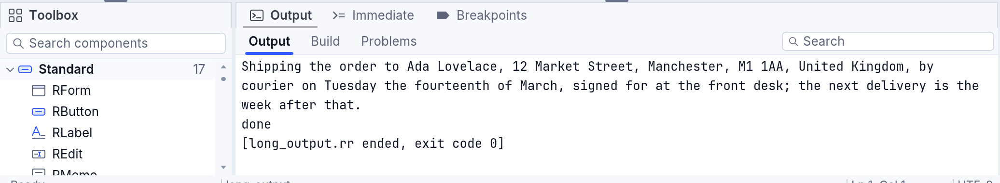

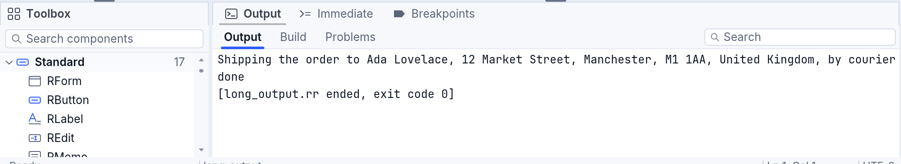

### Two layouts: editing and debugging

Studio arranges its panes for what you are doing.

- **While you edit**, the bottom panel under your code spans its whole
  width. Its tabs are **Output** (with its own Output, Build and Problems
  pages), **Immediate** and **Breakpoints**, so a long warning in Problems
  has room to be read. Breakpoints is there too: you can see and change your
  breakpoints before you run.
- **When you run with the debugger** (F5, F10, F11, Run to Cursor), Studio
  switches to the debugging layout: **Variables**, **Watch**, **Call Stack**
  and **Breakpoints** appear in a group beside Output and Immediate. When
  the program stops at a breakpoint, Variables comes to the front and the
  editor shows the line where it stopped.
- **When the program ends**, Studio switches back to the editing layout.

Each layout remembers its own sizes: drag the splitter above the bottom
panel while you edit, and again while you debug, and Studio keeps both,
even after you close and open it again. Run ▸ Run Without Debugging (Ctrl+F5)
keeps the editing layout, since there is nothing to inspect.

**View ▸ Debug Panes** (Ctrl+Shift+D) shows or hides the debug panes at any
time. Shown this way, they stay after the program ends until you hide them
again (they are pinned). View ▸ Variables, Watch or Call Stack and Debug ▸
Add Watch show them too.

**Tools ▸ Settings ▸ General ▸ Debug panes** chooses when they appear:

| Setting | What happens |
|---|---|
| Automatic (the default) | They appear when a run with the debugger starts and leave when it ends. |
| Always | The debugging layout all the time. |
| Never | Only when you ask (View ▸ Debug Panes, Ctrl+Shift+D). |

The switch never takes the keyboard from where you are typing; only a
breakpoint that hits moves it, to the line where the program stopped. The
status bar says which layout you are in for a few seconds, and a screen
reader reads it out.

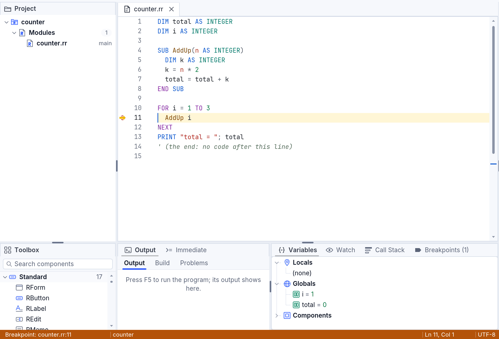

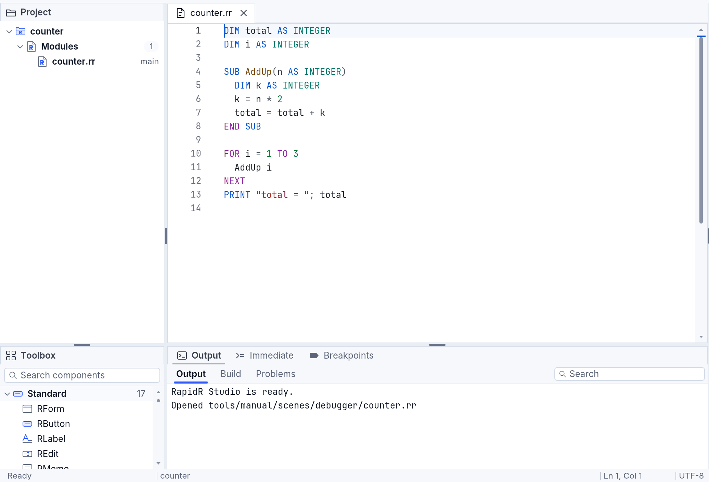

### Which commands you can use when

A command is greyed out when it can't do anything; when it isn't, it works
from its key, its menu item, its tool button and the command palette alike.

| The program is… | ▶ F5 | Ctrl+F5 | ❙❙ Pause | ■ Shift+F5, Restart | F10, F11 | Shift+F11, Set Next Statement | Ctrl+F10 | Show Program Window |
|---|---|---|---|---|---|---|---|---|
| not running (never run, ended, closed, or ended with an error) | Run | ✓ | — | — | start at the first line | — | start and stop at the caret | — |
| running (or a step that takes a while) | — | — | ✓ | ✓ | — | — | — | ✓ |
| paused (a breakpoint, a step, Pause, a run-time error) | Continue | — | — | ✓ | step | ✓ | go on to the caret | ✓ |

F9 (breakpoints) works at any time.

### Your program's window and Studio's

On the desktop your program has windows of its own, and Studio hands the
front back and forth so the right one is in front when you need it:

- When you run it, its first window comes up **in front of** Studio.
- When it stops — at a breakpoint after you clicked something in it, at a
  run-time error — **Studio comes to the front**, at the line where it
  stopped.
- **Continue (F5)** and Run to Cursor bring the program's windows back to
  the front: it's the program's turn. So does a step that hasn't stopped
  within half a second (stepping over a `ShowModal` that waits for you).
  A quick step leaves you in Studio.

While the program is paused, its windows **stay on the screen and
reachable**: they keep their picture, you can switch to them (a click,
Cmd-Tab on a Mac, Alt-Tab on Windows and Linux, or Debug ▸ Show Program
Window), move them, resize them and minimize them. They don't react to you,
though: none of the program's code runs while it's paused, so a click or a
key in its windows is ignored — not saved for later, so nothing surprises
the program when it goes on. Closing its last window (its close box) ends
the program, as Stop does: its OnClose doesn't run, since none of its code
can. What you change in Variables, Watch or the Immediate pane (a caption,
a colour) shows in its windows at once.

Try it with [themes.rr](../../examples/gui/themes.rr): put a breakpoint on
line 94 (`SELECT CASE Sender.Caption`), press F5, and click *Dark* in its
window. Studio comes to the front, paused at line 94, with ▶ ready to
continue. Switch to another program and back: the Themes window is still
there, and Debug ▸ Show Program Window brings it forward. Press F5: the
Themes window comes to the front and turns dark.

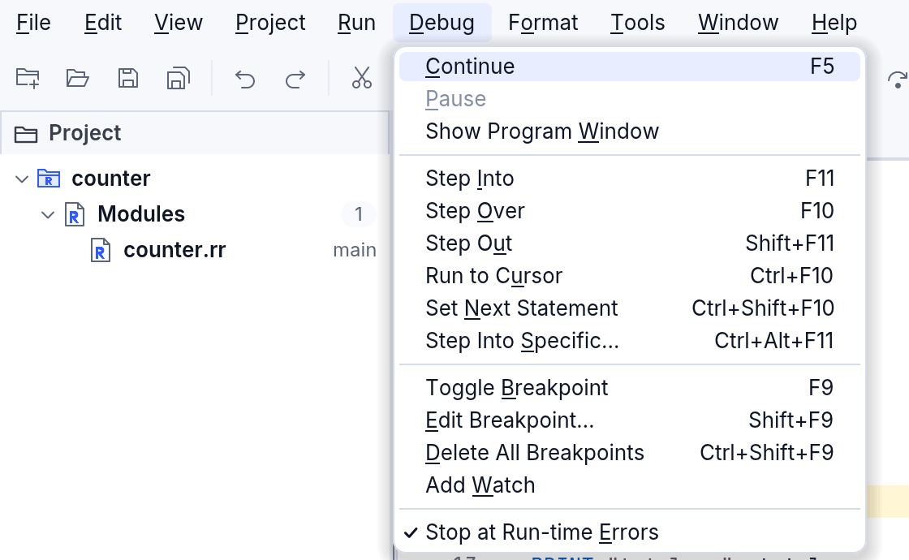

If the code has errors, Studio doesn't run it: the Problems list opens and
the editor goes to the first error.

The status bar shows what the program is doing: green while it runs,
orange while it's paused (with the file and line), back to normal when it
ends. A file name too long for it is shortened in its middle —
`Breakpoint: a_pro…he_status_bar.rr:6`, the line kept —; rest the
mouse on the bar for the whole of it. Output shows what the program prints, then
`[counter.rr ended, exit code 0]`.

## Breakpoints

A breakpoint stops the program when it reaches a line, before the line runs.

**Setting one.** Click in the narrow column left of the line numbers next
to line 11 (`AddUp i`). A red dot marks the line. You can also put the
caret on the line and press **F9** (Debug ▸ Toggle Breakpoint). Click the
dot again, or press F9 again, to remove it.

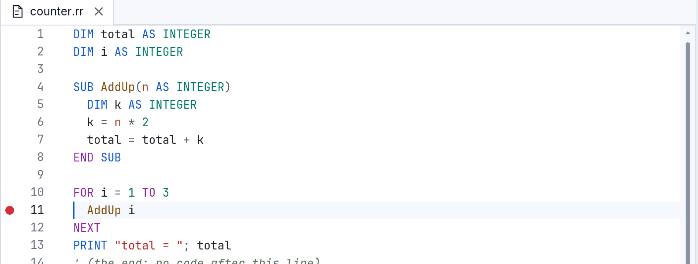

**Running to it.** Press **F5**. The program stops at line 11 before
calling `AddUp`:

- an arrow in the margin and a tinted line show where it is;
- the status bar turns orange: `Breakpoint: counter.rr:11`;
- **Variables** (bottom right) shows the values: `i = 1`, `total = 0`;
- **Call Stack** (bottom left, in the Toolbox's place while you debug)
  shows where the program is: `(the program)  counter.rr:11`.

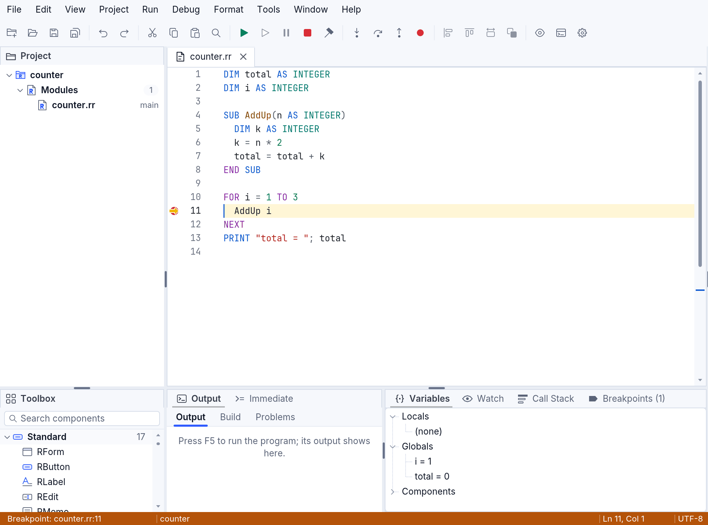

The ▶ button stays green while it's paused: its tip says *Continue
(F5)*. Press **F5** (or click ▶) again: it goes on and stops at line 11
again, now with `i = 2`. Press F5 twice more and the program ends.

Breakpoints work in every file of the project, also in files you
`$INCLUDE`; the file opens when the program stops in it.

**A line without code.** A breakpoint on a comment, a blank line or a
`DIM` moves to the next line that has code when the program runs, and
stops there. One after the last line of code can never stop; the
Breakpoints pane says `(no code here: never stops)` and its dot becomes a
ring.

**All of them.** The **Breakpoints** pane (next to Variables) lists every
breakpoint. Double-click one (or select it and press Enter) to see its
line; Delete removes it; Space switches it off and on. Debug ▸ Delete All
Breakpoints (Ctrl+Shift+F9) removes them all.

Studio keeps your breakpoints and watches with the project: close Studio,
open the project again, and they are there.

### Breakpoints in event handlers

A program with a window spends its time waiting for events, and most of
your code runs in its handlers — OnClick, OnChange, OnKeyPress, OnTimer,
OnResize, OnMouseMove, OnClose… A breakpoint in a handler stops **every
time** the event comes: the third click stops as the first did, every
letter typed into an edit stops in its OnChange, even when the handler is
a single line.

- **Step Over out of a handler** (F10 on its last line): the handler
  returns to the program, which waits for its next event — it runs on, and
  the next event stops at the breakpoint again.
- **A handler that opens a dialog** (`MESSAGEDLG`, a font or file dialog):
  Step Over its line and the dialog shows in the program's window; answer
  it, and the program stops on the next line, with the answer.
- **A handler that makes another event** — setting `Form.Width` fires the
  form's OnResize —: a breakpoint in the inner handler stops there, and the
  Call Stack shows both, the inner one on top.
- **A run-time error in a handler** stops at its line, as in the main
  program. Continue (F5) then does what the program does without the
  debugger: that handler ends there (and the handlers that
  fired it), the program runs on and the next event stops at the error
  again; the error is in Output. Stop (Shift+F5) ends the program.
- **The focus** ([OnEnter and OnExit](components.md#the-focus-onenter-and-onexit)):
  Tab from one control to the next stops in the first one's OnExit, then,
  F5, in the second one's OnEnter — every time. A click that moves the
  focus stops there too, before the click's own OnClick; the click is then
  over (the button was let go while the program was stopped: dropped), so click again to see its OnClick.

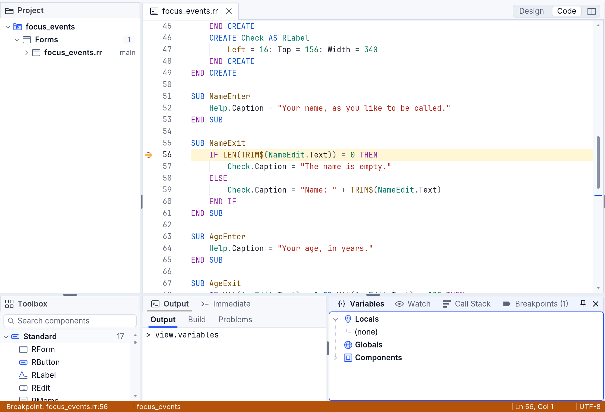
- **While the program is stopped**, what you type or click in its windows
  is dropped (none of its code can run): nothing is kept to run later, and
  no second stop waits behind it. Continue, and the next key stops as
  usual.

Try it with [hello_form.rr](../../examples/gui/hello_form.rr): a breakpoint
on line 49 (`GreetButton.Enabled = …`, the name's OnChange), F5, and type
your name — it stops at every letter.

### Conditions, hit counts and log messages

Put the caret on the breakpoint's line and press **Shift+F9** (Debug ▸ Edit
Breakpoint), or select it in the Breakpoints pane. The boxes under the list
change what it does; type and press **Enter** to apply.

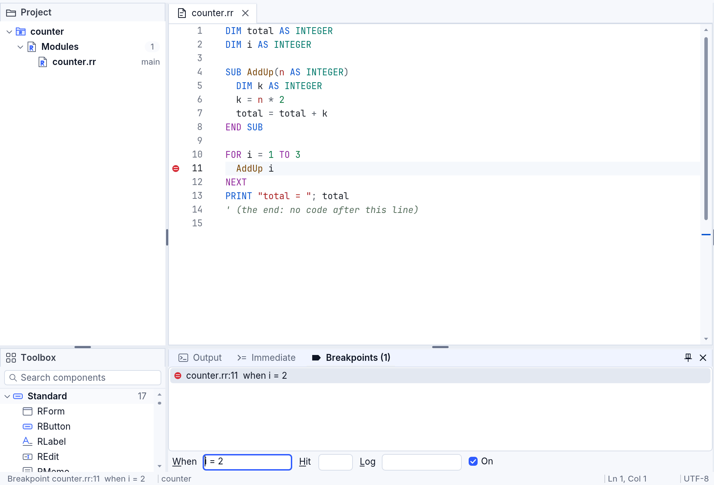

| Box | Example | Effect |
|---|---|---|
| When | `i = 2` | Stops only when the expression is true. |
| Hit | `3`, `>= 3`, `% 2` | Stops only the third time the line is reached, from the third time on, or every second time. |
| Log | `adding {i}: total is {total}` | Doesn't stop: prints the message in Output and goes on. Expressions in `{ }` are replaced by their values. |
| On | (check box) | Unchecked keeps the breakpoint but doesn't stop. |

With *When* set to `i = 2`, F5 stops at line 11 once, with `i = 2`.

A breakpoint with a log message is a quick way to follow a program without
adding PRINTs to it:

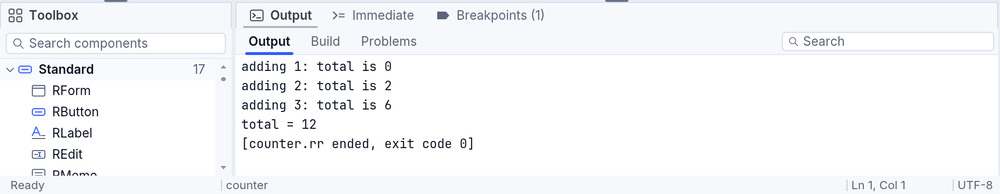

Each kind has its own mark, the same in the margin and in the Breakpoints
pane:

| Mark | Breakpoint |
|---|---|
|  | Stops here. |
|  | Stops when its condition (*When*) is true: an equals sign. |
|  | Stops on its hit count (*Hit*): a number sign. |
|  | Prints its log message and goes on: a diamond. |
|  | Off: a ring. |
|  | No code on its line, so it never stops: a dashed ring. |

The shapes say it, not only the colours, so they read the same in high
contrast. A screen reader names each one in the Breakpoints pane
("counter.rr:6 when n = 2, conditional breakpoint").

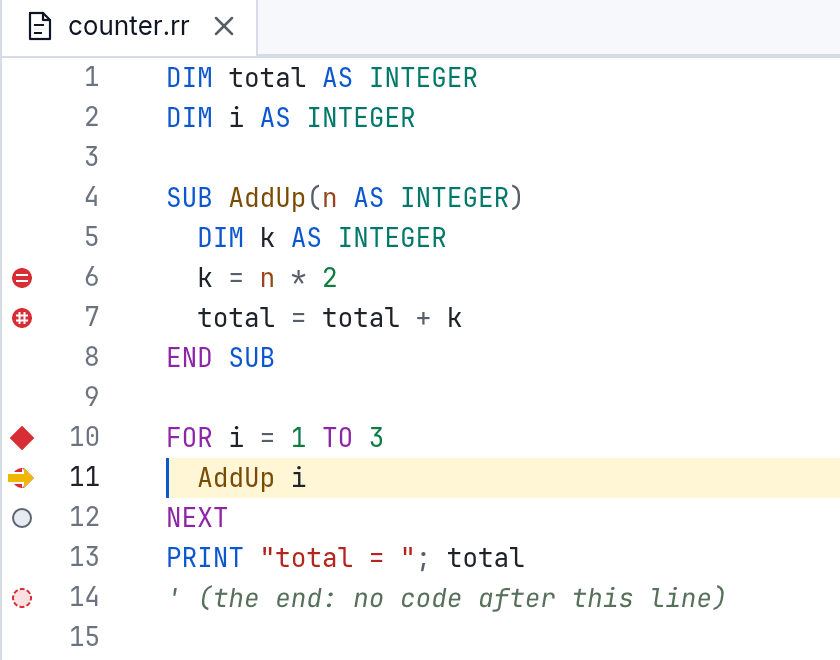

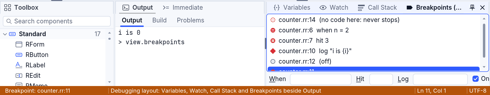

## Stepping

While the program is paused:

| Key | Menu | What it does |
|---|---|---|
| F10 | Debug ▸ Step Over | Runs the line and stops at the next one. A SUB or FUNCTION the line calls runs whole. |
| F11 | Debug ▸ Step Into | Runs the line and stops at the next line that runs — inside a SUB or FUNCTION it calls, in another file too. |
| Shift+F11 | Debug ▸ Step Out | Runs to the end of the SUB or FUNCTION it's in and stops after the call. |
| Ctrl+F10 | Debug ▸ Run to Cursor | Runs to the line with the caret. |
| Ctrl+Alt+F11 | Debug ▸ Step Into Specific | When the line calls several SUBs or FUNCTIONs, pick the one to step into. |
| Ctrl+Shift+F10 | Debug ▸ Set Next Statement | The program goes on from the caret's line instead (see below). |
| F5 | Debug ▸ Continue | Runs on to the next breakpoint, or the end. |

F8 also steps into and Shift+F8 steps over. When the
program isn't running, F10 and F11 start it and stop at its first line, and
Run to Cursor starts it and stops at the caret's line.

A line that calls a SUB or FUNCTION and then goes on (`x = Twice(n) + 1`)
is stepped over whole: F10 stops at the next line, not in the middle of
this one.

### Step Into Specific

This line of `shop.rr` calls two FUNCTIONs, `PriceOf` and then
`LineTotal`:

```basic
total = total + LineTotal(orders(i).Qty, PriceOf(orders(i).Item))
```

F11 goes into the first one that runs, `PriceOf`. To go straight into
`LineTotal`, press **Ctrl+Alt+F11** (Debug ▸ Step Into Specific): a menu
lists the calls the line still makes, in the order they happen; pick
*Step into LineTotal*. The program runs `PriceOf` whole and stops at the
first line of `LineTotal`. When the line calls one SUB or FUNCTION, it goes
into it at once; when it calls none, it steps over the line.

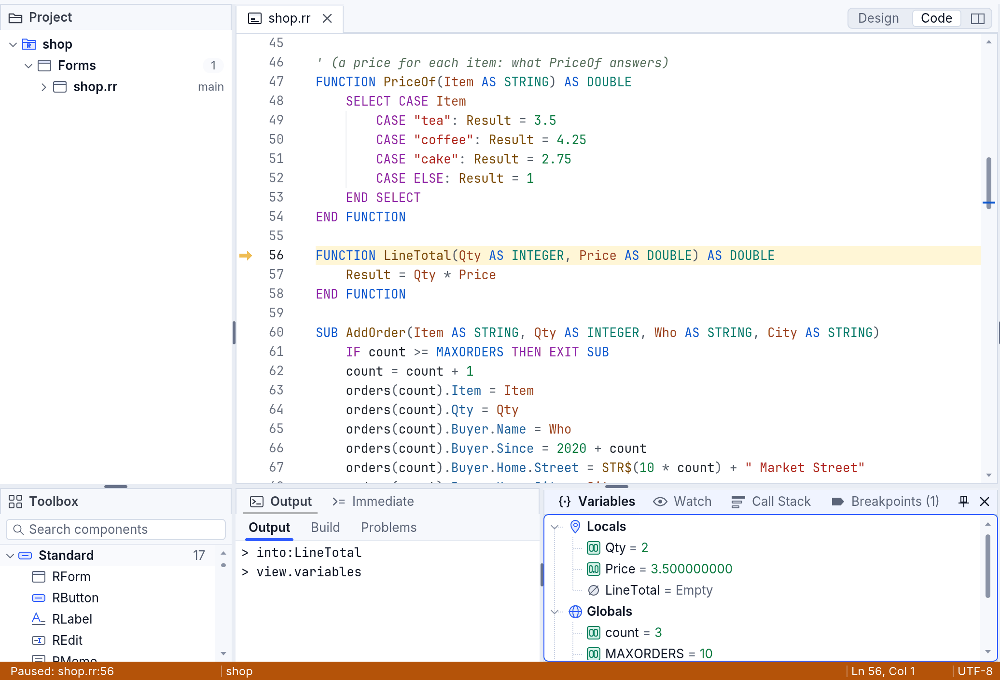

### Set Next Statement

While the program is paused you can choose which line it runs next:

- **drag the yellow arrow** in the margin up or down to another line, or
- put the caret on a line and press **Ctrl+Shift+F10** (Debug ▸ Set Next
  Statement).

The arrow moves there and nothing else runs: drag it back to run a line
again (after changing a value in Variables), or forward to skip lines.
The new line must be in the same SUB or FUNCTION where the program is
paused — Studio says so in the status bar and in Output when it isn't. On
a blank line or a comment, the arrow goes to the next line with code.

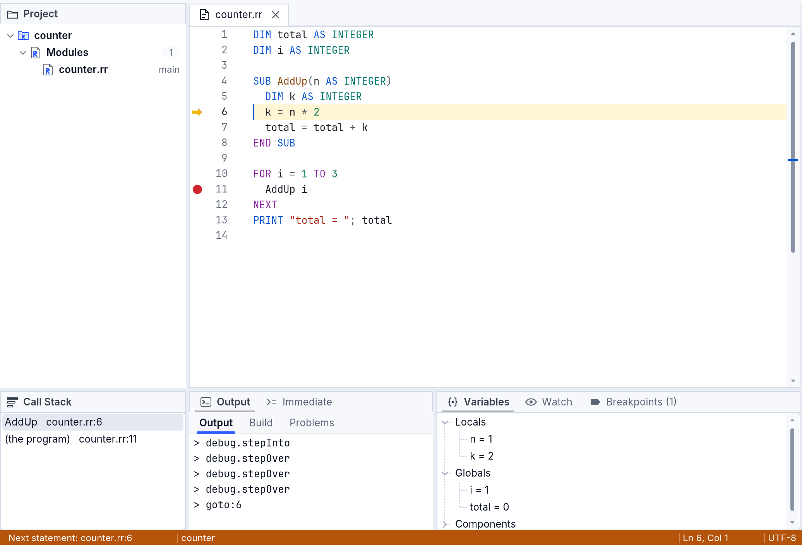

It works at a run-time error too (see [When the program fails](#when-the-program-fails)):
fix the value that caused it, put the arrow back on the failing line, and
press F5 — the line runs again and the program goes on instead of ending.

Stopped at line 11, press **F11**: the program goes into `AddUp` and stops
at its first line, `SUB AddUp(n AS INTEGER)`, where it takes `n`. Press
**F10**: it stops at `DIM k AS INTEGER`. The Call Stack now has two lines:
`AddUp  counter.rr:5`, where the program is, above
`(the program)  counter.rr:11`, the line that called it. Variables shows
AddUp's own variables under **Locals** (`n = 1`, and `k`, which has no
value yet) and the program's under **Globals**. The status bar's
`Ln 5, Col 1` follows the program's line. Two more F10s and `k = 2`.

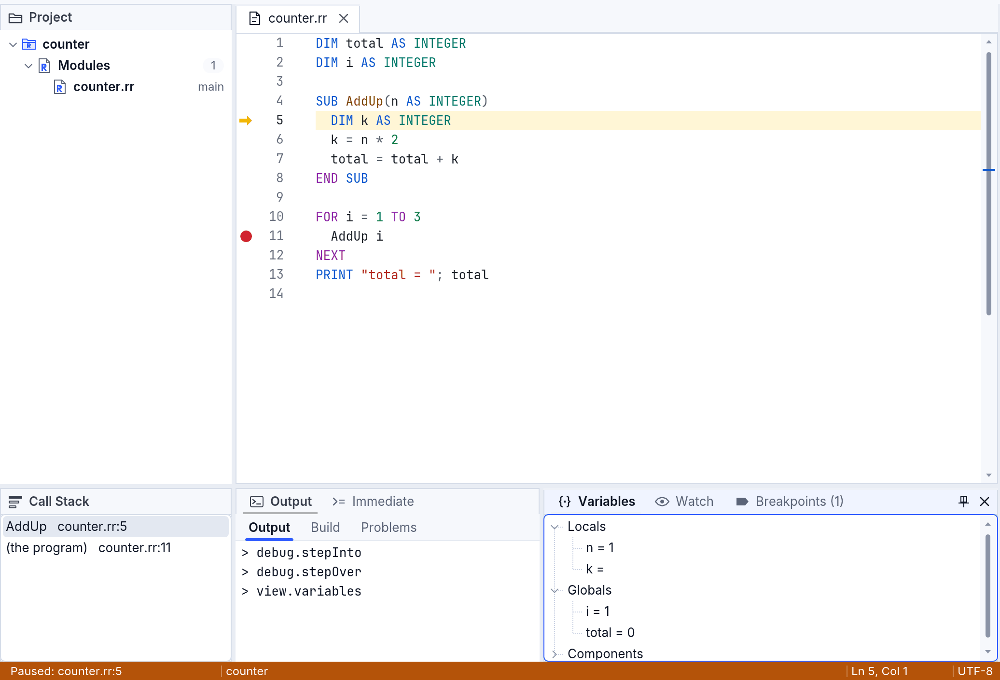

### Pausing a program that waits

A program with a form usually waits in `Form.ShowModal` for the user to do
something; no code runs. **Debug ▸ Pause** stops it at once, on the line
that waits, with the note *Waiting for events* beside it, and you can look
at its variables there. Try it with
`tools/manual/scenes/debugger/greeter.rr`:

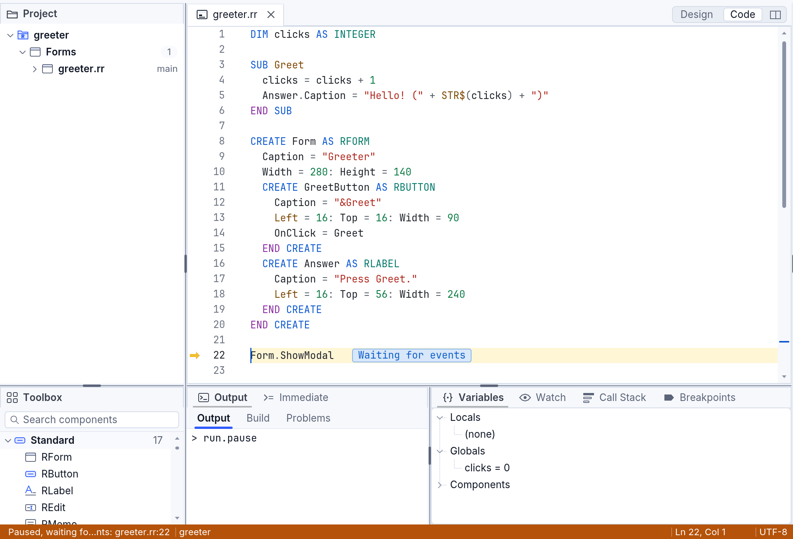

From there, **F5** lets it wait again. **F10** (Step Over) stops on the
line after `ShowModal` once the form is closed. **F11** (Step Into) stops
in the next event handler that runs: press Greet in the program's window
and Studio stops at the first line of `SUB Greet`.

While the program is paused its windows stay on the screen — switch to
them, move them — but don't react: clicks and keys in them are ignored,
and its timers wait until it goes on (see
[Your program's window and Studio's](#your-programs-window-and-studios)).

## Looking at values

### Values under the mouse

While the program is paused, rest the mouse on a variable in the code: a
**data tip** shows its value. An array, a TYPE, a component or a table opens
like a tree, as deep as you like: click a triangle to open or close it.
Stopped in `shop.rr`'s loop, rest the mouse on `orders`: the tip shows the
array and its elements; open `(1)` to see the order's fields, then its
`Buyer`, then the buyer's `Home`:

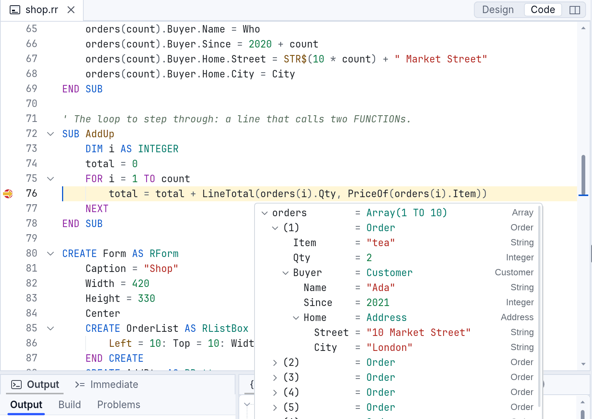

- Each row shows what kind of value it is as a small icon, its name, `=`,
  the value in its kind's colour (the code editor's: numbers, text, True and
  False, constants) and its type at the right. [How values look](#how-values-look)
  shows them all.
- A value that **changed** since the program last stopped is
  **highlighted** and marked with a small triangle, in Variables and Watch
  alike — step through a loop and see which variables the last line ran
  changed. (In high contrast the value is framed instead.)
- Rest the mouse on a part of a longer name and the tip shows that part:
  `orders(i).Qty`, `Buyer.Name`, `Edit1.Text`. A data tip never runs your
  code: a name that would call a SUB, FUNCTION or method shows nothing.
- Big arrays, tables and RNum arrays show 100 items at a time; click
  *… more* for the next ones.
- Hover a row to see its buttons: **copy** its value (the whole of it, even
  a long text), **watch** it (it's added to the Watch pane), and for a
  string **view** its whole text in a window of its own, with its lines:

  
- The wheel scrolls a long tip; the tip stays while the mouse is over it,
  and goes when the mouse moves on in the code or you click elsewhere.

**Tables.** An `RDataFrame` shows as a table: the names of its columns,
then its rows. Open a row to see its cells one by one, each by its column
(`week.At(0, "day")` names the first one).

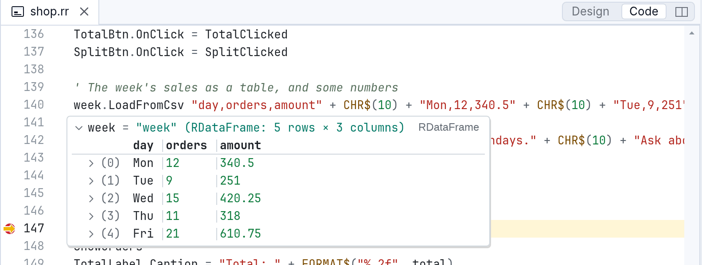

An `RNum` shows its first numbers (`RNum(7): [18.5, 19, 21.5, …]`) and opens
to all of them; a form opens to the **Components** it holds — each opening
to its own properties — then its properties, read as the program reads
them.

### Variables

The **Variables** pane shows **Locals** — the variables and parameters of
the SUB or FUNCTION where the program is paused —, **Globals** and the
program's **Components**: its forms, data frames, timers… each opening to
the components it holds and its properties. Arrays, TYPEs, components and
tables open the same way as in a data tip. In an event handler, open
`Sender` to see the component's properties as they are now. What you open
stays open from one stop to the next, and changed values are highlighted.

When the program goes on (Continue, or a step that takes a while), the
values in Variables and the Call Stack are no longer the program's: a
moment later both say **Running…**, and Watch shows *(running)* beside
each expression. At the next pause they fill again, Variables scrolled to
where it was and the value you had selected still selected.

**Globals** lists your program's own variables first. The constants an
`$INCLUDE` brings — `RAPIDQ.INC` has nearly five hundred: colours,
keys, message box buttons — come after them, each file's under one item
that stays closed until you open it (the constants built into a `.rr`
program aren't variables: they aren't listed):

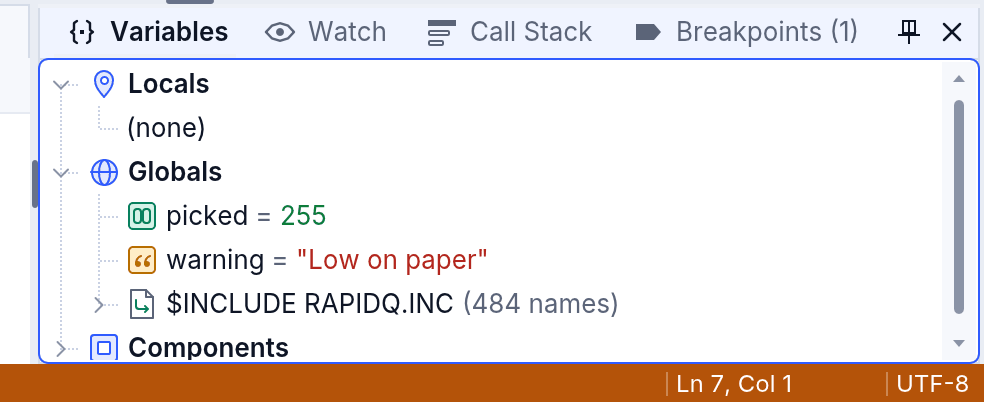

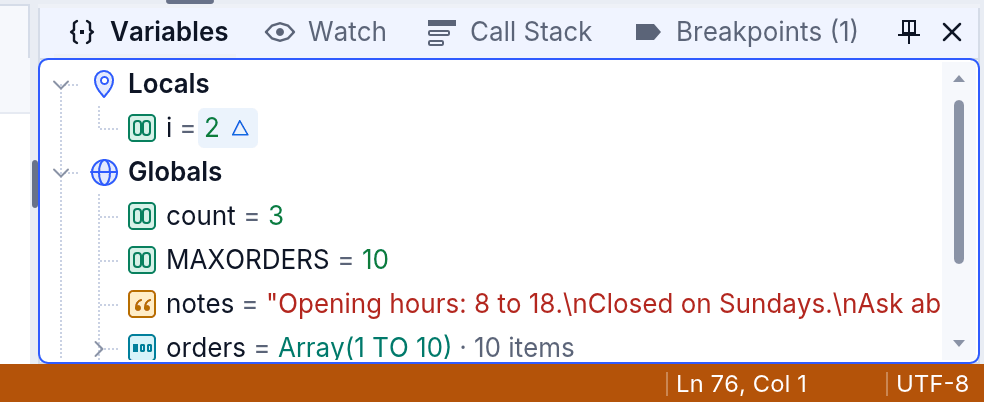

Open **Components** to see the program's forms and other components as
they are now — here the Shop form, its components and then its
properties:

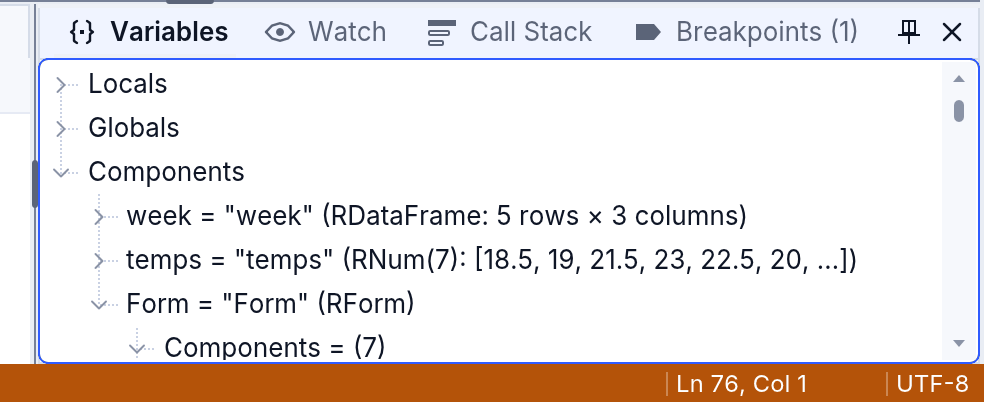

### How values look

Variables, Watch and the data tips draw each value the same way: an icon
for its kind, its name, `=`, then the value in its kind's colour.

| Icon | Kind | Shown as |
|---|---|---|
|  | A whole number (INTEGER, LONG, BYTE …) | `Score = 42` |
|  | A decimal number (SINGLE, DOUBLE) | `Ratio = 0.75` |
|  | Text (STRING) | `Title = "Hello"`; an empty text as a quiet `""` |
|  | True or False | `Done = True` |
|  | A property that is on or off | `Visible = 1 · on`, `KeyPreview = 0 · off`: the number the program reads, then a quiet *on* or *off* |
|  | An array | `ColName = Array(0 TO 64) · 65 items` |
|  | A TYPE's value | `p = Point · 2 fields` |
|  | A component (each its own icon, as in the toolbox) | `Sender = Button1 · RButton` |
|  | One of a property's constants | `WindowState = wsMaximized (2)` |
|  | A colour | `FontColor = ■ clWindowText`: a swatch, then its name, or `&HBBGGRR` |
|  | A handle (a window's, a file's) | `Handle = 133082` |
|  | No value yet | `Pending = Empty` |
|    | Locals, Globals, Components | the headings |

A colour's swatch is the colour as the program draws it: `clWindowText` is
dark in a light theme and light in a dark one.

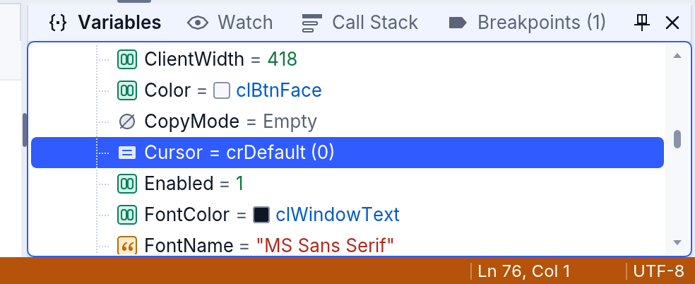

 Screen readers read each row
as a sentence: "FontColor, colour clWindowText", "Title, empty text",
"ColName, array 0 to 64, 65 items", "Score, whole number 42, changed".

An *on* or *off* property shows the number your program reads — `1` or
`0`, never `True`: in a `.rr` program `True` is `-1` — with a quiet *on*
or *off* after it.

**More.** Right-click a value (in Variables or Watch) for *Copy Value*
(Ctrl+C, ⌘C on a Mac, or Edit ▸ Copy: the whole value), *Copy Expression* (the name that reaches it,
such as `orders(1).Buyer.Name`), *Add Watch*, *View Text…* and *Set
Value…* (F2).

### Changing a value

While the program is paused you can change a value and let the program go
on with it. Select it in **Variables** (or a value inside a watch) and
press **F2**, double-click it, or right-click it and choose **Set Value…**.
An editor opens over the value — only the value, the name stays as it is —
with the value selected: type the new one and press **Enter**; **Escape**
leaves it as it was.

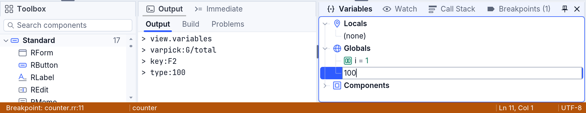

Set `total` to `100` at the first stop, remove the breakpoint (F9) and
press F5: Output shows `total = 112`.

What you type is checked against the kind of value first, so a slip
never reaches your program:

- **Numbers** take a number (`42`, `-3.5`, `&HFF`) or a constant's name
  (`clRed`, `MAXORDERS`). Text where a number goes is refused, and
  **Output** (beside Variables) says why in plain words: *total holds a
  whole number, and abc isn't one. Type a number such as 42.* The status
  bar says *Can't set total: see Output*, and the value stays as it was.

  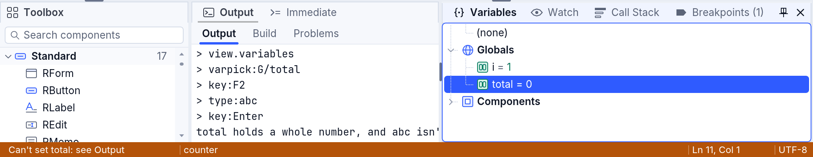
- **Text** is typed as it is, without quotes: type `Grace` and the name is
  `"Grace"`. The editor always holds the **whole** text, never the
  shortened one a long value shows. A text longer than about 80 characters,
  or one with line breaks, opens in a window of its own, lines and all:
  **Set** keeps it, **Cancel** leaves it.

  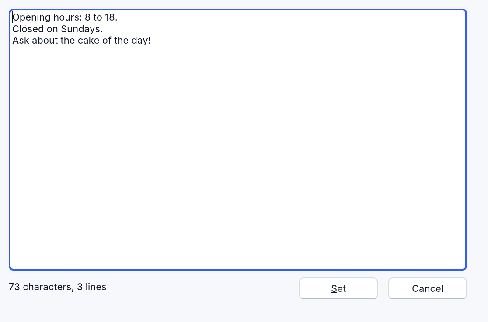
- **On / off** properties take `on` or `off` (also `yes`, `no`, `1`, `0`).
  **True / False** values take `True` or `False` (also `yes` and `no`).
- **A property's constants** — `Cursor`, `WindowState`, `Align` … — come as
  a menu: the one it has now is ticked, click the one you want.

  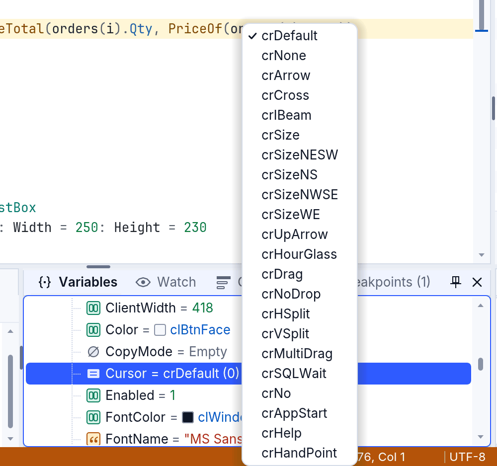
- **An expression**: start with `=` and type it — `=total * 2`,
  `=LEFT$(Name, 3)` — and it's worked out in the paused program.
- A **colour** also takes the web's `#RRGGBB` (`#FF8000`).

Some values can't be set, and Output says why: a **read-only**
property (*Handle can't be changed: it's read-only.*), an **array** or a
**TYPE** as a whole (open it and set its elements or fields one at a
time), a **component** (open it and set its properties), and a credential
(it shows as `••••` and stays unseen). This works for local and global
variables, array elements, the fields of TYPEs — however deep, such as
`orders(1).Buyer.Name` — and component properties such as `Form.Caption`.

A value you set is **highlighted** as changed, and the status bar says
what it is now (*total = 100 (Ctrl+Z undoes)*). **Ctrl+Z** (Edit ▸ Undo;
⌘Z on a Mac) in Variables or Watch puts it back, one value at a time,
while the program stays paused; once it goes on, what you set stays.

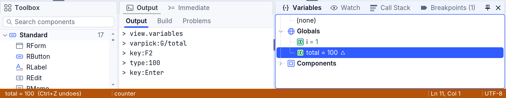

### Watch

The **Watch** pane shows expressions you choose, worked out again at every
stop. Type one in the *Add a watch* box and press Enter — `total + k`,
`n * 100`, `UCASE$(Name$)`, `Form.Caption` — or put the caret on a word in
the code (or select an expression) and choose Debug ▸ Add Watch; a data
tip's *watch* button and the Variables' *Add Watch* add one too. F2 on a
watch changes its expression; Delete removes it. A watch that changed since
the last stop is highlighted.

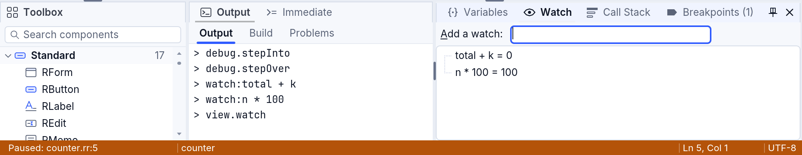

### Passwords show as ••••

A value that is a credential never shows. That is what `RSecrets.Read`
returns, what `RSecrets.Save` is given ([Keeping secrets](secrets.md)), and
a secret property such as `RMySQL.Password` or `RAI.APIKey`. Variables,
Watch, data tips, a component's properties and log messages show `••••`
in its place, also inside a longer text that holds it (`"pw=" + pw$`).
Your program still has the value.

### The Call Stack

The **Call Stack** shows how the program got where it is: the SUB it is in
first, then the code that called it, down to the main program. It is a tab
of the debug panes beside Output (see
[Two layouts](#two-layouts-editing-and-debugging)); View ▸ Call Stack
shows it at any time.

The call the program is in has the yellow arrow, as its line in the
editor does; the calls under it have a call's icon. Click a line of the
Call Stack to look at that caller: the editor shows its line with a grey
arrow, and Variables shows its locals.

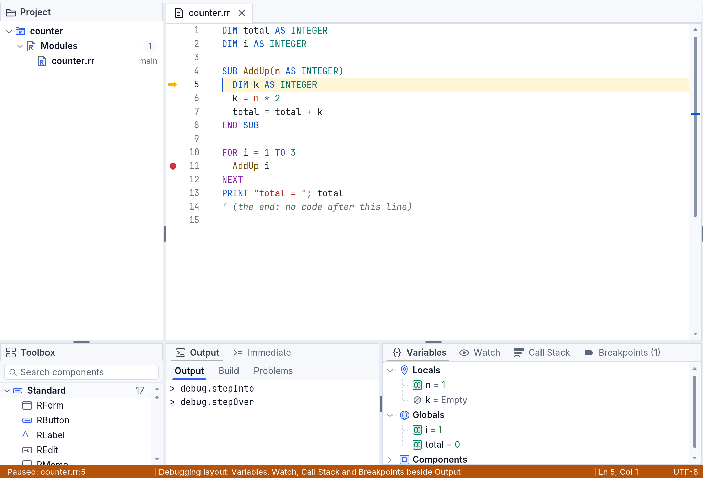

### The Immediate pane

**Immediate** (next to Output) runs what you type in the paused program.
Type a line and press **Enter**:

- `? expression` prints a value: `? total * 10` → `60`;
- `name = value` sets a value as Variables does — `total = 100`,
  `orders(1).Qty = 5`, `Form.Caption = "Shop"`: checked first (`total =
  "abc"` is refused in the same plain words), highlighted as changed, and
  Ctrl+Z in Variables puts it back;
- anything else runs as a statement where the program is paused.

In a `.rr` program the constants RapidQ's programs use (`mbYes`, `clRed`,
`mrYes` …) are built in, in Immediate and in Watch too: `? mrYes` → `6`. A name
your program makes its own (`DIM mbYes AS INTEGER`) is yours there, as it is in
the program.

Up and Down bring back the lines you typed before.

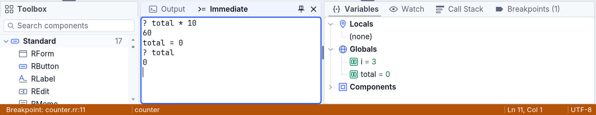

## When the program fails

When a run-time error happens — a division by zero, an index out of
range — Studio stops the program on the line that failed instead of
letting it end (Debug ▸ Stop at Run-time Errors, checked unless you change
it). The line turns red with the message at its end, and Variables and the
Call Stack show the values that led to it. The message is in Output too,
with the file and line: click it to go there. Press Shift+F5 to end the
program, or F5 to let the error do what it does without the debugger: in
the main program it ends the program; in an event handler it ends that
handler and the program runs on (see
[A run-time error in a handler](components.md#a-run-time-error-in-a-handler)).

This program (`tools/manual/scenes/debugger/share.rr`) divides by a
variable that is still 0:

```basic
DIM people AS INTEGER

SUB Share(Amount AS INTEGER)
  PRINT "each gets "; Amount \ people
END SUB

PRINT "before"
Share 10
PRINT "after"
```

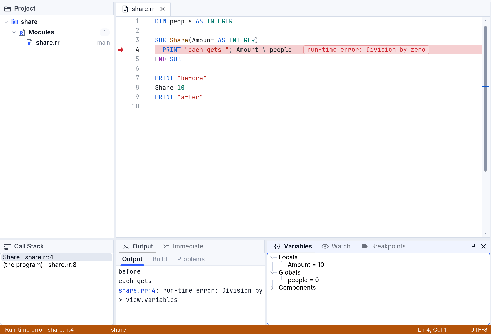

**Fix it and go on.** The program doesn't have to end there. Select
`people` in Variables, press F2, type `2` and Enter; then, with the caret
on line 4, press **Ctrl+Shift+F10** (or drag the arrow back to line 4) and
**F5**: line 4 runs again with the new value — `each gets 5` — and the
program goes on to `after`. To skip the failing line instead, put the arrow
on the line after it.

`shop.rr` has one to try: type `0` in its *Split between* box and press
*Split*.

## How fast it runs

A program runs under the debugger almost as fast as on its own: with no
breakpoint and no step to watch for, the VM only checks whether Studio
wants its attention. A program that waits for its events — a form open,
nothing happening — uses no processor time, under the debugger too:
Studio's requests wake it, nothing polls. `tools/bench/vm_bench` measures
this (and the VM's speed, start-up and memory) against its budgets.

| Measured 2026-10-15 | A Mac (Apple silicon) | Linux, one core and 2 GB |
|---|---|---|
| A 10-million-step loop, on its own | 0.61 s | 1.29 s |
| …under the debugger (a breakpoint set) | 0.72 s | 1.33 s |
| A form waiting for its events, under the debugger | 0 % CPU | 0 % CPU |
| Studio with that program running | 0.25 % CPU | 0.25 % CPU |
| Studio's start; F5 to the program's window; a step | — | 0.28 s; 14 ms; 10 ms |

## In every theme

The debugger looks right in each of Studio's themes (View ▸ Theme): RapidR
Light, RapidR Dark, RapidR High Contrast and Classic — and when the look
changes while you debug (View ▸ Theme, or your system switching to dark
while Studio follows it), every pane takes the new one at once, the
values marked as changed included. Every row of
Variables, Watch, the Call Stack and Breakpoints, the labels under the
breakpoints and the data tips are readable in each; in RapidR's three
looks every text is at least WCAG AA's 4.5:1 against what it's drawn on,
which RapidR's own tests check on every one of these panes, in Studio on
the desktop and in the browser (Classic keeps Windows' own colours).

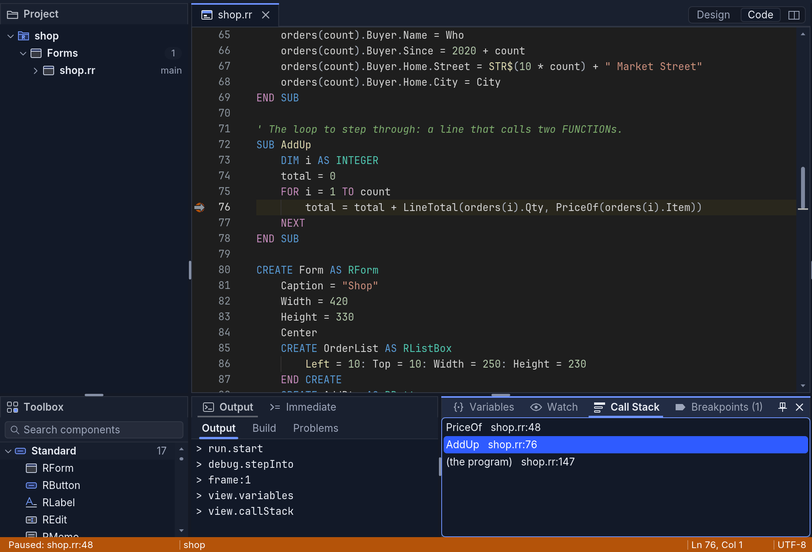

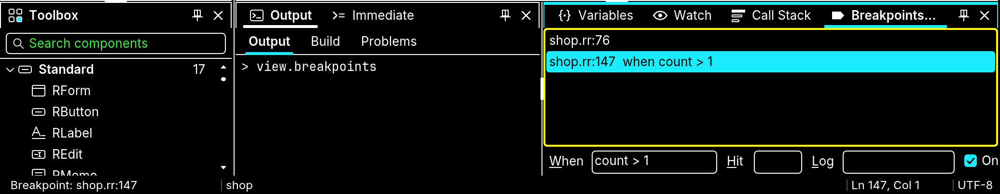

## On the desktop and in the browser

Everything on this page works the same in Studio on the desktop and in
Studio in the browser.

- **On the desktop** your program runs as a program of its own, with its
  own windows — as it will when you build it. Stop ends that program.

  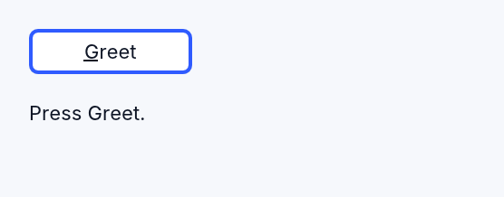

- **In the browser** your program runs inside the page. Its windows float
  over Studio; drag them anywhere on the page, even past Studio's own
  window, and nothing of them is cut off. A click beside them reaches
  Studio. Run ▸ Run in Browser isn't needed there: Run already runs the
  program in the page.

  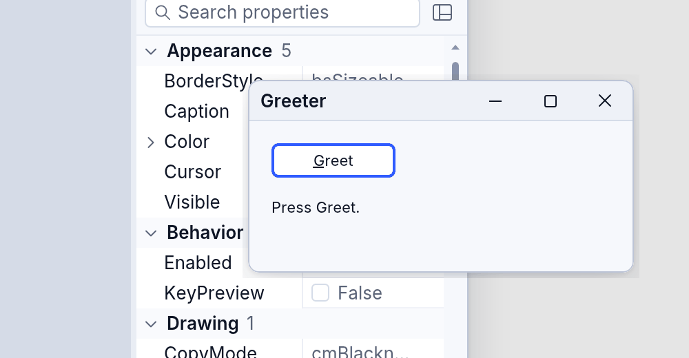

  Paused, the program's windows stay on the page and can be dragged; a
  click in them is ignored until it goes on, as on the desktop. When it
  stops, the keyboard comes back to Studio; Continue (F5) and Show Program
  Window give it to the program's window.

  A window bigger than the page — the 1200 × 800
  [sales_dashboard.rr](../../examples/gui/sales_dashboard.rr) example on a laptop's
  browser — opens with its title bar at the top of the page, and the
  program's desktop scrolls to the rest: a thin scroll bar shows along the
  page's edge while it's needed (drag it, or turn the wheel over it or over
  the window's title bar). Maximize the window and it fits the page. See
  [Windows bigger than the page](web.md#windows-bigger-than-the-page).

  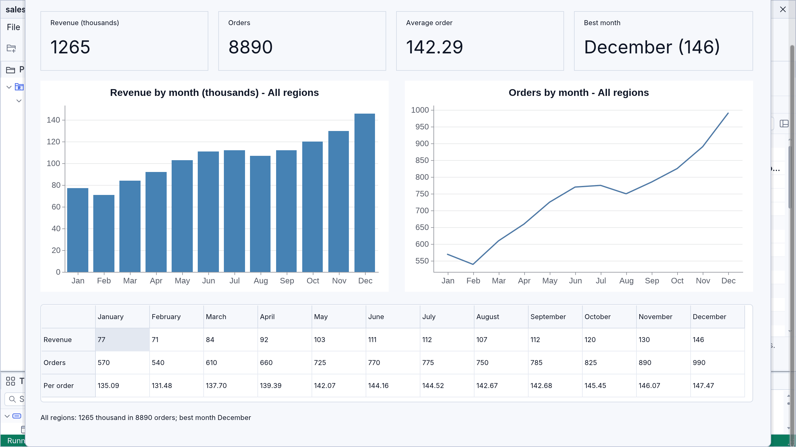

  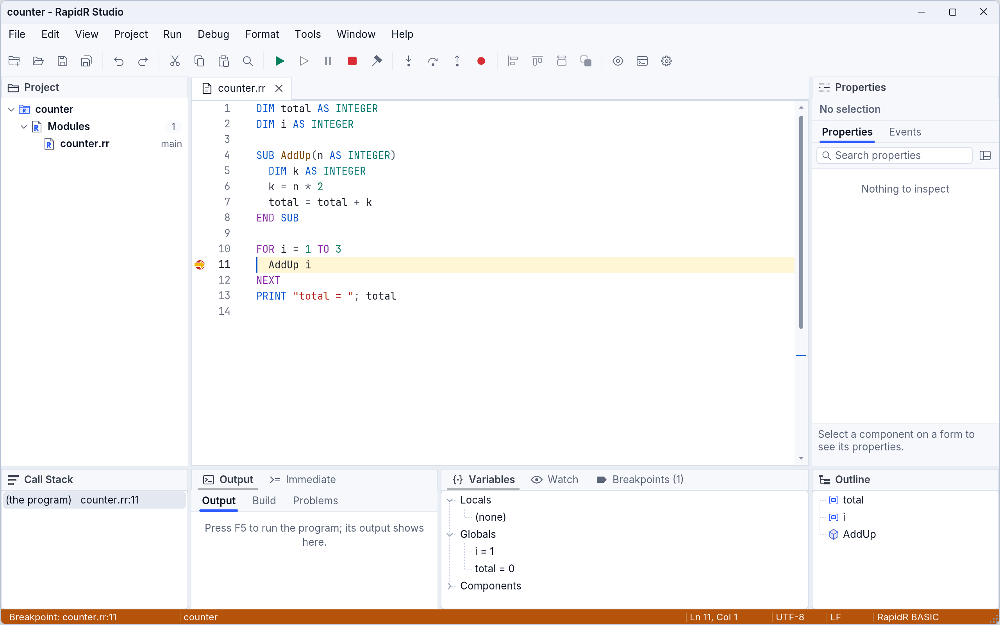

- The browser keeps some keys for itself (Ctrl+N, Ctrl+W, Ctrl+T): use the
  menus or the command palette for those commands.

## Not there yet

- On Linux with Wayland, Studio can't bring your program's window to the
  front for you (Wayland doesn't let one program raise another's windows):
  switch to it yourself.
- Completion while you type in the Immediate pane.
- Editing a value inside a data tip (F2 in Variables and Watch does it).
- A colour picker and a font list when you set a value: for now type a
  colour as a number, a name such as `clRed` or `#RRGGBB`.
