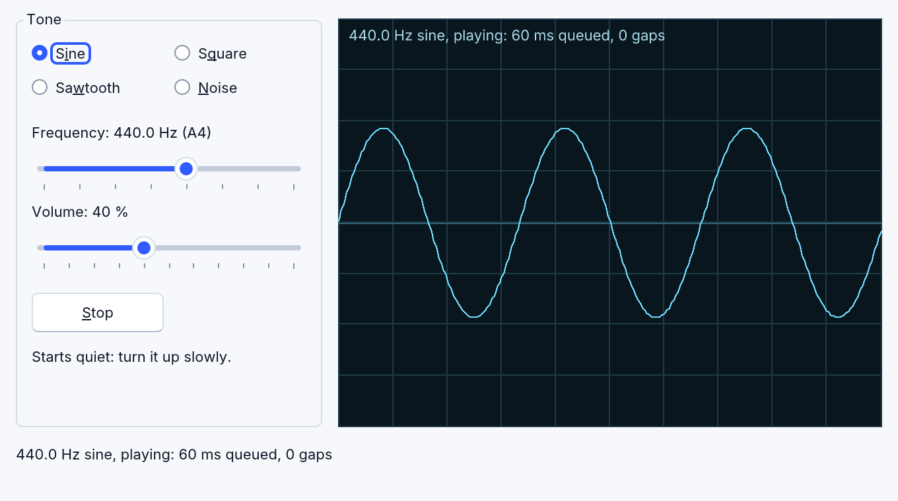

# DirectX, media and devices

The DirectX, media and device objects run on every platform and in the
browser. They are RapidR's own implementations of what programs do
with Windows' DirectX, MCI, WinINet and serial APIs, with the members and
behaviour that older programs rely on. Each has an older Q name too
(`QDXSCREEN` for `RDXScreen`, and so on), accepted everywhere.

## DirectX 2D

| Object | |
|---|---|
| `RDXScreen` | an off-screen surface shown on `Flip`: `Init`, `AutoSize`, `AllowStretch`, `Fill` (DirectDraw colours), `Pixel`, text (`TextOut`, `TextRect`), `Draw` / `StretchDraw` / `CopyRect`, `Rotate`, `View.*`; `OnInitialize` / `OnInitializeSurface` when its form first shows; `FullScreen` covers the screen with the surface scaled to fit |
| `RDXImageList` | DelphiX image libraries (`.DXG`) with their transparency and patterns |
| `RDXTimer` | a frame timer: `FrameRate`; `Interval = 0` fires once a frame; `ActiveOnly` only while the program is active |
| `RDXSound` | a WAV played at its `Frequency`, `Volume` and `Pan` (DirectSound's decibels), looped or once; `Playing`, `Position`, `Size`, `Play`, `Stop` |
| `RDXJoystick` | The classic `Update`, `IsLeft` / `IsRight` / `IsUp` / `IsDown`, `Button(n)`; RapidR adds `Index`, `Connected`, `Name`, the axes `X Y Z R U V`, `Buttons`, `POV` and the events `OnButtonDown`, `OnButtonUp`, `OnMove` |

Joysticks: gamepads through gilrs (Windows, macOS), evdev (Linux) and the
browser's Gamepad API, all reporting the same layout (an Xbox controller as
Windows' winmm showed it). With no joystick, every member reads "not
connected" instead of an error.

## Direct3D (retained mode)

`RD3DFrame`, `RD3DMeshBuilder`, `RD3DMesh`, `RD3DFace`, `RD3DLight`,
`RD3DTexture`, `RD3DVisual`, `RD3DWrap`, `RD3DVector` and RDXScreen's 3D
methods (`CreateFrame`, `CreateMeshBuilder`, `CreateLightRGB`,
`SetCameraPosition`, `CameraLookAt`, `Render`, …): frames, faces, `.X`
models (text and binary — every model of the compatibility suite loads), lights
(ambient, directional, point, spot), the camera, textures, wraps,
shadows and blended transparency, lit flat or Gouraud.

RapidR draws 3D on the GPU through wgpu — Metal on macOS, Direct3D 12 on
Windows (its WARP software adapter where there's no GPU), Vulkan or OpenGL
on Linux, WebGL 2 in the browser — sharp at any display scale and fast
(the compatibility suite's largest model, 16,000 triangles, about 4 ms a frame), then hands
the picture to the screen's back buffer, so text drawn after `Render`,
`Pixel` and `Flip` work as before. Fog is accepted and has no effect (it
never had one). RapidR's 3D matches the compatibility suite's examples, and
follows Direct3D's documentation where those are silent.

## Sound and music

- `PLAYWAV file [, options]` and `PLAYSOUND` play WAV, Ogg Vorbis, FLAC and
  MP3 files (or `$RESOURCE`s); `BEEP` and `SOUND freq, duration`.
- **RMIDI** (older name `QMIDI`, from `QMidi.inc`) plays standard MIDI files with MCI's timing on
  the system's MIDI output; where there is none (macOS, Linux, browsers
  without Web MIDI) RapidR's own General MIDI synthesizer plays them.
- **RWave** (`QWAVE`, from `QWave.inc`) plays WAV files, records from the default input
  (`New`, `Record`), saves and deletes.
- **RVideo** (`QVIDEO`, from `QVideo.inc`) plays AVI files with RapidR's own decoders:
  uncompressed, Microsoft RLE, Microsoft Video 1, Cinepak and Motion JPEG,
  with their PCM sound — on a form or in a window of its own.
- **RCDAudio** (`QCDAUDIO`, from `Qcdaudio.inc`) answers as a computer with no CD drive.

The media objects share these members: `Open`, `Close`, `Play`, `Stop`,
`Pause`, `State`, `FileOpen`, `Lenght` (the classic spelling), `Error` (MCI's
own texts), `Volume`, their `Timer` and `OnChange`. A program that
`$INCLUDE`s the classic library file gets RapidR's object.

## Sound made sample by sample: RAudioStream

**RAudioStream** plays sound your program makes as it goes, one number
(a *sample*) at a time: an emulator's beeper or sound chip, a synthesizer,
a tone for a physics lesson, a music game. The program writes samples into
the stream's queue; the sound device plays them on a thread of its own and
never waits for the program.



```basic
DIM Sound AS RAudioStream
DIM phase AS DOUBLE

SUB Feed (Count AS INTEGER)                 ' the stream asks for Count samples
    DIM buf(Count - 1) AS INTEGER, i AS INTEGER
    FOR i = 0 TO Count - 1
        buf(i) = SIN(phase) * 6000          ' a quiet 440 Hz tone
        phase = phase + 2 * 3.14159265 * 440 / Sound.SampleRate
    NEXT
    Sound.Write buf, Count
END SUB

Sound.OnNeedData = Feed
Sound.Start
```

- **Samples.** By default a sample is a 16-bit number from -32768 to 32767,
  44,100 of them a second (`SampleRate`, 8000 to 96000). `Write` takes an
  INTEGER (or BYTE, LONG …) array, a binary string (two bytes a sample, low
  byte first), an `RMemoryStream` (from its `Position`) or one number, with
  an optional `Count` and `Offset`; `WriteFloat` takes -1 to 1 from a SINGLE
  or DOUBLE array; `WriteSample v` writes one sample, the easiest way to
  learn. `Bits = 8` reads bytes 0 to 255 (128 is silence) as 8-bit WAV files
  have them. With `Channels = 2` samples are interleaved: left, right, left …
- **Keeping it fed.** Keep about `BufferMs` (60 ms by default) of sound
  queued. Either write in `OnNeedData(Count)`, which the stream raises on
  your program's own thread when the queue drops under `BufferMs` (Count
  fills it again), or, for a program that works a frame at a time, check
  `Queued` (ms waiting) from an `RTimer` and write until it is about
  `BufferMs`. The sound you hear is about `BufferMs` late: smaller answers
  sooner, larger survives a busy moment.
- **When the program is late** the queue runs dry: the stream plays silence
  after a 2 ms fade (no click), counts the gap in `Underruns`, and fades the
  next sound in. `Stop` fades out the same way; `Volume` (0–100, by the ear:
  50 sounds half as loud) glides over 10 ms, so a slider never clicks.
  `Enabled = False` pauses; `Clear` drops what waits.
- **Everywhere.** The same on Windows, macOS and Linux, interpreted and
  native, and in the browser. The device converts your `SampleRate` to its
  own. Without a sound device (or in a program built without sound) the
  stream plays silently, in time, and `Error` says why.

### Emulators: sound from a level timeline

A computer's simplest sound is one bit wired to a speaker, flipped by the
program at exact moments. An emulator plays it a frame at a time
(examples/media/beeper.rr, and the recipe examples/recipes/frame_audio.rr):

1. run the emulated machine for one frame (at 50 frames a second, 1/50 of
   its cycles), noting the cycle of every write to the speaker;
2. for each of the frame's samples (44100 / 50 = 882), how much of its
   time the bit was high: -1 to +1 by that share. Averaging over the
   sample instead of reading the bit once keeps the sound clean (no
   aliasing hiss);
3. a DC blocker (`out = x - prevX + 0.995 * prevOut`): a real speaker can't
   hold a push, so a bit left high drifts back to the middle;
4. `Write` the 882 samples.

An `RTimer` checks often and runs frames until about 60 ms is queued, so a
tick that comes late catches up and the sound never gaps. Use
`Interval = 10`: an `RTimer`'s ticks come on the system timer's 15.6 ms
steps, as they always have (`Interval = 20` ticks only every 31 ms, which
leaves a 60 ms queue little room for a late one). RapidR's interpreter makes such a frame in 0.2 to 0.6 ms, a
small part of the 20 ms it has.


### In the browser

A browser plays sound only after the person clicked or pressed a key on the
page: call `Start` from a button's `OnClick`. Until the page may play,
`Error` says so; the sound starts (and `Error` clears) as soon as it may.
Keep the queue a little longer there (`BufferMs = 80` or more) if the page
is busy: the browser plays the stream between the page's own work.

The examples: [tone_generator.rr](../../examples/media/tone_generator.rr)
(a sine, square, sawtooth or noise and an oscilloscope of the samples
played), [beeper.rr](../../examples/media/beeper.rr) (the one-bit speaker),
[chiptune.rr](../../examples/media/chiptune.rr) (three square-wave voices
playing RapidR's own tune) and the recipe
[frame_audio.rr](../../examples/recipes/frame_audio.rr).

## Devices and the network

| Object | |
|---|---|
| `RComPort` | a serial port (older name `COMPORT`): `Port`, `BaudRate`, `DataBits`, `Parity`, `StopBits`, `Open`, `Close`, `ReadString`, `WriteString`, `OnRxChar`, `OnComError`, … — serial2 on the desktop (nothing to install on Linux), Web Serial in the browser; RapidR's extras for IoT boards (ListPorts, DTR / RTS, ReadLine, OnLine, OnPortsChanged) in [Serial ports and IoT boards](serial-ports.md) |
| `RSocket` (older name `QSOCKET`), `RServerSocket` | TCP client and server (the browser: WebSocket client only); servers in [Networking](network.md): this computer only (`127.0.0.1`), by lines, bytes or whole HTTP requests |
| `RHttpServer` | a web server in your program, on `127.0.0.1`: a local API, a dashboard, an MCP server ([Networking](network.md)) |
| `RHttp` | HTTP(S) `Get` and `Post` |
| `RDownload` | older name `QDOWNLOAD` (`Qdownload.inc`), with `LeechFile`: a file from a web server into a variable or a file, with progress; port 443 is HTTPS, redirects are followed, and the program's windows keep working while it waits |
| `RCGI` | older name `QCGI` (`qcgi.inc`), the CGI object: the CGI variables as properties, `Parse`, `Get(Name, Value)` — for `$APPTYPE CGI` programs behind a web server |

HTTPS uses the operating system's TLS (macOS' Security framework,
Windows' SChannel, Linux's OpenSSL 3) and its certificates: RapidR compiles
no TLS library into your program.

## The system tray

Programs put an icon in Windows' notification area with
`RNotifyIconData` and `Shell_NotifyIcon`, and hear its clicks in their
form's `WndProc`. RapidR keeps that one Windows call working everywhere:
the icon shows in the macOS menu bar, the Windows notification area, the
Linux tray (StatusNotifierItem) and a strip at the bottom right of a web
page, and clicks reach `WndProc (hWnd, uMsg, wParam, lParam)` as Windows'
mouse messages. `NI.hIcon = Application.Icon` shows the program's icon. On
Windows the form's `WndProc` also hears every other message of its window
(see [Windows messages](components.md#windows-messages-a-forms-wndproc)); on
the other systems the tray's are the only ones.

## The registry

`RRegistry` is Windows' own registry on Windows, as it always was. On macOS,
Linux and the web it is a per-user store that answers the same way
(`~/Library/Application Support/RapidR/registry.reg`,
`~/.config/rapidr/registry.reg`). `RAPIDR_REGISTRY=<file>` puts the keys
in that file on every system, so tests never touch the real registry.
