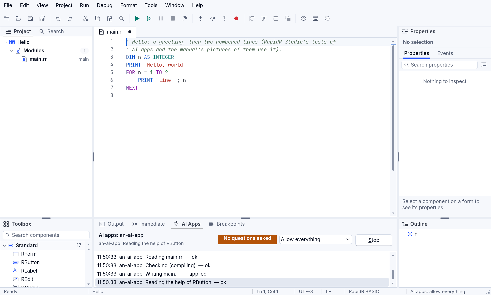
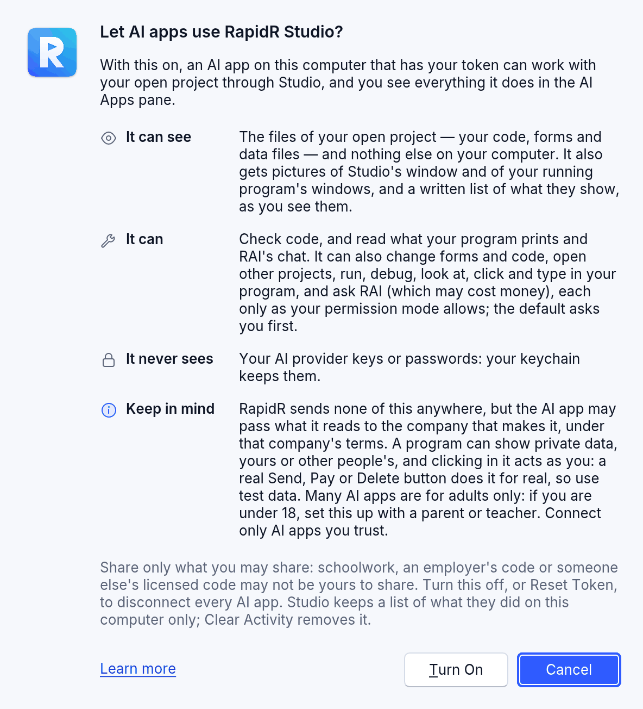
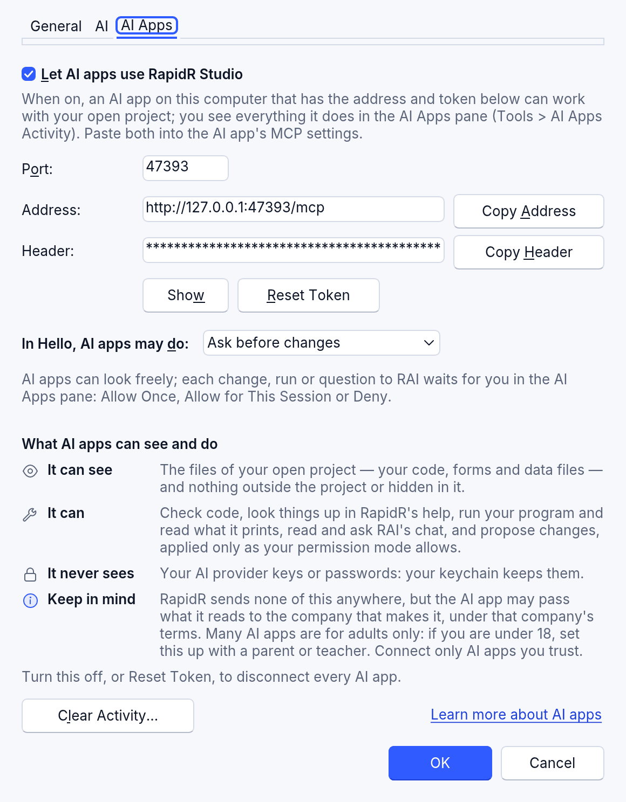
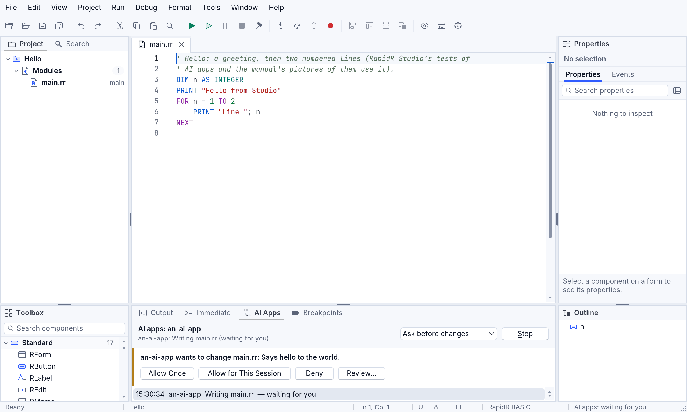

<!-- translated-from: ai-apps.md 2b132d5c8da23ffb -->
# Deja que las aplicaciones de IA trabajen en Studio

<!-- legal -->
RapidR Studio puede dejar que una aplicación de IA de tu computadora trabaje con
el proyecto que tienes abierto —leerlo, revisarlo, cambiarlo, ejecutarlo,
depurarlo, preguntarle a RAI— mientras ves cada paso en el panel **Aplicaciones
de IA**. Studio es entonces un servidor MCP: MCP es el protocolo que usan las
aplicaciones de IA para llamar a herramientas. Está desactivado hasta que lo
actives, escucha solo en tu computadora (`127.0.0.1`) y cada solicitud tiene que
llevar un token que solo tú tienes.

<!-- legal -->
Model Context Protocol® y MCP™ son marcas de LF Projects, LLC
(https://www.lfprojects.org/policies/). RapidR las usa solo para decir qué
protocolo habla. Claude Code es un producto de Anthropic, PBC. RapidR es
independiente de ambos y no está patrocinado ni respaldado por ellos.

Esto es RapidR Studio en el escritorio. Studio en un navegador no puede escuchar
a las aplicaciones de IA (una página web no puede abrir un puerto); está previsto
un modo de hacer lo mismo desde el navegador.



## Activarlo

1. **Herramientas > Configuración de aplicaciones de IA…** (o **Herramientas >
   Configuración**, la pestaña **Aplicaciones de IA**).
<!-- legal -->
2. Marca **Permitir que las aplicaciones de IA usen RapidR Studio**. La primera
   vez, Studio pregunta **¿Permitir que las aplicaciones de IA usen RapidR
   Studio?** y dice, en cuatro filas, qué puede ver una aplicación de IA, qué
   puede hacer, qué nunca ve y qué tener en cuenta (las mismas filas están
   en la página de Configuración); **Más información** abre esta página.
   **Activar** lo activa; **Cancelar**, la opción predeterminada (con Enter y con
   Esc), lo deja desactivado. Cuando lo que pueden hacer las aplicaciones de IA
   aumenta —ya que pueden mirar y usar tu programa en ejecución—, Studio pregunta
   una vez más al iniciarse, aunque lo hubieras activado antes (Cancelar lo
   desactiva), y un proyecto que habías dejado en **Permitir todo** vuelve a
   **Preguntar antes de cambiar**: elígelo de nuevo si lo quieres.
3. Presiona **Aceptar**. Studio escucha en la **Dirección** que se muestra:
   `http://127.0.0.1:47330/mcp`, a menos que cambies el **Puerto**.
4. Dale a tu aplicación de IA la **Dirección** y el **Encabezado**
   (`Authorization: Bearer …` con tu token): **Copiar dirección** y **Copiar
   encabezado** los ponen en el portapapeles. **Mostrar** muestra el token; si no,
   está oculto.





<!-- legal -->
El token se guarda en el llavero de tu sistema (el Llavero de macOS, el
Administrador de credenciales de Windows, el Secret Service en Linux), nunca en
un proyecto ni en la configuración de Studio. **Restablecer token** crea uno
nuevo al instante: todas las aplicaciones de IA que tenían el anterior quedan
fuera hasta que les des el encabezado nuevo. Desactiva el interruptor, o presiona
**Detener** en el panel Aplicaciones de IA, y todas las aplicaciones de IA se
desconectan.

## Configura tu aplicación de IA

Cualquier aplicación de IA que admita MCP puede conectarse con la dirección y el
token de Configuración. Como ejemplo, así los recibe Claude Code (un producto de
Anthropic):

```sh
claude mcp add --transport http rapidr-studio http://127.0.0.1:47330/mcp --header "Authorization: Bearer <token>"
```

<!-- legal -->
Otras aplicaciones de IA piden las mismas dos cosas en su propia configuración;
consulta su documentación para ver los pasos actuales. RapidR es independiente: no
lo hacen, patrocinan ni respaldan Anthropic, LF Projects ni el proyecto MCP.

<!-- legal -->
El token que escribes en un comando se queda en el historial de tu shell y en el
archivo de configuración propio de la aplicación de IA. Si lo compartiste por
error, presiona **Restablecer token** en Configuración.

Studio habla la revisión actual del protocolo (2026-07-28, sin intercambio
inicial: cada solicitud dice su versión) y las anteriores, que empiezan con
`initialize` (2025-11-25, 2025-06-18, 2025-03-26), así que las aplicaciones de IA
más antiguas también se conectan.

## Qué pueden hacer las aplicaciones de IA: el menú de permisos

<!-- legal -->
Una sola opción dice qué pueden hacer las aplicaciones de IA en el proyecto
abierto ahora. Está en el encabezado del panel Aplicaciones de IA y en
**Configuración > Aplicaciones de IA**, se conserva para cada proyecto, y un
proyecto empieza con **Preguntar antes de cambiar**.

<!-- legal -->
| Opción | Qué pueden hacer las aplicaciones de IA |
|---|---|
| **Solo lectura** | Mirar: leer el proyecto, revisar código, consultar la ayuda de RapidR, ver la salida del programa, la disposición de sus formularios y una imagen de Studio. Un cambio, una ejecución, o mirar o usar tu programa en ejecución se rechaza, y a la aplicación de IA se le dice por qué con palabras sencillas. |
| **Preguntar antes de cambiar** | Mirar el proyecto con libertad. Cada cambio, ejecución, vistazo a tu programa en ejecución o pregunta a RAI espera tu decisión en el panel: **Permitir una vez**, **Permitir en esta sesión** (ese tipo de llamada hasta que Studio se cierre, el servidor se detenga o se abra otro proyecto) o **Denegar**; **Revisar…** muestra antes un cambio como diferencias (diff). |
| **Permitir ediciones** | Los cambios en los archivos se hacen de inmediato: cada uno es un paso de **Edición > Deshacer**, listado en el panel y en el registro de actividad. Ejecutar el programa, mirarlo o usarlo, y preguntarle a RAI siguen esperando tu decisión. |
| **Permitir todo** | Nada espera tu decisión. Studio te pide que lo confirmes cuando lo eliges, muestra una ficha ámbar suave **Sin preguntar**, con una señal de advertencia, en el encabezado del panel y **Aplicaciones de IA: permitir todo** en la barra de estado. Todo sigue listado y registrado, **Detener** lo termina, las herramientas propias de Studio siguen sin entregar nunca claves ni archivos de fuera del proyecto, pero un programa que ejecuten puede hacer en esta computadora todo lo que tú puedes. Elígelo solo mientras observas una aplicación de IA en la que confíes. |

<!-- legal -->
En todos los modos, antes de abrir un proyecto que no esté en tu carpeta de
proyectos, en los ejemplos de RapidR ni en tu lista de recientes, se te pregunta,
y nunca se abre nada sobre cambios sin guardar.

<!-- legal -->
Un proyecto que una aplicación de IA crea o abre (`create_project`,
`open_project`) conserva el permiso del proyecto que estaba abierto antes —el
panel y la barra de estado dicen “Proyecto nuevo: el mismo permiso de antes
(Permitir ediciones)”— salvo que tenga un permiso propio. **Permitir todo** es la
única excepción: nunca se pasa al proyecto nuevo, así que este empieza con
**Permitir ediciones**; vuelve a elegir Permitir todo para él en el panel si lo
quieres. Si antes no había ningún proyecto abierto, empieza con **Preguntar antes
de cambiar**.



## Mira cómo trabaja: el panel Aplicaciones de IA

**Herramientas > Actividad de aplicaciones de IA** lo muestra; también aparece,
junto a Salida, la primera vez que trabaja una aplicación de IA, y pasa al frente
cuando algo espera tu decisión (el teclado se queda donde estaba). Muestra:

- quién está conectado y qué hizo la última llamada (“an-ai-app: Leyendo
  main.rr”);
- una línea por cada llamada: la hora, la aplicación de IA, lo que hizo y cómo
  salió (correcto, aplicado, rechazado, denegado por ti);
- la llamada que espera tu decisión, marcada en ámbar a su izquierda, con sus
  botones;
- el menú de permisos y **Detener**.

Haz clic derecho en la lista para **Copiar** (la línea elegida; también Ctrl+C,
⌘C en una Mac) y **Copiar todo**, como texto sin formato —“hora  aplicación de IA
qué — cómo salió”, una línea cada una—, y **Borrar actividad…**.

El último panel de la barra de estado también lo dice: “Aplicaciones de IA:
activadas”, “Aplicaciones de IA: esperando tu respuesta”, “Aplicaciones de IA:
permitir todo”. Un lector de pantalla anuncia cuándo se conecta una aplicación de
IA y, de inmediato, cuándo algo espera tu decisión.

Los cambios que hace una aplicación de IA van a los editores de Studio, sin
guardar, como los tuyos: **Edición > Deshacer** revierte cada uno, y **Ejecutar**
los guarda (como siempre).

## Las herramientas

Las herramientas son las que usa RAI, el asistente propio de Studio, más las de
Studio:

<!-- legal -->
| Herramienta | Qué hace | Tipo |
|---|---|---|
| `studio_status` | Qué tiene abierto Studio: el proyecto y sus archivos, los documentos (los que no están guardados, marcados), si el programa se está ejecutando, sus errores, RAI, el permiso | mirar |
| `list_files`, `read_file` | Los archivos del proyecto, el texto de un archivo (el del editor, con los cambios sin guardar incluidos) | mirar |
| `project_outline` | Los archivos en el orden de inclusión, los formularios, las `SUB` y las `FUNCTION`, las variables globales | mirar |
| `rapidr_list`, `rapidr_get` | Los componentes de los formularios y sus propiedades, tomados del código fuente | mirar |
| `rapidr_describe`, `search_manual`, `find_example` | La ayuda de RapidR: un componente o una función integrada, el manual, un ejemplo que funciona | mirar |
| `check_code`, `get_problems` | Los errores y las advertencias del compilador, y los problemas de disposición de los formularios | mirar |
| `layout_report` | Los componentes de cada formulario con su posición y su tamaño, y lo que se ve mal (cortado, unos sobre otros, un texto demasiado largo) | mirar |
| `capture` | Una imagen (PNG) de la ventana de Studio tal como la ves: solo la ventana propia de Studio, y nunca mientras haya un cuadro de diálogo abierto (Configuración y Configurar RAI pueden mostrar tu token o una clave): a la aplicación de IA se le dice que vuelva a pedirla más tarde | mirar |
| `list_documents` | Los documentos abiertos, el activo, los cambios sin guardar | mirar |
| `read_output` | Lo que el programa imprimió desde la última lectura | mirar |
| `get_rai_steps`, `get_rai_transcript`, `get_rai_audit` | El trabajo de RAI: sus pasos, su chat, su registro de auditoría | mirar |
| `propose_edit`, `write_file`, `create_project` | Un cambio en un archivo (solo las partes que cambian), un archivo nuevo, un programa nuevo: el compilador los revisa primero | cambiar |
| `set_property` | La propiedad de un componente establecida en el diseñador de formularios, como en el panel Propiedades | cambiar |
| `open_project` | Abre un proyecto o un programa | cambiar |
| `run_program` | Guarda, ejecuta el programa, espera unos segundos y devuelve su salida (o dónde se pausó) | ejecutar |
| `debug` | Puntos de interrupción, continuar, pasar por encima / entrar en la llamada / salir de la llamada, pausar, la pila de llamadas y las variables | ejecutar |
| `ask_rai` | Le pregunta a RAI como lo harías en su panel, y devuelve su respuesta y sus pasos | ejecutar (puede costar dinero: usa tu proveedor de IA) |
| `app_layout`, `app_screenshot` | Las ventanas y los controles del programa en ejecución en palabras (y lo que se ve mal), una imagen de sus ventanas | ejecutar (mirar o usar el programa en ejecución) |
| `app_click`, `app_type`, `app_key`, `app_drag`, `app_scroll` | Hace clic, escribe, presiona teclas, arrastra y se desplaza en el programa en ejecución, con un puntero que ves | ejecutar (mirar o usar el programa en ejecución) |
| `app_wait` | Deja que el programa en ejecución trabaje por su cuenta un momento, o hasta que esté inactivo | mirar |

Una llamada con un argumento que falta o es incorrecto se responde al instante con
lo que la herramienta necesita (“Call read_file again: it needs `path` (a
string)…”), así que hasta un modelo pequeño puede corregirse solo.

## Lo que Studio le dice a tu aplicación de IA

Cuando una aplicación de IA se conecta, Studio le entrega un texto breve (menos de
unos 1200 tokens) con la forma de trabajar, igual para toda aplicación de IA,
pequeña o grande:

1. `studio_status` dice qué hay abierto. En un proyecto vacío termina con *This
   project is empty: call find_example first*.
2. `find_example` con lo que quiere el usuario: un programa que funciona para
   empezar.
3. `write_file` para un archivo nuevo, `propose_edit` para unas pocas líneas de uno
   existente. **El proyecto abierto es el programa del usuario**: `create_project`
   solo crea un proyecto nuevo aparte.
4. `check_code` después de cada escritura. Un error que es una costumbre de otro
   lenguaje tiene debajo una línea de **sugerencia** con la forma de RapidR
   ([¿Vienes de otro lenguaje?](language.md#coming-from-another-language)).
5. El mismo error dos veces seguidas en un archivo: el rechazo cambia a *Same error
   again. Stop rewriting the whole file. Call find_example(…) and start from that
   recipe*, con las primeras líneas de la receta más cercana.

…y una tarjeta del lenguaje de unas 25 líneas: las reglas que más rompen los
modelos pequeños (`x = 1` y no `SET x = 1`, `<>` y no `!=`, `MOD` y no `%`,
`FOR i = 1 TO 10 … NEXT`, `ELSEIF`, `END IF`, sin llaves). Una ruta puede
escribirse como la propia del proyecto (`main.rr`), con la carpeta del proyecto
delante (`project/main.rr`, `MyApp/main.rr`, `./main.rr`) o como la ruta absoluta
dentro del proyecto; una que esté fuera de él se rechaza con la lista de los
archivos del proyecto. Los nombres de los argumentos van en minúsculas (`path`);
los que empiezan con mayúscula, que tenían las listas de herramientas anteriores,
todavía se aceptan. Un cambio se responde con una sola oración: *Waiting for the
user to apply the change to main.rr* (Preguntar antes de cambiar) o *Changed
main.rr in Studio's editor (not on disk yet: Run saves it)*, nunca ambas.

### Crear una aplicación de IA con estas herramientas

Esto se descubrió al ejecutar modelos locales pequeños con las herramientas (la
evaluación está en `tools/ai_eval` y `tests/ai-eval/README.md`):

- **Reintenta una respuesta vacía.** Algunos servidores de modelos responden a una
  solicitud sin texto y sin una llamada a una herramienta (una llamada mal formada
  que descartó el propio analizador del servidor, o un contexto que se agotó). No
  es “terminado”: envía la solicitud de nuevo (tras dos intentos como máximo,
  díselo a la persona) antes de terminar el turno. (El turno propio de RAI todavía
  no reintenta: queda como trabajo pendiente.)
- Una lista, un objeto, un número o un indicador que se envía como *texto* JSON
  (`"edits": "[{…}]"`) se toma como ese valor; las herramientas sin argumentos se
  enumeran con `"properties": {}`, que los servidores estrictos necesitan.
- Dale al modelo las instrucciones del servidor tal como están: son lo que hace que
  mire un ejemplo antes de escribir.

## Lo que pueden ver las aplicaciones de IA

<!-- legal -->
Con esto activado, una aplicación de IA que tenga tu token puede, a través de
Studio:

<!-- legal -->
- enumerar y leer los archivos de tu proyecto abierto (tu código, tus formularios
  y tus archivos de datos), y nada fuera del proyecto ni oculto en él (un archivo
  o una carpeta cuyo nombre empieza con un punto);
<!-- legal -->
- obtener imágenes de la ventana de Studio y de las ventanas de tu programa en
  ejecución, y una lista escrita de lo que muestran, tal como tú las ves;
<!-- legal -->
- mirar y cambiar formularios y código, abrir otros proyectos, y compilar,
  ejecutar y depurar tu programa, según lo permita el menú de permisos: Studio te
  pregunta antes con **Preguntar antes de cambiar**;
<!-- legal -->
- mirar, hacer clic y escribir en tu programa en ejecución, cada cosa solo como lo
  permita el menú de permisos (el predeterminado te pregunta primero): mira
  [Los ojos y las manos de un programa](app-eyes-and-hands.md#in-rapidr-studio-ai-apps-and-rai-look-at-your-running-program);
<!-- legal -->
- leer lo que imprime tu programa y los mensajes de error de Studio;
<!-- legal -->
- leer el chat de RAI y preguntarle a RAI (lo cual puede costar dinero: usa tu
  proveedor de IA).

<!-- legal -->
No puede ver las claves de tu proveedor de IA ni tus contraseñas (se quedan en el
llavero de tu sistema), ni archivos fuera del proyecto. RapidR no envía nada de
esto a ningún lugar. La aplicación de IA puede pasar lo que lee a la empresa que la
fabrica, bajo los términos y las reglas de privacidad de esa empresa. Un programa
puede mostrar datos privados, tuyos o de otras personas, y hacer clic en él actúa
como tú: un botón real de Enviar, Pagar o Eliminar lo hace de verdad, así que usa
datos de prueba. Muchas aplicaciones de IA son solo para personas adultas; si
tienes menos de 18 años, configura esto con un padre, una madre o un docente.
Conecta solo aplicaciones de IA en las que confíes, y comparte solo lo que tengas
permitido compartir (las tareas escolares, el código de un empleador o el código
con licencia de otra persona pueden no ser tuyos para compartir).

## El registro de actividad

<!-- legal -->
Cada llamada se escribe en el registro de auditoría que usa RAI, solo en esta
computadora: `~/Library/Application Support/RapidR/ai-audit.jsonl` en macOS,
`%APPDATA%\RapidR\ai-audit.jsonl` en Windows, `~/.config/rapidr/` en Linux, nunca
en tu proyecto. Guarda cuándo, qué aplicación de IA, qué herramienta, el archivo
del proyecto que tocó (nunca el texto del archivo, ni una imagen, ni el texto que
escribió una aplicación de IA, ni nada de lo que mostró tu programa) y cómo salió;
nunca una clave, el token ni tu código. **Borrar actividad…** en Configuración >
Aplicaciones de IA quita las líneas de las aplicaciones de IA (después de
preguntar).

## Tus propios programas también pueden hacerlo

`RMcpServer` le da a un programa tuyo sus propias herramientas para aplicaciones de
IA, con el mismo protocolo y las mismas protecciones: mira
[Redes](network.md#rmcpserver-your-programs-tools-for-ai-apps) y
[examples/network/mcp_tools.rr](../../../examples/network/mcp_tools.rr).

## Notas

- Las imágenes de aquí se hacen con `node tools/manual/shots.mjs ai-apps` (Studio
  con la aplicación de IA de las pruebas, `tests/http_client_probe.mjs`); el
  comportamiento se comprueba con `node tests/studio_mcp.mjs`.
- Las opciones de permisos propias de RAI (Configuración > IA) siguen siendo
  independientes; está previsto usar estas cuatro palabras también para RAI.
