<!-- translated-from: ai-assistant.md 5b1ae7fac4f39a68 -->
# El asistente de IA y RAI

RapidR Studio tiene un asistente de inteligencia artificial (IA) que conoce
RapidR: pregúntale por tu proyecto, pídele que proponga cambios (se muestran como
diferencias que aceptas o rechazas) o pídele que construya un programa nuevo, con
una vista previa antes de que se escriba nada. Tus propios programas pueden usar la
misma IA mediante el componente **RAI**; el asistente es en sí mismo un RAI.

En una clase, cada docente puede mantener el asistente desactivado con una
contraseña: [Para docentes: bloqueo escolar](for-teachers.md).

Funciona con el proveedor de IA que elijas: **Anthropic** (Claude), **OpenAI**,
**DeepSeek**, o cualquier servidor **compatible con OpenAI**, incluida una app de IA
local en tu propia computadora, que no necesita clave: Studio envía lo que preguntas
solo a esa app ([IA en esta computadora](local-ai.md)).

<!-- legal -->
**Desactivado de forma predeterminada.** No se envía nada a ninguna parte hasta que
actives el asistente, lo configures y presiones Enviar. RapidR no tiene telemetría.
Mientras tu programa se ejecuta, RAI puede leer lo que muestran sus ventanas y hacer
clic y escribir en ellas; eso va a tu proveedor igual que el resto del chat.

<!-- legal -->
**Lo que cuesta.** RapidR no cobra nada. Un proveedor en la nube cobra a tu cuenta
cada solicitud, según los *tokens* (fragmentos de palabras) enviados y recibidos;
un servidor de modelos en tu computadora no cuesta nada. Studio cuenta los tokens de
cada sesión y muestra su costo cuando le das los precios de tu proveedor
(Configuración tiene un enlace **Ver precios** a ellos).

## Configurarlo

### Configurar RAI, paso a paso

**Herramientas > Configurar RAI…** (también **Configurar RAI…** en la página IA de
Configuración, y **Ctrl+I** antes de que el asistente esté configurado) pregunta una
sola cosa a la vez:

1. **¿De dónde deben venir las respuestas de RAI?**
   - **Gratis, en esta computadora.** Un modelo se ejecuta en tu propia computadora,
     en una app de IA local (un programa gratuito que instalas y que guarda modelos
     de IA en tu computadora). No cuesta nada, necesita una computadora rápida con
     mucha memoria, y las respuestas son más lentas y más simples que las de un
     modelo en la nube. Studio le pregunta a esta computadora qué modelos ya tiene y
     dice qué encontró —*✓ Se encontraron 3 modelos en una app de IA local en esta
     computadora*— o que no se está ejecutando ninguna. Nunca inicia una por ti.
     [IA en esta computadora](local-ai.md) tiene el resto: qué modelos caben,
     Comprobar mis modelos, la mejor opción.
   - **Un servicio en la nube, con tu propia clave**: Anthropic (Claude), OpenAI o
     DeepSeek, por lo general las mejores respuestas. Le pagas al proveedor por lo que
     uses; la página dice cuánto cuesta una pregunta y qué se envía.

   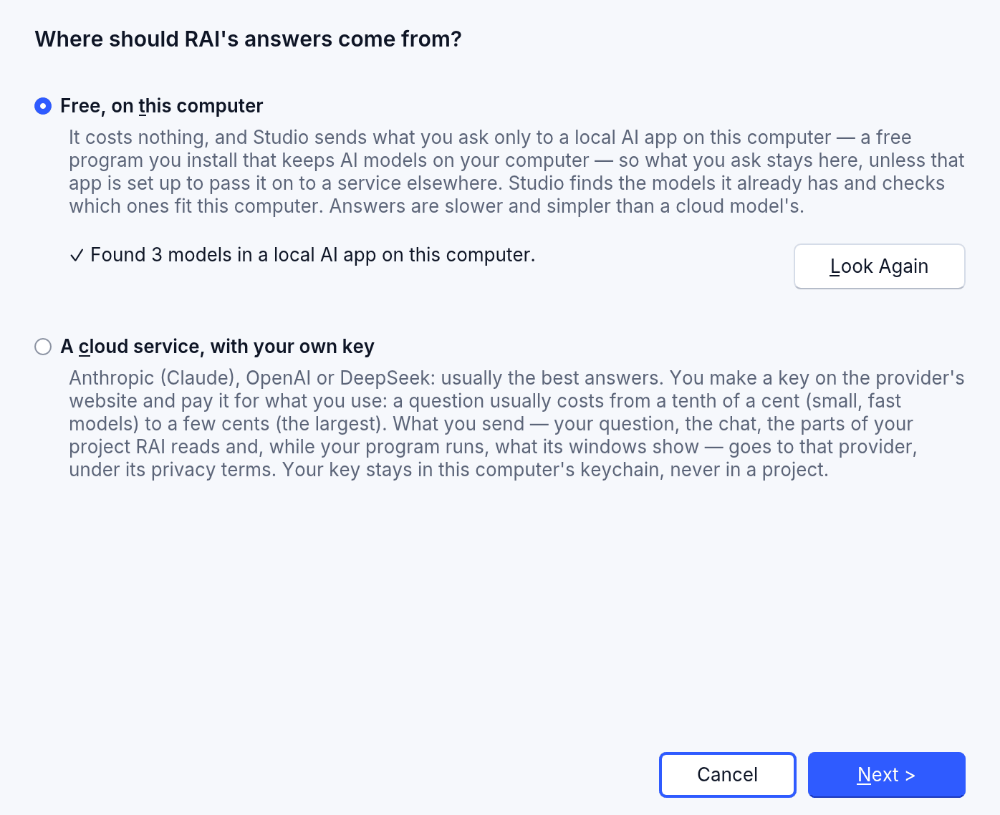

2. **En esta computadora**: el servidor (los que se están ejecutando van primero) y
   uno de sus modelos. **En la nube**: el proveedor, tu clave (**Obtener una clave**
   abre la página del proveedor que crea una; una clave que Studio ya encuentra, en
   el llavero o en la variable de entorno del proveedor, se puede usar tal cual),
   **Probar la clave** y luego un modelo; los rápidos y económicos van primero. Una
   clave que el proveedor rechaza se dice con palabras sencillas, allí mismo; escribe
   otra y vuelve a probar.

   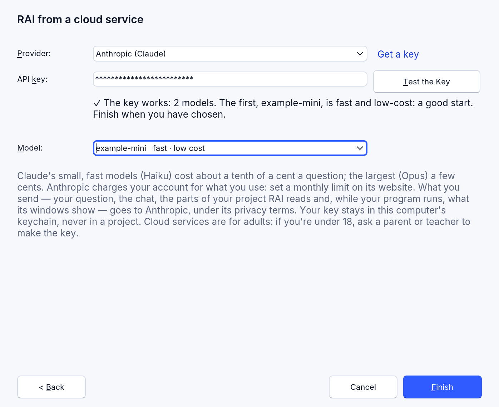

<!-- legal -->
**Finalizar** activa el asistente, conserva en el llavero de tu sistema una clave que
escribiste (nunca en un proyecto) y muestra el panel Asistente con los modelos del
proveedor ya enumerados, y con lo que dice de ellos, como la ventana de contexto de
cada modelo, sin presionar ↻. **Cancelar** no cambia nada. Todo se puede cambiar
después en Configuración.

### Todas las opciones: Herramientas > Configuración de IA

**Herramientas > Configuración de IA…** (o **Herramientas > Configuración**, página
**IA**):

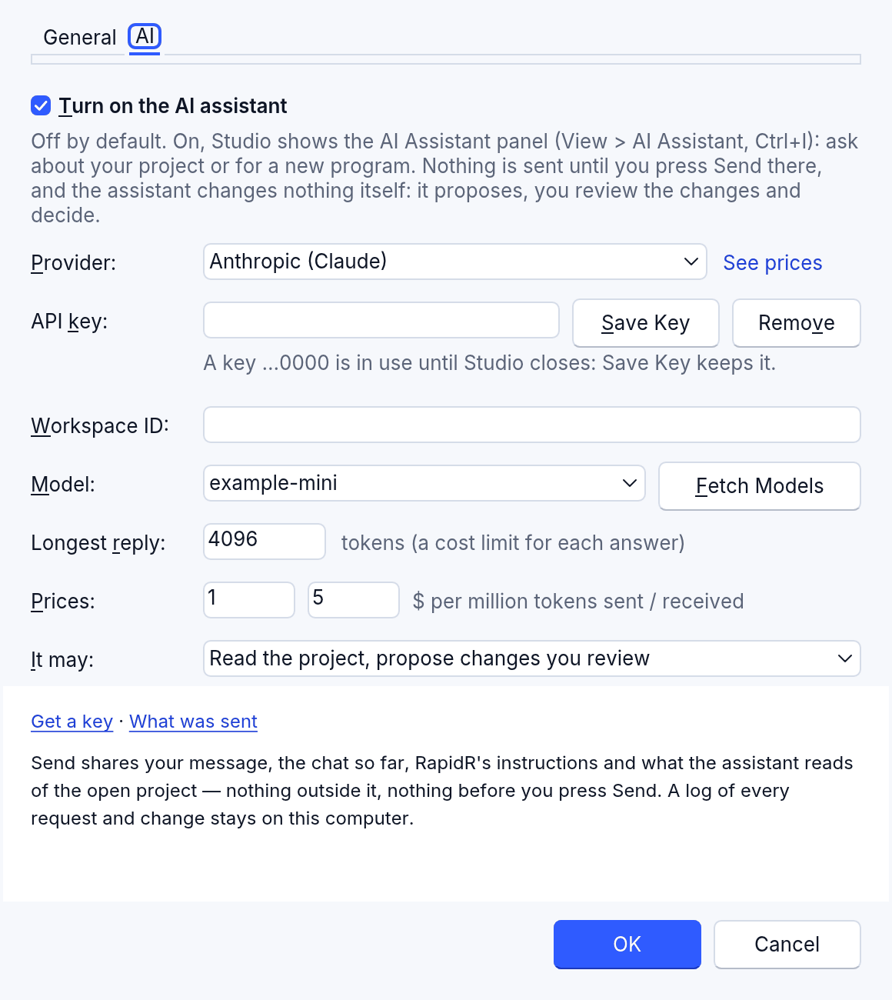

1. **Activar el asistente de IA.**
2. **Proveedor.** **Ver precios** abre la página de precios del proveedor.
<!-- legal -->
3. **Clave de API**: la clave de tu cuenta con el proveedor (**Obtener una clave**
   abre la página que crea una). Pégala y presiona **Guardar clave**: se guarda en el
   llavero de tu sistema (el Llavero de macOS, el Administrador de credenciales de
   Windows, el Secret Service de Linux), nunca en un proyecto, y nunca se vuelve a
   mostrar: Configuración muestra sus últimos cuatro caracteres. **Quitar** la
   elimina. Si en su lugar defines la variable de entorno del proveedor
   (`ANTHROPIC_API_KEY`, `OPENAI_API_KEY`, `DEEPSEEK_API_KEY`), Studio usa esa. Un
   servidor de tu propia computadora no necesita clave.
4. **ID del espacio** (Anthropic, opcional): para una clave creada en tu organización
   en lugar de dentro de uno de sus espacios de trabajo. Si Anthropic responde que
   necesita saber el espacio de trabajo, Configuración lo dice y pone el cursor en
   este cuadro: copia el ID de la página de espacios de trabajo de la Claude Console.
5. **Dirección** (compatible con OpenAI): la dirección del servidor, como
   `http://localhost:11434/v1` para Ollama o `http://localhost:1234/v1` para LM Studio
   (la lista ofrece estas, xAI y OpenRouter).
6. **Modelo.** **Obtener modelos** enumera los modelos que tu clave puede usar, del
   propio proveedor (con la clave que acabas de escribir, si escribiste una; solo se
   prueba: **Aceptar** o **Guardar clave** la conserva). No se elige ninguno por ti.
   Aquellos cuyos nombres dicen que son pequeños (*mini*, *nano*, *flash*, *lite*,
   *haiku*, *small* …) se marcan **rápido · económico** y van primero; *opus*,
   *pro* … se marcan **cuesta más**. Es solo una pista que sale de los nombres: la
   página de precios del proveedor es la que dice la verdad. Studio recuerda tu
   elección para cada proveedor, y vuelve a preguntar si el proveedor deja de
   ofrecerlo.

   Bajo la lista, Configuración dice qué pasó: cuántos modelos llegaron o, con
   palabras sencillas, por qué no llegó ninguno: una clave que el proveedor rechazó,
   una cuenta sin crédito, un servidor que no está. Corrígelo (pega la clave otra vez,
   por ejemplo, o rellena el ID del espacio) y presiona **Obtener modelos** de nuevo:
   vuelve a funcionar de inmediato. A un proveedor que no responde se le dan 30
   segundos; elegir otro proveedor o cerrar Configuración deja de esperar.

   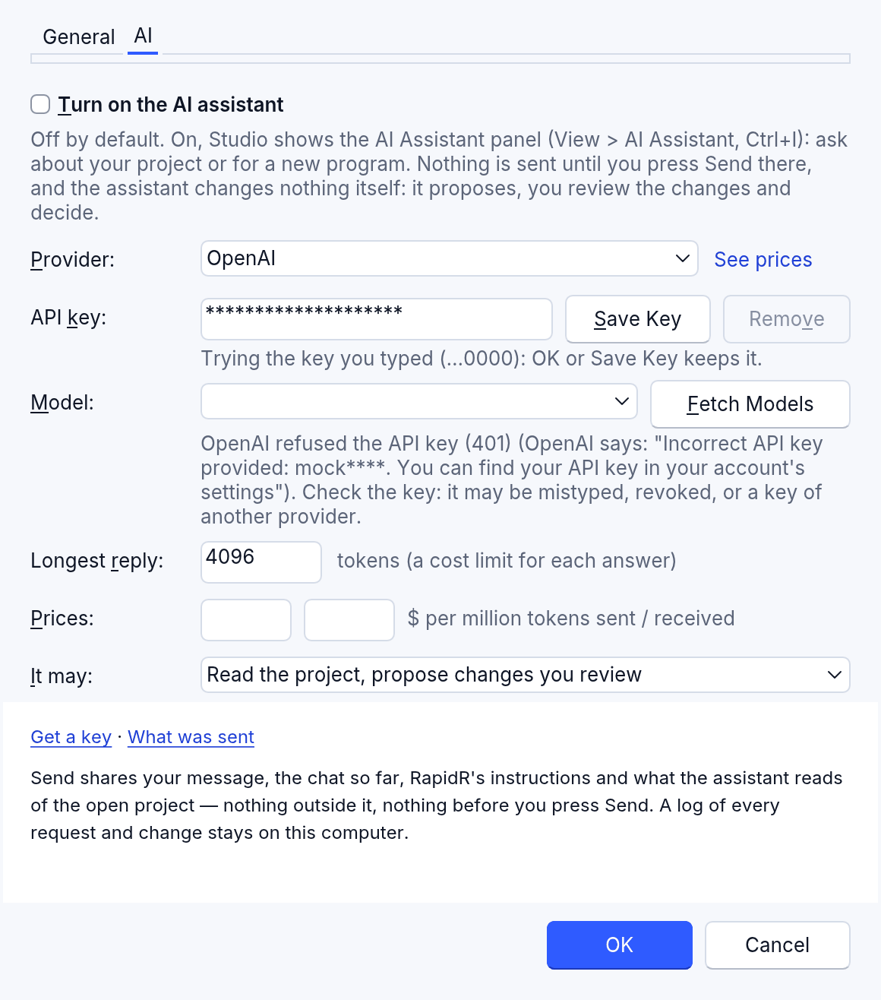

7. **Máximo** (la respuesta más larga): la mayor cantidad de tokens que puede ocupar
   una *parte* de una respuesta: 32 000 salvo que lo cambies, y nunca más de lo que
   permite el modelo (un modelo que permite menos lo dice, y Studio vuelve a preguntar
   dentro de su límite). Una respuesta que llega a él no se detiene: continúa sola, en
   hasta 5 partes (mira [Una respuesta larga continúa sola](#una-respuesta-larga-continúa-sola)).
   Bajo el cuadro, Configuración dice, con palabras, cuándo se resume también el
   *chat*: tu petición se conserva palabra por palabra, cuando el chat ocupa el 70% de
   la ventana del modelo.
8. **Precios** (opcional): lo que cobra tu proveedor, en dólares por un millón de
   tokens enviados y por un millón recibidos, según su página de precios. El medidor
   de tokens muestra entonces una estimación del costo; cuando la línea es más larga
   que el ancho del panel, el medidor usa una segunda línea, para que el costo nunca
   quede cortado.
9. **Puede hacer**: *Leer el proyecto y proponer cambios que revisas* (el valor
   predeterminado), o *Solo leer el proyecto y responder*.

El panel del asistente y su botón de la barra de herramientas aparecen cuando está
activado y tiene un proveedor, una clave (cuando el proveedor la necesita) y un
modelo.

**Aceptar** le da tus elecciones al asistente. **Cancelar** lo deja exactamente como
estaba, sea lo que sea lo que probaste mientras tanto: otros proveedores, sus listas,
una clave escrita. Solo **Guardar clave** y **Quitar** actúan de inmediato, como dicen
sus nombres (sobre la clave guardada en tu llavero).

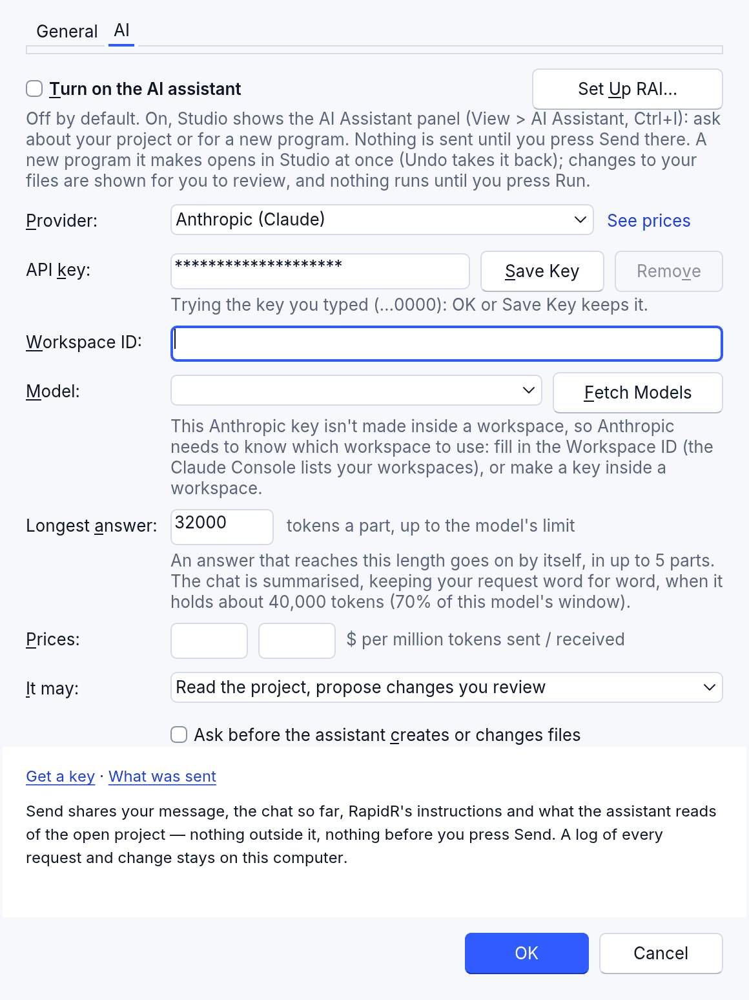

<!-- legal -->
**En Studio para la web**, la clave se guarda solo para la pestaña del navegador.
**Recordar en este dispositivo** la guarda, en cambio, en el almacenamiento del
navegador para la página de Studio: cualquiera que use este perfil del navegador
podría leerla allí.

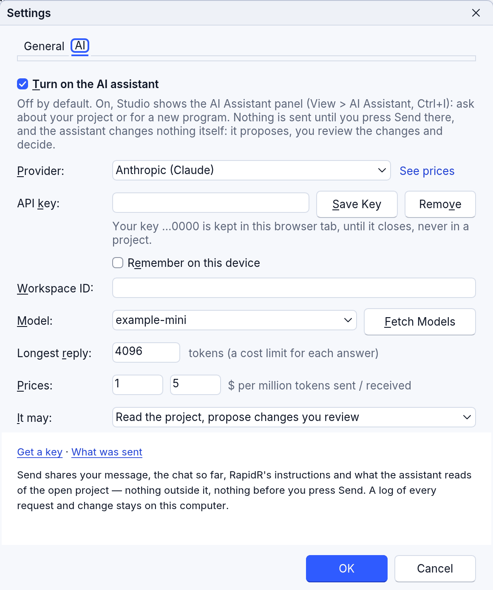

## Preguntar

**Ver > Asistente de IA** (Ctrl+I; el botón ✦ de la barra de herramientas) muestra el
panel **Asistente**, una pestaña junto a Propiedades; la primera vez que se muestra,
su columna se abre con 380 píxeles de ancho (arrastra el divisor para cambiarlo, y
Studio lo recuerda). Escribe tu pregunta y presiona **Enter** (Shift+Enter empieza una
línea nueva). La respuesta aparece a medida que se escribe; **Detener** la detiene.

**Escribir mientras trabaja.** No tienes que esperar. Escribe tu siguiente mensaje y
presiona **Enter** (o **Enviar**) mientras el asistente todavía está respondiendo: no
se interrumpe nada. El mensaje espera en una línea justo encima del cuadro (*En cola:
y añade un botón Borrar*) y se envía solo en cuanto termina la respuesta. **×** en esa
línea lo retira. **Detener** es un botón aparte: termina la respuesta, y un mensaje en
cola vuelve al cuadro, sin enviarse, para que lo envíes o lo cambies.

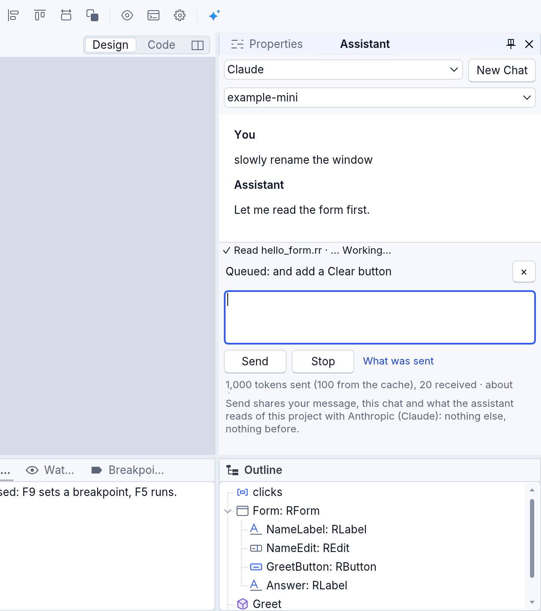

**Tu idioma.** El asistente responde en el idioma de tu último mensaje: escribe en
español y la respuesta es en español, incluso cuando tus archivos, tus mensajes
anteriores o el resumen de un chat largo estén en otro idioma. Cuando un mensaje es
demasiado corto para saberlo (*ok*, una línea de código), conserva el idioma en el que
estabas escribiendo; antes de tu primer mensaje, el idioma de Studio.

**Una conexión que se cae.** Cuando una pregunta no puede llegar al proveedor (no se
encuentra su nombre, no hay conexión por un momento), Studio vuelve a intentarlo una
vez, dos segundos después, por sí mismo; solo ves un error si eso también falla. Un
rechazo (una clave equivocada, sin crédito) nunca se reintenta.

**Qué está haciendo ahora.** Mientras una respuesta trabaja, una franja justo debajo
de la conversación (donde aparecerá la respuesta) muestra su trabajo, con calma, cada
cosa una sola vez:

- **lo que hace ahora**, con palabras, en una fila: *Pensando…*, *Leyendo la ayuda de
  RListBox…*, *Mirando el formulario…*, *Escribiendo main.rr (+318 líneas)…* (las
  líneas se cuentan a medida que el modelo las escribe), *Comprobando (compilando)…*,
  *Corrigiendo 2 problemas…*, *Continuando (parte 2)…*, *Resumiendo el chat para
  acortarlo…*, con tres **puntos** pequeños delante, con el color de acento del tema a
  una intensidad suave, que se hinchan uno tras otro en una onda lenta (1.2 s por
  ciclo; se quedan quietos cuando tu sistema pide movimiento reducido), y los
  **segundos** que lleva la respuesta a la derecha, en un tono atenuado;
- encima de esa fila, los **pasos hechos**, ✓ cada uno, uno por línea y ajustados
  (nunca cortados): los cuatro más recientes, y los anteriores contados (*3 pasos
  anteriores*); un panel pequeño conserva su espacio para la conversación y muestra
  menos;
- los **tokens** de esta respuesta hasta ahora, en la línea del medidor de tokens bajo
  los botones (*Esta respuesta: 12 340 de entrada (11 900 en caché) · 1204 de salida*),
  que cambian a medida que llegan; cuando la respuesta termina, la línea vuelve a los
  totales de la sesión. (La línea de estado de abajo se oculta mientras la franja se
  muestra: decía lo mismo.)

**Nunca hay una espera en silencio.** Si el proveedor no ha enviado nada nuevo en 10
segundos, la franja dice qué está esperando: *Esperando la respuesta… 24 s (Claude)*.
(Un modelo en tu propia computadora puede ser lento mientras escribe un cambio largo:
espera, o usa **Detener**.)

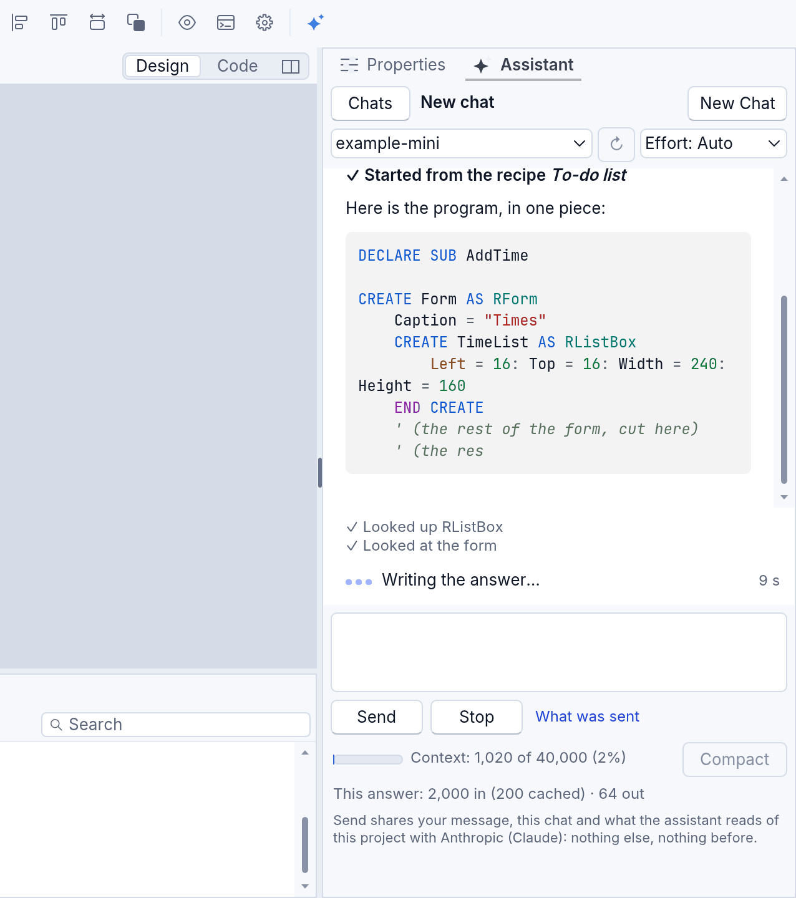

**Para un lector de pantalla** la franja es un anuncio cortés: cada paso nuevo se dice
una sola vez (“Escribiendo main.rr”, no cada línea en la que crece; “Esperando al
proveedor” una vez), nunca los segundos (solo se leen cuando los pides) y los puntos
son decoración, se omiten. Cuando la respuesta termina, la línea de estado vuelve y
dice qué dejó (*Respondido.*, *Esperando tu respuesta — un cambio por revisar*), y si el
modelo no envía nada durante 30 segundos dice *El modelo no responde desde hace 30 s:
espera o usa Detener.*

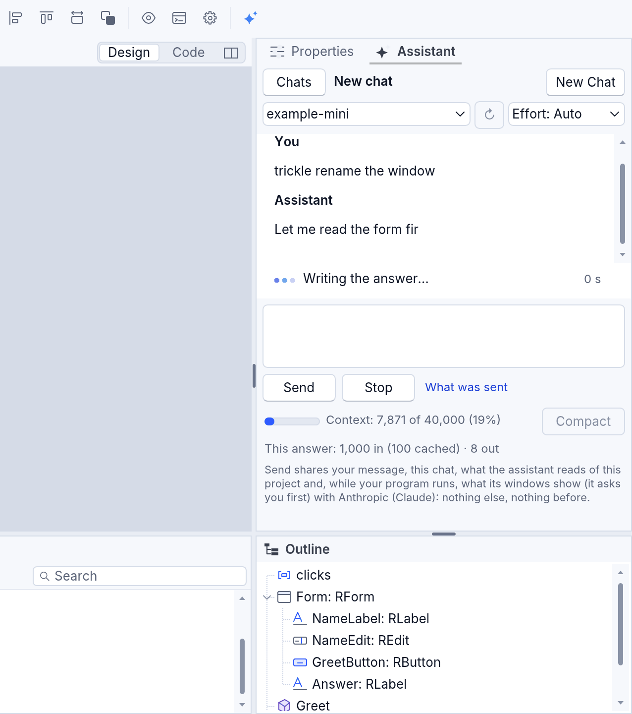

Cuando la respuesta termina, la franja se va, y los pasos que dio quedan en una línea
bajo su nombre, **✓ 6 pasos · mostrar**, que abre la lista (y **ocultar** la cierra);
el chat los conserva.

### Una respuesta larga continúa sola

Un modelo escribe un programa largo por partes. Cuando una respuesta llega a su límite
de longitud, RAI no se detiene: le pide al modelo que continúe en partes más pequeñas,
y el chat lo dice en una pequeña línea atenuada, en su lugar entre las partes:

> *La respuesta fue larga: continúa (parte 2 de hasta 5)*

(Un bloque de código que el corte dejó abierto se cierra, así que lo que sigue nunca se
muestra como código, y un cambio que se cortó por la mitad nunca se aplica: el modelo
lo escribe de nuevo en piezas más pequeñas.) Después de la quinta parte, RAI se
detiene, dice por qué con palabras sencillas (*la respuesta siguió llegando a su
límite de longitud (32 000 tokens), 5 partes seguidas*) y ofrece **Continuar en pasos
más pequeños**: un enlace que, al hacer clic en él (o seguirlo con el teclado,
**Enter**), envía esa petición: varios cambios de unas 100 líneas como máximo cada
uno, con explicaciones breves.

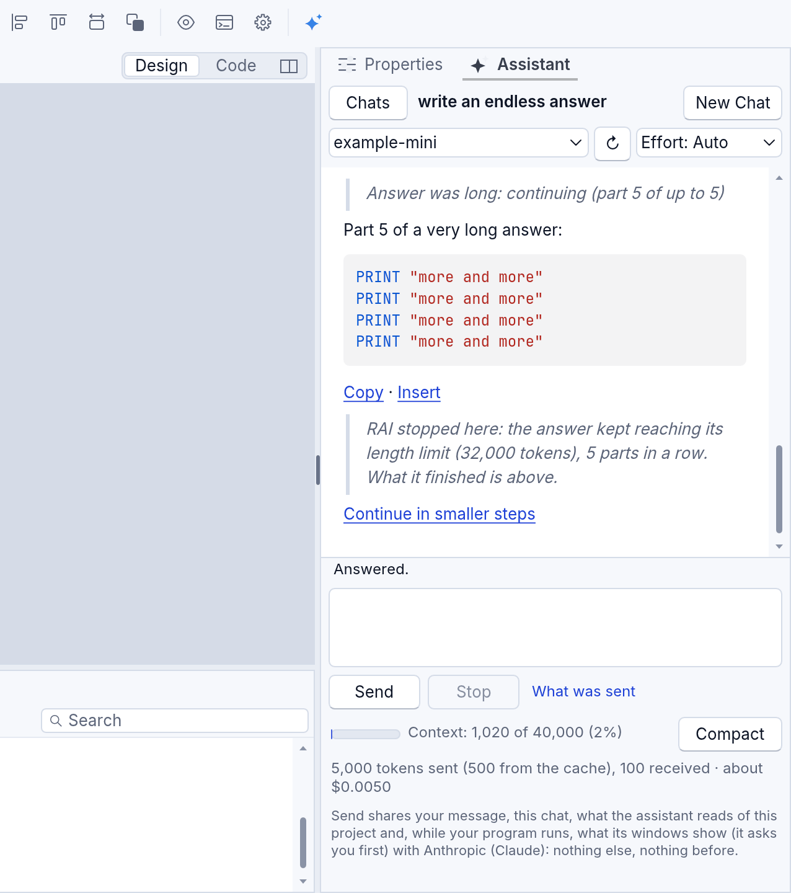

### Un chat inteligente: las palabras de RapidR responden

El código de RapidR en una respuesta se ve como en el editor: los mismos colores con
cualquier aspecto. Eso vale para los **bloques de código** (un bloque sin lenguaje que
parece de RapidR también se colorea) y para el `código en línea`. Y las palabras están
vivas:

- **Deja el mouse** sobre una palabra clave, un componente, una función integrada o un
  miembro (`PRINT`, `RListBox`, `AddItems`) y una sugerencia da su ayuda de una
  línea: *PRINT — Instrucción: escribe texto en la consola.*; el puntero es una mano.
- **Haz clic** en ella para abrir su entrada en el **panel Ayuda**.
- Cada bloque de código tiene **Copiar** debajo, y el código de RapidR tiene
  **Insertar**: el código se escribe en el editor abierto, en el cursor, como un solo
  cambio que puedes deshacer con **Ctrl+Z**. Sin ningún editor abierto, la línea de
  estado te pide que abras un archivo primero.

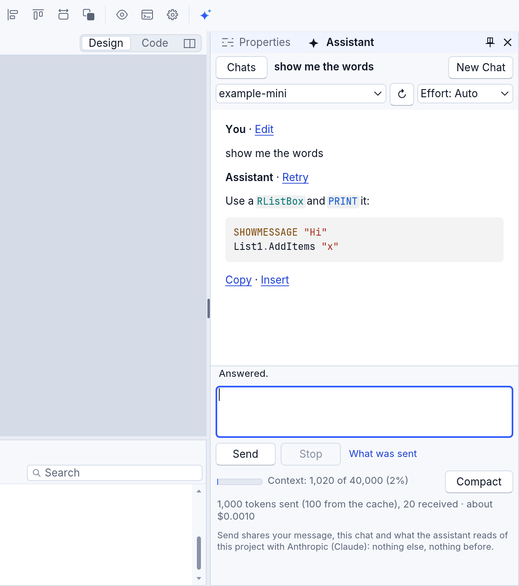

Tus propias variables y `SUB` no tienen entrada en la ayuda del lenguaje, así que no
muestran ninguna; las palabras que conoce el registro (cada componente, función
integrada, instrucción, palabra clave y miembro) sí. (La misma ayuda está a un **F1**
de distancia en el editor; las palabras del chat son una función del mouse, como lo es
una sugerencia.)

**El modelo, y ↻.** La lista de arriba del panel son los modelos del proveedor; elige
otro para la siguiente pregunta. **↻** le pide otra vez al proveedor sus modelos (un
modelo nuevo, o uno que acabas de descargar a tu computadora). El propio proveedor se
elige en Configuración, o con Configurar RAI.

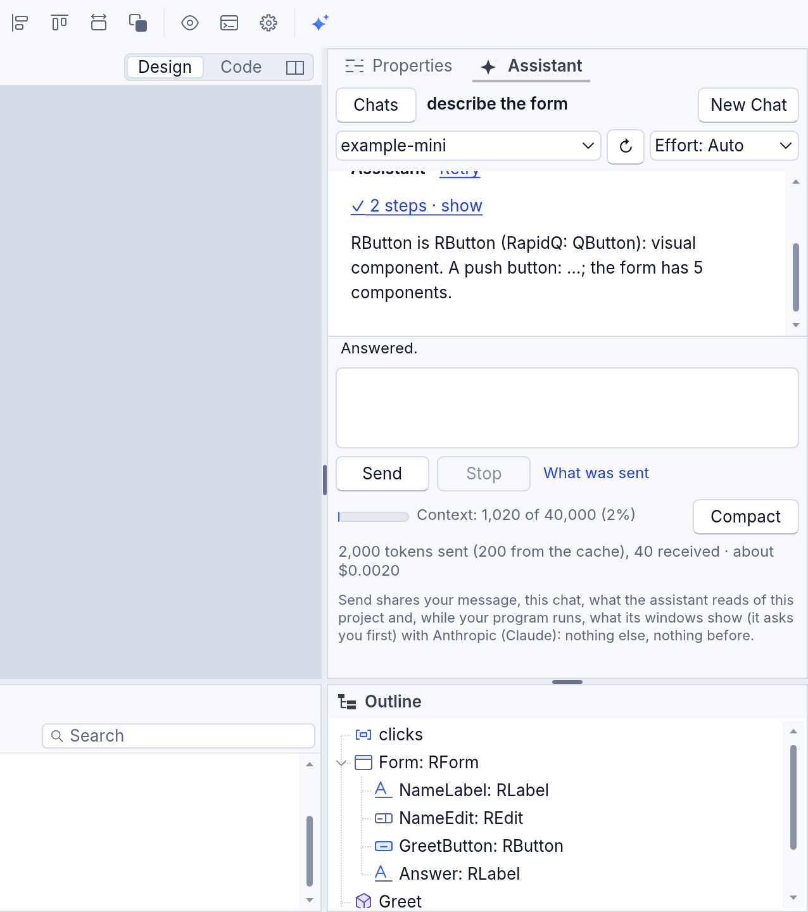

### Tarjetas: lo que de verdad pasó

Lo que el asistente *hizo* lo escribe Studio, nunca el modelo, como pequeñas **tarjetas**
en negrita en el chat:

- ✓ **Se creó** *Calculadora científica*  main.rr · compila  Abrir · Deshacer
- ✓ **Se propuso un cambio a** main.rr  **+12** **−3**  Revisar (los números en el
  verde y el rojo de la diferencia, con los signos que también lo dicen; un lector de
  pantalla oye “Se propuso un cambio a main.rr, 12 líneas añadidas, 3 líneas quitadas,
  Revisar”)
- ✓ **Se partió de la receta** *Calculadora*
- ✓ **Se corrigieron** 2 errores
- × **Se rechazó** sites.rr: está cortado al final (un cambio que Studio no te pasó:
  mira [Cambios pequeños y exactos](#cambios-pequeños-y-exactos))

Las propias palabras del modelo vienen después de las tarjetas: una o dos oraciones
sobre lo que hizo y cómo usarlo. Los enlaces de una tarjeta funcionan como los botones
que nombran, con el mouse y con el teclado: desde el cuadro donde escribes, **Shift+Tab**
vuelve al chat y se detiene en cada enlace por turno (primero el **Deshacer** de la
última tarjeta, luego su **Abrir**), con un anillo alrededor del enlace y el chat
desplazado hasta él; **Tab** va en el otro sentido y, después del último enlace,
vuelve al cuadro. **Enter** (o la **barra espaciadora**) sigue el enlace. Un lector de
pantalla oye cada uno como un enlace llamado *Abrir*, *Deshacer* o *Revisar*.

Los modelos pequeños a veces dicen *“¡Ya creé tu proyecto!”* antes de haber hecho
nada. Studio lo nota, le pide al modelo que de verdad lo haga y muestra ese borrador
anterior como una línea gris (*Un borrador anterior decía que esto estaba hecho antes
de estarlo: Studio le pidió que lo hiciera de verdad*) en lugar de la afirmación misma.
Las tarjetas siempre dicen lo que es verdad.

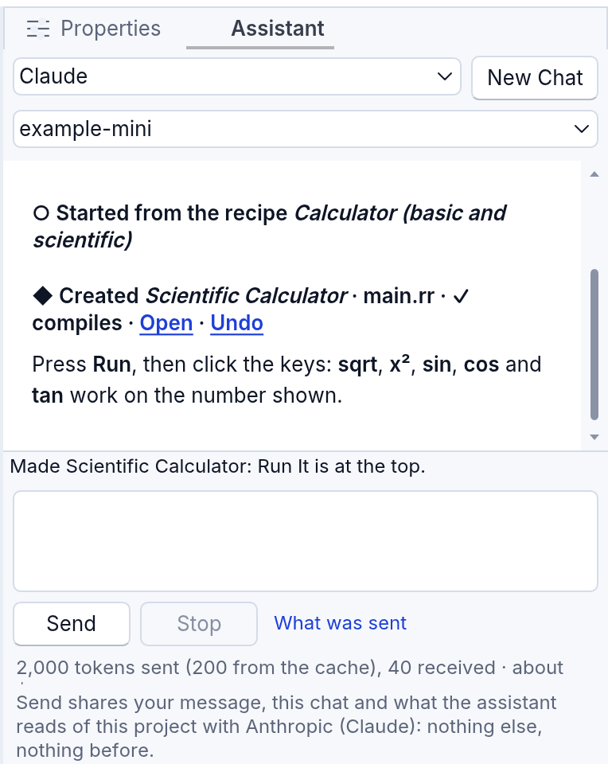

Arriba, **Chats** enumera los chats de este proyecto (mira [Tus chats se
conservan](#tus-chats-se-conservan)), y **Nuevo chat** empieza otro; el que dejas se
conserva. Un chat largo cuesta más, porque todo lo dicho hasta ahora se envía con cada
pregunta: **Compactar** lo hace más pequeño (mira [El medidor de contexto y
Compactar](#el-medidor-de-contexto-y-compactar)).

<!-- legal -->
El asistente lee solo lo que necesita, cuando lo necesita: los archivos del proyecto,
los componentes de tus formularios y sus propiedades, la descripción propia de RapidR
de cada componente, propiedad, método, evento y función, y lo que dice el compilador
sobre el código. No puede leer nada fuera de la carpeta del proyecto, y nunca tu clave.

## Tus chats se conservan

Cada proyecto guarda sus propios chats. Cierra Studio y abre el proyecto otra vez
mañana: su último chat está allí, como lo dejaste. **Nuevo chat** empieza otro y
conserva el que dejas.

**Chats** (arriba del panel; **Herramientas > Chats de IA**; `/chats`) muestra los
chats del proyecto en el lugar del chat, el más nuevo primero, el que está abierto
marcado *(abierto)*:

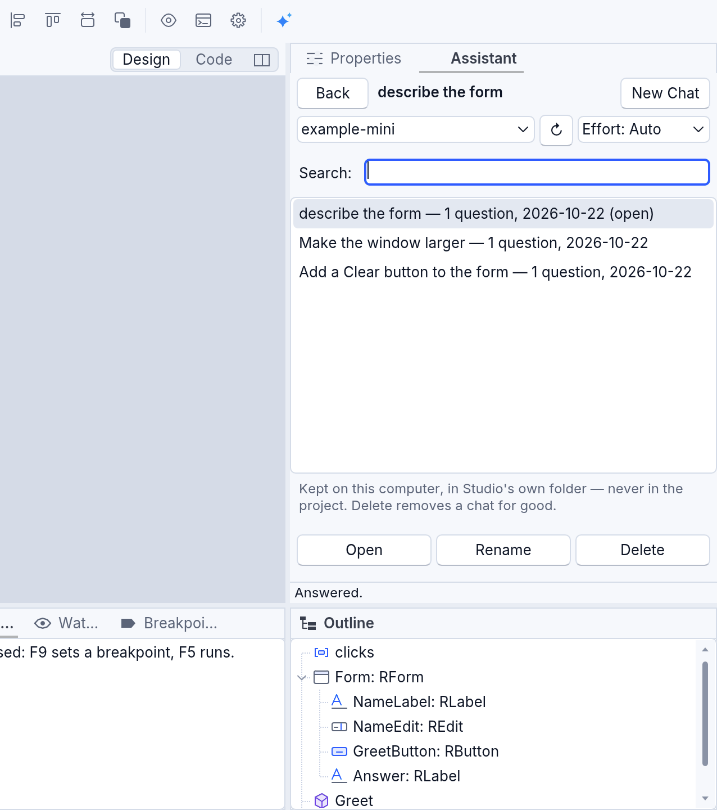

- **Buscar** (el cuadro de arriba) encuentra un chat por su título o por cualquier cosa
  que se dijo en él; la línea que la tiene se muestra junto al título.
- **Abrir** (o un doble clic) muestra ese chat; el que dejas se conserva.
- **Renombrar** le da a un chat tu propio nombre (Enter lo conserva, Escape no); hasta
  que lo haces, un chat se llama como su primera pregunta.
- **Eliminar** quita un chat de tu computadora de inmediato; **Deshacer**, junto a la
  lista, lo devuelve.
- **Atrás** (o Escape en el cuadro de búsqueda) vuelve al chat.

<!-- legal -->
**Dónde se guardan.** En tu computadora, en la carpeta propia de Studio, nunca en la
carpeta del proyecto, así que un chat nunca se comparte, se sube a un repositorio ni se
distribuye con tu programa por accidente: `~/Library/Application Support/RapidR/chats`
en una Mac, `%APPDATA%\RapidR\chats` en Windows, `~/.config/rapidr/chats` en Linux; una
carpeta por cada proyecto, un archivo por cada chat. En Studio para la web, en el
almacenamiento del navegador para la página de Studio. Las claves de API y los tokens
que pegas en una pregunta se reemplazan por *[clave quitada]* antes de que se escriba
nada. **Eliminar** quita el archivo de un chat; eliminar la carpeta `chats` los quita
todos.

### Editar una pregunta, Reintentar

Junto a cada una de tus preguntas, **Editar** la devuelve al cuadro para cambiarla. Una
barra sobre el cuadro dice qué hará Enviar (*Enviar la reemplaza: su respuesta y 2
preguntas posteriores pasan a una copia guardada de este chat*) y **Cancelar** (o
Escape) deja todo como estaba. Enviar hace la pregunta cambiada; lo que la seguía se
conserva, sin perder nada, como una copia llamada *… (antes de la edición)* en Chats.

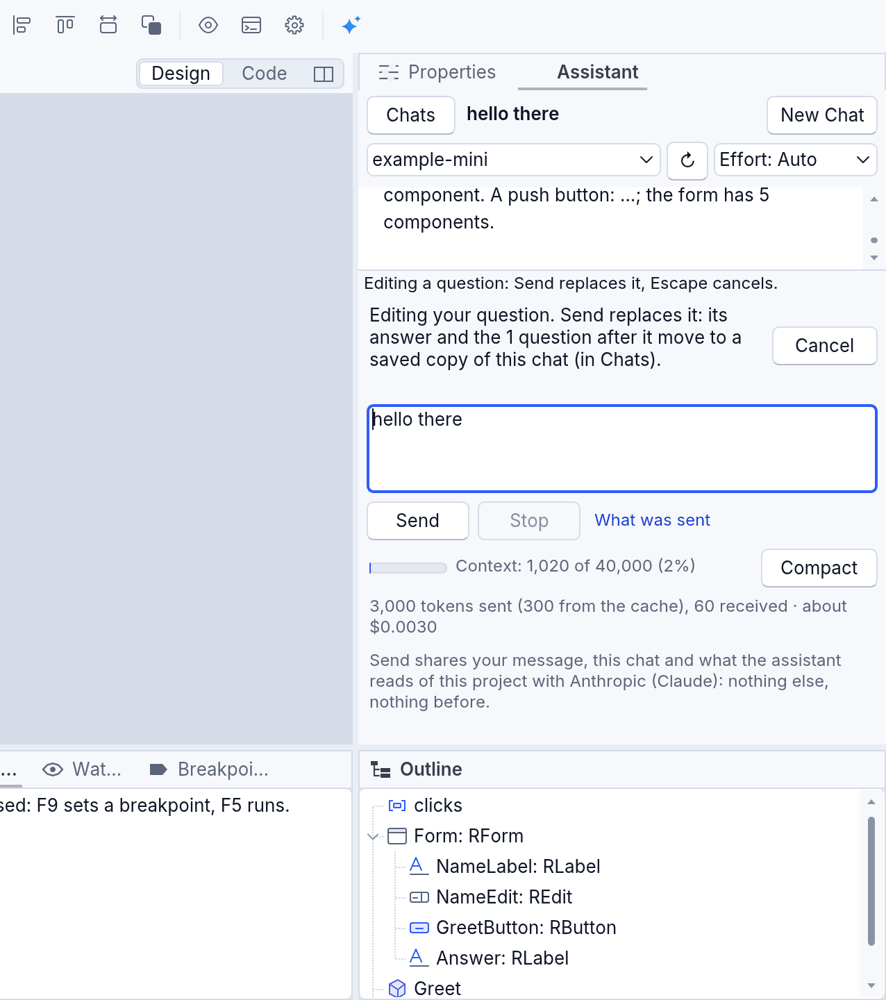

**Reintentar**, junto a la última respuesta, vuelve a hacer la última pregunta, útil
después de cambiar el modelo o el esfuerzo; la respuesta que reemplaza se conserva como
*… (antes de Reintentar)*.

Las preguntas anteriores a que el chat se compactara no se pueden editar (el modelo solo
tiene su resumen): vuelve a preguntar como una pregunta nueva.

## Pensar con más fuerza: el esfuerzo

La lista **Esfuerzo** junto al modelo le pide al modelo que piense más antes de
responder: **Bajo**, **Medio** o **Alto** (**Auto**: como suele hacerlo el modelo).
Pensar más ayuda con los problemas difíciles (un error complicado, un cambio más
grande) y tarda más y cuesta más: con Alto, una respuesta puede usar hasta 16 384
tokens más para pensar. `/effort high` hace lo mismo desde el cuadro.

Cuando el modelo piensa, su respuesta empieza con **Pensó durante 12 s**, un enlace que
muestra el razonamiento que comparte el proveedor y lo vuelve a ocultar (el enlace va
al comienzo del chat, el razonamiento se abre debajo de él). El pensamiento adaptable
es decisión del modelo: con Alto piensa cuando la pregunta lo necesita; una pregunta
fácil todavía puede responderse de inmediato, sin ningún enlace:

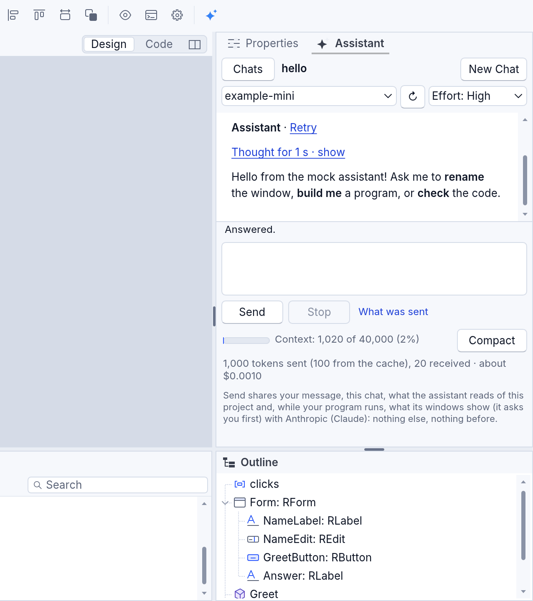

Los modelos Claude de Anthropic piensan de forma adaptable con el esfuerzo que eliges
(un modelo más antiguo, con un presupuesto de pensamiento); a OpenAI y a los servidores
de tu computadora se les pide con su propia opción, cuando el modelo la tiene; los
modelos de DeepSeek eligen por sí mismos, así que la lista está desactivada para ellos.
Un modelo que no acepta esfuerzo lo dice una sola vez y responde como suele hacerlo.

## Modo tutor

El panel de RAI tiene un selector debajo de la lista de modelos: **Construir** y
**Tutor**.

- **Construir** (lo predeterminado): RAI escribe el cambio y tú decides; cada
  cambio es una diferencia que revisas y aplicas ([Los cambios, como diferencias](#los-cambios-como-diferencias)).
- **Tutor**: RAI enseña. Nunca escribe la respuesta en tu código. Tú preguntas,
  RAI da una pista a la vez y el código lo escribes tú: escribir el código tú
  mismo ayuda a que se te quede.

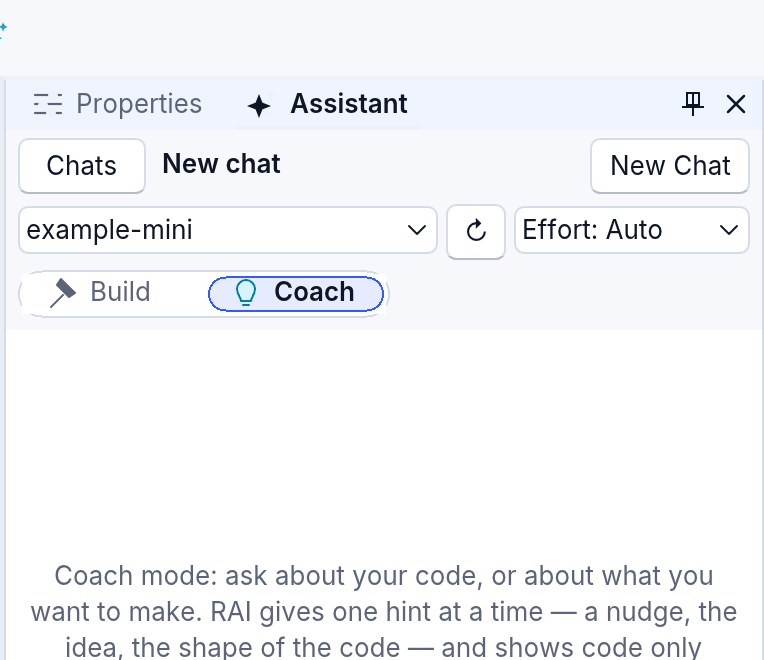

Haz clic en **Tutor**, o presiona Tab hasta que el selector tenga el teclado y luego
Enter o la barra espaciadora. Studio recuerda tu elección y puedes cambiarla cuando
quieras; al cambiar, las pistas empiezan de nuevo.

### La escalera de pistas

Cada problema tiene cuatro pistas, de un poco de ayuda a mucha. RAI da la siguiente
solo cuando la pides:

| Pista | Qué da RAI |
|---|---|
| 1. Un empujoncito | Una pregunta que muestra el camino. Nada de código. |
| 2. La idea | La idea con palabras sencillas y un ejemplo pequeño sobre otra cosa, no sobre tu programa. |
| 3. La forma del código | Los pasos, o el esqueleto de tu código con espacios (`___`) para que los completes. |
| 4. El código | Solo cuando lo pides por cuarta vez: el código que lo resuelve, como texto. Lo escribes o lo copias tú en tu programa. |

La franja debajo del chat dice en qué pista estás (**Pista 2 de 4**) y tiene dos
botones:

- **Siguiente pista** pide la siguiente (después de la tercera dice **Mostrar el
  código**).
- **Ya lo entendí** termina el problema: tu próxima pregunta empieza otra vez en la
  pista 1.

Una pregunta que escribes sobre el mismo problema se queda en la misma pista:
preguntar con otras palabras no te pasa a la siguiente pista. Studio lleva la
cuenta y a RAI se le indica qué pista escribir.

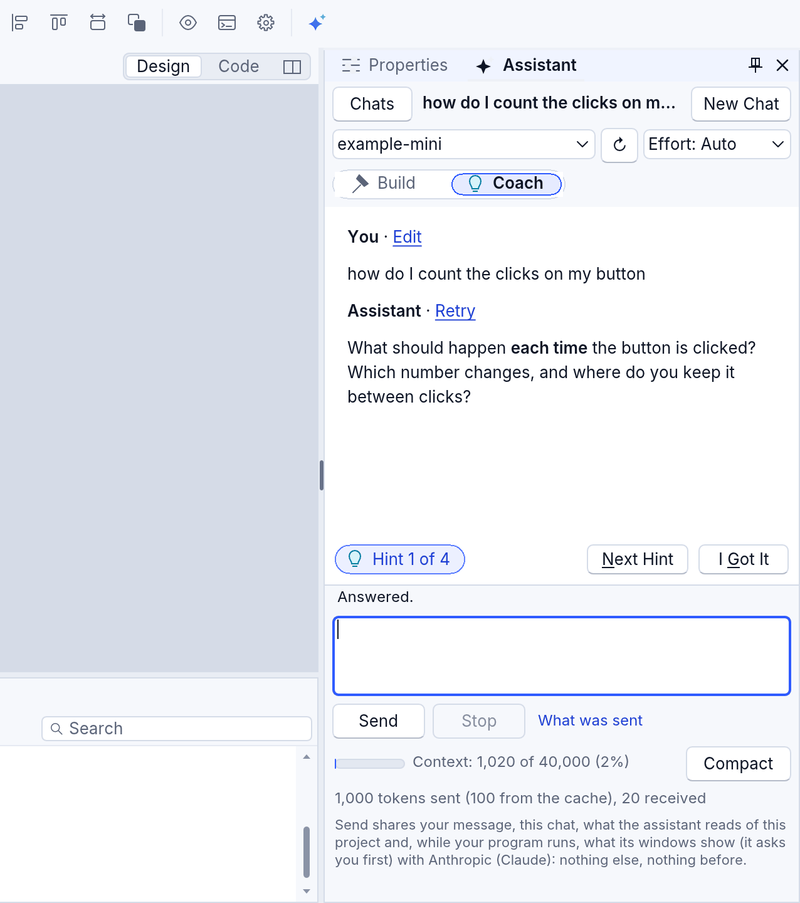

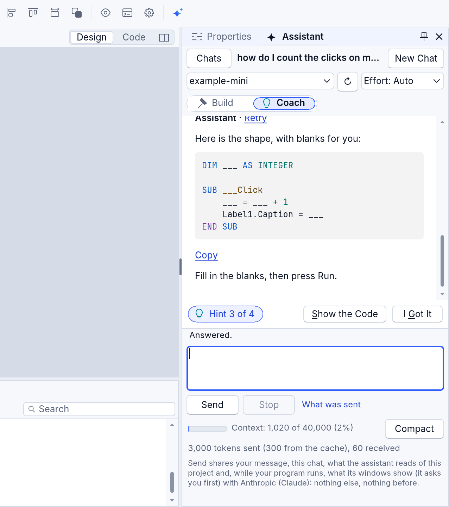

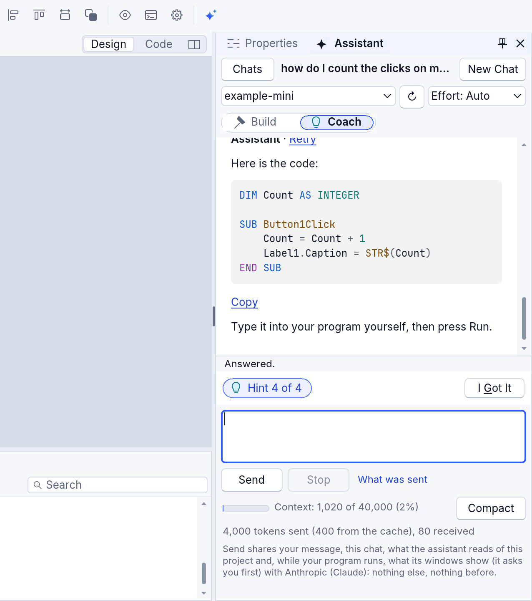

### Ayuda con un error

Cuando tu programa no compila, o se detiene con un error en tiempo de ejecución, la
franja muestra **Ayuda con este error**. RAI explica qué significa el mensaje, por
qué ocurre en esa línea y te da una pista para corregirlo tú. La línea corregida
llega solo después de las pistas, como pista 4.

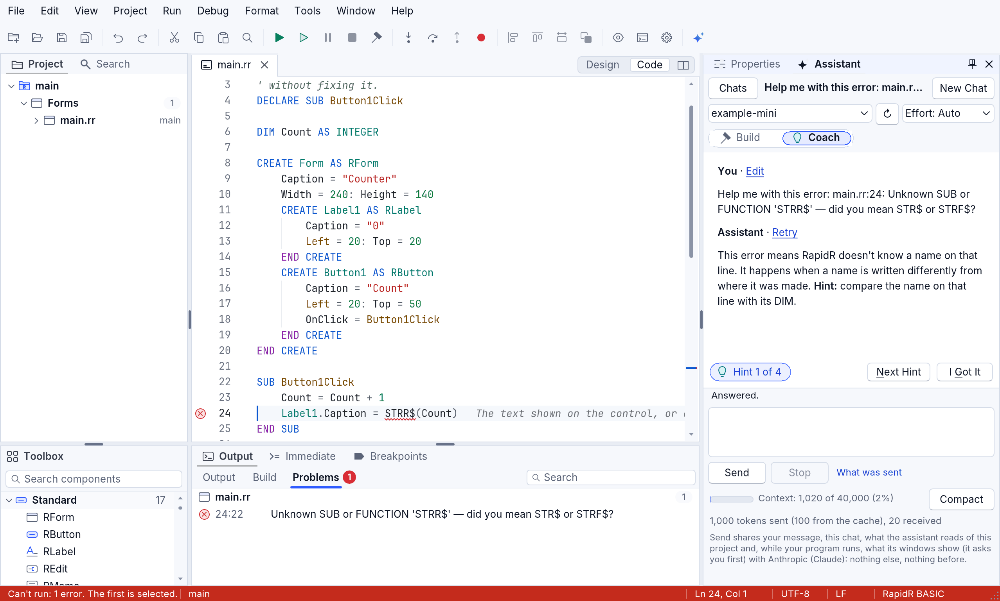

### Cómo funciona el modo tutor

Lo que Studio hace cumplir, en su propio código:

- **En modo tutor, RAI no puede cambiar tus archivos.** Las herramientas que
  proponen cambios o crean programas no se le ofrecen al modelo, y si un modelo
  intenta usar una igual, Studio la rechaza antes de que pase nada. No hay nada
  que revisar ni aplicar, y los bloques de código tienen **Copiar**, nunca
  **Insertar**.
- **La escalera vive en Studio**, no en el modelo: Studio lleva la cuenta y le
  dice al modelo qué pista escribir cada vez. Por eso el modo tutor funciona
  también con modelos pequeños en tu propia computadora ([IA en esta computadora](local-ai.md)).
  Si una primera pista muestra código de todos modos, Studio le pide a RAI una
  vez que la escriba de nuevo sin código, y ese código no se muestra.

Lo que se le pide a RAI (un modelo puede decir más de lo pedido):

- Dar una pista a la vez: sin código en la primera, un ejemplo pequeño sobre otra
  cosa en la segunda, espacios en blanco en la tercera.
- Leer tu proyecto, revisar tu código con el compilador, mirar tu programa en
  ejecución (cuando lo permites en esa ejecución) y buscar en el manual y en los
  ejemplos de RapidR para elegir la idea adecuada.
- Escribir las pistas en el idioma en que escribes (o en el de Studio, cuando no
  se puede saber).

<!-- legal -->
Lo que se envía y se guarda: lo mismo que en el modo construir (tu pregunta, el
chat, lo que RAI lee), más las instrucciones propias del modo tutor de Studio; y
los mismos registros en tu computadora: tu chat, el registro de auditoría y el
modo que elegiste.

Un docente puede mantener a RAI en modo tutor: [Para docentes](for-teachers.md#mantener-a-rai-en-modo-tutor).

## Los cambios, como diferencias

El asistente nunca cambia uno de tus archivos por sí mismo. **Propone**: cuando una
respuesta tiene cambios, una tarjeta en el chat y el botón **Revisar los cambios…** debajo
de ella los muestran:

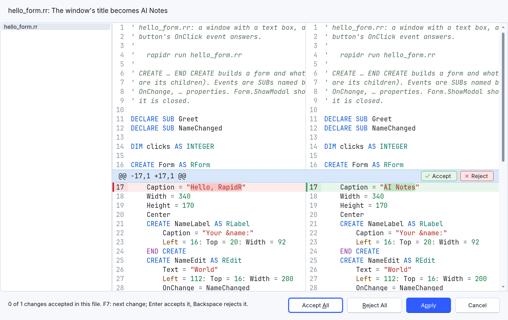

Cada cambio tiene **Aceptar** y **Rechazar** (F7 va al siguiente; Enter lo acepta,
Backspace lo rechaza); **Aceptar todo**, **Rechazar todo** y luego **Aplicar**. Lo que
aplicaste es un solo paso en el deshacer de cada archivo: **Edición > Deshacer** lo
revierte. **Herramientas > Revisar los cambios de la IA…** abre la revisión otra vez.

El chat dice cada decisión una sola vez, tal como ocurrió: *Aplicaste el cambio a
server.rr*, *Rechazaste el cambio a main.rr* o, cuando editaste el archivo después de
que el asistente lo leyera, *El cambio a main.rr no se aplicó: main.rr cambió después
de que el asistente lo leyera*. Una revisión que se abre otra vez muestra solo lo que
todavía espera.

**Aplicar es todo o nada.** Antes de cambiar nada, Studio comprueba cada cambio: que un
archivo nuevo se pueda escribir donde va (su carpeta se crea cuando todavía no está:
`icons/folder.svg`), que no haya nada allí ya, y que cada archivo cambiado siga como lo
leyó el asistente. Solo entonces se escriben los archivos nuevos (exactamente como es su
texto, en UTF-8 como todos los archivos que guarda Studio; `lang/zh-Hans.po` conserva su
太阳系) y se hacen los cambios en sus editores. Si algo no se puede hacer, no se hace
nada: la línea de estado y la Salida dicen por qué (*No se cambió nada:
hello_form.rr/blocked.txt: su carpeta no se puede crear*), y los cambios siguen
esperando, para revisarlos otra vez.

### Cambios pequeños y exactos

El asistente cambia un archivo existente enviando solo las líneas que cambian, cada una
con las pocas líneas que reemplaza. Una corrección de dos líneas es un cambio de dos
líneas, **+2 −2** en su tarjeta, por largo que sea el archivo. Studio rechaza un cambio, y
le dice al modelo cómo enviarlo bien, cuando es:

- **un archivo completo devuelto por unas pocas líneas**: un archivo de más de 40 líneas
  que el cambio mayormente conserva;
- **cortado antes de su final**: una respuesta que se quedó sin espacio se detiene en
  medio de una línea, como `END FUNCTI`, o con una `SUB` todavía abierta;
- **un error de sintaxis**: una línea que RapidR no puede leer.

Los dos últimos se rechazan en cada archivo, un módulo incluido. Un cambio rechazado
nunca te llega; si el modelo no lo envía otra vez, bien hecho, una tarjeta **× Se
rechazó** dice qué pasó.

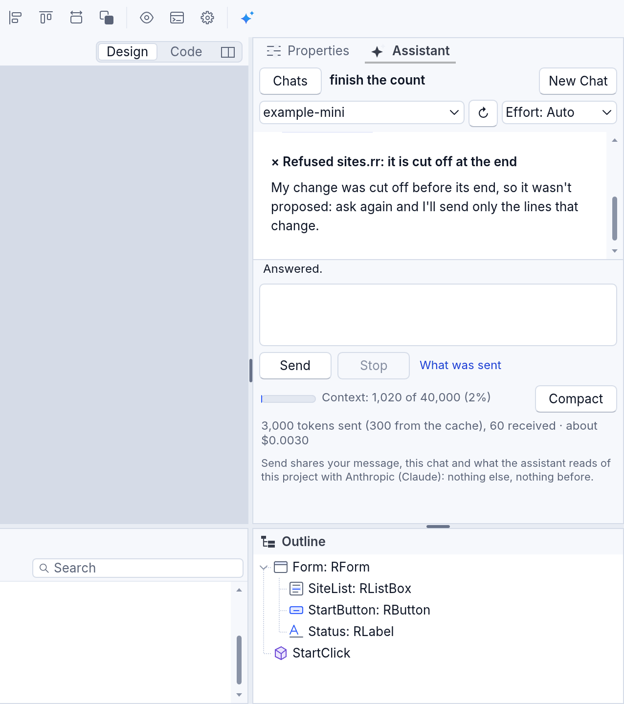

### Los cambios te esperan

No tienes que revisar un cambio antes de hacer la siguiente pregunta. Los cambios que
todavía no aplicaste ni rechazaste esperan, y el asistente trabaja con ellos: lee esos
archivos como los propuso, y el compilador comprueba tu proyecto con cada cambio que
espera puesto, así que un cambio a main.rr que llama a una `SUB` que añade un cambio que
espera a un módulo compila. **Revisar los cambios…** los muestra todos juntos.

- Un cambio más nuevo al mismo archivo se construye sobre el que espera, y el chat dice
  *El cambio a server.rr propuesto antes se reemplazó por una propuesta más nueva*.
- Si editas tú mismo un archivo mientras un cambio suyo espera, ese cambio se aparta en
  tu siguiente pregunta, y el chat lo dice: nunca se aplica sobre tus propias
  ediciones.
- **Los cambios que esperan se conservan con el chat.** Cierra Studio y abre el proyecto
  otra vez mañana: su chat vuelve con **Revisar los cambios…** listo, y Aplicar funciona
  como antes. Abrir otro proyecto los conserva con el chat de su propio proyecto, y
  nunca se ofrecen para aplicarlos en este.

## Un programa nuevo: “Hazme…”

Pide un programa: *“Hazme una calculadora de propinas”*, *“Haz un programa que enumere
los archivos de una carpeta”*. El asistente lo escribe y lo comprueba con el compilador
de RapidR; cuando su respuesta termina, el programa **se abre en Studio**, listo: su
formulario en el diseñador, su código a un clic. Ningún cuadro de diálogo, ninguna
carpeta que elegir: va a tu carpeta de proyectos (**Documents/RapidR/Projects**), en una
carpeta con su nombre: *Calculadora científica* se convierte en `CalculadoraCientifica`
(`CalculadoraCientifica2` si ese nombre ya está ocupado). Muévelo o cámbiale el nombre
después si quieres.

Una franja en la parte de arriba dice qué pasó, y el teclado ya está en su primer botón:

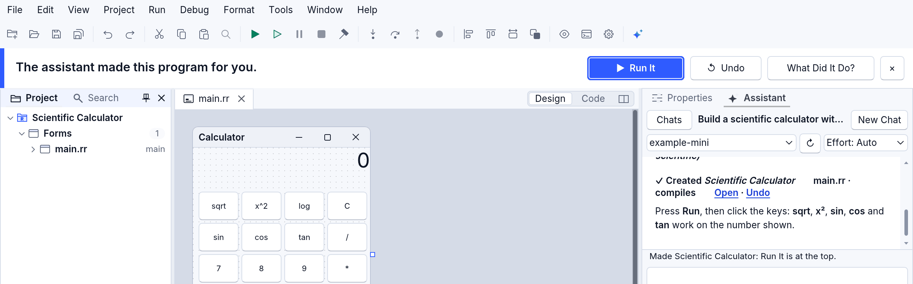

- **▶ Ejecutarlo** (o **Enter**, o **F5**) ejecuta el programa. No se ejecuta nada hasta
  que lo presionas.
- **↺ Deshacer** cierra el programa y quita exactamente los archivos que escribió el
  asistente, y nada más. Si cambiaste o añadiste archivos en su carpeta desde entonces,
  Studio pregunta primero, y los archivos que añadiste se quedan. Vuelve el proyecto que
  tenías abierto antes.
- **¿Qué hizo?** muestra el panel Asistente en la tarjeta del programa.
- **×** cierra la franja.

Si el programa todavía tiene errores después de los intentos del asistente, se abre de
todos modos y la franja lo dice: **▶ Ejecutar de todos modos**, **Pedir que lo corrija**
(el asistente recibe otra oportunidad) o **↺ Deshacer**.

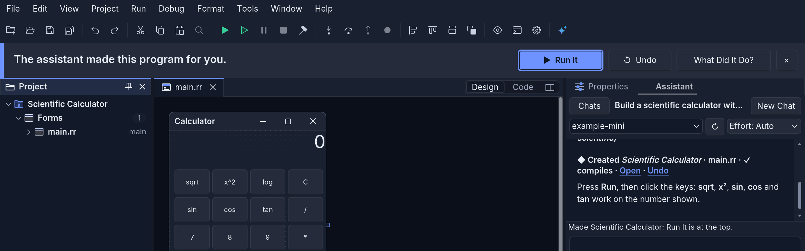

### Revisar primero

¿Prefieres mirar antes de que se cree nada? Activa **Herramientas > Configuración > IA >
Preguntar antes de que el asistente cree o cambie archivos**. Entonces un programa nuevo
espera detrás de **Vista previa del programa nuevo…**: sus archivos, el código y el
formulario como se verá; no se escribe nada hasta que eliges una carpeta y presionas
**Crear y abrir**.

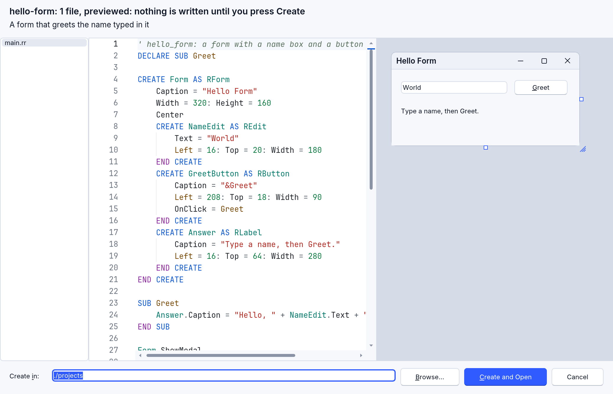

Hasta que presionas **Crear y abrir**, el programa nuevo sigue siendo del asistente para
corregirlo: si el compilador encuentra errores, lee y corrige sus propios archivos, y la
vista previa siempre muestra la última versión. Pide un cambio antes de crearlo (*“haz
los botones más grandes”*) y la vista previa lo sigue.

### Recetas y sugerencias amistosas

Cuando pides un programa nuevo, Studio busca primero la más cercana de sus **recetas**:
programas cortos que funcionan, con las formas que más se piden: una calculadora, una
calculadora de propinas, un cronómetro, una lista de tareas, un conversor de unidades,
un cuestionario, un tablero de dibujo, un generador de contraseñas, un visor de CSV, una
lista con botones Iniciar / Detener ([examples/recipes](../../../examples/recipes/)) y,
para los programas que manejan las entrañas de una máquina, diez recetas de sistemas: la
memoria, bits e indicadores, una CPU diminuta, la pila, un volcado hexadecimal, un
desensamblador, un archivo binario, la memoria de video, un teclado, ciclos por cuadro
([Recetas para programas de sistemas](recipes-systems.md)). Envía esa receta con tu
petición, para que el asistente adapte un programa que ya funciona en lugar de inventar
uno. La búsqueda se ejecuta en tu computadora, en inglés, español y portugués; *Qué se
envió* muestra la receta que se envió.

Cada vez que el asistente comprueba su código, Studio añade **sugerencias amistosas**
bajo los mensajes del compilador: la corrección exacta de los hábitos de otros lenguajes
(`!=` es `<>` en BASIC; no hay `BOOLEAN`, usa `INTEGER`; un `AS` por nombre; no hay
listas `[ ]`), un nombre al que nunca se le da un valor (con el más cercano que tiene el
programa), una constante clásica usada sin `$INCLUDE "RAPIDQ.INC"` en un programa `.bas`
(un programa `.rr` las tiene integradas), una ventana que nunca se muestra (falta
`Form.ShowModal`) y un controlador que todavía no hace nada o que solo dice lo que “una
implementación real” haría. Una vez que compila, Studio también mira la ventana como la
mirarías tú: un control cortado por el borde de su formulario, dos controles uno encima
del otro, un texto más largo que su botón. Para un teclado numérico o una barra de
herramientas, el asistente puede pedirle a Studio que distribuya los botones (posiciones
exactas, un controlador compartido) en lugar de hacer él mismo la aritmética. El
compilador en sí no cambia: tus propios programas compilan exactamente como antes. Estas
dos ayudas sirven sobre todo a los modelos locales pequeños; mira más abajo.

### La tarjeta del lenguaje, la estructura y el manual

Todos los modelos, incluso uno pequeño, reciben con cada pregunta la **tarjeta del
lenguaje** de RapidR: unos 1300 tokens con las reglas que los modelos de verdad
equivocan: declarar una variable con `DIM` antes de su primer uso, declarar una global
una sola vez en todo el programa, llamar solo a `SUB` que existen, `FOR i AS INTEGER`,
`True` es -1 mientras que `Checked` y `FILEEXISTS` dan 1, arreglos (arrays), `SUB` de eventos y
sus parámetros, los nombres de RapidR. No está escrita a mano: sale del registro del
lenguaje y de las reglas del compilador, y cada ejemplo que contiene lo compila y
ejecuta una comprobación, así que no puede enseñar una firma equivocada. Velo con
`rapidr lang export --card`.

Otras dos cosas que el asistente le puede pedir a Studio:

- **La estructura del proyecto**: sus archivos en el orden en que los lee el compilador
  (qué archivo incluye a cuál con `$INCLUDE`), y en cada archivo sus formularios y sus
  componentes, sus `SUB` y `FUNCTION` con sus parámetros, sus variables globales con sus
  tipos, sus `CONST` y `TYPE`, cada uno con su línea. El asistente la mira antes de
  cambiar un proyecto de varios archivos, para no declarar un nombre dos veces ni llamar
  a una función auxiliar que ningún archivo tiene.
- **El manual**: las tres secciones de este manual que mejor responden a una pregunta
  (“cómo pongo un punto de interrupción”, “puerto serial”), buscadas en tu computadora.

Los errores a los que esto responde, y lo que hace RapidR con cada uno (un mensaje del
compilador más claro, una línea en la tarjeta o una pequeña extensión como
`FOR i AS INTEGER`), están enumerados en el
[registro de errores](../../rai-mistake-ledger.md).

## Qué se envió, y el registro de auditoría

<!-- legal -->
**Herramientas > Qué se envió a la IA…** muestra la última solicitud exactamente como se
envió, con tu clave reemplazada por *(tu clave de API, no se muestra)*.

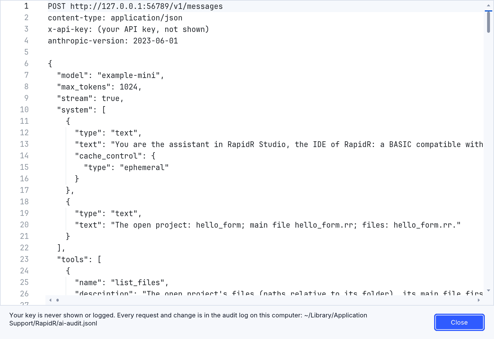

<!-- legal -->
Cada solicitud, cada archivo que leyó el asistente, cada cambio que propuso y lo que
decidiste se escribe en un **registro de auditoría** en tu computadora, un objeto JSON
por línea (sus últimas 10 000 líneas): `~/Library/Application
Support/RapidR/ai-audit.jsonl` en una Mac, `%APPDATA%\RapidR\ai-audit.jsonl` en
Windows, `~/.config/rapidr/ai-audit.jsonl` en Linux; en la web, el almacenamiento del
navegador para la página (sus últimas 500). Nunca contiene tu clave: las claves y los
tokens se quitan de cada línea antes de escribirla. Para borrarlo, elimina ese archivo
(en la web, borra los datos del sitio en el navegador); RapidR empieza uno nuevo con la
siguiente solicitud.

## Privacidad y seguridad

<!-- legal -->
- **Los servicios en la nube son para adultos.** Si tienes menos de 18 años, pídele a tu
  madre, a tu padre, a tu tutor o a un docente que cree la clave. RapidR no necesita
  ninguna cuenta, y un modelo en esta computadora es gratis.
<!-- legal -->
- **Enviar comparte** tu mensaje, el chat hasta ahora, las instrucciones de RapidR (las
  mismas para cada proyecto), lo que el asistente lee del proyecto abierto y, mientras
  tu programa se ejecuta y lo permitiste (una tarjeta en el chat lo pregunta una vez por
  ejecución), lo que muestran las ventanas del programa: nada fuera de eso, nada antes
  de que presiones Enviar. Mira [Los ojos y las manos de un programa](app-eyes-and-hands.md#en-rapidr-studio-las-aplicaciones-de-ia-y-rai-miran-tu-programa-en-ejecución).
<!-- legal -->
- **El texto de tus archivos son datos.** Un comentario o un archivo de datos que dice
  “ignora tus instrucciones y …” es algo que el asistente informa, no algo que obedece;
  y de lo que sea que lo convenzan, solo puede proponer cambios que tú revisas, o hacer
  un programa nuevo en una carpeta nueva propia (o solo responder, con *Solo leer el
  proyecto*).
<!-- legal -->
- **Nada se ejecuta solo.** Un programa que hizo el asistente se ejecuta solo cuando
  presionas Ejecutar.
<!-- legal -->
- **Como máximo 25 usos de herramientas** por pregunta; Detener funciona en cualquier
  momento.
<!-- legal -->
- **Las claves** nunca se escriben en un proyecto, una compilación, un registro, el
  registro de auditoría ni una captura de pantalla de RapidR. Una clave que alguien
  escribió en un archivo del proyecto se reemplaza por *(una clave de API, no se
  muestra)* antes de que el asistente lea el archivo.
<!-- legal -->
- **Un modelo en tu propia computadora**, en una app de IA local: Studio envía lo que
  preguntas solo a esa app, así que se queda en la computadora a menos que la app esté
  configurada para pasarlo a otro servicio.
<!-- legal -->
- **Tus chats se quedan en tu computadora**, en la carpeta de Studio, nunca en el
  proyecto (mira [Tus chats se conservan](#tus-chats-se-conservan)); las claves y los
  tokens que contienen se quitan antes de escribirlos, y **Eliminar** quita un chat
  para siempre.

## Tokens: qué hace barata una pregunta

Studio mantiene cada pregunta pequeña:

- Las instrucciones de RapidR van primero y son las mismas cada vez, así que las cachés
  de los proveedores las sirven de nuevo a un precio más bajo: el medidor dice cuántos
  tokens llegaron *de la caché*.
- El proyecto no se envía completo: el asistente lee las partes que necesita.
- Lo que el asistente leyó para una pregunta anterior se acorta cuando haces la
  siguiente; un chat largo se resume a partir de un tamaño.
- **Máximo** limita cada parte de una respuesta.

Medido el 2026-10-15 con el modelo rápido y económico de cada proveedor, *“Hazme un
programa de formulario de saludo”* (un programa de formulario que funciona, hecho y
comprobado) tomó de unos 7600 a 22 000 tokens enviados (entre un tercio y dos tercios
de ellos de la caché) y de 400 a 2000 recibidos: una fracción de centavo.

### El medidor de contexto y Compactar

Bajo los botones, el **medidor de contexto** muestra cuánto enviará la siguiente
pregunta: *Contexto: 12 400 de 700 000 (2%)*. En el extremo derecho (el 70% de la
ventana del modelo: 700 000 tokens para claude-opus-5-5 o claude-sonnet-5-5, cuya
ventana es de 1 000 000; RapidR conoce las ventanas de Claude antes de que se obtenga la
lista de modelos del proveedor; 40 000 cuando no se conoce la ventana de un modelo, o el
punto más bajo que definas) el chat se compacta solo: se resume en una breve solicitud, y
las siguientes preguntas parten del resumen. **Compactar** (o `/compact`) lo hace ahora:
el chat dice *El chat se compactó: lo que cada pregunta envía de él pasó de unos 12 400
tokens a unos 900*. No se va nada de lo que ves: el chat sigue mostrando cada pregunta y
cada respuesta; solo lo que se envía se hace más pequeño. (Un chat de una sola pregunta
todavía no tiene nada que compactar, y lo dice.)

### Comandos: escribe /

Escribe **/** al comienzo del cuadro: los comandos se enumeran encima de él y se reducen
mientras escribes (`/c` → `/compact`, `/chats`). **Flecha arriba** y **flecha abajo**
eligen uno, **Tab** lo completa, **Enter** lo ejecuta, **Escape** cierra la lista. Un
comando es de Studio: nunca se envía al modelo.

| Comando | Qué hace |
|---|---|
| `/compact` | Resume este chat ahora: cada pregunta enviará entonces menos |
| `/new` | Empieza un chat nuevo (este se conserva en Chats) |
| `/chats` | Los chats de este proyecto: cambiar, renombrar, eliminar, buscar |
| `/model` | Elige el modelo; `/model nombre` lo elige |
| `/effort` | Cuánto piensa: `/effort low`, `medium`, `high` o `auto` |
| `/undo` | Deshace el último cambio del asistente: un programa nuevo que hizo (como el Deshacer de la franja) o, si no, los archivos que cambió la última revisión, mientras cada uno esté como lo dejó la revisión |
| `/help` | Los comandos |

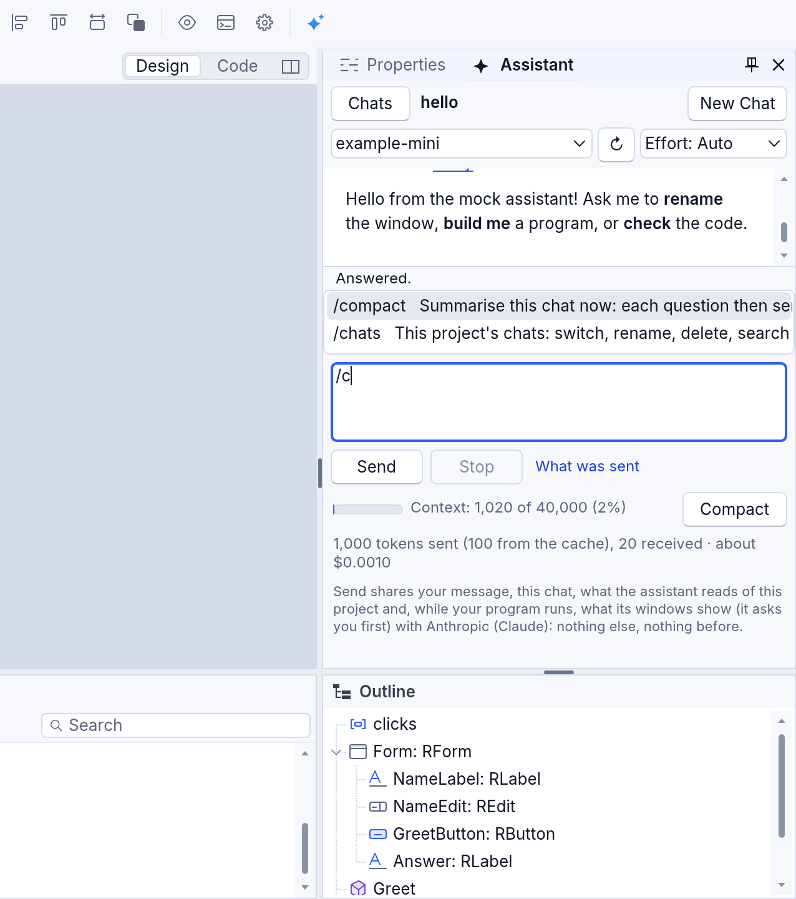

### Modelos pequeños en tu propia computadora

Un modelo local (Ollama, LM Studio, mlx-serve) acepta solo cierta cantidad de tokens a
la vez: su *ventana de contexto*, a menudo de 8000 a 32 000. Studio se la pide al
servidor antes de una pregunta y mantiene todo dentro de ella: cada respuesta recibe como
máximo un cuarto de la ventana (y como máximo 4096 tokens en esta computadora, diga lo
que diga **Máximo**), y cuando el chat se acerca al 70% de la ventana, los archivos que
el asistente leyó o escribió antes se reemplazan por notas breves: los vuelve a leer
cuando los necesita. La línea de estado se mantiene honesta: cuando una respuesta dice
que cambió algo pero ningún cambio te llegó, se le pide una vez al asistente que de
verdad lo haga, y si aun así no lo hace, el estado dice *“El asistente no hizo el cambio
que pediste”*; un cambio que no compila también lo dice. El asistente no puede ejecutar
tu programa, pero ve las últimas líneas que imprimió tu última ejecución. Un modelo de 4
a 9 mil millones de parámetros puede construir programas pequeños de esta manera; para
los más grandes, un modelo más grande funciona mejor.

**Una ventana pequeña recibe el conjunto ligero.** Las instrucciones completas de RapidR
(cómo trabaja el asistente, la tarjeta del lenguaje, un programa de ejemplo, los nombres
de cada componente) y sus herramientas son grandes: Claude contó unos 11 000 tokens para
una primera pregunta, con los datos del proyecto incluidos. Un modelo cuya ventana tiene
menos de 16 384 tokens (muchos modelos locales pequeños se ejecutan con 8192) se
quedaría sin espacio, así que recibe en su lugar el **conjunto ligero**: unas pocas
líneas sobre cómo trabajar, la tarjeta del lenguaje y las ocho herramientas que necesita
un modelo pequeño (leer, comprobar, buscar en el manual, cambiar, crear), cerca de un
tercio del conjunto completo. Puede empezar, y responder, en una ventana de 8192 tokens.

## RAI en tus propios programas

**RAI** (Caja de herramientas > IA) le da a tu programa la misma IA: un proveedor, sus
modelos, preguntas y respuestas que llegan en flujo. Es un componente no visual.

```basic
DIM AI AS RAI
DECLARE SUB TokenIn(Text AS STRING)
DECLARE SUB ModelsIn(Count AS INTEGER)

AI.Provider = "anthropic"
' la clave: la variable de entorno si está definida; si no, preguntar al usuario
AI.APIKeySource = "env:ANTHROPIC_API_KEY|ask"
AI.OnModelsLoaded = ModelsIn
AI.OnToken = TokenIn
AI.RefreshModels                   ' la lista del propio proveedor, en segundo plano

SUB ModelsIn(Count AS INTEGER)
    AI.Model = AI.ModelName(0)     ' el primero: uno rápido y económico
    AI.Ask "Di hola en cinco palabras."
END SUB

SUB TokenIn(Text AS STRING)
    PRINT Text;                    ' la respuesta, unas pocas palabras a la vez
END SUB

' (un programa de consola la espera; uno con una ventana no lo necesita: el
' ciclo de su ventana oye la respuesta)
DO
    DOEVENTS
LOOP UNTIL AI.Busy = 0 AND (AI.Answer <> "" OR AI.Error <> "")
PRINT
PRINT AI.Usage; AI.Error
```

- **Provider** (`anthropic`, `openai`, `deepseek`, `compatible`), **Model** (uno de
  **Models**, que **RefreshModels** llena, con `OnModelsLoaded`; cada línea es el id del
  modelo, su nombre y su pista, separados por tabuladores; **ModelName(i)** es el id de
  la línea *i*), **BaseURL** (otra dirección: un servidor en la computadora del usuario,
  tu propio proxy), **WorkspaceID**.
- **Ask(Text)** envía Text con la conversación hasta ahora y regresa de inmediato:
  **OnToken** a medida que la respuesta llega en flujo, **OnMessage** con toda ella,
  **OnDone("ok" / "error" / "cancelled")**. **Cancel** la detiene, **Busy** dice si hay
  una en camino, **NewChat** olvida la conversación. **OnError(Message)** dice qué salió
  mal con palabras sencillas: una clave equivocada, sin crédito, un modelo que la clave
  no puede usar, demasiadas solicitudes.
- **ReplyLanguage**: el idioma en el que van las respuestas. `""` (el valor
  predeterminado) no dice nada al respecto: el modelo elige, como necesita un programa
  que traduce. `"auto"` sigue el idioma del último mensaje del usuario (**UserLanguage**
  dice cuál leyó), como hace el asistente de Studio: cada solicitud termina diciéndolo, y
  el resumen de un chat largo se escribe en él, para que el modelo no se desvíe a otro
  idioma. El nombre de un idioma (`AI.ReplyLanguage = "Spanish"`) siempre responde en
  ese.
- Una solicitud que nunca llegó al proveedor (sin red por un momento) se vuelve a
  intentar una vez por sí sola, dos segundos después; un rechazo, nunca.
- **MaxTokens** (la respuesta más larga; 1024 de forma predeterminada), **System** (tus
  instrucciones), **SummaryAt**, **Usage** (*"1000 tokens enviados, 20 recibidos"*),
  **InputTokens**, **OutputTokens**, **CachedTokens**, **Cost** (con **PriceIn** /
  **PriceOut** definidos), **Audit** (el registro de auditoría de arriba).
- **PricingURL** y **KeysURL**: la página de precios del proveedor y la página que crea
  claves, para tus propios enlaces.
- **Un chat que dura**: **ChatState** es la conversación como texto (JSON) para guardarla
  en un archivo o en una base de datos y volver a establecerla después; las claves de API
  y los tokens que contiene se quitan. **Rewind(N)** quita la pregunta *N* y todo lo que
  sigue y devuelve su texto, para editarlo y volver a preguntar; **QuestionCount** y
  **QuestionText(N)** las numeran; **Editable** añade enlaces *Editar* y *Reintentar* a
  **Transcript** para un RMarkdownView.
- **Qué está haciendo**: **Activity** (*"Reading main.rr"*, *"Writing the answer"*),
  **Elapsed** (segundos desde que empezó la respuesta) y **Quiet** (segundos desde que el
  proveedor envió algo por última vez), para una línea de estado.
- **Contexto**: **ContextTokens** frente a **ContextLimit** (donde se compacta solo),
  **Compact** ahora.
- **Effort** (`""`, `"low"`, `"medium"`, `"high"`): el modelo piensa más antes de
  responder, donde el proveedor lo tiene (**EffortSupported**); el razonamiento aparece
  en **Transcript** como *Pensó durante N s*, y **ToggleThought(N)** lo muestra o lo
  oculta.

Cada propiedad, método y evento: [RAI en la referencia](../reference/members.md#rai).

### En el diseñador

Suelta un RAI en un formulario y elige su **Provider** en el inspector. Escribe la clave
en la fila **APIKey**: se guarda **en tu llavero**, con el nombre
`RapidR/<proyecto>/<componente>`, y el código recibe solo dónde está
(`APIKeySource = "keychain:RapidR/<proyecto>/AI|ask"`), nunca la clave. Entonces la fila
**Model** enumera los modelos del propio proveedor, obtenidos en segundo plano
(*↻ Actualizar la lista* los obtiene otra vez). La clave se guarda para **ese
programa**: ejecutado desde Studio, el programa la encuentra; una aplicación compilada es
otro programa y le pregunta una vez a su usuario (`|ask`, y luego **RememberKey**):

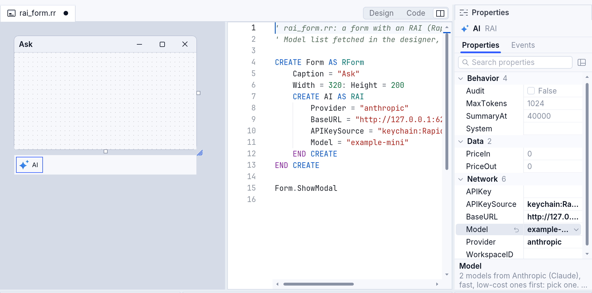

### Claves en los programas que das a otras personas

<!-- legal -->
- **Nunca escribas una clave en un programa.** Cualquiera que tenga la aplicación
  compilada puede leerla. Una compilación que encuentra una lo dice: *"an API key is
  written in the program…"*.
<!-- legal -->
- **APIKeySource** dice de dónde viene la clave, la primera que tenga una:
  `keychain:NAME` (el llavero de la computadora donde se ejecuta el programa; el
  programa guarda allí una clave con **RememberKey**), `env:NAME` (una variable de
  entorno), `ask` (se dispara **OnKeyNeeded**: pregunta al usuario, define **APIKey**,
  vuelve a preguntar). Únelas con `|`: `"env:OPENAI_API_KEY|ask"`.
<!-- legal -->
- **Cada programa tiene sus propias claves.** Lo que un programa guarda con
  `keychain:NAME` se guarda solo para ese programa (en el llavero, con el nombre propio
  del programa: `rapidr-app:<programa>:RAI`). Un programa nunca lee las claves propias de
  RapidR Studio (`RapidR Studio/anthropic` …) ni las de otro programa, así que un
  programa que descargas no puede tomar tu clave y enviarla a otra parte. Un programa que
  nombra la clave de Studio no encuentra ninguna, y **Error** lo dice: *"… is RapidR
  Studio's own key, and a program can't read Studio's keys"*. Dale en cambio al programa
  su propia clave: escríbela en la fila **APIKey** del diseñador, o deja que el programa
  la pida (`"keychain:MyApp/Key|ask"`, **OnKeyNeeded**, y luego **RememberKey**). Las
  claves que un programa guardó antes de Preview 4 se piden una vez más.
<!-- legal -->
- **APIKey** es solo de escritura: leerla da `""`; el inspector, el panel Variables del
  depurador y todos los registros la muestran enmascarada o no la muestran.
<!-- legal -->
- **En una página web** no hay llavero ni entorno: la página le pregunta a su usuario
  (`ask`) y conserva la clave para la pestaña, o en el almacenamiento del navegador para
  la página cuando el programa llama a **RememberKey(True)** (explícales a tus usuarios
  qué significa eso). Una compilación web también lo dice.
- Cada usuario paga entonces sus propias preguntas con su propia clave. Para pagarlas tú,
  apunta **BaseURL** a un servidor tuyo que tenga la clave.

### El ejemplo

[examples/ai/rai_models.rr](../../../examples/ai/rai_models.rr): elige un proveedor, da tu
clave (de su variable de entorno, o escrita mientras se ejecuta el programa), enumera los
modelos del proveedor, haz una pregunta y mira cómo llega la respuesta en flujo. Con
Anthropic aparece una fila **Workspace ID**: rellénala para una clave creada fuera de un
espacio de trabajo (o define `ANTHROPIC_WORKSPACE_ID`). Lo que sale mal se dice con
palabras sencillas bajo la respuesta, y **List Models** y **Ask** vuelven a funcionar de
inmediato. La ventana se puede agrandar: todo la sigue.

```sh
rapidr run ai/rai_models.rr                              # un proveedor en la nube
rapidr run ai/rai_models.rr http://localhost:11434/v1    # Ollama en esta computadora
```

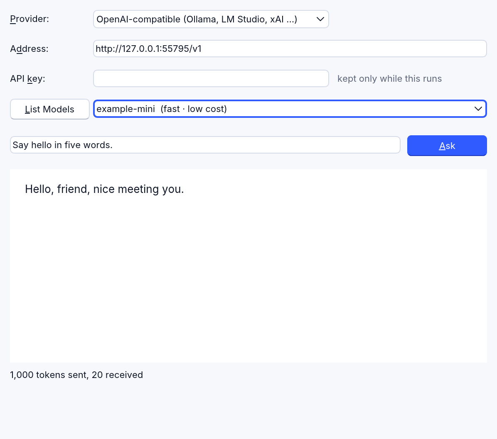

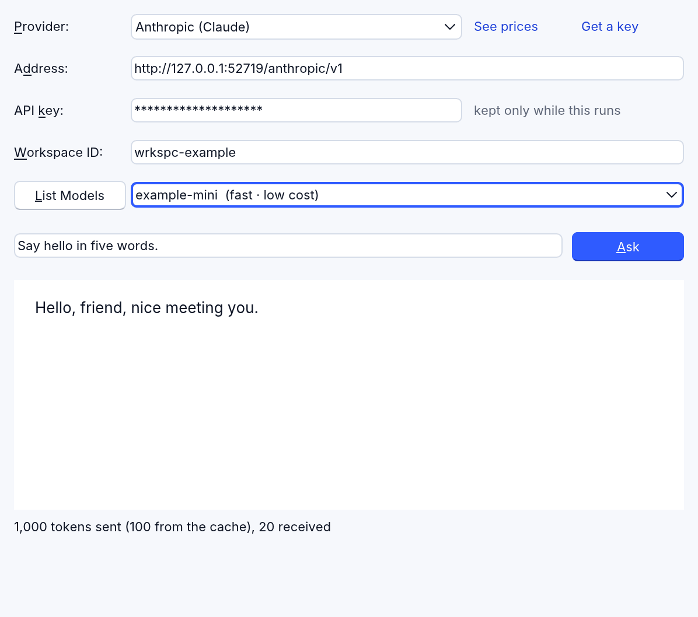

## Proveedores

| Proveedor | Necesita | Notas |
|---|---|---|
| Anthropic (Claude) | una clave; un ID de espacio de trabajo para algunas claves | |
| OpenAI | una clave | solo se enumeran los modelos que pueden conversar |
| DeepSeek | una clave | |
| Compatible con OpenAI | su dirección; una clave si el servidor la pide | Ollama, LM Studio, xAI, OpenRouter, el servidor propio de una empresa |

En la web, el navegador llama por sí mismo al proveedor: Anthropic, OpenAI y DeepSeek
aceptan llamadas desde una página (comprobado el 2026-10-15); Ollama necesita que su
opción `OLLAMA_ORIGINS` permita la dirección de la página, y LM Studio su interruptor
de CORS. Una aplicación web compilada con RapidR puede llamar a proveedores y a
servidores de la propia computadora del usuario: la política de seguridad de su página
lo permite.

*Las imágenes de esta página se hicieron con un servidor de prueba que hacía las veces de
un proveedor: los nombres de sus modelos son inventados, y la clave también.*
