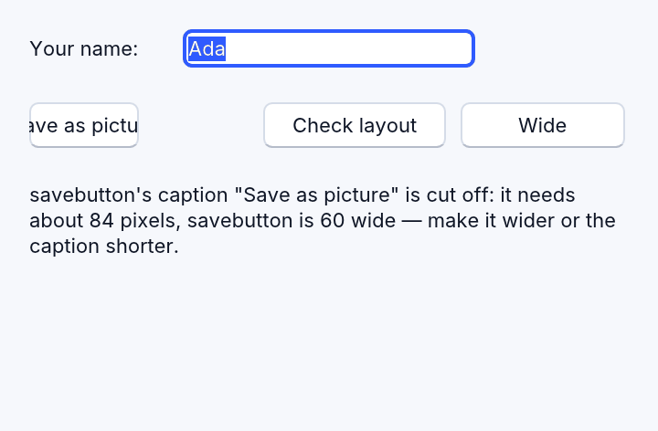
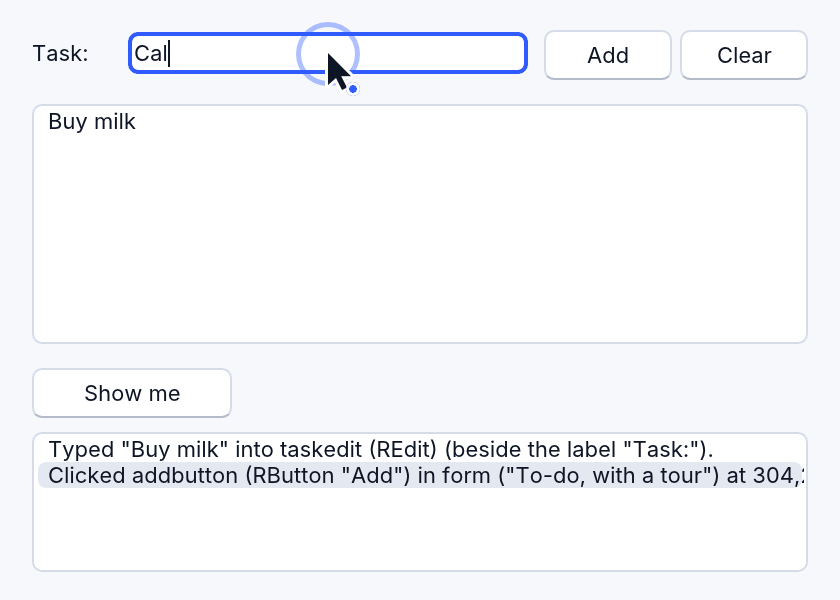
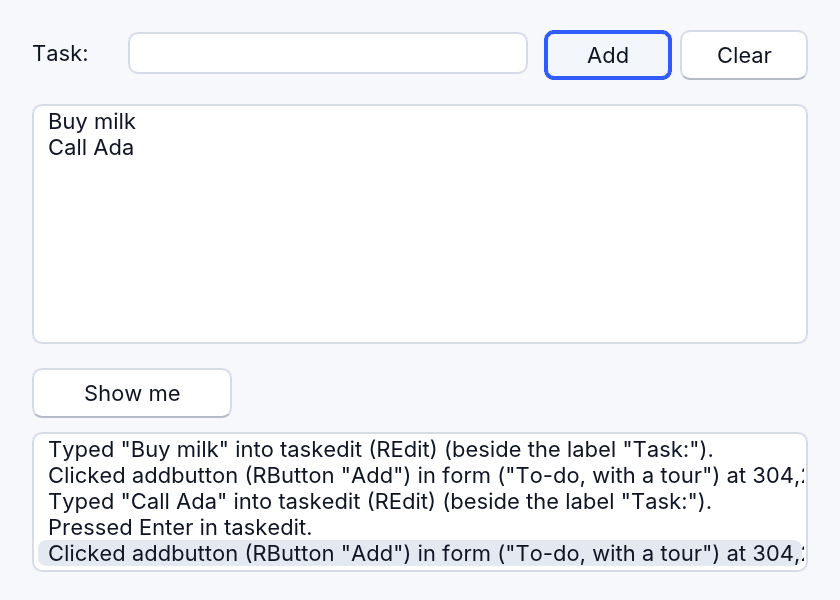
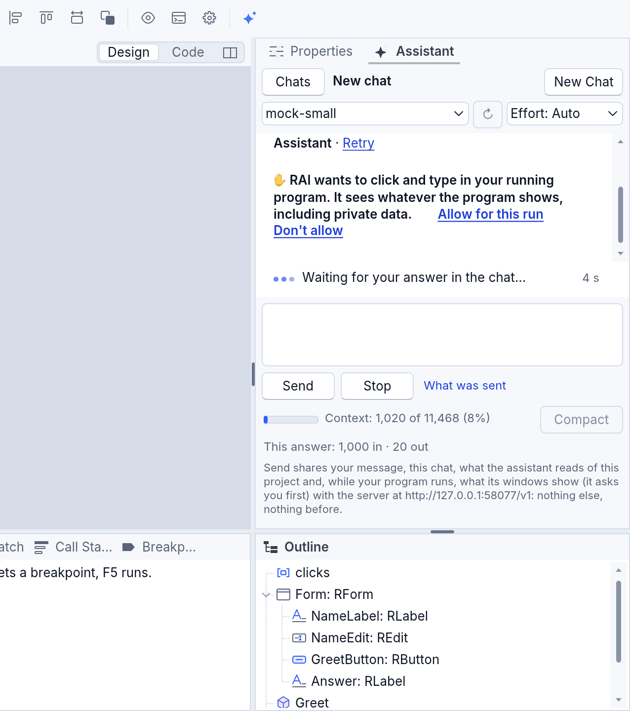

<!-- translated-from: app-eyes-and-hands.md b33f420aa11e3853 -->
# Los ojos y las manos de un programa: RWindowCapture y RAppHands

Un programa de RapidR puede ver sus propias ventanas y usarlas como lo haría una
persona:

- **RWindowCapture**, sus ojos: una imagen de sus ventanas, y un informe de dónde
  está cada control y qué se ve mal (texto cortado, controles unos sobre otros, un
  control más allá del borde de la ventana);
- **RAppHands**, sus manos: clics, escritura, teclas, arrastres y la rueda del
  mouse, reproducidos en sus propias ventanas con un puntero que puedes ver.

RapidR Studio usa los mismos ojos y manos cuando una IA mira tu programa en
ejecución o hace clic en él (las herramientas `app_*`, y las de RAI: mira más
abajo).

<!-- legal -->
Ambos llegan **solo a las ventanas propias del programa**. Nunca leen la
pantalla, nunca mueven tu mouse real ni presionan tus teclas reales, y no pueden
ver ni tocar otro programa, el escritorio ni RapidR Studio. Por eso no necesitan
del sistema el permiso de Grabación de pantalla (*Screen Recording*) ni el de
Accesibilidad (*Accessibility*).

## RWindowCapture: imágenes y el informe de disposición

<!-- legal -->
> **Úsalo con responsabilidad.**
> - **Tus ventanas pueden mostrar datos privados de otras personas.** Una imagen
>   o un informe de disposición los contiene todos: nombres, direcciones,
>   calificaciones, mensajes. Consérvalos en la computadora del propio usuario.
>   Antes de que uno vaya a cualquier otro lugar (un servidor, un correo
>   electrónico, un servicio de IA, una herramienta de análisis), la persona tiene
>   que saberlo y estar de acuerdo, y recopila solo lo que necesites. Dile a la
>   gente, con palabras sencillas, qué se captura y adónde va.
> - **Nada de grabar a escondidas.** Nunca captures ni grabes las ventanas de una
>   persona sin avisarle antes de que empiece y sin mostrar que está activado.
>   Enviar a un servidor imágenes o grabaciones de las pantallas de los usuarios
>   es tratar datos personales: en la UE y el Reino Unido necesita una base legal
>   (por lo general el consentimiento) y tu aviso de privacidad; algunos estados
>   de EE. UU. consideran escucha ilegal (*wiretapping*) grabar en secreto lo que
>   las personas hacen en una página o una aplicación, y las multas se cuentan por
>   persona. Mantenlo desactivado de forma predeterminada, enmascara los campos de
>   contraseña y los datos personales, y no lo hagas en programas para niños sin
>   el permiso de un padre, una madre o la escuela.
> - **Actúa solo dentro de tu propio programa, y no debe usarse para eludir
>   nada.** Reproduce entradas en las ventanas propias de tu programa y en nada
>   más: ni en el sistema ni en otros programas. No lo uses para hacer clic en
>   “Acepto”, “Pagar” o “Eliminar” por alguien que no lo ha elegido, para
>   responder una pregunta de seguridad, una contraseña o una solicitud de
>   permiso, para imitar a personas (votos o “me gusta” falsos, bots de juegos),
>   ni para automatizar otro servicio en contra de sus términos.
> - **Lo que hace clic ocurre de verdad.** Los recorridos, las demostraciones y
>   las pruebas automáticas pueden enviar correos reales, cobrar tarjetas reales
>   y eliminar datos reales. Ejecútalos con datos de prueba.



El ejemplo es [examples/gui/snapshot.rr](../../../examples/gui/snapshot.rr):
`rapidr run gui/snapshot.rr` desde la carpeta de ejemplos. Presiona **Narrow** y
luego **Check layout**: el programa encuentra su propio texto cortado.

```basic
DIM Eyes AS RWindowCapture

Eyes.Scale = 1                         ' 1: un píxel de imagen por cada píxel del programa
IF Eyes.SaveToFile("snapshot.png", "Form") THEN
    PRINT "guardada"; Eyes.Width; " x"; Eyes.Height
ELSE
    PRINT Eyes.Error                   ' no hay esa ventana, una carpeta en la que no puedes escribir …
END IF

PRINT Eyes.LayoutReport               ' cada ventana que se muestra, en palabras
IF Eyes.Problems <> "" THEN PRINT "Algo se ve mal:"; Eyes.Problems
```

| Miembro | Qué hace |
|---|---|
| `SaveToFile(FileName [, Window])` | Guarda una imagen de una ventana —el nombre de un formulario o su título— o, sin ella, de todas las ventanas que se muestran, una al lado de otra. Un PNG; un BMP cuando el nombre termina en `.bmp`. `True` cuando se guardó; si no, `Error` dice por qué. |
| `Scale` | 0 (el valor predeterminado): la escala de la pantalla, nítida en una pantalla de alta densidad de píxeles (el doble de los píxeles del programa en una pantalla 2x). 1: los píxeles propios del programa. 2: el doble. |
| `Frame` | `True` (el valor predeterminado): cada ventana con su barra de título, como RapidR dibuja una ventana en la web y en el diseñador. `False`: solo el interior (lo que guarda `Form.SaveImage`). |
| `Width`, `Height` | El tamaño de la última imagen en píxeles. |
| `LayoutReport([Window])` | Una línea por control: su nombre, tipo, texto o contenido, posición y tamaño en la ventana, `hidden`, `disabled` o `has the keyboard`; luego los problemas, o que no hay ninguno. |
| `LayoutJson([Window])` | Lo mismo como JSON, para un programa que lo lee con `RJson`. |
| `Problems([Window])` | Solo lo que se ve mal, una línea por problema con sus números y qué hacer; `""` cuando nada se ve mal. |
| `Windows` | Las ventanas que se muestran, de atrás hacia delante: el nombre del formulario y su título. |
| `Error` | Por qué falló la última llamada. Una ventana que el programa no tiene muestra la lista de las ventanas que sí tiene. |

Los problemas que encuentra:

- el texto de un botón, una casilla o una etiqueta que no cabe en su ancho;
- una etiqueta con ajuste de línea cuyas líneas no caben en su alto;
- dos controles del mismo padre uno sobre otro (las etiquetas, los paneles, los
  cuadros de grupo y otros contenedores no se cuentan: contienen a otros o se
  colocan debajo de ellos a propósito);
- un control que pasa del borde de su ventana, o está del todo fuera de ella
  (dentro de un cuadro de desplazamiento o de una página de pestañas eso es normal
  y no se cuenta).

<!-- legal -->
El texto de un cuadro de contraseña se muestra como puntos en el informe, nunca lo
que se escribió.

<!-- legal -->
Grabar un video de las ventanas llegará después (en formatos de uso libre: WebM,
WebP animado o GIF).

## RAppHands: clics, escritura y teclas, con un puntero

<!-- legal -->
> **Úsalo con responsabilidad.** Actúa solo dentro de tu propio programa y no debe
> usarse para eludir nada: nunca hagas clic en “Acepto”, “Pagar” o “Eliminar” por
> alguien que no lo ha elegido, ni respondas una pregunta de seguridad, una
> contraseña o una solicitud de permiso, ni imites a personas (votos o “me gusta”
> falsos, bots de juegos), ni automatices otro servicio en contra de sus términos.
> Lo que hace clic ocurre de verdad —los recorridos, las demostraciones y las
> pruebas automáticas pueden enviar correos reales, cobrar tarjetas reales y
> eliminar datos reales—: ejecútalos con datos de prueba. (El cuadro completo está
> en [RWindowCapture](#rwindowcapture-imágenes-y-el-informe-de-disposición).)



El ejemplo es [examples/gui/guided_tour.rr](../../../examples/gui/guided_tour.rr):
una lista de tareas cuyo botón **Show me** añade dos tareas por ti.

```basic
CREATE Tour AS RAppHands
    OnDone = StepDone
END CREATE

SUB TourClick
    Tour.TypeText "label:Task", "Buy milk"   ' el cuadro junto a la etiqueta "Task:"
    Tour.Click "Add"                         ' el botón que muestra "Add"
    Tour.PressKeys "Ctrl+A Backspace", "TaskEdit"
END SUB

SUB StepDone(Id AS INTEGER, Ok AS INTEGER, Text AS STRING)
    IF Ok THEN Steps.AddItems Text ELSE Steps.AddItems "No se hizo: " + Text
END SUB
```

Cada llamada pone su paso en la cola y regresa de inmediato (con el número del
paso); los pasos se reproducen uno tras otro mientras tu programa sigue
ejecutándose, y **OnDone(Id, Ok, Text)** dice cómo salió cada uno: lo que se hizo,
o lo que hay en su lugar:

> No button (or other control) shows "Go" in form. Buttons now: "Add",
> "Clear", "Show me".



| Miembro | Qué hace |
|---|---|
| `Click(Target)`, `DoubleClick`, `RightClick` | Hace clic en el control como lo haría una persona: el puntero se desliza hasta allí, presiona y suelta. |
| `ClickAt(Window, X, Y)` | Hace clic en un punto del interior de una ventana, en píxeles del programa (un lienzo, una imagen). |
| `TypeText(Target, Text)` | Hace clic en el control y luego escribe el texto una tecla a la vez (un salto de línea es Enter). `""` como destino: lo que tiene el teclado. Los caracteres que ninguna tecla escribe (é, 中) llegan como los entrega el método de entrada del sistema. |
| `PressKeys(Keys [, Target])` | `"Enter"`, `"Ctrl+S"`, `"Shift+Tab"`, `"Alt+F4"`, `"F5"`, varias separadas por espacios (`"Tab Tab Enter"`). Ctrl es la tecla de atajo en todos los sistemas (en una Mac, los atajos de Comando). |
| `Drag(Target, ToX, ToY)` | Presiona sobre el control, se mueve al punto de la misma ventana y suelta. |
| `Scroll(Target [, Notches])` | Gira la rueda del mouse sobre el control: 3 muescas hacia abajo si no indicas otra cosa; negativo: hacia arriba. |
| `Hover(Target)` | Mueve el puntero hasta allí y se queda un momento (se muestra su sugerencia). |
| `Wait(Milliseconds)` | Deja que el programa se ejecute por su cuenta antes del paso siguiente. |
| `Cancel` | Descarta los pasos que siguen esperando. |
| `ShowCursor` | `True` (el valor predeterminado): se dibujan el puntero y el anillo de cada clic. `False`: los pasos ocurren de inmediato, sin que se vean. |
| `Speed` | 1 el ritmo de una persona, 2 el doble de rápido, 0 de inmediato. |
| `Busy`, `Pending`, `LastResult`, `Error` | Pasos que esperan o se ejecutan; cuántos; la oración del último paso; por qué falló el último. |

Los **destinos** se encuentran como los encuentra una persona: el nombre de un
control, lo que muestra (el texto de un botón: `"Add"`, `"7"`), o la etiqueta que
tiene al lado (el campo de texto o la lista más cercanos a la derecha de una
etiqueta que lo dice, o debajo de ella). Fuerza uno con `name:`, `caption:` o
`label:` — `"label:Task"`. Una ventana que está debajo de una ventana modal no
recibe entradas, igual que para ti: el paso dice qué ventana espera una respuesta.
Un control deshabilitado no recibe clics: el paso dice que está deshabilitado.

**El puntero** es una flecha del color del texto del tema, con un borde del color
de la ventana, y un punto del color de acento del tema en su cola: es del
programa, no tuyo. Cada clic muestra un anillo que crece y se desvanece. Con el
**movimiento reducido** del sistema activado (macOS: Accesibilidad > Pantalla,
*Accessibility > Display*; Windows: Efectos de animación desactivados,
*Animation effects* off) el puntero salta en lugar de deslizarse y el anillo no
crece. Tu mouse real sigue funcionando todo el tiempo.

## En RapidR Studio: las aplicaciones de IA y RAI miran tu programa en ejecución

Cuando una IA trabaja con RapidR Studio —una aplicación de IA conectada a Studio
([Deja que las aplicaciones de IA trabajen en Studio](ai-apps.md)) o RAI, el
asistente propio de Studio ([El asistente de IA](ai-assistant.md))—, puede mirar
el programa que ejecutas y usarlo, con estos mismos ojos y manos:

<!-- legal -->
| Herramienta | Qué hace | Permiso |
|---|---|---|
| `app_layout` | Las ventanas y los controles del programa en ejecución en palabras, y lo que se ve mal | cuenta como ejecutarlo (pregunta igual que al usarlo) |
| `app_screenshot` | Una imagen de sus ventanas (aplicaciones de IA; RAI recibe en su lugar la disposición) | cuenta como ejecutarlo (pregunta igual que al usarlo) |
| `app_click`, `app_type`, `app_key`, `app_drag`, `app_scroll` | Hace clic y escribe en él: ves cómo lo hace el puntero | cuenta como ejecutarlo |
| `app_wait` | Deja que trabaje por su cuenta un momento | siempre |

<!-- legal -->
Para las aplicaciones de IA decide el menú de permisos: **Solo lectura** no les
deja ni mirar ni usar el programa; **Preguntar antes de cambiar** y **Permitir
ediciones** te preguntan una vez por cada ejecución del programa (Permitir una vez
cubre las imágenes, los clics y la escritura hasta que esa ejecución termina;
Permitir en esta sesión, cada ejecución hasta que cierres el proyecto o desactives
las aplicaciones de IA); **Permitir todo** no pregunta. RAI pregunta de la misma
manera, una vez por cada ejecución, con una tarjeta en su chat: **Permitir en esta
ejecución** le deja mirar, hacer clic y escribir hasta que la ejecución termina;
**No permitir** le responde que no para esa respuesta (vuelve a preguntar en una
posterior). Con su permiso en solo lectura no puede mirar ni usar el programa en
absoluto. Recibe estas herramientas solo mientras tu programa se ejecuta.



<!-- legal -->
**Lo que ve la IA.** Una imagen o el informe de disposición muestra todo lo que
muestra tu programa: tus datos, o los de otras personas. Con una aplicación de IA
va a esa aplicación y, bajo los términos de su fabricante, quizás a la empresa que
está detrás de ella; con RAI va al proveedor de IA que elegiste. RapidR no envía
nada por sí mismo, no guarda ninguna imagen (se elimina en cuanto se entrega) y
escribe en la lista de actividad solo que se pidió una imagen, nunca la imagen,
nunca lo que se escribió. Usa datos de prueba y cierra lo que no quieras que se
vea. Un programa en prueba puede enviar correo real, hacer compras reales o
eliminar datos reales cuando se hace clic en él: prueba con datos de prueba.

Mientras el programa está **en pausa en el depurador**, una IA todavía puede mirarlo
(la imagen y la disposición son de las ventanas tal como están), pero no usarlo: se
le dice dónde está en pausa el programa y que lo continúe primero.

Funcionan igual en Studio para la web, donde tu programa se ejecuta en la página.

## Dónde funciona

| | Escritorio (interpretado y nativo) | Web |
|---|---|---|
| `RWindowCapture` | sí | sí (`SaveToFile` escribe en los archivos de la página: RapidR Studio los conserva en tu proyecto) |
| `RAppHands` | sí | sí |
| Las herramientas `app_*` de Studio | sí (aplicaciones de IA y RAI) | las de RAI (las aplicaciones de IA solo llegan a Studio de escritorio: una página web no puede escuchar a las aplicaciones de IA) |
