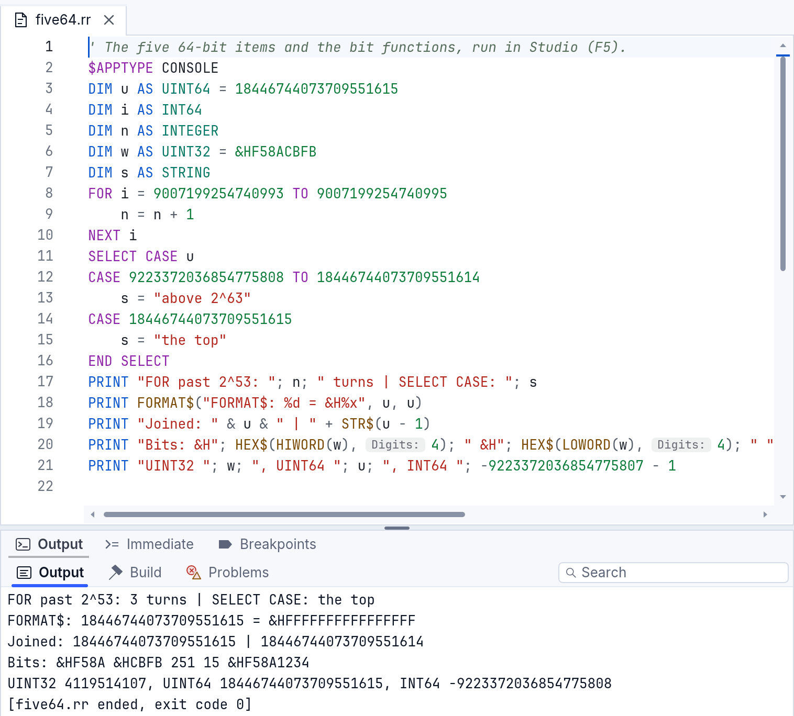
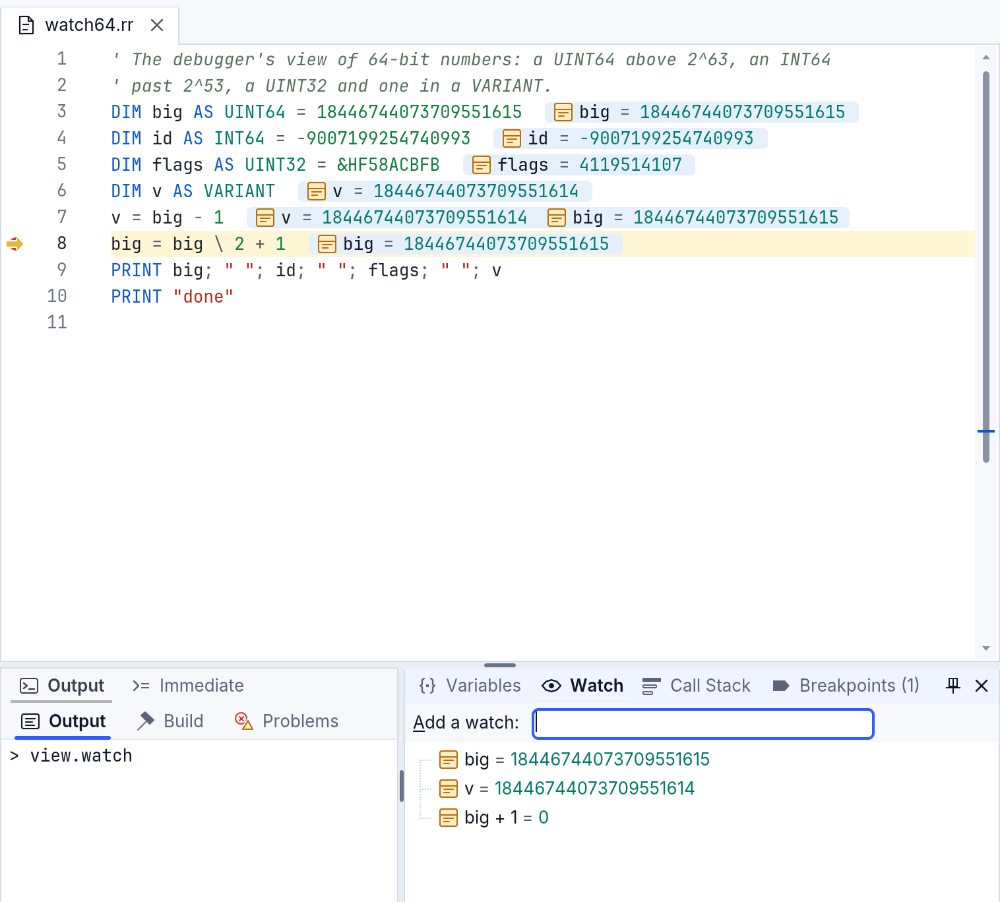

# Números grandes: INT64, UINT64, UINT32 y las funciones de bits

Los números enteros de RapidR van más allá de los 32 bits: **INT64** (con
signo, 64 bits), **UINT64** (sin signo, 64 bits) y **UINT32** (sin signo, 32
bits). Un número de 64 bits conserva todas sus cifras vaya donde vaya: en un
`VARIANT`, un arreglo, un campo de un `TYPE`, un parámetro, una propiedad de
un componente, un archivo, JSON, un parámetro de una base de datos, el
depurador. Nada se corta a 32 bits ni se redondea pasando por un `DOUBLE`;
donde un número no cabe, recibes un error que lo dice.

El ejemplo `examples/basics/bits_and_64bit.rr` muestra todo lo de esta
página en un solo programa (`rapidr run bits_and_64bit.rr`).

## Los tipos

| Tipo | Rango | Notas |
|---|---|---|
| `INT64` | -9223372036854775808 … 9223372036854775807 | |
| `UINT64` | 0 … 18446744073709551615 | se lee sin signo en todas partes |
| `UINT32` | 0 … 4294967295 | al guardarlo se conservan los 32 bits bajos; se calcula con 64 bits |
| `DWORD` | -2147483648 … 2147483647 | 32 bits *con signo* (el tipo clásico) |

```basic
DIM size AS INT64 = 5 * 3221225472        ' cinco archivos de 3 GB
DIM hash AS UINT64 = &HCBF29CE484222325
DIM flags AS UINT32 = &HF58ACBFB
PRINT size; " "; hash; " "; flags         ' 16106127360 14695981039346656037 4119514107
```



## Lo que funciona con ellos

- **Mostrarlos.** `PRINT`, `STR$`, unirlos a un texto con `&` o `+`,
  `FORMAT$("%d")`, un VARIANT, el depurador: todas las cifras, un `UINT64`
  sin signo.
- **Aritmética.** `+ - *` dan la vuelta a los 64 bits (como lo necesita un
  hash o una suma de verificación: `18446744073709551615 + 1` es 0 en un
  `UINT64`). Un `UINT64` en cualquiera de los lados da un `UINT64`, si no un
  `INT64`; un `DOUBLE` en cualquiera de los lados da un `DOUBLE`; `/` y `^`
  siempre dan un `DOUBLE`.
- **`\` y `MOD`** son exactos, cada lado con su propio signo.
- **Las comparaciones** son exactas: un `UINT64` mayor que
  9223372036854775807 es mayor que cualquier `INT64`, `u > -1` es verdadero, y
  `9007199254740993 > 9007199254740992.0` es verdadero (un `DOUBLE` no
  distingue esos dos; RapidR compara exactamente).
- **`AND OR XOR NOT SHL SHR`** usan los 64 bits (`SHR` es lógico).
- **`FOR`** compara su contador exactamente, y un contador de 64 bits se
  detiene al final de su tipo: `FOR u = 10 TO 0 STEP -1` sobre un `UINT64`
  termina después del 0, y un ciclo hasta 18446744073709551615 termina ahí
  (el contador conserva su último valor).
- **`SELECT CASE`** sobre uno: valores de `CASE`, rangos y `CASE IS`
  exactos.
- **`INPUT`** en uno lee el número escrito hasta su última cifra.
- **Archivos y flujos.** `PRINT #`, `WRITE #`, `INPUT #` y `LINE INPUT #`
  conservan todas las cifras; `WriteNum(n, Num_INT64)` / `ReadNum(Num_INT64)`
  de un flujo (también `Num_UINT64`, `Num_UINT32`) escriben y leen los 8 (o
  4) bytes, y `Write v` / `Read v` de una variable de 64 bits usan 8 bytes.
  `FILELEN` y `LOF` de un archivo de más de 2 GB dan su tamaño completo.
- **JSON.** `RJson.Get` lee un número entero exactamente (un `INT64`, o un
  `UINT64` por encima de 9223372036854775807), `RJson.Set` escribe uno
  exactamente, en el escritorio y en la web (donde el propio JavaScript lo
  redondearía).
- **Bases de datos.** Un `INT64` es un entero de SQLite o de MySQL; un
  `UINT64` va a MySQL como `BIGINT UNSIGNED`. Los enteros de SQLite son de 64
  bits con signo, así que un `UINT64` mayor que 9223372036854775807 se
  rechaza con un mensaje (pásalo como texto, `STR$(u)`, para conservarlo
  completo).
- **Memoria.** `SIZEOF`, `VARPTR`, `MEMCPY` y un `TYPE` pasado a una DLL dan
  a un campo `INT64` / `UINT64` sus 8 bytes, a un `UINT32` sus 4.

### Texto que entra, texto que sale

`STR$(u)` da las cifras; guardar un texto en uno lo lee exactamente
(`u = "18446744073709551615"`), y también `u = VAL(s$)`. `HEX$` muestra 8
cifras, 16 cuando el número necesita más de 32 bits (un `INT64` negativo
necesita los 64); `HEX$(x, cifras)` da al menos esa cantidad (`HEX$(255,
16)` es `00000000000000FF`) y nunca corta un número. `BIN$` y `OCT$`
muestran todos los bits sin ceros a la izquierda.

### Literales

En un programa que usa `INT64`, `UINT64` o `UINT32`, un literal entero de
más de 32 bits es un `INT64` (por encima de 9223372036854775807, un
`UINT64`): `PRINT 3000000000` muestra 3000000000. Junto a un valor de 64
bits o `UINT32`, un literal `&H` se lee tal como está escrito, hasta 16
cifras: `i AND &HFFFFFFFF` conserva los 32 bits bajos, e `IF flags =
&HF58ACBFB` es verdadero para un `UINT32`. Un programa sin estos tipos
conserva la lectura clásica de 32 bits (`PRINT 3000000000` muestra
-2147483648, `&HFFFFFFFF` es -1).

## Las funciones de bits

El bit 0 es el de la derecha. Sobre un número clásico (`INTEGER`, `LONG`,
`DWORD`, un `DOUBLE`) trabajan con sus 32 bits; sobre un `INT64`, `UINT64` o
`UINT32`, con 64 (un `UINT32` que se guarda de vuelta conserva sus 32 bits
bajos).

| Función | Da |
|---|---|
| `LOWORD(x)`, `HIWORD(x)` | los bits 0–15, los bits 16–31 (de 0 a 65535) |
| `LOBYTE(x)`, `HIBYTE(x)` | los bits 0–7, los bits 8–15 (de 0 a 255) |
| `GETBITS(x, start, count)` | `count` bits a partir del bit `start`, como un número desde 0 |
| `SETBITS(x, start, count, bits)` | `x` con esos `count` bits reemplazados por los bits bajos de `bits` |

```basic
DIM w AS UINT32 = &HF58ACBFB
PRINT HEX$(HIWORD(w)); " "; HEX$(LOWORD(w))     ' 0000F58A 0000CBFB
PRINT GETBITS(w, 28, 4)                          ' 15
PRINT HEX$(SETBITS(w, 0, 16, &H1234))            ' F58A1234
```

Un rango fuera de los bits del valor (`GETBITS(n, 30, 4)` sobre un `LONG`)
detiene el programa con un mensaje que nombra los bits; nada se corta en
silencio.

## En el depurador

Los paneles Variables y Observar y los valores junto al código muestran
todas las cifras; una expresión observada se calcula como lo haría el
programa (`big + 1` del mayor `UINT64` es 0). *Establecer valor...* sobre uno lee
exactamente el número escrito y rechaza uno que no cabe, indicando el rango
del tipo.



## Lo que sigue como era

- `INTEGER`, `LONG` y `DWORD` son de 32 bits con signo, como lo esperan los
  programas clásicos: guardar 4119514107 en un `DWORD` da -2147483648. Usa
  `UINT32` para 0 … 4294967295.
- `CINT`, `CLNG`, `ROUND` de un `DOUBLE`, `CEIL` y `FLOOR` dan números de 32
  bits (de un valor de 64 bits: el valor mismo). `SIN`, `SQR`, `LOG` y las
  demás funciones matemáticas trabajan con `DOUBLE`, como sus resultados.
- Un `DOUBLE` que se guarda en un `INT64` se trunca hacia cero; fuera del
  rango da -9223372036854775808 (un `UINT64`: 0). `ABS(-9223372036854775808)`
  vuelve a ser ese número, como `ABS` del `LONG` más pequeño guardado de
  vuelta en un `LONG`.
- `PRINT 1, 2` imprime `12`: la coma de `PRINT` no forma columnas, como en
  los programas clásicos.

## En todos los entornos

`rapidr run` (con el JIT encendido o apagado), las compilaciones nativas
(`rapidr build`), la web y la versión alfa para Windows 7 (32 bits) dan las
mismas respuestas; los casos de conformidad `big_numbers_*` de
`tests/conformance/cases` lo comprueban. En Windows de 32 bits, una función
de DLL declarada con `DECLARE` recibe un argumento `INT64` / `UINT64` como
sus 8 bytes y devuelve uno completo. La
lista completa de lugares revisados está en las notas para desarrolladores
(`docs/big-numbers-audit.md`).
