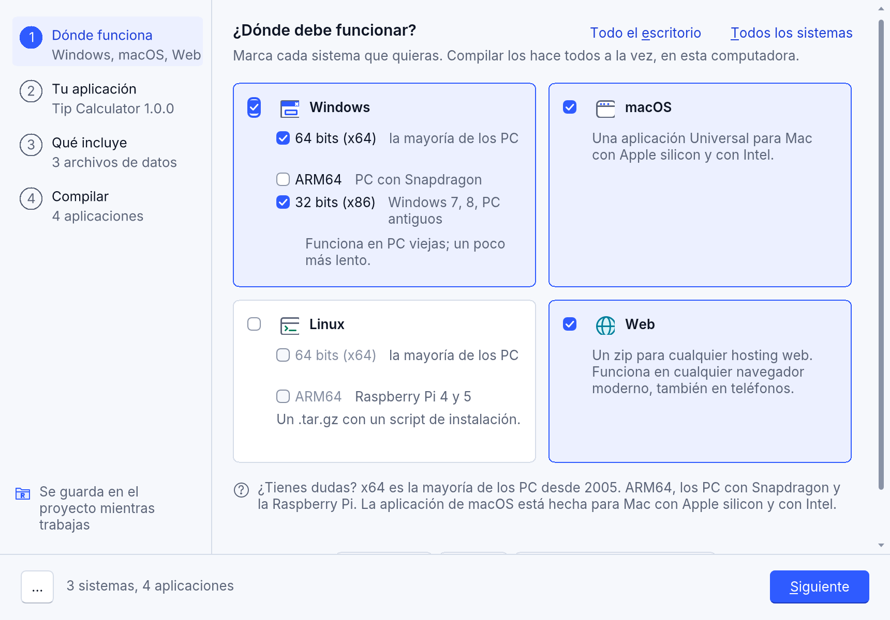
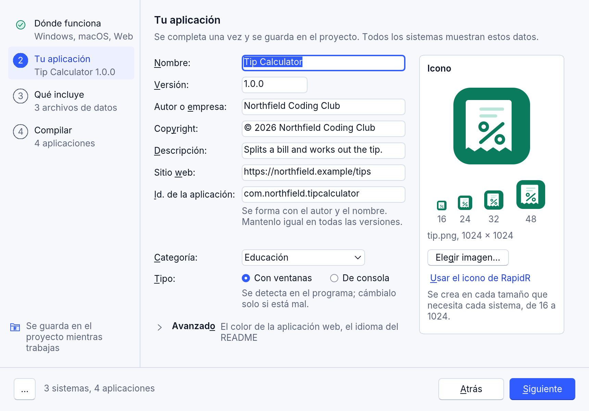
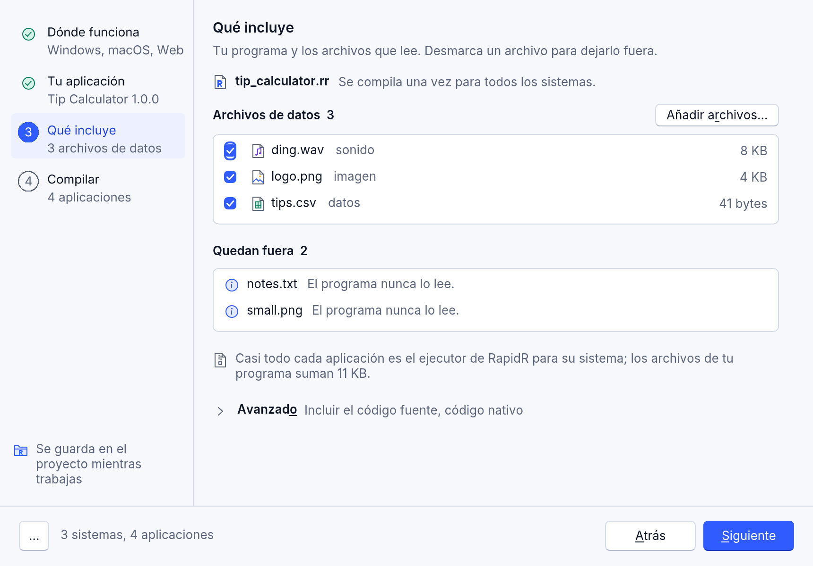
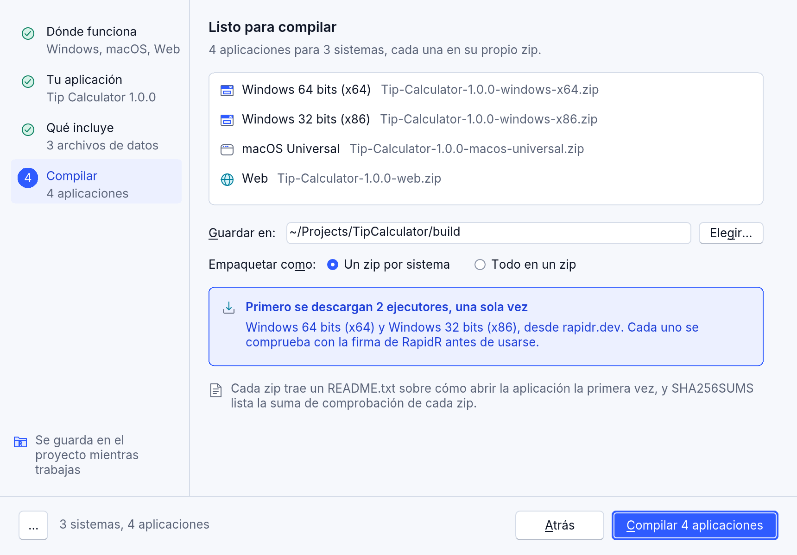
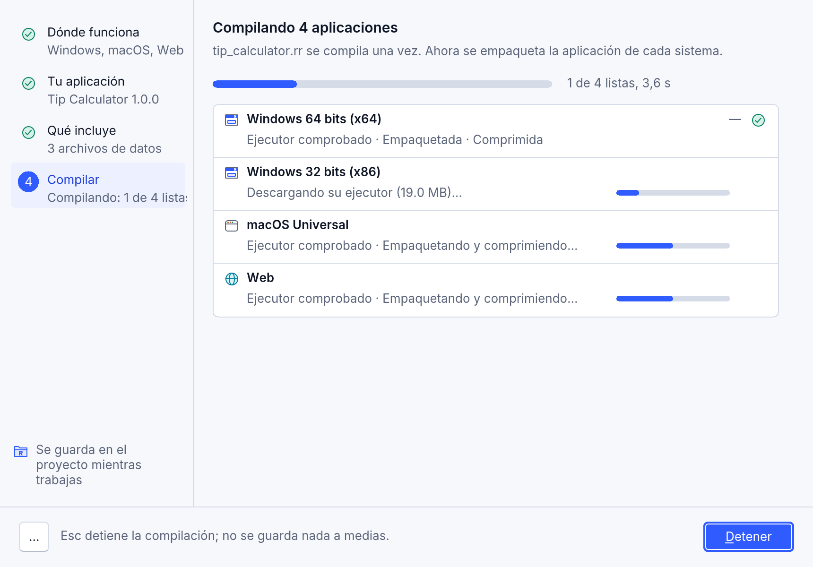
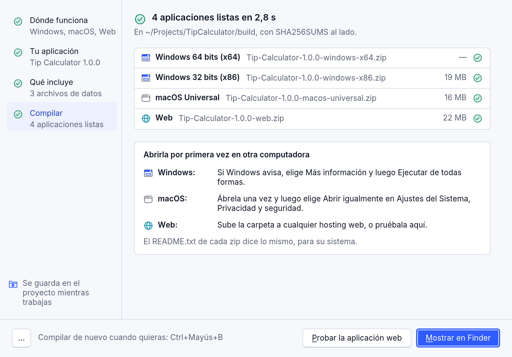

<!-- translated-from: build-for-every-system.md 609e6ff7240a2e87 -->
# Compila tu app para todos los sistemas

Escribe tu programa una vez y RapidR lo convierte en una aplicación para
Windows, macOS, Linux y la web, todo desde la computadora en la que estás.
Cada aplicación es un zip (un `.tar.gz` para Linux) que puedes dar a otras
personas: lo descomprimen y abren la aplicación. No necesitas las otras
computadoras, ni un compilador, ni el SDK de nadie.

## En RapidR Studio: Ejecutar > Compilar

**Ejecutar > Compilar...** abre el diálogo Compilar. Es el mismo en RapidR
Studio en el escritorio y en el navegador. Hay cuatro pasos en una lista a la
izquierda; haz clic en uno (o pulsa Ctrl+Tab) para ir a él, y **Siguiente**,
abajo, avanza.



1. **Dónde funciona.** Marca los sistemas que quieras: Windows (64 bits x64
   para la mayoría de los PC, ARM64 para los PC con Snapdragon, 32 bits x86
   para PC viejas: funciona un poco más lento), macOS (una aplicación
   Universal para todos los Mac), Linux (x64, ARM64) y la web. **Todo el
   escritorio** y **Todos los sistemas** marcan varios a la vez. La primera
   vez solo está marcado el sistema de esta computadora, así la primera
   compilación funciona incluso sin internet. Android, iOS y las placas
   aparecen como «más adelante».
2. **Tu aplicación.** El nombre, la versión, el autor o la empresa, el
   copyright, la descripción, el sitio web, el id. de la aplicación (se forma
   con el autor y el nombre: mantenlo igual en todas las versiones), la
   categoría y el tipo (con ventanas o de consola), y el ícono: una sola
   imagen, convertida en cada tamaño que necesita cada sistema, que se
   muestra de 16 a 48 píxeles. Un campo con un problema lo dice debajo, y el
   nombre del paso en la lista dice «Necesita atención». **Avanzado** tiene
   el color de la aplicación web y el idioma del README. **Proyecto >
   Opciones del proyecto** abre este mismo paso: hay un solo formulario para
   los datos de tu aplicación.
3. **Qué incluye.** Tu programa, compilado una vez para todos los sistemas;
   los archivos de datos que lee (desmarca uno para dejarlo fuera; **Añadir
   archivos...** añade más al proyecto) y lo que queda fuera, con el motivo
   («El programa nunca lo lee», «El programa lo escribe»). **Avanzado** tiene
   **Incluir el código fuente** y, en RapidR Studio en el escritorio,
   **Código nativo**: la aplicación de esta computadora compilada con Rust
   (las aplicaciones de los otros sistemas siempre ejecutan el bytecode).
4. **Compilar.** Una fila por aplicación con el nombre de su zip; **Guardar
   en** (la carpeta `build` del proyecto, salvo que elijas otra);
   **Empaquetar como** un zip por sistema o, además, todo en un zip; y qué
   ejecutores se descargan primero, una sola vez, desde rapidr.dev, cada uno
   comprobado con la firma de RapidR antes de usarse.







Cada elección se guarda en el proyecto en el momento en que la haces («Se
guarda en el proyecto mientras trabajas»), así que no hay Cancelar: la X de
cerrar y Esc cierran el diálogo y no se pierde nada.

**Compilar 4 aplicaciones** (las cuenta) compila. Cada aplicación tiene su
propia fila: su ejecutor comprobado, empaquetada, comprimida, con su propia
barra; un lector de pantalla oye un mensaje por aplicación a medida que está
lista. Esc o **Detener** detienen la compilación, y no se guarda nada a
medias. Una aplicación que falla dice por qué en su fila, con **Intentar de
nuevo**; las demás están bien.



Cuando termina, el diálogo enumera los zips y dice cómo abrir la aplicación
la primera vez en cada sistema (las mismas palabras están en el `README.txt`
de cada zip). **Mostrar en Finder** (Explorador de archivos en Windows,
Archivos en Linux) los muestra; **Probar la aplicación web** abre la web en tu
navegador.



- **Compilar de nuevo** (Ctrl+Mayús+B) vuelve a compilar las mismas opciones
  sin diálogo: la barra de estado dice cómo va y una nota en la esquina dice
  cómo terminó (**Mostrar**; **Abrir Compilar** cuando una aplicación no se
  compiló).
- **Más** (los tres puntos abajo a la izquierda): **Copiar línea de
  comandos** (el comando `rapidr build ... --targets ...` que hace lo mismo,
  para un script o una terminal), **Guardar todo en un zip**, **Ayuda**.
- Las teclas: Tab y Mayús+Tab recorren los controles del paso, Ctrl+Tab y
  Ctrl+Mayús+Tab cambian de paso, Espacio marca, Alt y la letra subrayada
  pulsa un control, Intro el botón principal, Esc cierra (o detiene una
  compilación), F1 abre esta página.
- Con menos de 640 píxeles de ancho (una ventana pequeña, un teléfono) los
  pasos se vuelven una sola página que se desplaza, con el botón Compilar fijo
  abajo.

**En RapidR Studio en el navegador** el mismo diálogo empaqueta las
aplicaciones en la página: nada sale de tu computadora, los ejecutores vienen
de la propia dirección del Studio web y se comprueban con la firma de RapidR
antes de usarse, y el navegador guarda los zips.

## Desde la línea de comandos

```sh
rapidr build tips.rr --targets windows-x64,macos,linux-x64,web
rapidr build Tips.rrproj --all            # todos los sistemas para los que compila RapidR
```

La carpeta de salida (la carpeta `build` del proyecto, o la del propio
programa) queda así:

```text
Tip-Calculator-1.2.0-windows-x64.zip
Tip-Calculator-1.2.0-macos-universal.zip
Tip-Calculator-1.2.0-linux-x64.tar.gz
Tip-Calculator-1.2.0-web.zip
SHA256SUMS
```

`SHA256SUMS` lista el SHA-256 de cada archivo, para que la gente pueda
comprobar que lo que descargó es lo que tú compilaste (`sha256sum -c
SHA256SUMS` en Linux, `shasum -a 256 -c SHA256SUMS` en un Mac). Si vuelves a
compilar para un solo sistema, se actualiza su línea y se conservan las demás.

Los ejecutores de los otros sistemas (el programa del que parte cada
aplicación) vienen de tu instalación, de los que ya se descargaron o de una
descarga comprobada: [De dónde vienen los ejecutores](building-apps.md#de-dónde-vienen-los-ejecutores).

## Los sistemas

| `--targets` | Qué hace | Funciona en |
|---|---|---|
| `windows-x64` | `Nombre.exe`, con su ícono y su versión | Windows 10 y 11 de 64 bits, la mayoría de los PC |
| `windows-arm64` | lo mismo | PC con Windows y procesador ARM (Snapdragon y otros) |
| `windows-x86` | lo mismo, con el intérprete rápido (sin JIT) | Windows 7, 8, 8.1, 10 y 11, de 32 y de 64 bits |
| `macos` (`macos-universal`) | `Nombre.app`, una sola aplicación para los dos tipos de Mac | Apple silicon (macOS 11 y posteriores) y Mac con Intel (macOS 10.13 y posteriores) |
| `linux-x64` | una carpeta con la aplicación, su entrada en el menú y sus íconos, e `install.sh` | Linux de 64 bits en PC |
| `linux-arm64` | lo mismo | Linux de 64 bits en ARM, también Raspberry Pi 4 y 5 |
| `web` | la página, el entorno de ejecución y tu programa | cualquier alojamiento web de archivos estáticos, todos los navegadores actuales |

`--all` compila los siete primeros. `macos-arm64` y `macos-x64` hacen una
aplicación de Mac más pequeña, para un solo tipo de Mac.

`--targets` hace aplicaciones interpretadas: el ejecutor de cada sistema (el
programa que ejecuta el bytecode de RapidR, con el JIT en los sistemas de 64
bits) y tu programa. Por eso una sola computadora puede compilar para todos.

## Qué lleva cada zip

- **Windows:** `Nombre.exe`, los archivos de datos de tu programa a su lado,
  `THIRD-PARTY-NOTICES.txt` y `README.txt`.
- **macOS:** `Nombre.app` (tus archivos de datos y los avisos van dentro) y
  `README.txt`.
- **Linux:** una carpeta, `Nombre-1.0.0-linux-x64/`, con `AppRun` (ejecútalo
  para iniciar la aplicación), `install.sh` (pone la aplicación en el menú de
  aplicaciones, solo para ti, sin ser root; `./install.sh --uninstall` la
  quita), la aplicación, su entrada de escritorio, sus íconos de 16 a 512
  píxeles, los avisos y `README.txt`. El `.tar.gz` conserva la marca de
  "ejecutable", que un zip perdería.
- **La web:** la página y todo lo que necesita, más `manifest.webmanifest` e
  `icons/`, para que los navegadores que instalan aplicaciones web puedan
  instalarla.

`README.txt` le dice a quien recibe la aplicación cómo abrirla la primera
vez en su sistema. Está en inglés, o en español con `--language es` (o
`language = "es"` en el proyecto).

## Los datos de tu aplicación

Todos los sistemas muestran los mismos datos, del proyecto (`.rrproj`,
`[build]`) o de la línea de comandos:

| Opción | En el proyecto | Qué es | Si no se dice |
|---|---|---|---|
| `--name` | `app_name` | El nombre en el título, el Dock, el menú Inicio | el nombre del proyecto |
| `--app-version` | `version` | Hasta cuatro números: `1.2.0` | `1.0.0` |
| `--company` | `company` | Quién la hace | nada |
| `--copyright` | `copyright` | La línea de derechos de autor | `© <company>` |
| `--description` | `description` | Una línea sobre la aplicación (la descripción en Windows, el comentario del menú de Linux, la de la página web) | nada |
| `--website` | `website` | Su sitio web, `https://…` (en el README) | nada |
| `--icon` | `icon` | Una imagen: un PNG de 1024 × 1024 o un SVG; todos los tamaños salen de ella | el de RapidR |
| `--bundle-id` | `bundle_id` | El identificador de la aplicación, `com.example.tips` | `dev.rapidr.app.<nombre>` |
| `--category` | `category` | utilities, productivity, education, games, developer-tools, graphics, music, video, business, finance o science | utilities |
| `--kind` | `kind` | `window` (una aplicación con ventanas) o `console` | lo que es el programa |
| `--theme-color` | `theme_color` | El color de la aplicación web, `#RRGGBB` | el de la página |
| `--include-source` | | El código fuente de tu programa en los zips, en `source/` | no se incluye |

```toml
[build]
app_name = "Tip Calculator"
version = "1.2.0"
company = "Example Ltd"
description = "Splits the bill"
website = "https://example.com/tips"
icon = "art/tips.svg"
category = "finance"
```

RapidR avisa cuando el ícono es pequeño (menos de 512 píxeles: los tamaños
grandes se ven borrosos) o no es cuadrado (se centra sobre un cuadrado
transparente).

Los asistentes de IA (RAI y las aplicaciones de IA conectadas a RapidR
Studio) tienen la herramienta `build_app`: "compílala para Windows y la web"
guarda en el proyecto los datos que se le dan, marca esos sistemas en las
opciones del diálogo Compilar y los compila como Compilar de nuevo: los mismos
zips.

## Seguro por diseño

- Solo entran los archivos de datos que tu programa nombra, nunca uno que
  escribe (tu copia puede tener tus datos), y nunca tu código fuente, salvo
  que lo pidas con `--include-source`. Los archivos que el proyecto deja
  fuera (`leave_out` en `[build]`: el paso 3 del diálogo Compilar) se quedan
  fuera; los archivos de datos añadidos al proyecto (**Añadir archivos...**,
  `kind = "data"`) entran.
- La ruta de un archivo de datos no puede salir de la carpeta de la
  aplicación (`..`, rutas absolutas, unidades), y los enlaces nunca se
  siguen.
- Un ejecutor de otro sistema se rechaza, así que un archivo equivocado no
  puede hacer una aplicación rota.
- Con `SOURCE_DATE_EPOCH` (la hora de los archivos, en segundos desde 1970),
  el mismo programa con los mismos datos hace el mismo zip, byte a byte; sin
  ella, los archivos llevan la hora de la compilación.

## Abrirla la primera vez

Las aplicaciones que compilas no están firmadas con un certificado, así que
cada sistema pregunta una vez:

- **Windows:** "Windows protegió su PC". Haz clic en **Más información** y
  luego en **Ejecutar de todas formas**.
- **macOS:** la aplicación está firmada ad hoc, como lo necesita Apple
  silicon, pero no con un Developer ID de Apple. RapidR hace esa firma él
  mismo, en el sistema que compila la aplicación: Windows, Linux o un Mac.
  macOS dice que “Nombre” no se abrió (*Apple no pudo verificar que “Nombre”
  esté libre de software malicioso…*). Haz clic en **Listo** (no en *Mover a
  la papelera*); luego, en **Configuración del Sistema > Privacidad y
  seguridad**, haz clic en **Abrir de todos modos** y confirma con tu
  contraseña o Touch ID.
- **Linux:** no hay nada que confirmar. Si los archivos perdieron la marca de
  "ejecutable", `chmod +x AppRun install.sh`.

El README de cada zip lo dice con palabras sencillas. Firmar las
aplicaciones con tu propio certificado, para que no se pregunte nada, depende
de ti (`signtool` en Windows; `codesign` con tu Developer ID y la
notarización en un Mac).
