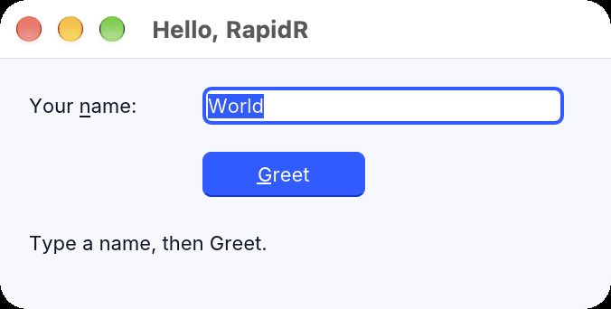
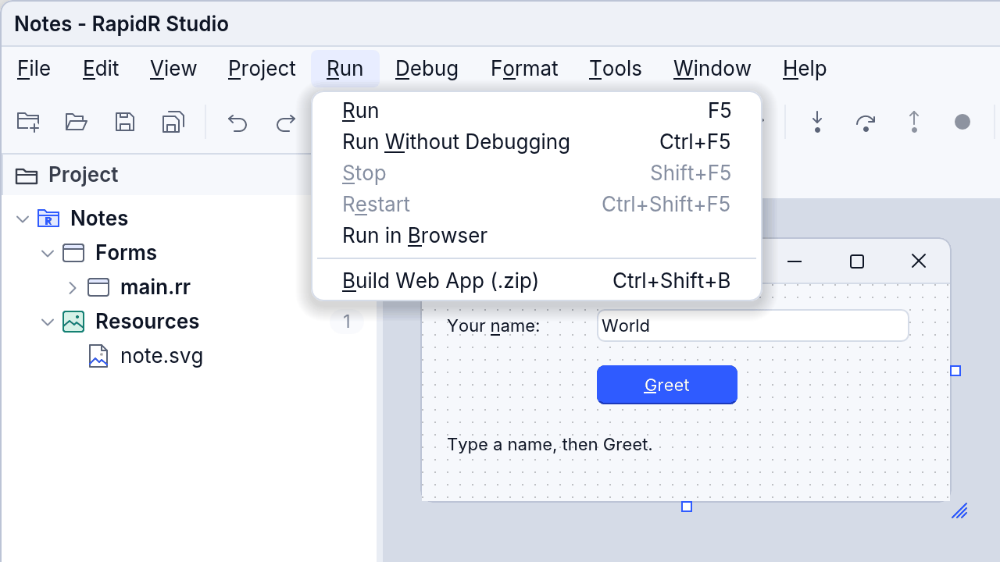
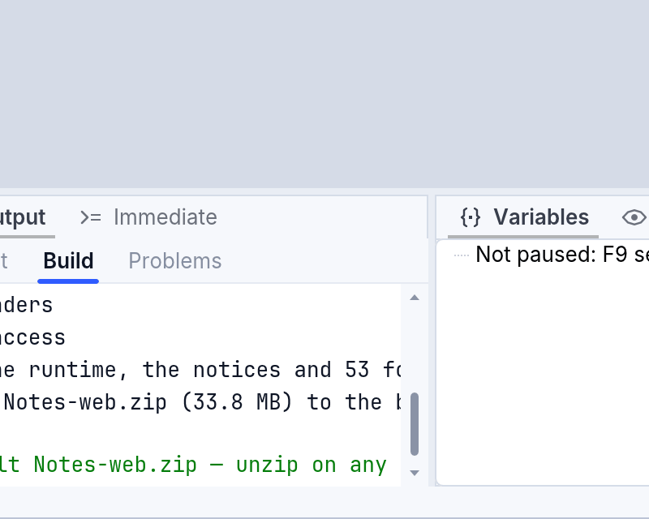

<!-- translated-from: building-apps.md baf3c580ff72a7d8 -->
# Compilar aplicaciones y sus íconos

`rapidr build` convierte un programa en una aplicación propiamente dicha para su
sistema, con un ícono: el que tú le das, o el propio de RapidR para los programas
compilados. **Ejecutar > Compilar** de RapidR Studio hace lo mismo. Una
compilación es una compilación final —optimizada, la que distribuyes (`--debug`
crea una rápida para depurar)— y su carpeta de salida recibe solo la aplicación:
el Rust que genera una compilación nativa y los archivos de cargo se quedan en la
caché de compilación de RapidR ([La CLI](cli-and-runtime.md#compilaciones-nativas)).

| Sistema | Un programa con ventanas | Un programa de consola |
|---|---|---|
| macOS | `Name.app`: el programa en `Contents/MacOS`, su ícono (`.icns`, todos los tamaños de 16 a 1024 píxeles), `Info.plist` (nombre, identificador, versión, macOS mínimo, alta resolución), firmada ad hoc para que se abra en Apple silicon | `prog`, un ejecutable simple (`--bundle` también lo convierte en una aplicación) |
| Windows | `prog.exe` con su ícono (de 16 a 256 píxeles, todos los tamaños que muestra el Explorador de archivos) y su información de versión (nombre del producto, versión, empresa, descripción) | lo mismo |
| Linux | `Name.AppDir`: el programa, `AppRun`, una entrada de escritorio y el ícono de 16 a 512 píxeles (la estructura que empaqueta AppImage) | `prog`, un ejecutable simple (`--bundle` también lo convierte en un AppDir) |

Un programa “tiene ventanas” cuando dice `$APPTYPE GUI`, o no dice ningún
`$APPTYPE` y crea formularios u otros componentes. Las compilaciones nativas y las
interpretadas (`--interp`) producen las mismas aplicaciones. Las compilaciones
cruzadas también: `rapidr build prog.bas --interp --target windows-x86_64` en una
Mac escribe el ícono y la información de versión del `.exe`; solo firmar una
aplicación de macOS necesita una Mac.

```sh
rapidr build notepad.bas --interp          # macOS: notepad.app
rapidr build notepad.bas --interp --icon art/notepad.png --name Notepad --app-version 2.1
rapidr build Notepad.rrproj                # el archivo principal del proyecto, con su configuración: build/Notepad.app
rapidr build notepad.bas --no-bundle       # solo el ejecutable, sin ícono
rapidr build notepad.bas dist --keep-rust  # dist/notepad.app y dist/notepad-rust-source/
```

## Los archivos de datos del programa lo acompañan

Un programa que lee un archivo que está junto a él —`CSV.FileName = "staff.csv"`,
`OPEN "prices.txt" FOR INPUT AS #1`— recibe ese archivo en la aplicación: la
compilación toma todos los archivos junto al programa cuyo nombre aparece en su
código fuente (los que copia `rapidr examples copy`) y lo dice.

```text
$ rapidr build linked_data.rr dist --interp
App: dist/linked_data.app
  data files in the app's Contents/Resources: staff.csv (started from Finder, a launcher or Explorer, it finds them)
```

Lo que una compilación toma con el programa:

- **Archivos junto a él** cuyos nombres aparecen en el código fuente
  (`"staff.csv"`).
- **Archivos en carpetas debajo de él** cuyas rutas aparecen en el código fuente,
  en las mismas carpetas: `RImage.Load "art/logo.svg"` toma `art/logo.svg`,
  `"data\sample.csv"` toma `data/sample.csv` (con cualquiera de las dos barras,
  con los nombres en mayúsculas o minúsculas). Los demás archivos de esas carpetas
  se quedan atrás.
- **Sus traducciones**: los archivos `.po` de su carpeta `lang`, cuando el
  programa usa `TR$`, `TRN$` o `Application.Language`, o tiene una carpeta `lang`
  ([Tu programa en todos los idiomas](translations.md)).
- Todo tipo de compilación hace esto: nativa, interpretada (`--interp`), para la
  web (`--web`, `bundle-bc`), el comando Compilar de RapidR Studio y `rapidr
  examples copy`. Los archivos `$RESOURCE`, en cambio, se incorporan al programa.

```text
$ rapidr build app.rr dist --interp
App: dist/app.app
  data files in the app's Contents/Resources: art/logo.svg, lang/es.po (started from Finder, a launcher or Explorer, it finds them)
```

<!-- legal -->
Una compilación nunca toma nada de fuera de la carpeta del programa. Un nombre que
sale de ella —`"../secret.txt"`, `"/etc/hosts"`, un enlace de la carpeta que apunta
a otro lugar— no se copia, y la compilación lo dice:

```text
warning: "../secret.txt" is outside the program's folder: not copied (a build takes only files from the program's folder and the folders below it)
```

En la web, los archivos de las carpetas inferiores van con los demás archivos de la
página, y las traducciones junto a la página, en `lang/`, con `lang/index.txt` que
las enumera.

| Sistema | Adónde van | La carpeta en la que trabaja una aplicación al hacerle doble clic |
|---|---|---|
| macOS | `Name.app/Contents/Resources` | `Contents/Resources` (Finder, el Dock y `open` inician las aplicaciones en `/`: la aplicación se traslada a sus propios archivos) |
| Windows | junto al `.exe` | la carpeta del `.exe` (el Explorador de archivos lo inicia allí) |
| Linux | `Name.AppDir/usr/bin`, junto al programa | `usr/bin` (un iniciador la inicia en tu carpeta personal: la aplicación se traslada a sus propios archivos) |

Si se inicia desde una terminal o un script, un programa conserva esa carpeta
—como siempre hace un programa de consola—, así que `"staff.csv"` y
`"art/logo.svg"` se buscan primero en la carpeta en la que estás. Cuando esa
carpeta no tiene ese archivo, estos leen el que trajo la aplicación:

- el archivo de un `RCSV` o de un `RJson`;
- imágenes: `RImage.Load` / `LoadFromFile`, un `BMP` (de una imagen, de un botón),
  un `Icon`, `AddBMPFile` / `AddICOFile` de un `RImageList`, las imágenes de una
  barra de herramientas, el archivo de una lista de imágenes o de una textura de
  DirectX;
- sonidos y música: `PLAYWAV`, `PLAYSOUND`, el `Open` de un `RWave`, `RMIDI` o
  `RVideo`, el `FileName` de un sonido de DirectX;
- modelos 3D: el archivo `.X` de un constructor de mallas (`Load`);
- listas: el `LoadFromFile` de un `RListBox`, `RComboBox`, `RStringList`,
  `RStringGrid` o `RTreeView`.

Un archivo de la carpeta actual siempre gana. `FILEEXISTS` y los comandos de
archivos (`OPEN`, `KILL` …) y los flujos siguen buscando solo en la carpeta actual.
Las traducciones siempre se leen de la carpeta `lang` de la propia aplicación. Los
archivos `$RESOURCE` se incorporan al programa y no necesitan nada de esto.

La carpeta propia de la aplicación puede ser de solo lectura: una aplicación en
`/Applications`, un `.exe` en Archivos de programa (*Program Files*), una
aplicación de macOS firmada (escribir en ella rompe su firma). Escribe lo que crea
el usuario en algún lugar suyo, una carpeta elegida en un cuadro de diálogo para
guardar o sus Documentos, y comprueba que funcionó: un guardado que falla dice por
qué en `RDataFrame.Error` (o `FILEEXISTS` es falso), como muestran los ejemplos de
`examples/data/`.

## ¿Necesito Rust?

No para compilar una aplicación. Hay dos tipos de compilación, y la primera no
necesita nada instalado aparte de RapidR:

| | Interpretada | Nativa |
|---|---|---|
| Necesita Rust | no | sí (es gratuito; `rapidr setup` lo instala) |
| Qué es la aplicación | el ejecutor de RapidR con el bytecode de tu programa | tu programa compilado a código de máquina |
| Tiempo de compilación | segundos | minutos la primera vez |
| Velocidad | suficiente para la mayoría de los programas | más rápida, para ciclos pesados y juegos |

Ambas producen la misma aplicación, con el mismo ícono y la misma información.
Empieza con la interpretada; elige la nativa cuando un programa necesite la
velocidad.

```sh
rapidr build notepad.bas --interp   # no necesita Rust
rapidr build notepad.bas            # nativa: necesita Rust
rapidr setup                        # instala Rust (pregunta antes); rapidr setup --check solo mira
```

Una compilación nativa en una computadora sin Rust se detiene de inmediato y lo
dice: “Native builds need Rust (it is free). Run `rapidr setup` to install it, or
build without it: add --interp”. No cambia nada y no deja nada a medio compilar.

## Los detalles de la aplicación

| Opción | Configuración del proyecto (`.rrproj`, `[build]`) | Qué es | Valor predeterminado |
|---|---|---|---|
| `--icon <file>` | `icon` | El ícono: `.icns`, `.ico`, `.png` o `.svg` | el `$OPTION ICON` del programa; si no, el de RapidR |
| `--name <name>` | `app_name` | El nombre que muestran Finder, el Explorador de archivos y el menú de aplicaciones (y el del `.app`) | el nombre del proyecto; si no, el del archivo fuente |
| `--bundle-id <id>` | `bundle_id` | Un identificador en DNS inverso, `com.example.notepad` (el bundle ID de macOS, el nombre de la entrada de escritorio de Linux) | `dev.rapidr.app.<nombre>` |
| `--app-version <v>` | `version` | Hasta cuatro números con puntos: `1.0`, `2.3.1` | `1.0` |
| `--company <name>` | `company` | Quién la hace: el nombre de la empresa de Windows y la línea de derechos de autor | ninguno |
| `--bundle` / `--no-bundle` | | Una aplicación incluso para un programa de consola / solo el ejecutable | |
| `--project <file.rrproj>` | | El proyecto cuya configuración se usa | el `.rrproj` junto al código fuente que lo nombra como su archivo principal (o una o dos carpetas por encima, con exactamente ese archivo como su `main`) |
| `[output folder]`, `--output <folder>` | `output` | Adónde va la aplicación (una carpeta del proyecto) | el `build` del proyecto; sin proyecto, la carpeta del código fuente |
| `--keep-rust` / `--no-keep-rust` | `keep_rust` | Una compilación nativa también deja su Rust generado en `<salida>/<programa>-rust-source` (con un README que dice qué es) | se elimina |

La línea de comandos gana sobre el proyecto, y el proyecto sobre el código fuente.
Un archivo de proyecto los lleva así:

```toml
[build]
icon = "art/notepad.svg"
app_name = "Notepad"
bundle_id = "com.example.notepad"
version = "2.1"
company = "Example Ltd"
targets = ["bytecode"]      # la Compilación de Studio: interpretada ("native" compila con Rust)
output = "dist"             # la carpeta de salida ("build" cuando no se indica)
keep_rust = true            # el Rust generado junto a la aplicación (no se conserva cuando no se indica)
```

### El nombre de la aplicación

El nombre que muestran Finder, el Explorador de archivos y el menú de aplicaciones
(y, en una Mac, el nombre de archivo del `.app`) es el del archivo fuente
(`notepad.bas` produce `notepad.app`), a menos que el proyecto o `--name` den otro:

```sh
rapidr build 3dcube.bas --interp                 # 3dcube.app (macOS)
rapidr build 3dcube.bas --interp --name "3D Cube"    # "3D Cube.app"
```

- Un nombre puede ser cualquier cosa que pueda ser un nombre de archivo,
  **incluido uno que empieza con un dígito** (`3dcube`, `2048`, `8ball`). Solo se
  rechazan `/`, `\` y `:`, porque en una Mac y en un AppDir de Linux el nombre es
  también el de una carpeta.
- El bundle ID (macOS) y el nombre de la entrada de escritorio de Linux salen del
  nombre: todo lo que no sea letras y dígitos se convierte en un guion, en
  minúsculas, así que “3D Cube” es `dev.rapidr.app.3d-cube`. Un nombre sin ninguna
  letra ni dígito (japonés, por ejemplo) recibe `dev.rapidr.app.program`: dale un
  `--bundle-id` propio (`com.example.cube`).
- En una Mac, cuando compruebas una firma a mano con `codesign --verify`, escribe
  `./3dcube.app` (o la ruta completa) para un nombre que empieza con un dígito:
  `codesign` toma `3dcube.app` por un número de proceso y responde “No such
  process”. Las versiones anteriores de `rapidr build` se detenían con ese mensaje
  para un nombre así; ahora `rapidr build` le pasa a `codesign` la ruta completa, y
  firma y comprueba la aplicación.

### El nombre del ejecutable

El programa de dentro tiene un nombre propio: `Contents/MacOS/<nombre>` en una
aplicación de Mac (el `CFBundleExecutable` de su `Info.plist`), `<nombre>.exe` en
Windows, `usr/bin/<nombre>` en un AppDir de Linux (y el `Exec` de la entrada de
escritorio), también para un ejecutable simple con `--no-bundle` y para una
compilación interpretada (`--interp`) por igual. Recibe el nombre **del proyecto**
cuando se compila un proyecto: el `name` del `.rrproj`, convertido en un nombre de
archivo igual en todos los sistemas: las letras, los dígitos, `-`, `_` y `.` se
quedan, una secuencia de cualquier otra cosa (espacios, signos de puntuación,
`/ \ : * ? " < > |`) se convierte en un solo `-`, como máximo 64 caracteres, y un
nombre de dispositivo de Windows como `con` o `nul` recibe `-app`. El proyecto
“Database Studio” en `src/main.rr` produce `Database Studio.app` con
`Contents/MacOS/Database-Studio`, no `main`. Un solo archivo (sin proyecto)
conserva el nombre propio del archivo: `notepad.bas` produce `notepad`. El
`.rrproj` de un proyecto se encuentra cuando está junto al código fuente, o una o
dos carpetas por encima con ese código fuente como su `main`
(`--project <file.rrproj>` lo dice sin rodeos).

`--name` y el `app_name` del proyecto cambian lo que ve la gente (el nombre del
`.app`, el del Explorador de archivos, el del menú), nunca el nombre del
ejecutable.

## Íconos

De dónde sale el ícono; gana el primero que exista:

1. `--icon` en la línea de comandos;
2. el `icon` del proyecto;
3. `$OPTION ICON "file"` en el programa, que además le da ese ícono a las ventanas
   del programa;
4. `-g<file.ico>`, la opción clásica del compilador (`RC -gfile.ico prog.bas`):
   `rapidr` también la acepta, por debajo de `$OPTION ICON`;
5. el ícono de RapidR para los programas compilados.

Sirve cualquiera de estos formatos, y RapidR dibuja a partir de él cada tamaño que
necesita cada sistema:

| Formato | Lo mejor es |
|---|---|
| `.svg` | Nítido en todos los tamaños. El texto del SVG tiene que convertirse en contornos (RapidR dibuja formas, no fuentes, en los íconos) |
| `.png` | 1024 × 1024 píxeles, cuadrado (otra forma se centra en un cuadrado transparente) |
| `.icns` | El propio de macOS: se usan sus imágenes PNG |
| `.ico` | El propio de Windows: se usan todas sus imágenes, PNG o BMP (también los íconos antiguos de 32 × 32 de 766 bytes) |

Una imagen de menos de 512 píxeles sirve, pero los tamaños mayores se amplían y se
ven borrosos: la compilación lo dice. Un archivo que no es una imagen que RapidR
pueda leer detiene la compilación con el motivo, antes de compilar nada.

El ícono propio de RapidR para los programas es el recuadro oscuro del Runtime con
una ventana de aplicación y el triángulo ámbar de Ejecutar (`design/brand/icons`:
`RapidR-App.icns`, `rapidr-app.ico`, `apps/rapidr-app` en el árbol hicolor).

### `$OPTION ICON`

`$OPTION ICON "path\file.ico"`: el nombre puede ir entre comillas o no; un archivo
que no está es un error de compilación (`ICON file nowhere.ico does not exist.`);
con varios, gana el último. El original busca el archivo en la carpeta actual;
RapidR también busca junto al código fuente. El original solo acepta un ícono de
766 bytes (32 × 32, de dieciséis colores); RapidR acepta cualquiera de los
formatos de arriba.

## macOS

<!-- legal -->
- La aplicación se firma ad hoc (`codesign --sign -`): se abre en la Mac que la
  compiló, y las Mac con Apple silicon la ejecutan. Para dársela a otras personas,
  fírmala con tu Developer ID y notarízala (`codesign`, `xcrun notarytool`); una
  aplicación descargada sin firmar se permite una sola vez en Configuración del
  Sistema > Privacidad y seguridad > Abrir de todos modos (*System Settings >
  Privacy & Security > Open Anyway*; mira
  [Instalar en macOS](getting-started.md#instalar-en-macos)).
- Una aplicación compilada se abre como cualquier otra aplicación de Mac:

  

- Una aplicación interpretada guarda el bytecode del programa en
  `Contents/Resources/<nombre>.rrbc` (los datos después de un ejecutable firmado
  romperían su firma).
<!-- legal -->
- `THIRD-PARTY-NOTICES.txt` está en `Contents/Resources`.
- `LSMinimumSystemVersion` es 10.13: macOS High Sierra en Intel, macOS 11 en Apple
  silicon.

## Windows

El ícono y la información de versión se escriben en el `.exe` después de
compilarlo (Rust puro: sin compilador de recursos, sin Visual Studio), así que el
Explorador de archivos, la barra de tareas y Propiedades > Detalles (*Properties >
Details*) los muestran. Un programa nativo también se enlaza, para empezar, con
información de versión simple y un manifiesto (los crea el `llvm-windres` del SDK),
que es lo que evita que algunos programas antivirus tomen por una amenaza un
programa nuevo sin información; luego el sellado escribe tus datos y el ícono
encima. La firma de código con un certificado queda a tu cargo (`signtool`). Si un
antivirus sigue bloqueando un programa nuevo:
[Solución de problemas > Antivirus](troubleshooting.md#antivirus).

## Linux

El AppDir se ejecuta donde está (`Notepad.AppDir/AppRun`). Para poner la
aplicación en tu menú de aplicaciones con su ícono:

```sh
rapidr install-app Notepad.AppDir
```

escribe su entrada de escritorio y sus íconos en `~/.local/share` (el menú la
inicia desde donde está el AppDir: instálala de nuevo después de moverlo).
Herramientas como appimagetool empaquetan un AppDir en un solo archivo AppImage.

## Compilar una aplicación web

Una aplicación web es tu programa y el entorno de ejecución web de RapidR en un
solo `.zip`. Descomprímelo en cualquier servidor web (GitHub Pages, un alojamiento
compartido, una carpeta de `nginx`) y el programa se ejecuta en el navegador de
quien lo visita, sin nada que instalar. Es un sitio estático: no hace falta ningún
programa de servidor.

```sh
rapidr build hello_form.rr --web --interp    # hello_form-web.zip
rapidr bundle-bc hello_form.rr -o site.zip   # lo mismo, con el nombre que quieras
```

**En RapidR Studio**, elige **Ejecutar > Compilar aplicación web** (en la página
web: **Ejecutar > Compilar aplicación web (.zip)**, Ctrl+Shift+B). El programa se
guarda, se revisa y se compila; la página **Compilación** del panel Salida enumera
lo que entra, y termina con “✓ Se compiló hello_form-web.zip — descomprímelo en
cualquier servidor web”. En el escritorio el zip se escribe en la carpeta de salida
del proyecto (`build` junto al archivo del proyecto) y la última línea tiene
**Mostrar en Finder** (Explorador de archivos, Archivos); en la página web lo
descarga el navegador. El zip lleva el nombre del proyecto (`Notes-web.zip` para
`Notes.rrproj`) o, si no, el del programa.





Lo que hay en el zip:

<!-- legal -->
| Archivo | Qué es |
|---|---|
| `index.html` | la página: nombra el programa y lleva su Content-Security-Policy, que permite solo lo que usa el programa (un programa que nunca usa `RHTTP` no puede llegar a un servidor) |
| `<programa>.rrbc` | tu programa, compilado |
| `rapidrintr.js`, `rapidrintr_bg.wasm`, `loader.js` | el entorno de ejecución web y lo que lo inicia |
| `rapidr-assets.js` | los archivos propios del proyecto (un CSV que carga el programa, imágenes), cuando los hay |
| `fonts/` | las fuentes de respaldo, que se cargan solo para los caracteres que les faltan a las fuentes integradas |
| `THIRD-PARTY-NOTICES.txt` | los avisos de código abierto que viajan con el entorno de ejecución |
| `_headers`, `.htaccess` | los mismos encabezados seguros, para los servidores que los leen |

Un programa que tiene que llegar a un servidor propio (un fetch a una dirección que
no escribe de forma explícita) lo añade a la política con `--csp`:
`rapidr bundle-bc prog.bas -o site.zip --csp "connect-src https://api.example.com"`.

Para probarlo antes de subirlo, descomprímelo y sirve la carpeta:
`python3 -m http.server -d hello_form-web 8000`, y luego abre
`http://127.0.0.1:8000/`. (Abrir `index.html` desde el disco no funciona: los
navegadores no dejan que una página cargue WebAssembly desde `file://`.)

## En RapidR Studio

- **Ejecutar > Compilar** (Ctrl+Shift+B, y el botón Compilar de la barra de
  herramientas) compila la aplicación del proyecto como dice **Proyecto > Opciones
  del proyecto** (**Compilación**: Compilada o Interpretada). **Ejecutar >
  Compilar aplicación nativa** y **Ejecutar > Compilar aplicación interpretada** la
  compilan de esa manera una sola vez, diga lo que diga el proyecto. Todas son
  compilaciones finales para el sistema en el que se ejecuta Studio, en la carpeta
  de salida del proyecto (`build` junto al archivo del proyecto, o la que nombra
  Opciones del proyecto). Lo que imprime `rapidr build` va a la página
  **Compilación** del panel Salida a medida que llega: la ruta de la aplicación y
  el código fuente de Rust que se conserva son enlaces, y la última línea, “✓ Se
  compiló Notepad.app (interpretado) en 12 s”, tiene **Mostrar en Finder**
  (Explorador de archivos, Archivos): un clic muestra la aplicación seleccionada.
  Una compilación que falla lo dice en rojo, después de los errores de cargo.
  Ejecutar (F5) es la que sirve para depurar: ejecuta el programa bajo el
  depurador de Studio, sin compilar.
<!-- legal -->
- **Sin Rust**, Compilar aplicación nativa pregunta primero: “Las compilaciones
  nativas necesitan Rust (es gratuito).” **Compilar interpretada en su lugar**
  (Enter) crea ahora la aplicación interpretada; **Instalar Rust...** ejecuta
  `rapidr setup` y muestra lo que dice en la página Compilación (cuando termina,
  las compilaciones nativas funcionan); **Cancelar** no hace nada. Un proyecto
  nuevo hecho en una computadora sin Rust queda configurado para compilar de forma
  interpretada, y Opciones del proyecto dice “(Rust sin instalar)” junto a la
  opción Compilada.
- **Ejecutar > Mostrar en Finder** muestra la última aplicación compilada.
- **Proyecto > Opciones del proyecto** establece el nombre, el bundle ID, la
  versión, la empresa y el ícono de la aplicación (con una vista previa, tal como
  los tendrá la aplicación); si Compilar la compila de forma nativa o la hace
  interpretada (no necesita Rust); la carpeta de salida; y **Mantener el código
  fuente de Rust generado** (desactivado de forma predeterminada: el Rust se
  elimina después de compilar; activado, se deja en
  `<salida>/<programa>-rust-source` para leerlo). Se guardan en el archivo del
  proyecto.
- **Ejecutar > Compilar aplicación web** convierte el programa en una aplicación
  web (mira [Compilar una aplicación web](#compilar-una-aplicación-web)). En la página web este
  es el comando Compilar: **Ejecutar > Compilar aplicación web (.zip)**. La página
  web no crea aplicaciones para una computadora (Compilar aplicación nativa,
  Compilar aplicación interpretada, Mostrar): esas están en RapidR Studio en el
  escritorio.

### RapidR Studio como una aplicación, desde una copia del código fuente

```sh
tools/studio_app.sh            # target/RapidR Studio.app
open "target/RapidR Studio.app"
```

convierte RapidR Studio en una aplicación con su ícono, que ejecuta el Studio de
esta copia (las aplicaciones publicadas salen de `tools/release/macos.sh`).
