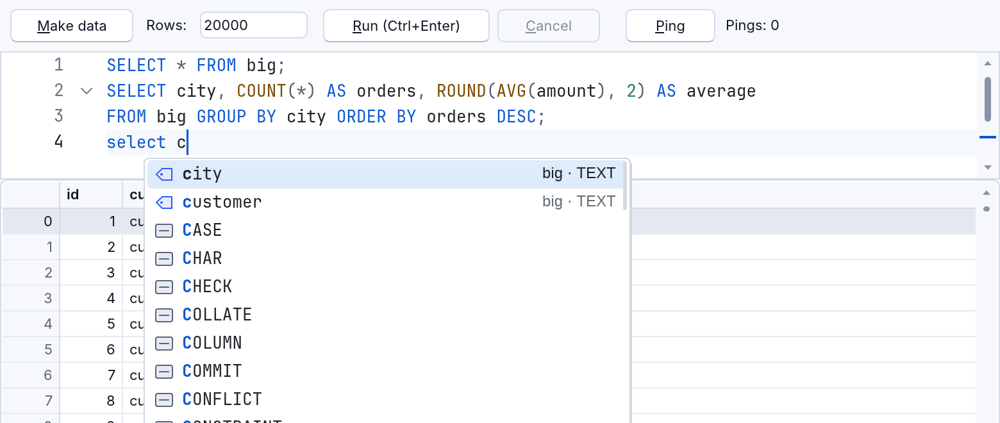

<!-- translated-from: code-editor.md a6af4f119f9f5110 -->
# El editor de código en tus programas

`RCodeEditor` es el propio editor de código de RapidR Studio, como un componente
para tus programas: colores de sintaxis, números de línea, plegado, varios
cursores, buscar y reemplazar, un minimapa, marcadores y autocompletado. Se ve y
funciona igual en el escritorio y en el navegador, y los lectores de pantalla lo
leen como leen el editor de Studio. Cada propiedad, método y evento está en la
[referencia de miembros](../reference/members.md#rcodeeditor); esta página
muestra los más comunes y el modo SQL.

```basic
CREATE Editor AS RCodeEditor
    Align = alClient
    Language = "json"                    ' o "rapidr-basic", "sql", "html" …
    Text = "{" + CHR$(34) + "a" + CHR$(34) + ": 1}"
    OnChange = Edited
END CREATE
```

- `Language` elige los colores, los corchetes, la sangría y el plegado: un id
  (`rapidr-basic`, `sql`, `json`, `html`, `css`, `javascript`, `markdown`,
  `toml`, `rust`, `csv`, `plaintext`), un nombre de archivo cuya extensión lo
  dice, o un archivo de definición de lenguaje propio (`.toml`).
- `LoadFromFile` y `SaveToFile` conservan los saltos de línea y la codificación
  de un archivo.
- `CaretLine`, `CaretColumn`, `GotoLineColumn`, `Find`, `ReplaceAll`,
  `Fold`, `AddMarker` y los demás cuentan las líneas y las columnas desde 1.
- Para un lenguaje sin el servicio de lenguaje de RapidR, el autocompletado, la
  información flotante y la información de parámetros son tuyos: responde a
  `OnCompletionRequest` con `ShowCompletion` y a `OnHoverRequest` con
  `ShowHover`.

## SQL

Con `Language = "sql"` el editor conoce SQL por sí solo:

```basic
CREATE Editor AS RCodeEditor
    Align = alTop: Height = 120
    Language = "sql"
    SqlDialect = "sqlite"                ' o "mysql"; "" para ambos
    OnRunStatement = RunStatement
END CREATE

Editor.SetSchema DB.Schema               ' las tablas y columnas de la base de datos

SUB RunStatement (SQL AS STRING)
    DB.QueryAsync SQL                    ' en segundo plano: mira Bases de datos
END SUB
```

- **Colores.** `SqlDialect` elige qué palabras se colorean y se autocompletan:
  `"sqlite"` (`PRAGMA`, `GLOB`, `JULIANDAY` …), `"mysql"` para MySQL y
  MariaDB (`SHOW`, `AUTO_INCREMENT`, `DATE_FORMAT` …), o `""` para ambos.
  `Language` sigue siendo `"sql"`.
- **Autocompletado.** Cuando empieza una palabra, el editor ofrece las columnas
  de las tablas que nombra la instrucción (las de todas las tablas cuando no
  nombra ninguna), luego las tablas y luego las palabras clave y las funciones
  del dialecto. Después de `name.` ofrece las columnas de esa tabla, también a
  través de un alias (`FROM people p` … `p.`). Después de `FROM`, `JOIN`,
  `INTO`, `UPDATE` y `TABLE` van primero las tablas. Tab o Enter lo acepta.
- **Tus tablas.** `SetSchema(json)` le da al autocompletado tus tablas, vistas y
  columnas. `DB.Schema` (el de un RSQLite o un RMySQL) es JSON ya preparado para
  eso. También puedes escribirlo tú: `{"tables": [{"name": "people",
  "kind": "table", "columns": [{"name": "id", "type": "INTEGER"}, …]}]}`,
  una lista de tablas así, o la forma corta `{"people": ["id", "name"]}`.
  (Las cadenas de BASIC no tienen el escape `""`: forma las comillas con
  `CHR$(34)`, o usa `RJson`.) `SetSchema ""` lo borra.
- **Ejecutar.** Ctrl+Enter (Cmd+Enter en una Mac) dispara `OnRunStatement (SQL)`
  con la selección, o con la instrucción en la que está el cursor: hasta su `;`,
  o hasta una línea en blanco, de modo que las instrucciones escritas sin `;` se
  ejecutan una por una cuando una línea en blanco las separa (un `;` o una línea
  en blanco dentro de una cadena o de un comentario no cuenta).
  `CurrentStatement` es el mismo texto, para un botón Ejecutar:
  `DB.QueryAsync Editor.CurrentStatement`.
- **Plegado.** Una instrucción de varias líneas se pliega, desde su primera línea
  hasta su `;`, y también una lista entre paréntesis de varias líneas (las
  columnas de un `CREATE TABLE`, una subconsulta).
- **Tu propio autocompletado.** Con `LanguageService = 0` el editor le pregunta a
  tu programa (`OnCompletionRequest`, que respondes con `ShowCompletion`).



El ejemplo [million_rows_async.rr](../../../examples/data/million_rows_async.rr)
lo junta todo: un editor de SQL, consultas en segundo plano y una tabla de un
millón de filas. Mira también [Bases de datos](databases.md).
