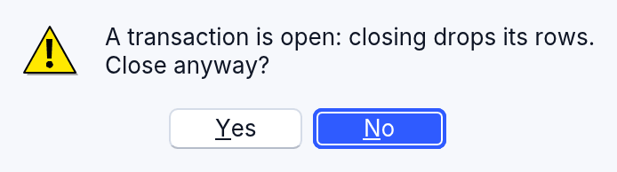
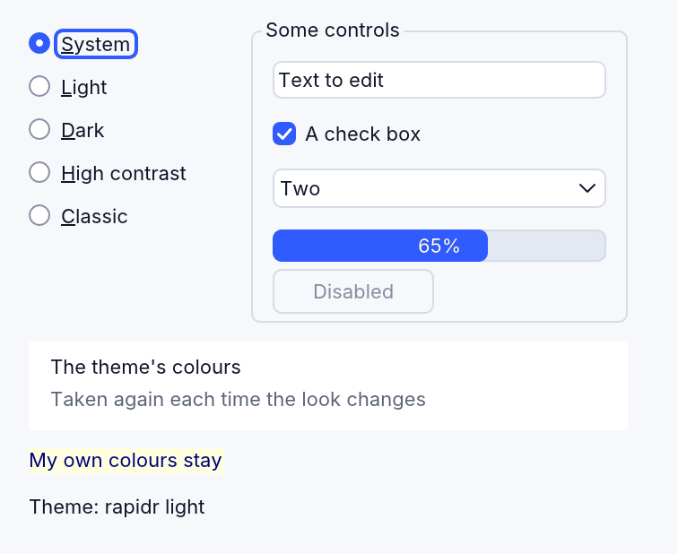
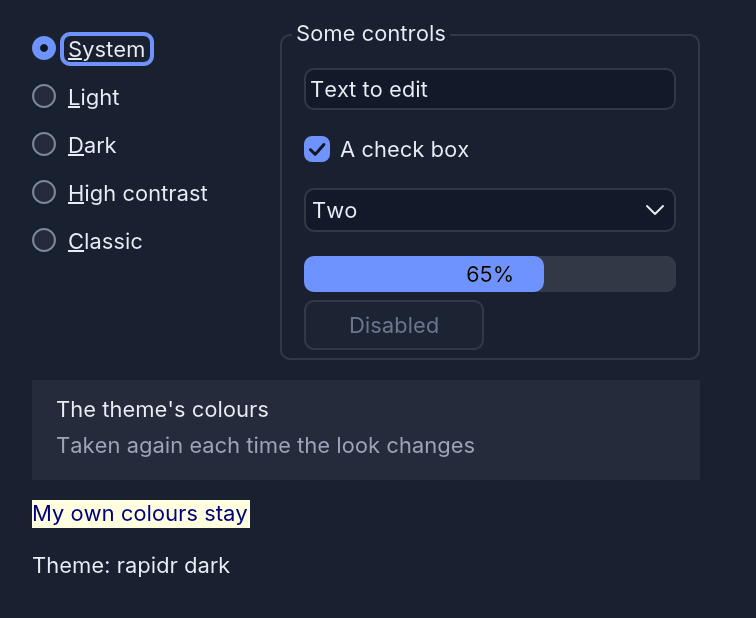
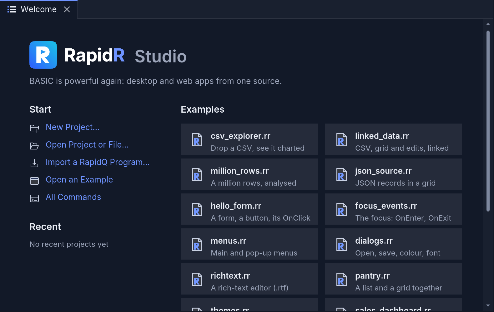
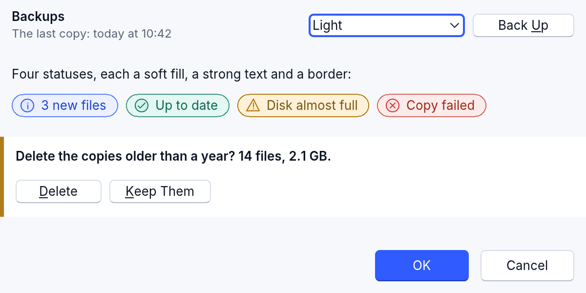
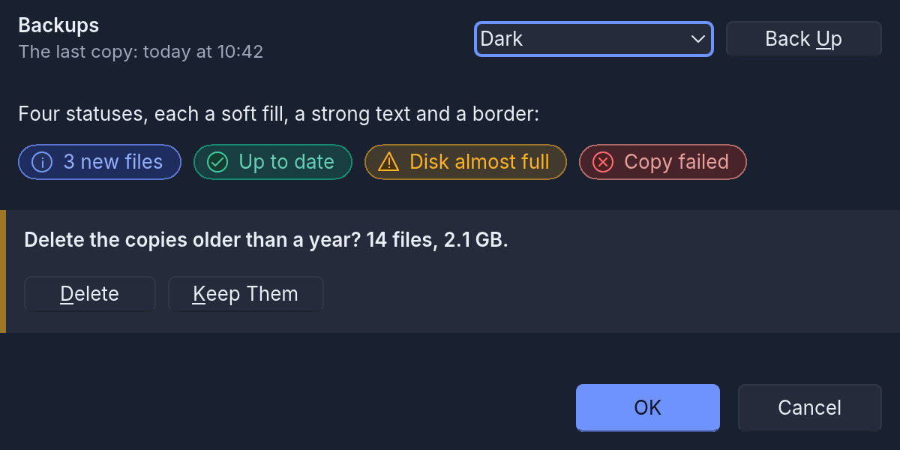

<!-- translated-from: components.md 694912b9ade24d32 -->
# Componentes y objetos

Un programa de RapidR construye sus ventanas con **componentes** —
formularios, botones, listas, tablas, temporizadores — y usa **objetos** que no
tienen ventana (fuentes, mapas de bits, flujos, listas de cadenas de texto, bases
de datos). RapidR tiene todos los componentes y objetos clásicos excepto OLE
(QOLECONTAINER, QOLEOBJECT), y añade los suyos.

La lista completa, con los dos nombres y dónde se ejecuta cada uno:
[reference/components.md](../reference/components.md).

## Los nombres clásicos

Los componentes de RapidR se escriben `RButton`, `RForm`, `RStringGrid`, ….
Los programas anteriores usan `QBUTTON`, `QFORM`, `QSTRINGGRID`, …: los mismos
componentes, aceptados en todas partes
([la lista completa](../reference/classic-names.md)). **Los dos nombres son un
solo componente**: las mismas propiedades, métodos, eventos, valores
predeterminados, aspecto y comportamiento, en todos los entornos de ejecución.
Unos pocos nombres clásicos se asignan a otro nombre R: `QGAUGE` es `RProgressBar`,
`QOUTLINE` (el árbol de Windows 3.1) es `RTreeView`, y `COMPORT` es `RComPort`.

- Mézclalos con libertad: un formulario `RForm` puede contener un botón
  `QBUTTON`, y un formulario `QFORM` un gráfico `RPlot`; `DIM`, `CREATE`,
  `EXTENDS`, los parámetros (`Sender AS RButton`) y los arreglos (arrays)
  aceptan cualquiera de los dos nombres.
- **Los componentes exclusivos de RapidR** tienen solo un nombre R: `RSQLite`,
  `RJson`, `RHttp`, `RNum`, `RDataFrame`, `RPlot`, los componentes de datos
  enlazados `RCSV`, `RDataSource` y `RDBGrid` ([Ciencia de datos](data-science.md)),
  `RAI` ([El asistente de IA y RAI](ai-assistant.md)), `RMarkdownView`
  ([Markdown](markdown.md)), `RCodeEditor`, los componentes web
  (`RWebView`, `RDOM`, …) y otros.
- Un programa escrito con nombres clásicos, que usa solo los componentes y
  miembros clásicos, sigue siendo un programa clásico simple. Para pasar uno a
  los nombres de RapidR, impórtalo
  (el comando de importación del menú **Archivo** de RapidR Studio, o
  `rapidr import-rapidq`): una copia convertida y un informe, con el original
  intacto — [Importar programas anteriores](importing-rapidq.md).
- RapidR Studio muestra los nombres de RapidR (la caja de herramientas, el
  inspector, la Ayuda, el autocompletado); lo que añade a un archivo escrito con
  nombres clásicos se escribe con nombres clásicos, así que un archivo nunca los mezcla.
- Como una Q inicial se lee como R siempre que exista el componente R, `QPLOT` se
  acepta y significa `RPlot`, aunque nunca hubo un `QPLOT` clásico. Prefiere el nombre R
  para los componentes propios de RapidR.

Más sobre cómo conviven las dos familias (y cómo las escribe RapidR Studio):
[docs/q-and-r-components.md](../../q-and-r-components.md).

## Crear componentes

```basic
CREATE Form AS RForm                 ' un componente y sus hijos
    Caption = "Pedidos"
    Width = 400 : Height = 300
    Center
    CREATE Grid AS RStringGrid
        Align = alClient
        ColCount = 3
    END CREATE
END CREATE

DIM Font AS RFont                    ' un objeto, o un componente creado después
Font.Name = "Arial" : Font.Size = 12
DIM Extra AS RButton
Extra.Parent = Form                  ' se coloca en el formulario en tiempo de ejecución
DIM Labels(1 TO 3) AS RLabel         ' arreglos de componentes
```

Dentro de `CREATE … END CREATE`, `Name = value` establece la propiedad del
componente y un nombre de método solo (`Center`, `AddItems "a", "b"`) lo llama.
Las propiedades se leen y se escriben con `Component.Property`, y los métodos se
llaman con `Component.Method args` (como una `SUB`) o `x = Component.Method(args)`.
Algunos métodos se pueden llamar sin paréntesis para obtener su valor (`WHILE
DB.FetchRow`, `IF Dlg.Execute THEN`).

## Eventos

Una propiedad de evento nombra una `SUB`:

```basic
CREATE Button1 AS RButton
    OnClick = ButtonClick
END CREATE

SUB ButtonClick (Sender AS RButton)
    ShowMessage "Se hizo clic en " + Sender.Caption
END SUB
```

- Los controladores de eventos reciben los argumentos clásicos, con el componente
  al final como `Sender`: `OnKeyDown (Key, Shift)`, `OnKeyPress (Key)`,
  `OnMouseDown (Button, X, Y, Shift)`, `OnMouseMove (X, Y, Shift)`, el
  `OnDrawCell (Col, Row, State, Rect)` de una tabla, … Un controlador puede
  declarar menos parámetros.
- Los controladores también se pueden enlazar en tiempo de ejecución:
  `Btn(i).OnClick = Clicked`.
- Los eventos se ejecutan cuando el programa espera: durante `ShowModal`,
  `DOEVENTS` o un cuadro de diálogo (mira
  [Cuándo se ejecutan los eventos](#cuándo-se-ejecutan-los-eventos)). El programa termina cuando
  termina su código principal: los formularios que siguen abiertos se cierran con
  él y sus temporizadores se detienen.
- El primer `Show` (o `ShowModal`) de un formulario dispara `OnResize`, `OnShow`,
  `OnResize` — organiza la disposición de un formulario en `OnResize` y estará
  bien cuando aparezca. `OnPaint` viene después, cuando el programa vuelve a
  esperar. Un tamaño que el programa establece en un formulario mostrado
  (`Width`, `Height`, `ClientWidth`) dispara `OnResize` al instante; una posición
  nueva no dispara nada.
- Bajo `ShowModal`, un `Close` (o un `ModalResult`) en el propio `OnShow` del
  formulario se pierde: el formulario sigue abierto y recibe su `OnClose` cuando
  se cierra después. Ciérralo desde un temporizador o un botón.
- Las propiedades verdadero / falso leen `1` o `0`, también los componentes de
  panel de RapidR Studio (`Console.ShowTabs`, `Tree.ShowFiles`).

```basic
Form.ShowModal          ' muestra el formulario y espera hasta que se cierre
' o
Form.Show               ' lo muestra y sigue; para mantenerlo, espera:
DO: DOEVENTS: LOOP UNTIL Closed    ' (Closed lo establece el OnClose del formulario)
```

### Cuándo se ejecutan los eventos

- **Los eventos de la ventana** — la marca de un temporizador, un clic, una
  tecla, un repintado que la ventana pide — se ejecutan solo mientras el programa
  espera (`ShowModal`, `DOEVENTS`, un cuadro de diálogo), cada uno hasta su final
  antes del siguiente. Un controlador que todavía se está ejecutando nunca es
  interrumpido por uno: este se ejecuta cuando ese controlador ha terminado.
- **Un temporizador nunca se ejecuta dentro de sí mismo.** Si su controlador
  tarda más que su `Interval`, la siguiente marca llega cuando el controlador
  termina; las marcas perdidas mientras tanto no se recuperan. El temporizador de
  cuadros de un emulador con `Interval = 10` cuyo cuadro tarda 30 ms simplemente
  ejecuta unos 30 cuadros por segundo.
- **Un controlador que llama a `DOEVENTS`** deja que los eventos en espera se
  ejecuten allí mismo — la marca de otro temporizador, un clic —, y luego sigue.
- **Los eventos que dispara tu propio código se ejecutan al instante**, dentro de
  la línea que los dispara ([más abajo](#eventos-que-dispara-tu-propio-código)):
  `Canvas.Repaint` ejecuta el `OnPaint` del lienzo antes de la línea siguiente.

Así, un controlador que dispara su propio evento se ejecuta dentro de sí mismo:
un `Repaint` dentro del `OnPaint` del mismo lienzo, un `OnChange` que le da un
`Text` nuevo a su campo de texto. Cuando eso no se detiene nunca, el programa lo
detiene, a 200 controladores de profundidad, con un error de ejecución que nombra
el evento y la línea:

```
run-time error: OnPaint of Screen ran inside itself 200 times: its handler fires it again before it ends (at game.rr line 21)
```

Como con cualquier [error en un controlador](#un-error-de-ejecución-en-un-controlador), la
ventana sigue funcionando. Dibuja en `OnPaint` y pide el repintado en otro
lugar — el temporizador que mueve el juego: `Screen.Repaint`.

### El foco: OnEnter y OnExit

Todo componente que toma el foco del teclado — un campo de texto, un botón, una
casilla, una lista, una tabla … — tiene **OnEnter** (recibió el foco) y
**OnExit** (lo perdió a favor de otro componente de su formulario). Llegan con
Tab y Shift+Tab, un clic, `SetFocus` y el atajo de una etiqueta; el componente
que tiene el foco cuando su formulario se muestra recibe entonces su OnEnter. El
que se va oye primero OnExit y luego el que llega su OnEnter, ambos antes de lo
que hace un clic (OnMouseDown, OnClick). Cambiar a otra ventana o aplicación y
volver no dispara ninguno, ni tampoco ocultar o deshabilitar el componente que
tiene el foco.

```basic
CREATE Age AS REdit
    OnExit = AgeExit
END CREATE

SUB AgeExit
    IF VAL(Age.Text) < 1 THEN Advice.Caption = "Escribe tu edad en años"
END SUB
```

[focus_events.rr](../../../examples/gui/focus_events.rr) muestra los dos. Son
propios de RapidR: los componentes clásicos tienen OnEnter solo en sus listas (el
de un QFILELISTBOX nunca se dispara; enlazar el de un QLISTBOX detiene el
programa) y ningún OnExit, así que ningún programa anterior cambia.

### Eventos que dispara tu propio código

Establecer algunas propiedades desde el código dispara el evento que dispara el
cambio del usuario, dentro de la asignación — antes de que se ejecute la línea
siguiente —, exactamente como lo hacen los componentes clásicos (el conjunto de
pruebas de compatibilidad lo cubre):

| El programa establece | Dispara |
|---|---|
| `Edit.Text` o `Edit.SelText` (el texto cambia) | OnChange |
| `RichEdit.Text` (el texto cambia) | OnChange: una vez antes de que su formulario se haya mostrado, **dos veces** después (el editor de texto enriquecido oye su propio cambio y el del texto) |
| `RichEdit.SelText` | OnChange |
| `CheckBox.Checked` (activado o desactivado, un cambio) | OnClick |
| `RadioButton.Checked = 1` (estaba desactivado) | OnClick — el botón que desactiva no oye nada |
| `ScrollBar.Position` (un cambio) | OnChange (no OnScroll) |
| el mismo valor otra vez; `RadioButton.Checked = 0` | nada |
| `ComboBox.ItemIndex`, `ComboBox.Text`, `ListBox.ItemIndex`, `TrackBar.Position`, `TabControl.TabIndex` | nada |

Un controlador que establece el valor de su propio componente se ejecuta otra
vez, y el código que llena un formulario dispara los controladores que enlaza:
mantén un indicador mientras lo haces, como hace
[csv_explorer.rr](../../../examples/data/csv_explorer.rr) con `Busy`. Todavía no
es igual que en los componentes clásicos: allí, `RichEdit.AddStrings` dispara
OnChange, y el OnChange de un QFILELISTBOX llega cuando lee su carpeta por primera
vez.

### Un error de ejecución en un controlador

El controlador se detiene en la línea que falló — y también los controladores que
lo dispararon (un clic cuyo `Edit.Text = …` ejecutó el OnChange que falla) — y el
programa sigue: sus ventanas siguen respondiendo, sus temporizadores siguen
marcando, el siguiente clic ejecuta el controlador otra vez. RapidR escribe el
error donde lo ves (la salida de errores del programa, la Salida de Studio); los
componentes clásicos no dicen nada. En un evento que se ejecutó dentro de un
`DOEVENTS`, el error también detiene el código que llamó a `DOEVENTS`: el
`DO: DOEVENTS: LOOP` de un programa principal termina allí, y el programa con él.
Un error en el programa principal termina el programa. Con el depurador de
Studio, el programa primero se detiene en la línea (mira
[Depuración](debugging.md#cuando-el-programa-falla)).

### Mensajes de Windows: el WndProc de un formulario

El `WndProc` de un formulario oye los mensajes que Windows envía o publica en la
ventana del formulario: `WndProc = MySub` en el bloque `CREATE` del formulario (o
`Form.WndProc = MySub`), y `MySub (hWnd, uMsg, wParam, lParam)` se ejecuta para
cada uno. En Windows son todos los mensajes de la ventana: los del sistema
(`WM_SIZE`, `WM_MOVE`, `WM_ACTIVATE`, `WM_PAINT`, el mouse y las teclas) y los
que le envía un programa o un controlador de dispositivo. Los mensajes propios de
un programa usan los números a partir de `WM_USER` (&H400):

```basic
CONST WM_USER = &H400
DECLARE FUNCTION PostMessageA LIB "user32" ALIAS "PostMessageA" (hWnd AS LONG, uMsg AS LONG, wParam AS LONG, lParam AS LONG) AS LONG
DECLARE SUB MyWndProc (hWnd AS LONG, uMsg AS LONG, wParam AS LONG, lParam AS LONG)
DECLARE SUB PostClick

CREATE Form AS RForm
    WndProc = MyWndProc
    CREATE PostBtn AS RButton
        Caption = "Publicar": OnClick = PostClick
    END CREATE
END CREATE

SUB PostClick
    PostMessageA(Form.Handle, WM_USER + 1, 7, 9)
END SUB

SUB MyWndProc (hWnd AS LONG, uMsg AS LONG, wParam AS LONG, lParam AS LONG)
    IF uMsg = WM_USER + 1 THEN Form.Caption = "Recibido: " + STR$(wParam) + ", " + STR$(lParam)
END SUB

Form.ShowModal
```

`OnMessage` es el otro nombre que RapidR da a `WndProc`: `OnMessage = MyWndProc` en
el bloque `CREATE` del formulario (o `Form.OnMessage = MyWndProc`) es el mismo
evento, con los mismos cuatro parámetros, que se oye en los mismos lugares y que
es igual en todos los sistemas. Usa el nombre que te parezca mejor. Un programa
que enlaza los dos en un formulario oye sus mensajes en el controlador enlazado al
último.

Un teclado MIDI funciona de la misma manera: `midiInOpen` de winmm con
`CALLBACK_WINDOW` (&H10000) y el `Handle` del formulario envía cada mensaje MIDI
al formulario como `MM_MIM_DATA` (&H3C3), con los bytes MIDI en lParam (el estado
en el byte bajo, la nota a continuación, la velocidad encima de ella). Abre el
dispositivo cuando el formulario ya se esté mostrando (desde un botón, o con el
primer mensaje que reciba WndProc): antes de que exista su ventana, `Form.Handle`
es el número propio de RapidR.

Lo que conviene saber:

- `hWnd` es el `Handle` del formulario; `uMsg`, `wParam` y `lParam` son números de
  32 bits (`&H80000000` llega como -2147483648).
- El controlador se ejecuta justo después de que Windows haya tratado el mensaje,
  en el orden en que llegaron los mensajes; lo que devuelve no importa.
  `DOEVENTS` dentro de él deja entrar los mensajes siguientes.
- Los mensajes llegan desde el momento en que se muestra la ventana del
  formulario. El WndProc clásico se llama ya mientras `CREATE` construye el
  formulario, así que un controlador que usa un control creado más adelante en el
  bloque detiene un programa así; el de RapidR no.
- Cada formulario tiene su propio WndProc. (El clásico es para todo el programa:
  el último que se enlazó oye los mensajes de todos los formularios.)
- Un mensaje cuyo lParam apunta a datos (`WM_COPYDATA`, `WM_GETMINMAXINFO`) no se
  puede leer: `PEEK` llega solo a la memoria propia del programa.
- RapidR dibuja los controles de un formulario en la ventana propia del
  formulario, así que el mouse sobre un control es también el `WM_MOUSEMOVE` del
  formulario (los controles clásicos son ventanas propias). Los repintados de sus
  controles que hace RapidR no se entregan como `WM_PAINT`.
- En macOS, Linux y la web no hay mensajes de Windows: `WndProc` oye solo el
  [ícono de la bandeja del sistema](directx-and-media.md#la-bandeja-del-sistema) del
  formulario. El `WndProc` de un control nunca se llama, en ningún sistema.

Los ejemplos de [examples/windows/](../../../examples/windows/) enumeran los
mensajes de un formulario a medida que llegan, publican `WM_USER + 1`, leen un
teclado MIDI y envían un mensaje MIDI SysEx (`midi_sysex_out.rr`: también muestra
cómo se organiza un tipo `TYPE` para una estructura de Windows de 64 bits,
`MIDIHDR`; mira [Llamadas a DLL de Windows](../../windows-dll-calls.md)).

## Cuadros de mensaje: la respuesta segura con Enter

Enter presiona el primer botón de un cuadro de mensaje. Para una pregunta cuya
primera respuesta no se puede deshacer, indica la respuesta segura con el quinto
argumento de `MESSAGEDLG`, la respuesta del botón que presiona Enter:

```basic
IF MESSAGEDLG("Esto elimina 1204 filas.", mtWarning, mbYes OR mbNo, 0, mrNo) = mrYes THEN
    DeleteRows
END IF
```

- Ese botón tiene el foco cuando se abre el cuadro, y Tab sigue yendo de izquierda
  a derecha desde él. Igual en el escritorio y en la web, en todos los temas.
- Escape y el botón de cierre responden como siempre: Cancelar si hay uno, y si
  no, No.
- Su indicador `mb` también sirve (`mbNo`), cuando ningún botón responde con ese
  número. Sin el argumento, o nombrando un botón que el cuadro no tiene, el
  primer botón es el predeterminado.
- `MESSAGEBOX` toma para ello los indicadores propios de Windows:
  `MB_DEFBUTTON2` (`&H100`) o `MB_DEFBUTTON3` (`&H200`), sumados a los botones:
  `MESSAGEBOX("Delete it?", "Notes", MB_YESNO OR &H100)`.



El ejemplo es la pregunta de cierre de
[transactions.rr](../../../examples/data/transactions.rr).

En una prueba, `RAPIDR_TEST_MESSAGE_DIALOG=__enter` responde un cuadro con su
botón predeterminado, como lo haría Enter.

## Las listas se desplazan hasta lo que eliges

Un cuadro de lista muestra el elemento que elige tu programa, como lo hacen los
cuadros de lista de Windows: establecer `ItemIndex` desplaza lo mínimo que hace
falta para que el elemento quede a la vista (no se mueve nada cuando ya está
allí), y establecer `TopIndex` hace que ese elemento sea la primera fila
mostrada — hasta donde la lista pueda desplazarse: el `TopIndex` del último
elemento muestra la última página de la lista. Leer `TopIndex` da la primera fila
mostrada, también después de que el usuario se desplazó. Funciona igual en una
lista en `Columns` (la lista se desplaza a lo ancho), en una lista de dibujo
propio (owner-drawn), y en el escritorio, en una compilación nativa y en la web.

```basic
' una lista de mensajes: cada mensaje nuevo se añade, luego se elige y se muestra
Messages.AddItems "Hola, " + Name
Messages.ItemIndex = Messages.ItemCount - 1
```

(`TopIndex` lee la lista tal como se dibujó por última vez: establécelo y leerá
lo que muestra la lista cuando la ventana la haya dibujado, un momento después.)

## RUpDown: flechas que cambian un número

Un componente `RUpDown` son dos botones de flecha pequeños que cambian `Position`
entre `Min` y `Max` (de a `Increment`; `Wrap = -1` da la vuelta de un extremo al
otro). Haz clic en una flecha, o presiona las teclas Up y Down mientras tiene el
foco. Cada paso que cambia `Position` dispara `OnChange` y luego `OnClick`; un
clic en el extremo del rango (no cambia nada) dispara solo `OnClick`. Establecer
`Position` en el código no dispara ningún evento.

Casi siempre las flechas están junto a un campo de texto que muestra el número.
Dilo con `Associate` y no hay nada más que escribir:

```basic
CREATE Dose AS REdit
    Left = 130: Top = 12: Width = 56: Text = "2"
END CREATE
CREATE DoseSpin AS RUpDown
    Left = 188: Top = 12: Width = 18: Height = 24
    Min = 0: Max = 8: Position = 2
    Associate = Dose
END CREATE
```

El campo de texto (o un `RLabel`, que lo muestra como su `Caption`) toma
`Position` cada vez que las flechas o tu programa lo cambian, y el `OnChange` del
propio campo se dispara como con cualquier `Text` que establezcas. Las flechas
cuentan a partir del número entero que muestra el campo, así que se parte de un
número escrito allí, y uno que pasa de `Max` se devuelve a `Max`; un texto que no
es un número entero se ignora y el paso parte de `Position`. Crea el campo antes
que las flechas, para que exista cuando `Associate` lo nombre. Sin `Associate`,
las flechas solo cambian `Position`: muéstralo tú mismo en `OnChange`.

El ejemplo [`examples/gui/updown.rr`](../../../examples/gui/updown.rr) tiene un
par de flechas con un campo de texto, uno que cambia de a 15 y otro sin
`Associate` que una etiqueta sigue mediante `OnChange`.

## Los objetos globales

| Objeto | Qué tiene |
|---|---|
| `Application` | `ExeName`, `Path`, `Title`, `Icon`, `Terminate`, `Minimize`, `Theme` (de RapidR) |
| `Screen` | `Width`, `Height`, `ClientWidth` / `ClientHeight` (el área de trabajo), `MouseX` / `MouseY`, `Monitors`, `Cursor`, `PixelsPerInch` (96), `Scale` (de RapidR) |
| `Clipboard` | `Text`, `SetAsText`, `GetAsText(n)`, `Clear`, `HasFormat`, … — el portapapeles del sistema en el escritorio |
| `Printer` | El objeto de impresora (y `LPRINT`): cada documento se convierte en un PDF, que se envía a la impresora con el `lp` de CUPS en macOS y Linux, o con el cuadro de diálogo de impresión del navegador en la web; en Windows, o sin impresora, se guarda como un PDF en la carpeta actual. `RAPIDR_PRINT_TO=<archivo o carpeta>` lo guarda allí en su lugar |
| `Mouse` | `X`, `Y` |

Un programa ejecutado por el RapidR Runtime se ve a sí mismo como si estuviera
compilado: `Application.ExeName` y `Application.Path` nombran su archivo, y
`COMMAND$(n)` / `CommandCount` ven solo sus propios argumentos (`COMMAND$(0)` es
el archivo del programa; un `COMMAND$` solo, el de RapidR, son los argumentos
unidos con espacios) — se ejecute como se ejecute: `rapidr run`, `rapidr
run-bc`, un archivo con doble clic, un ejecutable compilado. En la web son las
partes de la cadena de consulta de la página (`?a&b%20c`: `a`, `b c`).

## Adiciones de RapidR a todos los componentes

Estas son de RapidR, y aditivas: un programa que no las usa se comporta
exactamente como antes. Usar una hace que el programa sea solo de RapidR (el
compilador anterior no la conoce).

| Adición | |
|---|---|
| `Anchors = akLeft + akRight` (`akTop`, `akBottom`) | mantiene las distancias del componente a los bordes de su padre cuando se cambia el tamaño del padre (los componentes clásicos solo tienen `Align`) |
| `MinWidth`, `MinHeight`, `MaxWidth`, `MaxHeight` (también `Constraints.MinWidth`, …) | limitan todos los tamaños que toma el componente, desde el programa, la disposición o el usuario |
| `AccessibleName`, `AccessibleDescription` | lo que dice un lector de pantalla, cuando el texto no basta |
| `Form.Scale`, `Screen.Scale`, `OnScaleChanged` | qué tan fina es la pantalla (2 en una pantalla Retina, 1.5 al 150 %) |
| `Application.Theme`, `$THEME`, `Application.OnThemeChange` | el aspecto, y cuándo cambia (más abajo) |
| `TabStop` en un panel | el panel toma el foco del teclado: una tarjeta en la que se puede hacer clic ([Accesibilidad](#accesibilidad)) |
| `TabStop` en una etiqueta | la etiqueta es un enlace: Tab llega a ella, Enter o Space hace clic en ella ([Accesibilidad](#accesibilidad)) |
| `Application.Announce Text [, Assertive]` | un lector de pantalla dice Text sin que se mueva el foco ([más abajo](#avisar-a-los-lectores-de-pantalla-de-las-novedades-applicationannounce)) |
| `AutoComplete` en un campo de texto | la sugerencia de autocompletado del navegador, en la web |
| `Placeholder = "Search the help"` en un campo de texto | la línea gris que se muestra mientras el campo está vacío, que dice qué escribir; nunca se lee de vuelta como el texto, desaparece cuando el usuario escribe (el cuadro de la Ayuda de RapidR Studio la usa) |
| `Form.OnDropFiles (Files AS STRING)` | archivos arrastrados desde la computadora y soltados en la ventana (más abajo) |

### Archivos soltados en un formulario

`OnDropFiles` (de RapidR; los componentes clásicos no tienen ese evento) oye los
archivos arrastrados desde el Finder, el Explorador de archivos o un
administrador de archivos de Linux — en un navegador, desde la computadora — y
soltados en cualquier lugar de la ventana del formulario. `Files` contiene sus
rutas, una por línea (`CHR$(10)` entre ellas), en el orden en que llegaron;
soltar varios archivos es un solo evento. Abre cada uno como cualquier archivo.
En un navegador, un archivo soltado se lee en los archivos propios del programa
con su nombre, así que `Files` contiene nombres (`sales.csv`) que el programa
abre de la misma manera. Un formulario sin el controlador ignora los archivos
soltados.

```basic
CREATE Form AS RFORM
    Caption = "Suelta archivos aquí"
    OnDropFiles = Dropped
    CREATE Info AS RLABEL
        Left = 8: Top = 8: Width = 300
    END CREATE
END CREATE

SUB Dropped (Files AS STRING)
    DIM i AS INTEGER
    FOR i = 1 TO TALLY(Files, CHR$(10)) + 1
        Info.Caption = Info.Caption + FIELD$(Files, CHR$(10), i) + "  "
    NEXT
END SUB

Form.ShowModal
```

El ejemplo [CSV Explorer](data-science.md#tutorial-el-explorador-de-csv) abre el
archivo CSV que se suelta en él.

## El puntero del mouse

Todo componente muestra el puntero que su usuario espera, sin una línea de
código: el puntero en forma de I sobre un campo de texto, un memo, un editor de
texto enriquecido y el texto de una lista desplegable; el puntero de cambio de
tamaño de columna (una flecha doble con una barra) sobre un `RSPLITTER` entre dos
columnas y sobre el borde de columna de una tabla, una vista de lista o un
encabezado (el de cambio de tamaño de fila para un divisor entre dos filas y para
el borde de fila de una tabla con `goRowSizing`); las flechas de tamaño
diagonales y rectas sobre los bordes y las esquinas de una ventana hija de un
`RFORMMDI`; la esquina de tamaño sobre el agarre de una barra de estado. Los
paneles de Studio siguen la misma regla: la línea entre las columnas de nombre y
de valor del inspector de propiedades, los divisores entre paneles y entre
editores divididos, los puntos de control del diseñador de formularios, los
enlaces del panel Salida, y una pestaña, un archivo o un elemento de la caja de
herramientas que se está llevando (una mano cerrada). Con el aspecto de RapidR,
el divisor que puedes arrastrar también se ilumina bajo el mouse. Establece el
`Cursor` del componente (`crHandPoint`, `crSizeWE`, …) y gana tu elección;
`crDefault` (0) significa “el propio del componente”.

**Un divisor que se ve.** Con el aspecto de RapidR (claro, oscuro y contraste
alto), un `RSplitter` en reposo se muestra sin llamar la atención: un espacio
tranquilo con una línea suave de 1 píxel a lo largo de su centro (nítida en
contraste alto) y un agarre corto sobre esa línea, para que la gente vea que hay
algo que arrastrar. El agarre tiene un contraste de al menos 3:1 con el espacio.
Cuando el mouse se queda sobre él un momento (pasar por encima no hace parpadear
nada) y mientras se arrastra, todo el divisor toma el color de acento. Los
divisores propios de Studio entre sus paneles se ven igual, sin la línea: los
bordes propios de los paneles ya muestran dónde se encuentran (cada panel de un
`RDockManager` tiene un borde fino por ambos lados y por abajo, y lo que pones en
un panel no dibuja allí ningún borde propio). Los divisores de tu programa
conservan el lugar y el tamaño que les diste; solo el dibujo es nuevo. El aspecto
clásico dibuja la barra en relieve, como antes.
En el escritorio este es el puntero del sistema, en la web el puntero de la
página; coinciden.

## Temas

Los programas se dibujan con el aspecto propio de RapidR — el de RapidR Studio —
a menos que pidan otro. Sigue la configuración del sistema (claro, oscuro o
contraste alto) y es el mismo en macOS, Windows, Linux y la web.

| `$THEME` / `Application.Theme =` | Aspecto | `Application.Theme` lee |
|---|---|---|
| ninguno, `RapidR`, `Auto` (el valor predeterminado) | el aspecto de RapidR según la configuración del sistema, y sigue al sistema cuando el usuario cambia | `rapidr light`, `rapidr dark` o `rapidr high contrast` |
| `RapidR Light` (también `Modern`) | el aspecto de RapidR, claro | `rapidr light` |
| `RapidR Dark` (también `Dark`) | el aspecto de RapidR sobre la tinta (Ink) de la marca | `rapidr dark` |
| `RapidR High Contrast` (también `HighContrast`) | High Contrast Black de Windows: blanco sobre negro, anillos de foco gruesos | `rapidr high contrast` |
| `Classic` (también `System`, `Light`, `Windows`, `Win95`, `Win2K`, …) | El aspecto clásico de Windows, exacto | `classic` |

`$THEME Classic` al principio de un programa le da exactamente el aspecto
clásico; `Application.Theme = "rapidr dark"` cambia mientras se ejecuta. La
variable de entorno `RAPIDR_THEME` da un tema a los programas que no nombran
ninguno (**Vista previa en Clásico** de RapidR Studio la usa).

### Cuando cambia el aspecto

Un programa con el aspecto de RapidR (el predeterminado) cambia de aspecto
mientras se ejecuta: cuando la persona que lo usa cambia el sistema a claro,
oscuro o contraste alto — la Apariencia (*Appearance*) y Aumentar contraste
(*Increase Contrast*) de macOS, el modo de aplicación (*app mode*) y el Contraste
alto (*High Contrast*) de Windows, el esquema de color del navegador en la web —
y cuando el programa establece `Application.Theme`. Se abre con el aspecto del
sistema desde su primera línea. Lo que RapidR dibuja lo sigue solo: todos los
componentes y los colores del sistema (`clBtnFace`, `clWindowText` …).

Pero un color que el programa *leyó* del tema con `Application.ThemeColor` es un
número: se queda como estaba. El `Application.OnThemeChange` de RapidR se
dispara cuando el aspecto ya cambió — vuelve a tomar esos colores allí:

```basic
SUB TakeColors
    Card.Color = Application.ThemeColor("card")
    CardTitle.Font.Color = Application.ThemeColor("page.text")
    Now.Caption = "Tema: " + Application.Theme
END SUB

TakeColors                              ' el aspecto con el que se abre
Application.OnThemeChange = TakeColors  ' y cada aspecto después de él
```

Se dispara después del cambio, una vez (dos cambios en un momento lo disparan una
vez, para el aspecto en que terminan), desde el momento en que se establece: no
para el aspecto con el que se abre el programa, así que llama tú mismo a tu `SUB`
una vez, como arriba. Un programa que nombró un aspecto (`$THEME Dark`,
`Application.Theme = "classic"`) lo conserva cuando el sistema cambia;
`Application.Theme = "rapidr"` vuelve a seguir al sistema.
[themes.rr](../../../examples/gui/themes.rr) lo muestra: cambia tu sistema a
oscuro mientras se ejecuta, o elige un aspecto con sus botones.




RapidR Studio hace lo mismo: se abre con el aspecto de tu sistema y lo sigue
(**Ver ▸ Tema ▸ RapidR (como el sistema)**, el predeterminado); **Ver ▸ Tema ▸
RapidR claro**, **RapidR oscuro**, **RapidR contraste alto** o **Clásico
(Windows)** elige uno en su lugar. Todos los paneles, la página de bienvenida, el
diseñador, el depurador y cualquier cuadro de diálogo que esté abierto toman el
aspecto nuevo al instante.



Un tema solo cambia cómo se dibujan las cosas, nunca un tamaño ni un lugar: el
Left, Top, Width y Height de un componente, el área de cliente de un formulario y
el tamaño de una etiqueta con AutoSize son los clásicos en todos los temas. La
fuente predeterminada (MS Sans Serif) se dibuja en Inter con el aspecto de
RapidR, con el mismo tamaño en píxeles; las fuentes que un programa nombra
conservan su tipo de letra. Los colores del sistema (`clBtnFace`, `clWindow`,
`clHighlight` …) son los del tema; un color que el programa establece como RGB
(`Color`, `Font.Color`) se pinta tal como está escrito, y leer un color de vuelta
da lo que el programa estableció. Un QFONT al que nunca diste un color conserva
el color de texto del tema (su `Color` lee `clWindowText`), así que
`Form.Font = MyFont` cambia el tipo de letra y el tamaño del texto del formulario
pero nunca lo vuelve negro en un tema oscuro:

```basic
DIM UIFont AS RFont
UIFont.Name = "Inter": UIFont.Size = 10
Form.Font = UIFont                 ' el color de texto del tema, claro u oscuro
Notes.Font.Color = RGB(200, 0, 0)  ' un color que estableces: se pinta tal como está escrito
```

El contraste del texto cumple WCAG AA en todos los temas (incluido el texto
secundario — sugerencias, marcadores de posición —) y AAA en contraste alto; las
pruebas de RapidR lo comprueban sobre lo que se dibuja. De dónde sale cada color: [tokens
de tema](../../theme-tokens.md).

### Colores de estado

Para decir cómo salió algo — una nota, un resultado, una advertencia, un fallo —
toma los colores de estado del tema en lugar de elegir los tuyos: se leen bien en
todos los aspectos. Cada uno de los cuatro, `status.info`, `status.success`,
`status.warning` y `status.danger`, es un relleno suave, con un color fuerte para
sus palabras y su ícono (`".text"`) y otro para su borde (`".border"`):

```basic
Chip.Color = Application.ThemeColor("status.warning")
ChipText.Font.Color = Application.ThemeColor("status.warning.text")
```

Las palabras también lo dicen siempre: en contraste alto los cuatro son blanco
sobre negro, con marco. [status_colors.rr](../../../examples/gui/status_colors.rr)
los dibuja como chips (un lienzo con extremos redondos, los íconos de RapidR para
información, éxito, advertencia y error, las palabras encima) con un encabezado y
una franja de pregunta del tamaño que tienen en RapidR Studio, y vuelve a tomar
los colores en `OnThemeChange`; elige un aspecto en su menú.




## Pantallas de alta densidad de píxeles (high-DPI)

Las coordenadas de un programa son píxeles lógicos (1/96 de pulgada, como
Windows al 100 %) en todas las pantallas, así que las disposiciones antiguas se
quedan como estaban; todo se dibuja con la resolución real de la pantalla —
texto, líneas, formas, imágenes e imágenes SVG (aceptadas donde se acepta un mapa
de bits) — así que se ve nítido en pantallas Retina y 4K. `Screen.PixelsPerInch`
lee 96; `Screen.Scale` dice la proporción real.

## Accesibilidad

Todo programa se puede usar con el teclado y con lectores de pantalla sin que el
autor haga nada:

- Tab pasa por los componentes en el orden de `TabOrder` (los que tienen
  `TabStop`); `&` en un texto crea un atajo con Alt; Enter presiona el botón
  `Default` de un formulario y Escape su botón `Cancel`; F10 / Alt abre la barra
  de menús.
- Cada ventana publica un árbol de accesibilidad (roles, nombres, valores,
  estados, acciones) al lector de pantalla del sistema: VoiceOver en macOS,
  Narrator y NVDA (UI Automation) en Windows, AT-SPI en Linux (mediante
  AccessKit); en un navegador, un reflejo ARIA del mismo árbol.
- El nombre de un componente es su texto, o su `AccessibleName`.
- Los menús también se leen. Una barra de menús dibujada en la ventana (Windows,
  Linux, la web; macOS usa la propia del sistema) es una barra de menús de
  elementos de menú; un menú que está abierto — un menú desplegable, un submenú,
  un menú emergente — es un menú con sus elementos dentro: una marca de
  verificación o un punto de opción es “marcado”, un elemento atenuado
  “deshabilitado”, su `ShortCut` se dice después de su nombre, un elemento con un
  submenú dice que está contraído o expandido, y el elemento que eligieron las
  teclas de flecha tiene el foco del lector de pantalla, así que se lee a medida
  que las teclas se mueven. Un lector de pantalla también puede presionar un
  elemento, abrir o cerrar un submenú y pasar a un elemento, como lo hacen el
  teclado y el mouse. El `Hint` de un elemento es su descripción.
- (De RapidR) Un panel con `TabStop = 1` toma el foco como un botón: Tab llega a
  él, el anillo de foco del tema se muestra a su alrededor, Enter o Space hace
  clic en él (`OnClick`), y un lector de pantalla anuncia un botón con el nombre
  de su `AccessibleName`. Eso es una tarjeta en la que se puede hacer clic — la
  página de bienvenida de RapidR Studio está hecha de ellas. En un `RScrollBox`,
  pasar con Tab a un componente que está más allá de su borde lo desplaza a la
  vista. Un panel sin `TabStop` nunca toma el foco.
- (De RapidR) Una etiqueta con `TabStop = 1` es un enlace: Tab llega a ella, el
  anillo de foco del tema se muestra alrededor de su texto, Enter o Space hace
  clic en ella (`OnClick`), y un lector de pantalla anuncia un enlace con el
  nombre de su `Caption` (o `AccessibleName`). La lista Recientes de RapidR
  Studio está hecha de ellas. El texto del enlace queda 4 píxeles dentro del
  rectángulo de la etiqueta, para que el anillo tenga espacio alrededor de las
  letras. Una etiqueta sin `TabStop` nunca toma el foco.
  `examples/gui/links.rr` lo muestra.

### Avisar a los lectores de pantalla de las novedades: Application.Announce

Algunas novedades no tienen un foco que las acompañe: una búsqueda encontró 3
filas, apareció una tarjeta nueva en una lista de novedades, terminó una descarga,
se perdió la conexión. `Application.Announce` (de RapidR) hace que el lector de
pantalla lo diga, sin mover el foco del lugar donde la persona está trabajando:

```basic
Application.Announce "Se encontraron 3 filas"                  ' de forma cortés
Application.Announce "Se perdió la conexión", True             ' de inmediato
```

- De forma cortés (el valor predeterminado): el lector de pantalla lo dice cuando
  ha terminado lo que está diciendo. Úsalo para casi todo.
- `Assertive` True: interrumpe y lo dice de inmediato. Resérvalo para lo que no
  puede esperar — un error, una conexión perdida.
- El mismo texto anunciado dos veces se dice dos veces. Hazlo corto: unas pocas
  palabras.
- En el escritorio pasa por las regiones dinámicas de la ventana con el foco
  (AccessKit), hacia el lector de pantalla del sistema; en un navegador, por la
  región `aria-live` de la página. Sin un lector de pantalla activo, no pasa nada
  y no se muestra nada.

El ejemplo de la API local
([examples/network/local_api.rr](../../../examples/network/local_api.rr)) anuncia
cada solicitud que responde.

## Cómo se dibuja

RapidR dibuja cada ventana por sí mismo, con su propio núcleo de interfaz de
usuario (sobre winit, vello y parley; los árboles de los lectores de pantalla
mediante AccessKit), de la misma manera en macOS, Windows, Linux y en el
navegador — así que un programa se ve y se mide igual en todas partes. Lo que los
usuarios esperan de su sistema sigue siendo del sistema: la barra de menús de
macOS, los cuadros de diálogo Abrir / Guardar, el portapapeles, el ícono de la
bandeja. Sin una GPU (o con una solo de software, como en muchas máquinas
virtuales), RapidR dibuja en la CPU.
