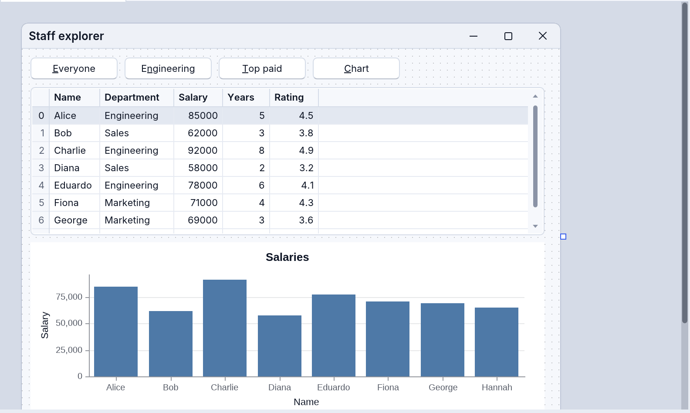
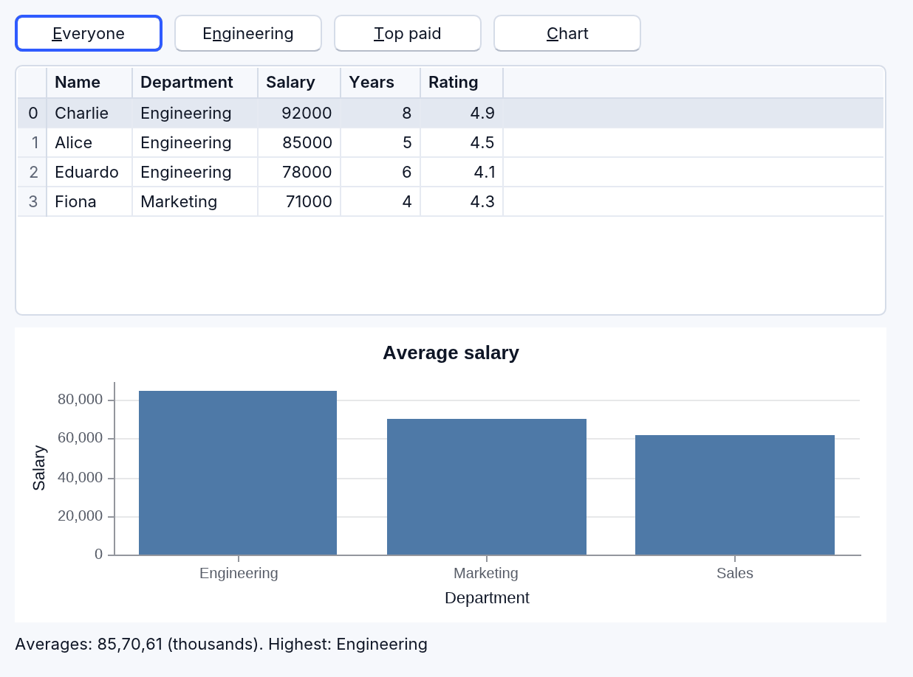

<!-- translated-from: data-science.md c4e980a65085b4f7 -->
# Ciencia de datos

Los componentes propios de RapidR para números, tablas, gráficos y JSON, que se
pueden usar desde cualquier programa de RapidR, de consola o con interfaz
gráfica. Cada nombre de miembro, con sus alias y dónde funciona:
[reference/data-science.md](../reference/data-science.md).

| Componente | |
|---|---|
| `RNum` | un arreglo (array) unidimensional de números, al estilo de NumPy |
| `RDataFrame` | una tabla, al estilo de pandas |
| `RPlot` | gráficos que se muestran en un RImage o se guardan como PNG, al estilo de Matplotlib |
| `RJson` | documentos JSON |
| `RCSV`, `RDataSource`, `RDBGrid` | datos vinculados: un archivo CSV como fuente, una fila actual compartida, una cuadrícula directamente desde una tabla — con `RDataFrame.Source` y `DataSource` / `DataField` en `REdit` y `RLabel` ([abajo](#linked-data-components); paso a paso: [Ciencia de datos con RapidR](data-science-with-rapidr.md)) |

RNum, RDataFrame y RPlot son una sola implementación (propia de RapidR, en Rust
puro, sin ninguna biblioteca de datos debajo) que ejecutan por igual las
compilaciones nativas, los programas interpretados y el navegador, así que cada
miembro da el mismo resultado en todas partes — gráficos incluidos: los dibuja el
kernel de interfaz (UI kernel), igual que las ventanas, así que un gráfico son
los mismos píxeles en el escritorio y en un navegador.

## RNum

```basic
DIM a AS RNum
a.arange 0, 10, 1                ' 0 … 9   (también linspace, zeros, ones, full, fromlist)
PRINT a.sum; " "; a.mean; " "; a.max      ' 45 4.500000000 9
a.multiply 2                     ' elemento por elemento, en el mismo arreglo
PRINT a.tolist                   ' 0,2,4,6,8,10,12,14,16,18

DIM b AS RNum
b.fromlist "1,2,3,4,5"
DIM c AS RNum
c.linspace 0, 1, 5
c.square
PRINT c.dot("b")                 ' otro arreglo se nombra con el nombre de su componente
```

Métodos: creación (`arange`, `linspace`, `zeros`, `ones`, `full`, `fromlist`),
agregados (`sum`, `mean`, `min`, `max`, `std`, `var`, `median`, `argmin`,
`argmax`, `count`, `ptp`), matemáticas elemento por elemento en el mismo arreglo
(`sin`, `sqrt`, `log`, `abs`, `round`, …), aritmética con un número u otro
arreglo (`add`, `subtract`, `multiply`, `divide`, `power`, `mod`, `clip`),
ordenamiento (`sort`, `reverse`, `unique`, `shuffle`, `append`, `slice`),
`cumsum` / `cumprod` / `diff`, `dot` / `norm` / `normalize`, `any` / `all` /
`where` / `searchsorted`, números aleatorios (`rand`, `randn`, `uniform`,
`randint` —ambos extremos incluidos—, `choice`), un elemento (`get(i)`,
`set i, value` —más allá del final el arreglo crece—, `push`), `tolist`, `print`.
Propiedades: `Size` (`Length`, `Count`), `Data` (los valores como `"1,2,3"`, se
puede establecer), `Shape` (`(3,)`), `NDim`, `DType`, y los agregados `Sum`,
`Mean`, `Min`, `Max`, `Std`. Los números se imprimen como los imprime RapidR
(`0.1 + 0.2` es `0.3`).

## RDataFrame

```basic
DIM df AS RDataFrame
df.loadfromcsv "people.csv"            ' name,age,city
PRINT df.rowcount; "x"; df.colcount; " "; df.columns   ' 4x3 name,age,city
df.filter "age", ">", 30              ' =, <>, >, <, >=, <=, contains, startswith, endswith
df.sort "name", 1                      ' 1 ascendente, 0 descendente
PRINT df.cell(0, 1)                    ' fila 0, columna 1 (o su nombre): el texto, "30"
df.print                               ' el DataFrame como una tabla, abajo
df.savetocsv "older.csv"
df.togrid "Grid1"                      ' llena un RStringGrid con él (encabezados y celdas)
```

`Print` (y `PRINT df.ToString`) muestra el DataFrame como una tabla de texto sin
formato, igual en todos los entornos de ejecución — números alineados a la
derecha, un valor ausente como `null`, las primeras y las últimas diez filas de
un DataFrame más largo:

```text
name  age  city
----  ---  ----
bob    30  NYC
amy    25  LA
[2 rows x 3 columns]
```

Una celda es su texto tal como se leyó (`cell` y `cellbyname` lo devuelven tal
cual); un campo vacío de CSV, `NA` o el `null` de JSON es un valor ausente. El
tipo de una columna (`dtypes`: `i64`, `f64`, `bool`, `str`) es lo que son sus
celdas, y decide cómo se ordena y se compara: los números como números, el texto
como texto.

Los métodos modifican el propio DataFrame: entrada y salida (`loadfromcsv` y
`loadfromjson` toman un archivo —o los datos mismos, `"a,b" + CHR$(10) + "1,2"`—,
`savetocsv`, `savetojson`: un arreglo de registros), selección (`head`, `tail`,
`select`, `cell(row, col)`, `cellbyname(row, name)`, `setcell row, col, value`
—más allá del final el DataFrame crece—, `iloc`), `sort` / `sort_values` (varias
columnas: `"city,name"`), `filter`, `query "age > 30"`, `groupby(column,
function)` (primero la columna, luego `mean`, `sum`, `count`, `min`, `max`,
`first`, `last`, `median` o `std` de cada otra columna, una fila por grupo),
columnas (`drop`, `rename`, `addcolumn name, "v1,v2,…"`), datos ausentes
(`fillna`, `dropna`), estadísticas (`describe` —el DataFrame se convierte en el
resumen de sus columnas numéricas—, `value_counts`, `nunique`, `corr`), muestreo
(`sample`, `nlargest`, `nsmallest`), uniones (`merge other, on, how` —`inner`,
`left`, `right`, `outer`, `cross`—, `concat`), transformaciones (`transpose`,
`apply` —`upper`, `lower`, `trim`, `abs`, `round`, `sqrt`, `log`, `exp`—,
`replace`), construir uno (`create`, `addrow`), `info`, `togrid`. Propiedades:
`RowCount`, `ColCount`, `Columns`, `Shape`, `Empty`, `DTypes`.

Las tablas grandes son rápidas. Un DataFrame guarda sus columnas como le gusta a
una computadora —números enteros, fracciones y `true` / `false` como números, el
resto del texto como texto— y reparte los trabajos grandes entre todos los núcleos
de la computadora. En una computadora de escritorio de 2024 (un Apple M4 Max), un
CSV de un millón de filas (37 MB) se carga en unos 12 ms y se filtra, ordena,
agrupa o une en 3–10 ms; cargarlo, filtrarlo, ordenarlo y agruparlo uno tras otro
toma unos 25 ms (diez millones de filas: alrededor de un cuarto de segundo, donde
antes tomaba cuatro segundos y medio). Una página web recibe un solo núcleo, así
que en un navegador el mismo motor trabaja con uno: en Chrome, en la misma Mac,
un millón de filas se carga en unos 0.15 s, y se filtra en 10 ms, se ordena en
60 ms y se agrupa en unos 35 ms.

Nada de esto cambia lo que lee un programa: una celda sigue leyéndose exactamente
como se escribió (`"007"` sigue siendo `"007"`, `"1.50"` sigue siendo `"1.50"`), y
cada miembro da la misma respuesta que antes. tools/bench/ lo mide, con las
condiciones de cada número (`tools/bench/compare.sh`, junto a pandas cuando está
instalado): consulta
[Por qué RapidR](why-rapidr.md#data-a-table-of-a-million-rows-in-a-blink).

## RPlot

Los datos de un gráfico son componentes RNum, nombrados por sus nombres:

```basic
DIM x AS RNum
DIM y AS RNum
x.linspace 0, 6.28, 50
y.linspace 0, 6.28, 50
y.sin

DIM plt AS RPlot
plt.title = "Seno"
plt.xlabel = "x"
plt.ylabel = "sin(x)"
plt.grid = 1
plt.plot "x", "y", "sin(x)", "steelblue"   ' arreglo x, arreglo y, etiqueta, color
plt.legend
plt.savefig "sine.png"
```

Series: `plot` (x, y, etiqueta, color, estilo: `-`, `--` discontinua, `:`
punteada, `o` marcadores, `o-` una línea con marcadores), `bar`, `barh`,
`scatter`, `step`, `area` (x, y, etiqueta, color), `hist(data, bins, label,
colour)`, `pie(data, labels, colours)`; `addseries(label, y, x, colour)` (una
línea a partir de números escritos directamente), `hline` / `vline`,
`annotate(text, x, y, colour)`, `legend`, `grid`, `xlim` / `ylim`, `xscale` /
`yscale` (`"log"`), `xticks(names [, positions])`, `figsize(w, h)` (pulgadas),
`savefig(file [, scale])`, `show`, `clear`. Propiedades: `Title`, `XLabel`,
`YLabel`, `Grid`, `Legend`, `Width`, `Height` (píxeles; por debajo de 100,
pulgadas a los `DPI` del gráfico), `DPI`, `Count` (las series).

Los datos son componentes RNum o números escritos directamente (`"35,25,40"`) — y
una x puede ser **nombres**: barras sobre sus categorías, varias series de barras
una al lado de otra en cada una.

```basic
plt.bar "Q1,Q2,Q3,Q4", sales2025, "2025"
plt.bar "Q1,Q2,Q3,Q4", sales2026, "2026"
plt.legend
```

Los colores son los nombres de CSS (`steelblue`, `royalblue`, `coral`, … los 148),
`#RGB` / `#RRGGBB`, `C0` … `C9` (los de la paleta), o números de color
(`RGB(255, 0, 0)` crea uno); las series sin color toman el siguiente de una
paleta de diez colores hecha para gráficos. El aspecto: marcas de graduación en
pasos redondos —números enteros para datos enteros (los meses 1, 2, 3, nunca
1.5)—, líneas de cuadrícula horizontales claras (`Grid = 1`: en ambos sentidos;
`Grid = 0`: ninguna), una leyenda dibujada como las series (la entrada de una
línea discontinua es discontinua) donde oculta la menor cantidad de puntos,
gráficos circulares con sus porcentajes y nombres, y los colores del tema actual
(`$THEME dark` dibuja gráficos oscuros, el contraste alto, gráficos simples). El
texto es el del kernel de interfaz: la Liberation Sans integrada, la misma en
todos los sistemas.

Para mostrar un gráfico en una ventana, pon el RPlot en el formulario —
`CREATE Chart AS RPlot … END CREATE`, con `Left`, `Top`, `Width` y `Height` como
cualquier componente: se dibuja ahí y de nuevo después de cada cambio (una serie
añadida, una propiedad establecida, `Clear`). `Clear` vacía el gráfico pero
conserva su tamaño, como el `clf` de Matplotlib conserva el de la figura. En el
diseñador de RapidR Studio un gráfico que todavía no tiene datos muestra barras
de ejemplo bajo su `Title`, para que veas dónde está y qué tamaño tiene; los
datos del programa las reemplazan cuando se ejecuta. Un gráfico enlazado a un
conjunto de datos (`DataSource`: [Componentes de datos
vinculados](#linked-data-components)) muestra ahí, en cambio, las filas reales. O muéstralo en una imagen:
`Image1.LoadFromPlot plt` (un RImage). De cualquier forma se ve nítido a cualquier
escala de pantalla — una pantalla de 2× recibe el gráfico dibujado a 2× —
mientras que los `Pixel` de una imagen conservan el tamaño propio del gráfico.
`savefig "chart.png", 2` escribe el PNG al doble del tamaño del gráfico (en la
web, entre los archivos de la página: el programa puede leerlo de nuevo u
ofrecerlo como descarga).

## Tutorial: el Explorador de CSV

[`examples/data/csv_explorer.rr`](../../../examples/data/csv_explorer.rr) es una
herramienta de datos pequeña y completa en unas 450 líneas de BASIC: suelta
cualquier archivo CSV en su ventana y míralo como una tabla, con las estadísticas
de cada columna y un gráfico que cambias en vivo. Funciona igual como aplicación
nativa, como interpretada y en un navegador.


### Pruébalo

1. En RapidR Studio, la página de bienvenida lo muestra primero bajo
   **Ejemplos**: haz clic en **csv_explorer.rr** (o en **Archivo > Abrir
   proyecto o archivo…**, y luego `examples/data/csv_explorer.rr`). Desde una
   terminal: `rapidr run examples/data/csv_explorer.rr` — o
   `rapidr run examples/data/csv_explorer.rr mydata.csv` para empezar con tu
   propio archivo.

   

2. Presiona **F5** (**Ejecutar > Ejecutar**). La ventana se abre con la muestra,
   `shop.csv` (el año de una tienda inventada: visitantes, pedidos, ingresos y
   calificación por mes).
3. **Suelta un archivo CSV** en la ventana — desde el Finder, el Explorador de
   archivos o tu administrador de archivos (en un navegador, desde tu
   computadora). O haz clic en **Open CSV…** y elige uno; **Sample data** trae de
   vuelta la muestra.
4. **Ordenar**: haz clic en el encabezado de una columna (una flecha muestra el
   orden); haz clic de nuevo para el otro sentido.
5. **Filtrar**: escribe en **Filter**; solo se quedan las filas con ese texto en
   cualquier celda — en la tabla, las estadísticas y el gráfico.
6. **Gráfico**: elige la columna **X** (cualquiera), la columna **Y** (una
   numérica) y **Bar**, **Line** o **Scatter**. El gráfico lo sigue de
   inmediato.


### Cómo funciona

- **Los datos**: un `RDataFrame` lee el archivo — `Frame.LoadFromCsv(path)`.
  `Frame.Columns` nombra las columnas, `Frame.DTypes` dice cuáles contienen
  números (`i64`, `f64`) y cuáles texto, `Frame.Cell(row, column)` da una celda,
  `Frame.Sort(name, 1)` ordena (0: de mayor a menor).
- **Soltar archivos**: el `OnDropFiles = FilesDropped` del formulario nombra una
  `SUB` que recibe las rutas de los archivos, una por línea, y carga el primero
  que es `.csv`
  ([Archivos soltados en un formulario](components.md#files-dropped-on-a-form)).
- **La tabla** es un `RListView` en vista de informe (`ViewStyle = vsReport`):
  `AddColumns` para los encabezados, `AddItems` y `AddSubItem` para las filas; su
  `OnColumnClick (Column)` ordena.
- **El filtro** es un `REdit` cuyo `OnChange` marca las filas que contienen el
  texto (`INSTR(LCASE$(cell), text)`), y luego lo llena todo de nuevo.
- **Las estadísticas**: los valores de cada columna numérica van a un `RNum`
  (`Nums.Push VAL(cell)`), que responde `Min`, `Max` y `Mean`.
- **El gráfico** es un `RPlot` en el formulario: `Chart.Clear`, y luego
  `Chart.Bar(names, Ys, label, "")`, `Chart.Plot(Xs, Ys, label, "", "o-")` o
  `Chart.Scatter(Xs, Ys, label, "")` — Xs y Ys son RNum; X puede ser nombres
  (`"Jan,Feb,Mar"`) para barras sobre categorías.
- **La muestra** está incluida en el programa con
  `$RESOURCE SHOP_CSV AS "shop.csv"` y se lee sin escribir un archivo: el
  `ExtractRes SHOP_CSV` de un `RMemoryStream`, luego `ReadStr`, y `LoadFromCsv`
  toma el propio texto CSV.
- **La disposición** sigue el tamaño de la ventana: el `OnResize` del formulario
  coloca la tabla, las estadísticas y el gráfico a partir de `Form.ClientWidth` y
  `ClientHeight`.

En el diseñador el gráfico muestra barras de ejemplo (sus datos llegan cuando el
programa se ejecuta), y el árbol del proyecto enumera `shop.csv` bajo
**Recursos** — un archivo que nombra el programa pertenece a su proyecto, tanto
en el escritorio como en el IDE web:


## Componentes de datos vinculados

Componentes vinculados, conectados mediante propiedades, en el diseñador o en
código; el diseñador de RapidR Studio muestra sus datos en vivo. Un comienzo paso
a paso es [Ciencia de datos con RapidR](data-science-with-rapidr.md); los
ejemplos son [`linked_data.rr`](../../../examples/data/linked_data.rr),
[`million_rows.rr`](../../../examples/data/million_rows.rr) y
[`json_source.rr`](../../../examples/data/json_source.rr).

```basic
CREATE Form AS RForm
    CREATE People AS RCSV
        FileName = "people.csv"       ' Delimiter = ",", HasHeader = True
    END CREATE
    CREATE DF AS RDataFrame
        Source = People               ' el DataFrame recibe las filas del archivo
    END CREATE
    CREATE Nav AS RDataSource
        DataSet = DF                  ' una fila actual de DF
    END CREATE
    CREATE Grid AS RDBGrid
        DataSource = Nav              ' o un conjunto de datos directamente: DataSource = DF
    END CREATE
    CREATE NameEdit AS REdit
        DataSource = Nav: DataField = "name"
    END CREATE
END CREATE
```

- **RCSV** — `FileName` (un archivo, o el nombre de un `$RESOURCE`: el archivo
  incluido en el programa, así que se ejecuta desde cualquier lugar — el
  diseñador lee el archivo que nombra el `$RESOURCE`), `Delimiter` (`","`,
  `";"`, `"tab"`, `"|"` …), `HasHeader`, `Text` (los datos mismos como texto CSV,
  en lugar de un archivo); `RowCount`, `ColCount`, `Columns`, `Error` (por qué no
  se pudo leer el archivo); `Load` (lo lee de nuevo; 1 o 0), `Save [file]` (su
  tabla, con las ediciones incluidas), `Clear`; `OnLoad`, `OnError(Message)`. Lee
  su archivo una sola vez, cuando su tabla se necesita por primera vez.
- **RJson** — los registros de su documento (`[{…}, …]`, JSON Lines, o columnas
  `{"a": […]}`) son una fuente de datos: `DF.Source = Json1`; un DataFrame los
  toma de nuevo cuando el documento cambia (`Parse`, `LoadFile`, un `FileName`
  nuevo).
- **RDataFrame.Source** — un RCSV, un RJson u otro RDataFrame: el DataFrame recibe
  de inmediato una copia de sus filas, y de nuevo cada vez que la fuente cambia;
  `Refresh` lo pide otra vez. Lo que el programa le haga después al DataFrame
  (`Filter`, `Sort` …) cambia solo el DataFrame, hasta que la fuente cambia.
- **RDataSource** — `DataSet`, `Row` (la fila actual, desde 0; establécela para
  moverte), `RecordCount`, `EOF` / `BOF` (True, -1, después de que `Next` /
  `Prior` no pudieron moverse, o sin filas), `Enabled`, `State` (`"inactive"`,
  `"browse"`); `First`, `Prior`, `Next`, `Last`, `MoveBy n`, `Field(name)`,
  `SetField name, value`, `Refresh`; `OnDataChange` (la fila se movió o los datos
  cambiaron).
- **RDBGrid** — `DataSource` (un RDataSource, o un conjunto de datos
  directamente: su propia fila actual), `Row`, `TopRow`, `RowCount`, `ColCount`,
  `Columns`, `SortColumn` (-1: ninguna), `SortDescending`, `ReadOnly`;
  `OnCellClick(Row, Col)`, `OnTitleClick(Col)`. Dibuja solo las filas que están
  en pantalla (un millón de filas se desplazan con fluidez); un clic o las teclas
  de flecha mueven la fila actual; el clic en un encabezado ordena su vista (de
  nuevo: el otro sentido, una tercera vez: el orden de los datos) sin cambiar los
  datos. Los números se alinean a la derecha, un valor ausente es un `null`
  atenuado; Ctrl+C (Cmd+C) copia la fila actual; los lectores de pantalla oyen
  una cuadrícula. Su `DataSource` también puede ser un `RSQLite` o un `RMySQL`:
  las filas de su última consulta, y las de una consulta en segundo plano a
  medida que llegan — el programa las ordena volviendo a preguntar con
  `ORDER BY` ([Bases de datos](databases.md#a-querys-rows-in-a-grid)).
- **DataSource + DataField** en **REdit** (su `Text`) y **RLabel** (su `Caption`):
  el campo de la fila actual; lo que el usuario escribe en un campo de texto
  vuelve a la tabla. Son propiedades propias de RapidR en estos componentes: un
  programa que no las establece se comporta como antes.
- **RPlot** — `DataSource` (un conjunto de datos, o el de un RDataSource) dibuja
  las filas como un gráfico: `Kind` (`"bar"`, el valor predeterminado, `"barh"`,
  `"line"`, `"scatter"`, `"area"`, `"step"`, `"pie"`, `"hist"`), `X` (la columna
  a lo largo de la parte inferior: los nombres bajo las barras y las porciones,
  los números sobre los que corre una línea; ninguna: la primera columna), `Y` (la
  columna dibujada, o varias separadas por comas — una serie cada una, con una
  leyenda; ninguna: todas las columnas numéricas salvo X). Se dibuja de nuevo
  cada vez que cambian los datos —un `Filter`, `Sort`, `GroupBy`, un archivo
  leído de nuevo—, y el diseñador lo muestra con las filas reales. Su `Title`,
  `XLabel` y `YLabel` siguen siendo tuyos (los nombres de las columnas donde no
  diste ninguno); sin un `DataSource` el gráfico es el que dibujan sus métodos. Se
  dibujan como máximo las primeras 10 000 filas.

[`dataframe.rr`](../../../examples/data/dataframe.rr) vincula un archivo CSV
incluido en el programa a una cuadrícula y a un gráfico: los botones solo cambian
los DataFrames, y los dos los siguen.

```basic
$RESOURCE STAFF_CSV AS "staff.csv"

CREATE Form AS RForm
    CREATE Staff AS RCSV
        FileName = STAFF_CSV          ' el archivo incluido en el programa
    END CREATE
    CREATE Team AS RDataFrame
        Source = Staff
    END CREATE
    CREATE Pay AS RDataFrame
        Source = Staff
    END CREATE
    CREATE Grid AS RDBGrid
        DataSource = Team
    END CREATE
    CREATE Chart AS RPlot
        Title = "Salarios"
        DataSource = Pay: Kind = "bar": X = "Name": Y = "Salary"
    END CREATE
END CREATE

SUB ChartByDepartment             ' el gráfico sigue al DataFrame
    Pay.Refresh
    Pay.GroupBy("Department", "mean")
    Chart.X = "Department"
END SUB
```





## RJson

```basic
DIM j AS RJson
j.Parse "{" + CHR$(34) + "a" + CHR$(34) + ": {" + CHR$(34) + "b" + CHR$(34) + ": [1, 2, 3]}}"
PRINT j.Get("a.b.1")             ' 2  (rutas con puntos, índices de arreglo desde 0)
j.Set "count", 5
PRINT j.Has("count")             ' 1
PRINT j.Stringify                ' {"a":{"b":[1,2,3]},"count":5}
```

`Parse`, `Get(path)`, `Set path, value`, `Has`, `Remove`, `Keys`, `Stringify`,
`Prettify`, `LoadFile`, `SaveFile`. (Recuerda que `""` dentro de una cadena no es
una comilla en el BASIC de RapidR: escribe `CHR$(34)`, o usa `$ESCAPECHARS ON` y
`\"`.)
