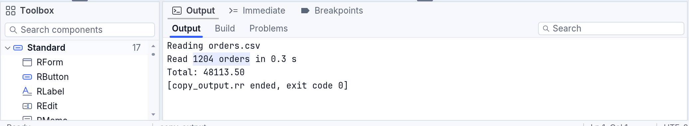
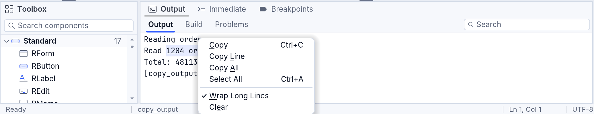
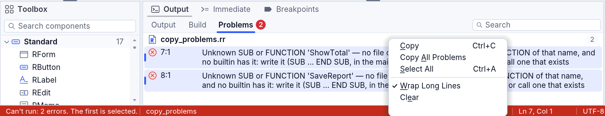

<!-- translated-from: debugging.md 6d0508d31645e76d -->
# Depuración en RapidR Studio

RapidR Studio ejecuta tu programa y te deja detenerlo donde elijas, mirar sus
variables, cambiarlas y seguir una línea a la vez. Funciona de la misma manera en
Studio de escritorio y en Studio en el navegador.

Las capturas de pantalla de esta página las hace `tools/manual/shots.mjs` a
partir de los programas de `tools/manual/scenes/debugger/` y de
[`examples/debugging/shop.rr`](../../../examples/debugging/shop.rr), el libro de
pedidos de una tienda pequeña hecho para mirarlo en el depurador (ábrelo desde la
página de bienvenida: *Debug it: values as trees*), así que se pueden volver a
hacer cuando Studio cambie.

## El ejemplo

Escribe este programa (o abre `tools/manual/scenes/debugger/counter.rr`) y
guárdalo como `counter.rr`. Ábrelo en Studio: Archivo ▸ Abrir (Ctrl+O), o
`rapidr ide counter.rr` desde una terminal.

```basic
DIM total AS INTEGER
DIM i AS INTEGER

SUB AddUp(n AS INTEGER)
  DIM k AS INTEGER
  k = n * 2
  total = total + k
END SUB

FOR i = 1 TO 3
  AddUp i
NEXT
PRINT "total = "; total
```

Presiona **F5**. El programa se ejecuta y **Salida** (el panel bajo el editor)
muestra `total = 12`. Ahora veamos cómo trabaja.

## Ejecutar y detener

| Tecla | Menú | Qué hace |
|---|---|---|
| F5 | Ejecutar ▸ Ejecutar | Guarda tus archivos y ejecuta el programa con el depurador. Mientras el programa está en pausa, F5 continúa: el elemento del menú dice **Continuar** y la sugerencia del botón ▶ dice *Continuar (F5)* (Depurar ▸ Continuar hace lo mismo). |
| Ctrl+F5 | Ejecutar ▸ Ejecutar sin depurar | Lo ejecuta sin detenerse en los puntos de interrupción. |
| Shift+F5 | Ejecutar ▸ Detener | Termina el programa de inmediato, en ejecución o en pausa. |
| Ctrl+Shift+F5 | Ejecutar ▸ Reiniciar | Lo detiene y lo ejecuta de nuevo. |
| — | Ejecutar ▸ Ejecutar en el navegador | (escritorio) Compila la versión web del programa y la abre en tu navegador. |
| — | Depurar ▸ Pausar | Detiene el programa en ejecución donde esté. |
| — | Depurar ▸ Mostrar la ventana del programa | Trae al frente las ventanas del programa, en ejecución o en pausa. |

La barra de herramientas tiene los mismos comandos: ▶ Ejecutar (Continuar mientras
está en pausa), ▷ Ejecutar sin depurar, ❙❙ Pausar, ■ Detener y Compilar, y luego
Entrar en la llamada, Pasar por encima, Salir de la llamada y Alternar punto de
interrupción.

### Líneas largas en Salida y Problemas

Una línea más larga que el ancho del panel continúa en la fila siguiente (en un
espacio, donde puede), así que un mensaje largo se lee completo en lugar de salirse
por el borde. Lo mismo ocurre en la página **Compilación** y en la página
**Problemas**, cuyas filas crecen para contener el mensaje completo (el lugar,
`Main.rr:12:5`, sigue a su última fila). Para el mouse, la selección y Copiar sigue
siendo una sola línea: un clic en cualquier fila de ella selecciona la línea, y
Ctrl+C la copia sin saltos de línea propios. **Ver ▸ Ajustar las líneas largas de
la salida** lo desactiva (también el menú de clic derecho del panel, **Ajustar
líneas largas**); Studio recuerda la elección. Desactivado, una línea larga se
corta en el borde y el mensaje de un problema termina en “…”, y al dejar el mouse
sobre cualquiera de los dos una sugerencia muestra el texto completo. Un lector de
pantalla lee cada línea completa de cualquiera de las dos maneras. En tus propios
programas, un `ROutputConsole` tiene el mismo interruptor: su propiedad
`WordWrap`, que es True salvo que la cambies.


### Copiar desde Salida, Compilación y Problemas

Todo lo que muestran los paneles se puede copiar: un error para buscarlo, una línea
de la salida de tu programa, todo el registro de compilación.

- **Selecciona texto con el mouse.** Arrastra sobre él (también a través de varias
  líneas; el panel se desplaza cuando arrastras más allá de su borde superior o
  inferior). Un doble clic selecciona una palabra, un triple clic la línea
  completa, y Shift + un clic extiende la selección hasta donde haces clic. Un
  clic sencillo selecciona la línea en la que está. Un arrastre que empieza en un
  enlace `file:line` selecciona texto; un clic en el enlace sigue abriéndolo.
- **Cópialo** con **Ctrl+C** (**⌘C** en una Mac; Ctrl+Insert también funciona). Lo
  que se copia es el texto sin formato (nunca los colores) y una línea ajustada se
  copia como la única línea que es. **Ctrl+A** (⌘A) selecciona toda la página.
- **Clic derecho** para el menú del panel:

  | Elemento | Qué copia |
  |---|---|
  | **Copiar** (Ctrl+C) | Lo que seleccionaste. En gris cuando no hay nada. |
  | **Copiar línea** | La línea en la que hiciste clic derecho, esté o no seleccionada. |
  | **Copiar todo** | Toda la página que estás mirando. |
  | **Seleccionar todo** (Ctrl+A) | Selecciona toda la página. |
  | **Ajustar líneas largas**, **Borrar** | Como antes: las líneas largas ajustadas o cortadas; la página vaciada. |

  La barra de estado dice qué se copió (*Se copiaron 7 caracteres*,
  *Se copiaron 4 líneas*).
- **Edición ▸ Copiar** y **Edición ▸ Seleccionar todo** funcionan en el panel
  mientras tiene el teclado, incluso sin ningún documento abierto.
- **En la página Problemas** cada fila se copia como una sola línea,
  `file:line:column: severity: message` —
  `main.rr:4:7: error: Undefined variable X` — lista para pegarla en una búsqueda,
  un mensaje o una pregunta a RAI. Haz clic en una fila (también te lleva a la
  línea), añade las siguientes con **Shift + un clic** o **Shift+↓**, y luego
  Ctrl+C; o haz clic derecho: **Copiar** copia los problemas seleccionados y
  **Copiar todos los problemas**, todos.







Un lector de pantalla lee el panel como un campo de texto de solo lectura, por
carácter, palabra y línea, y dice la selección a medida que cambia.

Lo mismo funciona en tus propios programas: un `ROutputConsole` tiene `SelText`,
`HasSelection`, `ClickedLine`, `SelectAll`, `CopySelection`, `CopyAll` y
`CopyLine` (mira [examples/studio/log_copy.rr](../../../examples/studio/log_copy.rr),
un registro con botones Copiar y un menú de clic derecho como el de Studio).

Los demás paneles también copian: **Variables** y **Observar** (*Copiar valor*,
Ctrl+C), **Pila de llamadas** y **Puntos de interrupción** (Ctrl+C, o clic derecho:
**Copiar** la fila seleccionada, **Copiar todo**), el panel **Inmediato** (como
cualquier cuadro de texto) y los cuadros de mensaje: **Ctrl+C** (⌘C) en un cuadro
de mensaje copia su título, su texto y sus botones, como hacen los cuadros de
mensaje de Windows.

### Dos disposiciones: edición y depuración

Studio organiza sus paneles según lo que estás haciendo.

- **Mientras editas**, el panel inferior bajo tu código ocupa todo su ancho. Sus
  pestañas son **Salida** (con sus propias páginas Salida, Compilación y
  Problemas), **Inmediato** y **Puntos de interrupción**, así que una advertencia
  larga en Problemas tiene espacio para leerse. Puntos de interrupción también
  está ahí: puedes ver y cambiar tus puntos de interrupción antes de ejecutar.
- **Cuando ejecutas con el depurador** (F5, F10, F11, Ejecutar hasta el cursor),
  Studio cambia a la disposición de depuración: **Variables**, **Observar**,
  **Pila de llamadas** y **Puntos de interrupción** aparecen en un grupo junto a
  Salida e Inmediato. Cuando el programa se detiene en un punto de interrupción,
  Variables pasa al frente y el editor muestra la línea donde se detuvo.
- **Cuando el programa termina**, Studio vuelve a la disposición de edición.

Cada disposición recuerda sus propios tamaños: arrastra el divisor sobre el panel
inferior mientras editas, y otra vez mientras depuras, y Studio conserva ambos,
incluso después de cerrarlo y abrirlo de nuevo. Ejecutar ▸ Ejecutar sin depurar
(Ctrl+F5) mantiene la disposición de edición, ya que no hay nada que inspeccionar.

**Ver ▸ Paneles de depuración** (Ctrl+Shift+D) muestra u oculta los paneles de
depuración en cualquier momento. Mostrados así, se quedan después de que el
programa termina hasta que los ocultas otra vez (quedan fijados). Ver ▸ Variables,
Observar o Pila de llamadas y Depurar ▸ Añadir a Observar también los muestran.

**Herramientas ▸ Configuración ▸ General ▸ Paneles de depuración** elige cuándo
aparecen:

| Opción | Qué pasa |
|---|---|
| Automático (el valor predeterminado) | Aparecen cuando empieza una ejecución con el depurador y se van cuando termina. |
| Siempre | La disposición de depuración todo el tiempo. |
| Nunca | Solo cuando lo pides (Ver ▸ Paneles de depuración, Ctrl+Shift+D). |

El cambio nunca le quita el teclado al lugar donde estás escribiendo; solo un punto
de interrupción que se alcanza lo mueve, a la línea donde el programa se detuvo. La
barra de estado dice en qué disposición estás durante unos segundos, y un lector de
pantalla lo lee en voz alta.


### Qué comandos puedes usar y cuándo

Un comando aparece en gris cuando no puede hacer nada; cuando no lo está,
funciona igual desde su tecla, su elemento de menú, su botón de la barra de
herramientas y la paleta de comandos.

| El programa está… | ▶ F5 | Ctrl+F5 | ❙❙ Pausar | ■ Shift+F5, Reiniciar | F10, F11 | Shift+F11, Establecer la siguiente instrucción | Ctrl+F10 | Mostrar la ventana del programa |
|---|---|---|---|---|---|---|---|---|
| sin ejecutarse (nunca se ejecutó, terminó, se cerró o terminó con un error) | Ejecutar | ✓ | — | — | empieza en la primera línea | — | empieza y se detiene en el cursor | — |
| en ejecución (o en un paso que tarda un rato) | — | — | ✓ | ✓ | — | — | — | ✓ |
| en pausa (un punto de interrupción, un paso, Pausar, un error de ejecución) | Continuar | — | — | ✓ | avanza un paso | ✓ | sigue hasta el cursor | ✓ |

F9 (puntos de interrupción) funciona en cualquier momento.

### La ventana de tu programa y la de Studio

En el escritorio tu programa tiene ventanas propias, y Studio se va pasando el
frente con él para que la correcta esté delante cuando la necesitas:

- Cuando lo ejecutas, su primera ventana aparece **delante de** Studio.
- Cuando se detiene (en un punto de interrupción después de que hiciste clic en
  algo en él, en un error de ejecución), **Studio pasa al frente**, en la línea
  donde se detuvo.
- **Continuar (F5)** y Ejecutar hasta el cursor devuelven al frente las ventanas del
  programa: es el turno del programa. También lo hace un paso que no se ha
  detenido en medio segundo (pasar por encima de un `ShowModal` que te espera).
  Un paso rápido te deja en Studio.

Mientras el programa está en pausa, sus ventanas **se quedan en pantalla y al
alcance**: conservan su imagen, puedes pasar a ellas (un clic, Cmd-Tab en una Mac,
Alt-Tab en Windows y Linux, o Depurar ▸ Mostrar la ventana del programa), moverlas,
cambiarles el tamaño y minimizarlas. Eso sí, no reaccionan a ti: no se ejecuta nada
del código del programa mientras está en pausa, así que un clic o una tecla en sus
ventanas se ignora; no se guarda para después, así que nada sorprende al programa
cuando continúa. Cerrar su última ventana (su casilla de cierre) termina el
programa, como lo hace Detener: su `OnClose` no se ejecuta, porque nada de su código
puede ejecutarse. Lo que cambias en Variables, Observar o el panel Inmediato (un
texto, un color) se muestra de inmediato en sus ventanas.

Pruébalo con [themes.rr](../../../examples/gui/themes.rr): pon un punto de
interrupción en la línea 94 (`SELECT CASE Sender.Caption`), presiona F5 y haz clic
en *Dark* en su ventana. Studio pasa al frente, en pausa en la línea 94, con ▶ listo
para continuar. Pasa a otro programa y vuelve: la ventana Themes sigue allí, y
Depurar ▸ Mostrar la ventana del programa la trae al frente. Presiona F5: la ventana
Themes pasa al frente y se vuelve oscura.


Si el código tiene errores, Studio no lo ejecuta: se abre la lista de Problemas y el
editor va al primer error.

La barra de estado muestra lo que hace el programa: verde mientras se ejecuta,
naranja mientras está en pausa (con el archivo y la línea), y vuelve a lo normal
cuando termina. Un nombre de archivo demasiado largo para ella se acorta por el
medio (`Breakpoint: a_pro…he_status_bar.rr:6`, con la línea conservada); deja el
mouse sobre la barra para verlo completo. Salida muestra lo que imprime el programa y
luego `[counter.rr terminó, código de salida 0]`.

## Puntos de interrupción

Un punto de interrupción detiene el programa cuando llega a una línea, antes de que
la línea se ejecute.

**Poner uno.** Haz clic en la columna estrecha a la izquierda de los números de
línea, junto a la línea 11 (`AddUp i`). Un punto rojo marca la línea. También puedes
poner el cursor en la línea y presionar **F9** (Depurar ▸ Alternar punto de
interrupción). Haz clic en el punto otra vez, o presiona F9 otra vez, para quitarlo.


**Ejecutar hasta él.** Presiona **F5**. El programa se detiene en la línea 11 antes
de llamar a `AddUp`:

- una flecha en el margen y una línea con tinte muestran dónde está;
- la barra de estado se vuelve naranja: `Punto de interrupción: counter.rr:11`;
- **Variables** (abajo a la derecha) muestra los valores: `i = 1`, `total = 0`;
- **Pila de llamadas** (abajo a la izquierda, en el lugar de la Caja de herramientas
  mientras depuras) muestra dónde está el programa: `(el programa)  counter.rr:11`.


El botón ▶ sigue verde mientras está en pausa: su sugerencia dice *Continuar (F5)*.
Presiona **F5** (o haz clic en ▶) otra vez: continúa y se detiene otra vez en la
línea 11, ahora con `i = 2`. Presiona F5 dos veces más y el programa termina.

Los puntos de interrupción funcionan en cada archivo del proyecto, también en los
archivos que incluyes con `$INCLUDE`; el archivo se abre cuando el programa se
detiene en él.

**Una línea sin código.** Un punto de interrupción en un comentario, una línea en
blanco o un `DIM` pasa a la siguiente línea que tiene código cuando el programa se
ejecuta, y se detiene allí. Uno después de la última línea de código nunca puede
detenerse; el panel Puntos de interrupción dice `(aquí no hay código: nunca se
detiene)` y su punto se vuelve un anillo.

**Todos ellos.** El panel **Puntos de interrupción** (junto a Variables) enumera
cada punto de interrupción. Haz doble clic en uno (o selecciónalo y presiona Enter)
para ver su línea; Delete lo quita; la barra espaciadora lo apaga y lo enciende.
Depurar ▸ Eliminar todos los puntos de interrupción (Ctrl+Shift+F9) los quita todos.

Studio conserva tus puntos de interrupción y tus expresiones observadas con el
proyecto: cierra Studio, abre el proyecto otra vez, y allí están.

### Puntos de interrupción en los controladores de eventos

Un programa con una ventana pasa su tiempo esperando eventos, y la mayor parte de
tu código se ejecuta en sus controladores: OnClick, OnChange, OnKeyPress, OnTimer,
OnResize, OnMouseMove, OnClose… Un punto de interrupción en un controlador se
detiene **cada vez** que llega el evento: el tercer clic se detiene igual que el
primero, cada letra escrita en un `REdit` se detiene en su OnChange, aunque el
controlador sea de una sola línea.

- **Pasar por encima al salir de un controlador** (F10 en su última línea): el
  controlador devuelve el control al programa, que espera su siguiente evento: sigue
  ejecutándose, y el siguiente evento vuelve a detenerse en el punto de
  interrupción.
- **Un controlador que abre un cuadro de diálogo** (`MESSAGEDLG`, un cuadro de
  fuentes o de archivos): pasa por encima de su línea y el cuadro de diálogo se
  muestra en la ventana del programa; respóndelo, y el programa se detiene en la
  línea siguiente, con la respuesta.
- **Un controlador que provoca otro evento** (cambiar `Form.Width` dispara el
  OnResize del formulario): un punto de interrupción en el controlador interior se
  detiene allí, y la Pila de llamadas muestra ambos, el interior arriba.
- **Un error de ejecución en un controlador** se detiene en su línea, como en el
  programa principal. Continuar (F5) hace entonces lo que hace el programa sin el
  depurador: ese controlador termina allí (y los controladores que lo dispararon),
  el programa sigue ejecutándose y el siguiente evento se detiene otra vez en el
  error; el error está en Salida. Detener (Shift+F5) termina el programa.
- **El foco** ([OnEnter y OnExit](../components.md#the-focus-onenter-and-onexit)):
  Tab de un control al siguiente se detiene en el OnExit del primero y luego, con
  F5, en el OnEnter del segundo, cada vez. Un clic que mueve el foco también se
  detiene allí, antes del OnClick del propio clic; el clic ya terminó (el botón se
  soltó mientras el programa estaba detenido: se descartó), así que haz clic otra
  vez para ver su OnClick.


- **Mientras el programa está detenido**, lo que escribes o en lo que haces clic en
  sus ventanas se descarta (nada de su código puede ejecutarse): no se guarda nada
  para ejecutarlo después, y ninguna segunda detención espera detrás. Continúa, y la
  siguiente tecla se detiene como de costumbre.

Pruébalo con [hello_form.rr](../../../examples/gui/hello_form.rr): un punto de
interrupción en la línea 49 (`GreetButton.Enabled = …`, el OnChange del nombre), F5,
y escribe tu nombre: se detiene en cada letra.

### Condiciones, veces y mensajes de registro

Pon el cursor en la línea del punto de interrupción y presiona **Shift+F9**
(Depurar ▸ Editar punto de interrupción), o selecciónalo en el panel Puntos de
interrupción. Los cuadros bajo la lista cambian lo que hace; escribe y presiona
**Enter** para aplicar.


| Cuadro | Ejemplo | Efecto |
|---|---|---|
| Cuando | `i = 2` | Se detiene solo cuando la expresión es verdadera. |
| Veces | `3`, `>= 3`, `% 2` | Se detiene solo la tercera vez que se llega a la línea, de la tercera vez en adelante, o una de cada dos veces. |
| Registro | `sumando {i}: el total es {total}` | No se detiene: imprime el mensaje en Salida y continúa. Las expresiones entre `{ }` se reemplazan por sus valores. |
| Activado | (casilla) | Desmarcada, conserva el punto de interrupción pero no se detiene. |

Con *Cuando* establecido en `i = 2`, F5 se detiene una sola vez en la línea 11, con
`i = 2`.

Un punto de interrupción con un mensaje de registro es una manera rápida de seguir un
programa sin añadirle `PRINT`:


Cada clase tiene su propia marca, la misma en el margen y en el panel Puntos de
interrupción:

| Marca | Punto de interrupción |
|---|---|
|  | Se detiene aquí. |
|  | Se detiene cuando su condición (*Cuando*) es verdadera: un signo igual. |
|  | Se detiene según su número de veces (*Veces*): un signo de número. |
|  | Imprime su mensaje de registro y continúa: un rombo. |
|  | Apagado: un anillo. |
|  | No hay código en su línea, así que nunca se detiene: un anillo de líneas discontinuas. |

Lo dicen las formas, no solo los colores, así que se leen igual en contraste alto. Un
lector de pantalla nombra cada una en el panel Puntos de interrupción
(“counter.rr:6 when n = 2, punto de interrupción condicional”).


## Ejecución paso a paso

Mientras el programa está en pausa:

| Tecla | Menú | Qué hace |
|---|---|---|
| F10 | Depurar ▸ Pasar por encima | Ejecuta la línea y se detiene en la siguiente. Una `SUB` o `FUNCTION` que la línea llama se ejecuta completa. |
| F11 | Depurar ▸ Entrar en la llamada | Ejecuta la línea y se detiene en la siguiente línea que se ejecuta: dentro de una `SUB` o `FUNCTION` que llama, también en otro archivo. |
| Shift+F11 | Depurar ▸ Salir de la llamada | Se ejecuta hasta el final de la `SUB` o `FUNCTION` en la que está y se detiene después de la llamada. |
| Ctrl+F10 | Depurar ▸ Ejecutar hasta el cursor | Se ejecuta hasta la línea donde está el cursor. |
| Ctrl+Alt+F11 | Depurar ▸ Entrar en llamada específica | Cuando la línea llama a varias `SUB` o `FUNCTION`, elige en cuál entrar. |
| Ctrl+Shift+F10 | Depurar ▸ Establecer la siguiente instrucción | El programa continúa desde la línea del cursor (mira más abajo). |
| F5 | Depurar ▸ Continuar | Se ejecuta hasta el siguiente punto de interrupción, o hasta el final. |

F8 también entra en la llamada y Shift+F8 pasa por encima. Cuando el programa no se
está ejecutando, F10 y F11 lo inician y se detienen en su primera línea, y Ejecutar
hasta el cursor lo inicia y se detiene en la línea del cursor.

Una línea que llama a una `SUB` o `FUNCTION` y luego sigue (`x = Twice(n) + 1`) se
pasa por encima completa: F10 se detiene en la línea siguiente, no en medio de esta.

### Entrar en llamada específica

Esta línea de `shop.rr` llama a dos `FUNCTION`, `PriceOf` y luego `LineTotal`:

```basic
total = total + LineTotal(orders(i).Qty, PriceOf(orders(i).Item))
```

F11 entra en la primera que se ejecuta, `PriceOf`. Para entrar directamente en
`LineTotal`, presiona **Ctrl+Alt+F11** (Depurar ▸ Entrar en llamada específica): un
menú enumera las llamadas que la línea todavía hace, en el orden en que ocurren;
elige *Entrar en LineTotal*. El programa ejecuta `PriceOf` completa y se detiene en
la primera línea de `LineTotal`. Cuando la línea llama a una sola `SUB` o
`FUNCTION`, entra en ella de inmediato; cuando no llama a ninguna, pasa por encima
de la línea.


### Establecer la siguiente instrucción

Mientras el programa está en pausa puedes elegir qué línea ejecuta a continuación:

- **arrastra la flecha amarilla** del margen hacia arriba o hacia abajo hasta otra
  línea, o
- pon el cursor en una línea y presiona **Ctrl+Shift+F10** (Depurar ▸ Establecer la
  siguiente instrucción).

La flecha se mueve allí y no se ejecuta nada más: arrástrala hacia atrás para
ejecutar una línea otra vez (después de cambiar un valor en Variables), o hacia
adelante para saltar líneas. La línea nueva tiene que estar en la misma `SUB` o
`FUNCTION` donde el programa está en pausa; Studio lo dice en la barra de estado y
en Salida cuando no es así. En una línea en blanco o en un comentario, la flecha va
a la siguiente línea con código.


También funciona en un error de ejecución (mira [Cuando el programa falla](#cuando-el-programa-falla)):
corrige el valor que lo causó, vuelve a poner la flecha en la línea que falla y
presiona F5: la línea se ejecuta otra vez y el programa continúa en lugar de
terminar.

Detenido en la línea 11, presiona **F11**: el programa entra en `AddUp` y se detiene
en su primera línea, `SUB AddUp(n AS INTEGER)`, donde recibe `n`. Presiona **F10**:
se detiene en `DIM k AS INTEGER`. La Pila de llamadas ahora tiene dos líneas:
`AddUp  counter.rr:5`, donde está el programa, sobre
`(el programa)  counter.rr:11`, la línea que la llamó. Variables muestra las
variables propias de AddUp bajo **Locales** (`n = 1`, y `k`, que todavía no tiene
valor) y las del programa bajo **Globales**. El `Lín 5, Col 1` de la barra de estado
sigue la línea del programa. Dos F10 más y `k = 2`.


### Pausar un programa que espera

Un programa con un formulario suele esperar en `Form.ShowModal` a que el usuario haga
algo; no se ejecuta ningún código. **Depurar ▸ Pausar** lo detiene de inmediato, en
la línea que espera, con la nota *Esperando eventos* a su lado, y puedes mirar sus
variables allí. Pruébalo con `tools/manual/scenes/debugger/greeter.rr`:


Desde allí, **F5** lo deja esperar otra vez. **F10** (Pasar por encima) se detiene en
la línea siguiente a `ShowModal` una vez que se cierra el formulario. **F11** (Entrar
en la llamada) se detiene en el siguiente controlador de eventos que se ejecuta:
presiona Greet en la ventana del programa y Studio se detiene en la primera línea de
`SUB Greet`.

Mientras el programa está en pausa, sus ventanas se quedan en pantalla (pasa a ellas,
muévelas), pero no reaccionan: los clics y las teclas en ellas se ignoran, y sus
temporizadores esperan hasta que continúa (mira
[La ventana de tu programa y la de Studio](#la-ventana-de-tu-programa-y-la-de-studio)).

## Mirar los valores

### Valores bajo el mouse

Mientras el programa está en pausa, deja el mouse sobre una variable en el código:
una **sugerencia de datos** muestra su valor. Un arreglo (array), un `TYPE`, un componente o
una tabla se abre como un árbol, tan profundo como quieras: haz clic en un triángulo
para abrirlo o cerrarlo. Detenido en el ciclo de `shop.rr`, deja el mouse sobre
`orders`: la sugerencia muestra el arreglo y sus elementos; abre `(1)` para ver los
campos del pedido, luego su `Buyer`, y después el `Home` del comprador:


- Cada fila muestra qué clase de valor es con un ícono pequeño, su nombre, `=`, el
  valor con el color de su clase (el del editor de código: números, texto, True y
  False, constantes) y su tipo a la derecha. [Cómo se ven los valores](#cómo-se-ven-los-valores)
  los muestra todos.
- Un valor que **cambió** desde la última vez que el programa se detuvo aparece
  **resaltado** y marcado con un triangulito, en Variables y en Observar por igual:
  avanza paso a paso por un ciclo y mira qué variables cambió la última línea que se
  ejecutó. (En contraste alto el valor se enmarca en su lugar.)
- Deja el mouse sobre una parte de un nombre más largo y la sugerencia muestra esa
  parte: `orders(i).Qty`, `Buyer.Name`, `Edit1.Text`. Una sugerencia de datos nunca
  ejecuta tu código: un nombre que llamaría a una `SUB`, una `FUNCTION` o un método
  no muestra nada.
- Los arreglos, las tablas y los arreglos RNum grandes muestran 100 elementos a la
  vez; haz clic en *… more* para ver los siguientes.
- Pasa el mouse por una fila para ver sus botones: **copiar** su valor (completo,
  incluso un texto largo), **observarlo** (se añade al panel Observar) y, para una
  cadena de texto, **ver** su texto completo en una ventana propia, con sus líneas:

  
- La rueda desplaza una sugerencia larga; la sugerencia se queda mientras el mouse
  está sobre ella, y se va cuando el mouse sigue por el código o haces clic en otro
  lugar.

**Tablas.** Un `RDataFrame` se muestra como una tabla: los nombres de sus columnas y
luego sus filas. Abre una fila para ver sus celdas una por una, cada una por su
columna (`week.At(0, "day")` nombra la primera).


Un `RNum` muestra sus primeros números (`RNum(7): [18.5, 19, 21.5, …]`) y se abre
para mostrarlos todos; un formulario se abre para mostrar los **Componentes** que
contiene (cada uno se abre para mostrar sus propias propiedades) y luego sus
propiedades, leídas como las lee el programa.

### Variables

El panel **Variables** muestra **Locales** (las variables y los parámetros de la `SUB`
o `FUNCTION` donde el programa está en pausa), **Globales** y los **Componentes** del
programa: sus formularios, marcos de datos, temporizadores… cada uno se abre para
mostrar los componentes que contiene y sus propiedades. Los arreglos, los `TYPE`, los
componentes y las tablas se abren de la misma manera que en una sugerencia de datos.
En un controlador de eventos, abre `Sender` para ver las propiedades del componente
como están ahora. Lo que abres se queda abierto de una detención a la siguiente, y
los valores cambiados aparecen resaltados.

Cuando el programa continúa (Continuar, o un paso que tarda un rato), los valores de
Variables y de la Pila de llamadas dejan de ser los del programa: un momento después
ambos dicen **Ejecutando…**, y Observar muestra *(en ejecución)* junto a cada
expresión. En la siguiente pausa se vuelven a llenar, con Variables desplazado hasta
donde estaba y el valor que tenías seleccionado todavía seleccionado.

**Globales** enumera primero las variables propias de tu programa. Las constantes que
trae un `$INCLUDE` (`RAPIDQ.INC` tiene casi quinientas: colores, teclas, botones de
cuadros de mensaje) vienen después de ellas, las de cada archivo bajo un solo
elemento que se queda cerrado hasta que lo abres (las constantes integradas en un
programa `.rr` no son variables: no se enumeran):


Abre **Componentes** para ver los formularios y los demás componentes del programa
como están ahora; aquí el formulario Shop, sus componentes y luego sus propiedades:


### Cómo se ven los valores

Variables, Observar y las sugerencias de datos dibujan cada valor de la misma
manera: un ícono para su clase, su nombre, `=`, y luego el valor con el color de su
clase.

| Ícono | Clase | Se muestra como |
|---|---|---|
|  | Un número entero (INTEGER, LONG, BYTE …) | `Score = 42` |
|  | Un número decimal (SINGLE, DOUBLE) | `Ratio = 0.75` |
|  | Texto (STRING) | `Title = "Hello"`; un texto vacío como un discreto `""` |
|  | Verdadero o Falso | `Done = True` |
|  | Una propiedad que está activada o desactivada | `Visible = 1 · on`, `KeyPreview = 0 · off`: el número que lee el programa y luego un discreto *on* u *off* |
|  | Un arreglo | `ColName = Array(0 TO 64) · 65 items` |
|  | El valor de un TYPE | `p = Point · 2 fields` |
|  | Un componente (cada uno con su propio ícono, como en la caja de herramientas) | `Sender = Button1 · RButton` |
|  | Una de las constantes de una propiedad | `WindowState = wsMaximized (2)` |
|  | Un color | `FontColor = ■ clWindowText`: una muestra, y luego su nombre, o `&HBBGGRR` |
|  | Un identificador (de una ventana, de un archivo) | `Handle = 133082` |
|  | Todavía sin valor | `Pending = Empty` |
|    | Locales, Globales, Componentes | los encabezados |

La muestra de un color es el color tal como lo dibuja el programa: `clWindowText` es
oscuro en un tema claro y claro en uno oscuro.


 Los lectores de pantalla leen cada fila como una oración: “FontColor, colour
clWindowText”, “Title, empty text”, “ColName, array 0 to 64, 65 items”, “Score,
whole number 42, changed”.

Una propiedad *on* u *off* muestra el número que lee tu programa (`1` o `0`, nunca
`True`: en un programa `.rr`, `True` es `-1`) con un discreto *on* u *off* después.

**Más.** Haz clic derecho en un valor (en Variables o en Observar) para *Copiar valor*
(Ctrl+C, ⌘C en una Mac, o Edición ▸ Copiar: el valor completo), *Copiar expresión* (el
nombre que llega hasta él, como `orders(1).Buyer.Name`), *Añadir a Observar*,
*Ver texto...* y *Establecer valor...* (F2).

### Cambiar un valor

Mientras el programa está en pausa puedes cambiar un valor y dejar que el programa
continúe con él. Selecciónalo en **Variables** (o un valor dentro de una expresión
observada) y presiona **F2**, haz doble clic en él, o haz clic derecho en él y elige
**Establecer valor...**. Se abre un editor sobre el valor (solo el valor; el nombre
se queda como está) con el valor seleccionado: escribe el nuevo y presiona
**Enter**; **Escape** lo deja como estaba.


Establece `total` en `100` en la primera detención, quita el punto de interrupción
(F9) y presiona F5: Salida muestra `total = 112`.

Lo que escribes se comprueba primero contra la clase del valor, así que un descuido
nunca llega a tu programa:

- Los **números** aceptan un número (`42`, `-3.5`, `&HFF`) o el nombre de una
  constante (`clRed`, `MAXORDERS`). Un texto donde va un número se rechaza, y
  **Salida** (junto a Variables) dice por qué en palabras sencillas: *total holds a
  whole number, and abc isn't one. Type a number such as 42.* La barra de estado dice
  *No se puede establecer total: mira Salida*, y el valor se queda como estaba.

  
- El **texto** se escribe tal cual, sin comillas: escribe `Grace` y el nombre es
  `"Grace"`. El editor siempre contiene el texto **completo**, nunca la versión
  abreviada que muestra un valor largo. Un texto de más de unos 80 caracteres, o con
  saltos de línea, se abre en una ventana propia, con todas sus líneas: **Establecer**
  lo conserva, **Cancelar** lo deja.

  
- Las propiedades **activadas / desactivadas** aceptan `on` u `off` (también `yes`,
  `no`, `1`, `0`). Los valores **True / False** aceptan `True` o `False` (también
  `yes` y `no`).
- **Las constantes de una propiedad** (`Cursor`, `WindowState`, `Align` …) vienen
  como un menú: la que tiene ahora está marcada, haz clic en la que quieres.

  
- **Una expresión**: empieza con `=` y escríbela (`=total * 2`, `=LEFT$(Name, 3)`) y
  se calcula en el programa en pausa.
- Un **color** también acepta el `#RRGGBB` de la web (`#FF8000`).

Algunos valores no se pueden establecer, y Salida dice por qué: una propiedad de
**solo lectura** (*Handle can't be changed: it's read-only.*), un **arreglo** o un
**TYPE** como un todo (ábrelo y establece sus elementos o sus campos uno por uno), un
**componente** (ábrelo y establece sus propiedades) y una credencial (se muestra como
`••••` y se queda sin verse). Esto funciona con variables locales y globales,
elementos de arreglos, los campos de los TYPE (por profundos que sean, como
`orders(1).Buyer.Name`) y propiedades de componentes como `Form.Caption`.

Un valor que estableces aparece **resaltado** como cambiado, y la barra de estado
dice cuál es ahora (*total = 100 (Ctrl+Z lo deshace)*). **Ctrl+Z** (Edición ▸
Deshacer; ⌘Z en una Mac) en Variables u Observar lo devuelve, un valor a la vez,
mientras el programa sigue en pausa; una vez que continúa, lo que estableciste se
queda.


### Observar

El panel **Observar** muestra las expresiones que eliges, calculadas otra vez en cada
detención. Escribe una en el cuadro *Añadir a Observar* y presiona Enter (`total + k`,
`n * 100`, `UCASE$(Name$)`, `Form.Caption`), o pon el cursor sobre una palabra del
código (o selecciona una expresión) y elige Depurar ▸ Añadir a Observar; el botón
*observar* de una sugerencia de datos y *Añadir a Observar* de Variables también
añaden una. F2 en una expresión observada cambia su expresión; Delete la quita. Una
expresión observada que cambió desde la última detención aparece resaltada.


### Las contraseñas se muestran como ••••

<!-- legal -->
Un valor que es una credencial nunca se muestra. Eso es lo que devuelve
`RSecrets.Read`, lo que se le da a `RSecrets.Save` ([Guardar secretos](../secrets.md))
y una propiedad secreta como `RMySQL.Password` o `RAI.APIKey`. Variables, Observar,
las sugerencias de datos, las propiedades de un componente y los mensajes de registro
muestran `••••` en su lugar, también dentro de un texto más largo que lo contiene
(`"pw=" + pw$`). Tu programa sigue teniendo el valor.

### La Pila de llamadas

La **Pila de llamadas** muestra cómo llegó el programa adonde está: primero la `SUB`
en la que está, luego el código que la llamó, hasta el programa principal. Es una
pestaña de los paneles de depuración junto a Salida (mira
[Dos disposiciones](#dos-disposiciones-edición-y-depuración)); Ver ▸ Pila de llamadas
la muestra en cualquier momento.

La llamada en la que está el programa tiene la flecha amarilla, igual que su línea en
el editor; las llamadas debajo de ella tienen el ícono de una llamada. Haz clic en una
línea de la Pila de llamadas para mirar a ese llamador: el editor muestra su línea con
una flecha gris, y Variables muestra sus locales.


### El panel Inmediato

**Inmediato** (junto a Salida) ejecuta lo que escribes en el programa en pausa. Escribe
una línea y presiona **Enter**:

- `? expresión` imprime un valor: `? total * 10` → `60`;
- `nombre = valor` establece un valor como lo hace Variables (`total = 100`,
  `orders(1).Qty = 5`, `Form.Caption = "Tienda"`): se comprueba primero (`total =
  "abc"` se rechaza con las mismas palabras sencillas), aparece resaltado como cambiado,
  y Ctrl+Z en Variables lo devuelve;
- cualquier otra cosa se ejecuta como una instrucción donde el programa está en pausa.

En un programa `.rr` las constantes habituales (`mbYes`, `clRed`, `mrYes` …) están
integradas, también en Inmediato y en Observar: `? mrYes` → `6`. Un nombre que tu
programa hace suyo (`DIM mbYes AS INTEGER`) es tuyo allí, como lo es en el programa.

Flecha arriba y flecha abajo traen de vuelta las líneas que escribiste antes.


## Cuando el programa falla

Cuando ocurre un error de ejecución (una división por cero, un índice fuera de rango),
Studio detiene el programa en la línea que falló en lugar de dejar que termine
(Depurar ▸ Detener en errores de ejecución, marcado salvo que lo cambies). La línea se
vuelve roja con el mensaje al final, y Variables y la Pila de llamadas muestran los
valores que llevaron a él. El mensaje también está en Salida, con el archivo y la
línea: haz clic en él para ir allí. Presiona Shift+F5 para terminar el programa, o F5
para dejar que el error haga lo que hace sin el depurador: en el programa principal
termina el programa; en un controlador de eventos termina ese controlador y el
programa sigue ejecutándose (mira
[Un error de ejecución en un controlador](../components.md#a-run-time-error-in-a-handler)).

Este programa (`tools/manual/scenes/debugger/share.rr`) divide por una variable que
todavía vale 0:

```basic
DIM people AS INTEGER

SUB Share(Amount AS INTEGER)
  PRINT "cada uno recibe "; Amount \ people
END SUB

PRINT "antes"
Share 10
PRINT "después"
```


**Corrígelo y continúa.** El programa no tiene que terminar ahí. Selecciona `people` en
Variables, presiona F2, escribe `2` y Enter; luego, con el cursor en la línea 4,
presiona **Ctrl+Shift+F10** (o arrastra la flecha de vuelta a la línea 4) y **F5**: la
línea 4 se ejecuta otra vez con el valor nuevo (`cada uno recibe 5`) y el programa
sigue hasta `después`. Para saltar la línea que falla, pon la flecha en la línea
siguiente.

`shop.rr` tiene uno para probar: escribe `0` en su cuadro *Split between* y presiona
*Split*.

## Qué tan rápido se ejecuta

Un programa se ejecuta con el depurador casi tan rápido como solo: sin ningún punto de
interrupción y sin ningún paso que vigilar, la VM solo comprueba si Studio quiere su
atención. Un programa que espera sus eventos (un formulario abierto, sin que pase
nada) no usa tiempo de procesador, tampoco con el depurador: las solicitudes de Studio
lo despiertan, nada consulta continuamente. `tools/bench/vm_bench` mide esto (y la
velocidad de la VM, el inicio y la memoria) contra sus presupuestos.

| Medido 2026-10-15 | Una Mac (Apple silicon) | Linux, un núcleo y 2 GB |
|---|---|---|
| Un ciclo de 10 millones de pasos, solo | 0.61 s | 1.29 s |
| …con el depurador (con un punto de interrupción) | 0.72 s | 1.33 s |
| Un formulario que espera sus eventos, con el depurador | 0% de CPU | 0% de CPU |
| Studio con ese programa en ejecución | 0.25% de CPU | 0.25% de CPU |
| El inicio de Studio; de F5 a la ventana del programa; un paso | — | 0.28 s; 14 ms; 10 ms |

## Con cada tema

El depurador se ve bien con cada uno de los temas de Studio (Ver ▸ Tema): RapidR claro,
RapidR oscuro, RapidR contraste alto y Clásico, y cuando el aspecto cambia mientras
depuras (Ver ▸ Tema, o tu sistema pasando a oscuro mientras Studio lo sigue), todos los
paneles toman el nuevo de inmediato, incluidos los valores marcados como cambiados.
Cada fila de Variables, Observar, la Pila de llamadas y Puntos de interrupción, las
etiquetas bajo los puntos de interrupción y las sugerencias de datos se leen bien con
cada uno; en los tres aspectos de RapidR cada texto tiene al menos el 4.5:1 de WCAG AA
contra aquello sobre lo que se dibuja, lo cual comprueban las propias pruebas de
RapidR en cada uno de estos paneles, en Studio de escritorio y en el navegador
(Clásico conserva los colores propios de Windows).


## En el escritorio y en el navegador

Todo lo de esta página funciona igual en Studio de escritorio y en Studio en el
navegador.

- **En el escritorio** tu programa se ejecuta como un programa aparte, con sus propias
  ventanas, como lo hará cuando lo compiles. Detener termina ese programa.

  

- **En el navegador** tu programa se ejecuta dentro de la página. Sus ventanas flotan
  sobre Studio; arrástralas a cualquier lugar de la página, incluso más allá de la
  propia ventana de Studio, y no se corta nada de ellas. Un clic junto a ellas llega a
  Studio. Ejecutar ▸ Ejecutar en el navegador no hace falta allí: Ejecutar ya ejecuta
  el programa en la página.

  

  En pausa, las ventanas del programa se quedan en la página y se pueden arrastrar; un
  clic en ellas se ignora hasta que continúa, como en el escritorio. Cuando se
  detiene, el teclado vuelve a Studio; Continuar (F5) y Mostrar la ventana del
  programa se lo dan a la ventana del programa.

  Una ventana más grande que la página (el ejemplo de 1200 × 800
  [sales_dashboard.rr](../../../examples/gui/sales_dashboard.rr) en el navegador de una
  laptop) se abre con su barra de título arriba de la página, y el escritorio del
  programa se desplaza hasta el resto: una barra de desplazamiento delgada aparece a
  lo largo del borde de la página mientras hace falta (arrástrala, o gira la rueda
  sobre ella o sobre la barra de título de la ventana). Maximiza la ventana y cabe en
  la página. Mira [Ventanas más grandes que la página](../web.md#windows-bigger-than-the-page).

  

  

- El navegador se reserva algunas teclas (Ctrl+N, Ctrl+W, Ctrl+T): usa los menús o la
  paleta de comandos para esos comandos.

## Todavía no

- En Linux con Wayland, Studio no puede traer al frente la ventana de tu programa por
  ti (Wayland no deja que un programa suba las ventanas de otro): pasa a ella tú
  mismo.
- El autocompletado al escribir en el panel Inmediato.
- Editar un valor dentro de una sugerencia de datos (F2 en Variables y Observar lo
  hace).
- Un selector de color y una lista de fuentes al establecer un valor: por ahora escribe
  un color como un número, un nombre como `clRed` o `#RRGGBB`.
