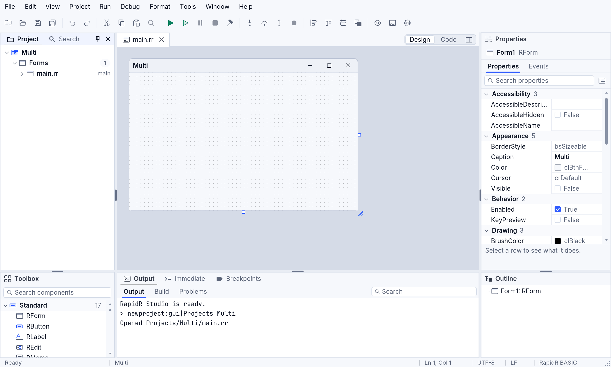
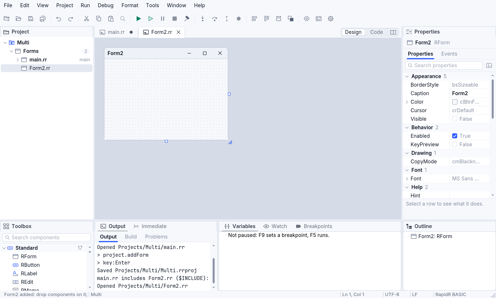
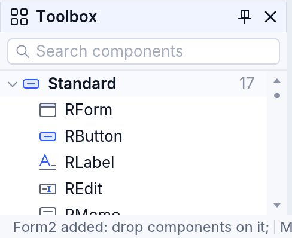
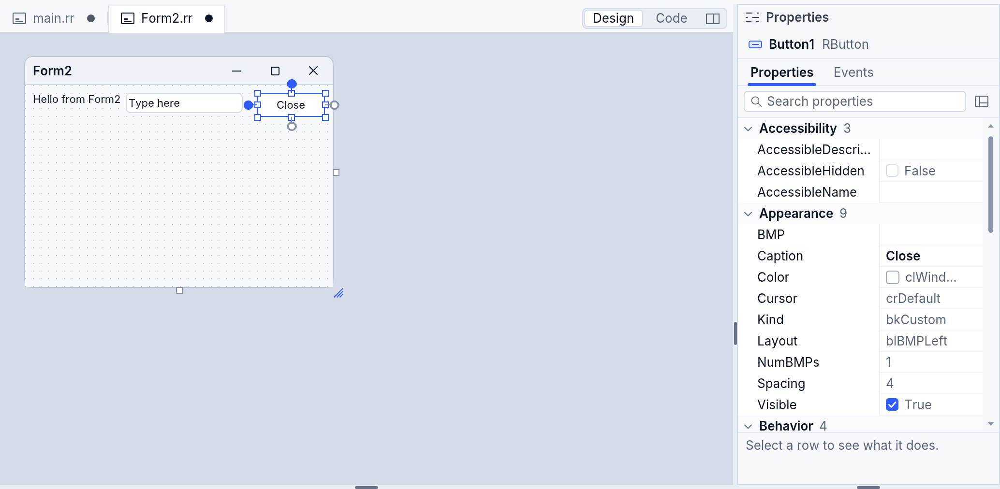
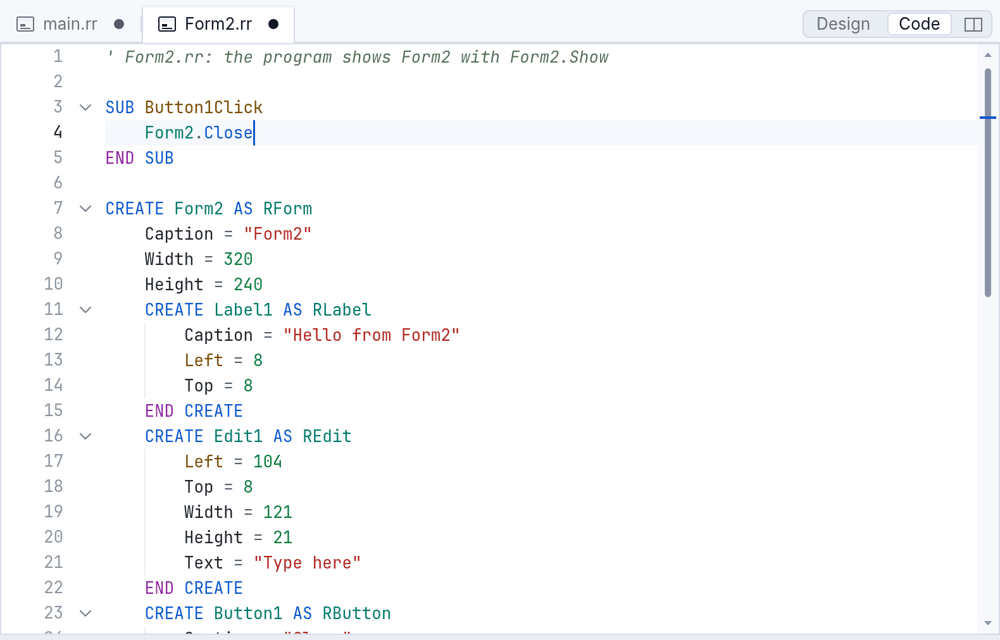
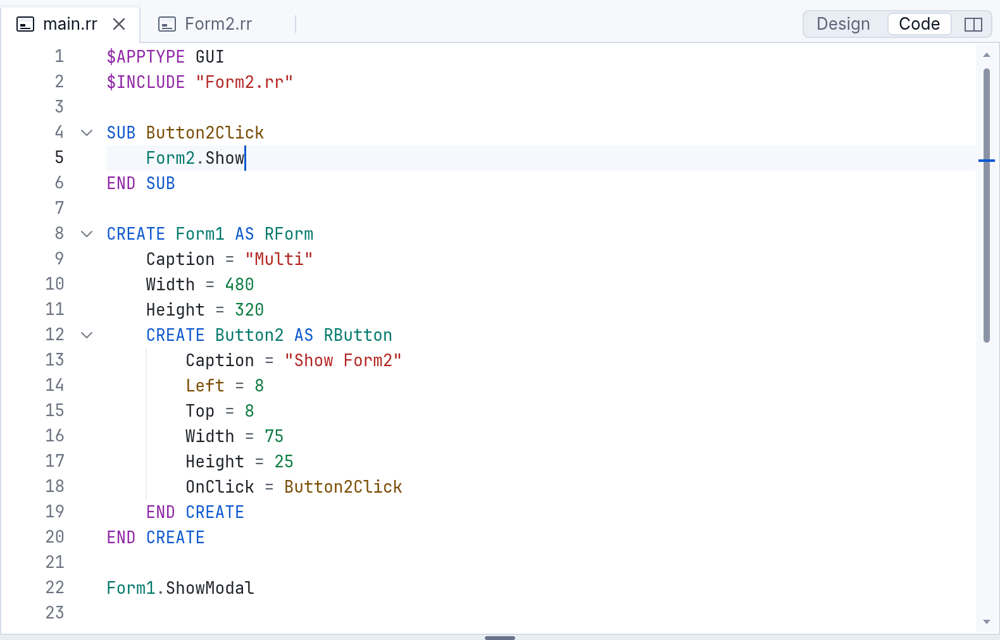
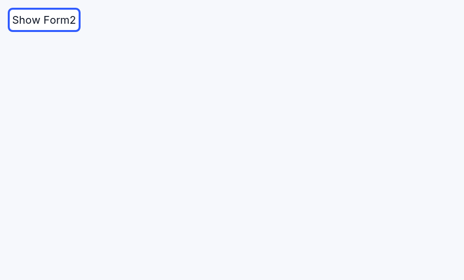
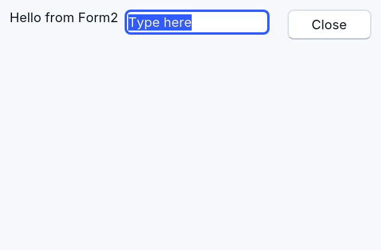
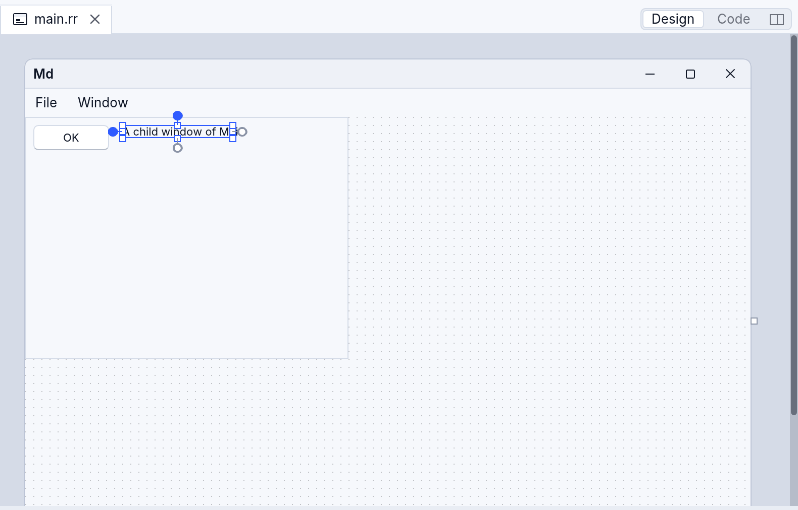
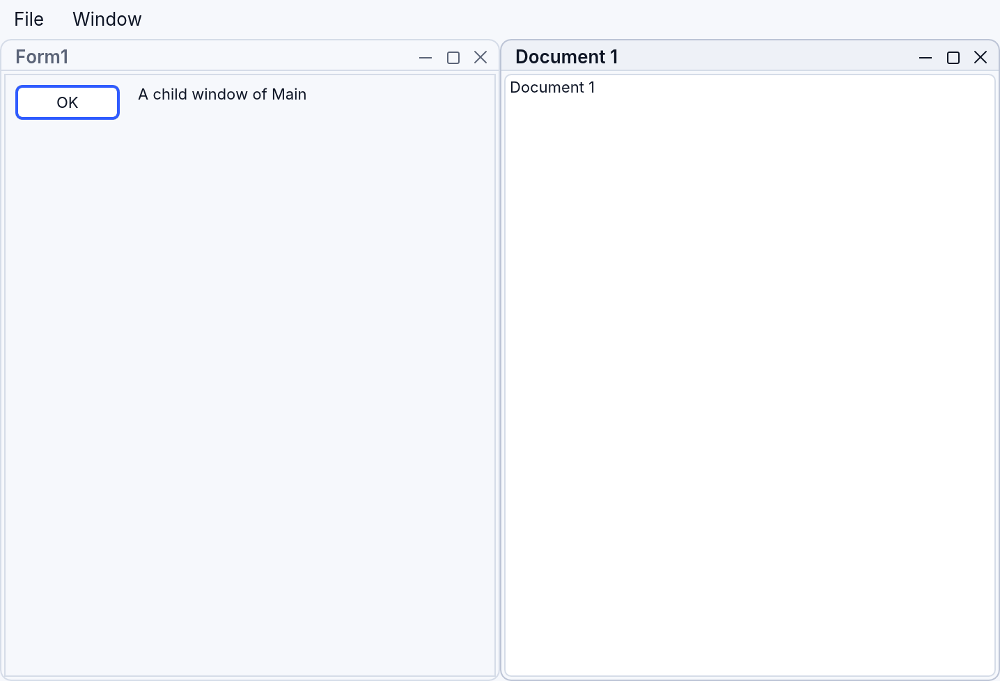

<!-- translated-from: designing-forms.md 787571a21d444a3a -->
# Diseñar formularios en RapidR Studio

El diseñador de formularios de RapidR Studio te permite construir las ventanas
de un programa dibujándolas: pones botones, etiquetas, campos de texto y lo
demás en un formulario, estableces sus propiedades, y Studio escribe el código
BASIC por ti — bloques `CREATE … END CREATE` normales en tu archivo fuente, el
mismo código que escribirías a mano. No hay ningún archivo de diseñador oculto:
**el código fuente es el formulario**. Cambia el código y el diseñador lo sigue;
cambia el diseñador y solo cambian en el código las líneas que lo necesitan.

Esta página empieza con un tutorial — un programa con dos formularios, desde un
proyecto vacío hasta ejecutarlo — y luego describe cada parte del diseñador.

Todas las imágenes salen de `tools/manual/shots.mjs` (las escenas están en
`tools/manual/scenes/designer.mjs`), así que muestran Studio tal como es.

## Tutorial: tu primera aplicación con dos formularios

Harás un programa cuya ventana principal tiene un botón que abre una segunda
ventana, y una segunda ventana con una etiqueta, un campo de texto y un botón
**Close**.

### 1. Crear un proyecto

Elige **Archivo ▸ Nuevo proyecto** (Ctrl+N; ⌘N en una Mac), elige
**Formulario**, ponle un nombre — aquí `Multi` — y una carpeta, y presiona
**Crear**. Studio crea la carpeta con dos archivos, `main.rr` (el programa) y
`Multi.rrproj` (el proyecto), y abre `main.rr` en su diseñador: el formulario
`Form1` está sobre el lienzo gris del diseñador, tal como se verá cuando el
programa se ejecute.



La ventana tiene cuatro áreas alrededor del documento: el árbol **Proyecto**
(arriba a la izquierda), la **Caja de herramientas** (abajo a la izquierda), el
inspector **Propiedades** (a la derecha) y **Salida** (abajo). Cada documento es
una pestaña; un archivo que crea un formulario tiene un interruptor **Diseño |
Código** a la derecha de las pestañas (y el botón de al lado muestra los dos lado
a lado).

| Para | Haz |
|---|---|
| ver el formulario | **Diseño** en el interruptor, o **Ver ▸ Diseñador** (Shift+F7) |
| ver el código | **Código** en el interruptor, o **Ver ▸ Código** (F7) |
| cambiar de uno a otro | F12 (en el código, F12 sobre un nombre va a donde está declarado) |
| ver los dos | el tercer botón del interruptor, o **Ver ▸ Diseñador y código lado a lado** |

### 2. Añadir un segundo formulario

Elige **Proyecto ▸ Añadir formulario** — o haz clic en **RForm** en la caja de
herramientas. El árbol del proyecto muestra un archivo nuevo, `Form2.rr`, con su
nombre listo para editar: escribe otro nombre si quieres y luego presiona
**Enter**.



Studio hizo tres cosas:

1. escribió `Form2.rr`:

   ```basic
   ' Form2.rr: el programa muestra Form2 con Form2.Show

   CREATE Form2 AS RForm
       Caption = "Form2"
       Width = 320
       Height = 240
   END CREATE
   ```

2. lo añadió al proyecto (`Multi.rrproj`), y
3. hizo que el programa lo incluya, al principio de `main.rr`:

   ```basic
   $APPTYPE GUI
   $INCLUDE "Form2.rr"
   ```

   Así es como un programa de RapidR se compone de varios archivos:
   `$INCLUDE` pone el código del archivo donde está la línea, así que `Form2` se
   crea cuando el programa se inicia — oculto, hasta que el programa lo muestra.
   El `$INCLUDE` es un solo paso de deshacer en `main.rr` (Ctrl+Z allí lo
   quita).

**Proyecto ▸ Añadir módulo** funciona de la misma manera para un archivo de
subrutinas (`SUB`) y funciones (`FUNCTION`) sin formulario (`Module1.rr`).

### 3. Poner componentes en Form2

La caja de herramientas enumera todos los componentes, agrupados (Estándar,
Adicional, Cuadros de diálogo, Sistema …), con los nombres de RapidR: RButton,
RLabel, REdit, etcétera. Escribe en su cuadro de búsqueda para encontrar uno por
su nombre o por lo que hace (“chart” encuentra RPlot).



Añade un **RLabel**, un **REdit** y un **RButton** a Form2 — cualquiera de estas
maneras sirve:

- **haz doble clic** en el elemento (o selecciónalo y presiona **Enter**): va al
  primer lugar libre del formulario, de izquierda a derecha y de arriba abajo, a
  un paso de cuadrícula de lo que hay allí;
- **haz clic** en el elemento y luego haz clic en el formulario donde va — o
  arrastra en el formulario para dibujarlo del tamaño que quieras;
- **arrastra** el elemento de la caja de herramientas al formulario.

Cada componente nuevo se nombra con su tipo y un número — Label1, Edit1,
Button1 — y queda seleccionado, así que el inspector lo muestra.

### 4. Establecer sus propiedades

Con **Label1** seleccionado, busca **Caption** en el inspector, escribe
`Hello from Form2` y presiona Enter. Haz lo mismo con el **Text** de **Edit1**
(`Type here`) y el **Caption** de **Button1** (`Close`). Cada cambio se escribe
en el código al instante, como el cambio más pequeño: una línea.



Una etiqueta se ajusta sola a su texto (su **AutoSize** está activado), así que
el diseñador no escribe ningún ancho para ella.

### 5. Hacer que el botón haga algo

Selecciona **Button1**, abre la página **Eventos** del inspector y haz doble clic
en **OnClick** (hacer doble clic en el botón del formulario hace lo mismo: crea
el controlador de su evento predeterminado). Studio escribe una subrutina
(`SUB`) para él, lo enlaza con `OnClick = Button1Click` en el bloque del botón y
pone el cursor dentro de la `SUB`. Escribe `Form2.Close`:



```basic
SUB Button1Click
    Form2.Close
END SUB

CREATE Form2 AS RForm
    …
    CREATE Button1 AS RButton
        Caption = "Close"
        Left = 240
        Top = 8
        Width = 70
        Height = 25
        OnClick = Button1Click
    END CREATE
END CREATE
```

La `SUB` va antes del formulario, donde tiene que estar (una `SUB` se conoce
desde la línea en que está escrita), con los parámetros que tiene el evento.

### 6. Mostrar Form2 desde Form1

Abre `main.rr` (su pestaña, o haz doble clic en él en el árbol del proyecto),
cambia a **Diseño**, añade un **RButton** a Form1, establece su Caption en
`Show Form2` y crea su controlador de eventos OnClick como en el paso 5. Escribe
`Form2.Show` en él:



El botón nuevo es **Button2**, no Button1: los nombres de los componentes de un
programa son globales (escribes `Button1.Caption`, no `Form2.Button1.Caption`),
así que el diseñador nunca da un nombre que use otro archivo del programa.

### 7. Ejecutarlo

Presiona **F5** (**Ejecutar ▸ Ejecutar**). Studio guarda primero todos los
archivos, comprueba el programa completo — `main.rr` y lo que incluye — y lo
ejecuta. Haz clic en **Show Form2**:




El mismo programa se ejecuta en todos los entornos de ejecución de RapidR:
interpretado, compilado como ejecutable nativo (**Ejecutar ▸ Compilar**,
Ctrl+Shift+B) y en un navegador — Studio en la web lo ejecuta en un marco junto a
tu código.

## La caja de herramientas

- Haz doble clic (o presiona Enter): añade el componente en un lugar libre del
  contenedor seleccionado — el formulario, o el panel, cuadro de grupo o cuadro
  de desplazamiento seleccionado. Un componente más grande que el formulario (un
  RPlot de 640 × 480 en un formulario pequeño) se hace tan grande como quepa.
- Haz clic y luego haz clic o arrastra en el formulario: lo coloca allí (al
  arrastrar se dibuja su tamaño).
- Arrastra al formulario: lo suelta donde lo sueltes, dentro del contenedor que
  está bajo el mouse; mientras arrastras, unas guías muestran cómo se alinea con
  los demás.
- Los componentes que no se ven cuando el programa se ejecuta — temporizadores,
  cuadros de diálogo, RStringList … — van a la **bandeja** debajo del formulario.
<!-- legal -->
- El grupo **Datos** (RCSV, RDataFrame, RDataSource, RDBGrid …) muestra sus datos
  en vivo mientras diseñas ([Ciencia de datos con RapidR](data-science-with-rapidr.md));
  un **RAI** del grupo **IA** guarda su clave en tu llavero y escribe en el código
  solo dónde está ([El asistente de IA y RAI](ai-assistant.md#en-el-diseñador)).
- **RForm** y **RFormMDI** son documentos, no componentes: al hacer clic en ellos
  se añade un archivo de formulario (paso 2); el de RFormMDI es una ventana
  principal MDI (`CREATE Form3 AS RFormMDI`). Arrastrar RForm a un formulario no
  pone un formulario dentro de un formulario: se añade como una ventana nueva y
  la barra de estado lo dice. Si se arrastra a un **RFormMDI**, se convierte en
  una de sus ventanas hijas (siguiente sección).

El diseñador escribe cada archivo con sus propios nombres: los de RapidR
(RButton) en un archivo escrito con ellos, los nombres clásicos (QBUTTON) en
un programa clásico — un archivo que crea componentes `QFORM`, o un archivo `.bas`
— nunca una mezcla. Los dos nombres significan el mismo componente.

## Seleccionar, mover y cambiar de tamaño

| Para | Haz |
|---|---|
| seleccionar | haz clic en él; Shift+clic (⌘+clic) añade o quita uno; arrastrar sobre el fondo del formulario dibuja un cuadro alrededor de varios |
| mover | arrástralo (Alt mientras arrastras: sin ajuste a la cuadrícula ni a las guías); las teclas de flecha lo mueven un píxel, Shift+flechas un paso de cuadrícula |
| cambiar de tamaño | arrastra uno de sus ocho puntos de control; Ctrl+flechas (⌘+flechas) un píxel |
| cambiar el tamaño del formulario | arrastra su borde derecho, su borde inferior o su esquina |
| editar un texto en su lugar | F2 (**Formato ▸ Editar texto**), o haz clic otra vez en el componente seleccionado, despacio |
| recorrer los componentes | Tab / Shift+Tab; Esc selecciona el contenedor |
| eliminar | Delete |
| copiar, cortar, pegar, duplicar | Ctrl+C, Ctrl+X, Ctrl+V, Ctrl+D (⌘ en una Mac) — el portapapeles guarda el texto de `CREATE`, así que pegar en el código da el código |
| deshacer, rehacer | Ctrl+Z, Ctrl+Y (⌘Z, ⌘⇧Z) |

Deshacer es **un historial por archivo**, compartido con el editor de código: lo
que hiciste en el diseñador y lo que escribiste en el código se deshacen en el
orden en que lo hiciste, hasta los bytes exactos del archivo.

**Formato** alinea los componentes seleccionados con el primero que
seleccionaste: **Alinear a la izquierda**, **Alinear a la derecha**, **Alinear
arriba**, **Alinear abajo**, **Alinear al centro**, **Alinear al medio**,
**Igualar ancho**, **Igualar alto**, **Igualar tamaño**, **Espaciar uniforme en
horizontal**, **Espaciar uniforme en vertical**, **Centrar en horizontal** y
**Centrar en vertical** (en el formulario), **Traer al frente**, **Enviar al
fondo**. Cada uno es un solo paso de deshacer.

## El inspector

La página **Propiedades** enumera lo que puedes establecer en el componente
seleccionado (o en el propio formulario cuando no hay nada seleccionado), por
categoría o de la A a la Z, con un cuadro de búsqueda; el cuadro que está debajo
dice qué hace la propiedad seleccionada. Los valores en gris son los
predeterminados: no se escriben en el código.

Cada tipo de propiedad tiene su propio editor, y cada uno escribe lo que el
programa necesita:

| Tipo | Ejemplo | Se escribe como |
|---|---|---|
| texto | Caption `Say hi && bye` | `Caption = "Say hi && bye"` (`&` subraya la letra siguiente; `&&` es un `&`) |
| verdadero / falso | WordWrap ☑ | `WordWrap = 1` |
| una opción | Alignment `taCenter` | `Alignment = taCenter` — o `Alignment = 2` (mira más abajo) |
| color | Color `clYellow` | `Color = clYellow` — o `Color = &H00FFFF` |
| fuente | Font ▸ Name `Arial`, Size `12`, Bold ☑, Color `clBlue` | `Font.Name = "Arial"`, `Font.Size = 12`, `Font.Bold = 1`, `Font.Color = …` |
| número | Width `120` | `Width = 120` |

Las constantes con nombre clásicas — `clYellow`, `taCenter`, `alClient` … — vienen
integradas en un programa de RapidR (`.rr`), así que el diseñador escribe sus
nombres. Un programa `.bas` las obtiene de `RAPIDQ.INC`: en uno que no hace
`$INCLUDE "RAPIDQ.INC"` (o no las define), un nombre se leería como nada cuando
se ejecuta, así que el diseñador escribe el número en su lugar.

La página **Eventos** enumera los eventos del componente (los del formulario
cuando no hay nada seleccionado: OnShow, OnClose, OnResize, OnPaint, OnKeyDown
…). Haz doble clic en uno para crear su controlador de eventos — una `SUB` con el
nombre del componente y el evento (`Button1Click`, `Form1Show`) — o para ir a él
cuando ya existe; la lista también ofrece las `SUB` del archivo que encajan.

## Ventanas hijas de un formulario MDI

Un programa MDI tiene una ventana principal (un **RFormMDI**) cuyas ventanas
hijas se abren, se mueven, se colocan en mosaico y en cascada dentro de ella. Una
ventana hija se hace con un componente (un panel): el `AddChild` del formulario
MDI lo muestra en una ventana hija propia. Arrastra **RForm** de la caja de
herramientas al RFormMDI en el diseñador, y Studio escribe exactamente eso — un
panel en el formulario MDI, con nombre de formulario, y la línea que lo abre como
ventana hija cuando el programa se inicia:

```basic
CREATE Main AS RFormMDI
    …
    CREATE Form1 AS RPanel
        Left = 0
        Top = 0
        Width = 320
        Height = 240
        CREATE Button1 AS RButton
            Caption = "OK"
            …
        END CREATE
    END CREATE
END CREATE
Main.AddChild(Form1.Handle, "Form1", 0, 0, 0, 0, 0, 1)
```

Pon los componentes de la ventana hija en el panel, en el diseñador, como en
cualquier formulario:



Cuando el programa se ejecuta, Form1 es una ventana hija dentro de Main — aquí en
mosaico con la propia ventana de documento de la plantilla (Window ▸ Tile):



Los otros argumentos de `AddChild` son el índice de la ventana, su lugar y
tamaño (izquierda, arriba, ancho, alto) y si se usa el tamaño predeterminado de
Windows (1: en cascada, tres cuartos de la ventana principal). Mueve la línea a
una `SUB` — el OnClick de un elemento de menú **Archivo ▸ Nuevo**, por ejemplo —
para abrir la ventana solo cuando el usuario lo pida.

## El editor de menús y el orden de tabulación

- **Formato ▸ Editor de menús** edita la barra de menús del formulario en el
  propio formulario: escribe en **Escribe aquí** para crear un menú, Enter para
  entrar en él; `&` marca la letra a la que llega Alt, `-` es un separador; en el
  cuadro ShortCut de un elemento presiona las teclas (Ctrl+O). Cada elemento es
  un bloque `CREATE … AS RMenuItem`.
- **Formato ▸ Orden de tabulación** muestra el lugar de cada componente en el
  orden de tabulación; haz clic en ellos en el orden que quieras.

## Zoom

**Ver ▸ Acercar / Alejar / Tamaño real / Ajustar al espacio**, Ctrl+= / Ctrl+− /
Ctrl+0 (⌘ en una Mac), Ctrl+rueda o el gesto de pellizco de un trackpad: del 25 %
al 400 %. Los píxeles del formulario en el programa no cambian. Cuando el
formulario es más grande que el diseñador, unas barras de desplazamiento te
permiten llegar a todo.

## Programas de varios formularios

- Cada formulario o módulo del programa es un archivo que incluye el archivo
  principal: **Proyecto ▸ Añadir formulario / Añadir módulo** escribe el
  `$INCLUDE` por ti (después del último `$INCLUDE`, así que un archivo posterior
  puede usar lo que crea uno anterior).
- Muestra un formulario con `Form2.Show`, o con `Form2.ShowModal` para esperar
  hasta que se cierre; ocúltalo con `Form2.Close` o `Form2.Visible = 0`.
- Los nombres de los componentes son globales: Form1 puede usar directamente el
  `Edit1.Text` de Form2.
- En el archivo de un formulario, Studio conoce el programa completo: los nombres
  del archivo principal y de los demás formularios se completan y se comprueban
  allí.
- Cambia el nombre de un archivo en el árbol del proyecto (F2) y el `$INCLUDE` lo
  sigue; quítalo del proyecto (Delete) y su `$INCLUDE` también se va (el archivo
  se queda en el disco).
- En un programa escrito con los nombres anteriores (`main.bas`), los formularios
  y módulos nuevos son archivos `.bas` y usan los nombres clásicos, para que
  el programa siga siendo clásico.
- Un archivo puede contener varios formularios (`CREATE Form AS RForm`,
  `CREATE NewForm AS RForm` …): el árbol del proyecto muestra cada uno bajo el
  archivo, y abrir uno lo diseña. El árbol toma lo que es un formulario de tu
  código, no del archivo del proyecto: mira
  [Proyectos en RapidR Studio](studio-projects.md).

## El código que escribe el diseñador

Todo lo que escribe el diseñador es el BASIC que escribirías tú: bloques
`CREATE … END CREATE`, una propiedad por línea, `OnClick = Handler` para un
evento, `SUB` normales. Cambia solo lo que tiene que cambiar — abrir un archivo y
guardarlo sin un cambio da los mismos bytes; mover un botón cambia su línea
`Left` y nada más; tus comentarios, líneas en blanco y formato se quedan. El
código que escribes dentro de un bloque `CREATE` que el diseñador no puede editar
(una expresión como `Width = Screen.Width / 4`) se queda como lo escribiste. Un
color escrito como `RGB(250, 246, 238)` se muestra en ese color. Una imagen
nombrada por su archivo — el `BMP = "logo.png"` o el `Load "logo.svg"` de un
RImage, o una línea `Logo.Load "logo.svg"` justo después del formulario — se
muestra en el formulario como se verá cuando el programa se ejecute, leída desde
la carpeta de tu programa (un archivo fuera de ella no se lee en tiempo de
diseño). Mientras el código tiene un error, el diseñador muestra el formulario
como se compiló por última vez y no cambia nada hasta que lo arregles.
