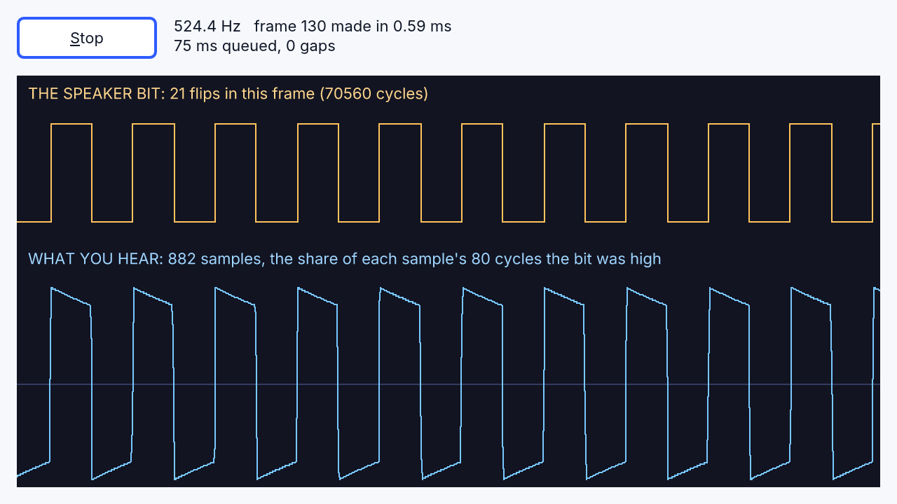

<!-- translated-from: directx-and-media.md 62ca4b0b9e9c5788 -->
# DirectX, multimedia y dispositivos

Los objetos de DirectX, multimedia y dispositivos se ejecutan en todas las
plataformas y en el navegador. Son implementaciones propias de RapidR de lo que
hacen los programas con las API de Windows para DirectX, MCI, WinINet y puertos
seriales, con los miembros y el comportamiento en los que se apoyan los
programas anteriores. Cada uno tiene también un nombre Q anterior (`QDXSCREEN`
para `RDXScreen`, y así sucesivamente), que se acepta en todas partes.

## DirectX 2D

| Objeto | |
|---|---|
| `RDXScreen` | una superficie fuera de pantalla que se muestra con `Flip`: `Init`, `AutoSize`, `AllowStretch`, `Fill` (colores de DirectDraw), `Pixel`, texto (`TextOut`, `TextRect`), `Draw` / `StretchDraw` / `CopyRect`, `Rotate`, `View.*`; `OnInitialize` / `OnInitializeSurface` cuando su formulario se muestra por primera vez; `FullScreen` cubre la pantalla con la superficie escalada para que quepa |
| `RDXImageList` | bibliotecas de imágenes de DelphiX (`.DXG`) con su transparencia y sus patrones |
| `RDXTimer` | un temporizador de cuadros: `FrameRate`; `Interval = 0` se dispara una vez por cuadro; `ActiveOnly` solo mientras el programa está activo |
| `RDXSound` | un WAV que se reproduce con su `Frequency`, `Volume` y `Pan` (los decibeles de DirectSound), en ciclo o una sola vez; `Playing`, `Position`, `Size`, `Play`, `Stop` |
| `RDXJoystick` | Los clásicos `Update`, `IsLeft` / `IsRight` / `IsUp` / `IsDown`, `Button(n)`; RapidR añade `Index`, `Connected`, `Name`, los ejes `X Y Z R U V`, `Buttons`, `POV` y los eventos `OnButtonDown`, `OnButtonUp`, `OnMove` |

Joysticks: gamepads mediante gilrs (Windows, macOS), evdev (Linux) y la API
Gamepad del navegador, todos con la misma disposición (un control de Xbox tal
como lo mostraba winmm de Windows). Sin ningún joystick, cada miembro indica “no
conectado” en lugar de dar un error.

## Direct3D (modo retenido)

`RD3DFrame`, `RD3DMeshBuilder`, `RD3DMesh`, `RD3DFace`, `RD3DLight`,
`RD3DTexture`, `RD3DVisual`, `RD3DWrap`, `RD3DVector` y los métodos 3D de
RDXScreen (`CreateFrame`, `CreateMeshBuilder`, `CreateLightRGB`,
`SetCameraPosition`, `CameraLookAt`, `Render`, …): marcos, caras, modelos `.X`
(de texto y binarios — se carga todo modelo del conjunto de pruebas de
compatibilidad), luces (ambiental, direccional, puntual, de foco), la cámara,
texturas, envolturas, sombras y transparencia combinada, con iluminación plana o
de Gouraud.

RapidR dibuja el 3D en la GPU mediante wgpu —Metal en macOS, Direct3D 12 en
Windows (con su adaptador de software WARP donde no hay GPU), Vulkan u OpenGL en
Linux, WebGL 2 en el navegador—, nítido a cualquier escala de pantalla y rápido
(el modelo más grande del conjunto de pruebas de compatibilidad, de 16 000
triángulos, tarda unos 4 ms por cuadro), y luego entrega la imagen al búfer
posterior de la pantalla, de modo que el texto dibujado después de `Render`,
además de `Pixel` y `Flip`, funciona como antes. La niebla se acepta y no tiene
efecto (nunca lo tuvo). El 3D de RapidR coincide con los ejemplos del conjunto de
pruebas de compatibilidad, y sigue la documentación de Direct3D donde estos
callan.

## Sonido y música

- `PLAYWAV file [, options]` y `PLAYSOUND` reproducen archivos WAV, Ogg Vorbis,
  FLAC y MP3 (o recursos `$RESOURCE`); `BEEP` y `SOUND freq, duration`.
- **RMIDI** (nombre anterior `QMIDI`, de `QMidi.inc`) reproduce archivos MIDI
  estándar con la temporización de MCI en una salida MIDI del sistema que
  produzca sonido; donde no hay ninguna (macOS, Linux, navegadores sin Web MIDI)
  los reproduce el sintetizador General MIDI propio de RapidR. Una salida cuenta
  cuando su nombre dice que es un sintetizador (el *GS Wavetable Synth* de
  Windows, FluidSynth, TiMidity …) o, en Windows, cuando es la primera que no es
  un ciclo (loop) ni un bus. Las salidas MIDI propias de una Mac (un bus IAC, una
  sesión de red, un puerto virtual que creó otro programa) y el *Midi Through* de
  Linux solo pasan mensajes a otros programas y no producen sonido, así que una
  canción nunca se envía por sí sola a una de ellas: la reproduce el sintetizador
  de RapidR. Para tocar en un teclado o en un módulo de sonido que hayas
  conectado, nómbralo antes de que se inicie el programa (una parte de su nombre,
  sin distinguir mayúsculas de minúsculas); `builtin` siempre se reproduce en el
  sintetizador de RapidR. Un nombre que ninguna salida tiene se informa en la
  salida de errores y se reproduce en el sintetizador de RapidR.

  ```
  RAPIDR_MIDI_OUT="Roland" rapidr run song.rr     (macOS, Linux)
  set RAPIDR_MIDI_OUT=builtin & rapidr run song.rr  (Windows)
  ```

  Ejemplo: [`examples/media/midi_compose.rr`](../../../examples/media/midi_compose.rr)
  escribe una canción en código (acordes, una línea de bajo, batería en el
  canal 10) y la reproduce. En un navegador, la variable de página
  `RAPIDR_MIDI_OUT` hace lo mismo.
- **RWave** (`QWAVE`, de `QWave.inc`) reproduce archivos WAV, graba desde la
  entrada predeterminada (`New`, `Record`), guarda y elimina.
- **RVideo** (`QVIDEO`, de `QVideo.inc`) reproduce archivos AVI con los
  decodificadores propios de RapidR: sin comprimir, Microsoft RLE, Microsoft
  Video 1, Cinepak y Motion JPEG, con su sonido PCM — en un formulario o en una
  ventana propia.
- **RCDAudio** (`QCDAUDIO`, de `Qcdaudio.inc`) responde como una computadora sin
  unidad de CD.

Los objetos multimedia comparten estos miembros: `Open`, `Close`, `Play`, `Stop`,
`Pause`, `State`, `FileOpen`, `Lenght` (la ortografía clásica), `Error` (los
textos propios de MCI), `Volume`, su `Timer` y `OnChange`. Un programa que
incluye con `$INCLUDE` el archivo de biblioteca clásico obtiene el objeto de
RapidR.

## Sonido creado muestra por muestra: RAudioOut

**RAudioOut** reproduce el sonido que tu programa va creando sobre la marcha, un
número (una *muestra*) a la vez: el zumbador o el chip de sonido de un emulador,
un sintetizador, un tono para una clase de física, un juego de música. El
programa escribe muestras en la cola del flujo; el dispositivo de sonido las
reproduce en un hilo propio y nunca espera al programa.


```basic
DIM Sound AS RAudioOut
DIM phase AS DOUBLE

SUB Feed (Count AS INTEGER)                 ' el flujo pide Count muestras
    DIM buf(Count - 1) AS INTEGER, i AS INTEGER
    FOR i = 0 TO Count - 1
        buf(i) = SIN(phase) * 6000          ' un tono suave de 440 Hz
        phase = phase + 2 * 3.14159265 * 440 / Sound.SampleRate
    NEXT
    Sound.Write buf, Count
END SUB

Sound.OnNeedData = Feed
Sound.Start
```

- **Muestras.** De forma predeterminada una muestra es un número de 16 bits de
  -32 768 a 32 767, 44 100 de ellas por segundo (`SampleRate`, de 8000 a 96 000).
  `Write` acepta un arreglo (array) de INTEGER (o BYTE, LONG …), una cadena
  binaria (dos bytes por muestra, primero el byte bajo), un `RMemoryStream`
  (desde su `Position`) o un número, con `Count` y `Offset` opcionales;
  `WriteFloat` acepta de -1 a 1 de un arreglo SINGLE o DOUBLE; `WriteSample v`
  escribe una muestra, la forma más fácil de aprender. `Bits = 8` lee bytes de 0
  a 255 (128 es silencio) como los tienen los archivos WAV de 8 bits. Con
  `Channels = 2` las muestras van intercaladas: izquierda, derecha, izquierda …
- **Mantenerlo alimentado.** Mantén en cola unos `BufferMs` (60 ms de forma
  predeterminada) de sonido. Escribe en `OnNeedData(Count)`, que el flujo genera
  en el propio hilo de tu programa cuando la cola baja de `BufferMs` (Count la
  vuelve a llenar), o, en un programa que trabaja un cuadro a la vez, revisa
  `Queued` (ms en espera) desde un `RTimer` y escribe hasta que esté cerca de
  `BufferMs`. El sonido que oyes llega con un retraso de unos `BufferMs`: un
  valor menor responde antes, uno mayor resiste un momento de mucha actividad.
- **Cuando el programa se retrasa**, la cola se vacía: el flujo reproduce
  silencio tras un fundido de salida de 2 ms (sin chasquido), cuenta el hueco en
  `Underruns` y hace entrar el siguiente sonido con un fundido. `Stop` baja el
  sonido de la misma manera; `Volume` (0–100, según el oído: 50 suena la mitad de
  fuerte) se desliza durante 10 ms, así que un control deslizante nunca provoca
  chasquidos. `Enabled = False` pausa; `Clear` descarta lo que espera. `Start` le
  da al dispositivo de sonido 40 ms de silencio antes de tus muestras, de modo
  que unos audífonos que toman una ráfaga al comenzar (los Bluetooth lo hacen)
  nunca cortan el inicio.
- **En todas partes.** Igual en Windows, macOS y Linux, interpretado y nativo, y
  en el navegador. El dispositivo convierte tu `SampleRate` al suyo. Sin un
  dispositivo de sonido (o en un programa compilado sin sonido) el flujo se
  reproduce en silencio, sin perder el ritmo, y `Error` dice por qué.

### Emuladores: sonido a partir de una línea de tiempo de niveles

El sonido más simple de una computadora es un bit conectado a un altavoz, que el
programa invierte en momentos exactos. Un emulador lo reproduce un cuadro a la
vez (examples/media/beeper.rr, y la receta examples/recipes/frame_audio.rr):

1. ejecuta la máquina emulada durante un cuadro (a 50 cuadros por segundo, 1/50
   de sus ciclos), anotando el ciclo de cada escritura al altavoz;
2. para cada una de las muestras del cuadro (44 100 / 50 = 882), qué parte de su
   tiempo estuvo alto el bit: de -1 a +1 según esa proporción. Promediar sobre
   la muestra en lugar de leer el bit una sola vez mantiene el sonido limpio (sin
   el siseo del aliasing);
3. un bloqueador de DC (`out = x - prevX + 0.995 * prevOut`): un altavoz real no
   puede mantener un empuje, así que un bit que se deja en alto vuelve poco a
   poco hacia el centro;
4. escribe las 882 muestras con `Write`.

Un `RTimer` revisa con frecuencia y ejecuta cuadros hasta que hay unos 60 ms en
cola, así que un tic que llega tarde se pone al día y el sonido nunca tiene
huecos. Usa `Interval = 10`: los tics de un `RTimer` llegan en los pasos de
15.6 ms del temporizador del sistema, como siempre (`Interval = 20` solo marca
cada 31 ms, lo que le deja a una cola de 60 ms poco margen para un tic tardío).
El intérprete de RapidR hace un cuadro así en 0.2 a 0.6 ms, una pequeña parte de
los 20 ms de que dispone.



### En el navegador

Un navegador reproduce sonido solo después de que la persona haya hecho clic o
presionado una tecla en la página: llama a `Start` desde el `OnClick` de un
botón. Hasta que la página pueda reproducir, `Error` lo dice; el sonido empieza
(y `Error` se borra) en cuanto puede. Mantén la cola un poco más larga allí
(`BufferMs = 80` o más) si la página está ocupada: el navegador reproduce el
flujo entre el trabajo propio de la página.

Los ejemplos: [tone_generator.rr](../../../examples/media/tone_generator.rr)
(una onda senoidal, cuadrada, de diente de sierra o ruido, y un osciloscopio de
las muestras reproducidas), [beeper.rr](../../../examples/media/beeper.rr) (el
altavoz de un bit), [chiptune.rr](../../../examples/media/chiptune.rr) (tres
voces de onda cuadrada que tocan la melodía propia de RapidR) y la receta
[frame_audio.rr](../../../examples/recipes/frame_audio.rr).

## Dispositivos y red

| Objeto | |
|---|---|
| `RComPort` | un puerto serial (nombre anterior `COMPORT`): `Port`, `BaudRate`, `DataBits`, `Parity`, `StopBits`, `Open`, `Close`, `ReadString`, `WriteString`, `OnRxChar`, `OnComError`, … — serial2 en el escritorio (nada que instalar en Linux), Web Serial en el navegador; los extras de RapidR para placas IoT (ListPorts, DTR / RTS, ReadLine, OnLine, OnPortsChanged) en [Puertos seriales y placas IoT](serial-ports.md) |
| `RSocket` (nombre anterior `QSOCKET`), `RServerSocket` | cliente y servidor TCP (el navegador: solo cliente WebSocket); servidores en [Redes](network.md): solo esta computadora (`127.0.0.1`), por líneas, bytes o solicitudes HTTP completas |
| `RHttpServer` | un servidor web en tu programa, en `127.0.0.1`: una API local, un panel de control, un servidor MCP ([Redes](network.md)) |
| `RHttp` | `Get` y `Post` de HTTP(S) |
| `RDownload` | nombre anterior `QDOWNLOAD` (`Qdownload.inc`), con `LeechFile`: un archivo de un servidor web a una variable o a un archivo, con progreso; el puerto 443 es HTTPS, se siguen las redirecciones, y las ventanas del programa siguen funcionando mientras espera |
| `RCGI` | nombre anterior `QCGI` (`qcgi.inc`), el objeto CGI: las variables CGI como propiedades, `Parse`, `Get(Name, Value)` — para programas `$APPTYPE CGI` detrás de un servidor web |

<!-- legal -->
HTTPS usa el TLS del sistema operativo (el framework Security de macOS, SChannel
de Windows, OpenSSL 3 de Linux) y sus certificados: RapidR no compila ninguna
biblioteca TLS dentro de tu programa.

## La bandeja del sistema

Los programas ponen un ícono en el área de notificación de Windows con
`RNotifyIconData` y `Shell_NotifyIcon`, y reciben sus clics en el `WndProc` de su
formulario. RapidR mantiene funcionando en todas partes esa única llamada de
Windows: el ícono se muestra en la barra de menús de macOS, en el área de
notificación de Windows, en la bandeja de Linux (StatusNotifierItem) y en una
franja en la parte inferior derecha de una página web, y los clics llegan a
`WndProc (hWnd, uMsg, wParam, lParam)` como los mensajes de mouse de Windows.
`NI.hIcon = Application.Icon` muestra el ícono del programa. En Windows, el
`WndProc` del formulario también recibe todos los demás mensajes de su ventana
(consulta [Mensajes de Windows](components.md#windows-messages-a-forms-wndproc));
en los demás sistemas, los de la bandeja son los únicos.

## El registro

<!-- legal -->
`RRegistry` es el propio registro de Windows en Windows, como siempre lo fue. En
macOS, Linux y la web es un almacén por usuario que responde de la misma manera
(`~/Library/Application Support/RapidR/registry.reg`,
`~/.config/rapidr/registry.reg`). `RAPIDR_REGISTRY=<archivo>` pone las claves en
ese archivo en todos los sistemas, así que las pruebas nunca tocan el registro
real.
