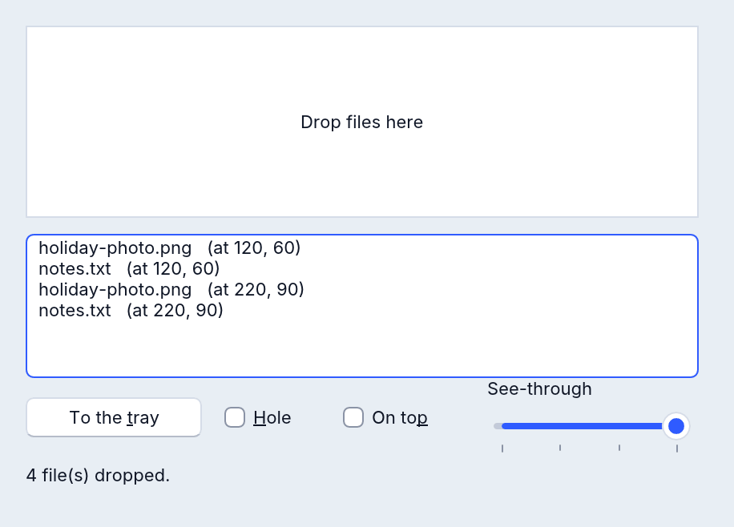

# RFormEx: un formulario con más

`RFormEx` es un formulario que hace más que un `RForm`, de forma nativa en
Windows, macOS, Linux y la web:

- **archivos soltados en él**, un evento por archivo, solo dentro del área que
  elijas, con el punto donde cayeron;
- **su propio ícono en la bandeja del sistema**, con una sugerencia e imágenes
  que pueden turnarse (una animación), clics y dobles clics;
- **translúcido**: toda la ventana, o solo su color de fondo (un hueco a
  través del cual se ve el escritorio);
- **siempre encima** de las ventanas de otros programas;
- avisos cuando se **minimiza**, cuando **recibe** y **pierde el foco**;
- **los mensajes de la ventana** en Windows (una entrada MIDI, un mensaje que
  otro programa envía).

Todo lo que tiene un `RForm` también lo tiene un `RFormEx`: escribe `RFormEx`
donde escribirías `RForm`.



```basic
DECLARE SUB FileDropped (File AS STRING)

CREATE Main AS RFormEx
    Caption = "Drop files here"
    DragEnable = True
    OnDrag = FileDropped
END CREATE

SUB FileDropped (File AS STRING)
    Main.Caption = File
END SUB

Main.ShowModal
```

El ejemplo [examples/gui/form_ex.rr](../../../examples/gui/form_ex.rr) usa
todas las funciones de abajo (`rapidr run gui/form_ex.rr` en la carpeta de
ejemplos).

## Archivos soltados en el formulario

| Miembro | Qué hace |
|---|---|
| `DragEnable` | `True`: se pueden soltar en el formulario archivos arrastrados desde Finder, File Explorer o un administrador de archivos. |
| `OnDrag(File AS STRING)` | Una vez por cada archivo soltado, en orden, con su ruta completa. |
| `DragZone.Left`, `.Top`, `.Right`, `.Bottom` | Solo cuentan los archivos soltados dentro de este rectángulo (píxeles del área cliente; `Right` y `Bottom` quedan justo afuera). Vacío, como empieza: todo el formulario. |
| `DropPoint.X`, `DropPoint.Y` | Dónde cayeron los archivos; se establece antes de `OnDrag`. |

```basic
' solo el recuadro blanco acepta archivos
Main.DragZone.Left = Box.Left: Main.DragZone.Top = Box.Top
Main.DragZone.Right = Box.Left + Box.Width
Main.DragZone.Bottom = Box.Top + Box.Height
```

En un navegador, un archivo soltado se lee en los archivos propios del
programa y `File` es su nombre: ábrelo como cualquier archivo. Todo
formulario tiene además `OnDropFiles(Files)`, que recibe todo lo soltado de
una vez (las rutas, una por línea); un `RFormEx` puede usar cualquiera de los
dos.

## El ícono de la bandeja

| Miembro | Qué hace |
|---|---|
| `AddTrayIcon` / `DelTrayIcon` | Pone el ícono del formulario en la bandeja del sistema, o lo quita. Cerrar el formulario y el fin del programa también lo quitan. |
| `TrayIconHint` | La sugerencia (el título de la aplicación hasta que la estableces). |
| `TrayICO` | Las imágenes, un `RImageList` propio del formulario: `Main.TrayICO.AddICOFile "app.ico"` (también `AddBMPFile`, `AddSVGFile`…). Ninguna: el ícono del formulario o de la aplicación. |
| `TrayIconIndex` | Qué imagen se muestra, desde 1. |
| `TrayIconUpdate` | Con dos imágenes o más se turnan cada tantos milisegundos (2000 al empezar; 0 lo detiene). |
| `TrayIconShown` | `True` mientras el ícono está en la bandeja. |
| `OnTrayDblClick` | Doble clic en el ícono: vuelve a mostrar la ventana aquí. |
| `OnTrayClick` | Se soltó el botón derecho sobre él (en macOS también un clic con Control): muestra un menú aquí. |
| `OnTrayMouseUp(Button)` | Se soltó cualquier botón sobre él: `mbLeft`, `mbRight` o `mbMiddle`. |

La bandeja es el área de notificación en Windows, la barra de menús en macOS,
la bandeja del panel en Linux (StatusNotifierItem) y una franja pequeña abajo
a la derecha de una página web.

Un programa que vive en la bandeja:

```basic
SUB Minimised            ' OnMinimise
    Main.AddTrayIcon
    Main.Visible = False
END SUB

SUB BackFromTray         ' OnTrayDblClick
    Main.DelTrayIcon
    Main.WindowState = wsNormal
    Main.Visible = True
END SUB
```

`RemoveTaskBar` quita el botón de la ventana de la barra de tareas de Windows
(en los demás sistemas no hace nada).

## Translúcido y encima

| Miembro | Qué hace |
|---|---|
| `Transparent` | De 0 a 255: qué tan opaca es toda la ventana; 255 opaca (al empezar), 127 a medias, 0 invisible. Los demás valores se ignoran. |
| `TransparentClient` | `True`: el color de fondo del formulario (`Color`) se vuelve un hueco; se ve el escritorio a través y los clics allí llegan a lo que está detrás. Los controles quedan, salvo sus partes de exactamente ese color. |
| `FormStyle` | `fsStayOnTop`: encima de las ventanas de otros programas; `fsNormal`: de nuevo una ventana común (el `FormStyle` de todo formulario hace esto). |

| | Windows | macOS | Linux X11 | Linux Wayland | Web |
|---|---|---|---|---|---|
| `Transparent` | sí | sí | todavía no | todavía no | sí |
| `TransparentClient` | sí | sí | todavía no | todavía no | se ve la página a través; los clics siguen llegando al formulario |
| `fsStayOnTop` | sí | sí | sí | decide el compositor | encima de las demás ventanas de la página |

Donde un sistema no puede hacerlo, la ventana queda como estaba y el programa
lo avisa una vez en su salida de errores. Una ventana con
`TransparentClient` se dibuja con el procesador en lugar de la tarjeta
gráfica (RapidR lee sus colores para recortar el hueco).

## Minimizado, el foco, la rueda

| Evento | Cuándo |
|---|---|
| `OnMinimise` | La persona minimizó la ventana (su botón, el menú del sistema, la barra de tareas o el Dock); no cuando tu programa establece `WindowState`. Dentro de él `WindowState` ya es `wsMinimized`. |
| `OnGetFocus` | La ventana pasó a ser la activa. |
| `OnLostFocus` | Otra ventana, de este programa o de otro, tomó el teclado. |
| `OnMouseWheel(Delta, X, Y, Shift)` | Como el de un `RForm`: muescas enteras (1 alejándose de ti), el mouse en píxeles del formulario. |

## Los mensajes de la ventana: `OnMessage`

`OnMessage(Hwnd, Msg, wParam, lParam)` recibe los mensajes que llegan a la
ventana.

- **En Windows**: todos los mensajes que Windows envía o deja en la cola de
  la ventana del formulario (una entrada MIDI abierta con `CALLBACK_WINDOW`
  (`MM_MIM_DATA`), un `WM_USER + n` que envía otro programa, `WM_SIZE`, el
  mouse y las teclas), salvo los que son eventos propios de `RFormEx`:
  `WM_DROPFILES`, `WM_ACTIVATE`, `WM_KILLFOCUS`, `WM_SYSCOMMAND`,
  `WM_MOUSEWHEEL` y el del ícono de la bandeja (`&H590`).
- **En macOS, Linux y la web** no hay mensajes de Windows. Recibe exactamente
  estos, numerados como en Windows: los de los íconos de bandeja propios de tu
  programa (`RNotifyIconData` y `Shell_NotifyIcon`, el mensaje que elegiste),
  `WM_SIZE` (`&H5`: wParam 0 restaurada, 1 minimizada, 2 maximizada; lParam
  el ancho del área cliente + el alto * 65536) y `WM_MOVE` (`&H3`: lParam la
  izquierda del área cliente + su arriba * 65536 en la pantalla).

`WndProc`, el de todo formulario, recibe todos los mensajes, esos incluidos.

```basic
SUB Heard (Hwnd AS LONG, Msg AS LONG, wParam AS LONG, lParam AS LONG)
    IF Msg = &H5 THEN Info.Caption = "now" + STR$(lParam AND &HFFFF) + " wide"
END SUB
```

## Programas escritos con QFormEx

`QFormEx` es el nombre que le dio a este formulario un include antiguo. Un
programa que lo incluye (o que usa `QFormEx`) funciona sin cambios y recibe
un `RFormEx` que se comporta exactamente como el formulario de ese include;
consulta las [Notas de compatibilidad](compatibility.md#qformex).
