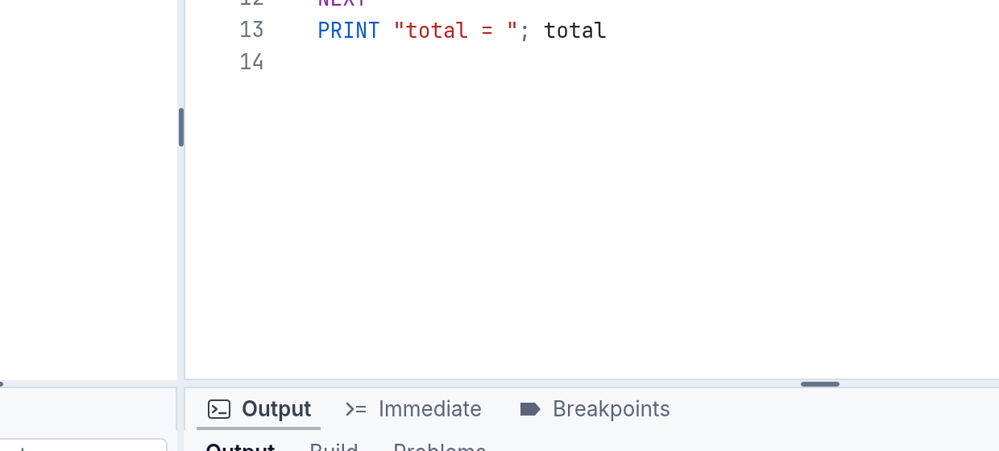
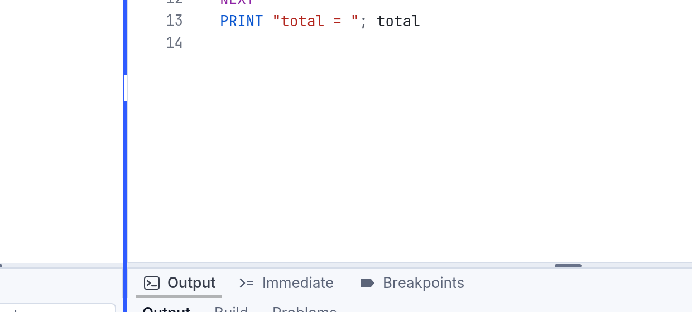
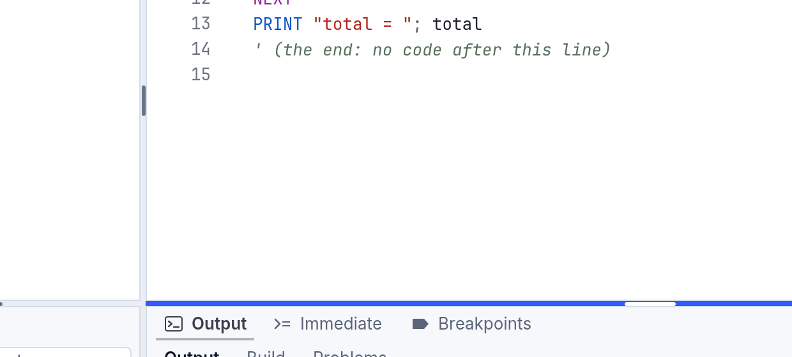

<!-- translated-from: getting-started.md d730607fc171e370 -->
# Primeros pasos

**En tres líneas**

- **Descarga el SDK** (`RapidR-…`): Studio, el comando `rapidr` y todo lo necesario para compilar. *Es lo que la mayoría necesita.* El **Runtime** (`RapidR-Runtime-…`) solo ejecuta programas que hicieron otros, como un entorno de ejecución de Java; el SDK lo incluye.
- **`rapidr run file.bas`** ejecuta un programa ahora. **`rapidr build-bc file.bas`** lo compila a `file.rrbc`, que se ejecuta con `rapidr file.rrbc` o con doble clic donde esté instalado el Runtime.
- **`rapidr build file.bas`** crea un ejecutable independiente: `--interp` no necesita Rust; el predeterminado, nativo, necesita Rust una vez (`rapidr setup`).

## Instalar

Descárgalo de [las versiones publicadas en GitHub](https://github.com/iBobX/RapidR/releases).
Hay dos tipos de paquete para cada sistema (elige el primero, salvo que solo
quieras ejecutar programas):

- **El SDK de RapidR**: el IDE, el comando `rapidr` (compilador y entorno de
  ejecución), todo lo necesario para crear ejecutables independientes y paquetes
  web, y el código fuente del entorno de ejecución de RapidR para las
  compilaciones nativas. Instálalo para escribir programas.
- **El Runtime de RapidR**: solo ejecuta programas (`.rrbc`, `.rr`, `.bas`,
  `.rqw`, `.rqb`, `.rq`), como un entorno de ejecución de Java. Instálalo en
  computadoras que solo ejecutan programas que alguien te dio.

El SDK incluye el Runtime. Las instalaciones son por usuario y no necesitan
permisos de administrador (salvo los paquetes `.deb` de Linux, que se instalan
para todo el sistema).

| Sistema | SDK | Solo Runtime | Mínimo |
|---|---|---|---|
| Windows x64 / ARM64 | `RapidR-2.119.0-windows-<x64\|arm64>-setup.exe` | `RapidR-Runtime-2.119.0-windows-<arch>-setup.exe` | Windows 10 u 11 |
| macOS (una sola aplicación universal: Apple silicon e Intel) | `RapidR-2.119.0-macos-universal.dmg` | `RapidR-Runtime-2.119.0-macos-universal.dmg` | macOS 11 Big Sur |
| Linux x86_64 / aarch64 | `rapidr-2.119.0-linux-<arch>.tar.gz` o `rapidr_2.119.0_<amd64\|arm64>.deb` | `rapidr-runtime-…` | Ubuntu 22.04, Debian 12 o posterior (OpenSSL 3) |
| Web | `rapidr-web-2.119.0.zip`: el IDE web, para cualquier servidor web estático | | un navegador actual |

**Las descargas de RapidR todavía no tienen firma de código.** Apple y Microsoft
comprueban los programas descargados contra una lista de editores registrados, y
RapidR todavía no está en ella, así que Windows y macOS avisan una vez la primera
vez que lo abres. El aviso es el esperado, y los pasos para superarlo están más
abajo (uno por sistema). Los archivos son los mismos cuyas sumas de comprobación
se publican; mira [Comprobar tu descarga](#comprobar-tu-descarga) para
demostrarlo.

### Instalar en Windows

Entre paréntesis y en cursiva va el texto original en inglés. El instalador de
RapidR solo está en inglés; Windows mostrará los suyos en tu idioma.

1. **Elige el archivo correcto.** *Configuración > Sistema > Acerca de > Tipo de
   sistema* (*Settings > System > About > System type*) dice “x64-based
   processor” (elige `RapidR-2.119.0-windows-x64-setup.exe`) o “ARM-based
   processor” (elige `…-windows-arm64-setup.exe`; Windows 11 en la máquina
   virtual de una Mac es ARM). Para solo ejecutar programas, elige el archivo
   `RapidR-Runtime-…` del mismo tipo.
2. **Ejecuta el instalador.** Haz doble clic en él. Se instala solo para ti, en
   `%LOCALAPPDATA%\Programs\RapidR`, y nunca pide una contraseña de
   administrador.
3. **Supera SmartScreen** (solo la primera vez). Windows muestra **Windows
   protegió su PC** (*Windows protected your PC*) y un enlace azul **Más
   información** (*More info*). Haz clic en **Más información**: el editor dice
   “Unknown publisher” (*editor desconocido*) y aparece un botón **Ejecutar de
   todos modos** (*Run anyway*). Haz clic en él.
4. **Acepta la licencia**, lee las notas legales y haz clic en **Next**
   (*Siguiente*). En la página “Select Additional Tasks”, deja marcada la casilla
   *Add rapidr to PATH* (hace que `rapidr` funcione en cualquier ventana del
   Símbolo del sistema o de PowerShell que abras después). Marca *Open .bas
   files with RapidR by default* solo si RapidR debe abrir tus archivos `.bas`
   cuando les haces doble clic. Los archivos `.rrbc`, `.rr` y `.rrproj`
   siempre pertenecen a RapidR.
5. **Haz clic en Install y luego en Finish** (*Instalar* y *Finalizar*).

Abre el menú Inicio, escribe “RapidR” y presiona Enter: se inicia **RapidR
Studio**. En un Símbolo del sistema nuevo, `rapidr version` imprime
`RapidR 2.119.0`.

Para quitar RapidR: *Configuración > Aplicaciones > Aplicaciones instaladas*
(*Settings > Apps > Installed apps*), “RapidR 2.119.0”, **Desinstalar**
(*Uninstall*). Se van los archivos, la entrada del menú Inicio, los tipos de
archivo y la entrada del PATH; tus programas se quedan. El SDK y el Runtime usan
la misma carpeta y la misma entrada de desinstalación, así que una computadora
tiene uno de los dos: instalar el otro lo reemplaza.

### Instalar en macOS

1. **Abre la imagen de disco** (`RapidR-2.119.0-macos-universal.dmg`; un solo
   archivo para las Mac con Apple silicon y con Intel, macOS 11 o posterior).
   Arrastra **RapidR Studio** a **Aplicaciones**. (La imagen del Runtime solo
   contiene **RapidR Runtime**.) La carpeta *Licenses* de la imagen tiene la
   licencia y los avisos.

   

2. **Abre RapidR Studio** desde Aplicaciones. La primera vez, macOS lo rechaza:
   “RapidR Studio” no se abrió (*“RapidR Studio” Not Opened*), *Apple no pudo
   verificar que “RapidR Studio” esté libre de software malicioso…* (*Apple could
   not verify “RapidR Studio” is free of malware…*). Haz clic en **Listo**
   (*Done*). (No hagas clic en *Mover a la papelera*, *Move to Trash*.)

   

3. **Permítelo, una sola vez.** Abre **Configuración del Sistema > Privacidad y
   seguridad** (*System Settings > Privacy & Security*) y baja hasta *Seguridad*
   (*Security*). Dice que “RapidR Studio” se bloqueó para proteger tu Mac, con un
   botón **Abrir de todos modos** (*Open Anyway*). Haz clic en él y confirma con
   tu contraseña o con Touch ID. Si no ves el botón, primero vuelve a abrir la
   aplicación (aparece después de un intento rechazado).

   

   En el macOS actual (15 Sequoia y posteriores), hacer clic derecho en la
   aplicación y elegir *Abrir* ya no sirve para superar esto: **Abrir de todos
   modos** es el camino. ¿Prefieres la Terminal? Esto hace lo mismo:

   ```sh
   xattr -dr com.apple.quarantine "/Applications/RapidR Studio.app"
   ```

4. **Se abre RapidR Studio.** A partir de ahora es una aplicación normal de Mac.

   

La línea de comandos `rapidr` está dentro de la aplicación. Ejecútala una vez
para que ofrezca un enlace en tu PATH:
`/Applications/RapidR Studio.app/Contents/MacOS/rapidr setup`. Los programas
que compilas con `rapidr build` se firman ad hoc, así que se abren en la Mac que
los compiló sin nada de esto.

<!-- legal -->
Para quitar RapidR: arrastra **RapidR Studio** (y **RapidR Runtime**) de
Aplicaciones a la Papelera. La configuración y los archivos recientes se quedan
en `~/Library/Application Support/RapidR`: elimina también esa carpeta para no
dejar ningún rastro.

### Instalar en Ubuntu o Debian (el paquete .deb)

El `.deb` es la instalación para Ubuntu 22.04 o posterior y Debian 12 o
posterior. Es para todo el sistema, así que pide tu contraseña (`sudo`). Nada
avisa de ello: Linux no comprueba a los editores.

1. **Elige el archivo correcto.** `dpkg --print-architecture` imprime `amd64`
   (la mayoría de las computadoras: `rapidr_2.119.0_amd64.deb`) o `arm64`
   (Raspberry Pi 4 y 5, servidores ARM, Ubuntu en la máquina virtual de una Mac:
   `rapidr_2.119.0_arm64.deb`). Para solo ejecutar programas, elige
   `rapidr-runtime_2.119.0_<arch>.deb`.
2. **Instálalo con apt**, desde la carpeta a la que lo descargaste. Conserva el
   `./` delante del nombre: le dice a apt que es un archivo, y entonces apt
   obtiene por sí mismo lo que RapidR necesita (OpenSSL 3, fontconfig, ALSA):

   ```sh
   cd ~/Downloads
   sudo apt install ./rapidr_2.119.0_arm64.deb
   ```

   

   *(La imagen es de una versión anterior: la tuya muestra 2.119.0.)*

3. **Abre RapidR Studio**: *Mostrar aplicaciones*, escribe “RapidR”, haz clic en
   **RapidR Studio** (también está en Desarrollo), o ejecuta `rapidr ide`.

   

4. **Ejecuta un ejemplo.** En la página de bienvenida haz clic en
   **hello_form.rr** y luego presiona **F5** (Ejecutar). La ventana del ejemplo
   se abre junto a Studio.

   

En el administrador de archivos, un doble clic en un programa `.rrbc` compilado
lo ejecuta, y un archivo `.rr`, `.bas` o `.rrproj` se abre en RapidR Studio.

Qué pone el paquete y dónde: el comando `rapidr` en `/usr/bin`; los demás
archivos de RapidR (el código fuente del entorno de ejecución para las
compilaciones nativas, el IDE, unos pocos programas de ejemplo) en
`/usr/lib/rapidr`; la licencia, los avisos y este manual (`manual/`) en
`/usr/share/doc/rapidr`; la entrada del menú, los tipos de archivo y los íconos
en los lugares habituales del sistema.

El paquete del SDK (`rapidr`) y el del Runtime (`rapidr-runtime`) son
alternativos: instalar uno quita el otro, porque ambos proporcionan el comando
`rapidr`. Para quitar RapidR por completo, sin dejar nada atrás:

```sh
sudo apt remove rapidr
```

Si prefieres no usar `sudo`, el `.tar.gz` se instala en tu propia carpeta:
descomprímelo y ejecuta `./install.sh` (en `~/.local`; la carpeta también
funciona tal cual: `bin/rapidr`). `~/.local/lib/rapidr/uninstall.sh` lo quita.

### Comprobar tu descarga

Cada versión publicada enumera el SHA-256 de todos sus archivos en
**`SHA256SUMS`**. Si coincide, demuestra que el archivo es el que publicó
RapidR, completo y sin cambios. Descarga `SHA256SUMS` en la misma carpeta que el
instalador y luego:

```sh
# macOS
shasum -a 256 -c SHA256SUMS --ignore-missing

# Linux
sha256sum -c SHA256SUMS --ignore-missing
```

Cada archivo que tienes imprime `OK` (los archivos que no descargaste se
omiten). En Windows (PowerShell), imprime la suma de comprobación del archivo y
compárala con su línea en `SHA256SUMS`:

```powershell
Get-FileHash .\RapidR-2.119.0-windows-x64-setup.exe -Algorithm SHA256
```

Cuando una versión también tiene **`SHA256SUMS.minisig`**, demuestra que la lista
misma vino del autor de RapidR (las sumas de comprobación solo demuestran que el
archivo coincide con la lista). Instala
[minisign](https://jedisct1.github.io/minisign/) (macOS: `brew install
minisign`; Ubuntu: `sudo apt install minisign`; Windows: `winget install
jedisct1.minisign`) y ejecútalo con la clave pública impresa en las notas de esa
versión:

```sh
minisign -Vm SHA256SUMS -P <la clave pública de las notas de la versión>
```

Dice `Signature and comment signature verified` cuando la lista es auténtica.

### Rust, solo para compilaciones nativas

Ejecutar programas, el IDE, los ejecutables interpretados independientes y los
paquetes web no necesitan nada más. Las **compilaciones nativas** (tu programa
compilado a código de máquina) se compilan con Rust:

```sh
rapidr setup            # pregunta primero; --yes para aceptar, --check para solo informar
```

- Con rustup ya instalado, añade la versión exacta de Rust con la que se probó
  RapidR (`1.98.1`) *junto* a la tuya. Nunca cambia tu cadena de herramientas
  predeterminada, ni actualiza ni quita ninguna.
<!-- legal -->
- Sin ningún Rust, instala rustup (en `~/.cargo` y `~/.rustup`) después de
  decirlo y de preguntar.
- Con un Rust que no es el de rustup, lo informa y no cambia nada.
- En Windows el SDK trae su propio enlazador (LLVM-MinGW): no hace falta Visual
  Studio. En macOS las compilaciones nativas de lanzamiento son universales
  cuando están instalados los dos destinos de Rust (`rapidr setup` los añade).
- También ofrece poner `rapidr` en tu PATH.

Las compilaciones nativas funcionan entonces sin conexión: el SDK lleva el código
fuente del entorno de ejecución y todos los crates que necesita.

## Tu primer programa

Guarda esto como `hello.bas` (`.rr` funciona igual):

```basic
PRINT "¡Hola, mundo!"
DIM name AS STRING
name = "RapidR"
PRINT "Hola desde "; name
```

Ejecútalo con el intérprete:

```sh
rapidr run hello.bas
```

```
¡Hola, mundo!
Hola desde RapidR
```

O ábrelo en el IDE (`rapidr ide hello.bas`, o haz doble clic en él) y presiona
Ejecutar.

## Una ventana

```basic
' Una ventana con un botón y una etiqueta
DECLARE SUB ButtonClick (Sender AS RButton)

CREATE Form AS RForm
    Caption = "Hola"
    Width = 320
    Height = 160
    Center
    CREATE Label1 AS RLabel
        Caption = "Aún sin clic"
        Left = 20
        Top = 20
    END CREATE
    CREATE Button1 AS RButton
        Caption = "Haz clic"
        Left = 20
        Top = 60
        OnClick = ButtonClick
    END CREATE
END CREATE

SUB ButtonClick (Sender AS RButton)
    Label1.Caption = "¡Clic hecho!"
END SUB

Form.ShowModal
```

`rapidr run form.bas` abre la ventana; al cerrarla termina el programa.

### Los nombres de RapidR y los nombres Q anteriores

RapidR escribe sus componentes `RForm`, `RButton`, `RLabel`, `REdit`,
`RStringGrid` …, y RapidR Studio, los ejemplos y este manual usan esos nombres.
Los programas más antiguos usan `QFORM`, `QBUTTON`, `QLABEL` …: **RapidR también
los acepta, en silencio y sin ninguna opción** — `QFORM` y `RForm` son el mismo
componente, y puedes mezclarlos:

```basic
DIM Old AS QBUTTON      ' el nombre Q anterior
DIM New AS RButton      ' el nombre de RapidR: el mismo componente
```

La regla es sencillamente Q → R (`QBUTTON` es `RButton`); unos pocos difieren:
`QGAUGE` es `RProgressBar`, `QOUTLINE` es `RTreeView`, `COMPORT` es `RComPort`.
La lista completa: [reference/components.md](../reference/components.md). Para
convertir un programa así en uno con los nombres de RapidR, mira
[Importar programas anteriores](../importing-rapidq.md). Un programa `.bas` que
usa las constantes clásicas (`clRed`, `MB_OK` …) conserva la línea
`$INCLUDE "RAPIDQ.INC"`: RapidR las proporciona mediante esa línea sin necesitar
el archivo. Un programa de RapidR (`.rr`) las trae incorporadas, sin ninguna
línea.

## Compilar

| Quieres | Comando | Necesita |
|---|---|---|
| Ejecutar un programa ahora | `rapidr run prog.bas` | nada |
| Un programa compilado para el Runtime de RapidR, para dárselo a quien lo tenga (se ejecuta con `rapidr prog.rrbc`, o con doble clic) | `rapidr build-bc prog.bas -o prog.rrbc` | nada |
| Un ejecutable independiente (con el intérprete dentro): nadie necesita RapidR para ejecutarlo | `rapidr build prog.bas --interp` | nada |
| …para la otra arquitectura de Windows, o una sola variante de macOS | `rapidr build prog.bas --interp --target windows-aarch64` | nada (el SDK trae esos ejecutores) |
| Un ejecutable nativo (tu programa compilado a código de máquina) | `rapidr build prog.bas` | Rust, una vez (`rapidr setup`) |
| Un paquete web (un `.zip` para cualquier servidor estático) | `rapidr bundle-bc prog.bas -o prog-web.zip` | nada |

<!-- legal -->
Cada compilación escribe `THIRD-PARTY-NOTICES.txt` junto al ejecutable (o dentro
del paquete web). Distribúyelo con tu programa: es todo lo que piden las
licencias de los componentes que lleva dentro ([LEGAL.md](../../../LEGAL.md)).

- Un ejecutable interpretado es el intérprete incluido en el SDK con tu programa
  añadido al final: no hace falta Rust y se comporta igual que `rapidr run`. En
  macOS es universal de forma predeterminada.
- Una compilación nativa traduce el programa a Rust y lo compila: los programas
  más rápidos y los ejecutables más pequeños. `rapidr build prog.bas` es la
  compilación optimizada de lanzamiento, la que distribuyes; `--debug` compila
  más rápido para depurar. La carpeta de salida recibe solo la aplicación: el Rust
  generado se elimina después de la compilación, a menos que lo pidas
  (`--keep-rust`, o las Opciones del proyecto de Studio).
- Las compilaciones nativas e interpretadas se comportan igual: la suite de
  conformidad ejecuta cada caso de las dos maneras, y en la web.

Detalles: [La CLI y el RapidR Runtime](../cli-and-runtime.md).

## La web

```sh
rapidr bundle-bc form.bas -o form-web.zip
unzip form-web.zip -d form-web
python3 -m http.server -d form-web 8080      # cualquier servidor web estático
```

Abre `http://localhost:8080`: la misma ventana, dibujada por el mismo núcleo de
interfaz en un lienzo. Mira [La web](../web.md).

## RapidR Studio

- **El IDE de escritorio** (SDK: menú Inicio > RapidR Studio, *RapidR Studio* en
  Aplicaciones en macOS, *RapidR Studio* en el menú de aplicaciones en Linux, o
  `rapidr ide [file]`) está escrito en el propio RapidR. Tiene un **diseñador de
  formularios** ([Diseñar formularios](../designing-forms.md)), un **editor de
  código** que completa, explica y comprueba mientras escribes
  ([El editor de código](studio-editor.md)), un **depurador** con puntos de
  interrupción, ejecución paso a paso, valores que puedes abrir como un árbol y
  Establecer la siguiente instrucción ([Depuración](debugging.md)), un
  **asistente de IA** que se queda desactivado hasta que lo actives
  ([El asistente de IA y RAI](ai-assistant.md)), archivos Markdown con formato
  ([Markdown](../markdown.md)), datos vinculados que se muestran en vivo en el
  diseñador ([Ciencia de datos con RapidR](../data-science-with-rapidr.md)), y
  Ejecutar, Compilar y Compilar aplicación web.
- **El IDE web** (`rapidr-web-2.119.0.zip`, cualquier servidor estático): el
  mismo RapidR Studio en el navegador (el diseñador, el editor de código, el
  depurador, Ejecutar y Compilar aplicación web), sin código en el servidor. Las
  aplicaciones para una computadora (`.app`, `.exe`) se compilan en el escritorio.

En la página de bienvenida, **Ejemplos** abre un programa para ejecutar y leer;
empieza con `hello_form.rr` y luego los ejemplos de datos. Una ventana demasiado
baja para todos ellos se desplaza (con la rueda o con la barra); con el teclado,
Tab y Shift+Tab van de una tarjeta a otra y a cada proyecto de **Recientes** (la
página se desplaza hasta el que alcanzas, y un anillo lo rodea) y Enter lo abre.
Studio se abre con el aspecto claro, oscuro o de contraste alto de tu sistema y
lo sigue cuando lo cambias ([Temas](../components.md#when-the-look-changes)).

Los ejemplos que están donde se instaló RapidR no se pueden cambiar (la
aplicación de macOS, `/usr/lib/rapidr`, Program Files), así que la primera vez
que abres uno, Studio hace tu propia copia (el programa y los archivos de datos
que usa) en `Documents/RapidR/Examples/<nombre>` y abre esa; la Salida dice
dónde. Ejecútalo, cámbialo y guárdalo allí: la próxima vez que abras el ejemplo
(la tarjeta, Archivo > Abrir ejemplo, Recientes) recibes tu copia como la
dejaste. **Copiar otra vez desde el original** (el enlace de la Salida, o Archivo
> Copiar el ejemplo otra vez del original) devuelve la versión de RapidR, después
de preguntar; los archivos que añadiste a la carpeta se quedan. En una copia del
código fuente, los ejemplos se abren donde están. En la web, un ejemplo que
cambias y guardas se conserva en el navegador (en el almacén de la página), sobre
el original.


### Paneles y divisores

La ventana de Studio está hecha de paneles: Proyecto y Caja de herramientas a la
izquierda, Propiedades y Estructura a la derecha, tus documentos en el centro y,
debajo de ellos, el panel inferior (Salida, Inmediato, Puntos de interrupción).
Cada panel tiene un borde fino alrededor, con cualquier aspecto (claro, oscuro y
contraste alto), así que siempre ves dónde termina un panel y empieza el
siguiente. Entre dos paneles hay un **divisor**. En reposo se mantiene
discreto: el espacio estrecho entre los bordes de los paneles con un agarre corto
en el medio. Deja el mouse un momento sobre él y todo el espacio toma el color de
acento, y el puntero se vuelve una flecha de cambio de tamaño. Arrástralo para
darle más espacio a un panel. Haz **doble clic** en él para devolverlo a donde
estaba al principio. Donde se encuentran dos divisores, agarra el punto de
encuentro para mover los dos a la vez (el puntero se vuelve una flecha en cuatro
direcciones).

Las pestañas de un panel conservan sus nombres completos: cuando un grupo es
demasiado estrecho para todas sus pestañas, primero reducen un poco el relleno, y
solo después se cortan con “…” los nombres más largos; los más cortos nunca se
cortan por culpa de uno largo. Con cualquier aspecto, también el de contraste
alto, el nombre completo es la sugerencia de la pestaña y lo que dice un lector
de pantalla.





Con el teclado, **F6** va de un panel a otro, y **Ctrl+F6** (Ventana ▸ Cambiar
tamaño de los paneles) le da el teclado al divisor que está junto al panel en el
que estás. Toma el color de acento y su agarre se alarga. Entonces:



| Tecla | Qué hace |
|---|---|
| Izquierda / Derecha, Arriba / Abajo | Mueve el divisor 10 píxeles |
| Shift + una flecha | Lo mueve 50 píxeles |
| Alt + una flecha hacia el otro divisor | Mueve el otro divisor, donde los dos se encuentran |
| Home / End | Lo mueve hasta donde llega, en un sentido o en el otro |
| Tab / Shift+Tab | Va al divisor siguiente / anterior |
| Enter o Escape | Devuelve el teclado a donde estaba |

Un lector de pantalla oye un divisor como un *separador* con el nombre de los dos
paneles que divide, y dice dónde está como un porcentaje (“45%”).

Mientras un programa se ejecuta con el depurador, Studio muestra los paneles de
depuración junto a Salida; cuando termina, el panel inferior recupera todo el
ancho ([Depuración: dos disposiciones](debugging.md#dos-disposiciones-edición-y-depuración)).

## Adónde ir después

- [Por qué RapidR](../why-rapidr.md): en qué destaca, con números medidos.
- [El lenguaje](../language.md), con las reglas que sorprenden a quien viene de
  otros BASIC (la coma de `PRINT`, los números, las asignaciones a enteros).
- [Diseñar formularios en RapidR Studio](../designing-forms.md): una aplicación de
  dos formularios, paso a paso.
- [Los ejemplos](../../../examples/README.md), en el orden en que conviene
  leerlos.
- [La referencia de componentes](../reference/components.md), con los miembros de
  cada componente.
- ¿Tienes programas anteriores con nombres Q?
  [Importar programas anteriores](../importing-rapidq.md); también se ejecutan
  tal cual.
- ¿Un mensaje que no entiendes? [Solución de problemas](troubleshooting.md).
