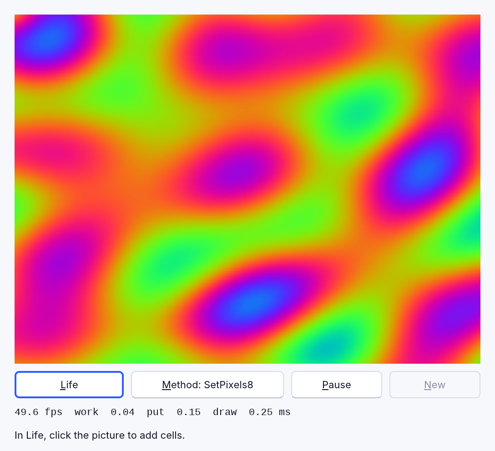
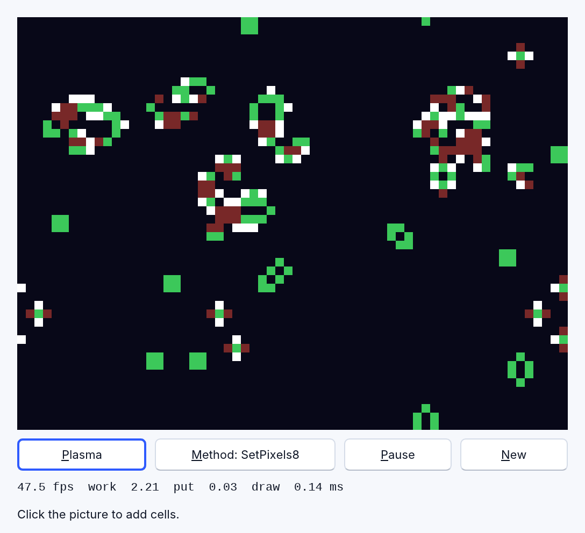

<!-- translated-from: graphics.md 6cce3837e01ab577 -->
# Dibujo: lienzos, mapas de bits y píxeles

Tres cosas de RapidR contienen una imagen sobre la que puedes dibujar, y todas
dibujan de la misma manera:

- un **`RCanvas`**: un control en un formulario. Dibuja en su controlador de
  eventos `OnPaint` y la imagen vuelve siempre que la ventana la necesita;
- un **`RBitmap`**: una imagen en memoria, sin ventana. Dibuja en él, guárdalo
  (`SaveToFile`), dibújalo sobre un lienzo;
- un **`RImage`**: un control que muestra una imagen (un archivo, o lo que
  dibujaste en él).

Los colores son números: `RGB(r, g, b)` crea uno (`&HBBGGRR`: el rojo es el byte
más bajo). Las coordenadas son los mismos píxeles lógicos en todas las
pantallas; en una pantalla de alta densidad de píxeles (high-DPI) (una Mac
Retina, un navegador a 2x) todo se dibuja más fino, y los píxeles que un
programa lee de vuelta (`Pixel`, `GetPixels`, `SaveToFile`) siguen siendo los que
dibujó — mira
[Pantallas de alta densidad de píxeles (high-DPI)](components.md#high-dpi-screens).

| Para hacer esto | Llama a |
|---|---|
| Un píxel | `Pset x, y, colour` (para leer uno: `Pixel(x, y)`) |
| Líneas y formas | `Line`, `Rectangle`, `FillRect`, `Circle`, `RoundRect`, `Paint` (relleno por inundación) |
| Texto | `TextOut`, `TextRect`, `DrawText` |
| Una imagen sobre otra | `Draw x, y, Picture` · `StretchDraw Rect, Picture` · `CopyRect Dest, Picture, Source` |
| Girarla | `Rotate x, y, degrees` |
| **Muchos píxeles a la vez** | **`SetPixels`, `SetPixels8`, `GetPixels`** — más abajo |

## Dibujar muchos píxeles rápido

Algunos programas hacen una imagen a partir de números: la memoria de video de
un emulador, un filtro de imágenes, un mapa de calor de una tabla, un autómata
celular, un plasma. La manera obvia es un ciclo de `Pset`:

```basic
FOR y = 0 TO 191
    FOR x = 0 TO 255
        Screen.Pset x, y, colour(y * 256 + x)       ' 49 152 llamadas
    NEXT
NEXT
```

Eso funciona, y es lento: cada llamada es un viaje de tu programa a la imagen, de
1 a 3 microsegundos cada una, así que una pantalla de 256 x 192 tarda de **60 a
80 milisegundos** — catorce imágenes por segundo en el mejor de los casos, y el
programa no hace nada más. Un juego, un emulador y una animación fluida
necesitan una imagen cada 20 milisegundos.

En su lugar, pon la imagen en un **arreglo (array)** y entrégala en una sola
llamada.

### SetPixels: los colores en sí

```basic
DIM Colours(256 * 192 - 1) AS LONG
' … llena Colours(y * 256 + x) con RGB(r, g, b) …
Frame.SetPixels Colours, 256, 192
```

`SetPixels Pixels, Width, Height [, X, Y]` copia los `Width` x `Height` colores
del arreglo sobre la imagen, con su esquina superior izquierda en (`X`, `Y`) — en
0, 0 si los omites. El arreglo se lee fila por fila desde su **primer
elemento**, sea cual sea su límite inferior: en un arreglo de una dimensión, el
elemento `y * Width + x` es el píxel (x, y). Un arreglo de dos dimensiones se
guarda con su último subíndice variando más rápido, así que
`DIM Pixels(Height - 1, Width - 1)` guarda el píxel (x, y) en `Pixels(y, x)`.

Los colores son los números que toma `Pset`: `RGB(r, g, b)`, `&HBBGGRR`, un color
del sistema como siempre. Usa un arreglo `INTEGER` o `LONG` (un color necesita 24
bits).

### SetPixels8: una paleta

```basic
DIM Indexes(256 * 192 - 1) AS BYTE      ' un número de color para cada píxel
DIM Palette(255) AS LONG                ' cómo se ve cada número
Frame.SetPixels8 Indexes, Palette, 256, 192
```

`SetPixels8 Indexes, Palette, Width, Height [, X, Y]` es lo mismo, pero cada
elemento de `Indexes` es el número de un color de `Palette` (su primer elemento
es el color 0): una búsqueda por píxel, hecha en Rust. Así funcionaba la memoria
de pantalla en las máquinas que imita un emulador, y hace que la **rotación de
paleta** (palette cycling) no cueste nada: cambia unas pocas entradas de
`Palette` y llámalo otra vez — la imagen se mueve aunque no haya cambiado ni un
índice ([pixels_fast.rr](../../../examples/graphics/pixels_fast.rr) lo hace con
su plasma).

### GetPixels: la imagen a un arreglo

```basic
DIM Px(256 * 192 - 1) AS LONG
Pic.GetPixels Px, 0, 0, 256, 192        ' Pixels, X, Y, Width, Height
FOR i = 0 TO 256 * 192 - 1
    Px(i) = &HFFFFFF - Px(i)            ' un negativo
NEXT
Pic.SetPixels Px, 256, 192
```

`GetPixels Pixels, X, Y, Width, Height` es la otra dirección. Lee, cambia los
números, devuelve: eso es un filtro de imagen. El ciclo de arriba invierte una
imagen de 256 x 192 en unos 5 milisegundos en el intérprete; el mismo filtro con
49 152 llamadas a `Pixel` y otras tantas a `Pset` tarda 140.

### Cuando algo está mal

Una llamada que no se puede atender detiene el programa con un mensaje que dice
por qué — nunca una imagen que está mal en silencio:

- `SetPixels: Pixels must be an array (DIM Pixels(…) AS LONG), not a number`
- `SetPixels: Pixels holds 3 values, but a 2 x 2 block needs 4`
- `SetPixels: a 2 x 2 block at (3, 0) does not fit in the 4 x 4 bitmap`
- `SetPixels8: the pixel (1, 1) of the block has index 2, but Palette has 2
  colours (indexes 0 to 1)`

Un bloque tiene que caber por completo dentro de la imagen; para dibujar una
parte que sobresale de un borde, pon el bloque en un mapa de bits y dibújalo con
`Draw` o `CopyRect` (ellos recortan).

## Dibujarla más grande

Pon la imagen en un mapa de bits `RBitmap` del tamaño de la pantalla de la
máquina y luego dibuja ese mapa de bits en el lienzo, más grande:

```basic
Frame.SetPixels8 Indexes, Palette, 256, 192
Screen.StretchDraw 0, 0, 512, 384, Frame        ' x, y, ancho, alto, imagen
```

`StretchDraw` toma el rectángulo como cuatro números (el de RapidR; la forma
anterior `StretchDraw Rect, Picture` con un `RRect` sigue funcionando igual).
Cada píxel del resultado es el píxel **más cercano** de la imagen: nítido, como
lo quieren el arte de píxeles y una pantalla llena de texto — y en una pantalla
Retina cada píxel de la imagen de 256 x 192 es un bloque nítido de 2 x 2 de la
pantalla, no un borrón. Establece `Smooth = True` en el lienzo o el mapa de bits
*sobre* el que dibujas y, en cambio, se mezclan los cuatro píxeles que rodean a
cada uno, que es lo que quiere una fotografía. `Smooth` es `False` salvo que
digas otra cosa, y `StretchDraw` y `CopyRect` son las llamadas que cambia.





## Qué tan rápido

Una imagen de 256 x 192 (49 152 píxeles), puesta en un mapa de bits y dibujada al
doble de tamaño (512 x 384), en milisegundos por imagen, el promedio de 300.
Medido en un Apple M4 Max con macOS, compilaciones release, 30 de octubre de
2026 — la Mac estaba ocupada con otro trabajo (promedio de carga de 20 a 40), así
que estas cifras son, si acaso, lentas. El programa es
[tools/bench/pixels.rr](../../../tools/bench/pixels.rr); las cifras de la web son
`tests/web_pixels_bench.mjs` en Chromium.

| | el intérprete (`rapidr run`) | compilación nativa | web (Chromium) |
|---|--:|--:|--:|
| `Pset` para cada píxel | 77.7 | 62.0 | 83 |
| `SetPixels` | 0.031 | 0.030 | 0.050 |
| `SetPixels8` | 0.044 | 0.048 | 0.083 |
| `GetPixels` | 0.044 | 0.021 | 0.057 |
| `StretchDraw`, al doble de tamaño | 0.044 | 0.045 | 0.060 |
| **`SetPixels8` + `StretchDraw`** | **0.087** | **0.090** | **0.127** |

Una imagen completa tarda alrededor de **una décima de milisegundo**, es 900
veces más rápida que el ciclo de `Pset` y ocupa el 0.4 % de un cuadro a 50 por
segundo. En una pantalla de alta densidad de píxeles (high-DPI), el mapa de bits
también conserva la imagen más fina que muestra la pantalla, y el mismo cuadro
cuesta 0.34 ms a 2x (0.64 ms a 3x), con la entrega de la imagen a la pantalla
incluida (`cargo run --release -p rapidr-value --example pixels_bench`).

Pasar un arreglo al método de cualquier componente solía costar un milisegundo
extra con 50 000 elementos, que también se escondía en cada `RAudioOut.Write buf`;
eso ya no pasa.

## Una imagen cada 20 milisegundos

Un `RTimer` avanza en pasos de 15.6 ms, como los propios temporizadores de
Windows, así que `Interval = 20` da unas 32 imágenes por segundo, no 50 — y un
temporizador vuelve a dispararse 15.6 ms *después* de que termina su controlador
de eventos. Así que, para 50 exactas por segundo, deja que el temporizador mire
cada marca y dibuje una imagen solo cuando **toca** una, llevando tú mismo la
cuenta de la hora en que toca:

```basic
SUB Tick
    DIM now AS DOUBLE
    now = TIMER
    IF now < nextAt THEN EXIT SUB                ' todavía no
    nextAt = nextAt + 0.02                       ' la siguiente, 20 ms después de cuando le tocaba a esta
    IF nextAt < now THEN nextAt = now + 0.02     ' (muy atrasado: sin ráfaga para ponerse al día)
    DrawFrame                                    ' calcularla, SetPixels8, StretchDraw
END SUB
```

con `Interval = 10` en el temporizador. Los cuadros están separados exactamente
20 ms en promedio, hagan lo que hagan las marcas, siempre que el trabajo propio
de un cuadro sea menor que unos 4 ms.
[pixels_fast.rr](../../../examples/graphics/pixels_fast.rr) es este ciclo: su
lectura en pantalla dice cuántos cuadros por segundo dibuja de verdad, y cuánto
tardó en calcular la imagen, ponerla en el mapa de bits y dibujarla.

## Pruébalo

| | |
|---|---|
| [pixels_fast.rr](../../../examples/graphics/pixels_fast.rr) | Un plasma (rotación de paleta, 256 x 192) y el Juego de la vida (64 x 48 celdas calculadas en cada cuadro) a 50 cuadros por segundo, con la lectura en pantalla. **Method** cambia a un `Pset` para cada píxel, para ver la diferencia: el plasma baja a unas 12 imágenes por segundo |
| [video_memory.rr](../../../examples/recipes/video_memory.rr) | La receta de sistemas: el mapa de bits y los atributos de color de una máquina, guardados decodificados en un arreglo `BYTE` y dibujados con `SetPixels8`; **Repaint** mide el tiempo de un repintado completo (unos 0.2 ms; la primera versión de la receta tardaba de 8 a 13 ms) |
| [tools/bench/pixels.rr](../../../tools/bench/pixels.rr) | La prueba de rendimiento de arriba, para ejecutarla en tu propia computadora |

Siguiente: [Recetas para programas de sistemas](recipes-systems.md), cuya receta
de memoria de video usa estas llamadas; [Componentes y objetos](components.md).
