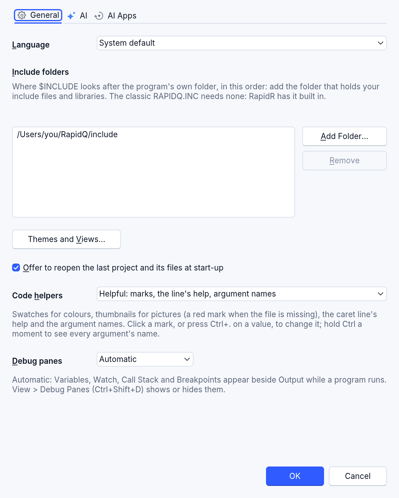
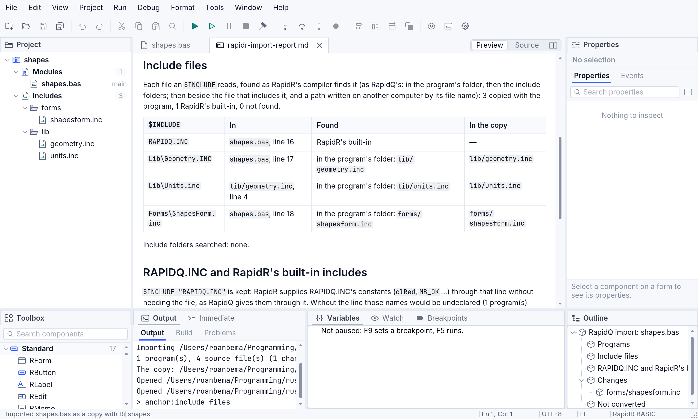
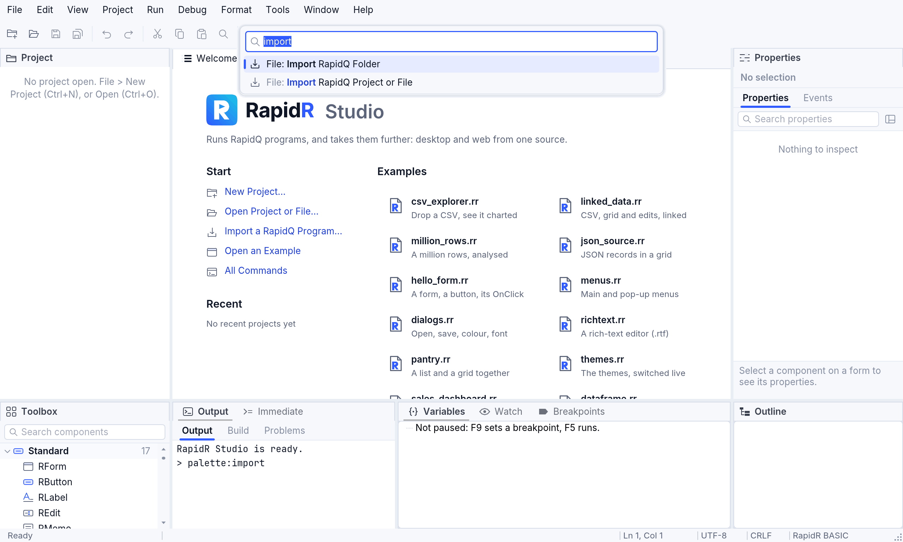
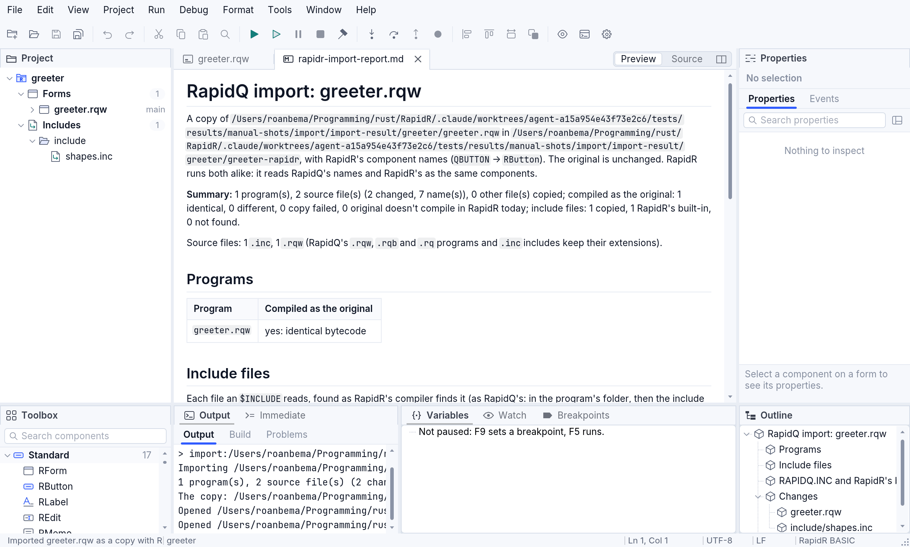
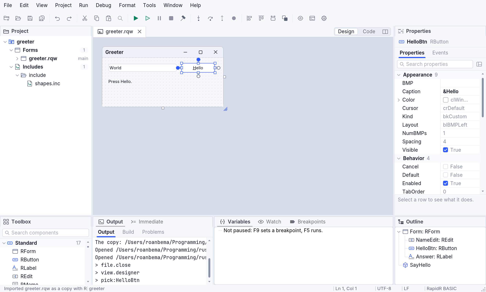

<!-- translated-from: importing-rapidq.md 38e8b3960766d0cc -->
# Importar programas de RapidQ

RapidR ejecuta los programas de RapidQ **tal como están**: no tienes que importar
nada para ejecutar, compilar o editar uno. Importar sirve para cuando quieres que
un programa use **los nombres propios de RapidR** (`RButton` en lugar de
`QBUTTON`) de ahora en adelante.

Importar siempre trabaja sobre una **copia**. Tus archivos originales solo se
leen, nunca se cambian.

## Qué hace una importación

- Copia el programa —el archivo principal, cada archivo que incluye con
  `$INCLUDE` (a cualquier profundidad, dondequiera que RapidR lo encuentre: mira
  [Archivos incluidos](#archivos-incluidos)) y (en una carpeta) todo lo demás de la
  carpeta— en una carpeta nueva a su lado, llamada `<nombre>-rapidr`.
- En la copia, cambia **solo los nombres de componentes**: `QFORM` pasa a ser
  `RForm`, `QBUTTON` pasa a ser `RButton`, `QGAUGE` pasa a ser `RProgressBar`, y
  así sucesivamente. Nada más cambia: ni tu código, ni las cadenas de texto, ni
  los comentarios, ni tus propios nombres (`QButtonCount` se queda como está), ni
  tus propios `TYPE`.
- **Prueba** que la copia se comporta igual: el original y la copia se compilan,
  y los resultados tienen que ser idénticos, byte por byte. El informe lo dice
  para cada programa.
- Escribe un informe, `rapidr-import-report.md`, junto a la copia: cada nombre que
  cambió (archivo, línea, columna), cada archivo incluido y dónde se encontró, y
  todo lo que dejó como estaba, y por qué.
- `$INCLUDE "RAPIDQ.INC"` se queda: RapidR da las constantes de RapidQ (`clRed`,
  `MB_OK` …) mediante esa línea, sin el archivo. (La copia conserva su nombre
  `.bas`: un programa de RapidQ, cuyas constantes vienen con la línea; un
  programa `.rr` las tiene integradas.)

Antes y después, para un programa pequeño:

```basic
' greeter.rqw, como se escribió para RapidQ   ' la copia, greeter-rapidr/greeter.rqw
DECLARE SUB SayHello (Sender AS QBUTTON)       DECLARE SUB SayHello (Sender AS RButton)
CREATE Form AS QFORM                           CREATE Form AS RForm
    CREATE NameEdit AS QEDIT                       CREATE NameEdit AS REdit
    END CREATE                                     END CREATE
    CREATE HelloBtn AS QBUTTON                     CREATE HelloBtn AS RButton
        Caption = "&Hola"                              Caption = "&Hola"
        OnClick = SayHello                             OnClick = SayHello
    END CREATE                                     END CREATE
END CREATE                                     END CREATE
```

## Archivos incluidos

Un programa de RapidQ suele ser varios archivos: el programa principal incorpora
sus bibliotecas y formularios con `$INCLUDE`. RapidR busca cada uno en estos
lugares, en este orden, en todos los sistemas:

1. **en la propia carpeta del programa** — también un `$INCLUDE` anidado (un
   archivo incluido que incluye a otro lo nombra desde la carpeta del programa,
   tal como RapidQ compila allí);
2. **en tus carpetas de inclusión**, en orden — la carpeta de inclusión de
   RapidQ, donde están `WINDOWS.INC`, `RAPIDQ2.INC` y tus propias bibliotecas;
3. y luego **junto al archivo que lo incluye**.

Los nombres se comparan **sin distinguir mayúsculas de minúsculas, con `\` o
`/`**: el código de RapidQ se escribió en Windows, así que
`$INCLUDE "Lib\Geometry.INC"` encuentra `lib/geometry.inc` en una Mac y en
Linux. Una ruta de otra computadora —`C:\rapidq\include\x.inc`,
`\RapidQ\include\x.inc`— se encuentra por su final (`include\x.inc`, y luego
`x.inc`) en esas carpetas.

`RAPIDQ.INC` no necesita ningún archivo: RapidR lo tiene integrado (y también
`QMidi.inc`, `QWave.inc`, `QVideo.inc`, `QCDAudio.inc`, `QCgi.inc`,
`QDownload.inc`, `QDockForm.inc` y `QDirListView.inc`).

**Tus carpetas de inclusión.** En RapidR Studio: **Herramientas ▸
Configuración…**, y luego **Añadir carpeta…** en *Carpetas de inclusión*. Studio
las usa para todo: abrir un programa, sus problemas, Ejecutar, Compilar e
Importar. Desde la línea de comandos: `--include-dir <carpeta>` (las veces que
quieras), o la variable de entorno `RAPIDR_INCLUDE_PATH`.



**Cuando importas**, cada archivo incluido que usa el programa se copia con él, y
también se convierten sus nombres:

- los archivos incluidos propios del programa conservan su lugar
  (`lib/geometry.inc` se queda en `lib/`);
- un archivo de una carpeta de inclusión va a la carpeta de la copia tal como
  estaba en la carpeta de inclusión (`GL\QGL.INC` → `GL/QGL.INC`), así que la
  copia no necesita ninguna carpeta de inclusión;
- una línea `$INCLUDE` que ya no encontraría la copia de su archivo
  (`..\shared\common.inc`, `C:\rapidq\include\x.inc`) se cambia para nombrar la
  copia, y el informe lo dice;
- `RAPIDQ.INC` y los demás archivos incluidos que RapidR tiene integrados nunca se
  copian, ni tampoco una copia tuya de alguno (el informe la enumera). Si tu
  programa usa algo de tu `RAPIDQ.INC` que el de RapidR no tiene (el arreglo
  (array) `QBColor` de RapidQ), el informe dice que conserves la carpeta de ese
  archivo en tus carpetas de inclusión.

La tabla **Include files** (*Archivos incluidos*) del informe enumera cada
`$INCLUDE`, dónde se encontró y dónde está su copia:



**Un archivo incluido que no se encuentra en ninguna parte nunca se pasa por
alto.** El informe lo enumera en *Not found* (*No encontrado*) con lo que hay que
hacer, la **Salida** de Studio lo dice y la línea de estado se pone en rojo, y
`rapidr import-rapidq` lo imprime y termina con el código de salida 1:

```text
main.bas:5: include file not found: Inc\Tools.INC — add the folder that holds Tools.INC in RapidR Studio > Tools > Settings > Include folders (or `--include-dir <folder>`), or put Tools.INC beside the program (…), and import again
```

Añade la carpeta y luego vuelve a importar. En un navegador, RapidR Studio solo
tiene los archivos que le das: importa la **carpeta** del programa (Archivo ▸
Importar carpeta de RapidQ…), o elige el programa **y sus archivos incluidos
juntos** en Archivo ▸ Importar proyecto o archivo de RapidQ… — se encuentran por
sus nombres.

Pruébalo con el ejemplo
[rapidq/shapes](../../../examples/rapidq/shapes/shapes.bas): un programa de
RapidQ cuya biblioteca y cuya ventana están en `lib/` y `forms/`:

```sh
rapidr run rapidq/shapes/shapes.bas
rapidr import-rapidq rapidq/shapes/shapes.bas
```

## Qué archivos

Puedes importar un archivo —`.bas`, `.rqw`, `.rqb`, `.rq` (las extensiones con
las que los editores de RapidQ guardaban los programas) o un `.inc`—, o una
carpeta completa, o un proyecto de RapidR (`.rrproj`). Cada archivo conserva su
extensión en la copia. No necesitas importar los archivos `.rqw`, `.rqb` o `.rq`
para usarlos: RapidR y RapidR Studio los abren, los ejecutan y los compilan
directamente.

## En RapidR Studio

1. Elige **Archivo ▸ Importar proyecto o archivo de RapidQ…** para seleccionar un
   archivo, o **Archivo ▸ Importar carpeta de RapidQ…** para seleccionar una
   carpeta. La página de bienvenida tiene el mismo comando: **Importar un
   programa de RapidQ…**. En la paleta de comandos (**Ctrl+Shift+P**, **⌘⇧P** en
   una Mac) escribe `import`.
2. Studio escribe la copia junto al original (`greeter-rapidr`; si esa carpeta
   existe, `greeter-rapidr-2` y así sucesivamente) y dice en **Salida** cuántos
   nombres cambiaron y que cada programa se compila exactamente como antes.
3. La copia se abre como un proyecto: sus archivos en **Proyecto**, su archivo
   principal en el editor y el informe en una pestaña a su lado.





En la copia, el diseñador, la caja de herramientas, el inspector y la estructura
muestran todos los nombres de RapidR, y el código también los dice:



En el navegador, RapidR Studio importa de la misma manera: elige el archivo o la
carpeta (sus archivos se leen en la página) y la copia se escribe a su lado en el
almacenamiento de la página.

## Desde la línea de comandos

```sh
rapidr import-rapidq greeter.rqw                 # la copia en greeter-rapidr/
rapidr import-rapidq greeter.rqw converted       # la copia en converted/
rapidr import-rapidq my-folder                   # una carpeta completa
rapidr import-rapidq prog.bas --include-dir C:\RapidQ\include   # dónde están los archivos incluidos de RapidQ
```

Imprime un resumen y la ruta del informe. `rapidr upgrade-names file.rr` hace lo
mismo en uno de **tus propios** archivos, modificándolo directamente (`--dry-run`
muestra primero los cambios).

## Conviene saber

- **Mezclar nombres no es un problema.** RapidR lee `QBUTTON` y `RButton` como el
  mismo componente, siempre, sin ninguna configuración, tanto en archivos
  antiguos como nuevos (mira [Componentes](components.md#los-nombres-clásicos)).
- **Cuando añades algo a un archivo, Studio sigue su estilo.** En un archivo
  escrito con los nombres de RapidQ, el diseñador añade `QBUTTON` y el
  autocompletado ofrece los nombres de RapidQ, así que el archivo nunca los
  mezcla; en los demás, los nombres de RapidR.
- **Lo que no se convierte**, y aparece en el informe: los nombres en una rama
  `$IFDEF` que tu compilación no compila, los nombres que crea un `$DEFINE`, y
  los archivos incluidos que no se encontraron (añade la carpeta de inclusión de
  RapidQ a tus carpetas de inclusión: [Archivos incluidos](#archivos-incluidos)).
- Las plantillas `.tpl` del IDE de RapidQ no se copian.
