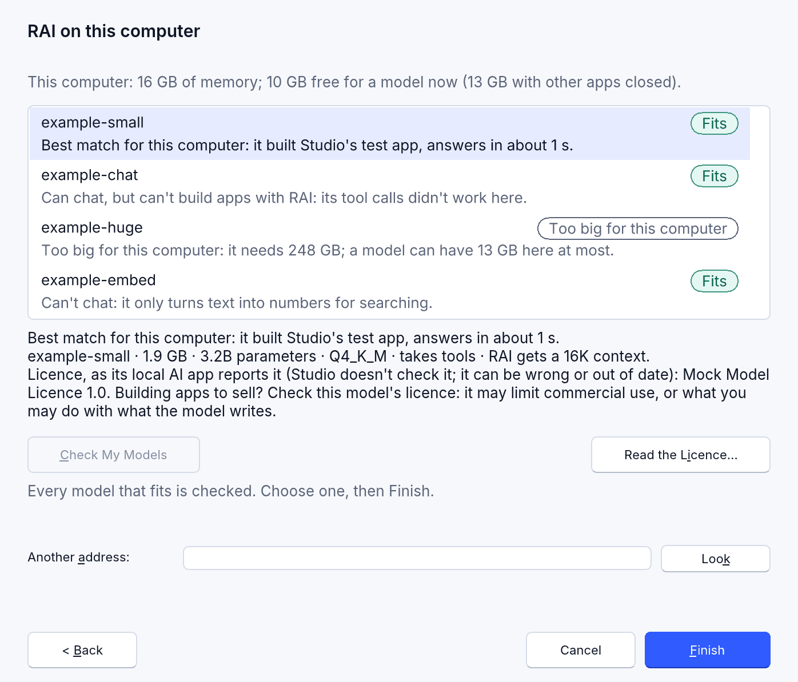
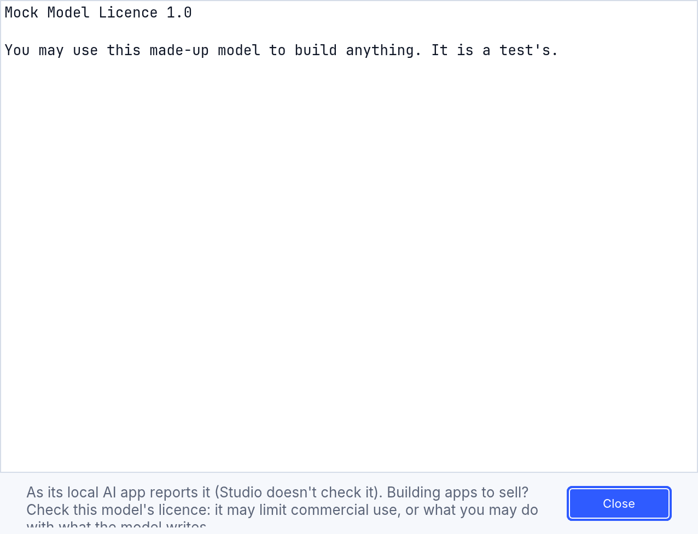
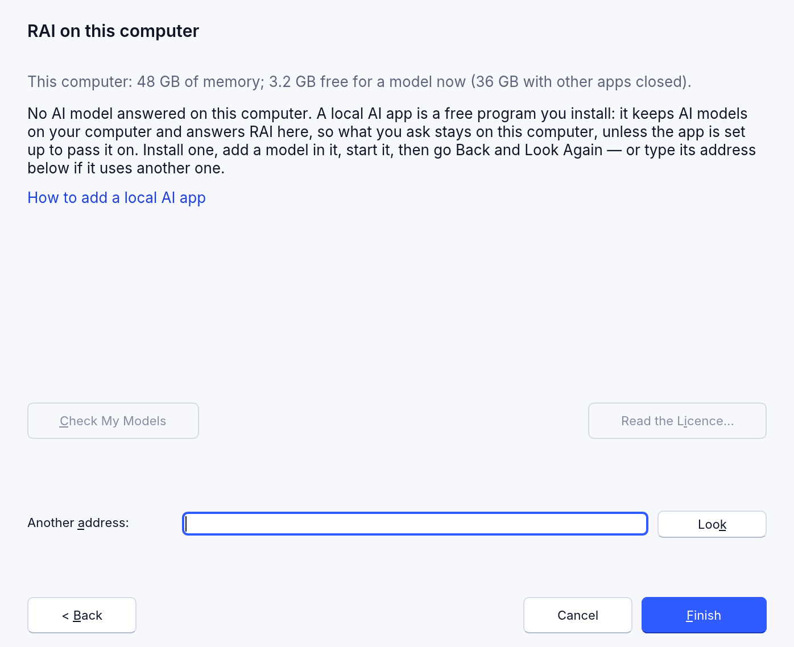
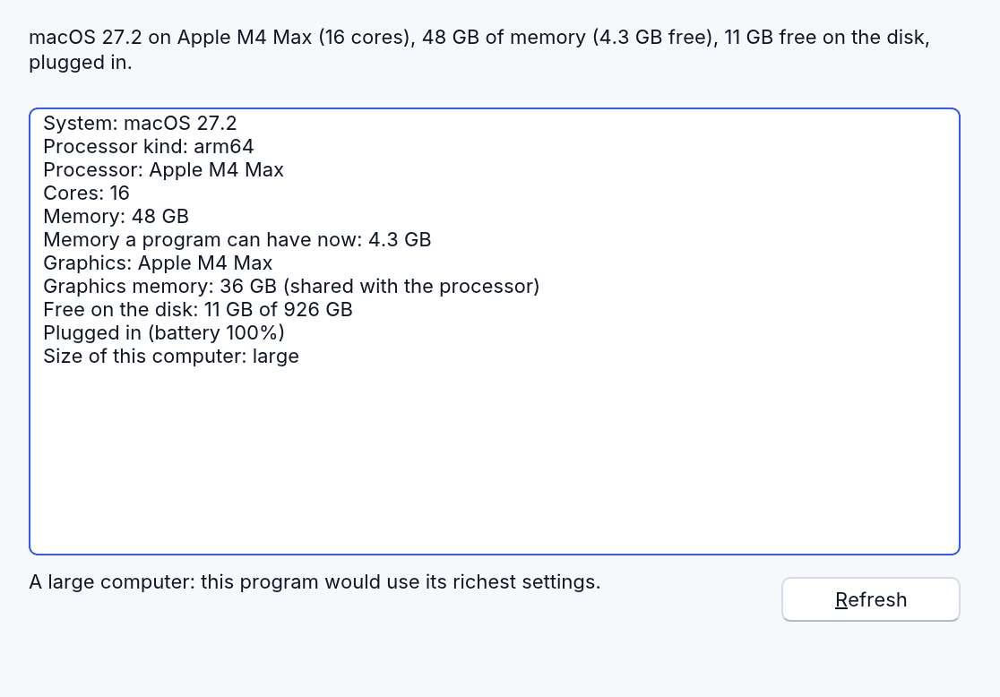

<!-- translated-from: local-ai.md 642b95bd7a6513e4 -->
# IA en esta computadora

<!-- legal -->
RAI, el asistente de inteligencia artificial (IA) de RapidR Studio, puede trabajar con un modelo que se ejecuta **en tu propia computadora**: gratis, sin cuenta ni clave, y lo que preguntas se queda en la computadora, siempre que la app misma no esté configurada para pasarlo a un servicio externo. El modelo se ejecuta en una *app de IA local*: un programa gratuito que instalas, que guarda modelos de IA en tu computadora y responde a RAI desde ella.

RapidR Studio no descarga, no ejecuta ni recomienda ningún modelo. Mira los modelos que **ya hay en tu computadora**, te dice cuáles caben en ella, puede probarlos en unas pocas tareas pequeñas y dice cuál es la mejor opción para esta computadora. Solo aparecen los modelos que tienes: RapidR nunca nombra ni sugiere un modelo que no tengas.

## Configurarlo

1. **Herramientas > Configurar RAI…** (o Ctrl+I antes de que RAI esté configurada).
2. Elige **Gratis, en esta computadora**. Studio busca de inmediato apps de IA en esta computadora y dice qué encontró.

   

3. **Siguiente**. Cada modelo de tu app de IA local aparece en la lista, con la mejor opción para esta computadora primero y ya elegida:

   

4. Opcional: **Comprobar mis modelos** prueba, uno a la vez en esta computadora, cada modelo que cabe ahora y cada uno cuyo tamaño no se conoce (más abajo). Puedes elegir sin hacerlo.
5. Elige un modelo y **Finalizar**. RAI se activa con ese modelo y se abre su panel.

Todo se puede hacer también con el teclado: Tab pasa entre la lista, los botones y la dirección; las flechas eligen un modelo; Enter es Finalizar. Un lector de pantalla lee cada fila como una sola oración (“example-small. Cabe. Mejor opción para esta computadora según su tamaño: usa Comprobar mis modelos para ver cómo le va.”).

## Qué busca Studio, y dónde

Solo cuando abres esta página (o presionas **Buscar de nuevo** o **Buscar**), Studio les pide su lista de modelos a las apps de IA locales **de esta computadora**:

- en `127.0.0.1`, en los puertos que suelen usar las apps de IA locales (11434, 1234, 8080, 8000, 1337, 5001, 4891 y 8081),
- y en una dirección que escribes en **Otra dirección**, para una app que usa otro puerto.

Nunca le pregunta a otra computadora: una dirección que no es de esta computadora (`127.0.0.1`, `[::1]` o `localhost`) se rechaza antes de enviar nada. Un puerto donde nada responde se omite de inmediato. Studio le pide a cada app su lista de modelos (la API compatible con OpenAI que ofrecen muchas apps de IA locales: `GET /v1/models`) y, cuando la app describe sus modelos, el tamaño de cada uno, sus parámetros, su cuantización, su contexto, si acepta herramientas, su forma (capas, cabezas de atención) y su licencia. No inicia nada ni carga nada para buscar.

<!-- legal -->
RapidR Studio no envía nada sobre tu computadora ni sobre tus modelos a ninguna parte: solo se comunica con esta computadora. Lo que una app de IA local hace con lo que preguntas depende de la app: algunas pueden pasar las preguntas a un servicio externo, y Studio marca un modelo cuya app dice que se ejecuta en otro lugar (*Se ejecuta en otro lugar*): nunca es la mejor opción, nunca se comprueba y no se puede elegir aquí.

<!-- legal -->
En una computadora compartida con otras personas (un laboratorio escolar, un escritorio remoto), la app que responde puede ser de otra persona, y Comprobar mis modelos usaría su memoria y su procesador. Usa Comprobar mis modelos solo con una app que sea tuya.

## ¿Cabe? (los chips)

Cada modelo tiene un chip que dice si cabe en **esta** computadora. Studio lo calcula de inmediato, sin ejecutar el modelo:

> memoria que necesita el modelo = sus pesos (el archivo del modelo) + la memoria de la conversación para el contexto que recibe RAI (según sus capas, cabezas de atención y tamaño de cabeza) + lo que necesita la app de IA para ejecutarlo

y lo compara con la memoria libre ahora (reservando unos 1.5 GB para RapidR Studio y el sistema) y con lo máximo que podría tener un modelo con las demás apps cerradas (en una Mac con Apple silicon, la parte de la memoria compartida que pueden usar los gráficos; en las demás computadoras, todo menos lo que reserva el sistema).

| Chip | Qué significa |
|---|---|
| **Cabe** | Según la estimación de Studio, cabe en la memoria libre ahora, con holgura. |
| **Cabe si cierras otras apps** | Cabría con las demás apps cerradas: cierra algunas (un navegador con muchas pestañas, un juego) y usa **Buscar de nuevo**. |
| **Demasiado grande para esta computadora** | Ni siquiera así. Aparece en la lista, pero no se puede elegir. |
| **Tamaño desconocido** | Su app no dice su tamaño (o un navegador no puede decir cuánta memoria hay): **Comprobar mis modelos** muestra cómo le va. |
| **Se ejecuta en otro lugar** | Su app dice que ejecuta el modelo en un servicio externo: lo que preguntas se enviaría allí. No se puede elegir aquí. |

Studio también elige el **contexto** que recibe RAI (cuánto de la conversación mantiene el modelo en mente): 16K tokens cuando hay espacio, 8K de forma predeterminada, nunca menos de 4K y nunca más de lo que el modelo soporta. La línea bajo la lista lo dice (“RAI recibe un contexto de 16K”).

## Comprobar mis modelos

**Comprobar mis modelos** carga, uno a la vez en esta computadora, cada modelo que cabe ahora y cada uno cuyo tamaño no se conoce, y lo prueba. La nota junto al botón dice cuánto tarda más o menos (un minuto o dos por modelo; más para uno grande). Mientras tanto usa la memoria y el procesador de la computadora, y cargar un modelo puede hacer que la app cierre otro que tenía cargado. Un modelo que dice *Cabe si cierras otras apps* no se comprueba hasta que quepa: cierra otras apps, usa **Buscar de nuevo** y luego **Comprobar mis modelos**. Con cada modelo, Studio:

1. **mide una respuesta**: cuánto tarda en empezar la primera respuesta real de RAI, con sus instrucciones y herramientas, y cuántas palabras por segundo la siguen;
2. **prueba una llamada a una herramienta**: si el modelo llama a una de las herramientas de RAI como RAI lo necesita (algunos modelos escriben la llamada como texto: RAI no puede usarlos para construir apps);
3. **construye una app muy pequeña** con el ciclo real de RAI y las herramientas reales de Studio: *una ventana con un botón que dice Hello*. Pasa la prueba cuando el programa que escribe compila y tiene ese botón. Nada de lo que escribe el modelo se ejecuta ni se guarda.

<!-- legal -->
Cuando su app deja que Studio se lo pida, un modelo que la comprobación cargó se libera después (uno que ya estaba en uso se queda); algunas apps lo mantienen hasta su propio temporizador. **Detener comprobación** se detiene en cuanto termina la respuesta actual del modelo (el modelo que se estaba comprobando queda sin comprobar). Los resultados se guardan en esta computadora, para cada modelo y esta versión de Studio: un modelo se vuelve a comprobar solo cuando cambia él, cambian las instrucciones de RAI o cambia Studio. Están en `local-ai-checks.json`, en la carpeta propia de Studio (donde guarda su configuración y el registro de auditoría: [la página del asistente](ai-assistant.md) dice dónde): tiempos y resultados de sí o no, y la huella (*digest*) del modelo, o su nombre y dirección cuando no tiene ninguna. Nada de eso se envía a ninguna parte; borra el archivo para olvidarlos.



### La mejor opción, con palabras

Esto dice cómo le fue a un modelo en la única prueba pequeña de Studio, en esta computadora, hoy. No es un veredicto sobre el modelo: otra computadora u otra tarea pueden dar otro resultado. Los modelos se ordenan según lo que le importa a RAI en esta computadora: que **construyó la app de prueba** › que sus **llamadas a herramientas funcionan** › que es **lo bastante rápido** (una respuesta empieza en unos 10 segundos) › que deja más **memoria libre**. Cada fila lo dice en una línea:

| La línea | Qué significa |
|---|---|
| *Mejor opción para esta computadora: construyó la app de prueba de Studio, responde en alrededor de 4 s.* | El mejor de tus modelos para esta computadora, según ve la comprobación de Studio. Tú eliges. |
| *Construyó la app de prueba de Studio, responde en alrededor de 6 s.* | También le fue bien. |
| *Funciona, pero despacio aquí (alrededor de 40 s por respuesta).* | Construyó la app de prueba, pero tendrás que esperar. |
| *Usa las herramientas de RAI, pero no pudo construir la app de prueba aquí.* | RAI aún puede ayudar: empieza sus programas desde las recetas de RapidR. |
| *Puede conversar, pero no puede construir apps con RAI: sus llamadas a herramientas no funcionaron aquí.* | Responde preguntas, pero no puede usar las herramientas de RAI. |
| *Su app de IA local dice que no acepta herramientas, así que RAI no puede construir apps con ese modelo.* | Sin comprobar: su app lo dice. |
| *Mejor opción para esta computadora según su tamaño: usa Comprobar mis modelos para ver cómo le va.* | Aún sin comprobar: la mejor estimación según su tamaño y lo que dice su app. |

## RAI con un modelo pequeño

Un modelo pequeño recibe el **modo para modelos pequeños** de RAI: instrucciones más cortas, menos herramientas, una receta que funciona enviada primero cuando se pide un programa nuevo, y el contexto elegido arriba. Y si una petición de un programa nuevo sigue saliendo mal (tres intentos que se rechazan o no compilan), Studio empieza el programa desde esa receta, sin cambios, y lo dice en el chat (*✓ Started from the recipe …, unchanged: the model's own 3 tries didn't work*, es decir, que se empezó desde la receta, sin cambios, porque los 3 intentos del propio modelo no funcionaron; ese mensaje del chat todavía sale en inglés). Obtienes un programa que funciona para cambiar paso a paso, en lugar de nada.

El modo se elige a partir de la comprobación del modelo, nunca de su nombre: un modelo que construyó la app de prueba, rápido, con llamadas a herramientas que funcionan y un contexto de 16K recibe las instrucciones completas de RAI; cualquier otro recibe el modo para modelos pequeños. Un modelo sin comprobar recibe el modo que le da su contexto (por debajo de 16K: pequeño). Los programas también pueden elegirlo: [`SmallModel` y `ContextSize` de RAI](../reference/members.md).

## Licencias

<!-- legal -->
Cada modelo viene con su propia licencia, de quien lo hizo: algunas son muy abiertas, otras limitan el uso comercial, aquello para lo que se puede usar el modelo o lo que puedes hacer con lo que escribe, y algunas piden que le des crédito. Studio muestra la licencia de cada modelo **tal como la informa su app de IA local** (su nombre, y **Leer la licencia…** para el texto completo). Studio no la comprueba: viene del archivo del modelo y puede ser incorrecta o estar desactualizada. Con ella, un recordatorio:

> **¿Creas apps para vender? Revisa la licencia de este modelo:** puede limitar el uso comercial, o lo que puedes hacer con lo que el modelo escribe.

<!-- legal -->
Cuando la app no informa ninguna, Studio lo dice: revisa la licencia donde conseguiste el modelo. RapidR no descarga ni distribuye ningún modelo, no comprueba lo que dice una licencia, y su propia licencia (MIT) no dice nada sobre la de un modelo ni sobre lo que un modelo escribe. Si puedes vender los programas que un modelo ayudó a escribir, y de quién son, depende de la licencia de ese modelo y de la ley de tu país; consulta con quienes hicieron el modelo si tienes dudas.



## Aún no hay una app de IA local

Cuando nada responde, la página dice qué es una app de IA local y cómo añadir una:



1. Instala una app de IA local: un programa gratuito que guarda modelos de IA en tu computadora y los ofrece mediante la **API compatible con OpenAI** (muchas lo hacen; revisa su licencia y que funcione en tu sistema).
2. En ella, añade un modelo que quepa en tu computadora y lee su licencia. Como regla general, un archivo de modelo de 2–5 GB va bien en una computadora con 16 GB de memoria; los chips de esta página lo estiman cuando el modelo ya esté allí. Los modelos que aceptan herramientas funcionan mejor con RAI.
3. Inicia la app (Studio nunca la inicia por ti), luego **Atrás** y **Buscar de nuevo**, o escribe su dirección en **Otra dirección** si usa un puerto propio (`127.0.0.1:PORT`).

## En Studio para la web

<!-- legal -->
Un navegador no puede buscar por sí solo en tu computadora. En la página **RAI en esta computadora**, escribe la dirección de tu app de IA local (`http://127.0.0.1:11434`, por ejemplo) y presiona **Buscar**: una dirección que no es de esta computadora se rechaza antes de enviar nada. La app debe permitir que la página de Studio para la web le haga solicitudes: en su configuración, permite las solicitudes desde la dirección desde la que se sirve la página (su *origen*; una app de IA local suele llamarlo orígenes permitidos o configuración de CORS). Permite solo esa dirección, nunca todos los sitios: una app que responde a cualquier página deja que cualquier sitio web que visites use tus modelos. El navegador no puede saber cuánta memoria hay libre, así que los chips dicen *Tamaño desconocido*; comprobar modelos se hace en Studio de escritorio.

## Bloqueo escolar

Mientras el [bloqueo escolar](../for-teachers.md) (en inglés) desactiva RAI, Configurar RAI se queda en su primera página, en solo lectura: no se busca nada y no se comprueba ningún modelo.

## RSystemInfo: lo que tiene esta computadora

La comprobación de si un modelo cabe lee los mismos datos que cualquier programa puede leer con **RSystemInfo**: el sistema y su versión, el procesador y sus núcleos, toda la memoria y la memoria que un programa puede tener ahora, los gráficos y su memoria (compartida en Apple silicon), el disco y cuánto hay libre, la batería. Se leen en esta computadora; RapidR nunca los envía a ninguna parte. `Class` dice el tamaño de la computadora con palabras sencillas (`small`, `medium`, `large`), para que un programa pueda adaptarse; `Summary` lo dice todo en una oración. Los tamaños están en megabytes.

```basic
DIM Info AS RSystemInfo
PRINT Info.Summary
IF Info.Class = "small" THEN PRINT "Using the light settings."
IF Info.FreeMemory < 2048 THEN PRINT "Less than 2 GB free: close some apps first."
```



<!-- legal -->
**Si tu programa envía estos datos a algún lugar** (tu servidor, un registro, un informe de fallos), pueden ser datos personales: juntos identifican a una computadora, y en la Unión Europea leerlos para rastrear personas requiere consentimiento. Avisa a tus usuarios, pide permiso primero donde la ley lo exija, envía solo lo necesario (`Class` suele bastar) y nunca los envíes desde un programa para niños. En la web el navegador da menos a propósito (sin nombre de los gráficos, sin batería, con la memoria redondeada y 8 GB como máximo): no intentes sortearlo.

El ejemplo [system_info.rr](../../../examples/system_info.rr) muestra cada dato. En una página web el navegador dice muy poco (sus núcleos, más o menos su memoria, el sistema): `Unknown` nombra lo que allí no se puede saber, y esas propiedades valen 0 o "". Cada miembro está en [la referencia](../reference/members.md).

## Cuando algo no va bien

| Lo que ves | Qué hacer |
|---|---|
| *No se encontró ninguna app de IA local ejecutándose en esta computadora* | Inicia tu app de IA local y luego usa **Buscar de nuevo**; si usa otro puerto, escribe su dirección. |
| *Una app de IA local responde en esta computadora, pero aún no tiene ningún modelo* | Añade un modelo en la app y luego usa **Buscar de nuevo**. |
| Todos los modelos dicen *Demasiado grande para esta computadora* | Cierra otras apps y usa **Buscar de nuevo**, o añade un modelo más pequeño (un archivo más pequeño, o una cuantización más fuerte como Q4). |
| *Su comprobación no pudo terminar* | La app dejó de responder (puede que se haya quedado sin memoria): cierra otras apps y vuelve a usar **Comprobar mis modelos**. |
| RAI olvida el comienzo de un chat largo | El modelo se ejecuta con un contexto pequeño: RAI se mantiene dentro de él. Un modelo que cabe con espacio de sobra recibe 16K. |
