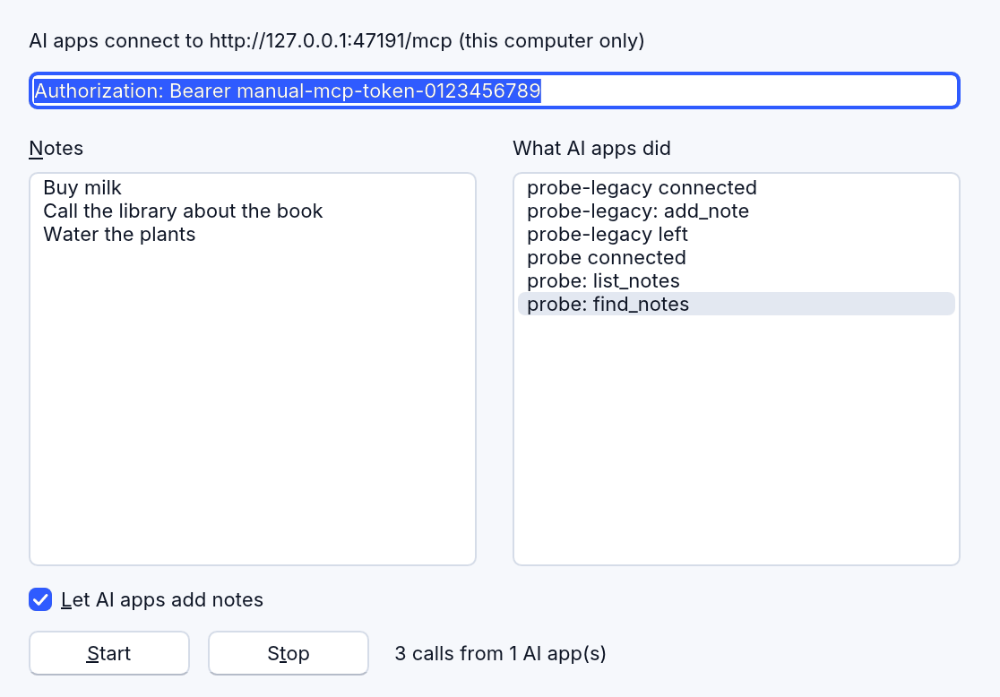

<!-- translated-from: network.md 3ecfc268e7bf759b -->
# Redes: sockets y un servidor web local

Un programa se comunica con la red en dos direcciones:

- **como cliente**, que llama a servidores: `RHttp` (`Get` y `Post` de HTTP y
  HTTPS), `RDownload` (un archivo, con progreso) y `RSocket` (una conexión TCP;
  en la web, un WebSocket). Se describen junto con los demás objetos en
  [DirectX y multimedia](directx-and-media.md).
- **como servidor**, que responde a otros: `RServerSocket` (TCP, por líneas,
  bytes o solicitudes HTTP completas), `RHttpServer` (un servidor web: una API
  local, un panel de control) y `RMcpServer` (las herramientas propias de tu
  programa para las aplicaciones de IA). Los tres son propios de RapidR, y solo
  para el escritorio: una página web no puede escuchar conexiones.

## Solo esta computadora, o toda la red

Un servidor escucha en una **dirección** y un **puerto**. La dirección decide
quién puede llegar a él:

| Dirección | Quién puede conectarse |
|---|---|
| `127.0.0.1` | solo los programas de esta computadora — nada en la red llega a él, y el sistema no pregunta por las conexiones entrantes |
| `0.0.0.0` | todas las interfaces de red: también otras computadoras (el firewall puede preguntar) |

<!-- legal -->
Un servidor con el que solo hablan tus propios programas (o una aplicación de IA
de la misma computadora) siempre tiene que escuchar en `127.0.0.1`.

| Componente | Dónde escucha |
|---|---|
| `RHttpServer` | `Host`: `127.0.0.1` salvo que establezcas otro |
| `RServerSocket` | `Host`: `0.0.0.0` salvo que establezcas otro (como antes) |
| el `Open(Port)` de `RSocket` | `0.0.0.0`; `Open(Port, "127.0.0.1")` o `BindAddress = "127.0.0.1"` para solo esta computadora |

```basic
DIM Sock AS RSocket
DIM Server AS INTEGER
Server = Sock.Open(47100, "127.0.0.1")    ' -1 cuando no puede
```

Un puerto es un número del 1 al 65 535; usa uno por encima de 1024 que ningún
otro programa use. El puerto 0 deja que el sistema elija uno libre: después de
`Start`, `Port` dice cuál.

## RServerSocket: un servidor TCP

`RServerSocket` escucha en `Host:Port`, y le dice al programa lo que hacen sus
clientes mediante tres eventos, que se disparan cuando el programa llama a `Poll`
(así que pon `Poll` en un `RTimer`):

| Evento | Cuándo |
|---|---|
| `OnClientConnect (Address)` | un cliente se conectó (`Address` es `127.0.0.1:53211`) |
| `OnDataReceived (Address, Data)` | el cliente envió algo (consulta `Mode`) |
| `OnClientDisconnect (Address)` | el cliente se fue |

`Mode` (propio de RapidR) dice qué es `Data`:

| Mode | `Data` es |
|---|---|
| `"lines"` (el valor predeterminado) | una línea cada vez, sin su final, recortada; las líneas en blanco se omiten. Una última línea sin su final llega cuando el cliente cierra. |
| `"bytes"` | lo que llegó, tal como llegó: nada recortado ni omitido |
| `"http"` | una solicitud HTTP completa cada vez: su línea de solicitud, sus encabezados, una línea en blanco y luego su cuerpo — de cualquier tamaño (hasta 4 MB) y sin importar cómo se envió (su `Content-Length`, o en fragmentos, que se unen y reciben un `Content-Length`). A un cliente que espera “100 Continue” antes de enviar un cuerpo grande se le dice que continúe. |

<!-- legal -->
`Mode = "http"` no comprueba nada por ti (ni token, ni comprobación de Host o de
Origin), y RServerSocket escucha en todas las interfaces de red salvo que `Host =
"127.0.0.1"`: para una API web usa RHttpServer, o al menos establece `Host =
"127.0.0.1"`.

Para responder: `SendTo(Address, Data)` envía Data y un fin de línea,
`Send(Address, Data)` (propio de RapidR) lo envía tal cual, `Broadcast(Data)` lo
envía con un fin de línea a todos, `Disconnect(Address)` (propio de RapidR) cierra
la conexión de ese cliente, `Stop` las cierra todas.

El [ejemplo del servidor de eco](../../../examples/network/echo_server.rr)
responde por sí mismo a las solicitudes web con `Mode = "http"`: el cuerpo de
cada solicitud vuelve, sin importar su tamaño.

```basic
SUB Got (Address AS STRING, Data AS STRING)
    DIM body AS STRING
    body = MID$(Data, INSTR(Data, CRLF + CRLF) + 4)
    Srv.Send Address, "HTTP/1.1 200 OK" + CRLF + "Connection: close" + CRLF + CRLF + body
    Srv.Disconnect Address
END SUB
```

```
$ curl --data-binary @big.json http://127.0.0.1:47120/echo
```

Para una API web, `RHttpServer` hace todo el HTTP por ti.

## RHttpServer: un servidor web en tu programa

<!-- legal -->
`RHttpServer` (propio de RapidR; solo para el escritorio) es un pequeño servidor
web: una API local para otros programas, un panel de control, un servidor
[MCP](#un-servidor-mcp) para aplicaciones de IA. Escucha en `127.0.0.1` salvo que
digas otra cosa, lee cada solicitud completa, rechaza por sí mismo lo que no
corresponde, y te da el resto en `OnRequest` — en el hilo propio de tu programa,
entre sus otros eventos, así que la ventana nunca se congela.


```basic
DIM Web AS RHttpServer

SUB Answer (Method AS STRING, Path AS STRING, Headers AS STRING, Body AS STRING)
    IF Method = "GET" AND Path = "/hello" THEN
        Web.Respond 200, "Content-Type: text/plain", "Hola desde RapidR"
    ELSEIF Method = "POST" AND Path = "/echo" THEN
        Web.Respond 200, "Content-Type: application/json", Body
    ELSE
        Web.Respond 404, "", "No encontrado"
    END IF
END SUB

Web.OnRequest = Answer
Web.Port = 47110
Token$ = Web.NewToken      ' un token aleatorio: toda solicitud debe llevarlo
IF Web.Start = 0 THEN ShowMessage "No está escuchando: " + Web.Error
```

```
$ curl -H "Authorization: Bearer 3f9a…" http://127.0.0.1:47110/hello
Hola desde RapidR
```

El ejemplo es [examples/network/local_api.rr](../../../examples/network/local_api.rr).

### Una solicitud

`OnRequest (Method, Path, Headers, Body)` da el método (`GET`, `POST` …), la ruta
sin su consulta (`/mcp`), los encabezados (líneas `Name: value`, con CR LF entre
ellas) y el cuerpo como texto. Mientras se ejecuta, el servidor también dice:

| Propiedad / método | |
|---|---|
| `Query` | lo que sigue al `?` de la ruta (`q=1&n=2`) |
| `Header(Name)` | un encabezado, por nombre con cualquier combinación de mayúsculas y minúsculas (`Web.Header("Content-Type")`); "" cuando no tiene ninguno |
| `Peer` | quién hizo la solicitud (`127.0.0.1:53211`) |
| `Request` | el número de la solicitud, para responderla más tarde |

Las solicitudes llegan de una en una: la siguiente espera hasta que tu
controlador termina.

### La respuesta

`Respond Status, Headers, Body` responde: el estado (200 OK, 404 Not found …),
tus encabezados (líneas `Name: value`, con `CHR$(13) + CHR$(10)` o `CHR$(10)`
entre ellas) y el cuerpo. El servidor añade `Content-Length` por sí mismo, y un
`Content-Type` de texto sin formato cuando no das ninguno.

**Más tarde.** Una solicitud puede esperar — a que el usuario apruebe algo, a que
termine una consulta. Guarda su número y responde cuando puedas; el cliente
espera mientras tanto:

```basic
Waiting = Web.Request          ' en OnRequest
…
Web.Respond 200, "Content-Type: application/json", Result$, Waiting
```

`Close [Request]` cierra la conexión de una solicitud sin una respuesta.

**Flujos de eventos.** `BeginStream` responde con un flujo de
[Server-Sent Events](https://html.spec.whatwg.org/multipage/server-sent-events.html)
(`text/event-stream`); `SendEvent Data [, EventName]` envía cada uno —uno ahora,
otro después, desde un temporizador—, y `EndStream` lo termina. Cada uno lleva al
final el número de la solicitud, para un flujo que se mantiene después de
`OnRequest`. `SendEvent` da False cuando el cliente se fue.

```basic
Web.BeginStream "", Id
Web.SendEvent "{" + CHR$(34) + "tick" + CHR$(34) + ":1}", "tick", Id
Web.EndStream Id
```

```
$ curl -N -H "Authorization: Bearer …" http://127.0.0.1:47110/events
event: tick
data: {"tick":1}
```

### Lo que el servidor rechaza por sí mismo

<!-- legal -->
Antes de `OnRequest`, el servidor responde a estas solicitudes por sí mismo, y tu
programa nunca las ve:

| Solicitud | Respuesta | Se establece con |
|---|---|---|
| sin el token, o con uno equivocado, cuando `Token` está establecido: `Authorization: Bearer <token>` | 401 | `Token` |
| cualquier cosa que no sea GET y HEAD mientras no hay un `Token` establecido | 401 | `Token` |
| desde una página web de otro sitio: su encabezado `Origin`, o el `Sec-Fetch-Site: cross-site` de un navegador | 403 | `AllowedOrigins` (`https://my.site`, con comas entre ellos; `*` cualquiera) |
| para otro nombre de host (su encabezado `Host`): una página web no puede llegar a tu servidor por un nombre propio (DNS rebinding) | 403 | `AllowedHosts` (`127.0.0.1`, `localhost` y `[::1]` con tu puerto siempre pasan) |
| con un cuerpo mayor que `MaxRequestSize` (4 MB) | 413 | `MaxRequestSize` |
| que no llega completa dentro de `Timeout` ms (30 segundos) | 408 | `Timeout` (también cuánto tiempo se mantiene abierta una conexión inactiva) |
| más allá de `MaxConnections` (32) abiertas a la vez | 503 | `MaxConnections` |
| que no es HTTP/1.0 ni HTTP/1.1 | 400 / 505 | — |

<!-- legal -->
Estas comprobaciones no detienen todo lo que puede hacer una página web. Un
enlace, una imagen o un script en la página de otro sitio hace que el navegador
envíe un GET a tu servidor, a menudo sin ningún `Origin` (los navegadores
recientes lo marcan con `Sec-Fetch-Site: cross-site`, que se rechaza; los más
antiguos no). Así que:

<!-- legal -->
- **Un GET nunca tiene que cambiar nada.** Responde a los GET con lo que se puede
  leer; cambia cosas solo con POST, PUT o DELETE.
<!-- legal -->
- **Establece un Token para todo lo que vaya más allá de lecturas
  inofensivas.** Sin uno, el servidor solo responde a GET y HEAD (todo lo demás
  recibe 401: “this server has no Token”). `Web.NewToken` establece uno nuevo a
  partir de la fuente aleatoria segura del sistema operativo y lo devuelve, para
  dárselo al programa que te llama. Nunca crees un token con `RND`: no sirve para
  secretos. Guárdalo con [RSecrets](secrets.md), no en el programa.

<!-- legal -->
Las solicitudes que no vienen de una página web (curl, una aplicación de IA, tus
propios programas) no llevan `Origin`, y pasan si llevan el token. Establece esto
antes de `Start`.

<!-- legal -->
**Sin TLS.** `RHttpServer` habla HTTP simple. En `127.0.0.1` nada va por la red,
pero otros programas y otros usuarios de la misma computadora aún pueden
conectarse: el Token es lo que los deja fuera. Con `Host = "0.0.0.0"` el token
viaja en texto sin cifrar por la red, donde otros pueden leerlo. Para atender a
otras computadoras, ponlo detrás de un servidor web que hable HTTPS, y enumera en
`AllowedHosts` los nombres con los que se llega a él.

### Un servidor MCP

Usa [`RMcpServer`](#rmcpserver-las-herramientas-de-tu-programa-para-las-aplicaciones-de-ia): habla el
protocolo por sí mismo, con las mismas conexiones y comprobaciones que
`RHttpServer`.

### En la web

Una página web no puede escuchar conexiones, así que `RHttpServer`, `RMcpServer`
y `RServerSocket` se ejecutan solo en el escritorio (interpretados y nativos). En
la web `Start` da False y `Error` dice por qué.

## RMcpServer: las herramientas de tu programa para las aplicaciones de IA

<!-- legal -->
`RMcpServer` permite que una aplicación de IA que admite MCP — el protocolo que
las aplicaciones de IA usan para llamar a herramientas — llame a las herramientas
que ofrece tu programa: leer sus datos, añadirles datos, presionar sus botones, lo
que elijas ofrecer. La función de aplicaciones de IA del propio RapidR Studio es
un ejemplo ([Deja que las aplicaciones de IA trabajen en Studio](ai-apps.md)).
Model Context Protocol® y MCP™ son marcas de LF Projects, LLC; RapidR las usa solo
para decir qué protocolo habla.

Añades cada herramienta —un nombre, una oración que le dice a la IA lo que hace,
sus argumentos escritos como los parámetros de una `SUB`, y si solo lee— y
respondes a cada llamada en `OnToolCall`, en el hilo propio de tu programa:

```basic
DIM Mcp AS RMcpServer

SUB ToolCalled (Tool AS STRING, Arguments AS STRING, CallId AS INTEGER)
    SELECT CASE Tool
        CASE "list_notes": Mcp.Reply CallId, NotesText
        CASE "add_note"
            Notes.AddItems Mcp.Argument("Text")
            Mcp.Reply CallId, "Añadida."
    END SELECT
END SUB

Mcp.OnToolCall = ToolCalled
Mcp.AddTool "list_notes", "Las notas del usuario, una por línea.", "", "read"
Mcp.AddTool "add_note", "Añade una nota al final de la lista.", "Text AS STRING", "change"
Mcp.Port = 47120
Token$ = Mcp.NewToken           ' toda solicitud debe llevarlo
IF Mcp.Start THEN PRINT "Las aplicaciones de IA se conectan a "; Mcp.Url
```



El ejemplo es [examples/network/mcp_tools.rr](../../../examples/network/mcp_tools.rr):
una lista de notas que una aplicación de IA puede leer y a la que puede añadir,
cada llamada mostrada en la ventana, y una casilla que le impide añadir.

- **Argumentos.** Escríbelos como los parámetros de una `SUB` —`Text AS STRING,
  [Count AS INTEGER]`, los opcionales entre `[ ]` (STRING, INTEGER, DOUBLE,
  BOOLEAN, LIST, OBJECT)— o como un JSON Schema para algo más complejo.
  `Mcp.Argument("Text")` lee uno (`options.size` llega al interior de un
  objeto); `Arguments` los tiene todos como JSON. Una llamada con un argumento
  que falta o es erróneo nunca llega a tu programa: a la aplicación de IA se le
  dice de inmediato lo que la herramienta necesita, para que pueda volver a
  llamar correctamente.
- **Respuestas.** `Reply CallId, Text` (con `True` después para un fallo: di qué
  salió mal y qué hacer en su lugar — la IA actúa según eso), `ReplyImage CallId,
  File` (un PNG, JPEG, GIF o WebP; un BMP se envía como PNG), `ReplyJson CallId,
  Result` para cualquier otra cosa.
- **Más tarde.** Guarda `CallId` y responde cuando puedas — después de
  preguntarle a tu usuario, por ejemplo. `Progress CallId, "Asking the user…"` se
  lo dice mientras tanto a la aplicación de IA (cuando escucha). Las llamadas
  llegan de una en una: la siguiente espera hasta que termina tu controlador, no
  hasta que respondes.
- **Quién.** `ClientName` es la aplicación de IA que hace la llamada; `Clients`
  las enumera (`OnConnect`, `OnDisconnect` dicen cuándo llegan y se van);
  `Disconnect` deja una fuera hasta el siguiente `Start`.
- **Lo que dice que es.** `ServerName`, `ServerTitle`, `ServerVersion` e
  `Instructions` (unas pocas oraciones para la IA sobre cómo usar tus
  herramientas).
- **Recursos.** `AddResource Uri, Name` ofrece algo para leer; `OnReadResource` lo
  pide, y `Reply` da su texto.

<!-- legal -->
Lo que el servidor hace por sí mismo: escucha solo en `127.0.0.1` (otro `Host`
abre tus herramientas a la red: no lo hagas, a menos que conozcas todas las
computadoras que pueden llegar a él); `Start` se niega a ejecutarse sin un `Token`
(`NewToken` crea uno: 64 dígitos hexadecimales aleatorios; guárdalo con
[RSecrets](secrets.md)); una solicitud sin el token, desde una página web o para
otro nombre de host se rechaza antes de que tu programa la vea. Habla la revisión
actual (2026-07-28) y las anteriores que empiezan con `initialize`.

<!-- legal -->
Lo que ofrece tu programa, y la privacidad de los datos de sus usuarios, los
decides tú: ofrece solo lo que una aplicación de IA puede ver y hacer, describe tu
programa diciendo que “funciona con clientes MCP” en lugar de poner MCP en su
nombre, y dile a tus usuarios que una aplicación de IA puede enviar lo que lee a
la empresa que la fabrica.

## Miembros

| | `RHttpServer` |
|---|---|
| Propiedades | `Host`, `Port`, `Token`, `AllowedOrigins`, `AllowedHosts`, `MaxRequestSize`, `MaxConnections`, `Timeout`; solo lectura: `Listening`, `Url`, `Error`, `Request`, `Method`, `Path`, `Query`, `Peer` |
| Métodos | `Start`, `Stop`, `NewToken`, `Respond`, `BeginStream`, `SendEvent`, `EndStream`, `Close`, `Header` |
| Evento | `OnRequest (Method, Path, Headers, Body)` |

Las listas completas, con todos los argumentos:
[RHttpServer](../reference/members.md#rhttpserver),
[RServerSocket](../reference/members.md#rserversocket),
[RSocket](../reference/members.md#rsocket).
