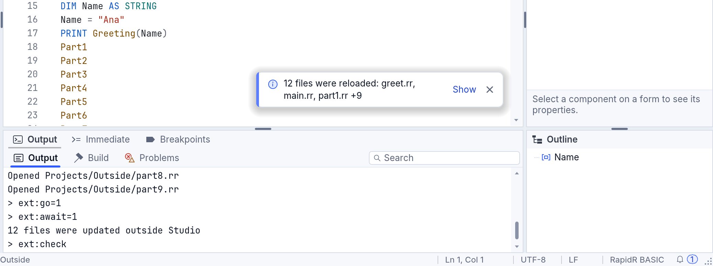
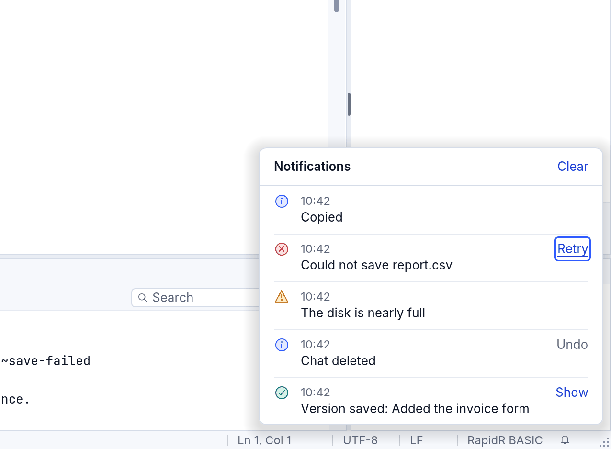
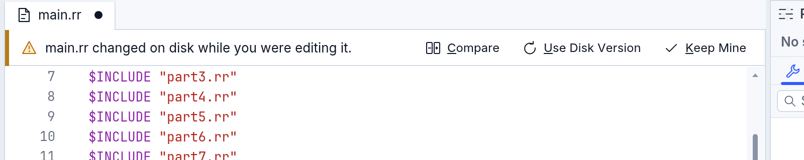
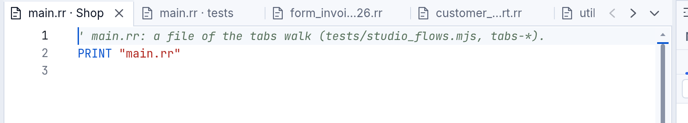
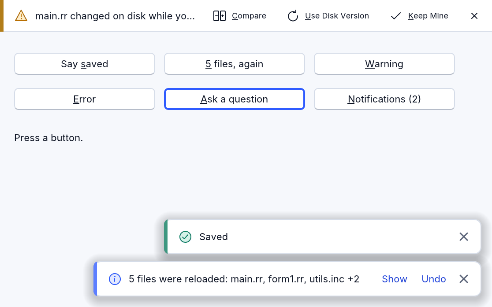

<!-- translated-from: notifications.md a1f06408e529eb33 -->
# Notificaciones: mensajes que aparecen y preguntas que esperan

Un programa tiene tres maneras de decirle algo a quien lo usa, y cada una tiene su propio tamaño.

| Es | Úsalo cuando | Cómo se ve |
|---|---|---|
| un **aviso** (toast) | pasó algo y no hay nada que decidir: «Guardado», «Se recargaron 5 archivos» | una tarjeta pequeña en una esquina, que se va sola |
| la **franja de una pregunta** | la persona debe elegir antes de seguir: «main.rr cambió en el disco mientras lo editabas» | una línea fina sobre aquello de lo que trata, con sus botones |
| un **diálogo** | algo con consecuencias está a punto de activarse o perderse | el centro de la ventana; la respuesta segura es la predeterminada |

Detrás de los avisos hay un **historial**, así que un mensaje que se pasó por un segundo nunca se pierde. RapidR Studio usa todo esto, y tus programas también pueden: los avisos son el componente `RNotify`, la franja es `RNotifyBar`. Las reglas que siguen están en la [guía de diseño](../../design-guidelines.md#notifications).



## En RapidR Studio

### Avisos

- **Dónde:** abajo a la derecha del área del editor, a la izquierda de la barra de desplazamiento del editor y por encima de la horizontal, así que un aviso nunca tapa lo que lees ni una barra que arrastras.
- **Qué dicen:** qué pasó, con los nombres. Cuando un agente, un editor o `git` cambia muchos archivos abiertos a la vez, Studio lo dice una sola vez: *Se recargaron 12 archivos: greet.rr, main.rr, part1.rr +9*. **Mostrar** abre la lista completa en una tarjeta con búsqueda.
- **Cuántos y cuánto tiempo:** tres como máximo (un cuarto pasa el más antiguo al historial). Un aviso se queda el tiempo que sus palabras necesitan para leerse: 3 segundos y un poco más por cada carácter, 2 segundos más cuando tiene un botón, mínimo 5 y máximo 20. Una advertencia se queda una vez y media ese tiempo, y un error hasta que lo cierres. **El tiempo se detiene mientras el ratón está sobre un aviso o el teclado también.**
- **Cómo llegas a uno con el teclado:** un aviso nunca toma el teclado por sí solo (la única excepción: el programa nuevo que el asistente acaba de hacer tiene el teclado en su primer botón, así que Intro lo ejecuta; Escape lo devuelve). **F6** (Ventana > Área siguiente) lo trae después del editor; **Tab** se mueve entre los botones de un aviso, **Intro** pulsa uno, **Escape** cierra el aviso y el teclado vuelve al editor.
- **Los lectores de pantalla** dicen un aviso una sola vez, con cortesía, cuando terminaron lo que estaban diciendo; un error se dice de inmediato. Sus botones están en el árbol de accesibilidad como botones.
- **Herramientas > Configuración > General > Las notificaciones se quedan** hace que los avisos se queden *El tiempo que necesiten sus palabras* (lo predeterminado), *Más tiempo* (el doble) o *Hasta que las cierre*.

### La campana y el historial

La campana, en el extremo derecho de la barra de estado, muestra cuántos mensajes no has visto. Haz clic en ella, o pulsa **Ctrl+Mayús+N** (Ver > Notificaciones), y se abre el historial: cada mensaje con su hora, su texto entero y su acción otra vez. **Borrar** lo vacía; se guardan los últimos 50. Una acción que ya no puede funcionar (un **Deshacer** después de borrar algo para siempre) aparece en gris, y su sugerencia dice por qué.



### Una pregunta en una línea

Cuando un archivo cambia en el disco **mientras tienes cambios sin guardar en él**, Studio pregunta, solo en ese editor y en una línea: *main.rr cambió en el disco mientras lo editabas.* **Comparar** muestra la versión del disco junto a la tuya, **Usar la versión del disco** la carga (la tuya queda en el historial local, y Deshacer la recupera), **Conservar la mía** mantiene la tuya (al guardarla, Studio pregunta antes de reemplazar la versión del disco). Nada más en pantalla la repite. La franja se anuncia a un lector de pantalla una vez, de inmediato; F6 llega a ella, **Escape** devuelve el teclado al editor y deja la pregunta sin responder.



### Los demás mensajes de Studio

Cada uno está en el nivel que sus palabras necesitan, y ninguno se repite en otro lugar:

- **Borrar un chat** en el Asistente dice *Se eliminó "hello one".* en un aviso, con **Deshacer**. Deshacer funciona hasta que se borra otro chat; después su botón en el historial aparece en gris y su sugerencia dice por qué.
- **La última vez, RapidR Studio se cerró de forma inesperada** es una pregunta sobre Studio mismo, así que su franja recorre la ventana bajo la barra de herramientas, en una línea: *La última vez, RapidR Studio se cerró de forma inesperada. Un informe queda en esta computadora; no se envió nada.* con **Ver informe**, **Copiar informe**, **Guardar informe...**, **Informar en GitHub...** y **Ocultar** ([Cuando RapidR falla](troubleshooting.md#cuando-rapidr-falla)).

### Pestañas que conservan su nombre

Cada documento abierto es una pestaña con su icono **y su nombre**: un nombre largo cortado por el medio para que queden sus primeros ocho caracteres y su extensión (*form_inv…26.rr*), una pestaña nunca más estrecha que eso, y dos archivos con el mismo nombre muestran sus carpetas (*main.rr · tests*). Cuando las pestañas no caben todas, la franja **se desplaza**: dos flechas en su extremo derecho (o la rueda del ratón, o un deslizamiento con dos dedos), con la pestaña mostrada siempre a la vista. El botón del final, **Pestañas abiertas**, lista todos los documentos abiertos en una tarjeta con búsqueda: escribe para filtrar, **Intro** muestra la pestaña, un punto marca un archivo con cambios sin guardar.



## En tus programas: RNotify

Suelta un **RNotify** en un formulario (el grupo *Additional* de la caja de herramientas) y llama a `Show`. Cubre el formulario, solo recoge el ratón donde hay un aviso y se dibuja con el aspecto del propio programa, claro, oscuro o de alto contraste.

```basic
CREATE Notify AS RNotify
    OnAction = Acted
END CREATE

Notify.Show "Guardado", "success"
Notify.Show "Se recargaron 5 archivos: main.rr, form1.rr, utils.inc +2", "info", "Mostrar|Deshacer", -1, "reload"
```

- `Show(Text, [Kind], [Action], [Timeout], [Key])` lo dice y devuelve el número del aviso. **Kind** es `"info"` (por omisión), `"success"`, `"warning"` o `"error"`. **Action** son uno o dos textos separados por `|`; `OnAction(Id, Index, Key)` oye el que se pulsó. **Timeout** va en milisegundos (-1 lo ajusta al texto, 0 se queda hasta que se cierre).
- **Key** mantiene una ráfaga del mismo mensaje en un solo aviso: volver a mostrar con la misma Key sustituye las palabras y empieza el tiempo de nuevo, así «5 archivos» se convierte en «7 archivos» en lugar de un segundo aviso.
- `Position` (`npBottomRight`, `npBottomLeft`, `npTopRight`, `npTopLeft`), `MaxVisible`, `Timeout`, `TimeScale` (el «que se queden más tiempo» de una persona: 200 es el doble, 0 hasta que se cierren) y `Margin` son propiedades. `SetArea` hace que los avisos se sitúen en una parte del formulario (el área del editor de Studio).
- **El historial:** `ShowHistory` lo abre (`ShowHistory Right, Bottom` lo cuelga de una campana), `UnseenCount` y `OnUnseenChange` dicen cuántos mensajes no se vieron, `HistoryText(i)`, `HistoryTime(i)` y `HistoryAction(i)` lo leen, `Retire(Key, Reason)` dice que una acción ya no se puede hacer.
- **Para RAI y las apps de IA:** `Count`, `Text(i)`, `Kind(i)` y `ActionText(i)` leen lo que hay en pantalla y `Press(Id, [Index])` hace lo que hace un clic en su acción: los mismos miembros que usa el programa de una persona.

Un mensaje nunca es un secreto: no pases nada que una persona no deba ver en una pantalla.

## En tus programas: RNotifyBar

`RNotifyBar` es la franja de la pregunta. Su `Align` es `alTop`, así que empuja hacia abajo lo que tiene debajo y no tapa nada.

```basic
CREATE Bar AS RNotifyBar
    OnChoose = Chose
END CREATE

Bar.Ask "main.rr cambió en el disco mientras lo editabas.", "&Comparar,&Usar la versión del disco,&Conservar la mía"

SUB Chose (Index AS INTEGER, Caption AS STRING)
    ' Index 1, 2 o 3; la franja ya se fue
END SUB
```

`Ask(Text, Buttons, [Kind])` muestra la franja y hace que un lector de pantalla la diga una vez. Los botones son una lista separada por comas; cada uno puede empezar con un icono de RapidR y una barra (`"compare|&Comparar"`), y un `&` subraya una letra que pulsa el botón.

La franja es compacta y discreta: botones de 24 píxeles de alto en la letra pequeña, el principal (`Primary`, el primero por omisión) con un relleno suave de acento, los demás sin marco. Muestra como máximo dos acciones. Para el resto pon `More = 1`: un botón de tres puntos cuyo `OnMore (Right, Bottom)` dice dónde abrir un menú emergente (`Alignment = paRightAlign`, luego `Popup Right, Bottom`). `Closable = 1` añade una X para cerrar (llamada *Descartar*; `OnChoose` oye el índice 0). Cuando el ancho es justo, los demás botones muestran solo su icono, luego la pregunta se corta con «…» (entera en la sugerencia); una franja sin botón principal (`Primary = 0`: opciones iguales, donde las palabras son la decisión) corta primero la pregunta y pasa a solo icono después. Solo por debajo de eso los botones pasan bajo la pregunta. `OnEscape` oye Escape (devuelve el teclado; la pregunta sigue en pie), `Press(Index)` la responde como lo haría un clic (`Press(0)` la X de cerrar).

## Pruébalo

[examples/gui/notify.rr](../../../examples/gui/notify.rr) tiene un botón para cada una de estas cosas: un aviso, el mismo mensaje otra vez (un aviso, con su cuenta más alta), una advertencia, un error que se queda, una pregunta, y la campana con su historial.



Ejecútalo con `rapidr run examples/gui/notify.rr`. Las imágenes de esta página se vuelven a hacer con `node tools/manual/shots.mjs notifications`.
