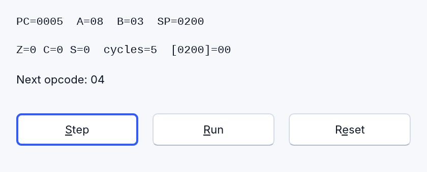
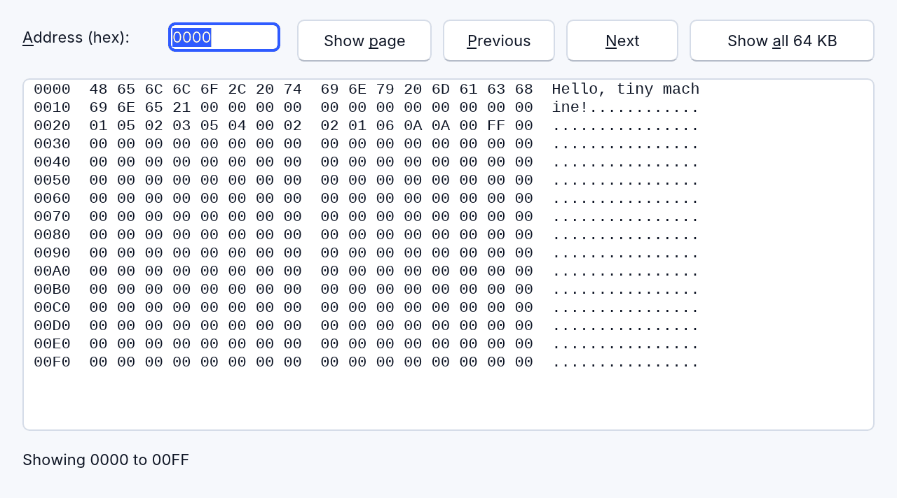
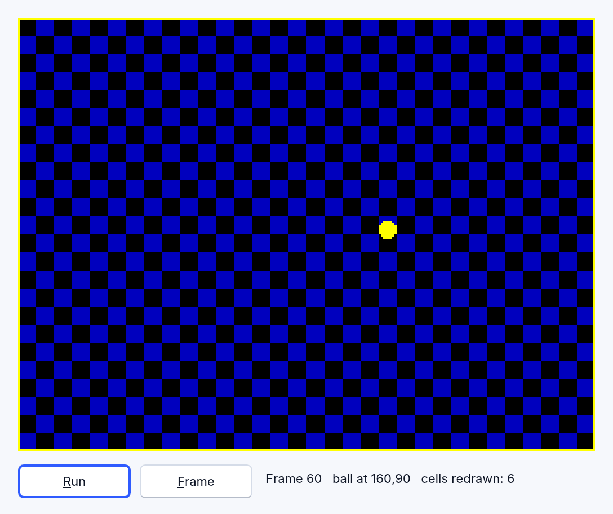

<!-- translated-from: recipes-systems.md 996d379c0d805bd8 -->
# Recetas para programas de sistemas: memoria, bits, una CPU, una pantalla, un teclado

Algunos programas manejan las entrañas de una máquina: un emulador, una máquina
virtual, un depurador, un visor de memoria, un lector para un formato de archivo.
Están hechos de las mismas pocas técnicas: la memoria como un arreglo (array) de
bytes, direcciones que dan la vuelta, bits e indicadores, un ciclo que obtiene y
decodifica, una pila, una pantalla dibujada a partir de la memoria. Cada uno de los
diez programas de abajo es **una** de esas técnicas, en un archivo que puedes
ejecutar, con una ventana pequeña que muestra el resultado.

Están en [`examples/recipes/`](../../../examples/recipes/) junto a los demás, y son
de lo que parte el asistente de RapidR Studio cuando le pides una CPU, un emulador
o un visor de memoria: encuentra por sí mismo la receta más cercana, en inglés,
español o portugués ([el asistente](ai-assistant.md#recetas-y-sugerencias-amistosas)).
Sirven igual de bien para copiarlos a mano: un programa que funciona es el mejor
lugar para empezar un programa que tiene que funcionar.

## Una computadora diminuta

Los diez cuentan una sola historia: una computadora diminuta de 8 bits, propia.
Está inventada para estas páginas (nada de ella es de otra máquina), así que no hay
nada que consultar: todo lo que hace está en los archivos.

- **Memoria:** 65 536 bytes, direcciones de `0000` a `FFFF`. Una palabra son dos
  bytes, el bajo primero.
- **Registros:** `A` y `B` (8 bits), `PC` (la instrucción siguiente), `SP` (la
  cima de la pila) y tres indicadores: cero, acarreo y signo.
- **El mapa:** el programa en `0000`, sus datos en `0100` y `0200`, la pila justo
  debajo de `0200` creciendo hacia abajo, la pantalla en `8000`, sus colores en
  `9800`.
- **Dieciséis instrucciones:**

| Opcode | Instrucción | Hace | Ciclos (la receta de la pila no los cuenta) |
|---|---|---|---|
| `00` | `NOP` | nada | 1 |
| `01 n` | `LDA n` | `A = n` | 2 |
| `02 n` | `LDB n` | `B = n` | 2 |
| `03 nn` | `LDA [nn]` | `A` = el byte en la dirección `nn` | 4 |
| `04 nn` | `STA [nn]` | el byte en `nn` = `A` | 4 |
| `05` | `ADD` | `A = A + B` (indicadores) | 1 |
| `06` | `SUB` | `A = A - B` (indicadores) | 1 |
| `07` | `INC` | `A = A + 1` | 1 |
| `08` | `DEC` | `A = A - 1` | 1 |
| `09 nn` | `JMP nn` | `PC = nn` | 3 |
| `0A nn` | `JNZ nn` | `PC = nn` salvo que sea cero | 3 (2 si no) |
| `0B` | `PUSH` | apila `A` | – |
| `0C` | `POP` | desapila en `A` | – |
| `0D nn` | `CALL nn` | apila `PC`, `PC = nn` | – |
| `0E` | `RET` | desapila `PC` | – |
| `FF` | `HALT` | detiene | 1 |

La receta de la CPU ejecuta este programa (una suma y luego una cuenta regresiva);
el volcado lo tiene en `0020` y la receta del archivo en `0100`. El
desensamblador lista uno más largo que usa todas las instrucciones.

```
0000  01 05      LDA 05        A = 5
0002  02 03      LDB 03        B = 3
0004  05         ADD           A = 8
0005  04 00 02   STA [0200]    guardarlo
0008  02 01      LDB 01
000A  06         SUB           A = A - 1   (el ciclo)
000B  0A 0A 00   JNZ 000A      hasta que A sea 0
000E  FF         HALT
```

## Las diez recetas

| Receta | La única técnica | Prueba |
|---|---|---|
| [memory_bytes.rr](../../../examples/recipes/memory_bytes.rr) | **La memoria como un arreglo de bytes.** `DIM mem(0 TO 65535) AS BYTE`; leer y escribir un byte y una palabra de 16 bits mediante cuatro funciones auxiliares pequeñas que hacen que la dirección dé la vuelta con `AND &HFFFF` y limitan un valor a un byte | Poke word con `1234` en `FFFF`: el byte alto cae en `0000` |
| [flags_bits.rr](../../../examples/recipes/flags_bits.rr) | **Bits e indicadores.** Un indicador es un bit de un número: se pone en 1 con `OR`, se pone en 0 con `AND (NOT mask)`, se comprueba con `AND`. Acarreo, cero, signo, desbordamiento, acarreo medio y N después de una suma o una resta (con el acarreo de entrada); rotar a través del acarreo; un byte sin signo y con signo | `7F + 01`: signo y desbordamiento, porque 127 + 1 no es -128 |
| [cpu_step.rr](../../../examples/recipes/cpu_step.rr) | **Obtener, decodificar, ejecutar.** La CPU de arriba sin la pila: `PC` avanza a medida que se obtiene cada byte, un `SELECT CASE` decodifica, los ciclos se suman; Step, Run y Reset | Presiona Step tres veces: `PC` es `0005` y `A` es `08` |
| [cpu_stack.rr](../../../examples/recipes/cpu_stack.rr) | **La pila.** `PUSH`, `POP`, `CALL` y `RET` en el arreglo de memoria: `SP` disminuye al apilar, una llamada apila su dirección de retorno (el byte alto primero), y la pila se muestra a medida que crece | Presiona Step tres veces y observa `01FD: 06 00 05` |
| [hex_dump.rr](../../../examples/recipes/hex_dump.rr) | **Un visor de memoria.** La dirección, 16 bytes en hexadecimal y los mismos como texto; el hexadecimal de cada valor se busca en una tabla hecha una sola vez, y cada fila se arma por sí sola | Show all 64 KB: 4096 filas |
| [disassembler.rr](../../../examples/recipes/disassembler.rr) | **Una tabla de opcodes.** De bytes de vuelta a mnemónicos con una tabla leída de `DATA` (sin `SELECT CASE`): el nombre y el tipo de operando de cada opcode | Lista desde `0006`, el medio de una instrucción: el listado sale mal |
| [load_binary.rr](../../../examples/recipes/load_binary.rr) | **Un archivo binario en la memoria.** `RFileStream`: los campos del encabezado en desplazamientos fijos, `ReadNum(Num_Byte)` y `ReadNum(Num_Word)`, y luego la memoria en un ciclo | Crea el archivo de muestra y luego cárgalo |
| [video_memory.rr](../../../examples/recipes/video_memory.rr) | **Memoria de video en un lienzo.** Un mapa de bits de 1 bit y atributos de color en el arreglo de memoria; una copia decodificada (un número de color por cada píxel) que cada escritura mantiene al día, dibujada en un `RCanvas` con `SetPixels8` y `StretchDraw` ([Dibujar muchos píxeles rápido](graphics.md#dibujar-muchos-píxeles-rápido)); una pelota dibujada con `XOR` | Repaint: la pantalla completa en unos 0.1 ms |
| [keyboard_matrix.rr](../../../examples/recipes/keyboard_matrix.rr) | **Una matriz de teclado.** `OnKeyDown` y `OnKeyUp` ponen en 0 y en 1 un bit en 8 filas de 5; `IN` elige filas con una máscara y da su AND | Presiona `Q` y luego `Enter` |
| [cpu_timing.rr](../../../examples/recipes/cpu_timing.rr) | **Temporización.** Un presupuesto de ciclos para cada tic de un `RTimer` (un cuadro, 20 ms), con los ciclos gastados de más pasados al cuadro siguiente, para que la velocidad sea exacta; Pause y Frame sin congelar la ventana | Faster y luego Frame |

Y el sonido de la máquina: [frame_audio.rr](../../../examples/recipes/frame_audio.rr)
anota el ciclo de cada cambio de un altavoz de un bit durante un cuadro y convierte
los cambios en las 882 muestras del cuadro para un `RAudioOut`
([Emuladores: sonido a partir de una línea de tiempo de niveles](directx-and-media.md#emuladores-sonido-a-partir-de-una-línea-de-tiempo-de-niveles)).







## Lo que tienen en común

- **Hexadecimal de entrada y de salida.** `HEX$` da 8 dígitos, así que un byte es
  `RIGHT$(HEX$(v), 2)` y una dirección `RIGHT$(HEX$(v), 4)`. De texto a número es
  `VAL(CONVBASE$(s, 16, 10))`: `VAL("&HFF")` lee 0.
- **Haz que cada dirección dé la vuelta.** `addr AND &HFFFF` después de cada suma, y
  un byte con `AND &HFF`: un arreglo de `BYTE` ya hace que un valor guardado dé la
  vuelta, pero un registro es del tipo `INTEGER`.
- **Los programas son texto.** Un programa es una cadena de texto de bytes en
  hexadecimal (`"01 05 02 03 …"`) que se carga con `FIELD$` y `CONVBASE$`: fácil de
  leer, de editar y de entregar a una prueba.
- **Haz una tabla una sola vez.** `hexTab(255)` para el hexadecimal de cada byte, una
  tabla de opcodes para el desensamblador: una búsqueda gana a un cálculo en un
  ciclo que se ejecuta 65 536 veces.
- **Devuelve la ventana.** Un programa que entra en un ciclo infinito congela la
  ventana: ejecuta un presupuesto de trabajo en cada tic de un `RTimer`.

## Cosas de RapidR con las que se topan estos programas

Se encontraron al escribirlos; cada una tiene una solución alternativa en las
recetas.

- `DATA &H10` se lee como 0; escribe el número como texto (`DATA "10"`) y
  conviértelo.
- `FORMAT$("%02X", 10)` rellena con un espacio (`" A"`); `FORMAT$("%.2X", 10)` da
  `0A`, igual que `RIGHT$(HEX$(10), 2)`.
- `RFileStream.ReadStr(n)` da n + 1 caracteres (un espacio al final);
  `ReadBinStr(n)` da exactamente n.
- `Stream.LoadArray(a(0), n)` y `SaveArray` reciben un elemento del arreglo, no su
  nombre, y son ciclos de `ReadNum` y `WriteNum`.
- `STEP` y `WORD` son palabras del lenguaje: no sirven como nombres de una `SUB` ni
  de una variable. Un componente y una variable no pueden compartir un nombre
  (`Matrix` y `matrix`): entonces la variable “no es un arreglo”.
- Un formulario tiene que pedir las teclas: `KeyPreview = 1` le da al formulario
  `OnKeyDown` y `OnKeyUp` antes que a la lista o al campo de texto que tiene el
  foco.
- No recorras una cadena de texto larga con `MID$(s, i, 1)` ni con `s[i]`: hoy
  64 KB tardan segundos (cada acceso empieza desde el principio). Lee los bytes de
  un archivo con `ReadNum`.

## Qué tan rápido

Medido en una Mac (Apple silicon) el 29 de octubre de 2026 con
[`tools/bench/systems_loops.rr`](../../../tools/bench/systems_loops.rr), que puedes
ejecutar en tu propia computadora: `rapidr run tools/bench/systems_loops.rr` (todos
los ciclos; o uno, por su palabra: `memory`, `hexdump`, `filewrite`, `fileread`,
`cpu`, `cpu2`) y, para la columna nativa,
`rapidr build tools/bench/systems_loops.rr out`. Cada tiempo es el `TIMER` propio
del programa para el ciclo, el de la más rápida de seis ejecuciones. La
computadora estaba ocupada con otro trabajo mientras se medía esto (una carga
promedio de unas 250), así que son límites superiores: en una computadora tranquila
son iguales o mejores.

| El ciclo | El RapidR Runtime (`rapidr run`) | Una compilación nativa |
|---|---|---|
| [memory_bytes.rr](../../../examples/recipes/memory_bytes.rr): 1 310 720 llamadas a las funciones auxiliares `MemWrite` / `MemRead` | 0.30 s | 0.06 s |
| [hex_dump.rr](../../../examples/recipes/hex_dump.rr): todas las 4096 filas (64 KB) armadas | 0.05 s | 0.02 s |
| [load_binary.rr](../../../examples/recipes/load_binary.rr): 64 KB leídos con `ReadNum(Num_Byte)`, un byte por llamada | 0.09 s | 0.08 s |
| los mismos 64 KB **escritos** con `WriteNum(, 1)`, un byte por llamada | 0.6 s | 0.8 s |
| los mismos 64 KB escritos con un solo `WriteBinStr` | menos de 0.01 s | menos de 0.01 s |
| el ciclo de [cpu_step.rr](../../../examples/recipes/cpu_step.rr), 2 000 000 ciclos (750 001 instrucciones), con la obtención escrita dentro del ciclo | 0.28 s | 0.04 s |
| lo mismo como lo escribe [cpu_timing.rr](../../../examples/recipes/cpu_timing.rr) (una función para cada obtención) | 0.50 s | 0.05 s |

- **Qué tan rápido se ejecuta una CPU.** La CPU de las recetas ejecuta unos **4
  millones de ciclos por segundo** en el RapidR Runtime (7 millones con la obtención
  escrita dentro del ciclo) y unos **40 millones** en una compilación nativa. A 50
  cuadros por segundo eso son unos 80 000 ciclos por cuadro en el Runtime y unos
  800 000 en una compilación nativa; una máquina con una frecuencia de reloj de
  3.5 MHz necesita 70 000 por cuadro solo para el reloj, así que su CPU, que hace más
  por instrucción que esta, quiere la compilación nativa o un paso más ligero.
- **La pantalla.** En [video_memory.rr](../../../examples/recipes/video_memory.rr) un
  cuadro (se movió la pelota, se volvió a dibujar toda la pantalla) tarda unos
  0.2 ms de los 20 ms que tiene un cuadro de 50 Hz, y un repintado completo por sí
  solo tarda unos 0.1 ms (el Runtime, dibujando en el lienzo sin ventana, con la Mac
  ocupada con otro trabajo). La primera versión de la receta dibujaba cada celda con
  llamadas a `FillRect` y volvía a dibujar solo las celdas que habían cambiado: su
  repintado completo tardaba 7.7 ms, 77 veces más. Una llamada por cada píxel (o por
  cada píxel que está encendido) cuesta de 1 a 3 µs en el Runtime; `SetPixels8` pasa
  los 49 152 por una paleta en una sola llamada
  ([Dibujar muchos píxeles rápido](graphics.md#dibujar-muchos-píxeles-rápido)).
- **Un cuadro cada 20 ms.** Un `RTimer` avanza en pasos de 15.6 ms, como los propios
  temporizadores de Windows: el `Interval = 20` de las recetas se dispara unas 32
  veces por segundo, y un tic llega 15.6 ms después de que terminó el controlador de
  eventos anterior. Para exactamente 50 por segundo, haz tics con frecuencia y dibuja
  cuando un cuadro *toca*
  ([Una imagen cada 20 milisegundos](graphics.md#una-imagen-cada-20-milisegundos)).
- **Lo único lento que se encontró: escribir un archivo un byte a la vez.** Cada
  escritura es una llamada al sistema (la computadora pasa 0.8 s de ese segundo en el
  sistema), una lectura usa un búfer: escribir 64 KB tarda de 0.6 a 1 s y leerlos,
  0.09 s. Escribe bloques completos (`WriteBinStr`) cuando puedas.

## Ejecutarlos

Cada archivo se ejecuta como todo programa de RapidR: `rapidr run memory_bytes.rr`,
como un ejecutable independiente (`rapidr build … --interp`), como una compilación
nativa y en un navegador (`rapidr bundle-bc`). La suite de ejemplos
(`tests/examples_run.mjs`) prueba los diez, con clics, en los cuatro: Step tres veces
y `PC` es `0005`; el volcado muestra `48 65 6C 6C 6F`; `7F + 01` activa signo y
desbordamiento; Space es un bit `0` en la fila 7.
