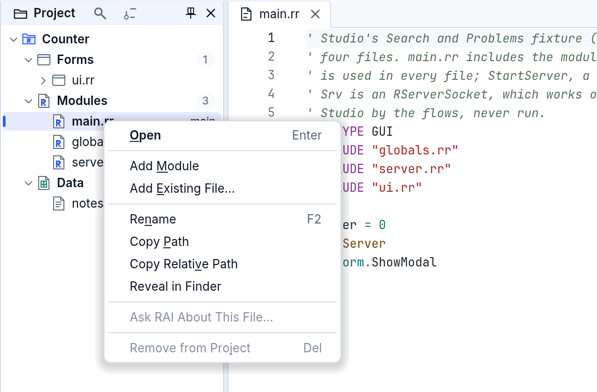
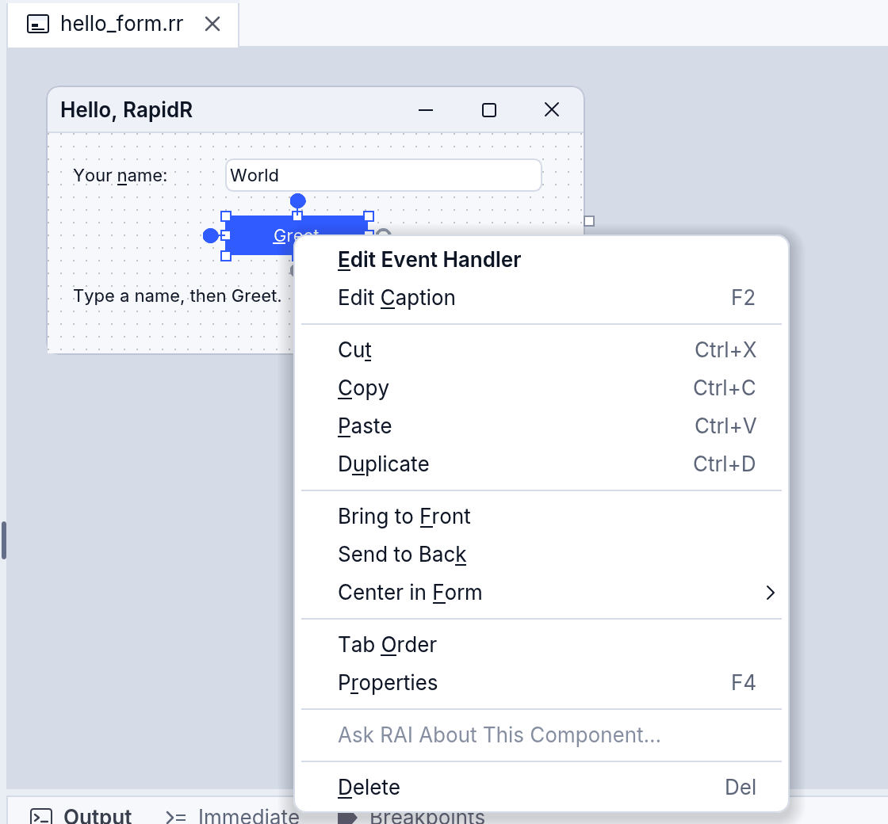
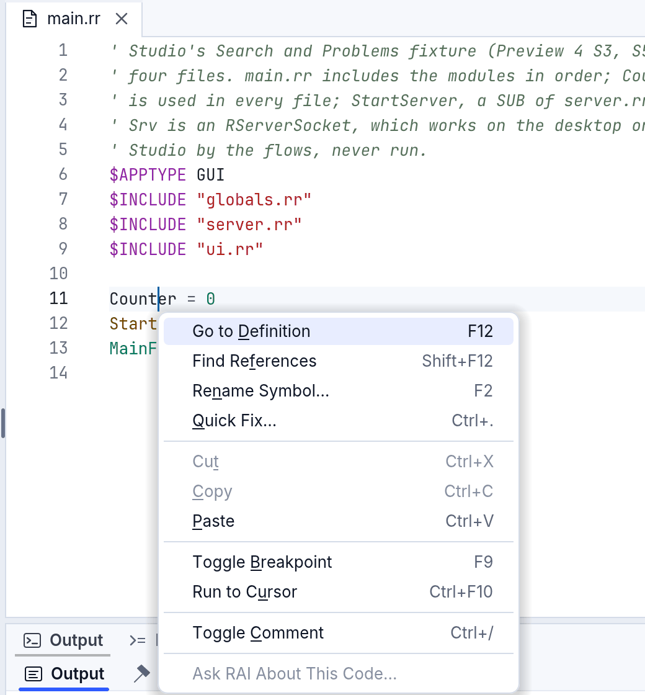
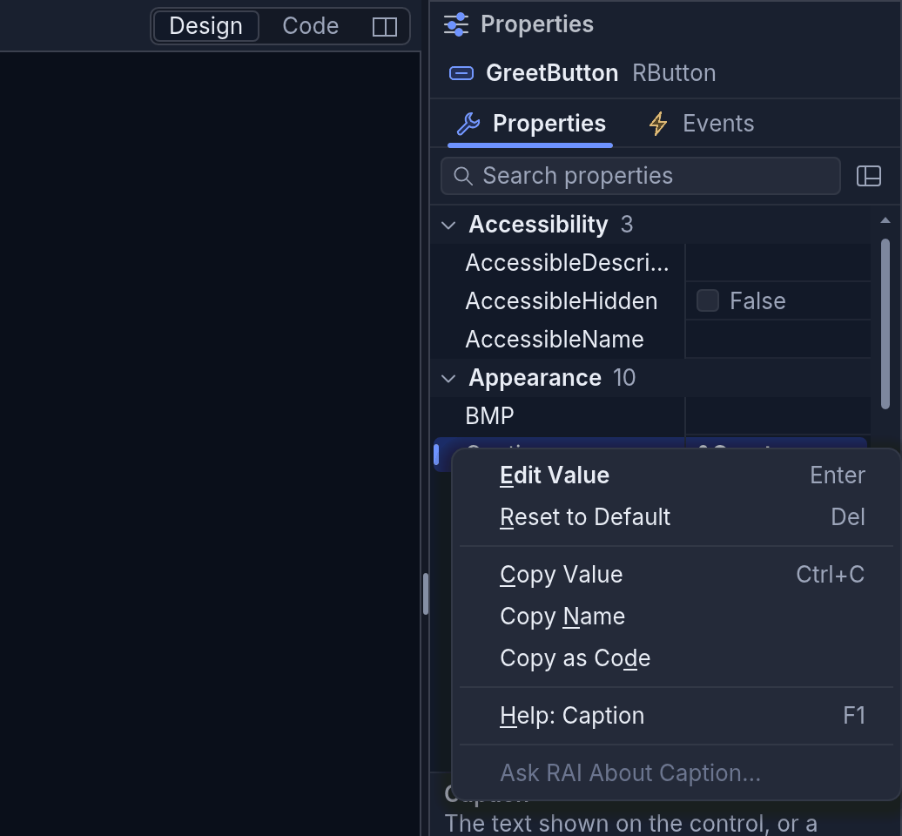
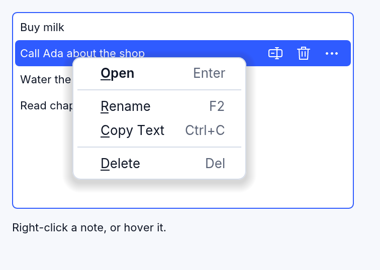
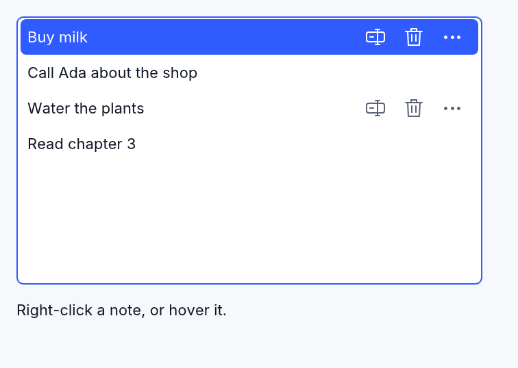

# Menús del clic derecho

Haz clic derecho en casi cualquier cosa de RapidR Studio y aparece un menú
corto con lo que puedes hacer con ella ahí: un archivo en el árbol del
proyecto, la pestaña de un documento, el código, un componente de un
formulario, una fila de Propiedades o de Eventos, un chat del asistente. El
teclado abre los mismos menús, y también un lector de pantalla. Tus propios
programas tienen lo mismo con un evento, `OnContextMenu`, y las listas
pueden mostrar pequeñas acciones con icono en sus filas con `RowActions`.

## Abrir un menú

| Cómo | Dónde se abre el menú |
|---|---|
| Un clic derecho (en un Mac, también un clic con dos dedos o Control-clic) | donde hiciste clic; lo que tocaste se selecciona antes |
| **Mayús+F10** o la **tecla de menú** | debajo de la fila, la pestaña o el componente seleccionado, o debajo del cursor en el código; su primer elemento ya está elegido |
| El «mostrar menú» de un lector de pantalla (VoiceOver: VO+Mayús+M) | igual que el teclado |

En el menú: las flechas se mueven, **Intro** elige, la letra subrayada
elige su elemento, **Esc** cierra el menú y te devuelve adonde estabas.

Todos los menús siguen las mismas reglas, así que siempre sabes dónde mirar:

- **La acción predeterminada va primero, en negrita**: lo que hace allí un
  doble clic o Intro (Abrir para un archivo, Editar el valor para una
  propiedad).
- **Se muestran las teclas** junto a cada elemento, en un color más suave:
  el menú te enseña el atajo.
- **Los grupos van siempre en el mismo orden**: para qué es, crear algo
  nuevo, editar, buscar y mostrar, lo propio del modo (depurar, versiones,
  la alineación del diseñador), Preguntar a RAI y **al final, lo que hace
  perder algo** (Quitar del proyecto, Eliminar).
- **En gris, no escondido**: un elemento que no se puede usar ahora sale en
  gris y su descripción dice por qué («No hay nada seleccionado», «El
  archivo principal se queda en el proyecto»), así los elementos nunca
  cambian de lugar.
- **Preguntar a RAI nunca envía nada por sí solo**: abre el asistente con el
  archivo, el código o el problema citado en el cuadro de la pregunta; tú
  agregas tu pregunta y pulsas Enviar. Con el Bloqueo escolar apagando la
  IA, el elemento no aparece.

## Los menús de RapidR Studio



| Clic derecho en | Obtienes |
|---|---|
| **Un archivo** del árbol del proyecto | **Abrir**, Abrir el código (un formulario) · Añadir módulo, Agregar archivo existente... · Renombrar (F2), Copiar ruta, Copiar ruta relativa, Mostrar en Finder (Explorador de archivos, Archivos) · Ver el historial (un proyecto con versiones) · Preguntar a RAI sobre este archivo... · Quitar del proyecto (Supr: el archivo se queda en el disco) |
| **Una carpeta** o **un grupo** (Forms, Modules…) | Agregar formulario (un grupo), Añadir módulo, Agregar archivo existente..., Agregar carpeta... · Copiar ruta, Copiar ruta relativa, Mostrar (una carpeta) · Contraer todo |
| **El proyecto** (su propia fila) | Agregar formulario, Añadir módulo, Agregar archivo existente..., Agregar carpeta... · Copiar ruta, Mostrar · Guardar una versión... (o Empezar a versionar este proyecto), Contraer todo · Preguntar a RAI sobre este proyecto... · Opciones del proyecto... · Cerrar el proyecto |
| **La pestaña de un documento** | Cerrar documento (Ctrl+W), Cerrar los demás, Cerrar los de la derecha, Cerrar los guardados, Cerrar todos los documentos · Copiar ruta, Copiar ruta relativa, Mostrar, Mostrar en el proyecto · Dividir a la derecha, Dividir hacia abajo · Historial local de este archivo... |
| **El código** | Ir a la definición (F12), Buscar referencias (Mayús+F12), Cambiar nombre del símbolo... (F2), Corrección rápida... (Ctrl+.) · Cortar, Copiar, Pegar · Alternar punto de interrupción (F9), Ejecutar hasta el cursor (y, en pausa, Establecer la siguiente instrucción, Agregar inspección) · Alternar comentario, Versiones ▸ · Preguntar a RAI sobre este código... |
| **Un componente** de un formulario | **Editar el manejador del evento**, Editar el texto (F2) · Cortar, Copiar, Pegar, Duplicar · Traer al frente, Enviar al fondo, Centrar en el formulario ▸ · Orden de tabulación, Propiedades (F4) · Preguntar a RAI sobre este componente... · Eliminar (Supr) |
| **Varios componentes** | Alinear ▸, Igualar el tamaño ▸, Espaciar por igual ▸ · Cortar, Copiar, Pegar, Duplicar · Traer al frente, Enviar al fondo · Propiedades · Preguntar a RAI · Eliminar |
| **El formulario** mismo | Pegar, Seleccionar todo · Editor de menús, Orden de tabulación · Zoom ▸ · Código (F7), Propiedades · Preguntar a RAI sobre este formulario... |
| **Una propiedad** | **Editar el valor** (Intro), Restablecer el valor predeterminado (Supr) · Copiar el valor, Copiar el nombre, Copiar como código (`GreetButton.Caption = "Greet"`) · Ayuda: Caption (F1) · Preguntar a RAI sobre Caption... |
| **Un evento** | **Ir al manejador** (o Crear el manejador), Quitar el manejador (Supr: el SUB se queda en el código) · Copiar el nombre, Copiar como código · Ayuda (F1) · Preguntar a RAI |
| **Un chat** del asistente | **Abrir** (Intro) · Renombrar (F2) · Eliminar (Supr) |

Los nombres exactos de los elementos son los de los menús de Studio en tu
idioma.





Los menús los dibuja RapidR mismo, con el aspecto de Studio (claro,
oscuro, alto contraste), así que aparecen en capturas y grabaciones, y RAI
y las apps de IA pueden ver y elegir sus elementos como tú.



### Los chats del asistente

Haz clic en un chat para abrirlo (las flechas solo se mueven por la lista;
Intro abre). La fila bajo el mouse, y la fila seleccionada, muestran tres
botones pequeños: **Renombrar** (F2), **Eliminar** (Supr) y **Más** (el
menú de la fila, también Mayús+F10). Eliminar actúa enseguida y ofrece
**Deshacer** junto a la lista, por eso no pregunta antes. Sin chats todavía,
la lista muestra **Empezar un chat**.

## En tus propios programas

### OnContextMenu

Todo componente que puede tomar el teclado tiene `OnContextMenu (X, Y,
Key)` (de RapidR):

| Argumento | |
|---|---|
| `X`, `Y` | dónde va el menú, en los píxeles del propio componente: donde la persona hizo clic, o debajo del elemento seleccionado cuando lo pidió el teclado |
| `Key` | cómo lo pidió la persona: `0` el mouse, `1` Mayús+F10 o la tecla de menú, `3` un lector de pantalla, `4` el botón Más de una fila (`X`, `Y` su esquina inferior derecha: abre allí el menú alineado a la derecha) |

Muestra tu menú con `PopupAt`:

```basic
CREATE NoteMenu AS RPopupMenu
  SystemMenu = 0                 ' lo dibuja RapidR: tu aspecto, visible para las herramientas de IA
  CREATE OpenItem AS RMenuItem
    Caption = "&Open" + CHR$(9) + "Enter"     ' las teclas después de un Tab
    Default = 1                  ' en negrita: lo que hace un doble clic
  END CREATE
END CREATE

SUB NotesMenu (X AS INTEGER, Y AS INTEGER, Key AS INTEGER, Sender AS RListBox)
  IF Sender.ContextIndex < 0 THEN EXIT SUB
  Sender.ItemIndex = Sender.ContextIndex      ' un clic derecho no selecciona por sí solo
  IF Key = 4 THEN NoteMenu.Alignment = 1 ELSE NoteMenu.Alignment = 0
  NoteMenu.PopupAt Sender, X, Y
END SUB

Notes.OnContextMenu = NotesMenu
```

- Una lista dice para qué elemento es el menú en **`ContextIndex`**: el del
  clic derecho (un clic derecho no cambia la selección, como antes), el
  seleccionado para el teclado, o la fila cuyo botón Más se pulsó.
- Un componente con un **`PopupMenu`** y sin `OnContextMenu` abre ese menú
  por sí solo, como siempre con el clic derecho, y en un programa de RapidR
  (`.rr`) también desde el teclado; un programa clásico (`.bas`, `.rqw`)
  conserva solo el clic derecho. Asigna `OnContextMenu` y decide tu manejador.
- **`RMenuItem.Default`** dibuja un elemento en negrita; **`RPopupMenu.SystemMenu = 0`**
  hace que RapidR dibuje el menú en todos los sistemas (por defecto macOS y
  Windows muestran el suyo).
- Un administrador de paneles dice en qué pestaña de documento fue el clic
  derecho en **`ContextDocument`**.



### RowActions: botones pequeños en las filas de una lista

```basic
Notes.RowActions = "rename:Renombrar (F2),delete:Eliminar (Supr),more:Más acciones (Mayús+F10)"
Notes.OnRowAction = NotesAction

SUB NotesAction (Index AS INTEGER, Action AS STRING, Sender AS RListBox)
  IF Action = "delete" THEN Sender.DelItems Index
END SUB
```

Hasta tres acciones, cada una un nombre de icono de RapidR con su ayuda
después de dos puntos. Se muestran en la fila bajo el mouse y en la fila
seleccionada de una lista que tiene el teclado —nunca solo bajo el mouse,
así el teclado y las pantallas táctiles también las tienen—. **F2** es
`rename` y **Supr** `delete` en la fila seleccionada; **`more`** abre el
`OnContextMenu` de la fila (`Key` 4). Pon también cada acción de fila en el
menú de la lista.



El ejemplo completo es [context_menus.rr](../../../examples/gui/context_menus.rr):
`rapidr run examples/gui/context_menus.rr`.

### Para las herramientas de IA

`app_layout` enumera los elementos de un menú abierto, y `app_click` con
`menu` («NoteMenu > Rename») elige uno, también con un clic derecho: los
menús que dibuja RapidR los ven y los usan RAI y las apps de IA igual que
una persona ([Apps de IA](ai-apps.md), [ojos y manos](app-eyes-and-hands.md)).
