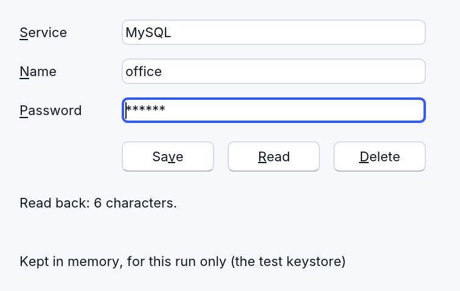

<!-- translated-from: secrets.md 189796fbdc1097b0 -->
# Guardar secretos: RSecrets

<!-- legal -->
`RSecrets` guarda contraseñas, tokens y claves en el llavero del sistema
operativo, nunca en el programa, en un archivo ni en su configuración:

- el llavero de macOS;
- el Administrador de credenciales de Windows;
- el Secret Service de Linux (GNOME Keyring o KWallet).

<!-- legal -->
RapidR Studio guarda sus claves de IA de la misma manera, con el mismo código.



El ejemplo es [examples/data/secrets.rr](../../../examples/data/secrets.rr):
`rapidr run data/secrets.rr` desde la carpeta de ejemplos.

## Guardar, leer, eliminar

Un secreto tiene un servicio y un nombre, ambos con tus propias palabras. El
servicio dice para qué sirve (`"MySQL"`), y el nombre cuál de ellos (`"office"`).

```basic
DIM Secrets AS RSecrets

IF Secrets.Save("MySQL", "office", PasswordEdit.Text) THEN
    PasswordEdit.Text = ""
END IF

pw$ = Secrets.Read("MySQL", "office")       ' "" cuando no hay nada guardado
IF Secrets.Exists("MySQL", "office") THEN Secrets.Delete "MySQL", "office"
```

| Miembro | Qué hace |
|---|---|
| `Save(Service, Name, Value)` | Guarda `Value` y reemplaza lo que había guardado ahí. Da True cuando se guardó. |
| `Read(Service, Name)` | Lo que está guardado, o `""` cuando no hay nada (`Exists` permite distinguir los dos casos). |
| `Delete(Service, Name)` | Lo elimina. Da True cuando había algo. |
| `Exists(Service, Name)` | Da True cuando hay algo guardado. |
| `Error` | Por qué falló la última llamada, `""` cuando funcionó. Nunca contiene el valor. |
| `Available` | Da True donde se pueden guardar secretos. |
| `Store` | Dónde se guardan, en palabras: "the macOS Keychain" … |
| `Program` | La identidad bajo la que se guardan los secretos de este programa. |

<!-- legal -->
Un valor tiene como máximo 1024 caracteres, y uno vacío se rechaza (usa
`Delete`). Un servicio o un nombre no pueden estar vacíos ni contener un salto de
línea.

## Cada programa tiene los suyos

<!-- legal -->
Los secretos de un programa se guardan bajo su propia identidad, que da
`Program`:

<!-- legal -->
- **un archivo de programa** (`main.rr`, `dbstudio.rr`, un `.exe` compilado o un
  programa de Linux): su nombre y un resumen criptográfico (*digest*) de dónde
  está el archivo, así que el servicio `MySQL` de
  `/Users/me/apps/dbstudio.rr` es el elemento del llavero
  `rapidr-app:dbstudio~1a2b3c4d5e6f7081:MySQL`. Dos programas llamados
  `main.rr` en dos carpetas son dos programas y nunca comparten un secreto. Un
  programa que se mueve a otra carpeta empieza sin sus secretos: guárdalos de
  nuevo;
<!-- legal -->
- **una aplicación de macOS compilada**: su identificador de paquete
  (`com.example.dbstudio`, el *Bundle ID* del proyecto), esté donde esté la
  aplicación.

<!-- legal -->
Ningún programa llega a los secretos de otro programa, ni a las claves de RapidR
Studio, a través de RSecrets. Los secretos guardados antes de Preview 4 se
guardaban solo bajo el nombre del archivo (`rapidr-app:dbstudio:MySQL`): nada en
ellos dice qué programa los guardó, así que ningún programa los lee ya.
Guárdalos de nuevo (Acceso a Llaveros (*Keychain Access*), o el Administrador de
credenciales de Windows, pueden eliminar los elementos antiguos).

<!-- legal -->
Dentro de tu cuenta de usuario esto mantiene separados a los programas; no es
una barrera contra un programa que ejecutas y que reescribe el archivo de otro
programa. Ejecuta solo programas de confianza.

<!-- legal -->
El sistema operativo puede preguntarle una vez al usuario si un programa puede
usar el llavero, por ejemplo la primera vez que una aplicación recién compilada
lee un elemento que guardó una compilación anterior.

## Nunca se muestran

<!-- legal -->
Lo que devuelve `Read` y lo que se le da a `Save` son credenciales:

<!-- legal -->
- **El depurador** muestra `••••` para una variable, una expresión observada o
  una sugerencia de datos que contiene una, y un mensaje de registro (un punto
  de registro) la enmascara. Las propiedades secretas de un componente, como
  `RMySQL.Password` y `RAI.APIKey`, también muestran `••••`.
<!-- legal -->
- **Nunca se le da a una IA.** El registro del lenguaje marca `Read` y `Save`
  como `secret`, y lo que RapidR le da a una IA sobre un programa (los valores
  del depurador, las propiedades secretas de un componente) muestra `••••` en su
  lugar. El texto que imprime tu programa es cosa tuya, así que no imprimas
  secretos.
<!-- legal -->
- **Los mensajes propios de RapidR** nunca lo imprimen. `Error` nunca lo
  contiene.

<!-- legal -->
Tu programa sí puede usar el valor, por supuesto: un `PRINT pw$` lo imprime,
como en cualquier BASIC.

## En un navegador

<!-- legal -->
Una página web no tiene llavero, y RapidR nunca guarda secretos en el
almacenamiento de la página, donde cualquier script de la página podría leerlos.
En la web `Available` es False, y toda llamada falla con "RSecrets isn't
available in the browser" en `Error`. Pídele la contraseña al usuario cada vez.

## Pruebas

<!-- legal -->
`RAPIDR_AI_KEYSTORE=memory` (o `RAPIDR_KEYSTORE=memory`) guarda todo en la
memoria del programa durante esa ejecución, y el llavero nunca se toca. Las
pruebas propias de RapidR siempre se ejecutan así. `Store` dice entonces "memory,
for this run only (the test keystore)".
