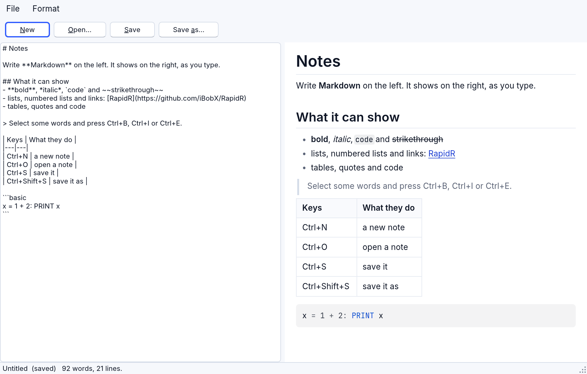
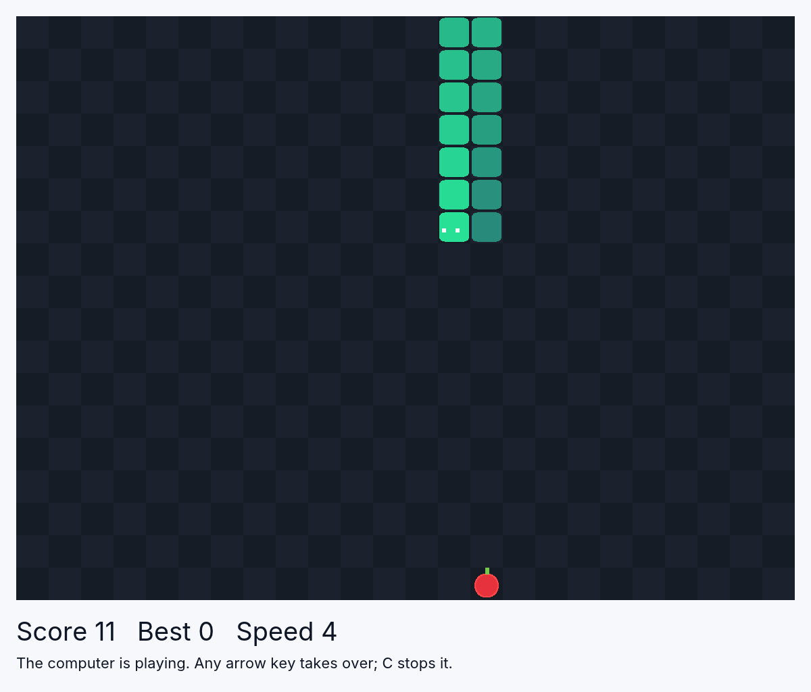

<!-- translated-from: showcase.md 22651e279be65721 -->
# Galería: programas más grandes

<!-- legal -->
Estos programas están en [`examples/showcase/`](../../../examples/showcase/),
cada uno un programa completo en un solo archivo, escrito a partir de una idea y
de nada más: no se copió el código de nadie, los datos los inventan los
programas (salvo el del clima, que consulta un servicio meteorológico público),
y cada uno usa solo lo que RapidR tiene hoy. Ábrelos en RapidR Studio desde
**Abrir un ejemplo** en la página de bienvenida (los muestra junto con los demás
ejemplos), o ejecútalos desde una terminal; las primeras líneas de cada uno
dicen cómo.

Todos se ejecutan como los ejecuta el intérprete (`rapidr run`), como un
ejecutable independiente creado con `--interp`, como una compilación nativa y en
un navegador, y siguen el aspecto claro, oscuro o de contraste alto del sistema.
Cuando un programa necesita algo que un navegador no puede darle, su sección lo
dice.

| Programa | Qué muestra |
|---|---|
| [Fuegos artificiales](#fireworks) | miles de chispas, cada una con su propia física; RNum dibuja las formas |
| [Notas](#notes) | una aplicación de notas en Markdown con vista previa en vivo; archivos en el escritorio, el almacenamiento del navegador en la web |
| [Un juego de la serpiente](#a-snake-game) | un juego solo para el teclado: un `RCanvas`, un `RTimer`, arreglos (arrays) para la serpiente |
| [Los mismos números](#same-numbers) | cuatro conjuntos de puntos con exactamente las mismas estadísticas y cuatro imágenes distintas, hechas por el programa |
| [Pi con dardos](#pi-by-darts) | RNum lanza y cuenta miles de dardos al azar; la estimación y su error se actualizan en vivo |
| [Un planeta](#a-planet) | un planeta 3D iluminado y sombreado, con un anillo y una luna, construido a partir de caras |
| [Laboratorio de señales](#signal-lab) | un generador de señales, un osciloscopio que un disparador mantiene quieto, y una FFT escrita en BASIC |
| [Un visualizador MIDI](#a-midi-visualizer) | una escena 3D que baila al ritmo de una canción que el propio programa lee |

## Fuegos artificiales

[`fireworks.rr`](../../../examples/showcase/fireworks.rr): haz clic en el cielo,
o presiona la barra espaciadora, y un cohete sube y estalla en una esfera, un
anillo, dos anillos o un corazón. Las teclas 1 a 4 eligen la forma, 0 deja que
el programa elija, A activa un espectáculo automático. La esquina muestra
cuántas chispas están volando y a cuántos cuadros por segundo dibuja el
programa. La ventana no tiene botones a propósito: se juega con las teclas y con
el mouse sobre el cielo, y la línea de debajo dice qué tecla hace qué.


Cada chispa es un lugar en un conjunto de arreglos. Esto es toda la vida de una
chispa, una vez por cuadro, para cada chispa que sigue volando:

```basic
svy(i) = (svy(i) + GRAVITY * dt) * drag      ' la gravedad la atrae hacia abajo, el aire la frena
svx(i) = svx(i) * drag
sx(i) = sx(i) + svx(i) * dt                  ' se mueve
sy(i) = sy(i) + svy(i) * dt
f = f - fade(i) * dt                         ' y su vida se agota
```

`dt` es el tiempo transcurrido desde el cuadro anterior, así que las chispas
vuelan a la misma velocidad en una computadora lenta y en una rápida. Una chispa
se dibuja como una línea corta desde donde está hasta donde acaba de estar, de un
color que se atenúa cuando su vida termina:

```basic
c = RGB(8 + cr(i) * br, 10 + cg(i) * br, 28 + cb(i) * br)
Sky.Line sx(i), sy(i), sx(i) - svx(i) * dt * 4, sy(i) - svy(i) * dt * 4, c
```

Las chispas nuevas toman el siguiente lugar libre en los arreglos, y cuando los
arreglos están llenos la chispa más antigua deja su lugar
(`head = (head + 1) MOD MAXSPARKS`), así que el programa nunca reserva memoria
mientras se ejecuta.

**Las formas son cálculos sobre arreglos completos.** Un estallido de `n`
chispas necesita `n` ángulos alrededor de un círculo y una velocidad para cada
una. `RNum`, el arreglo de números de RapidR, los crea en un solo paso cada uno,
sin ningún ciclo:

```basic
Ang.Linspace 0, PI2, n                 ' n ángulos alrededor del círculo
Ang.Add(RND * PI2)                     ' girados una cantidad al azar
Spd.Uniform 0.35, 1, n                 ' velocidades, del 35% al 100% completo
Vx.Data = Ang.Data: Vx.Cos             ' la dirección: coseno y seno del ángulo
Vy.Data = Ang.Data: Vy.Sin
```

Un anillo es lo mismo con todas las velocidades iguales (`Spd.Full n, 1`). El
corazón es la curva clásica del corazón, calculada sobre el arreglo completo:
`Vx.Sin`, luego `Vx.Power 3` y luego `Vx.Multiply 16` dan dieciséis veces el cubo
del seno de cada ángulo, en tres instrucciones.

**Los cuadros vienen de un `RDXTimer`.** `RDXScreen` es una superficie sobre la
que dibuja el programa y que se muestra con `Flip`; el temporizador con
`Interval = 0` se dispara una vez por cuadro, y su propiedad `FrameRate` es el
número de la esquina. El programa dibuja unas dos mil líneas por cuadro, y esto
es lo que mide:

| Dónde | Chispas | Cuadros por segundo |
|---|---|---|
| El intérprete en una Mac (sin pantalla, dibujo por software) | unas 1000 | 38 a 46 |
| El navegador (Chromium sin pantalla) | unas 1800 | 35 |
| El navegador (Chromium sin pantalla) | 2500 a 2900 | 27 a 40 |

El costo son las llamadas de dibujo: cada una tarda unos 5 microsegundos, así
que 2000 chispas son unos 10 milisegundos de los 16 o 33 del cuadro; la
aritmética de todas ellas tarda menos de un milisegundo.

## Notas

[`notes.rr`](../../../examples/showcase/notes.rr) es una pequeña aplicación de
notas que entiende Markdown. Escribe a la izquierda; la derecha muestra la nota
con formato, mientras escribes: encabezados, listas, tablas, citas, código,
**negrita** y *cursiva*, y enlaces en los que puedes hacer clic (se abren en el
navegador). **New**, **Open** y **Save** funcionan con archivos y tienen las
teclas habituales (Ctrl+N, Ctrl+O, Ctrl+S, Ctrl+Shift+S, en una Mac con Cmd en
lugar de Ctrl); el menú **Format** pone marcas alrededor del texto seleccionado
(Ctrl+B negrita, Ctrl+I cursiva, Ctrl+E código). El nombre de la nota y si está
guardada aparecen en el título y debajo de la ventana, con un conteo de palabras
y de líneas. Los cambios nunca se pierden sin preguntar: New, Open y cerrar la
ventana preguntan antes “Save the changes?”.



La vista previa sigue lo que escribes con una sola línea, en el evento
`OnChange` del editor:

```basic
SUB Edited
    Preview.Text = Editor.Text
    dirty = 1
    IF onWeb THEN storeDue = TIMER + 0.6
    ShowStatus
END SUB
```

`Editor` es un `RMemo` (un cuadro de texto) y `Preview` un `RMarkdownView`, que
dibuja Markdown como lo hace el manual, con el tema del programa y legible para
un lector de pantalla. Los dos están uno al lado del otro con un `RSplitter`
entre ellos, colocados con `Align` (`alLeft`, `alLeft`, `alClient`), de modo que
la ventana puede tener cualquier tamaño y la línea se puede arrastrar.

**Archivos.** Open y Save usan los cuadros de diálogo del sistema
(`ROpenDialog`, `RSaveDialog`) y los propios `LoadFromFile` y `SaveToFile` del
memo. Un navegador no tiene carpetas que darle a una página, así que allí esos
mismos cuadros de diálogo son los selectores del navegador (la página del manual
sobre la web dice qué hace cada navegador).

<!-- legal -->
**En un navegador la nota también se guarda en el almacenamiento del
navegador.** `RWebStorage` guarda cadenas de texto por nombre en el
`localStorage` de la página: un momento después de que dejas de escribir (con un
temporizador, para que no escriba cada tecla) se guardan la nota y el nombre de
su archivo, y cuando la página se abre de nuevo se leen de vuelta:

```basic
Store.Set("rapidr.notes.text", t)
...
IF Store.HasKey("rapidr.notes.text") THEN Editor.Text = Store.Get("rapidr.notes.text")
```

`RWebStorage` existe solo en los navegadores; en el escritorio sus métodos no
hacen nada e imprimen una advertencia. El programa averigua si está en un
navegador mirando el nombre de su propio archivo, `Application.ExeName`, que en
un navegador es la página (`index.html`):
`onWeb = (RIGHT$(LCASE$(Application.ExeName), 5) = ".html")`. (RapidR todavía no
tiene una forma directa de preguntarlo.)

## Un juego de la serpiente

[`snake.rr`](../../../examples/showcase/snake.rr): guía la serpiente con las
teclas de flecha (o W A S D) hacia las manzanas; cada una la hace más larga y el
juego más rápido; termina cuando la serpiente choca con una pared o consigo
misma. La **barra espaciadora** (o Enter, P, o un clic en el tablero) inicia,
pausa y vuelve a iniciar. La ventana no tiene botones: se juega con las teclas, y
muestra el puntaje, el mejor puntaje de la sesión y la velocidad.



La serpiente son dos arreglos, `bx` y `by`: las casillas que cubre, empezando por
la cabeza. Un paso mueve cada casilla al lugar de la que tiene delante y pone la
cabeza una casilla más adelante:

```basic
IF ate THEN length = length + 1
FOR i = length - 1 TO 1 STEP -1
    bx(i) = bx(i - 1): by(i) = by(i - 1)
NEXT
bx(0) = nx: by(0) = ny
```

Cuando come, `length` aumentó primero, así que la cola no se aleja: eso es todo
lo que es “crecer”. Chocar consigo misma es un ciclo sobre las casillas: aquella
a la que va la cabeza no puede ser ninguna de ellas (la casilla de la cola no
cuenta a menos que la serpiente acabe de crecer, porque se aleja en el mismo
momento).

Las teclas pueden llegar más rápido que los pasos, y un juego que respondiera a
cada una de inmediato dejaría que una rápida Izquierda seguida de Abajo hiciera
girar a la serpiente sobre sí misma entre dos pasos. Por eso `AskTurn` mantiene
en espera como máximo dos giros, nunca uno directamente hacia atrás y nunca en la
dirección en que ya va, y un paso toma el más antiguo. Las teclas las oye el
formulario (`OnKeyDown = FormKey`), porque nada en la ventana toma el foco del
teclado: no hay botones, así que la barra espaciadora tampoco puede presionar
uno. La velocidad es el `Interval` del temporizador, que se reduce cada tres
manzanas:

```basic
speed = 1 + score \ 3
Clock.Interval = 140 - 7 * (speed - 1)
```

**La computadora puede jugar.** Presiona **C** y la computadora dirige la
serpiente (cualquier tecla de flecha te devuelve el juego): en cada paso
`AutoSteer` mira qué pasa si sigue recto, a la izquierda y a la derecha, descarta
las que chocan con una pared o con la serpiente, y toma la que termina más cerca
de la manzana. Son pocas líneas, no es inteligente (a veces se encierra a sí
misma), y juega el tiempo suficiente para mostrar una serpiente larga, como en la
imagen. Un número después del nombre del programa (`rapidr run snake.rr 7`) hace
que las manzanas aparezcan siempre en los mismos lugares.

El tablero es un `RCanvas`. Su `OnPaint` dibuja el tablero de ajedrez, la
manzana, la serpiente (más brillante en la cabeza) y, cuando el juego no está en
marcha, un velo con las palabras; cada paso termina con `Board.Repaint`. La
primera manzana está siempre justo delante de la serpiente, así que el primer
movimiento es fácil; las demás se colocan en cualquier casilla libre.

## Los mismos números

[`same_numbers.rr`](../../../examples/showcase/same_numbers.rr) muestra cuánto
puede ocultar un puñado de números. Cuatro conjuntos de puntos están construidos
para tener la misma media y dispersión en x y en y, la misma correlación y por lo
tanto la misma recta de mejor ajuste, y aun así uno es una nube dispersa
alrededor de una recta, otro una curva, otro una recta con un punto aislado y
otro una columna de puntos con un solo punto lejano. Debajo de cada gráfico están
los números, **medidos a partir de los puntos dibujados** con `RNum`; salen
iguales las cuatro veces. **New points** crea otros cuatro conjuntos con los
mismos números; **Show the line of best fit** activa o desactiva la recta. (Una
idea mostrada por primera vez por F. J. Anscombe en 1973; los puntos de aquí los
crea el programa, no están copiados.)


**Cómo los crea el programa.** No busca puntos afortunados; construye cada
conjunto de modo que los números salgan bien. Haz que x tenga media 0 y
dispersión 1 (`xs`). Toma una “forma” (ruido aleatorio, el cuadrado de x, un
punto puesto en 1, una rampa) y quítale su media y todo lo que tiene en común
con x:

```basic
dot = 0
FOR i = 0 TO N - 1: dot = dot + (ss(i) - m) * xs(i): NEXT
dot = dot / N
FOR i = 0 TO N - 1: ss(i) = ss(i) - m - dot * xs(i): NEXT
```

Lo que queda, escalado a dispersión 1, es una forma exactamente sin correlación
con x. Entonces y es una mezcla de x y la forma, y su correlación con x es
exactamente la deseada, `R`:

```basic
ys = R * xs(i) + SQR(1 - R * R) * ss(i) / ssv
px(k, i) = MX + SX * xs(i)
py(k, i) = MY + SY * ys
```

Las dos últimas líneas estiran ambas a la media y la dispersión deseadas. Como la
correlación, las dos dispersiones y las dos medias son iguales, también lo es la
recta: su pendiente es la correlación por la dispersión de y sobre la dispersión
de x. La curva es el cuadrado de x mezclado, el punto aislado es una forma que
vale 0 en todas partes menos en un lugar (los demás puntos quedan entonces
exactamente sobre una recta), y la columna pone todas las x en un solo valor
salvo una.

**Los números que se muestran se miden, no se prometen.** `Describe` llena un
`RNum` con la x y la y de cada conjunto y le pregunta:

```basic
mx = Xs4(k).Mean: my = Ys4(k).Mean
sdx = Xs4(k).Std: sdy = Ys4(k).Std
cov = Tmp.Mean - mx * my                    ' Tmp guarda x * y de cada punto
rr = cov / (sdx * sdy)
```

Cada gráfico es un `RPlot` creado en código (`DIM Chart(3) AS RPlot`, luego
`Chart(q).Parent = Form` y su posición) con una serie `Scatter` para los puntos y
una serie `Plot` para la recta, los cuatro en los mismos ejes (`Xlim`, `Ylim`)
para que se puedan comparar sus formas. `DrawCharts` los vuelve a dibujar cada
vez que se activa o desactiva la recta (`Clear` también borra los ejes, así que
los establece cada vez), y `LayOut`, llamado desde el `OnResize` del formulario,
reparte los cuatro gráficos y sus números según el tamaño que tenga la ventana.

## Pi con dardos

[`monte_carlo_pi.rr`](../../../examples/showcase/monte_carlo_pi.rr): dardos al
azar caen en un cuadrado. Los que caen dentro del círculo que cabe justo en él
son azules, los demás naranjas. El círculo es pi/4 del cuadrado, así que cuatro
veces la proporción de dardos dentro estima pi, y cuantos más dardos, mejor. La
ventana muestra la estimación, cuánto se aleja (y en porcentaje), cuál sería un
error típico con esa cantidad de dardos, y un gráfico de la estimación
asentándose en pi. El control deslizante fija la velocidad desde 30 dardos por
segundo hasta 300 000; **Pause** y **Reset** hacen lo que dicen.


Un lote de dardos lo lanza y lo cuenta `RNum`, los arreglos numéricos, en unas
pocas instrucciones para todo el lote, tenga los dardos que tenga:

```basic
Dx.Uniform -1, 1, batch                      ' la x y la y de cada dardo, en el cuadrado
Dy.Uniform -1, 1, batch
R2.Data = Dx.Data: R2.Square                 ' x * x
T.Data = Dy.Data: T.Square                   ' y * y
R2.Add "T"                                   ' x * x + y * y: la distancia al cuadrado
R2.Subtract 1: R2.Sign: R2.Clip 0, 1         ' 1 donde es mayor que 1: fuera
outside = R2.Sum
```

`Sign` convierte cada número en -1, 0 o 1, `Clip 0, 1` conserva los 1 (los
dardos de fuera) y `Sum` los cuenta: por eso el control deslizante puede llegar a
300 000 dardos por segundo mientras el programa dibuja solo los primeros 3000
como puntos (un punto necesita una llamada a un método propia: `InX.Push x`). La
x del gráfico es el número de dardos como potencia de diez
(`LOG(total) / LOG(10)`), de modo que se ven tanto las estimaciones iniciales,
erráticas, como las posteriores, tranquilas. Las dos imágenes son componentes
`RPlot` del formulario: el programa cambia sus series y llama a `Show`;
`Board.Scatter(InX, InY, "inside", "royalblue")` es una serie de puntos,
`Settle.Hline PI, "darkorange", "pi"` la línea en la que se asienta la
estimación.

## Un planeta

[`spin3d.rr`](../../../examples/showcase/spin3d.rr): un planeta con océanos,
tierra y casquetes de hielo, un anillo y una luna que gira a su alrededor, frente
a las estrellas, iluminado por un sol. Las **teclas de flecha izquierda y
derecha** frenan y aceleran el giro del planeta, y **abajo y arriba** el
recorrido de la luna; los cuatro botones hacen lo mismo.


Todo lo construye el programa a partir de caras, una cara siendo un polígono
plano con un color. Las esquinas de una cara se enumeran en sentido horario vistas
desde fuera, que es como Direct3D reconoce su frente, el lado que se dibuja. El
planeta es una esfera de 36 anillos de 72 caras; las líneas que importan en
`BuildPlanet`:

```basic
DX.CreateFace(Face)
Face.AddVertex(radius * SIN(a0) * COS(b1), radius * COS(a0), radius * SIN(a0) * SIN(b1))
...
land = SIN(3 * bm + 2 * SIN(2 * am)) + SIN(2 * am * 2.5 + bm * 1.5) + 0.6 * SIN(7 * bm - 3 * am)
IF land > 0.55 THEN Face.SetColorRGB(0.28 * shade, 0.58 * shade, 0.24 * shade)
MB.AddFace(Face)
```

`a` es el ángulo desde el polo norte y `b` el ángulo alrededor del eje; la tierra
está donde tres ondas de distintos tamaños, superpuestas, son altas, lo que crea
continentes (y el mismo planeta cada vez). El hielo está cerca de los polos.

**Los marcos lo ponen en movimiento.** Un marco es un lugar de la escena; lo que
está unido a él va adonde él va. El planeta, el anillo y la órbita de la luna
están en un marco que se inclina 23 grados
(`Tilt.SetOrientation(0, 0, 1, 0.4, 0.92, 0)`: los tres últimos números indican
hacia dónde es arriba para él), de modo que todo gira alrededor del eje inclinado
del planeta. En cada cuadro el programa dice cuánto gira cada parte, y llama a
`DX.Move(1)`:

```basic
PlanetFrame.SetRotation(0, 1, 0, spinSpeed * dt)
MoonOrbit.SetRotation(0, 1, 0, moonSpeed * dt)
MoonFrame.SetRotation(0, 1, 0, 1.5 * dt)
DX.Move(1)
```

La luna está a 3.5 de distancia hacia un lado en `MoonOrbit`, que gira, así que
da vueltas alrededor; su propio marco la hace girar sobre sí misma. El planeta es
liso (el sombreado de Gouraud predeterminado combina la luz entre las caras) y la
luna, creada con `SetQuality(D3DRMRENDER_FLAT)`, muestra sus facetas. Las
estrellas son 700 cuadrados diminutos y lejanos dibujados “sin iluminar”
(`D3DRMRENDER_UNLITFLAT`), así que son blancas lisas hagan lo que hagan las luces.
Las teclas de flecha llegan primero al formulario (`KeyPreview = 1`), sea cual sea
el botón que tenga el foco.

## Laboratorio de señales

[`signal_lab.rr`](../../../examples/showcase/signal_lab.rr) es un pequeño
instrumento para quienes trabajan en ingeniería y para cualquier persona curiosa
por las ondas. Elige una onda **senoidal**, **cuadrada**, **triangular** o **de
diente de sierra**, ajusta su frecuencia, su amplitud y el ruido que lleva, y
añade un segundo tono. La pantalla de arriba es la señal tal como la muestra un
osciloscopio; la pantalla de abajo es su **espectro** (cuánto hay de cada
frecuencia), con los picos más altos marcados en hertz. Las señales las inventa
el programa, no hay micrófono: RapidR todavía no puede escuchar.


Prueba esto: elige **Square**, apaga el segundo tono y mira el espectro. Una onda
cuadrada es una onda senoidal más sus múltiplos impares, cada uno menor que el
anterior: picos en 438, 1314, 2190, 3066 y 3942 Hz. El sexto pico no es un
múltiplo que encaje: el programa genera 8192 muestras por segundo, así que solo
puede ver hasta 4096 Hz, y el múltiplo número 11 (4818 Hz) se pliega de vuelta a
3374 Hz, como ocurre en un analizador real (aliasing).

**El disparador (trigger).** Un osciloscopio dibuja la señal una y otra vez; el
disparador hace que cada imagen empiece en el mismo punto de la onda, así que se
queda quieta. Aquí recorre el cuadro buscando el primer lugar donde la señal sube
cruzando el cero y empieza a dibujar allí. Desactiva **Trigger** y la onda se
pone a correr de un lado a otro:

```basic
FOR k = 3 TO M - N - 1
    IF sig(k - 2) < 0 AND sig(k - 1) < 0 AND sig(k) >= 0 THEN
        trig = k
        EXIT FOR
    END IF
NEXT
```

(Dos muestras por debajo de cero y luego una en cero o por encima: un poco de
ruido en la señal no puede engañarlo.)

**La FFT.** Una transformada rápida de Fourier convierte 1024 muestras en cuánto
aporta cada frecuencia. El programa tiene la suya, en unas 30 líneas de BASIC
(muestra que RapidR hace aritmética de verdad: esto se ejecuta 30 veces por
segundo, y la FFT de un cuadro tarda de 4 a 6 milisegundos). Primero reordena las
muestras en orden de “bits invertidos”, luego combina pares en grupos de cuatro,
de ocho, y así sucesivamente, con la “mariposa” en su centro:

```basic
tr = wr * re(j) - wi * im(j)
ti = wr * im(j) + wi * re(j)
re(j) = re(i) - tr: im(j) = im(i) - ti
re(i) = re(i) + tr: im(i) = im(i) + ti
```

`re` e `im` guardan las partes real e imaginaria; `wr` y `wi` son el factor de
giro, tomado de una tabla de cosenos y senos creada una sola vez al comienzo.
Antes de la FFT cada muestra se multiplica por una ventana de Hann,
`0.5 - 0.5 * COS(2 * PI * q / (N - 1))`, que vale 0 en los dos extremos del
cuadro, para que los extremos cortados del cuadro no difuminen los picos;
después, el tamaño de cada frecuencia es `SQR(re * re + im * im)`, escalado para
que un tono de amplitud 1 dé 1, y se dibuja en decibeles:
`20 * LOG(mag) / LOG(10)`.

**Los picos** son los puntos más altos que sus dos vecinos y que están a no más de
30 dB del más alto. Un pico entre dos puntos del espectro se encuentra con más
exactitud mediante la parábola que pasa por los tres puntos:
`best + 0.5 * (a - c) / (a - 2 * b + c)` (`a`, `b` y `c` son los decibeles en el
punto anterior, en él y en el posterior), así que 438 Hz se lee como 438 y no como
el múltiplo de 8 más cercano. A un lector de pantalla también se le informan los
picos: la `AccessibleDescription` del espectro es “Peaks at 438 Hz, 683 Hz” y se
renueva una vez por segundo.

Las pantallas son dos componentes `RCanvas` que se dibujan en su `OnPaint`; el
temporizador crea el siguiente cuadro y llama a `Repaint`. Medido, con 1024
puntos por cuadro:

| Dónde | Cuadros por segundo | Crear la señal | La FFT | Un cuadro completo |
|---|---|---|---|---|
| El intérprete en una Mac (sin pantalla) | 30 a 33 | 4 a 6 ms | 4.4 ms | 11 a 14 ms |
| El navegador (Chromium sin pantalla) | 31 | 5.2 ms | 6.2 ms | 14.7 ms |

## Un visualizador MIDI

[`midi_visualizer.rr`](../../../examples/showcase/midi_visualizer.rr): suena una
canción y una escena 3D reacciona a ella, nota por nota. **Load MIDI…** abre
cualquier archivo `.mid` y la misma escena lo sigue; **Play**, **Pause** y
**Stop** hacen lo que dicen; **Loop** reproduce la canción otra vez cuando
termina; **Calm** hace que cada movimiento sea más suave. La canción con la que
se abre es `song.mid`, un ciclo original de 32 compases hecho por
[`make_song.rr`](../../../examples/showcase/make_song.rr) (más abajo).


Qué mueve qué:

| En la canción | En la escena |
|---|---|
| un bombo | el cristal palpita (y el fondo se ilumina un poco) |
| la altura de una nota | el color de su columna y de su chispa: las notas graves azul intenso, luego violeta y rosa, las agudas naranja; y qué tan alto llegan |
| una nota de bajo | un salto bajo de su columna y una sacudida de la cámara |
| las notas por segundo | qué tan rápido gira el anillo |
| un platillo crash o una caja | un empujón al giro |

<!-- legal -->
El color de la luz sobre el suelo sigue las notas con suavidad, a lo largo de un
tercio de segundo, y los pulsos del bombo están separados por al menos un tercio
de segundo, así que nada parpadea: la escena está construida para no ser un
problema para las personas sensibles a las luces intermitentes (sigue la idea de
la regla de los tres destellos, WCAG 2.3.1; no la ha probado nadie del ámbito
médico, y **Calm** suaviza aún más el movimiento).

**El programa lee el archivo MIDI por sí mismo.** Un archivo MIDI es un
encabezado y bloques de eventos, cada evento precedido por un “tiempo delta”, los
tics desde el anterior, escrito como un número de longitud variable: siete bits
por byte, con el bit alto activado en todos los bytes menos el último. Esta
función lee uno:

```basic
FUNCTION ReadVLQ AS LONG
    DIM v AS LONG, b AS INTEGER
    DO
        b = Rd.ReadByte
        v = v * 128 + (b AND 127)
    LOOP WHILE b >= 128
    ReadVLQ = v
END FUNCTION
```

`Rd` es un `RFileStream`; `ReadByte` lee el siguiente byte. Una pista se lee
evento por evento. Un byte de estado inicia un evento, pero un archivo MIDI puede
omitirlo cuando es igual al anterior (“running status”), así que el lector vuelve
a poner el byte cuando no es un estado:

```basic
b = Rd.ReadByte
IF b >= 128 THEN
    status = b
ELSE
    status = run                      ' running status: el byte era un dato
    Rd.Position = Rd.Position - 1
END IF
```

Un evento meta (`&HFF`) lleva el tempo (`&H51`, los microsegundos de un pulso) y
nombres; el lector conserva esos y cada Note On con una velocidad mayor que 0, y
se salta el resto según su longitud. Las notas se cuentan en tics, así que
`TickMs` recorre los cambios de tempo para convertir cada una a milisegundos. Las
notas de todas las pistas se ponen entonces en orden temporal con una sola
ordenación: cada nota se convierte en el número
`milliseconds * 100000 + its number`, y `QUICKSORT` ordena esos números:

```basic
sortKey(i) = INT(TickMs(rawTick(i))) * 100000 + i
...
QUICKSORT sortKey(0), sortKey(noteCount - 1), 0
```

**RMIDI reproduce; el programa vigila el reloj.** `Midi.Timer.Interval = 20`
hace que RMIDI le diga al programa la posición de la canción en milisegundos
cincuenta veces por segundo (`Midi.OnChange = Moved`). En cada cuadro, cada nota
que corresponde mueve algo:

```basic
DO WHILE nextNote < noteCount AND Midi.State = MD_PLAY
    IF noteMs(nextNote) > songPos THEN EXIT DO
    NoteOn noteChan(nextNote), noteKey(nextNote), noteVel(nextNote)
    nextNote = nextNote + 1
LOOP
```

RapidR tiene un sintetizador General MIDI propio, así que la canción se oye en
todos los sistemas y en el navegador, tenga o no uno el sistema. El 3D es
`RDXScreen` con objetos de Direct3D: marcos, luces, una cámara y mallas que el
programa construye a partir de caras (una caja, una bola de cristal y un disco:
`BuildBox`, `BuildBall`, `BuildDisc`). El anillo gira al establecer la rotación
de un marco y llamar a `DX.Move`; un pulso es
`GemPulse.AddScale(0, size, size, size)`; la sacudida es un pequeño movimiento
aleatorio de `DX.SetCameraPosition`.

Ejecuta `rapidr run midi_visualizer.rr 40` para empezar la canción en su segundo
40.

### make_song.rr: la canción

[`make_song.rr`](../../../examples/showcase/make_song.rr) compone `song.mid` y lo
escribe como un archivo MIDI estándar, con el `WriteByte` de un `RFileStream`.
Crea cinco pistas (el tempo, la batería, el bajo, el arpegio y el pad), 32
compases a 128 pulsos por minuto en La menor sobre los acordes Am, F/A, C y G:
bombo a cuatro tiempos, un bajo a contratiempo, un arpegio en semicorcheas y un
pad. Se suma una capa nueva cada ocho compases, y el último compás de cada
sección es un redoble de caja. Cada nota sale de las reglas del programa; nada se
copia de una canción. Las notas se ponen en orden temporal de la misma manera que
lo hace el visualizador, con `QUICKSORT` sobre números que guardan el tic y el
lugar de la nota, y el tiempo delta de cada evento se escribe con esto:

```basic
SUB Delta (n AS LONG)
    DIM groups(4) AS INTEGER, g AS INTEGER, v AS LONG
    v = n
    groups(0) = v AND 127                         ' los últimos 7 bits
    g = 0
    v = v \ 128
    DO WHILE v > 0
        g = g + 1
        groups(g) = (v AND 127) OR 128            ' más bits: con el bit alto activado
        v = v \ 128
    LOOP
    DO WHILE g >= 0
        PutByte groups(g)                         ' primero el grupo más grande
        g = g - 1
    LOOP
END SUB
```

La canción del repositorio es la que crea el programa: las pruebas de los
ejemplos ejecutan `make_song.rr` y comparan su `song.mid` con el que se incluye,
byte por byte.
