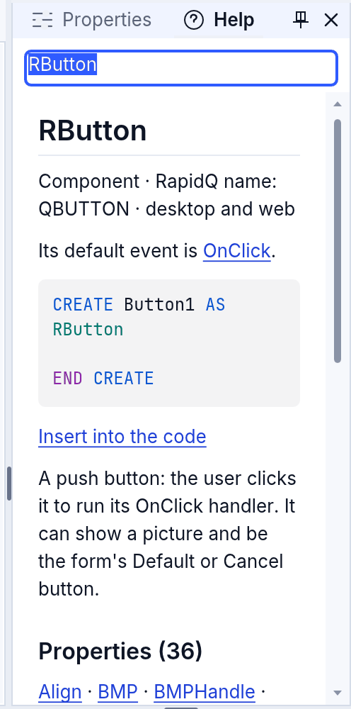
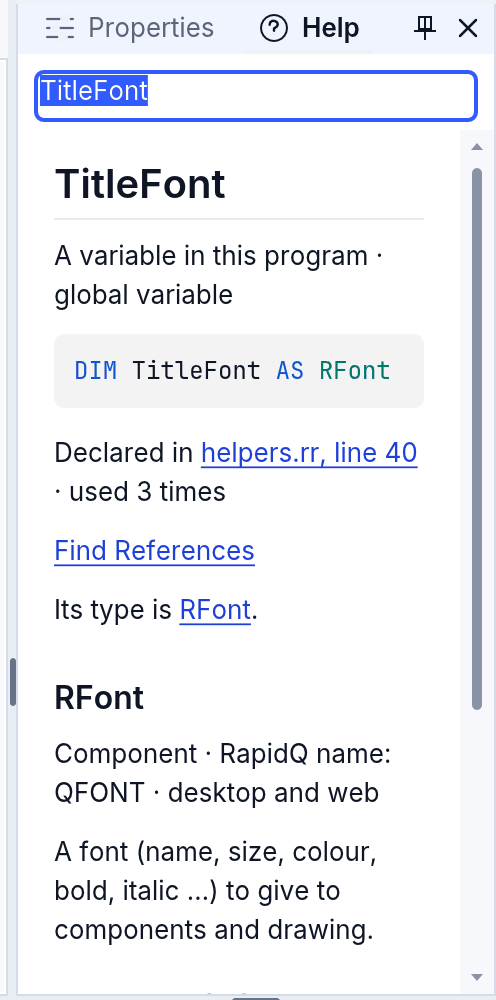
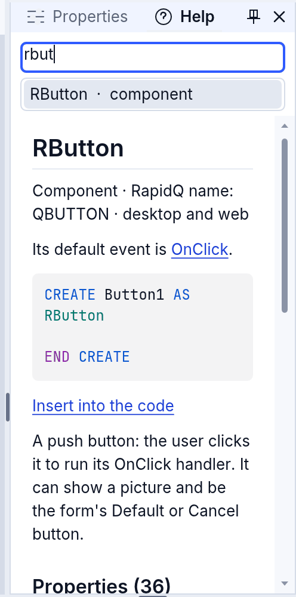
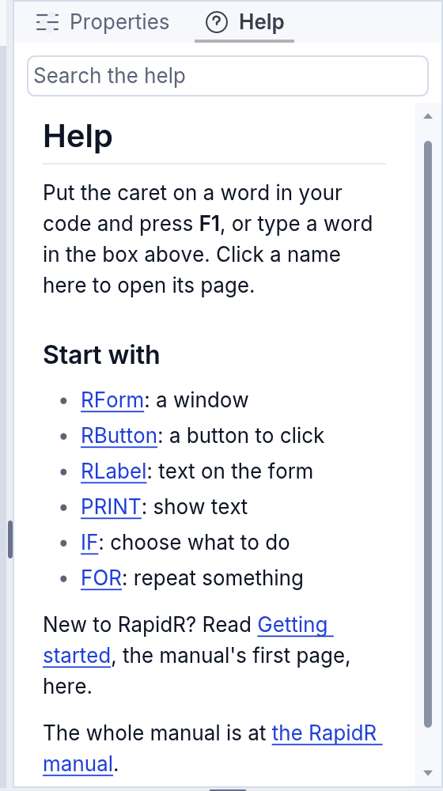
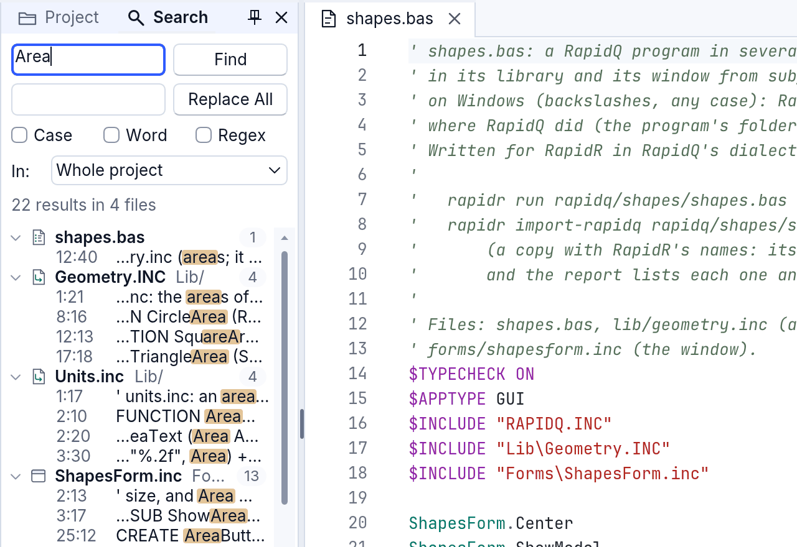
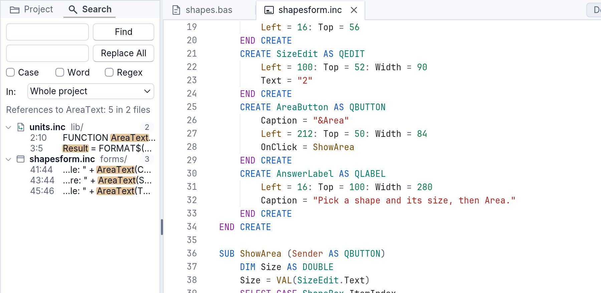
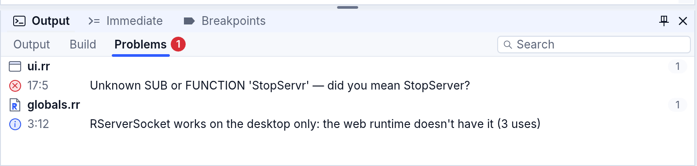
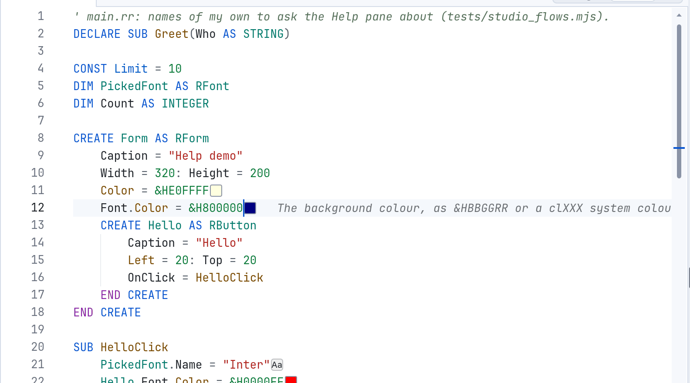

<!-- translated-from: studio-editor.md 9ccaf841158486ee -->
# El editor de código en RapidR Studio

El editor de código de RapidR Studio conoce tu programa como lo conoce el
compilador. Mientras escribes, sugiere nombres, muestra los parámetros de la
llamada que estás escribiendo, explica cualquier palabra a la que apuntes, salta
al lugar donde se define un nombre y marca los errores antes de que ejecutes. Funciona
igual en Studio de escritorio y en Studio para la web.

Las imágenes de abajo se hicieron con `examples/gui/hello_form.rr` abierto
(Archivo > Abrir ejemplo…, y luego **Código** arriba a la derecha de su pestaña,
o F7).

En una Mac, usa **⌘ Cmd** donde esta página dice **Ctrl**, salvo en Ctrl+Space y
Ctrl+Shift+Space, que se quedan en la tecla Control (⌘ Space es Spotlight).

## Autocompletado: los nombres mientras escribes

Empieza a escribir y bajo el cursor aparece una lista de lo que encaja. Escribe
un punto después de un componente y la lista muestra sus propiedades, métodos y
eventos:


- La lista se reduce mientras escribes. También coincide con el comienzo de las
  palabras: `sm` encuentra `ShowModal`.
- El cuadro de la derecha describe la entrada seleccionada: su tipo, qué hace y
  si es propia de RapidR.
- **Tab** o **Enter** pone el nombre seleccionado. **Escape** cierra la lista.
  **↑ ↓ Page Up Page Down** se mueven por ella. Un clic también elige.
- Los nombres que elegiste hace poco salen primero la próxima vez.

La lista sabe qué es cada nombre:

```basic
DIM Ok AS RBUTTON
Ok.          ' los miembros de RButton: Caption, Left, OnClick …

DIM Buttons(3) AS RBUTTON
Buttons(1).  ' lo mismo, para un elemento de un arreglo (array)

TYPE Point
    X AS INTEGER
    Y AS INTEGER
END TYPE
DIM p AS Point
p.           ' X e Y

WITH Ok
    .        ' otra vez los miembros de RButton
END WITH

CREATE Form AS RFORM
    Cap      ' dentro de un CREATE: lo que puedes establecer — Caption = …
END CREATE
```

Después de `AS`, la lista ofrece los tipos integrados, tus `TYPE` y todos los
componentes con los nombres de RapidR (`RButton`, `RForm`). Los nombres Q
anteriores (`QButton`, `QForm`) funcionan exactamente igual: empieza a escribir
uno (`QBu`) y la lista también lo ofrece, después de los de RapidR. En un
archivo que ya usa nombres Q, la lista ofrece esos en su lugar (y los de RapidR
cuando escribes una `R`), así que un archivo conserva un solo estilo.

### Ctrl+Space

**Ctrl+Space** (Edición > Completar palabra) abre la lista en cualquier lugar,
también en una línea vacía. Allí muestra primero los nombres propios de tu
programa (sus variables, componentes, `SUB` y `FUNCTION`) y luego las funciones,
instrucciones y constantes de RapidR:


### Las constantes de RAPIDQ.INC

Constantes como `mbYes`, `mtWarning`, `clRed` o `fmOpenRead` están integradas en
un programa de RapidR (`.rr`): la lista las ofrece tal cual, y no necesitas
ninguna línea de inclusión
([Constantes](../language.md#constants-clred-mbyes-vk_escape)).


En un programa `.bas` vienen del archivo incluido RAPIDQ.INC. La lista las ofrece
incluso antes de que tu programa lo incluya, y al elegir una también se añade la
línea `$INCLUDE "RAPIDQ.INC"` al comienzo del archivo (después de sus primeros
comentarios). Ctrl+Z deshace las dos cosas.


## Información de parámetros

Escribe `(` después de una `SUB`, una `FUNCTION` o un método, y un cuadro sobre
la línea muestra sus parámetros, con el que estás escribiendo en negrita. Lo
sigue mientras escribes las comas y se cierra después del `)`.


Para verlo otra vez, presiona **Ctrl+Shift+Space** (Edición > Avanzado >
Información de parámetros). Funciona también con tus propias `SUB` y
`FUNCTION`:

```basic
SUB Greet(Name AS STRING, Times AS INTEGER)
    ...
END SUB

Greet("Ann",     ' el cuadro muestra Greet(Name AS STRING, Times AS INTEGER), con Times en negrita
```

## Información flotante: qué es una palabra

Deja el mouse medio segundo sobre una palabra y un cuadro te dice qué es: la
sintaxis de una instrucción y lo que hace, la propiedad de un componente con su
tipo, o tu propia variable con su declaración y cuántas veces se usa. Edición >
Avanzado > Mostrar información flotante hace lo mismo con la palabra que está en
el cursor.


F1 abre la entrada completa en el panel Ayuda ([la sección siguiente](#f1-el-panel-ayuda)).

## F1: el panel Ayuda

Pon el cursor sobre una palabra y presiona **F1** (o Ayuda > Ayuda de RapidR). El
panel Ayuda se abre junto a Propiedades y muestra una página para esa palabra.
Funciona igual en la web. El panel tiene dos partes:

- Arriba, un **cuadro de búsqueda**, con la palabra que preguntaste. Escribe otra
  palabra allí: un momento después de la última tecla la página la sigue, y los
  nombres que puede significar aparecen bajo el cuadro (también los nombres
  propios del programa: *tu variable*, *tu SUB*). **Flecha arriba** y **flecha
  abajo** eligen uno, **Enter** lo abre, **Escape** cierra la lista y, otra vez,
  te devuelve al código.
- Debajo, **una página que se desplaza**: la palabra como título, qué es (una
  instrucción, una función, una propiedad de RButton, una palabra clave; dónde se
  ejecuta), la sintaxis como código con **Insertar en el código** debajo (escribe
  la sintaxis en el cursor; solo está cuando hay un editor de código abierto) y
  qué hace. Para un componente, la página enumera sus **Propiedades**,
  **Métodos** y **Eventos**, y cada nombre es un enlace a su propia página. **Tab**
  pasa de un enlace a otro, **Enter** sigue uno.



**Tus propios nombres.** F1 sobre una variable, una constante, una `SUB`, una
`FUNCTION` o un componente de tu programa dice qué es en tu programa: su
declaración, dónde se declara (un enlace que salta allí), cuántas veces se usa y
**Buscar referencias**. Para un nombre con tipo, la ayuda del tipo va debajo:
`TitleFont` es un RFont, así que sigue la página de RFont.



F1 sobre una propiedad después de un punto (`Hello.Font.Color`) es la página de lo
que está antes del punto: el Color de RFont.

**Nada en el cursor.** Sin una palabra, o con una palabra que nada conoce, Ayuda
muestra una **página de inicio** (cómo usarla, y unos cuantos lugares para
empezar: RForm, RButton, RLabel, PRINT, IF, FOR) o, para una palabra que no
conoce, “No entry for” y los nombres más cercanos.




## F12: Ir a la definición

Pon el cursor sobre un nombre y presiona **F12** (Edición > Ir a la definición):
el cursor salta al lugar donde se define el nombre: la `SUB` de una llamada, el
`DIM` de una variable, el `CREATE` de un componente. Si eso está en otro archivo
(un `$INCLUDE`), Studio lo abre allí. Para una variable que tu programa nunca
declara, F12 va al primer lugar donde se le da un valor.


F12 funciona también en el código del archivo de un formulario. Con el cursor
fuera de un nombre (o en el diseñador), F12 alterna entre el diseñador del
formulario y su código; también lo hacen **F7** (código), **Shift+F7**
(diseñador) y el interruptor **Diseño | Código** a la derecha de la pestaña.

Relacionado: **Shift+F12** (Buscar referencias) enumera cada uso del nombre en la
pestaña Búsqueda ([más abajo](#buscar-referencias-dónde-se-usa-esto)); **F2**
cambia el nombre en todos los lugares donde se usa.

### Atrás y Adelante

Después de que F12 (o un resultado de búsqueda, o una referencia) te lleve a
algún lugar, **Alt+Left** (Edición > Navegar hacia atrás) te devuelve a donde
estabas y **Alt+Right** (Edición > Navegar hacia adelante) vuelve a ir allí.
Studio recuerda los últimos 40 lugares. En una Mac son **⌘ Cmd+⌥ Option+←** y
**→**, porque allí Option+← y Option+→ mueven el cursor por palabras.

## Búsqueda: la pestaña Búsqueda

La pestaña **Búsqueda** está junto a **Proyecto**, a la izquierda, con una lupa.
Haz clic en ella, o presiona **Ctrl+Shift+F** (Edición > Buscar en archivos…): el
texto seleccionado, si lo hay, ya está en el cuadro. Escribe lo que buscas y
presiona **Enter**.



- **Mayús.**, **Palabra** y **Regex** distinguen mayúsculas y minúsculas, buscan
  solo palabras completas o usan una expresión regular, como el propio Buscar del
  editor.
- **Buscar en** elige dónde mirar: **Este archivo**, **Archivos abiertos**,
  **Módulos** (los archivos de código del proyecto que no son formularios),
  **Formularios**, **Recursos** (los archivos de datos y de texto del proyecto),
  **Todo el proyecto** (el valor predeterminado), o **Una carpeta...**, que pide
  una carpeta y busca en sus archivos de texto.
- Los resultados vienen agrupados por archivo. Cada archivo muestra el mismo
  ícono que en el panel Proyecto, su nombre, su carpeta y, a la derecha, cuántos
  resultados tiene. Debajo, cada resultado muestra su línea y columna (`12:5`:
  línea 12, columna 5) y la línea misma, con la coincidencia marcada; una línea
  larga se muestra alrededor de la coincidencia. Haz clic en un archivo, o
  presiona **Enter** o **flecha izquierda** y **flecha derecha** sobre él, para
  ocultar o mostrar sus resultados.
- **Enter** o un doble clic abre el archivo en la coincidencia, con la
  coincidencia seleccionada. Un solo clic la muestra y deja las teclas en los
  resultados, para que puedas bajar por la lista con las flechas.
- **Reemplazar todo** pone el texto del segundo cuadro en lugar de cada
  coincidencia, en cada archivo del ámbito. Cada archivo cambia en un solo paso:
  **Ctrl+Z** en ese archivo lo devuelve.

Un archivo que tienes abierto se busca tal como lo tiene el editor, guardado o
no.

## Buscar referencias: ¿dónde se usa esto?

Pon el cursor sobre un nombre (una variable, una `SUB` o `FUNCTION`, un
componente) y presiona **Shift+F12** (Edición > Buscar referencias, o clic
derecho > Buscar referencias). La pestaña Búsqueda enumera cada lugar donde el
programa lo usa, en cada archivo, agrupado por archivo: “Referencias a
AreaText: 5 en 2 archivos”.



Las imágenes de la pestaña Búsqueda se hicieron con `examples/rapidq/shapes/shapes.bas`
abierto: un programa de cuatro archivos.

Esto no es una búsqueda de texto. Studio lee el programa como lo lee el
compilador, con sus archivos `$INCLUDE` en su orden, así que no se enumera un
comentario ni una cadena de texto que casualmente diga la misma palabra, ni una
variable local con el mismo nombre en otra `SUB`. Dentro de una `FUNCTION`,
`Result =` (o el propio nombre de la función) le da su valor, así que también se
enumera como un uso. Abre uno con **Enter** o con un doble clic; **Alt+Left** te
devuelve.

El menú de clic derecho del código tiene **Ir a la definición**, **Buscar
referencias** y **Cambiar nombre del símbolo...** arriba, y luego Cortar, Copiar,
Pegar y Seleccionar todo. Un clic derecho sobre una palabra pone primero el
cursor allí.

## Problemas mientras escribes

Cuando abres un archivo, y cuando dejas de escribir un momento, Studio comprueba
el programa y subraya con una línea ondulada lo que está mal: roja para los
errores, ámbar para las advertencias. Una señal en el margen marca la línea, y la
pestaña **Problemas** bajo el editor (Ver > Problemas) los enumera todos, con su
lugar. Haz clic en uno para ir allí. Los mensajes son las palabras del propio
compilador, así que se leen igual que cuando compilas. Cuando el error es algo
que te enseñó otro lenguaje (`SET x = 1`, `a % b`, `for i in range(10)`), el
mensaje va seguido de una breve sugerencia con la forma de RapidR: *RapidR no
tiene SET: escribe x = 1*. Las mismas sugerencias están en `rapidr check` y
cuando ejecutas o compilas; la tabla es
[¿Vienes de otro lenguaje?](../language.md#coming-from-another-language).

Studio comprueba todo el proyecto junto, como lo compila una compilación: un
módulo o el archivo de un formulario que el archivo principal incluye se
comprueba como parte del programa, nunca por separado. Un módulo que usa las
variables globales del programa y las `SUB` de otros módulos no muestra errores
cuando el programa compila.

La lista muestra **primero los errores**, luego las advertencias y luego las
notas. Está agrupada por archivo: cada archivo tiene un encabezado, con el ícono
del archivo (como en el panel Proyecto), su carpeta y cuántos problemas tiene;
debajo, cada problema muestra su línea y columna, y luego el mensaje. Un lector de
pantalla oye el encabezado como “ui.rr, 1 error”. La lista se abre por arriba;
cuando Studio vuelve a comprobar el código mientras lees, se queda donde la
desplazaste.



Las notas sobre lo que funciona en un solo entorno de ejecución (el escritorio o
la web) aparecen solo cuando tu proyecto también se ejecuta allí: mira
[Destinos](studio-projects.md#destinos-dónde-se-ejecuta-tu-programa). Entonces
hay una nota por componente, con cuántas veces lo usa el programa, no una por
línea. Mientras editas, el panel inferior ocupa todo el ancho bajo tu código, así
que un mensaje largo tiene espacio, y uno todavía demasiado largo se ajusta en
más filas para que se lea completo
([Depuración: líneas largas en Salida y Problemas](debugging.md#líneas-largas-en-salida-y-problemas)).
Con Ver > Ajustar las líneas largas de la salida desactivado, termina en “…” y,
al dejar el mouse sobre él, una sugerencia lo muestra completo.

### La advertencia de RAPIDQ.INC

En un programa `.bas`, RapidR, para ejecutar los programas antiguos de la misma
manera, lee un nombre que no conoce como una variable nueva que vale 0. Así que
si un programa así usa `mbYes` sin incluir RAPIDQ.INC, `mbYes` vale 0, y una
pregunta como esta muestra solo un botón Aceptar (un programa `.rr` tiene las
constantes integradas: ahí no hay advertencia):

```basic
IF MessageDlg("¿Guardar los cambios?", mtWarning, mbYes OR mbNo, 0) = mrYes THEN
```

Studio advierte de cada nombre así:


### Correcciones rápidas: Ctrl+.

Pon el cursor sobre una palabra subrayada y presiona **Ctrl+.** (Edición >
Corrección rápida…). Aparece una lista de correcciones; **Enter** aplica la
primera. Para la advertencia de arriba, la corrección añade
`$INCLUDE "RAPIDQ.INC"` al comienzo del archivo:


Otras correcciones: una propiedad mal escrita (`NameEdit.Txet`) ofrece las más
cercanas que existen (“Cambiar a Text”); en un proyecto que se mantiene
compatible con lo clásico, un nombre Q que no existe (`QPLOT`) ofrece el de
RapidR (`RPLOT`).

`IF NOT FILEEXISTS(f) THEN` parece correcto pero siempre es verdadero:
`FILEEXISTS` da 1 cuando el archivo está, y `NOT 1` es -2, que también es
verdadero. Studio lo subraya, y la corrección escribe la prueba que funciona,
`IF FILEEXISTS(f) = 0 THEN` (`DIREXISTS`, igual):


## Ayuda al escribir

- **Tab** al comienzo de una línea la sangra con la unidad del archivo (cuatro
  espacios, o un tabulador si el archivo usa tabuladores); **Shift+Tab** la
  devuelve. Con varias líneas seleccionadas, las sangran o las desangran todas.
  Tab nunca pone un carácter suelto en tu código.
- Las palabras clave se escriben en mayúsculas cuando terminas cada palabra
  (`dim` → `DIM`), y tus propios nombres como los declaraste (`nameedit` →
  `NameEdit`).
- Los paréntesis y las comillas se cierran solos; al escribir el de cierre, lo
  pasa por encima.
- Fragmentos: escribe `sub`, `function`, `if`, `for`, `select`, `create`, `type`,
  `while`, `do` o `with` y presiona Tab para obtener el bloque completo; Tab otra
  vez pasa a la siguiente parte que hay que rellenar.

## Ayudas

El código muestra sus propios valores. Cuando una línea establece un color, una
pequeña muestra de ese color aparece justo después; el nombre de una imagen
muestra la imagen; el nombre de una fuente muestra un pequeño ejemplo. Haz clic
en la marca, o pon el cursor sobre el valor y presiona **Ctrl+.**, y se abre un
editor junto a él. Lo que elijas se escribe de vuelta en tu código, como un solo
paso que **Ctrl+Z** deshace.

Las imágenes de abajo se hicieron con `examples/studio/helpers.rr` abierto
(Archivo > Abrir ejemplo…, “The code shows its own values”).


### Colores

Un color escrito como `RGB(255, 130, 20)`, como `&H1482FF` o como una constante
(`clTeal`) muestra su muestra. También el color de una parte de un componente,
escrito con un punto: `Font.Color = &H800000` en un bloque `CREATE`,
`Hello.Font.Color = clRed` en cualquier lugar, o en un `WITH`.


 Su editor tiene una rueda de color con un cuadrado para la intensidad y el brillo,
los números Rojo, Verde, Azul y Hex, el nombre del color con palabras, el color
anterior junto al nuevo y una paleta: primero los colores que tu programa ya usa,
luego los estándar y los del sistema.


Tu código conserva su propia manera de escribir el color: `RGB(…)` sigue siendo
`RGB(…)`, `&H…` sigue siendo `&H…` con los mismos dígitos, y una constante sigue
siendo una constante cuando el color nuevo tiene nombre (`clRed`; si no, se
convierte en `RGB(…)`).

Teclas del editor de color: **Tab** pasa de la rueda al cuadrado, a los cuatro
números, a la paleta y a los botones. En la rueda, las flechas giran el color un
paso (con **Shift**, diez); en el cuadrado, izquierda y derecha lo hacen más
débil o más fuerte, y arriba y abajo más brillante u oscuro. **Enter** conserva el
color, **Esc** deja el código como estaba.

### Imágenes, sonidos y archivos

El nombre de una imagen (`Logo.Load "logo.svg"`, el `BMP` de un botón) muestra una
pequeña miniatura. Cuando el archivo no está en tu proyecto, aparece en su lugar
una marca roja, así que un error al escribir se ve antes de ejecutar. Un sonido
muestra una marca ▶.

El editor de archivos enumera los archivos de tu proyecto de esa clase, con una
vista previa de la imagen en la que estás; escribe para filtrar la lista, **Enter**
elige.

Las imágenes solo se leen de dentro de la carpeta de tu proyecto, nunca de ningún
otro lugar de tu computadora, y nada se obtiene de internet.

### Fuentes

El nombre de una fuente (`TitleFont.Name = "Inter"`) muestra un pequeño ejemplo
“Aa”. Su editor enumera las fuentes de tu computadora con una línea de vista
previa (en el panel Propiedades, también el tamaño, Negrita y Cursiva). El ejemplo
y la vista previa se dibujan como tu programa dibujará la fuente: RapidR dibuja
cada programa con sus propios tipos de letra integrados, así que un programa se ve
igual en todas las computadoras, y una fuente que no tiene se dibuja con la más
cercana de ellos.

### Opciones, Verdadero o Falso, y enlaces

**Ctrl+.** sobre una constante abre la lista de las que encajan allí:
`Align = alClient` ofrece `alNone`, `alTop` … `alClient`. Para un conjunto de
indicadores (los botones de `MESSAGEDLG`, `mbYes + mbNo`) cada uno tiene una
casilla: la **barra espaciadora** marca, **Enter** los escribe todos. Sobre `True` o
`False`, la **barra espaciadora** lo invierte.

En un evento (`OnClick = SaveClick`) la lista ofrece las `SUB` de tu programa, y
primero **Crear controlador “AgainClick”** (el nombre del componente y el del
evento): escribe una `SUB` nueva por ti, antes del bloque CREATE del formulario,
la enlaza y pone el cursor dentro, listo para escribir: un solo paso de
deshacer. Funciona también sobre `OnClick =` sin nada después todavía.


Un enlace a otro componente (`PopupMenu = …`, `Parent = …`) ofrece los
componentes de tu programa que encajan.

### La ayuda de la línea y los nombres de los argumentos

La línea en la que está el cursor muestra una breve ayuda al final, en gris: lo
que hace la llamada o la propiedad. Las llamadas con varios números o textos
muestran el nombre de cada argumento antes de él, como una pequeña etiqueta gris
(`x1:`, `c:`), así que `FillRect 0, 0, 107, 60, …` se lee como lo que significa (un
nombre que no dice nada, como el `S$` de `FORMAT$`, no recibe etiqueta). Mantén
presionada la tecla **Ctrl** un momento para ver el nombre de cada argumento; suéltala y
desaparecen.


Nada de esto mueve jamás tu código mientras escribes: las marcas y los nombres
conservan su espacio en la línea en la que estás escribiendo hasta que la dejas.

### Valores mientras tu programa está en pausa

Cuando el depurador se detiene (un punto de interrupción, un paso), cada línea de
la rutina en la que se detuvo muestra al final los valores de los nombres que usa,
de la misma manera que los muestra el panel Variables (un color como una muestra,
un texto vacío como `""`). Desaparecen cuando el programa sigue ejecutándose.


### Cuánto se muestra

Herramientas > Configuración > General > **Ayudas del código**:

- **Útil** (el valor predeterminado): las marcas, la ayuda de la línea, los
  nombres de los argumentos de los números y los textos, y los valores mientras
  está en pausa;
- **Discreto**: solo las marcas;
- **Todo**: el nombre de cada argumento, y también una marca ▾ después de cada
  opción y enlace;
- **Desactivado**.

### Con un lector de pantalla

**Ctrl+K**, y luego **H**, lee la línea del cursor con sus ayudas: “Color =
RGB(255, 130, 20); naranja, 255 130 20”. No se anuncia nada mientras escribes, a
medida que las ayudas van y vienen. Los editores son cuadros de diálogo dentro del
editor de código: cada parte tiene nombre, Tab se mueve por ellas y el foco nunca
salta.

## Atajos de teclado

| Teclas | Qué hace | Menú |
|---|---|---|
| Ctrl+Space | Abrir el autocompletado aquí | Edición > Completar palabra |
| Tab, Enter | Aceptar la sugerencia seleccionada | |
| Escape | Cerrar la lista o el cuadro | |
| Ctrl+Shift+Space | Información de parámetros | Edición > Avanzado > Información de parámetros |
| F12 | Ir a la definición | Edición > Ir a la definición |
| Shift+F12 | Buscar referencias (en la pestaña Búsqueda) | Edición > Buscar referencias |
| Alt+Left / Alt+Right (Mac: ⌘⌥← / ⌘⌥→) | Volver a donde estabas / ir adelante otra vez | Edición > Navegar hacia atrás / hacia adelante |
| F2 | Cambiar el nombre en todas partes | Edición > Cambiar nombre del símbolo… |
| Ctrl+. | Sobre un valor: su editor (color, imagen, fuente, opción, controlador); en otro lugar, una corrección rápida | Edición > Corrección rápida… |
| Ctrl+K, H | Leer la línea con sus ayudas (lectores de pantalla) | |
| Ctrl, mantenida un momento | Mostrar el nombre de cada argumento | |
| F1 | Ayuda sobre la palabra que está en el cursor | Ayuda |
| F7 / Shift+F7 | El código / el diseñador de un formulario | Ver > Código / Diseñador |
| Tab / Shift+Tab | Aumentar / disminuir la sangría | Edición > Avanzado > Aumentar / Disminuir sangría |
| Ctrl+/ | Comentar o descomentar las líneas | Edición > Alternar comentario |
| Shift+Alt+F | Dar formato al archivo | Edición > Dar formato al documento |
| Ctrl+F, Ctrl+H | Buscar, Reemplazar | Edición > Buscar…, Reemplazar… |
| F3 / Shift+F3 | Buscar siguiente / anterior | Edición > Buscar siguiente / anterior |
| Ctrl+Shift+F | La pestaña Búsqueda: buscar en los archivos del proyecto | Edición > Buscar en archivos… |
| Ctrl+G | Ir a una línea: escribe su número después de `:` y presiona Enter (la barra de estado muestra la línea nueva) | Edición > Ir a la línea… |
| Ctrl+D | Seleccionar la siguiente ocurrencia (varios cursores) | Edición > Avanzado |
| Alt+Z | Activar / desactivar el ajuste de línea | Edición > Avanzado > Ajuste de línea |
| Ctrl+Z / Ctrl+Y | Deshacer / rehacer (si deshaces hasta el texto que guardaste, el archivo ya no aparece como cambiado: desaparece el punto de su pestaña) | Edición > Deshacer / Rehacer |

## Configuración

Studio guarda tres opciones del editor en su clave del registro
(`HKCU\Software\RapidR\Studio`; en macOS y Linux, el archivo de registro propio de
RapidR):

- `KeywordCase`: `upper` (el valor predeterminado), `lower`, `proper` o
  `preserve`;
- `IdentifierCase`: `declaration` (tus nombres como los declaraste, el valor
  predeterminado) o `preserve`;
- `Helpers`: `helpful` (el valor predeterminado), `quiet`, `everything` u `off`
  (Herramientas > Configuración > General > Ayudas del código).

Tus propios programas pueden usar el mismo editor: es el componente RCodeEditor
(mira [El editor de código en tus programas](../code-editor.md), con su modo SQL,
y la [referencia de miembros](../reference/members.md#rcodeeditor)).
