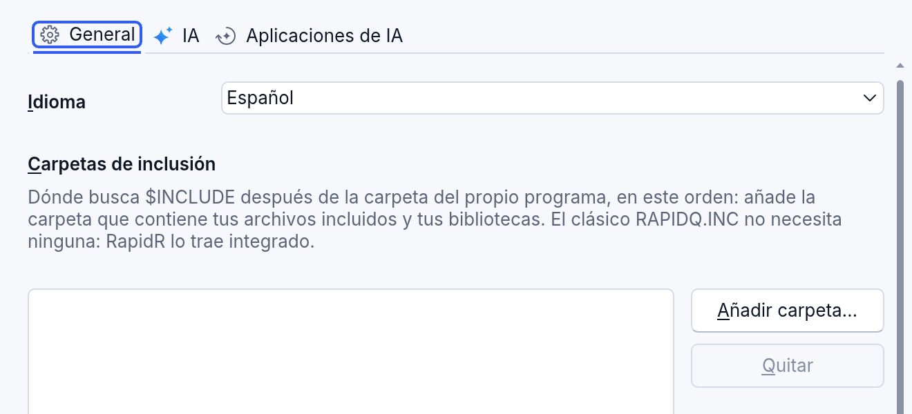
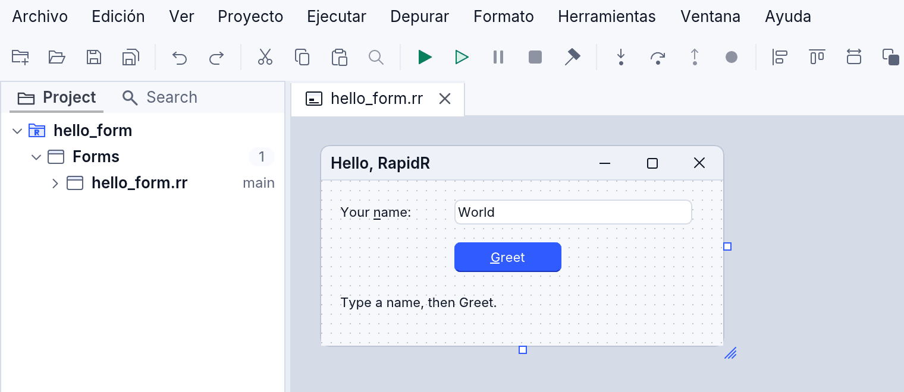
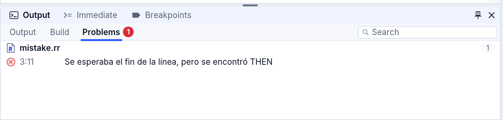
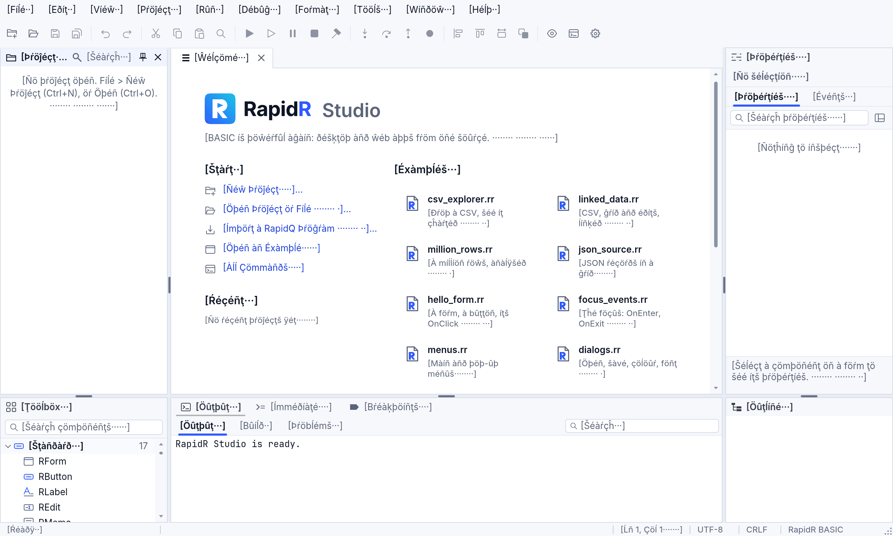

<!-- translated-from: studio-languages.md 8afefc8fc47dcafb -->
# Studio en tu idioma

RapidR Studio habla tu idioma: sus menús, cuadros de diálogo, mensajes, los
errores del compilador y la Ayuda. **Español** va primero (Preview 5); portugués
y chino van después. Mientras un idioma no esté completo, lo que aún no está
traducido se muestra en inglés.

## Elegir el idioma

**Herramientas > Configuración > General > Idioma**:

- **Predeterminado del sistema** (el inicial): el idioma de tu computadora
  cuando Studio lo tiene; si no, inglés.
- **English**, **Español** … uno por cada idioma que tiene Studio.

Studio cambia al instante, sin volver a iniciarse: los menús, los paneles, los
cuadros de diálogo abiertos y la barra de estado. Tu elección se conserva para la
próxima vez. **Cancelar** en Configuración vuelve al idioma que tenías.





Los atajos de teclado nunca cambian con el idioma (Ctrl+F busca, F5 ejecuta). Las
letras subrayadas de cada menú se eligen para el idioma, así que Alt más una
letra sigue abriendo un menú o eligiendo un elemento.

En la línea de comandos, `rapidr ide --lang es` inicia Studio en español durante
esa sesión; en Studio para la web, añade `?lang=es` a la dirección de la página.

## Los mensajes del compilador

Problemas muestra los errores del compilador en el idioma de Studio:



El comando `rapidr` habla el idioma de tu sistema, o el que nombre
`RAPIDR_LANG`:

```
$ RAPIDR_LANG=es rapidr check hello.rr
hello.rr:3:11: error: Se esperaba el fin de la línea, pero se encontró THEN [Expected end-of-line but got THEN]
```

- Un mensaje con las palabras del compilador clásico conserva su original en
  inglés junto a la traducción, entre corchetes, para que las palabras que
  conoces (y buscas) sigan estando.
- `rapidr check file.rr` compila un programa y enumera sus errores sin
  ejecutarlo.
- `RAPIDR_LANG=en` da los mensajes en inglés; las pruebas y los scripts que los
  leen pueden definirlo.

## La Ayuda en tu idioma

El panel Ayuda (F1) muestra las entradas del lenguaje (RButton, Caption, PRINT,
MID$) en el idioma de Studio cuando están traducidas, y las páginas del manual:
**Ayuda > Ayuda de RapidR** y luego *Primeros pasos*. Una página que todavía no
tiene traducción se muestra en inglés, con una nota que lo dice. El código, los
nombres y los ejemplos nunca se traducen: `RButton`, `Caption`, `OnClick` se
quedan como los escribes.

## Sugiere una palabra mejor

Si una palabra o una frase suena rara en tu idioma, o conoces una forma más
común de decirla, cuéntanos: abre una
[sugerencia de traducción](https://github.com/iBobX/RapidR/issues/new?template=translation.yml)
en GitHub (puedes escribir en español). Di qué dice ahora, dónde lo viste y
qué sugieres. No necesitas conocer los archivos de abajo.

## Ayuda a traducir RapidR

Las traducciones son archivos de texto sin formato, en el mismo formato PO que
usan tus propios programas ([Tu programa en todos los idiomas](translations.md)).
Cada parte de RapidR tiene una plantilla y un archivo por idioma:

| Qué | Plantilla | El archivo de un idioma |
|---|---|---|
| El texto de Studio | `ide/lang/studio.pot` | `ide/lang/es.po` |
| Las palabras propias de RapidR (los paneles y cuadros de diálogo de Studio, el editor de código) | `crates/rapidr-value/lang/runtime.pot` | `crates/rapidr-value/lang/es.po` |
| Los mensajes del compilador | `crates/rapidr-diagnostics/lang/compiler.pot` | `crates/rapidr-diagnostics/lang/es.po` |
| El manual | `docs/manual/<página>.md` | `docs/manual/es/<página>.md` |
| Las entradas del lenguaje (Ayuda, información flotante) | `crates/rapidr-lang/data/**/*.toml` | `crates/rapidr-lang/data/i18n/es/*.toml` |

1. **Sigue el glosario**: [docs/i18n/glossary-es.md](../../i18n/glossary-es.md)
   para el español (las palabras, el *tú*, las mayúsculas de oración, las letras
   de los menús).
2. **Empieza el archivo desde su plantilla** (o ponlo al día):
   `rapidr i18n update ide/lang/studio.pot ide/lang/pt.po`. Cada texto es un
   `msgid`; escribe su traducción en `msgstr`.
3. **Conserva las marcas**: los marcadores `{name}` (pueden cambiar de lugar, no
   de forma), `` `code` ``, un `&` antes de la letra del menú, y los `...` de un
   menú como tres puntos. `rapidr i18n check ide/lang/es.po` encuentra cualquiera
   que se haya perdido.
4. **Marca un borrador**: `#, review` sobre una entrada dice que una persona
   todavía tiene que revisarla.
5. **Velo**: Configuración > Idioma, o `rapidr ide --lang es`.
6. **Cuenta lo que falta**: `rapidr i18n coverage`.
7. **Una página del manual**: cópiala a `docs/manual/es/` y tradúcela; luego
   `rapidr i18n manual-stamp es <página>.md` registra qué inglés traduce, y
   `rapidr i18n coverage` avisa cuando ese inglés cambia.
8. **Las entradas del lenguaje**: una tabla `[docs]`, cada entrada con su nombre en
   mayúsculas: `"RBUTTON" = "…"`, `"RBUTTON.CAPTION" = "…"`, `"MID$" = "…"`.

Un idioma nuevo para Studio es un archivo `ide/lang/<idioma>.po` nuevo:
Configuración lo enumera con su propio nombre (*Português*, *中文（简体）*) en
cuanto está allí.

### El seudoidioma

`rapidr i18n studio` también crea `ide/lang/xx.po`, el seudoidioma: cada texto
que Studio traduce, con acentos y un tercio más largo. Studio en él
(`rapidr ide --lang xx`) muestra de un vistazo cualquier texto que no se puede
traducir (inglés sin más) y cualquier lugar donde un idioma más largo no cabrá
(texto cortado). Las pruebas de RapidR ejecutan las escenas principales de Studio
en él (`tests/studio_lang.mjs`).



## Todavía no

- El texto de Studio está en español (una primera versión que revisa Robert: cada
  menú, menú contextual, panel, cuadro de diálogo y mensaje, los mensajes del
  compilador y las sugerencias que van debajo, las palabras propias del panel
  Ayuda alrededor de una entrada, y los cuadros de diálogo que muestra un
  programa: los de color y fuente y los mensajes); el portugués y el chino van
  después.
- Los errores de ejecución de un programa en marcha están traducidos los más
  comunes (división por cero, un subíndice fuera de rango, quedarse sin `DATA`,
  un archivo que no se puede abrir o crear, un desbordamiento de pila, una
  variable que no es un objeto…), en la línea que Studio muestra donde se
  detiene un programa en depuración y en las notas de Problemas. Los muchos
  mensajes propios de un componente (una base de datos, un socket, una
  impresora) todavía salen en inglés.
- El manual está en español: todas sus páginas de guía. Las páginas de
  referencia (los componentes, los miembros, las funciones integradas, las
  instrucciones y las constantes), generadas desde el registro del lenguaje,
  van después en español con el texto del registro.
