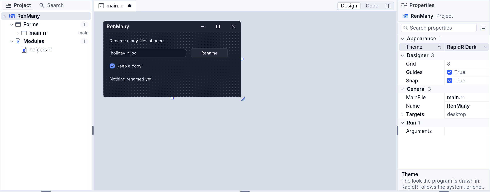
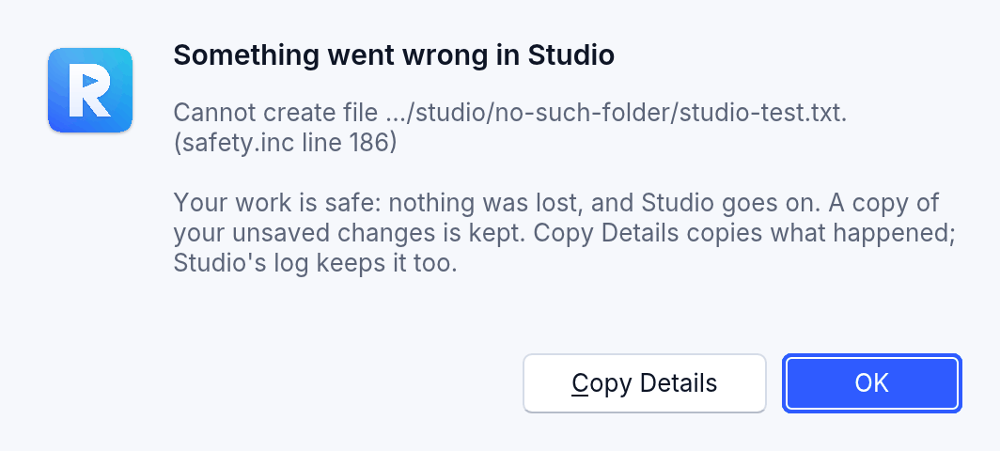
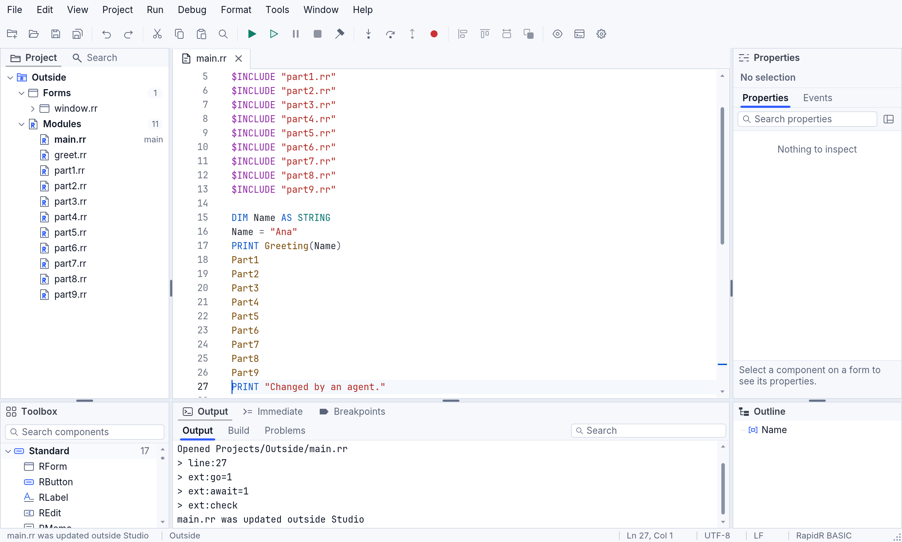
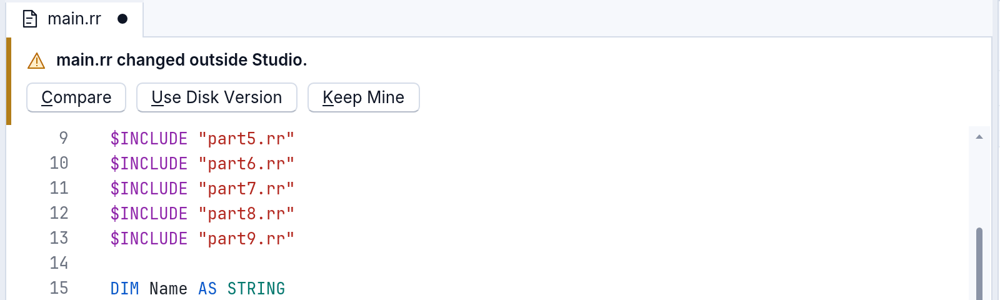
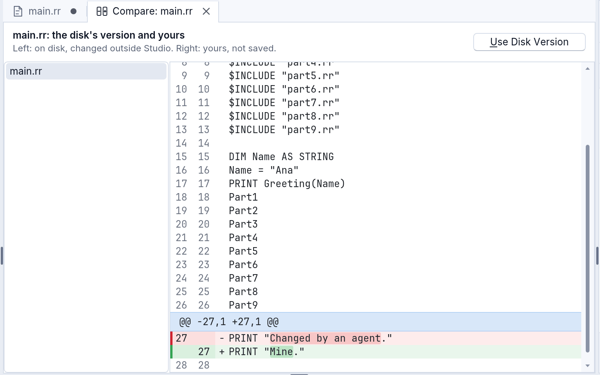
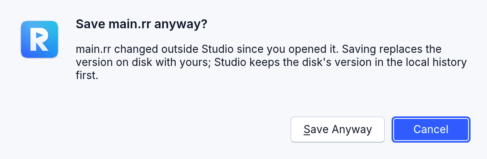
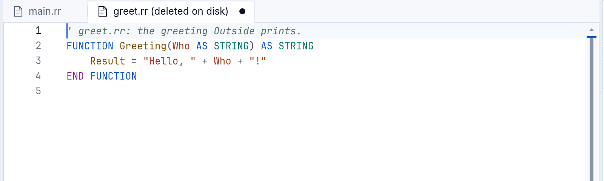
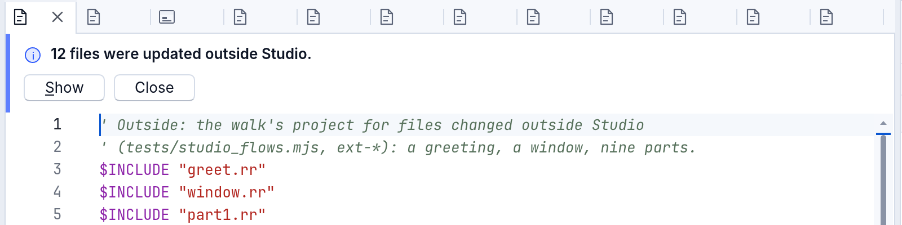
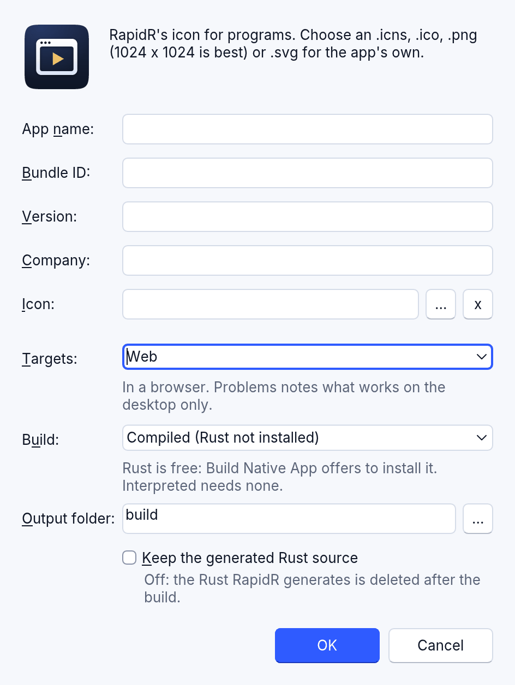

<!-- translated-from: studio-projects.md b56fc2356fb5c4d1 -->
# Proyectos en RapidR Studio

Un programa de RapidR puede ser un archivo o muchos: un archivo principal que
incluye a los demás con `$INCLUDE`. RapidR Studio guarda la lista en un archivo
de proyecto (`.rrproj`) y la muestra en el panel **Proyecto**. Esta página
explica qué muestra el panel Proyecto, cómo abrir lo último en lo que
trabajaste y qué PATH reciben tus programas cuando Studio los ejecuta.

Las imágenes se hicieron con el proyecto de prueba de siete archivos de Studio
(`tests/fixtures/studio_forms` en el código fuente de RapidR): sus ventanas
están en `ui.rr`, tres formularios en un solo archivo; los demás archivos
contienen sus `SUB` y `FUNCTION`.

## Los formularios salen de tu código

Cualquier archivo que crea un formulario en su nivel superior, con
`CREATE Name AS RForm` (o `RFormMDI`, o los nombres anteriores `QFORM` y
`QFORMMDI`), es un archivo de formulario. Aparece en **Formularios**, diga lo
que diga el archivo de proyecto sobre él. Un archivo que crea varios formularios
muestra cada uno de ellos debajo:

```basic
' ui.rr: las tres ventanas del programa
CREATE Form AS RForm
    Caption = "Estante"
    ...
END CREATE

CREATE NewForm AS RForm
    Caption = "Elemento nuevo"
    ...
END CREATE

CREATE CfgForm AS RForm
    Caption = "Opciones"
    ...
END CREATE
```


- **Un archivo con varios formularios** se abre en el árbol para mostrar sus
  formularios, uno por línea. Abre uno (haz doble clic en él, o selecciónalo y
  presiona Enter) y se muestra en el diseñador del archivo. Selecciona un
  formulario, o un componente de uno, y el diseñador cambia a ese formulario;
  le dice a un lector de pantalla cuál es (“Diseñando NewForm, formulario 2 de 3
  en este archivo”).
- **Un archivo sin formularios** (el archivo principal que solo incluye a los
  demás con `$INCLUDE` y arranca el programa, un archivo de `SUB`) aparece en
  **Módulos**.
- **El árbol sigue lo que escribes.** Añade un `CREATE … AS RForm` a un módulo y
  pasa a Formularios; quita el último formulario de un archivo y vuelve a
  Módulos.
- **El archivo de proyecto también lo sigue.** Cuando guardas (Archivo >
  Guardar, Ctrl+S o Guardar todo), Studio escribe en el `.rrproj` las clases que
  dice tu código, y la Salida dice qué cambió:

  ```text
  main.rr no crea ningún formulario: ahora está en Módulos
  ui.rr crea un formulario: ahora está en Formularios
  Se guardó …/Shelf.rrproj
  ```

  Un archivo que escribe por ti el asistente de IA se enumera de la misma
  manera: un archivo nuevo que crea un formulario va a Formularios.

Un archivo incluido (`.inc`) que crea un formulario también es un archivo de
formulario. Uno que no crea ninguno se queda en Archivos incluidos.

## Abrir reciente

**Archivo > Abrir reciente** enumera los últimos diez proyectos y archivos que
abriste, el más nuevo primero, cada uno con su carpeta. Presiona su número para
abrirlo. **Borrar recientes** vacía la lista (los archivos se quedan donde
están).


Con el teclado: **Alt+A** y luego **R** (en una Mac, Archivo > Abrir reciente en
la barra de menús). La paleta de comandos (Ctrl+Shift+P) tiene los mismos
elementos bajo “Abrir reciente”. La lista **Recientes** de la página de
bienvenida muestra los primeros seis.

Si algo de la lista ya no está (se movió, cambió de nombre, está en una unidad
que no está conectada), al elegirlo se quita de la lista, y la barra de estado y
la Salida lo dicen.

## Volver a abrir el último proyecto

Cuando Studio se inicia sin un archivo que abrir, la página de bienvenida ofrece
el proyecto que tenías abierto por última vez, con los archivos que tenía
abiertos:


El teclado empieza en la tarjeta: presiona **Enter** (o la barra espaciadora, o
haz clic en ella) y el proyecto se abre con sus archivos en sus pestañas y la
disposición que dejaste. Para empezar en otro lugar, usa los demás elementos de
la página como de costumbre.

Puedes desactivar la oferta en **Herramientas > Configuración > General**:
desmarca **Ofrecer reabrir el último proyecto y sus archivos al iniciar**.

## Propiedades del proyecto

Selecciona el nombre del proyecto, la fila superior del panel **Proyecto**, y el
panel **Propiedades** muestra el proyecto: “RenMany  Proyecto” en su encabezado
y luego su configuración en grupos, con lo que hace cada una bajo las filas
(selecciona una fila para leerlo). Vuelve a seleccionar un formulario o un
componente y muestra eso en su lugar.



- **Theme** (Apariencia) es el aspecto con el que se dibujan las ventanas de tu
  programa: **RapidR** sigue al sistema (claro, oscuro o contraste alto),
  **RapidR Light**, **RapidR Dark** y **RapidR High Contrast** eligen uno, y
  **Classic** es el aspecto de Windows. El programa lo guarda en una sola línea
  al comienzo de su archivo principal, `$THEME RapidR Dark` (ninguna para
  **RapidR**), así que la elección viaja con el código: la fila pone la línea,
  la cambia o la quita en un solo paso que puedes deshacer en el editor de ese
  archivo, y el archivo aparece como cambiado hasta que lo guardas. El
  diseñador de formularios dibuja tu formulario con un aspecto que eliges al
  instante, tenga el aspecto que tenga el propio Studio (**Ver > Tema**), tal
  como se verá el programa cuando se ejecute; con **RapidR** muestra el
  formulario con el aspecto del propio Studio. Edita la línea `$THEME` a mano y
  el diseñador y la fila la siguen.
- **Name**, **MainFile** y **Targets** (General): el nombre del proyecto (sus
  archivos conservan el suyo), el archivo desde el que arranca el programa y
  dónde se ejecuta (mira más abajo).
- **Arguments** (Ejecutar): los argumentos de la línea de comandos que
  **Ejecutar** le da al programa, lo que lee `COMMAND$`. Uno “entre comillas”
  conserva sus espacios.
- **Grid**, **Snap** y **Guides** (Diseñador): la cuadrícula del diseñador de
  formularios en píxeles, el ajuste a ella y las guías de alineación.

Cada cambio salvo Theme se guarda de inmediato en el archivo de proyecto
(`.rrproj`); la Salida lo dice.

**El archivo principal es donde empieza el programa.** Cuando el archivo
principal del proyecto es un módulo que otro de sus archivos incluye con
`$INCLUDE`, Studio lo dice al abrir el proyecto: *El archivo principal lang.rr
está incluido por main.rr: el programa probablemente empieza en main.rr*;
elige aquí **MainFile** para cambiarlo. Y **Ejecutar** siempre dice por qué no
arrancó, o qué mirar: nada abierto, un archivo principal que no está, los
errores del programa (en **Problemas**), o un archivo principal que se ejecutó
y terminó enseguida, sin ventana y sin imprimir nada.

## Al seleccionar un archivo, se muestra

Selecciona un archivo en el panel Proyecto y, un momento después, el editor lo
muestra: su pestaña pasa al frente o, cuando no está abierto, se abre en una
**pestaña de vista previa**, que el siguiente archivo que selecciones ocupa
mientras no hayas cambiado nada. Ábrelo (Enter, o doble clic) o escribe en él y
se queda. Las teclas siguen en el panel Proyecto, así que puedes bajar por la
lista con las flechas y leer cada archivo sobre la marcha (`lang/es.po`, luego
`lang/pt-BR.po`), sin ver nunca el texto de un archivo bajo el nombre de otro.

## Studio conserva tu trabajo

- **Un error en el propio Studio nunca lo cierra.** Si algo sale mal en el
  código del propio Studio, Studio detiene lo que estaba haciendo y un cuadro de
  diálogo dice *Algo salió mal en Studio* con lo que pasó. Tu trabajo está a
  salvo: tus documentos, guardados o no, y el chat del asistente quedan como
  estaban, y Studio sigue funcionando. **Copiar detalles** copia lo que pasó
  (para un informe de error); el registro de Studio también lo guarda
  (`studio-errors.log` en la carpeta de configuración de RapidR:
  `~/Library/Application Support/RapidR` en macOS, `%APPDATA%\RapidR` en Windows,
  `~/.config/rapidr` en Linux).

  
- **El trabajo sin guardar sobrevive a un fallo.** Mientras un documento tiene
  cambios que no guardaste, Studio conserva una copia de él en esa misma carpeta
  (nunca en tu proyecto), cada 20 segundos y en el momento en que algo sale mal.
  Si Studio termina sin cerrarse (un fallo, un cierre forzado, la computadora
  apagada), pregunta en el siguiente inicio: **¿Restaurar tu trabajo sin
  guardar?** **Restaurar** devuelve cada cambio a su documento, aún sin guardar
  (un solo Deshacer vuelve al archivo tal como está en el disco); **Descartar**
  deja ir las copias; **Ahora no** las conserva y vuelve a preguntar la próxima
  vez. Cerrar Studio de la manera habitual (con cada cambio guardado o
  descartado) elimina las copias.

## Cuando los archivos cambian fuera de Studio

Los archivos de tu proyecto pueden cambiar mientras Studio los tiene abiertos:
otro agente de IA trabaja en ellos, editas uno en otro editor o un
`git checkout` cambia de rama. Studio lo nota (cuando su ventana vuelve a pasar
al frente, y cada dos segundos mientras está al frente) y nunca pierde ninguna de
las dos versiones.

- **Un archivo que no cambiaste en Studio se vuelve a cargar, en silencio.** La
  barra de estado dice *main.rr se actualizó fuera de Studio* (un lector de
  pantalla también lo dice). Lo que tenía el editor se conserva en el
  **historial local** del archivo (*Antes de volver a cargar*: Archivo >
  Versiones > Historial local de este archivo...), y un **Deshacer** (Ctrl+Z) lo
  devuelve.

  
- **Un archivo con cambios sin guardar en Studio nunca se reemplaza.** Una franja
  sobre su editor (y sobre su formulario, en el diseñador) pregunta qué hacer:

  

  - **Comparar** muestra la versión del disco junto a la tuya, con la diferencia
    a la vista.

    
  - **Usar la versión del disco** carga el archivo tal como está en el disco. Tu
    versión se conserva antes en el historial local, y Deshacer todavía la
    devuelve.
  - **Conservar la mía** conserva tu versión. Cuando la guardas, Studio pregunta
    primero: **Cancelar** es la opción predeterminada, y no se escribe nada hasta
    que eliges **Guardar de todos modos** (la versión del disco pasa al historial
    local antes de reemplazarla):

    

  Las mismas tres opciones están en **Archivo > Cambiado fuera de Studio**, para
  el teclado (Alt+A y luego F). Guardar nunca sobrescribe contenido más nuevo del
  disco sin preguntar: ni Guardar, ni Guardar todo, ni el guardado previo a
  Ejecutar o a Compilar.
- **Un archivo eliminado fuera de Studio conserva su pestaña**, marcada
  *(eliminado del disco)*, con su texto. Se guarda una copia en el historial
  local. **Guardar** vuelve a crear el archivo, después de preguntar.

  
- **Muchos archivos a la vez** (una rama que se cambia, un agente que reescribe
  una docena de archivos) generan una sola nota, nunca un cuadro de diálogo para
  cada uno: *12 archivos se actualizaron fuera de Studio*. **Mostrar** los
  enumera en la Salida.

  
- **El archivo de proyecto** (`.rrproj`) cambió fuera de Studio (un agente
  añadió o quitó archivos): el panel Proyecto lo sigue en silencio.
- **Archivo > Reabrir proyecto** cierra el proyecto y lo abre de nuevo desde el
  disco (preguntando antes por los cambios sin guardar, como al cerrar).
- **Las escrituras del propio Studio no cuentan**: guardar, los cambios del
  asistente que aplicas, los cambios de una aplicación de IA, Compilar, Volver de
  Versiones: Studio sabe que las escribió él.

Studio compara la hora, el tamaño y (cuando la hora cambió pero el tamaño no)
una huella rápida de los bytes de cada archivo abierto, así que tocar un archivo
sin cambiarlo no dice nada. Studio para la web guarda tus archivos en el
almacenamiento del navegador, donde solo Studio los cambia: allí no hay nada que
notar.

Un programa tuyo puede hacer lo mismo: `Watch`, `ExternalChanges()` y
`ChangedOnDisk` de RProject, y `Application.Active` (si tu programa es la
aplicación que está al frente);
[examples/studio/watch_file.rr](../../../examples/studio/watch_file.rr), una nota
que sigue a su archivo.

## Destinos: dónde se ejecuta tu programa

**Proyecto > Opciones del proyecto** tiene una opción **Destinos** (las
propiedades del proyecto también la tienen, como **Targets**): **Escritorio**
(el valor predeterminado), **Web** o **Escritorio y web**. Dice dónde se
pretende que se ejecute tu programa, y Studio lo guarda en el archivo de
proyecto:

```toml
[build]
runs_on = "web"
```

Algunos componentes y funciones solo funcionan en un entorno de ejecución.
`RServerSocket`, por ejemplo, escucha en un puerto, algo que una página del
navegador no puede hacer. La pestaña Problemas te avisa de ellos solo cuando tu
proyecto se ejecuta donde no funcionan:

- **Escritorio**: nada sobre lo que solo funciona en el escritorio (ahí es donde
  se ejecuta); una nota por cada cosa que solo funciona en el navegador.
- **Web**: una nota por cada componente o función que solo funciona en el
  escritorio.
- **Escritorio y web**: notas para ambos.

Cada nota aparece una sola vez, en el primer uso, con cuántos usos hay:
“RServerSocket funciona solo en el escritorio: el entorno de ejecución web no lo
tiene (12 usos)”.



Un proyecto que también compila una aplicación web (`targets` en `[build]`
incluye `web`) empieza como **Escritorio y web**; cualquier otro empieza como
**Escritorio**.

## El PATH que reciben tus programas

En macOS y Linux, una aplicación iniciada desde el Dock, el Finder o un lanzador
del escritorio recibe el PATH corto del sistema (`/usr/bin:/bin:/usr/sbin:/sbin`),
no el que tiene tu Terminal. Un programa que ejecuta `SHELL "php -v"`, busca
`curl` o usa una herramienta de Homebrew funcionaba en la Terminal y fallaba
desde Studio.

Studio lee una vez el PATH de tu shell de inicio de sesión, cuando se inicia, y
se lo da a los programas que ejecuta; sus comandos `SHELL` y `RUN` lo heredan.
Compilar y Ejecutar en el navegador también lo reciben. Pruébalo:

```basic
PRINT "PATH=" + ENVIRON$("PATH")
SHELL "command -v brew || echo 'brew: no se encontró'"
```

Ejecutado desde Studio (F5), la Salida muestra el mismo PATH que muestra
`echo $PATH` en la Terminal, y dónde está `brew`.

**Herramientas > Configuración > General** muestra las carpetas, en orden, y de
dónde vinieron. Después de cambiar los archivos de inicio de tu shell
(`~/.zprofile`, `~/.zshrc`, `~/.bash_profile` …), presiona **Actualizar**: el
siguiente Ejecutar recibe el PATH nuevo.


Cómo lo lee Studio: ejecuta tu shell de inicio de sesión (`$SHELL -l -i -c`) sin
terminal y sin nada que leer, así que nunca puede detenerse a preguntarte algo,
y le da tres segundos. Studio solo lee; nunca escribe en los archivos de tu
shell. Si el shell no responde a tiempo, Studio usa su propio PATH más las
carpetas habituales que existen en tu computadora (`/opt/homebrew/bin`,
`/usr/local/bin`, `~/.cargo/bin`, `~/.local/bin` …), y la Configuración dice por
qué.

En Windows, las aplicaciones ya reciben el PATH completo, y en la web los
programas se ejecutan en el navegador: allí el PATH no se cambia, y la
Configuración no lo muestra.

Para tus propias herramientas, los mismos valores están en el componente
`RProgramSession`: `ShellPath`, `ShellPathSource`, `ReadShellPath` y
`RefreshShellPath` (mira la
[referencia de miembros](../reference/members.md#rprogramsession)).
