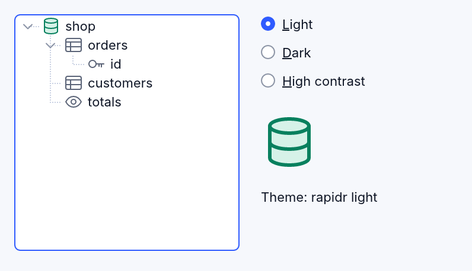
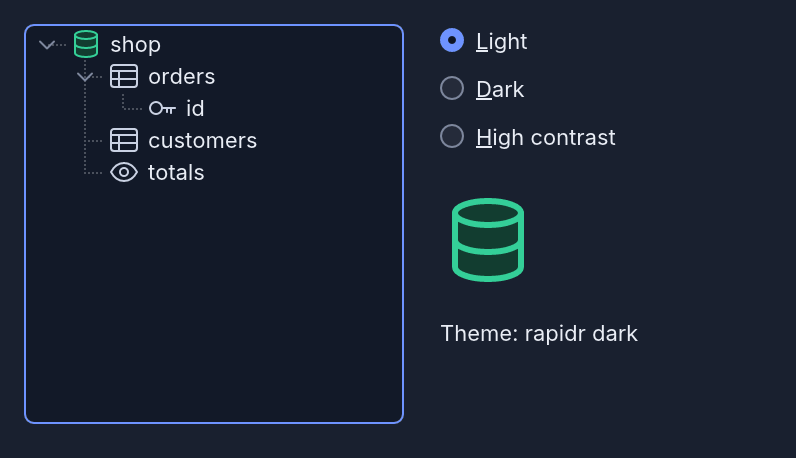
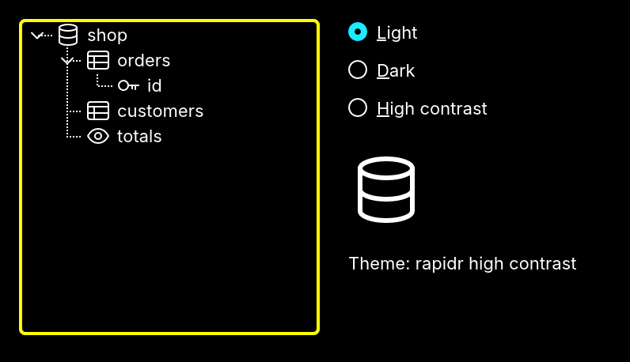

<!-- translated-from: svg-icons.md f802c0055923a6e4 -->
# Tus propios íconos SVG

Un programa puede dibujar sus árboles, listas, barras de herramientas e
imágenes con sus propios íconos SVG. Se ven nítidos en cualquier escala de
pantalla y toman los colores del tema, claro, oscuro o de contraste alto, igual
que los íconos de RapidR. Cuando el tema cambia, se dibujan de nuevo con los
colores nuevos.

| Claro | Oscuro | Contraste alto |
|---|---|---|
|  |  |  |

El ejemplo es [examples/gui/svg_icons.rr](../../../examples/gui/svg_icons.rr),
con sus íconos en [examples/gui/icons/](../../../examples/gui/icons). Ejecútalo
con `rapidr run gui/svg_icons.rr` desde la carpeta examples.

## Una lista de imágenes de íconos SVG

`RImageList.AddSVGFile(FileName [, Theme])` añade un SVG. Se dibuja con los
valores `Width` × `Height` de la lista, sea cual sea el tamaño que diga el
archivo, y se vuelve a dibujar con la escala de la pantalla, así que un ícono de
16 píxeles se ve nítido en una pantalla 2×. `AddSVGFile` da el índice de la
imagen nueva.

```basic
DIM Icons AS RImageList
Icons.Width = 16: Icons.Height = 16
Icons.AddSVGFile "icons/table.svg"     ' 0
Icons.AddSVGFile "icons/view.svg"      ' 1

CREATE Tree AS RTreeView
    Left = 12: Top = 12: Width = 190: Height = 200
END CREATE
Tree.Images = Icons
Tree.AddItems "orders"
Tree.Item(0).ImageIndex = 0
```

El argumento `Theme` (`"dark"`, `"highcontrast"`, `"light"`, `"classic"`) dibuja
el ícono con los colores de ese tema para siempre: no sigue el tema del
programa.

Un archivo que falta, un archivo que no es un SVG o un nombre que no es un tema
no añade nada, y el entorno de ejecución dice por qué en el lugar donde van sus
mensajes (la terminal, la consola del navegador).

## Colores que siguen el tema

Un SVG sigue el tema cuando se dibuja con:

- **`currentColor`**: la tinta del tema. Es pizarra (`#5B6478`) con el tema
  claro, niebla (`#C9D1E3`) con el oscuro y blanco en contraste alto. Úsalo para
  íconos de un solo color. Antes, `currentColor` salía negro, algo que no se
  puede ver sobre un fondo oscuro.
- **Los tokens de color de RapidR**, escritos con sus valores del tema claro,
  como los íconos de RapidR:

| Token | Escribe | Oscuro | Contraste alto |
|---|---|---|---|
| tinta | `#5B6478` | `#C9D1E3` | blanco |
| papel | `#FFFFFF` | `#373A42` | negro |
| azul / tinte de azul | `#2F5BFF` / `#E3E9FF` | `#7398FF` / `#24315C` | blanco / negro |
| cian / tinte de cian | `#007F9C` / `#D7F3F9` | `#2CC9E9` / `#123C47` | blanco / negro |
| verde azulado / tinte de verde azulado | `#08805E` / `#D6F2E8` | `#34CF98` / `#123D30` | blanco / negro |
| ámbar / tinte de ámbar | `#B86E00` / `#FFEDC7` | `#FFB224` / `#45340F` | blanco / negro |
| rojo / tinte de rojo | `#D92D36` / `#FCE1E2` | `#FF6B70` / `#4D1E22` | blanco / negro |
| violeta / tinte de violeta | `#6F42E5` / `#EBE4FD` | `#AC8FFF` / `#33295E` | blanco / negro |

Todos los tokens, y cómo los usan los íconos de RapidR, están en el sistema de
diseño de íconos de RapidR: `design/icons/README.md` en el código fuente de
RapidR.

Los tokens se cambian solo cuando todos los colores que usa el SVG son tokens.
Así, una ilustración con colores propios, un dibujo parecido a una foto o un
logotipo conserva sus colores. Si además usa `currentColor`, solo ese sigue el
tema. Un `<svg color="…">` en la raíz conserva el color que nombra. Las máscaras
dibujadas en `white` y `black` se dejan como están.

Para una comprobación que puedes hacer tú: un ícono del tema claro escrito así
se ve bien por sí solo en cualquier visor de SVG, porque sus colores son los del
tema claro.

## Imágenes y botones

La misma regla vale para todo SVG que carga un programa:

- `RImage.Load` y `LoadFromFile`;
- `RBitmap.LoadFromFile`;
- la propiedad `BMP` de un botón;
- `RImageList.AddBMPFile` (un SVG del tamaño de la lista sigue el tema; uno de
  otro tamaño se recorta al tamaño de la lista con los colores del tema en que
  se añadió).

```basic
Picture.Load "icons/database.svg"
```

## SVG incluidos en el programa

`$RESOURCE` incluye un archivo en el programa. Su nombre va entonces donde va un
archivo de imagen: `RImage.Load`, `LoadFromFile`, `AddSVGFile`, la propiedad
`BMP`, `BMPHandle` y la propiedad `Icon`.

```basic
$RESOURCE TABLE_SVG AS "icons/table.svg"
$RESOURCE DATABASE_SVG AS "icons/database.svg"

Icons.AddSVGFile TABLE_SVG
Picture.Load DATABASE_SVG
```

Una aplicación compilada tiene entonces sus imágenes desde cualquier carpeta en
que se inicie, incluso las imágenes cuyos nombres de archivo el programa arma
mientras se ejecuta. (Las compilaciones copian solo los archivos cuyos nombres
aparecen en el código fuente.) Antes, `RImage.Load` con un `$RESOURCE` decía
“could not load '65536'”.

## Dónde funciona

Igual en el escritorio (`rapidr run`, compilaciones interpretadas y nativas) y
en la web.
