<!-- translated-from: versions.md e74e61ec909e7d51 -->
# Versiones: nunca pierdas tu trabajo

**Versiones** conserva cada estado guardado de tu proyecto, muestra qué cambió
entre dos cualesquiera y te lleva de vuelta a cualquiera de ellos. Por debajo es
Git (los mismos repositorios que abre cualquier herramienta de Git), y por
encima, palabras sencillas: cada palabra de RapidR Studio tiene su nombre de Git
en una sugerencia, así que aprendes Git de verdad sin darte cuenta.

Y aun antes de empezar: Studio conserva una copia de un archivo **cada vez que
lo guardas**: el [historial local](#historial-local-cada-guardado-conservado).
Nada de lo que guardas se pierde jamás.

## Versiones en RapidR Studio

### Empezar a guardar versiones

Abre tu proyecto y elige **Ver > Versiones** (o **Archivo > Versiones > Empezar
a guardar versiones de este proyecto**). El panel Versiones se abre junto a
Proyecto y explica qué es una versión. **Empezar a guardar versiones de este
proyecto** hace que la carpeta del proyecto guarde versiones desde ahora.

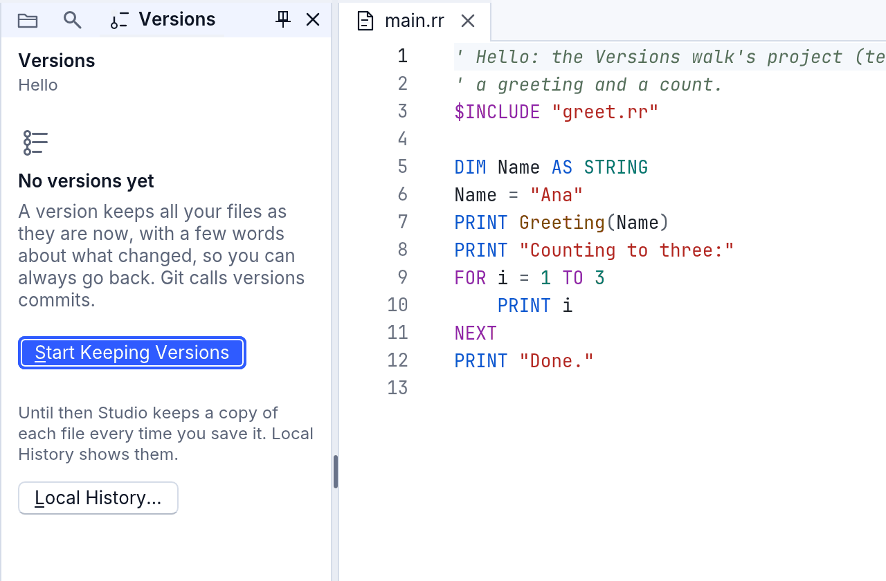

Studio empieza a guardar versiones solo en la **propia carpeta** de un proyecto.
Explica por qué, y no empieza nada, cuando se trata de una unidad completa, de
tu carpeta personal o de su Escritorio, Documentos o Descargas (contienen mucho
más que un proyecto), y de una carpeta dentro de otra que ya tiene versiones.
Primero pon el proyecto en una carpeta propia (Archivo > Nuevo proyecto).

### Guardar una versión

**Archivo > Guardar una versión...**, con **Ctrl+Shift+V** (Cmd+Shift+V en una
Mac; la “V” es de versión. Ctrl+S sigue siendo **Guardar**: guarda el archivo,
mientras que una versión guarda el estado de todo el proyecto), o
**Guardar una versión...** en el panel:

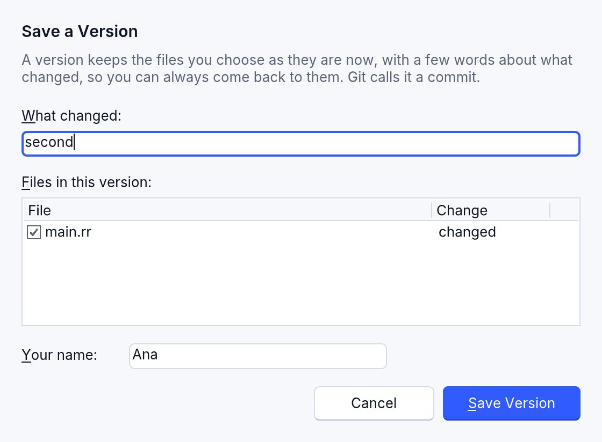

- **Qué cambió:** unas pocas palabras (“Botón más grande”, “Corregí el
  total”). Son lo que muestra la línea de tiempo.
- **Archivos de esta versión:** cada archivo cambiado está marcado; desmarca los
  que quieras dejar fuera de esta versión (la barra espaciadora marca o desmarca
  uno).
- **Tu nombre:** se guarda con la versión y Studio lo recuerda.

Los archivos abiertos con cambios sin guardar se guardan primero (Studio
pregunta, como cuando los cierras): una versión conserva lo que está en el
disco.

<!-- legal -->
**Una revisión de claves y contraseñas.** Antes de guardar, Studio lee las
líneas que añadiste. Una línea que parece una clave privada, una clave de API,
un token de acceso o una contraseña escrita en el código detiene el guardado: el
cuadro de diálogo dice en qué archivo y en qué línea está, con el secreto
oculto. Quítalo (guarda los secretos de verdad con [RSecrets](../secrets.md)) o
marca **Estas no son claves ni contraseñas reales: guardarlas de todos modos**:
solo entonces **Guardar de todos modos** guarda.

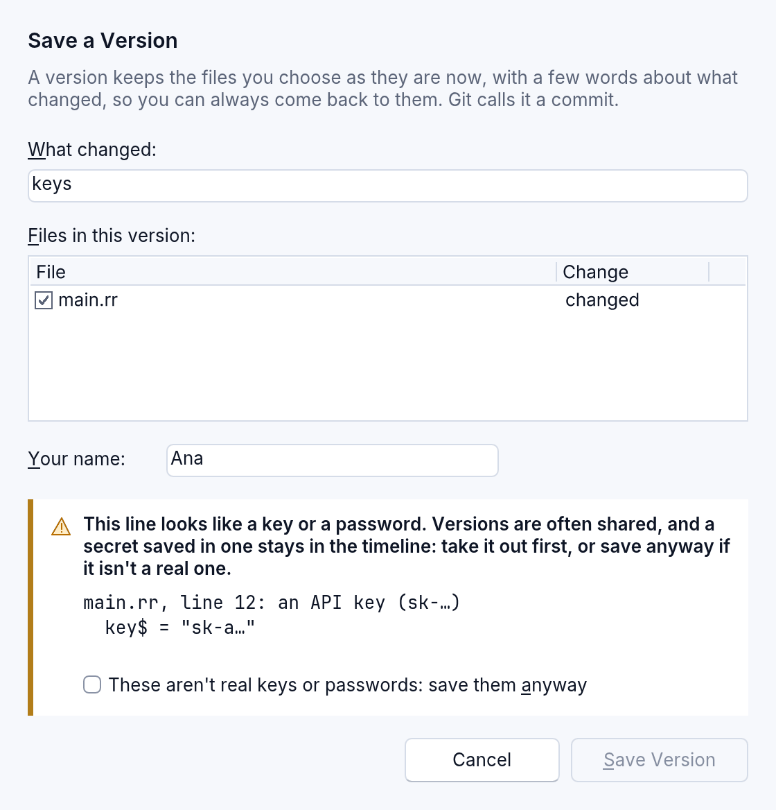

### La línea de tiempo

El panel enumera los archivos **sin guardar como versión**, cada uno con una
letra (**M** cambiado, **N** nuevo, **D** quitado), y después la **Línea de
tiempo**: cada versión, la más nueva primero, con sus palabras, quién la guardó
y cuándo. Los puntos de control de una IA (lo que el asistente conserva antes de
cambiar tus archivos) son más pequeños y más discretos.

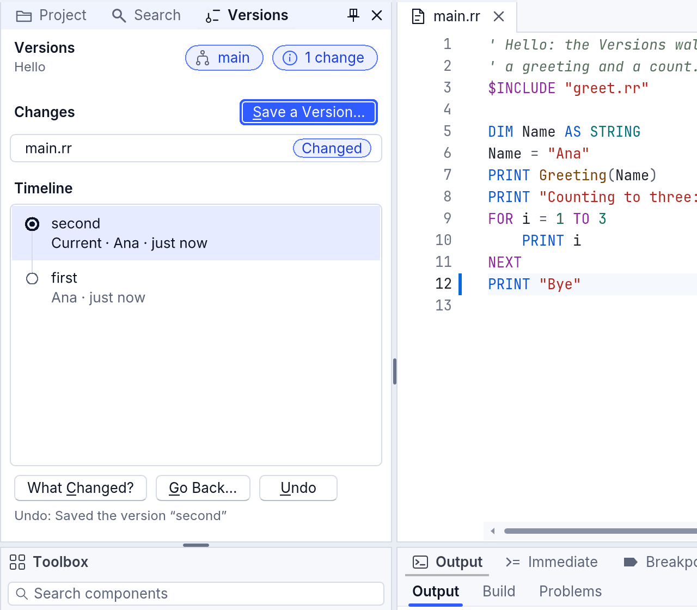

### ¿Qué cambió?

Mientras trabajas, el editor marca en su margen las líneas que difieren de la
última versión (una barra para las líneas añadidas y cambiadas, un triangulito
donde se quitaron líneas); el panel Proyecto muestra la **M** del archivo, y la
barra de estado, el experimento en el que estás (“main”: Git lo llama rama) y
cuántos archivos tienen cambios sin guardar como versión.

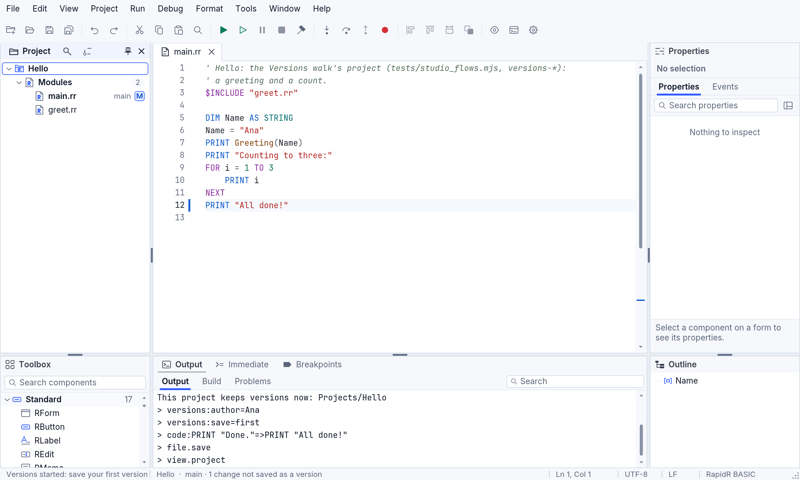

Haz clic en una marca (o elige **Archivo > Versiones > Mostrar el cambio de esta
línea**, para la línea del cursor) para ver cómo eran las líneas. **Deshacer
este cambio** las deja como las tiene la última versión; un Ctrl+Z te devuelve
tu cambio. Escape lo cierra.

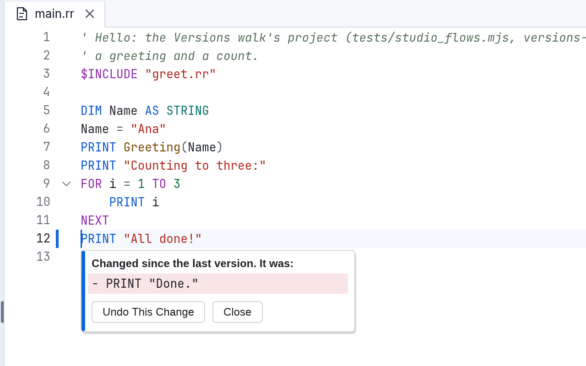

Elige una versión en la línea de tiempo y presiona **¿Qué cambió?** (o haz doble
clic en ella): los archivos que cambió se abren en una pestaña junto a tu
código, cada uno con sus líneas de antes y de después, y las palabras cambiadas
marcadas.

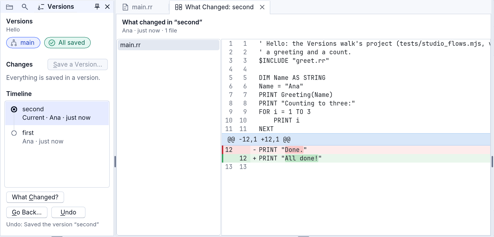

### Volver

Elige una versión y luego **Volver...**: **Todo el proyecto** o **Solo este
archivo** (el que tienes abierto). Studio pregunta primero, y Cancelar es la
opción predeterminada:

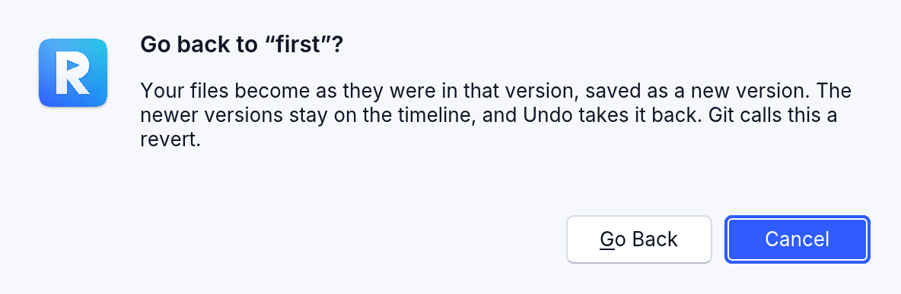

Volver guarda una versión **nueva** con los archivos de esa versión (“Se volvió a
‘first’”): las versiones más nuevas siguen en la línea de tiempo, no se descarta
nada, y Studio guarda un punto de seguridad oculto antes de cambiar cualquier
archivo. Si vuelves solo con un archivo, los demás archivos, y sus cambios sin
guardar, quedan como están.

### Deshacer

**Deshacer** (en el panel, o Archivo > Versiones > Deshacer la última acción de
Versiones) revierte lo último que se hizo con las versiones (un guardado, un
volver), incluso al día siguiente. El panel dice qué deshará. Deshacer se
niega, sin cambiar nada, cuando sobrescribiría trabajo que hiciste después: dice
en qué archivo, para que antes guardes una versión.

### Historial local: cada guardado conservado

Cada vez que Studio guarda un archivo, esté bajo versiones o no, conserva una
copia, además del archivo tal como estaba en el disco antes de que Studio lo
escribiera por primera vez. **Archivo > Versiones > Historial local de este
archivo...** (o **Historial local...** en el panel) enumera las copias, la más
nueva primero; elige una para compararla con el editor, y **Restaurar esta
copia** pone su texto en el editor como un solo paso (Ctrl+Z lo revierte;
guarda para conservarlo).

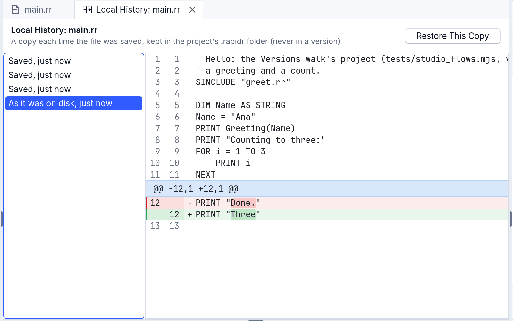

Las copias viven en la carpeta `.rapidr/history` del proyecto: cada contenido
una sola vez, comprobado al leerlo de nuevo (una copia dañada se avisa, nunca se
muestra como si fuera tu archivo), las 100 más recientes de cada archivo; un
archivo de más de 8 MB no se copia. Esa carpeta nunca forma parte de una
versión, y puedes eliminarla: solo se van las copias.

### En un navegador

Studio en un navegador todavía no puede guardar versiones (el motor de Git,
gitoxide, no se ejecuta en un navegador): el panel Versiones lo dice. El
**historial local** también funciona allí, en el almacenamiento propio del
navegador.

### Las teclas

| Acción | Teclas |
|---|---|
| Guardar una versión... | Ctrl+Shift+V (Cmd+Shift+V) |
| Elegir una versión | Flecha arriba y flecha abajo en la línea de tiempo, y luego Tab hasta ¿Qué cambió? o Volver... |
| Abrir un archivo cambiado | doble clic en la lista de cambios |
| Cerrar un cambio mostrado bajo su línea | Escape |
| Todos los comandos de Versiones | Archivo > Versiones, o la paleta de comandos (Ctrl+Shift+P, “Versiones”) |

Cada control tiene un nombre para los lectores de pantalla: la fila de un
archivo cambiado dice “main.rr, cambiado desde la última versión”, la de una
versión, “first, guardada por Ana, hace 2 minutos”, y las filas del panel
Proyecto también dicen su cambio con palabras.

## Las ideas, en palabras sencillas

| Tú dices | Qué significa | Git lo llama |
|---|---|---|
| **Empezar a guardar versiones** | La carpeta del proyecto empieza a guardar versiones. | `git init` |
| **Guardar una versión** | Una instantánea de tus archivos, con unas palabras sobre lo que cambió. Eliges todos los archivos cambiados o solo algunos. | commit (con staging) |
| **Línea de tiempo** | Todas las versiones, la más nueva primero: sus palabras, quién la guardó y cuándo. | log |
| **¿Qué cambió?** | Las diferencias: desde la última versión, o lo que cambió una versión. | diff |
| **Volver** | Todo el proyecto, o un archivo, como estaba en una versión anterior. Se guarda como una versión *nueva*, así que las más nuevas siguen en la línea de tiempo. | revert (nunca un hard reset) |
| **Experimento** | Una línea de versiones aparte para probar algo sin tocar la principal (“main”). | branch |
| **Deshacer** | La última acción, revertida. | (el propio historial de acciones de RapidR) |
| **Historial local** | Una copia de un archivo en cada guardado, esté bajo versiones o no. | (propio de RapidR) |

## Nada se pierde jamás

- **Puntos de seguridad.** Antes de cualquier cosa que reescriba archivos o
  mueva una versión (volver, restaurar, cambiar, incorporar, obtener lo último),
  Versiones guarda en silencio toda la carpeta tal como está, con los cambios sin
  guardar y los archivos nuevos incluidos. Los puntos de seguridad nunca aparecen
  en la línea de tiempo ni se comparten.
- **Deshacer.** Cada acción va a un historial, y **Deshacer** revierte la última,
  incluso al día siguiente.
- **Los cambios sin guardar nunca se descartan.** Volver guarda primero tus
  archivos abiertos, y espera cuando hay cambios sin guardar como versión.
- **El historial local.** Cada guardado conserva una copia del archivo.
- **Los puntos de control de la IA.** Antes de que el asistente cambie tus
  archivos, un punto de control los conserva como estaban.

## Seguro con cualquier carpeta

Abrir un proyecto nunca ejecuta nada de él: ni hooks, ni filtros, ni programas
nombrados en su configuración. Un proyecto que pertenece a otra cuenta de usuario
de tu computadora (o que viene de una memoria USB o de una unidad de red) no se
abre para hacer cambios: Versiones explica por qué y lo abre en solo lectura,
para mirar sus versiones.

## RRepository: versiones en tus propios programas

El panel Versiones de Studio está construido sobre **RRepository**, un
componente que también puede usar cualquier programa que ejecute `rapidr run`
(es uno de los componentes del IDE, junto con RProject y RLanguageService):

```basic
DIM Repo AS RRepository
Repo.Folder = CURDIR$
IF Repo.Versioned = 0 THEN Repo.Start
PRINT Repo.ChangeCount; " archivo(s) sin guardar como versión"
IF Repo.ChangeCount > 0 THEN
    IF Repo.SaveVersion("Guardado desde mi programa") = "" THEN PRINT Repo.Error
END IF
PRINT Repo.Timeline(5)
```

Sus miembros están en la [referencia](../reference/components.md): `Start`,
`SaveVersion` (con `CheckSecrets` y `Secrets`), `Timeline`, `VersionFiles`,
`FileAt`, `GoBack`, `GoBackFile`, `Undo` y `CanUndo`, `History`, `Checkpoint`, y
`Snapshot`, `LocalHistory` y `SnapshotText` del historial local. Los errores se
dicen en palabras sencillas (`Error`), y su clase en `ErrorKind`.

La parte del editor de código es `ChangeBase` de RCodeEditor (las marcas del
margen frente al texto de una versión), `ChangeAt`, `ShowChange` y
`RevertChange`; `FileBadge` de RProjectTree dibuja la letra de un archivo;
`ReadOnly` de RDiffView muestra lo que cambió sin Aceptar ni Rechazar.

## RDiffView: tres maneras de ver qué cambió

`RDiffView` compara dos textos. Su propiedad `Kind` dice cómo:

| Kind | Qué muestra |
|---|---|
| `"text"` (el valor predeterminado) | Línea por línea, lado a lado o en una sola columna. Las **palabras** cambiadas se marcan, y cada tramo de cambios (un bloque de cambios) tiene los botones Aceptar y Rechazar (ninguno con `ReadOnly`). |
| `"form"` | Dos versiones de los formularios de un programa: el formulario **antes y después**, dibujado como lo dibuja el diseñador, con los componentes cambiados delineados (verde añadido, rojo quitado, azul cambiado), y los cambios en una lista: "GreetButton: Caption "&Greet" → "&Say hello"; Width 90 → 110". |
| `"table"` | Dos archivos CSV como una sola tabla: las filas añadidas en verde, las quitadas en rojo, una fila cambiada con sus valores anteriores encima de los nuevos y las celdas cambiadas marcadas, una columna nueva con un tinte. Las filas se emparejan por su primera columna cuando sus valores son únicos (un Id), y si no, por su contenido. |

```basic
CREATE Diff AS RDiffView
    Left = 8: Top = 8: Width = 800: Height = 460
    Kind = "table"
END CREATE

Diff.LeftText = "Id,Name,Score" + CHR$(10) + "1,Ana,10" + CHR$(10)
Diff.RightText = "Id,Name,Score" + CHR$(10) + "1,Ana,12" + CHR$(10)
PRINT Diff.ChangeCount     ' 1
PRINT Diff.Summary         ' Row 1 (Id 1): Score 10 → 12
```

`Summary` dice cada cambio con palabras, uno por línea: lo que lee un lector de
pantalla, y lo que puedes mostrar o registrar. `ChangeCount` los cuenta.

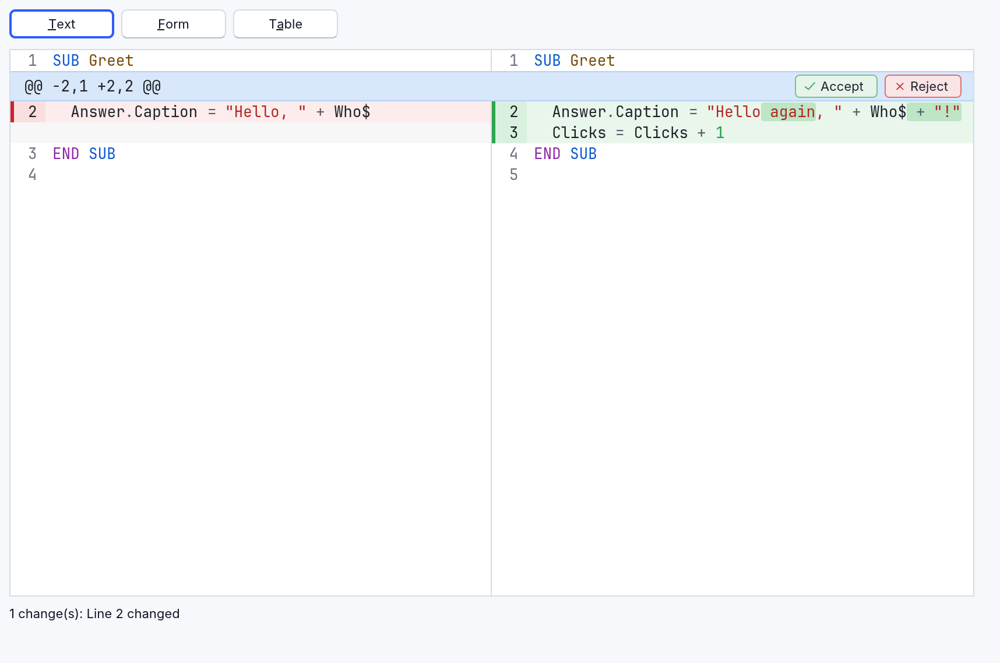

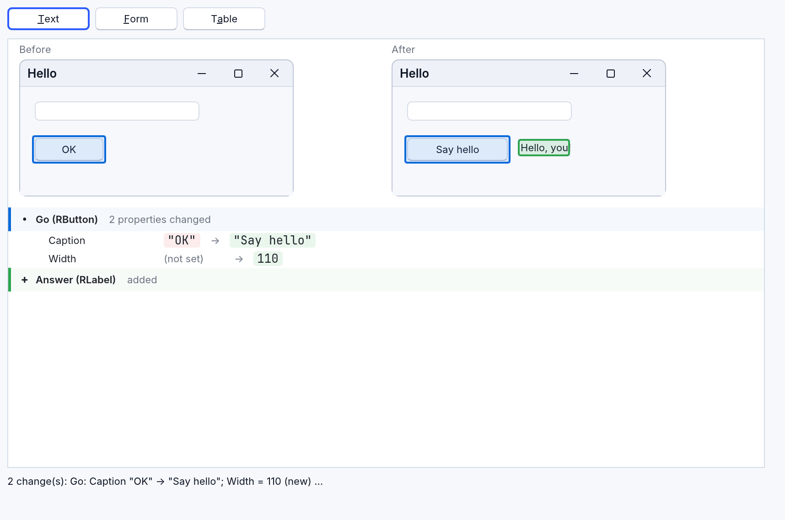

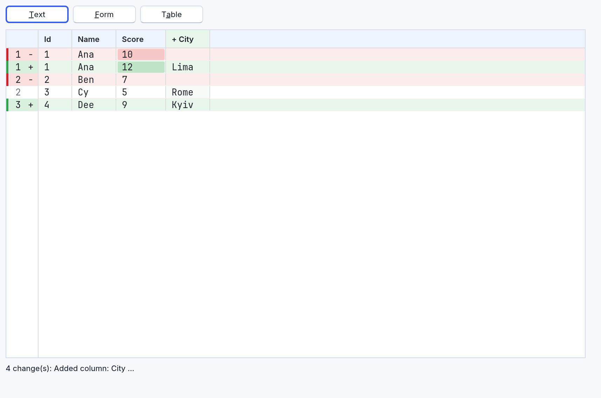

El ejemplo es [examples/studio/diff_views.rr](../../../examples/studio/diff_views.rr):
`rapidr run studio/diff_views.rr` desde la carpeta de los ejemplos.

La vista de formulario necesita el diseñador de formularios de RapidR Studio para
leer los formularios: `rapidr run`, RapidR Studio y los programas en el
navegador lo tienen. Un ejecutable creado por sí solo muestra allí una nota.

## Para los curiosos

- La comparación de diferencias es propia de RapidR: el algoritmo de Myers,
  escrito a partir de su artículo de 1986, el mismo para RDiffView, Versiones,
  las marcas del editor y los cambios del asistente. Un archivo de 4500 líneas
  se compara en bastante menos de 50 ms.
- Los repositorios son repositorios de Git corrientes (gitoxide, un motor de Git
  escrito en Rust): otras herramientas de Git los abren, y RapidR abre los
  suyos. Empezar a guardar versiones escribe un `.gitignore` que deja fuera de
  ellos la propia carpeta de RapidR (`.rapidr/`) y lo que Compilar escribe junto
  al programa.
- Los puntos de seguridad y los puntos de control son commits bajo
  `refs/rapidr/`; el historial de acciones es `.git/rapidr/history.jsonl`; el
  historial local es `.rapidr/history/index.jsonl` y su carpeta `blobs/` (cada
  uno con el nombre del SHA-256 de su contenido).
- Lo que viene: experimentos en el panel, incorporar uno a main con una fusión
  que conoce los formularios, quién escribió cada línea, compartir en línea y un
  nivel Pro con las palabras propias de Git.
