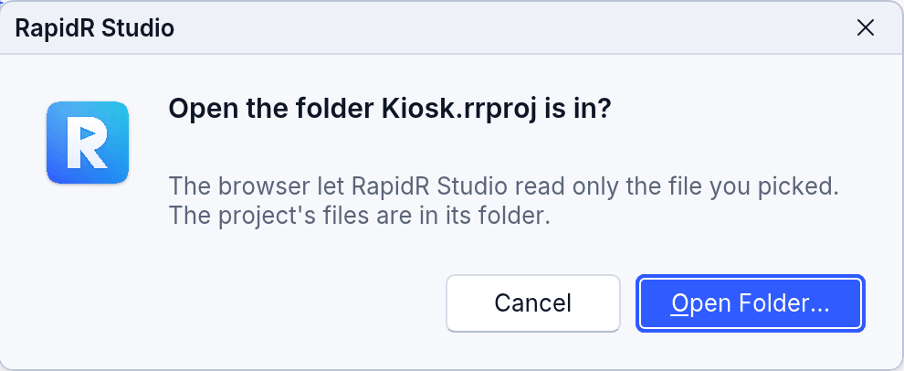

<!-- translated-from: web.md 165a0962deda8814 -->
# La web

<!-- legal -->
El mismo programa se ejecuta en un navegador. Sus ventanas las dibuja el mismo
kernel de interfaz que en el escritorio, en un lienzo de la página, así que se ven
y se comportan como en el escritorio: ventanas que puedes mover, cambiar de
tamaño, minimizar y maximizar, las mismas fuentes y píxeles, pantallas de alta
densidad de píxeles, compatibilidad con el teclado y con lectores de pantalla (un
espejo ARIA del árbol de accesibilidad del kernel). La página no necesita más que
un alojamiento web estático: ningún código del lado del servidor, y nada contacta
a un tercero a menos que lo haga el programa. Un programa que carga a propósito
contenido de otros sitios (RWEBVIEW, RDOM, RHTTP, o los orígenes añadidos con
`--csp`) hace a su autor responsable de las reglas de privacidad de ese contenido,
como pedir el consentimiento de los visitantes de la UE antes de cargar fuentes o
elementos incrustados de terceros.

## Dos maneras de compilar para la web

| | `rapidr bundle-bc prog.bas` (o `build --web --interp`) | `rapidr build prog.bas --web` |
|---|---|---|
| Qué | el intérprete web compartido + el bytecode de tu programa | tu programa compilado a WebAssembly |
| Necesita | nada (el SDK incluye el intérprete) | Rust, `rustup target add wasm32-unknown-unknown`, `cargo install wasm-bindgen-cli --version 0.2.129` |
| Salida | `prog-web.zip`: `index.html`, `rapidrintr.js` / `rapidrintr_bg.wasm`, `prog.rrbc`, `THIRD-PARTY-NOTICES.txt`, las fuentes de respaldo | `prog_web/`: `index.html`, `prog.js`, `prog_bg.wasm`, `THIRD-PARTY-NOTICES.txt`, las fuentes de respaldo |

```sh
rapidr bundle-bc form.bas -o form-web.zip
unzip form-web.zip -d form-web
python3 -m http.server -d form-web 8080      # o cualquier alojamiento estático
```

Sirve la carpeta por HTTP(S): los navegadores no cargan WebAssembly desde páginas
`file://` (`rapidr serve form.bas --open` compila la versión web del programa y la
sirve en esta computadora por ti, para probarla). El intérprete web pesa unos
21 MB (unos 6 MB comprimido con brotli, lo que hacen por ti la mayoría de los
servidores; medido para 2.119.0).

## Archivos y recursos

Una página de un navegador no tiene sistema de archivos. RapidR le da uno propio a
un programa:

- **Archivos del proyecto**: cuando compilas, los archivos junto al programa con
  las extensiones `.csv`, `.db`, `.sqlite`, `.png`, `.jpg`, `.jpeg`, `.gif`,
  `.bmp`, `.txt`, `.wav` y `.mp3` se incorporan a `index.html`, así que el programa
  los lee como en el escritorio (`OPEN`, flujos, imágenes,
  `RDataFrame.LoadFromCSV`, `RSQLite.Connect`). Mantén un programa web en una
  carpeta propia para que solo entren sus archivos. Los archivos `$RESOURCE`
  también se incorporan.
<!-- legal -->
- **Los archivos que escribe el programa** viven durante la sesión de la página en
  el almacén privado del navegador: se escriben, se vuelven a leer, `FILEEXISTS`
  los encuentra, `KILL` los elimina. Nunca llegan al disco del usuario a menos que
  un cuadro de diálogo los haya nombrado (más abajo).
- **Los demás nombres** se obtienen del propio servidor de la página.
- **Los archivos que se sueltan sobre una ventana** (arrastrados desde la
  computadora a un formulario que tiene un controlador de eventos `OnDropFiles`)
  se leen completos en los archivos del programa con sus nombres; `OnDropFiles`
  recibe esos nombres, y el programa los abre como cualquier archivo. Un
  formulario sin el controlador rechaza lo que se suelta (tampoco el navegador
  reemplaza la página con el archivo).
- Imprimir abre el cuadro de diálogo de impresión del navegador.

### Abrir y Guardar: los archivos reales del usuario

`ROpenDialog`, `RSaveDialog` y `RFileDialog` abren los selectores de archivos
propios del navegador, como el escritorio abre los cuadros de diálogo del sistema.
El programa lee y escribe entonces esos archivos con su entrada y salida de
archivos habitual (`LoadFromFile`, `SaveToFile`, `RFileStream`, `OPEN … FOR`):

- **Abrir** lee completos los archivos elegidos antes de que `Execute` regrese.
  Sus nombres están en `FileName` / `Files(…)` — solo el nombre: un navegador nunca
  le dice a una página la carpeta, así que `Files(0)` está vacío.
- **Guardar** responde con el nombre que el usuario eligió, y lo que el programa
  escribe en ese nombre va a ese archivo.
- Un nombre que vino de un cuadro de diálogo sigue siendo el del archivo real
  durante el resto de la sesión; cualquier otro nombre se queda en el almacén
  privado del navegador. Si dos archivos elegidos en carpetas distintas tienen el
  mismo nombre, se escribe el último que se eligió.
- `Filter` se convierte en los tipos de archivo de los selectores, el de
  `FilterIndex` primero. “Todos los archivos” (`*.*`, `*`) se ofrece solo cuando
  `Filter` lo tiene, como en Windows; un navegador que acepta un solo grupo de
  tipos (la entrada de archivo de más abajo) recibe las extensiones de todos los
  filtros — y todos los archivos cuando `Filter` tiene “Todos los archivos”, para
  que nada quede atenuado.
- Cancelar devuelve 0, como lo hace `Execute`.

Qué hace cada navegador:

| | Chrome, Edge, Opera (File System Access) | Firefox, Safari |
|---|---|---|
| Abrir | El cuadro de diálogo Abrir del sistema (`showOpenFilePicker`). | El cuadro de diálogo Abrir del sistema (una entrada de archivo). |
| Guardar | El cuadro de diálogo Guardar del sistema (`showSaveFilePicker`), con el `FileName` del programa (con `DefaultExt`) propuesto; lo que el programa escribe va a ese archivo. | Estos navegadores no tienen cuadro de diálogo Guardar: RapidR pide el nombre en un cuadro propio, dibujado como los demás cuadros de diálogo del programa, y lo que el programa escribe en ese nombre sale como una **descarga** de él (la carpeta Descargas del navegador, o donde este pregunte). |
| Escribir de vuelta en un archivo que se abrió | Permitido después de la pregunta de “guardar cambios” del navegador. | No es posible: lo escrito se queda en el almacén del navegador. Guárdalo con un cuadro de diálogo Guardar. |

Un navegador abre sus selectores solo justo después de un clic o una tecla del
usuario. Un programa cuyo `Execute` llega más tarde —desde un temporizador, por
ejemplo— muestra primero un cuadro pequeño (“Choose the file to open.” con
**Open…** y **Cancel**): su botón es el clic que el navegador necesita.

<!-- legal -->
En el IDE web el programa se ejecuta en un marco aislado (*sandbox*), que puede no
mostrar estos selectores por sí mismo: los muestra el IDE por él, y escribe de
vuelta solo en los archivos que el usuario eligió durante esa ejecución.

Todo esto es del intérprete web (`bundle-bc`, `build --web --interp`, el IDE). Un
programa compilado a WebAssembly (`build --web`) no puede esperar a un cuadro de
diálogo: su `Execute` pide un nombre con el cuadro de pregunta del navegador, y los
archivos se quedan en el almacén del navegador.

## Ventanas más grandes que la página

La página es la pantalla del programa: `Screen.Width` y `Screen.Height` son los de
la página, y `Left` y `Top` de un formulario son su lugar en la página. Nada de
una ventana queda nunca fuera de alcance, ni siquiera una más grande que la
ventana del navegador:

- Una ventana nunca se coloca ni se arrastra por encima ni a la izquierda de la
  esquina superior izquierda de la página, así que su barra de título siempre está
  en la página. Un formulario que se centra en una página más pequeña (`Center` con
  un formulario más alto que la página) empieza arriba en su lugar, y el `Top` del
  programa lo dice.
- Más allá de los bordes derecho e inferior la página se desplaza: arrastra una
  ventana allí, o muestra una más grande que la página, y te desplazas hasta el
  resto de ella.
- Maximizada (el botón de la barra de título, un doble clic en ella, o
  `WindowState = 2`), una ventana llena la parte de la página que ves.

En RapidR Studio para la web las ventanas del programa flotan sobre Studio, y su
escritorio se desplaza de la misma manera: una barra de desplazamiento delgada
aparece a lo largo del borde derecho o inferior de la página mientras una ventana
lo sobrepasa; arrastra su control deslizante, o gira la rueda del mouse sobre la
barra de título de una ventana o sobre la barra de desplazamiento. El ejemplo
[sales_dashboard.rr](../../../examples/gui/sales_dashboard.rr) es una ventana de
1200 × 800 para probarlo
([Depuración: en el escritorio y en el navegador](debugging.md#en-el-escritorio-y-en-el-navegador)).

## Qué se ejecuta de otra manera en un navegador

- El ciclo ocupado de un programa (un ciclo de juego sin `DOEVENTS`, un cálculo
  largo) no congela la página: el intérprete se ejecuta en fracciones de tiempo y
  lo que dibuja se muestra a medida que se ejecuta. Los eventos solo se ejecutan
  cuando el programa espera, como en el escritorio.
- `SLEEP`, `ShowModal`, `INPUT`, los cuadros de mensaje y los cuadros de diálogo
  esperan como lo hacen en el escritorio; `INPUT` pregunta en un cuadro de entrada
  cuando se muestran ventanas, y la salida de `PRINT` aparece en una consola de la
  página.
- **RSQLite** es el propio SQLite, compilado a WebAssembly; `Connect "x.db"` abre
  en memoria el `x.db` del proyecto durante la sesión (los cambios todavía no se
  guardan en el almacenamiento del navegador).
<!-- legal -->
- **RSecrets** no guarda nada en un navegador: una página no tiene llavero, y
  RapidR nunca pone secretos en el almacenamiento de la página. `Available` es
  `False` y toda llamada falla, y `Error` lo dice
  ([Guardar secretos](secrets.md#en-un-navegador)).
- **RMySQL**, **RServerSocket** y **RHttpServer** no funcionan en un navegador (no
  hay TCP en bruto, y una página no puede escuchar conexiones); llama a un
  servidor tuyo con RHttp en su lugar. **RSocket** se conecta por WebSocket.
  **RHttp** usa el fetch del navegador, así que se aplican las reglas CORS del
  navegador.
- **RComPort** usa Web Serial, **RDXJoystick** la API Gamepad, **RMIDI** Web MIDI
  (o el sintetizador propio de RapidR mediante Web Audio), y el sonido usa Web
  Audio.
- **RRegistry** guarda sus claves en un almacén por usuario, como en macOS y
  Linux.
- Una página web no puede cargar DLL ni bibliotecas nativas: una rutina
  `DECLARE … LIB` (y `SENDMESSAGE` / `POSTMESSAGE` / `KILLMESSAGE`) detiene el
  programa con un error que la nombra cuando se la llama. Los bloques `RUSTSTART`
  no están disponibles en el intérprete. PEEK / POKE funcionan como en el
  escritorio.
<!-- legal -->
- El texto que las fuentes integradas de RapidR no pueden dibujar (símbolos,
  chino, japonés, coreano, emoji) usa las fuentes Noto que se incluyen con la
  compilación, y se cargan a medida que la página las necesita. El `TextOut` de un
  lienzo también las usa: dibuja en `OnPaint`, que se ejecuta de nuevo cuando llega
  una fuente (el texto dibujado una sola vez, antes de que llegue, queda como un
  `?` hasta que el lienzo se vuelve a dibujar).

## Componentes solo para la web

Son los elementos HTML propios de la página, colocados por el kernel donde están
sus componentes (recortados a sus padres, ocultos con ellos):

| Componente | |
|---|---|
| `RWebView` | una página web o HTML incrustados (un iframe): `URL`, `HTML`, `Sandbox` |
| `RDOM` | un elemento HTML propio: `InnerHTML`, `CssClass`, `CssStyle`, `SetAttribute`, `AddClass`, `QuerySelector`, … |
| `RJavaScript` | ejecuta JavaScript: `Eval(code)`, `Call(function, args…)` |
| `RWebStorage` | `localStorage` / `sessionStorage`: `Set`, `Get`, `Remove`, `Clear`, `Keys`, `HasKey` |
| `RWebAudio`, `RWebVideo` | audio y video HTML5: `Src`, `Volume`, `Loop`, `Play`, `Pause`, `Stop`, `Seek` |
| `RWebNotification` | notificaciones del navegador: `RequestPermission`, `Show` |
| `RWebGeolocation` | la posición del dispositivo: `GetPosition`, `Latitude`, `Longitude`, `Accuracy` |
| `RRouter` | rutas con hash para aplicaciones de una sola página: `Navigate`, `Back`, `Forward`, `OnRouteChange` |

Existen solo en los navegadores: un programa de escritorio que los usa se compila y
se ejecuta, pero sus métodos no hacen nada allí e imprimen una advertencia.

## El IDE web

`rapidr-web-2.119.0.zip` es el IDE web: RapidR Studio, el mismo programa que en el
escritorio, dibujado por el kernel de interfaz en la página: una carpeta para
cualquier alojamiento estático (abre su `index.html` mediante un servidor web).
Tiene el diseñador de formularios, el editor de código, el depurador
([el mismo que el del escritorio](debugging.md#en-el-escritorio-y-en-el-navegador)),
el árbol del proyecto, el inspector, la caja de herramientas y Ejecutar (el
programa se ejecuta en un marco aislado de la página), y **Ejecutar > Compilar
aplicación web (.zip)**. Compila en el navegador; no se envía nada a ninguna
parte. Los archivos de datos que nombra un programa van con él cuando se ejecuta
— un archivo `$RESOURCE`, un CSV que carga (`"staff.csv"`): cualquier archivo junto
al programa cuyo nombre está escrito en su código fuente, tal como los enumera el
árbol del proyecto en Recursos, Activos y Datos. Así que todos los ejemplos se
ejecutan en el IDE web como en el escritorio. Las aplicaciones para una
computadora (`.app`, `.exe`, compilaciones nativas) se hacen en el escritorio
(Compilar de Studio, `rapidr build`).

### Abrir tu proyecto en el navegador

<!-- legal -->
Un navegador deja que una página lea solo los archivos que le das. Para trabajar
en un proyecto de varios archivos, dale a Studio su carpeta: **Archivo > Abrir
carpeta...** y elige la carpeta donde está el `.rrproj`. Studio lee todos los
archivos que hay en ella (y en sus carpetas). En Chrome, Edge y Opera guarda tus
cambios de vuelta en ellos (después de que el navegador pregunte una vez); en
Firefox y Safari se quedan en el navegador.

Si eliges solo el archivo del proyecto (**Archivo > Abrir proyecto o archivo...**,
o el enlace de la página de bienvenida), Studio no abre el proyecto con archivos
vacíos. En su lugar, pide abrir su carpeta:



**Abrir carpeta...** muestra el selector de carpetas del navegador, ya donde está
el archivo del proyecto: elige esa carpeta y el proyecto se abre con sus archivos y
formularios. **Cancelar** deja Studio como estaba.

Un proyecto hecho para el escritorio también se abre, aunque use cosas que un
navegador no puede hacer (un socket de servidor, `SHELL`, los archivos de la
computadora). Para ver qué no funcionará en un navegador, establece **Destinos** en
**Proyecto > Opciones del proyecto** en **Web**: la pestaña Problemas anota cada
uno de esos componentes (mira
[Proyectos](studio-projects.md#destinos-dónde-se-ejecuta-tu-programa)).
