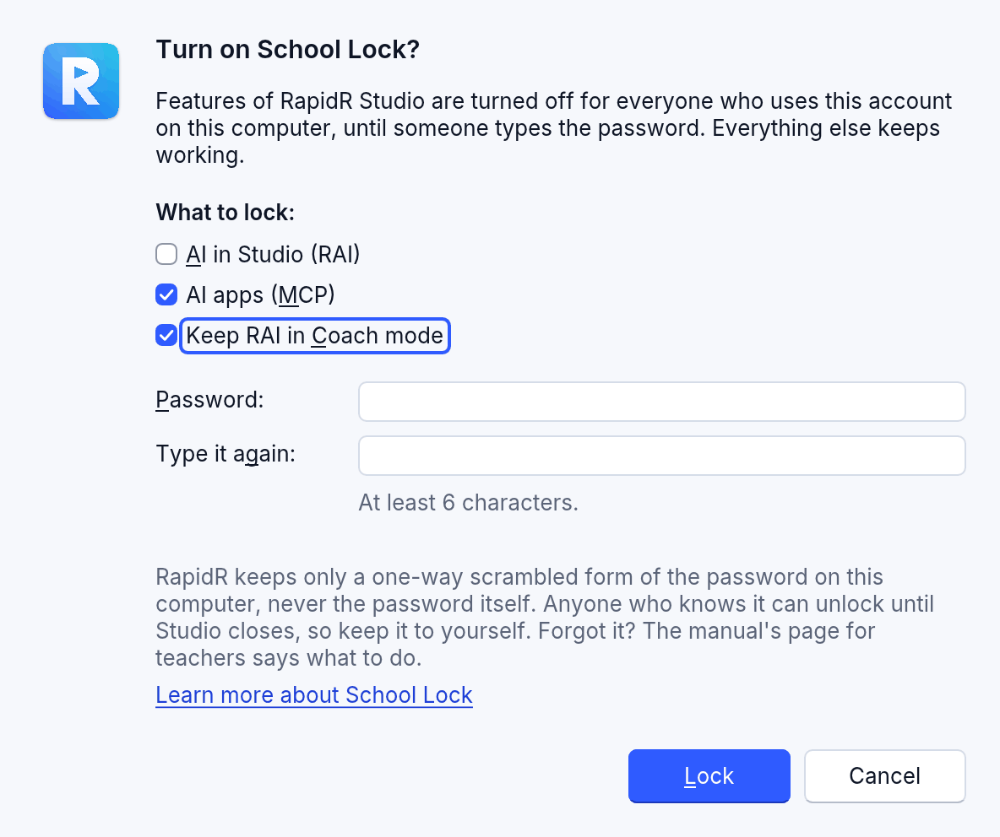
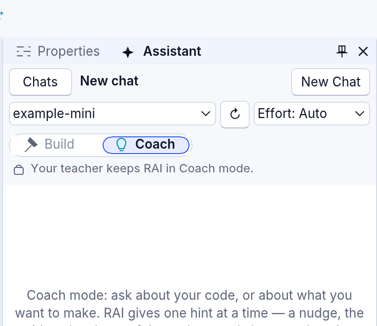

# For teachers: School Lock

School Lock turns RapidR Studio's AI off behind a password. A teacher can turn it on for the account students use; a school's IT can turn it on for every account of a computer, in a way students can't remove. Everything else in Studio keeps working: writing code, designing forms, running and debugging programs, Help.

It is **off until someone turns it on**. For now it can lock three things:

| What | What students see while it's locked |
|---|---|
| **AI in Studio (RAI)** | RAI's pane shows *AI is turned off by your teacher* instead of the chat; nothing is sent to an AI. Set Up RAI and Tools > Settings > AI are read-only. The AI commands in the menus and the command palette are greyed, with the reason beside them. |
| **AI apps (MCP)** | AI apps on the computer can't connect to Studio: its AI apps server doesn't start (and stops if it was running). Tools > Settings > AI Apps is read-only, its switch off and greyed. |
| **Keep RAI in Coach mode** | RAI stays on, but only as a tutor: one hint at a time, never the answer written into the student's code ([Coach mode](ai-assistant.md#coach-mode)). The dial in RAI's pane shows Coach with *Your teacher keeps RAI in Coach mode.*, and Build can't be chosen. |

The status bar shows a small **School Lock** chip while the lock is on. And if Studio ever closes unexpectedly, its report stays on the computer without the strip that offers to report it on GitHub (a GitHub account is for 13 and over).

School Lock collects nothing about students or teachers and sends nothing anywhere: it keeps one setting on the computer (below).

## Turn it on

1. **Tools > School Lock...**
2. Leave *AI in Studio* and *AI apps* ticked under *What to lock* (or untick one). To let students use RAI as a tutor instead, see [Keep RAI in Coach mode](#keep-rai-in-coach-mode).
3. Type a password twice: at least 6 characters. The line under the fields says how easy it is to guess; a longer one with numbers or symbols is safer.
4. **Lock**.


From then on, every time Studio starts on this account, AI is off:


## Keep RAI in Coach mode

Coach mode lets students ask RAI for help without being handed the whole answer at once: RAI gives a nudge, then the idea, then the shape of the code, and shows the code only when they ask a fourth time — as text they type or copy in themselves ([Coach mode](ai-assistant.md#coach-mode)). Students can choose Coach on their own; School Lock keeps it on:

1. **Tools > School Lock...**
2. Untick **AI in Studio (RAI)** (locking it turns RAI off altogether), then tick **Keep RAI in Coach mode**. Leave *AI apps* ticked if students shouldn't connect other AI apps to Studio.
3. Type a password twice, then **Lock**.



RAI works as usual, in Coach mode only. The dial says why Build can't be chosen:



In Coach, Studio never offers RAI a way to change the student's files, and refuses one if a model tries: this holds in Studio's code, not only in what RAI is asked. The lock itself is as strong as the rest of School Lock: only the computer's policy can't be removed by students (see [How strong is it?](#how-strong-is-it)). **Unlock Until Studio Closes** (with the password) lets Build be chosen again until Studio closes.

Coach is a teaching aid inside RapidR Studio; it doesn't block AI websites or other programs.

## Unlock it for a lesson

**Unlock...** (on RAI's card or a note) or **Tools > School Lock...** asks for the password:

- **Unlock Until Studio Closes**: AI works again until Studio is closed. The next time Studio starts, it is locked again. The chip says *School Lock: unlocked* meanwhile; **Tools > School Lock... > Lock Again** locks it at once.
- **Turn School Lock Off**: the lock ends on this account until someone turns it on again. It asks for the password too.

A wrong password is said plainly, with the tries left. After **5 wrong passwords in a row**, Studio waits **one minute** before it checks another one, and shows the time left. Closing and opening Studio doesn't reset the count.


## The password

RapidR never keeps the password itself. It keeps a one-way scrambled form of it (a salted hash: PBKDF2-HMAC-SHA256, 600,000 rounds), from which the password can't be read back. Only someone who types the right password can unlock.

Keep it to yourself: anyone who knows it can unlock until Studio closes.

**Forgot it?** On one account, the lock is a setting of Studio's: with Studio closed, remove the value named `SchoolLock` under `Software\RapidR\Studio` in Studio's settings, then turn School Lock on again with a new password:

| System | Where Studio's settings are |
|---|---|
| Windows | the registry, `HKEY_CURRENT_USER\Software\RapidR\Studio` (Registry Editor) |
| macOS | `~/Library/Application Support/RapidR/registry.reg` (a text file: delete the line `"SchoolLock"=…`) |
| Linux | `~/.config/rapidr/registry.reg` (the same) |
| Studio in a browser | the page's storage: clear the site's data in the browser |

A lock set by the computer's policy (below) is changed only by IT.

## How strong is it?

- **On one account** (Tools > School Lock), the lock is a classroom tool, not a wall: someone who can change that account's files — as the steps under *Forgot it?* do — can remove it. It stops a student from turning AI on by accident or on a whim; it doesn't stop someone determined who knows where Studio keeps its settings.
- **The computer's policy** (next section) is kept in a place only an administrator can change. Students can't remove it, and Studio can only unlock it until it closes, with IT's password — never turn it off.
- **Studio in a browser** keeps the lock in the page's storage, for that browser on that computer only. Anyone can clear a site's data in their browser, which removes the lock: in a browser it is a reminder, not a lock. There is no computer policy for a browser.
- School Lock is about RapidR Studio. It doesn't block AI websites or other programs on the computer, and programs students write with RapidR can still use the `RAI` component with their own key, as any program can.

## For a school's IT: the computer's policy

A policy file turns School Lock on for every account of a computer. Put it where only an administrator can write:

| System | The policy file |
|---|---|
| Windows | `%ProgramData%\RapidR\policy.toml` (usually `C:\ProgramData\RapidR\policy.toml`) |
| macOS | `/Library/Application Support/RapidR/policy.toml` |
| Linux | `/etc/rapidr/policy.toml` |

Make the password's line with `rapidr school-lock hash` (it asks for the password twice, without showing it, and prints one line; `--stdin` reads it from a script instead):

```text
$ rapidr school-lock hash
Password:
Type it again:
password_hash = "pbkdf2-sha256$600000$5c1f…$9a2e…"
```

Then write the file, pasting that line:

```toml
# RapidR Studio: School Lock for every account of this computer
school_lock = true
locked = ["ai", "ai_apps"]     # "ai": RAI in Studio; "ai_apps": AI apps (MCP)
password_hash = "pbkdf2-sha256$600000$5c1f…$9a2e…"
```

To keep RAI on in Coach mode instead of off, leave `"ai"` out and add `coach_only = true` (the same as `"coach"` in `locked`):

```toml
school_lock = true
locked = ["ai_apps"]
coach_only = true              # RAI on, in Coach mode only: hints, and it can't change the student's files
password_hash = "pbkdf2-sha256$600000$5c1f…$9a2e…"
```

Check it with `rapidr school-lock check` (it reads the computer's file, or a file you name, and says what it locks):

```text
$ rapidr school-lock check
/Library/Application Support/RapidR/policy.toml: School Lock is on for every user of this computer.
Locked: RAI in Studio (ai), AI apps, MCP (ai_apps).
Unlock: with the password password_hash was made from, until Studio closes. It can't be turned off in Studio.
```

How Studio reads it:

- **The policy wins.** While it locks, a user's own School Lock doesn't matter, and Studio offers only *Unlock Until Studio Closes* (with the policy's password) and *Lock Again* — never *Turn School Lock Off*. Students see *AI is turned off by your school*.
- **Without `password_hash`**, nobody can unlock it in Studio.
- **A file Studio can't read** (not valid TOML, a wrong value, a damaged hash) locks every feature with no way to unlock, and Studio says why in its Output: it fails closed. Fix the file to change that.
- `school_lock = false` means no lock from the computer: each account's own School Lock still applies. Leaving out `locked` locks every feature (RAI off, so Coach mode doesn't matter). `coach_only` must be `true` or `false`; anything else counts as a file Studio can't read.
- Every account must be able to read the file (Studio runs as the user) and only administrators may change it: readable by all, writable by administrators. It holds no password, only its hash.


## Questions

**Does School Lock know who my students are?** No. It keeps no names, accounts or logs about people; only the lock's setting (on, what it locks, the password's hash) and the count of wrong passwords, on the computer.

**Can a student see the password in the settings?** No: only the hash is kept, and the password can't be worked out from it. A short or common password can still be guessed by trying, which is why wrong tries wait a minute after five.

**What about RAI's chats from before?** They stay on the computer as they were; they show again when AI is unlocked.

**Does Coach mode stop students from getting answers?** No. It encourages them to try first; it isn't a way to prevent copying or to assess work. In RapidR Studio, RAI can't change a student's files while it's kept in Coach mode (Studio refuses it in its code). RAI is told to give one hint at a time and to show code only as the fourth hint, which three clicks of Next Hint reach; Studio checks the first hint for code, but it can't check every word a model writes, so a model may say more than asked. The student can type or copy that code in. Coach doesn't stop other AI websites or apps on the computer, or help from other people; *AI apps (MCP)* only stops AI apps from connecting to Studio.

**Does Coach mode store anything about students?** Coach adds nothing of its own: no names, no scores, no reports. RAI's usual records still apply: the chat and RAI's audit log stay on the computer and hold what the student asked, including each *Give me the next hint.* they pressed, and Studio remembers which mode was chosen. On a computer where students share one account, they share these too. What is sent to the AI provider is the same kind of thing as in Build mode (the question, the chat, what RAI reads), plus Studio's own Coach instructions; **Tools > What Was Sent to the AI...** shows it. What a cloud provider does with it follows that provider's terms, which RapidR doesn't control. Cloud AI services are for adults ([Privacy and safety](ai-assistant.md#privacy-and-safety)): for students under 18, a teacher or the school sets up the key, or a model on the computer is used.

**More features to lock?** School Lock is built to lock more of Studio later; for now it's the AI.
