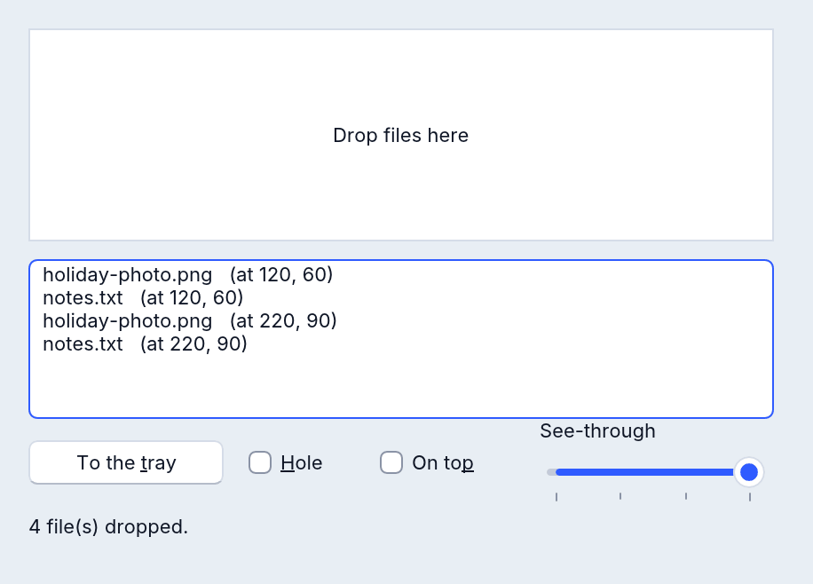

# RFormEx: a form with more

`RFormEx` is a form that does more than an `RForm`, natively on Windows,
macOS, Linux and the web:

- **files dropped on it**, one event per file, only inside the area you
  choose, with the point where they landed;
- **its own icon in the system tray**, with a tooltip and pictures that can
  take turns (an animation), clicks and double clicks;
- **see-through**: the whole window, or only its background colour (a hole
  the desktop shows through);
- **always on top** of other programs' windows;
- told when it is **minimised**, when it **gets** and **loses the focus**;
- **the window's messages** on Windows (a MIDI input, a message another
  program posts).

Everything an `RForm` has, an `RFormEx` has too: put `RFormEx` where you
would write `RForm`.



```basic
DECLARE SUB FileDropped (File AS STRING)

CREATE Main AS RFormEx
    Caption = "Drop files here"
    DragEnable = True
    OnDrag = FileDropped
END CREATE

SUB FileDropped (File AS STRING)
    Main.Caption = File
END SUB

Main.ShowModal
```

The example [examples/gui/form_ex.rr](../../examples/gui/form_ex.rr) uses
every feature below (`rapidr run gui/form_ex.rr` in the examples folder).

## Files dropped on the form

| Member | What it does |
|---|---|
| `DragEnable` | `True`: files dragged from Finder, File Explorer or a file manager can be dropped on the form. |
| `OnDrag(File AS STRING)` | Once for each file of a drop, in order, with its whole path. |
| `DragZone.Left`, `.Top`, `.Right`, `.Bottom` | Only drops inside this rectangle count (client pixels; `Right` and `Bottom` are just outside). Empty, as it starts: the whole form. |
| `DropPoint.X`, `DropPoint.Y` | Where the files landed, set before `OnDrag`. |

```basic
' only the white box takes files
Main.DragZone.Left = Box.Left: Main.DragZone.Top = Box.Top
Main.DragZone.Right = Box.Left + Box.Width
Main.DragZone.Bottom = Box.Top + Box.Height
```

In a browser a dropped file is read into the program's own files, and
`File` is its name: open it as any file. Every form also has
`OnDropFiles(Files)`, which hears a whole drop at once (the paths one a
line); an `RFormEx` can use either.

## The tray icon

| Member | What it does |
|---|---|
| `AddTrayIcon` / `DelTrayIcon` | Puts the form's icon in the system tray, or takes it away. Closing the form and the end of the program take it away too. |
| `TrayIconHint` | The tooltip (the application's title until you set it). |
| `TrayICO` | The pictures, an `RImageList` of the form's own: `Main.TrayICO.AddICOFile "app.ico"` (also `AddBMPFile`, `AddSVGFile` …). None: the form's or the application's icon. |
| `TrayIconIndex` | Which picture shows, from 1. |
| `TrayIconUpdate` | With two pictures or more they take turns every so many milliseconds (2000 to start with; 0 stops it). |
| `TrayIconShown` | `True` while the icon is in the tray. |
| `OnTrayDblClick` | The icon double-clicked: bring the window back here. |
| `OnTrayClick` | The right button released on it (on macOS also a Control-click): show a menu here. |
| `OnTrayMouseUp(Button)` | Any button released on it: `mbLeft`, `mbRight` or `mbMiddle`. |

The tray is the notification area on Windows, the menu bar on macOS, the
panel's tray on Linux (StatusNotifierItem) and a small strip at the bottom
right of a web page.

A program that lives in the tray:

```basic
SUB Minimised            ' OnMinimise
    Main.AddTrayIcon
    Main.Visible = False
END SUB

SUB BackFromTray         ' OnTrayDblClick
    Main.DelTrayIcon
    Main.WindowState = wsNormal
    Main.Visible = True
END SUB
```

`RemoveTaskBar` takes the window's button off the Windows taskbar (it does
nothing on other systems).

## See-through and on top

| Member | What it does |
|---|---|
| `Transparent` | 0 to 255: how opaque the whole window is — 255 opaque (to start with), 127 half, 0 invisible. Other values are ignored. |
| `TransparentClient` | `True`: the form's background colour (`Color`) becomes a hole; the desktop shows through and clicks there reach what is behind. Controls stay, except their parts in exactly that colour. |
| `FormStyle` | `fsStayOnTop`: above other programs' windows; `fsNormal`: an ordinary window again. |

| | Windows | macOS | Linux X11 | Linux Wayland | Web |
|---|---|---|---|---|---|
| `Transparent` | yes | yes | yes (with a compositor) | no | yes |
| `TransparentClient` | yes | yes | yes | no | the page shows through; clicks still reach the form |
| `fsStayOnTop` | yes | yes | yes | the compositor decides | above the page's other windows |

Where a system can't do it, the window stays as it was and the program is
told once on its error output. A window with `TransparentClient` is drawn on
the processor rather than the graphics card (RapidR reads its colours to cut
the hole).

## Minimised, the focus, the wheel

| Event | When |
|---|---|
| `OnMinimise` | The person minimised the window (its button, the system menu, the taskbar or the Dock); not when your program sets `WindowState`. In it `WindowState` is already `wsMinimized`. |
| `OnGetFocus` | The window became the active one. |
| `OnLostFocus` | Another window, of this program or another, took the keyboard. |
| `OnMouseWheel(Delta, X, Y, Shift)` | As an `RForm`'s: whole notches (1 away from you), the mouse in the form's pixels. |

## The window's messages: `OnMessage`

`OnMessage(Hwnd, Msg, wParam, lParam)` hears the messages the window gets.

- **On Windows**: every message Windows sends or posts to the form's
  window — a MIDI input opened with `CALLBACK_WINDOW` (`MM_MIM_DATA`), a
  `WM_USER + n` another program posts, `WM_SIZE`, the mouse and the keys —
  except the ones that are `RFormEx`'s own events: `WM_DROPFILES`,
  `WM_ACTIVATE`, `WM_KILLFOCUS`, `WM_SYSCOMMAND`, `WM_MOUSEWHEEL` and the
  tray icon's (`&H590`).
- **On macOS, Linux and the web** there are no Windows messages. It hears
  exactly these, numbered as on Windows: your program's own tray icons
  (`RNotifyIconData` and `Shell_NotifyIcon`, the message you chose),
  `WM_SIZE` (`&H5`: wParam 0 restored, 1 minimised, 2 maximised; lParam the
  client width + height * 65536) and `WM_MOVE` (`&H3`: lParam the client
  area's left + top * 65536 on the screen).

`WndProc`, every form's, hears every message, those included.

```basic
SUB Heard (Hwnd AS LONG, Msg AS LONG, wParam AS LONG, lParam AS LONG)
    IF Msg = &H5 THEN Info.Caption = "now" + STR$(lParam AND &HFFFF) + " wide"
END SUB
```

## Programs written with QFormEx

`QFormEx` is the name an older include gave this form. A program that
includes it (or uses `QFormEx`) runs unchanged and gets an `RFormEx` that
behaves exactly as that include's form did — see
[Compatibility notes](compatibility.md#qformex).
