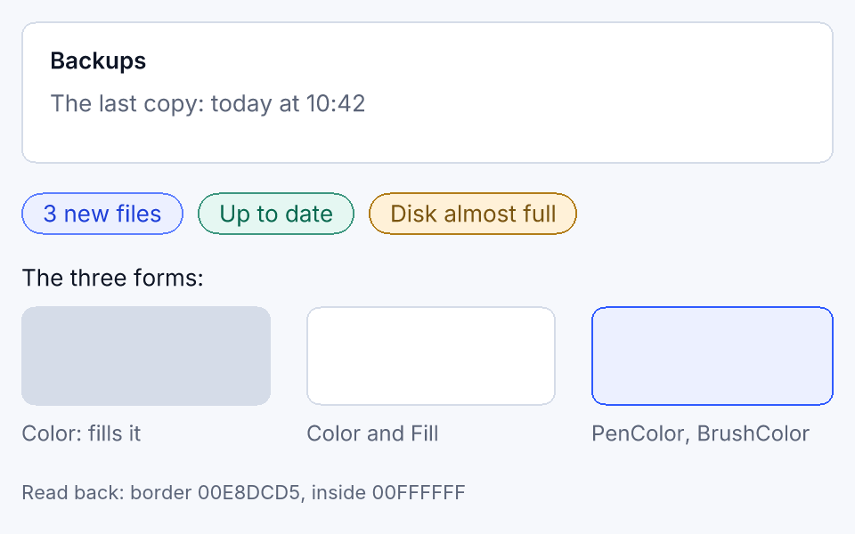
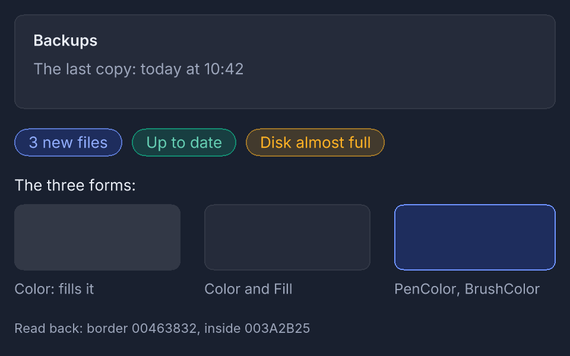
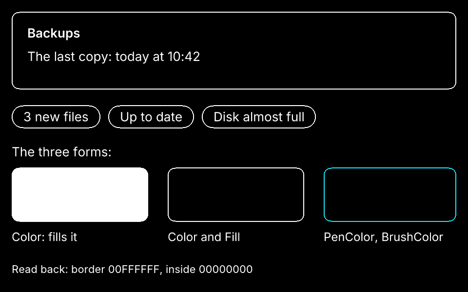
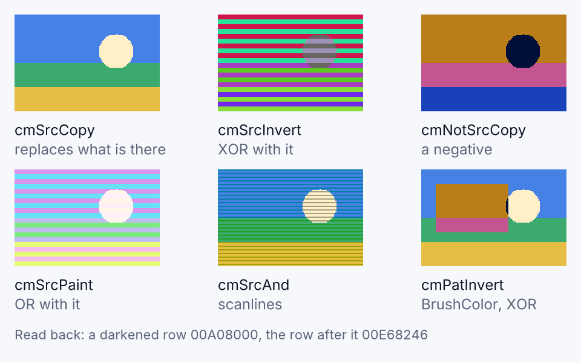
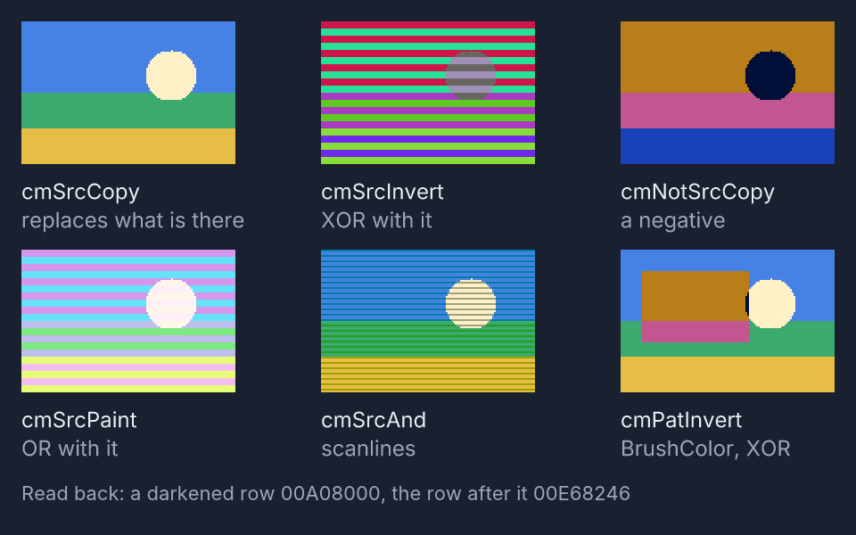
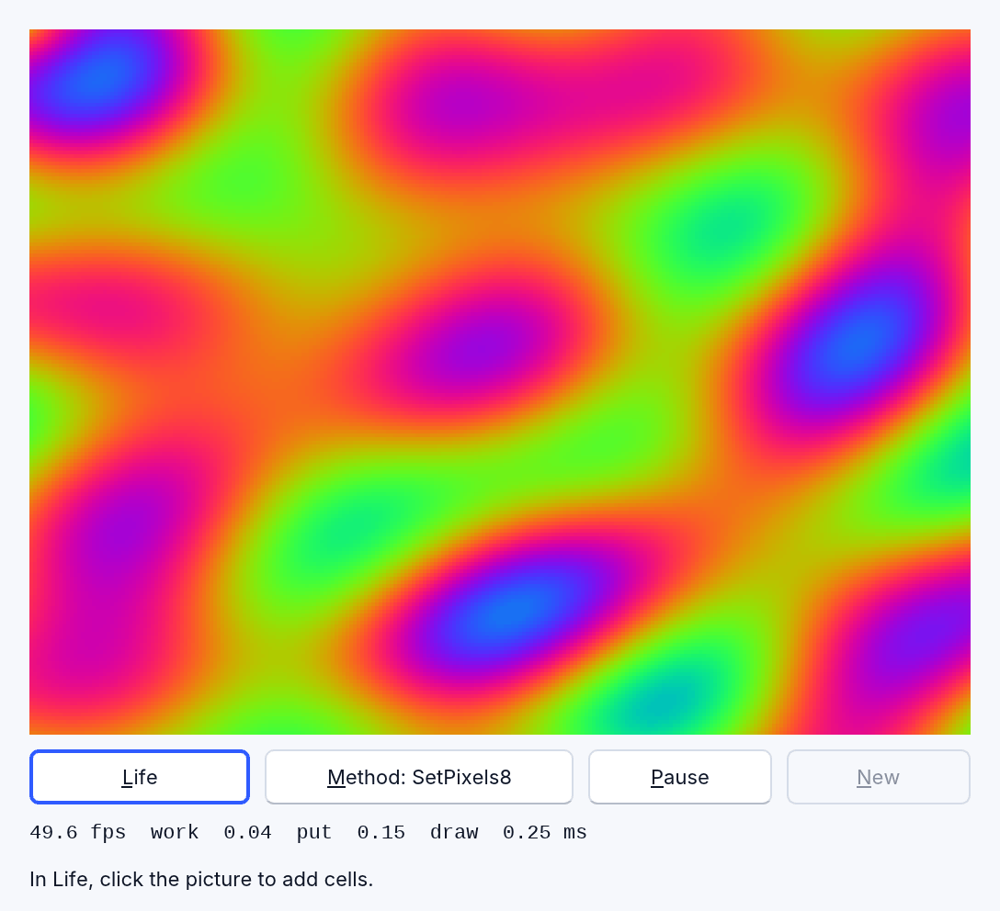
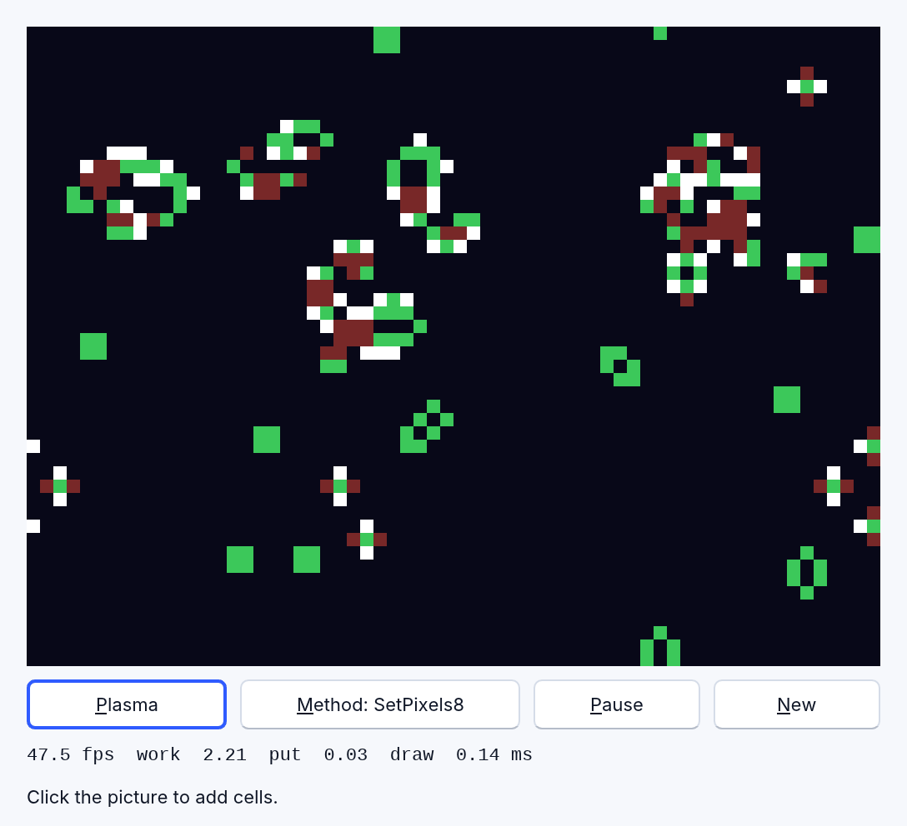
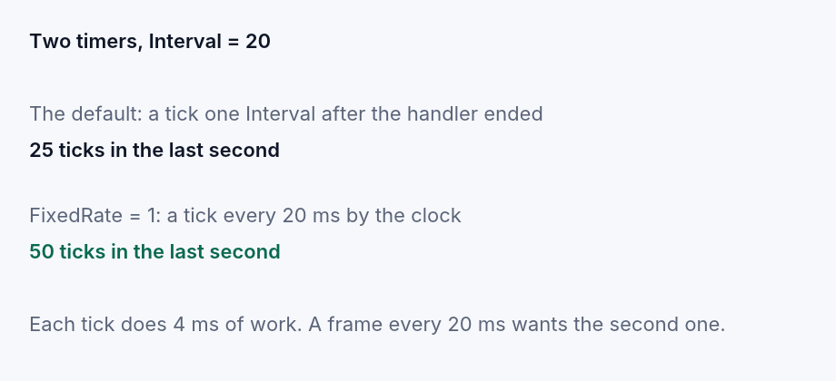

# Drawing: canvases, bitmaps and pixels

Three things in RapidR hold a picture you can draw on, and they all draw the
same way:

- an **`RCanvas`**: a control on a form. Draw in its `OnPaint` handler and the
  picture comes back whenever the window needs it;
- an **`RBitmap`**: a picture in memory, with no window. Draw on it, save it
  (`SaveToFile`), draw it onto a canvas;
- an **`RImage`**: a control that shows a picture (a file, or what you drew on
  it).

Colours are numbers: `RGB(r, g, b)` makes one (`&HBBGGRR`: red is the lowest
byte). Coordinates are the same logical pixels on every screen; on a
high-DPI screen (a Retina Mac, a browser at 2x) everything is drawn finer, and
the pixels a program reads back (`Pixel`, `GetPixels`, `SaveToFile`) are
still the ones it drew — see [High-DPI screens](components.md#high-dpi-screens).

| To do this | Call |
|---|---|
| One pixel | `Pset x, y, colour` (read one: `Pixel(x, y)`) |
| Lines and shapes | `Line`, `Rectangle`, `FillRect`, `Circle`, `RoundRect`, `Paint` (flood fill) |
| Text | `TextOut`, `TextRect`, `DrawText` |
| A picture onto another | `Draw x, y, Picture` · `StretchDraw Rect, Picture` · `CopyRect Dest, Picture, Source` |
| Turn it | `Rotate x, y, degrees` |
| **Many pixels at once** | **`SetPixels`, `SetPixels8`, `GetPixels`** — below |

## Rounded boxes: RoundRect

`RoundRect x1, y1, x2, y2, rx, ry` draws the box from (`x1`, `y1`) to (`x2`,
`y2`) — its right and bottom edges left out, as every shape's — with its
corners rounded by an ellipse `rx` wide and `ry` high. It takes its colours
in three ways:

| Call | What you get |
|---|---|
| `RoundRect x1, y1, x2, y2, rx, ry, Color` | the whole box filled with `Color` |
| `RoundRect x1, y1, x2, y2, rx, ry, Color, Fill` | a one-pixel **border** in `Color`, just inside the edge, and the inside in `Fill` (-1: no fill, only the border) |
| `RoundRect x1, y1, x2, y2, rx, ry` on an `RCanvas` | the border in `PenColor` and the inside in `BrushColor` |

So a card, or a pill, is one call:

```basic
Canvas.RoundRect 12, 12, 468, 92, 16, 16, Application.ThemeColor("border"), Application.ThemeColor("card")
Canvas.RoundRect x, 108, x + w, 132, 24, 24, Application.ThemeColor("status.info.border"), Application.ThemeColor("status.info")
```

The border and the inside cover exactly the box the one-colour form fills, and
on a high-DPI screen the curve is drawn at the screen's own scale, the border
still one pixel wide. [round_rect.rr](../../examples/graphics/round_rect.rr) draws a
card, three status chips and the three forms in the look's own colours.





## CopyMode: how a picture meets what is there

`Draw`, `StretchDraw` and `CopyRect` put a picture onto a canvas, a bitmap, an
image or a form's surface. What becomes of the pixels already there is the
destination's `CopyMode`. `cmSrcCopy`, the default, replaces them with the
picture's; the others combine the two colour by colour, bit by bit — the 15
raster operations of Windows. They work the same on a canvas, a bitmap and an
image, for a whole picture or a part of one, scaled or not, on Windows, macOS
and Linux and in a browser.

| `CopyMode` | The pixel becomes |
|---|---|
| `cmSrcCopy` | the picture's (the default) |
| `cmSrcInvert` | the picture XOR what is there: do it twice and the original is back |
| `cmSrcAnd` | the picture AND what is there: darker. A strip of grey copied over every third row gives scanlines |
| `cmSrcPaint` | the picture OR what is there: lighter |
| `cmSrcErase` | the picture AND NOT what is there |
| `cmNotSrcCopy` | the picture as a negative |
| `cmNotSrcErase` | NOT (the picture OR what is there) |
| `cmMergePaint` | NOT the picture OR what is there |
| `cmDstInvert` | what is there, turned over: the picture only says where |
| `cmBlackness`, `cmWhiteness` | black, or white, where the picture lands |
| `cmPatCopy` | the pattern |
| `cmPatInvert` | the pattern XOR what is there: draw a selection box, draw it again and it is gone |
| `cmPatPaint` | what is there OR the pattern OR NOT the picture |
| `cmMergeCopy` | the picture AND the pattern |

The **pattern** is the destination's brush: on an `RCanvas` in a RapidR
program its `BrushColor`; in a classic program the colour last used to fill
(a `FillRect`, `Rectangle` or `RoundRect` with a colour, a `Circle`'s fill, a
`TextOut`'s background; white before any). A picture with a transparent
colour, or soft edges (an SVG), is drawn as it always was whatever the mode,
and a printer page and the owner-drawn items of a list or a grid copy
(`cmSrcCopy`) for now. [copy_modes.rr](../../examples/graphics/copy_modes.rr)
shows six of them on one picture, scanlines included.




## Drawing many pixels fast

Some programs make a picture out of numbers: an emulator's video memory, an
image filter, a heat map of a table, a cellular automaton, a plasma. The
obvious way is a loop of `Pset`:

```basic
FOR y = 0 TO 191
    FOR x = 0 TO 255
        Display.Pset x, y, colour(y * 256 + x)       ' 49,152 calls
    NEXT
NEXT
```

That works, and it is slow: every call is a trip from your program to the
picture, 1 to 3 microseconds each, so one 256 x 192 screen is **60 to 80
milliseconds** — fourteen pictures a second at best, and the program does
nothing else. A game, an emulator and a smooth animation need a picture every
20 milliseconds.

Instead, put the picture in an **array** and hand it over in one call.

### SetPixels: the colours themselves

```basic
DIM Colours(256 * 192 - 1) AS LONG
' … fill Colours(y * 256 + x) with RGB(r, g, b) …
Frame.SetPixels Colours, 256, 192
```

`SetPixels Pixels, Width, Height [, X, Y]` copies the `Width` x `Height`
colours of the array onto the picture with its top-left corner at (`X`, `Y`)
— at 0, 0 if you leave them out. The array is read row by row from its
**first element**, whatever its lower bound is: in a one-dimensional array,
element `y * Width + x` is the pixel (x, y). A two-dimensional array is stored
with its last subscript varying fastest, so
`DIM Pixels(Height - 1, Width - 1)` holds pixel (x, y) in `Pixels(y, x)`.

Colours are the numbers `Pset` takes: `RGB(r, g, b)`, `&HBBGGRR`, a system
colour as always. Use an `INTEGER` or `LONG` array (a colour needs 24 bits).

### SetPixels8: a palette

```basic
DIM Indexes(256 * 192 - 1) AS BYTE      ' a colour number for every pixel
DIM Palette(255) AS LONG                ' what each number looks like
Frame.SetPixels8 Indexes, Palette, 256, 192
```

`SetPixels8 Indexes, Palette, Width, Height [, X, Y]` is the same, but each
element of `Indexes` is the number of a colour in `Palette` (its first element
is colour 0): one lookup a pixel, done in Rust. It is how screen memory worked
on the machines an emulator imitates, and it makes **palette cycling** free:
change a few entries of `Palette` and call it again — the picture moves though
not one index changed ([pixels_fast.rr](../../examples/graphics/pixels_fast.rr)
does that for its plasma).

### GetPixels: the picture into an array

```basic
DIM Px(256 * 192 - 1) AS LONG
Pic.GetPixels Px, 0, 0, 256, 192        ' Pixels, X, Y, Width, Height
FOR i = 0 TO 256 * 192 - 1
    Px(i) = &HFFFFFF - Px(i)            ' a negative
NEXT
Pic.SetPixels Px, 256, 192
```

`GetPixels Pixels, X, Y, Width, Height` is the other direction. Read, change
the numbers, put back: that is an image filter. The loop above inverts a
256 x 192 picture in about 5 milliseconds in the interpreter; the same filter
with 49,152 `Pixel` calls and as many `Pset` calls takes 140.

### When something is wrong

A call that can't be answered stops the program with a message that says
why — never a picture that is quietly wrong:

- `SetPixels: Pixels must be an array (DIM Pixels(…) AS LONG), not a number`
- `SetPixels: Pixels holds 3 values, but a 2 x 2 block needs 4`
- `SetPixels: a 2 x 2 block at (3, 0) does not fit in the 4 x 4 bitmap`
- `SetPixels8: the pixel (1, 1) of the block has index 2, but Palette has 2
  colours (indexes 0 to 1)`

A block must lie wholly inside the picture; to draw a part that hangs over an
edge, put the block in a bitmap and `Draw` or `CopyRect` it (they clip).

## Drawing it larger

Put the picture in an `RBitmap` the size of the machine's screen, then draw
that bitmap on the canvas, larger:

```basic
Frame.SetPixels8 Indexes, Palette, 256, 192
Display.StretchDraw 0, 0, 512, 384, Frame        ' x, y, width, height, picture
```

`StretchDraw` takes the rectangle as four numbers (RapidR's; the older
`StretchDraw Rect, Picture` with an `RRect` still works the same way). Each
pixel of the result is the **nearest** pixel of the picture: crisp, as pixel
art and a screen full of text want it — and on a Retina screen each pixel of
the 256 x 192 picture is a sharp 2 x 2 block of the display, not a blur. Set
`Smooth = True` on the canvas or bitmap you draw *on* and the four pixels
around each one are blended instead, which is what a photograph wants. `Smooth`
is `False` unless you say so, and `StretchDraw` and `CopyRect` are the calls it
changes.





## How fast

One 256 x 192 picture (49,152 pixels), put into a bitmap and drawn twice as
large (512 x 384), in milliseconds a picture, the average of 300. Measured on
an Apple M4 Max with macOS, release builds, 2026-10-30 — the Mac was busy with
other work (load average 20 to 40), so these are, if anything, slow. The
program is [tools/bench/pixels.rr](../../tools/bench/pixels.rr); the web
numbers are `tests/web_pixels_bench.mjs` in Chromium.

| | the interpreter (`rapidr run`) | native build | web (Chromium) |
|---|--:|--:|--:|
| `Pset` for every pixel | 77.7 | 62.0 | 83 |
| `SetPixels` | 0.031 | 0.030 | 0.050 |
| `SetPixels8` | 0.044 | 0.048 | 0.083 |
| `GetPixels` | 0.044 | 0.021 | 0.057 |
| `StretchDraw`, twice as large | 0.044 | 0.045 | 0.060 |
| **`SetPixels8` + `StretchDraw`** | **0.087** | **0.090** | **0.127** |

A whole picture is about **a tenth of a millisecond**, 900 times faster than
the `Pset` loop and 0.4 % of a 50-a-second frame. On a high-DPI screen the
bitmap also keeps the finer picture the display shows, and the same frame
costs 0.34 ms at 2x (0.64 ms at 3x) with the picture handed to the screen
included (`cargo run --release -p rapidr-value --example pixels_bench`).

Passing an array to any component's method used to cost an extra millisecond
for 50,000 elements, which hid in every `RAudioOut.Write buf` too; that is gone.

## A picture every 20 milliseconds

A timer's `Interval` is counted in the system timer's steps of 15.6 ms,
rounded up: `Interval = 20` is 31.25 ms, about 32 ticks a second, not 50. And
when the handler takes a good part of the Interval, how the ticks follow one
another depends on the timer:

| The timer | The next tick comes |
|---|---|
| an `RTimer` in a RapidR program (the default) | one Interval after the handler has **ended**: a 24 ms handler at `Interval = 20` ticks about every 55 ms |
| an `RTimer` with `FixedRate = 1` | every Interval **exactly**, by the clock: `Interval = 20` is 50 a second. A tick that fell due while a long handler ran runs the moment it ends, and the ones missed besides it one after another (handlers never overlap), up to 250 ms behind; further behind (a dragged window, a long dialog) and it counts again from then |
| a classic program's `QTimer` (a `.bas` file) | on the beat: an Interval from where the last tick was **due**, so a 24 ms handler still ticks every 31 ms; a tick that fell due during the handler runs the moment it ends, the ones missed besides it are dropped |

A program that wants a steady beat — an emulator's 50 frames a second, a
clock hand, a metronome — sets `FixedRate = 1`:

```basic
Clock.Interval = 20
Clock.FixedRate = 1            ' every 20 ms by the clock, not 20 ms after the last frame
```



[steady_timer.rr](../../examples/gui/steady_timer.rr) runs both side by side
and counts their ticks. The other way, which works without `FixedRate` and
cares nothing for the ticks' rhythm: let the timer look at every tick and draw a
picture only when one is **due**, keeping the due time yourself:

```basic
SUB Tick
    DIM now AS DOUBLE
    now = TIMER
    IF now < nextAt THEN EXIT SUB                ' not yet
    nextAt = nextAt + 0.02                       ' the next one, 20 ms after this one was due
    IF nextAt < now THEN nextAt = now + 0.02     ' (far behind: no burst to catch up)
    DrawFrame                                    ' work it out, SetPixels8, StretchDraw
END SUB
```

with `Interval = 10` on the timer. The frames are exactly 20 ms apart on
average whatever the ticks do, as long as one frame's own work is under about
4 ms. [pixels_fast.rr](../../examples/graphics/pixels_fast.rr) is this loop:
its readout says how many frames a second it really draws, and how long it
spent working the picture out, putting it into the bitmap and drawing it.

## Try it

| | |
|---|---|
| [round_rect.rr](../../examples/graphics/round_rect.rr) | `RoundRect` with a border and an inside in one call: a card, three status chips and the three forms, in the look's own colours (light, dark, high contrast) |
| [copy_modes.rr](../../examples/graphics/copy_modes.rr) | `CopyMode` on one picture: replace, XOR, a negative, OR, scanlines (`cmSrcAnd`) and a selection box (`cmPatInvert`) |
| [steady_timer.rr](../../examples/gui/steady_timer.rr) | An `RTimer` and an `RTimer` with `FixedRate` counting their ticks side by side: about 25 a second against 50 |
| [pixels_fast.rr](../../examples/graphics/pixels_fast.rr) | A plasma (palette cycling, 256 x 192) and the Game of Life (64 x 48 cells worked out every frame) at 50 frames a second, with the readout. **Method** switches to a `Pset` for every pixel, to see the difference: the plasma drops to about 12 pictures a second |
| [video_memory.rr](../../examples/recipes/video_memory.rr) | The systems recipe: a machine's bitmap and colour attributes kept decoded in a `BYTE` array and drawn with `SetPixels8`; **Repaint** times a full repaint (about 0.2 ms; the first version of the recipe took 8 to 13 ms) |
| [tools/bench/pixels.rr](../../tools/bench/pixels.rr) | The benchmark above, to run on your own computer |

Next: [Recipes for systems programs](recipes-systems.md), whose video-memory
recipe uses these calls; [Components and objects](components.md).
