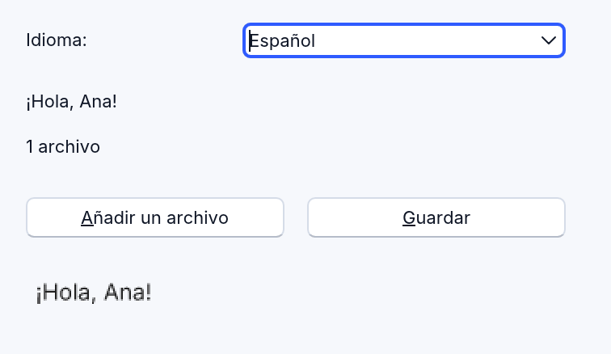

# The language

RapidR's language is a modern BASIC, and older programs run as
they are. This chapter is a working summary, with the rules where RapidR
differs from other BASICs — those are the ones that surprise
people. Native builds, the
interpreter and the web give the same output for every example here.

RapidR also accepts some syntax the classic language doesn't (VB's `#If`, `ON ERROR`,
`i++`, …): see [Differences and extensions](differences.md).

## Source files

- Extensions `.bas` and `.rr` are the same language. The older extensions
  are accepted too: `.rqw`, `.rqb` and
  `.rq` (run, built, opened in RapidR Studio and `$INCLUDE`d like a `.bas`).
  A file is read as UTF-8; one that isn't valid UTF-8 is read as
  Windows-1252 (ANSI), as older programs usually are.
- **Case doesn't matter** in keywords, names, components and builtins.
- `:` separates statements on a line; `_` at the end of a line continues it
  (a string may continue too).
- Comments: `'` or `REM`.
- `?` is short for `PRINT`.
- Labels: `Name:` on a line of their own, or a line number.
- A first line `#!/usr/bin/env rapidr` makes the file a script on macOS and
  Linux (`chmod +x prog.bas; ./prog.bas`); the line is ignored.

## Program kinds: `$APPTYPE`

`$APPTYPE CONSOLE`, `$APPTYPE GUI`, `$APPTYPE CGI` (the classic ones) and `$APPTYPE
WEB` (RapidR's). Without one, a program that creates components is a GUI
program and any other a console program. The kind
decides, for example, whether a Windows executable opens a console window,
and whether a program double-clicked on macOS or Linux gets a terminal.

## Variables and types

| Type | Suffix | Holds |
|---|---|---|
| `BYTE` | `?` | 0 … 255 (a store wraps: `b? = 300` holds 44) |
| `WORD` | `??` | 0 … 65535 |
| `SHORT` | `%` | -32768 … 32767 (`q% = 40000` holds -25536) |
| `INTEGER`, `LONG` | `&` | 32-bit signed |
| `DWORD` | `???` | 32-bit (signed) |
| `SINGLE` | `!` | 32-bit float |
| `DOUBLE` | `#` | 64-bit float |
| `STRING` | `$` | text; `STRING * n` is always n characters |
| `VARIANT` | | whatever is stored |

```basic
DIM count AS INTEGER, title AS STRING
DIM x AS INTEGER = 5
DIM code AS STRING * 3        ' "abcdef" stored gives "abc"; "a" gives "a  "
DIM (a, b, c)(5) AS LONG      ' three arrays
DIM m                         ' no AS: a DOUBLE
DIM p, q AS LONG              ' only q is a LONG; p is a VARIANT
CONST MaxItems = 3
DEFINT k(1 TO 3) = {7, 8, 9}  ' DEFINT, DEFSTR, DEFLNG, DEFDBL, …
```

- Variables needn't be declared; an undeclared name is a VARIANT. A name
  with a suffix (`n%`, `s$`) has the suffix's type.
- **A store into an integer variable truncates** (`i = 2.7` gives 2);
  beyond 32 bits it gives -2147483648. A `BYVAL` parameter rounds half to
  even instead.
- Inside a SUB or FUNCTION, `DIM` makes a local; `STATIC` keeps its value
  between calls. An undeclared variable a SUB uses before the main program
  does is the SUB's own (kept between calls) — the one-pass rule.
- `TRUE` and `FALSE`: a comparison gives -1 or 0 (`PRINT 1 = 1` prints
  -1). In a RapidR program (`.rr`) `True` is -1 and `False` 0. In a `.bas`
  program they come from `$INCLUDE "RAPIDQ.INC"`, where `True` is 1;
  without the include they are undeclared names that read 0
  (so `IF True THEN` doesn't run), and the code editor warns.

## Constants: `clRed`, `mbYes`, `VK_ESCAPE`…

Constants are names for fixed numbers, such as colours, message box buttons and
key codes. The full list is in [the constants reference](reference/constants.md).

**In a RapidR program (`.rr`)** they are built in. Just use them, no
include line:

```basic
Form.Color = clRed
IF MESSAGEDLG("Save?", mtConfirmation, mbYes OR mbNo, 0) = mrYes THEN SaveIt
PRINT QBColor(12)          ' QBasic's 16 colours, QBColor(0) … QBColor(15)
```

A name of your own wins: `DIM mbYes AS INTEGER = 5`, `CONST clRed = &HFF`,
a variable you store into or a SUB's parameter is yours where you declare
it, and the built-in constant is still there everywhere else. Only the
constants your program uses are compiled, and the debugger doesn't list them
as variables. `True` stays -1, as a comparison gives it (a check box's
`Checked` is 1: test `IF CheckBox1.Checked THEN`, not `= True`).

**In a `.bas` program** nothing changes: the constants come with
one line at the top:

```basic
$INCLUDE "RAPIDQ.INC"
```

RapidR has that include built in, so the line needs no file: RapidR ships no
copy of it. Without the line, `clRed` — and `True` and `False` too — is an undeclared
name and reads as 0, and the code editor warns you
([the RAPIDQ.INC warning](studio-editor.md#the-rapidqinc-warning)). Old
programs behave the same. The line in a `.rr` program is harmless: the
constants are then the include's.

RapidR's own constants, such as `akLeft` … `akBottom` for anchors, need no
include in any program. A variable or `CONST` of your own with the same name
always wins.

Your own constants:

```basic
CONST MaxPlayers = 4
CONST Title = "My Game"
```

**Coming next (after Preview 2):**

- In RapidR programs (`.rr`), every constant will be there with no
  `$INCLUDE` line. Only the ones your program uses are compiled in, and your
  own names still win.
- Older programs (`.bas`) keep today's rule.
- Constants will also be grouped by topic, so typing `Color.` in the editor
  lists every colour. The old names keep working.

## Arrays

```basic
DIM a(1 TO 3) AS INTEGER      ' bounds 1 … 3
DIM grid(2, 2) AS STRING      ' 0 … 2 in each dimension
REDIM a(1 TO 5) AS INTEGER    ' resized, its values kept
PRINT LBOUND(a), UBOUND(a)
SWAP a(1), a(3)
QUICKSORT a(1), a(5), 0       ' sorts a(1) … a(5); 0 ascending
```

Whole arrays can be passed (`Fill M()`, `SUB Fill (list() AS STRING)`), and
TYPEs can hold arrays (`Names(2) AS STRING`, `vertex(9, 2) AS SINGLE`).

## Operators

From the loosest: `OR`, `XOR` · `AND` · `NOT` · comparisons (`=`, `<>`,
`<`, `>`, `<=`, `>=`, `NOT=`) · `+`, `-`, `&` · `*`, `/`, `\`, `MOD`,
`SHL`, `SHR`, `INV` · `^` · unary `-`.

- `AND`, `OR`, `XOR`, `NOT` are **bitwise** on 32-bit integers (`7 AND 3`
  is 3, `NOT 0` is -1). `NOT` binds looser than comparisons.
- `/` divides as reals (`7 / 2` is 3.5); `\` is integer division, its
  operands rounded first; `MOD`'s operands round half to even (`7.5 MOD 2`
  is 0).
- `\` and `MOD` by zero stop the program with "Division by zero"; `/` by
  zero gives an infinity.
- `a INV m` is the modular inverse (`3 INV 26` is 9).
- Strings: `+` or `&` join; `-` removes every occurrence (`"jello" - "l"`
  is `"jeo"`); `s$[i]` is the i-th character.
- `i++`, `i--`, `x += y` (and `-=`, `*=`, `/=`, `&=`); `INC x [, n]`,
  `DEC x [, n]`.
- `@var` passes a variable by reference.

## Printing numbers

RapidR prints numbers in the classic way (the compatibility suite covers
it):

```basic
PRINT 1 / 3         ' 0.333333333
PRINT 3.5           ' 3.500000000   (fractions: 9 decimals)
PRINT 10 / 5        ' 2             (whole numbers: as integers)
PRINT 1E10          ' -2147483648   (a whole number beyond 32 bits)
PRINT STR$(1 / 3)   ' 0.333333333   (STR$: 9 significant digits)
```

**PRINT's comma is a semicolon**: `PRINT 1, 2` prints `12`, with
no tab zones. Use `;` with explicit spaces, `TAB(n)`, `SPACE$(n)`,
`FORMAT$` or `STRF$` to lay out columns:

```basic
PRINT FORMAT$("%5d|%.2f|%s", 42, 3.14159, "x")    '    42|3.14|x
PRINT STRF$(1234.5678, 2, 8, 2)                    ' 1234.57 (ffFixed)
```

Other numeric rules: `INT` and `FIX` truncate toward zero; `ROUND`, `CINT`
and `CLNG` are `INT(x + 0.5)` (2.5 → 3, -2.5 → -2); `VAL` reads the number
at the start of the text (`VAL("12abc")` is 12); `HEX$` has 8 digits.

## Control flow

```basic
IF x > 10 THEN
    PRINT "large"
ELSEIF x > 5 THEN
    PRINT "medium"
ELSE
    PRINT "small"
END IF
IF ok THEN PRINT "yes" ELSE PRINT "no"

FOR i = 1 TO 10 STEP 2 : PRINT i : NEXT i
WHILE k < 5 : k = k + 1 : WEND
DO
    k = k + 1
LOOP UNTIL k >= 3                 ' also DO WHILE / DO UNTIL / LOOP WHILE

SELECT CASE n
    CASE 1 TO 10
        PRINT "small"
    CASE 11, 12
        PRINT "eleven or twelve"
    CASE IS > 12
        PRINT "big"
    CASE ELSE
        PRINT "?"
END SELECT

GOSUB Shout                       ' … Shout: PRINT "!" : RETURN
GOTO Done
EXIT FOR / EXIT DO / EXIT WHILE / EXIT SUB / EXIT FUNCTION
END
```

`DATA`, `READ` and `RESTORE [label]` work as in other BASICs.

### `FOR i AS INTEGER`: a counter declared in its loop

Many BASICs (and the AI models that learned them) write the counter's type
in the loop itself. RapidR takes that too:

```basic
FOR i AS INTEGER = 1 TO 3 : PRINT i : NEXT      ' prints 1, 2, 3

SUB CountDown
    FOR k AS LONG = 10 TO 0 STEP -5             ' k is the SUB's own
        PRINT k
    NEXT
END SUB
```

- The counter is declared where it isn't yet, as a `DIM` would: in a SUB or
  FUNCTION it is a local of its own; in the main program, a global.
- A counter already declared with the **same type** is that variable (two
  loops on `i`, or `DIM i AS INTEGER` first). One declared with **another
  type** is an error that says so:
  `FOR name AS INTEGER: name is already declared AS STRING (in main.rr:3)`.
- The type is a number type: `INTEGER`, `LONG`, `DOUBLE`, `SINGLE`, `BYTE` …
- `FOR i = 1 TO 3` is unchanged. It works the same in the interpreter, native builds and on
  the web.

### `END` and the exit code

`END` ends the program at once; the files it wrote are kept. RapidR's
`END n` ends it with the exit code `n`, so a console tool can tell the
system, or the script that ran it, whether it worked. 0 means success, as
everywhere else:

```basic
IF COMMANDCOUNT = 0 THEN
    PRINT "usage: check FILE"
    END 2
END IF
IF FILEEXISTS(COMMAND$(1)) = 0 THEN END 1
PRINT "ok"                        ' running off the end is exit code 0 too
```

`n` is any number or numeric expression (`END failures + 1`), stored as a
LONG is, so `END 2.9` ends with 2. A bare name has to be one you declared
(`DIM code AS INTEGER = 5` then `END code`; a `CONST`, a parameter or a
local does too): a typo in a block's ending, `END SUBB` or `END FUNCTON`,
and a name that was never declared stay a syntax error, with a "did you mean END SUB?" hint when the word is close to one,
rather than quietly ending the program there. A plain `END` ends with 0, as
it always did, and `END IF`, `END SUB` and the other block endings are what
they were. After a run, read the code in the shell: `echo $?` on macOS and Linux,
`echo %ERRORLEVEL%` in Windows' Command Prompt. It is the same for
`rapidr run`, for an app built with `rapidr build` (native or `--interp`)
and for a program with windows. macOS and Linux keep the low 8 bits of the
number (0 to 255); Windows keeps all 32. A program running in a web page has
no exit code: it just ends, and the number is ignored.

## SUBs and FUNCTIONs

```basic
DECLARE FUNCTION Square (x AS DOUBLE) AS DOUBLE   ' optional

SUB Greet (Who AS STRING)
    PRINT "Hello, "; Who
END SUB

FUNCTION Square (x AS DOUBLE) AS DOUBLE
    Square = x * x            ' or: Result = x * x
END FUNCTION

FUNCTION Twice% (n%)          ' a suffix gives the result's type
    Twice% = n% * 2
END FUNCTION

SUB Change (BYREF v AS INTEGER)
    v = 99
END SUB

Greet "RapidR"                ' a SUB is called without parentheses
PRINT Square(1.5)             ' 2.250000000
```

- Parameters are by value unless `BYREF` (or passed as `@var`).
- `SUBI` / `FUNCTIONI` take any number of arguments, read with
  `ParamVal(i)`, `ParamValCount`, `ParamStr$(i)`, `ParamStrCount`.
- Function pointers: `BIND p TO MySub`, `CALLFUNC p, args`, `CODEPTR(MySub)`.
- `DECLARE … LIB "user32"` (any DLL) calls the DLL's function **on
  Windows**, in native builds and interpreted, with these rules: a
  number goes by value unless `BYREF`, a `STRING` and a `TYPE` by address
  (what the DLL writes shows in the variable), `VARPTR` addresses are real
  pointers for the call. Up to 16 arguments, of which up to 8 `DOUBLE` /
  `SINGLE`. A 64-bit pointer a DLL returns or writes into a `LONG` is kept
  as a 32-bit stand-in that turns back into the pointer when given to a
  DLL again. `SENDMESSAGE`, `POSTMESSAGE` and `KILLMESSAGE` are
  user32's functions the same way. On macOS, Linux and the web the program
  compiles and stops at the first such call with an error that names the
  function (and RapidR's portable equivalent when there is one); a
  library of the system's own (`LIB "libfoo.dylib"`, `"libfoo.so"`) loads
  there. With `RAPIDR_SANDBOX` set no library is loaded at all.
  docs/windows-dll-calls.md has the details.
- `PEEK` / `POKE` / `PCOPY` work on the console's pages
  (page 0 is the screen: even addresses a cell's character, odd ones its
  colour), and — RapidR's addition — `PEEK` / `POKE` on the program's own
  memory through `VARPTR`, on every system. Any other address is a
  run-time error, never a read of the process. `INP` / `OUT` (hardware
  ports) are a run-time error, as on every Windows since 2000.
- `VARPTR` doesn't see a SUB's parameters: when a parameter
  has the name of a global variable, `VARPTR(name)` inside the SUB is the
  global's address.

  ```basic
  DIM Msg AS STRING = "global"
  SUB Greet(Msg AS STRING)
    PRINT Msg                       ' the parameter: hello
    PRINT VARPTR$(VARPTR(Msg))      ' the global: global
  END SUB
  Greet "hello"
  ```

  `VARPTR` of a parameter that no global shares its name with gives that
  parameter's own address.

## TYPEs and objects

A `TYPE` is a record, and can have methods, a constructor,
events and inheritance:

```basic
TYPE TCounter
    Count AS INTEGER
    Name AS STRING
    SUB Bump (n AS INTEGER)
        This.Count = This.Count + n
    END SUB
    FUNCTION Describe AS STRING
        Describe = This.Name + "=" + STR$(This.Count)
    END FUNCTION
    CONSTRUCTOR
        Name = "counter"
        Count = 100
    END CONSTRUCTOR
END TYPE

TYPE TLoud EXTENDS TCounter
    FUNCTION Shout AS STRING
        Shout = UCASE$(This.Describe)
    END FUNCTION
END TYPE

DIM c AS TCounter
c.Bump 5
PRINT c.Describe              ' counter=105
DIM l AS TLoud
l.Bump 1
PRINT l.Shout                 ' COUNTER=101
```

- `TYPE TMyButton EXTENDS RButton` makes a component of your own, with
  `EVENT OnSomething … END EVENT` blocks.
- `WITH obj … END WITH` and `.Member` inside it.
- Arrays of TYPEs and of components: `DIM lbl(1 TO 3) AS RLabel`.

## Components

```basic
CREATE Form AS RForm
    Caption = "Title"
    CREATE Btn AS RButton
        Caption = "OK"
        OnClick = OkClick
    END CREATE
END CREATE
DIM Font AS RFont             ' a non-visual object
```

See [Components and objects](components.md).

## Strings

The builtins are the classic ones: `LEFT$`, `MID$`, `RIGHT$`, `INSTR`, `RINSTR`,
`UCASE$`, `LCASE$`, `TRIM$`, `REPLACE$` (overwrites at a position),
`REPLACESUBSTR$` (find and replace), `INSERT$`, `DELETE$`, `REVERSE$`,
`FIELD$`, `TALLY`, `STRING$`, `SPACE$`, `CHR$`, `ASC`, `HEX$`, `BIN$`,
`OCT$`, `CONVBASE$`, `FORMAT$`, `STRF$`, … — the full list is in
[the builtins reference](reference/builtins.md). String functions count
characters, not bytes.

- `""` inside a string is **not** an escaped quote (it reads as two strings
  side by side). Use `CHR$(34)`, or turn on `$ESCAPECHARS ON` for `\"`,
  `\n`, `\t`, `\\`, `\x41`.

### Long strings and binary data

A string can hold a whole file: `ReadBinStr` (or `ReadStr`) on an
`RFileStream` gives one character per byte, `CHR$(0)` … `CHR$(255)`, and
`ASC(MID$(data, i, 1))` — or `ASC(data[i])` — is the byte at `i`. Reading
every byte of a 64 KB file this way took 13 ms with `rapidr run`, 7 ms
built native and 23 ms in a browser on an Apple M4 Max
([tools/bench](../../tools/bench/README.md)), the same per byte however
long the string: `MID$`, `LEFT$`, `RIGHT$`, `LEN`, `INSTR` and `data[i]`
cost what they return, not the string's length. Strings are
shared, not copied — passing one to a SUB or putting it in another
variable costs nothing — and a string built a piece at a time,
`s = s + x` or `s = s & x`, grows in place. (Write `s = s + (a + b)`
rather than `s = s + a + b` when `s` is long: the second makes a new
`s + a` first.) To get the bytes into an array in one call, copy them with
`MemCopyTo`:

```basic
DIM mem(65535) AS BYTE
fs.Open("game.rom", fmOpenRead)
fs.MemCopyTo(VARPTR(mem(0)), fs.Size)     ' its bytes, mem(0) the first (no more than the array holds)
fs.Close
```

[bytes.rr](../../examples/basics/bytes.rr) does both with a 64 KB file.

## Files

```basic
OPEN "notes.txt" FOR OUTPUT AS #1     ' also INPUT, APPEND, BINARY, RANDOM
PRINT #1, "first line"
CLOSE #1
f = FREEFILE
OPEN "notes.txt" FOR INPUT AS #f
WHILE NOT EOF(f)
    LINE INPUT #f, s$
    PRINT s$
WEND
CLOSE #f
PRINT FILEEXISTS("notes.txt"), FILELEN("notes.txt")
```

### Reading what is typed or piped in, line by line

A console program's own input is read as it arrives. `INPUT s$` takes a line
from the console, and `OPEN "/dev/stdin" FOR INPUT AS #f` makes it a file:
`LINE INPUT #f, s$` returns each line **as soon as it has come**, not when
all the input has, and `EOF(f)` waits for the next byte or the end of the
input. A program that answers one line with one line (a server that speaks
JSON lines on its input and output, such as an MCP stdio server) can
therefore be written with a plain loop:

```basic
$APPTYPE CONSOLE
OPEN "/dev/stdin" FOR INPUT AS #1
WHILE NOT EOF(1)
    LINE INPUT #1, request$
    PRINT "got "; request$       ' written before the next line is read
WEND
```

It works the same with `rapidr run`, in an interpreted build and in a native
one. A web page has no standard input: there `/dev/stdin` is a file that is
not there (the page's files are its own, see [The web](web.md)).

The stream objects do the same with methods: `RFileStream` (older name
`QFILESTREAM`: `Open`,
`ReadLine`, `WriteLine`, `ReadNum`, `WriteNum`, `Read`, `Write`, `Seek`,
`Size`, `Position`, `SaveArray`, `LoadArray`, …), `RMemoryStream` and
`RStringList` (`LoadFromFile`, `SaveToFile`). `DIR$`, `KILL`, `MKDIR`,
`RMDIR`, `RENAME`, `CHDIR`, `CURDIR$` and `DIREXISTS` work with folders.
In a browser, files are the page's own (see [The web](web.md)).

### Text and bytes: accents, Chinese, emoji

A string is made of characters and a file of bytes. RapidR keeps them
apart, so text is never lost and binary data is never changed:

| You use | The file holds |
|---|---|
| `PRINT #`, `LINE INPUT #`, `RStringList.SaveToFile` / `LoadFromFile`, translation (`.po`) files | Text as **UTF-8**. Reading also takes the Windows-1252 text that older programs and editors wrote (an `é` as one byte): a character is never turned into `?` or `�` on the way in. |
| `RFileStream` and `RMemoryStream`: `WriteStr`, `WriteLine`, `Write`, `ReadStr`, `Read`, `ReadLine` | **Bytes.** A string whose characters are all up to 255 is written one byte a character (`CHR$(200)` is the byte 200), so pictures, sounds and packets built or copied with strings come back exact. A string with any character above 255 (Chinese, emoji, `€`) is text: it is written whole as UTF-8, accents included. |
| `WriteText` and `ReadAllText` (RapidR's, on both streams) | Text as UTF-8 whatever the string holds, even only accents. `ReadAllText` reads the rest of the stream as UTF-8 (a byte-order mark dropped) or, when it isn't UTF-8, as Windows-1252. |
| `RMemo`, `REdit` and `RRichEdit` (plain text), `RCodeEdit` | The encoding the file had when it was loaded: UTF-8 (with or without a byte-order mark) or Windows-1252. A text never loaded in a text box is written as Windows-1252 while it fits. |

`WriteStr(S, n)` counts **characters**, so `WriteStr(S, LEN(S))` writes all
of `S` in any language. A file is **never saved with a `?` in place of a
character** its encoding lacks: a Windows-1252 file that gets Chinese typed
into it (or a text box's text that has an emoji) is saved as UTF-8, and
`RCodeEdit.Encoding` says "UTF-8" afterwards.

```basic
DIM f AS RFileStream, s AS STRING
s = "Fecha: 日期 · café · 😀"
f.Open("note.txt", fmCreate)
f.WriteStr(s, LEN(s))              ' UTF-8: the Chinese and the emoji need it
f.Position = 0
PRINT IIF(f.ReadAllText = s, "same", "different")    ' same: all of it came back
f.Close
```

The picture below is the translations example: the same greeting in a label
(above) and drawn on a canvas with `TextOut` (below), from a Chinese and a
Spanish catalog. A canvas draws the characters RapidR's own fonts lack
(Chinese, Japanese, Korean) with the system's CJK font on the desktop and
with the Noto fonts of the page on the web, as its labels do; on the web
draw in `OnPaint`, which runs again when such a font arrives.



An `RFileStream` writes a file a byte at a time as fast as all at once:
it keeps what it's given and writes it together — at `Close`, when the
program waits (for its events, `SLEEP`, `INPUT`) or ends (`END`, a
run-time error), every 64 KB, and before anything else uses the file by
its name (`OPEN`, another stream's `Open`, `FILELEN`, `KILL` …), so
whatever reads the file sees every byte, as if each write had gone
straight to it. Only a program stopped from outside (killed, the power
gone) can lose what it wrote last, at most 64 KB. `SaveArray` and
`LoadArray` of a numeric array move all its elements in one go.

File names work as they do on Windows, on every system: `\` and `/` both
separate folders, and a name finds its file in any case. A program
written on Windows finds its files on macOS and Linux unchanged:

```basic
Bitmap.BMP = "PICS\OPEN.BMP"            ' finds pics/open.bmp on Linux too
DIM Notes AS RStringList
Notes.LoadFromFile(Application.Path + "\notes.txt")
```

A name that exists exactly as written is always taken as it is; a new
file keeps the name the program gives it (in the folder found in any
case).

## The console

`CLS`, `COLOR fg, bg`, `LOCATE row, col`, `CSRLIN`, `POS(0)`, `INPUT
[prompt,] var`, `INKEY$`, `INPUT$(n)`, `SLEEP seconds` (`SLEEP 0.5`), `BEEP`,
`SOUND`. Colours and positions are written as ANSI sequences, so they work
in any modern terminal and in the IDE's output panel. A bare `INPUT$`
(no count) reads a whole line — old programs end with
`a = INPUT$` to wait before the window closes.

**Box characters.** The classic console showed characters 128 to 255 in the
old DOS code page 437, so older programs draw boxes with them:

```basic
PRINT CHR$(201); STRING$(10, 205); CHR$(187)    ' ╔══════════╗
```

RapidR shows an older program's console the same way: a file that isn't
UTF-8 (saved by an old Windows or DOS editor), or a `.bas` / `.rqb` / `.rq`
/ `.rqw` file of plain ASCII. A RapidR program (a `.rr` file, or any UTF-8
file with accented letters) prints its text as it is — `CHR$(233)` is é. To
draw boxes in a RapidR program, write the characters themselves
(`PRINT "╔══╗"`).

### Older forms that still work

The classic compiler took a few forms that look odd today; RapidR takes them
the same way:

```basic
SUB Draw.Box (X AS INTEGER)       ' a dot in a SUB / FUNCTION name
    PRINT "box"; X
END SUB
FUNCTION Calc.Twice (N AS INTEGER) AS INTEGER
    Calc.Twice = N * 2            ' the result, assigned to the whole name
END FUNCTION
CONST Null = &0                   ' & before plain digits: the number (0)
CONST App.Name = "Demo"           ' a dot in a CONST name, read as App.Name
Draw.Box 1
SLEEP(Calc.Twice(3)) / 10         ' (…) starts the argument: SLEEP 0.6
```

## The preprocessor

| Directive | |
|---|---|
| `$INCLUDE "file"` | include a file (include folders and `\` paths work; `RAPIDQ.INC` is built in) |
| `$DEFINE NAME [text]`, `$UNDEF NAME` | text substitution |
| `$IFDEF` / `$IFNDEF` / `$ELSE` / `$ENDIF` | conditional compilation |
| `$MACRO NAME(x) = text` | a macro with parameters |
| `$APPTYPE CONSOLE \| GUI \| CGI \| WEB` | the program's kind |
| `$RESOURCE NAME AS "file"` | a file built into the program (`RESOURCE(n)`, `EXTRACTRESOURCE`, pictures) |
| `$OPTION ICON "file.ico"` | the program's icon: its windows' and the built app's ([Building apps](building-apps.md)) |
| `$ESCAPECHARS ON` | escape sequences in this file's strings |
| `$TYPECHECK ON` / `OFF` (`$OPTION EXPLICIT`: ON) | every variable must be declared (DIM, CONST, a parameter): an undeclared one stored into gives `Undeclared identifier x`, read gives `Undefined symbol X` |
| `$OPTIMIZE` | accepted |
| `$THEME name` | RapidR's: the desktop look ([Components](components.md#themes)) |
| `#If … Then` / `#ElseIf` / `#Else` / `#End If`, `#Const` | VB's conditional compilation |

An error in included code points at the include file and line.

## Errors

- Compile errors name the file, line and column, and every bad line is
  reported, not just the first: `syn.bas:3:1: error: Syntax error in FOR
  statement`.
- Some say the fix too. A name declared again — in a program of several
  files, often in another file — says where the first one is:
  `Identifier siteCount already used, try another name — it is declared in
  globals.rr:12 already`. A SUB or FUNCTION that no file has names the
  nearest ones: `Unknown SUB or FUNCTION 'ShowNumbr' — did you mean
  ShowNumber?`.
- The editor also warns about code that compiles but can't be right:
  `IF NOT FILEEXISTS(f) THEN` is always true, because FILEEXISTS gives 1
  for yes and `NOT 1` is -2. The warning's quick fix (Ctrl+.) writes
  `IF FILEEXISTS(f) = 0 THEN`.
- A run-time error in the main program's code stops the program with its
  message and line: `run-time error: Division by zero (at err.bas line 4)`.
- A run-time error in an **event handler** (a click's, a timer's) ends that
  handler — and the handlers that fired it — and the window keeps working:
  the error is written to the program's error output (in Studio, the
  Output). An error a component raises (`Cannot create file
  notes/today.txt.`) is a run-time error like any other, with its line.
- `ON ERROR GOTO` / `ON ERROR RESUME NEXT` (VB's) are accepted
  so that such programs compile, and **ignored**.

### When a handler fails: `Application.OnError`

A program can hear each of those handler errors, to tell its user, write a
log or save their work (RapidR's own):

```basic
SUB Failed(Message AS STRING, File AS STRING, Line AS INTEGER)
  Status.Caption = "Something went wrong: " + Message + " (line " + STR$(Line) + ")"
END SUB

Application.OnError = Failed
```

`Message` is the error alone (`Division by zero`), `File` and `Line` where
it happened (a native build gives `""` and `0`). It fires once per error,
after the handler has ended — never for an error in `Failed` itself. An
error in the main program's own code still ends the program. RapidR Studio
uses it to keep your work safe ([Studio keeps your work](studio-projects.md#studio-keeps-your-work)).
Try [examples/gui/on_error.rr](../../examples/gui/on_error.rr): two buttons,
each with a bug, and a window that keeps working.

## Native code: `RUSTSTART`

In native builds only, `RUSTSTART … RUSTEND` puts Rust code in the
program — in the main program or in a SUB, with more BASIC after it. The
interpreter and the web refuse it with a clear message at its line.

```basic
PRINT "before"
RUSTSTART
println!("from Rust");
RUSTEND
PRINT "after"
```
