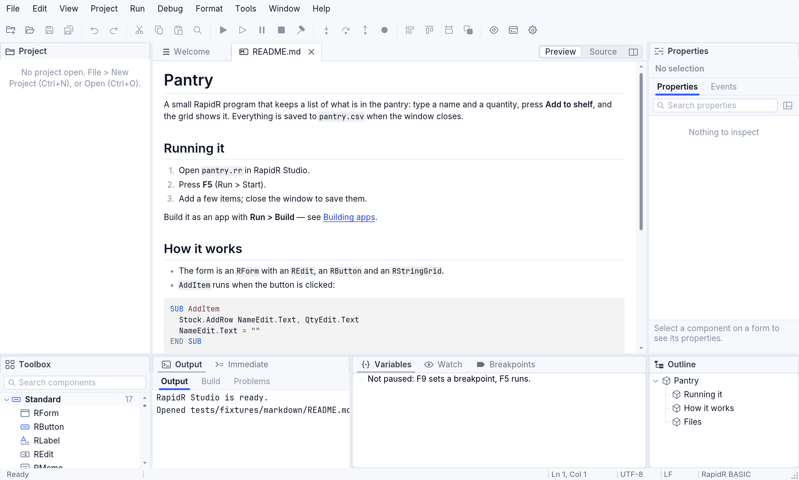
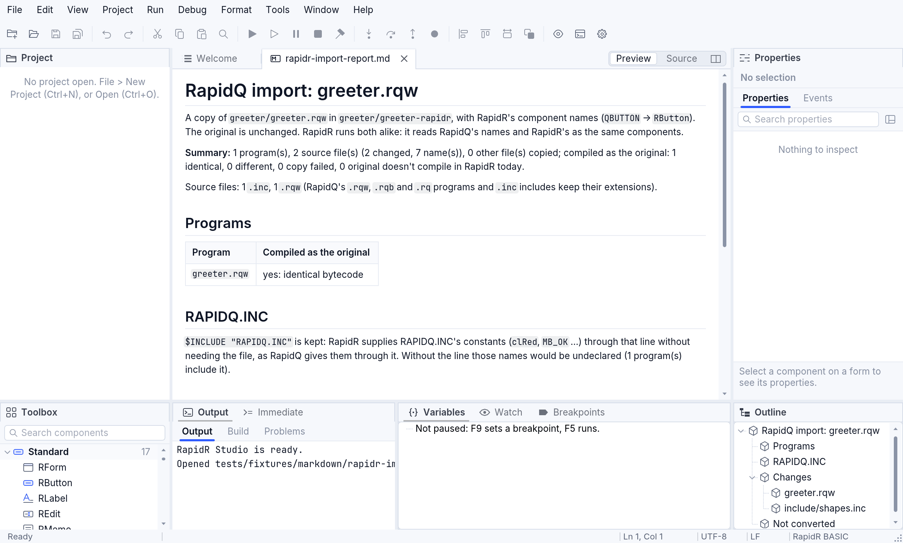
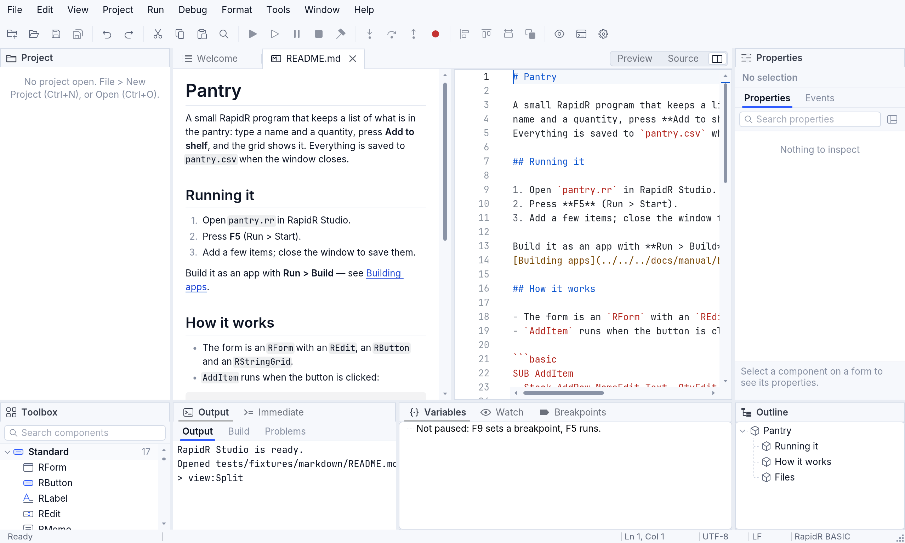
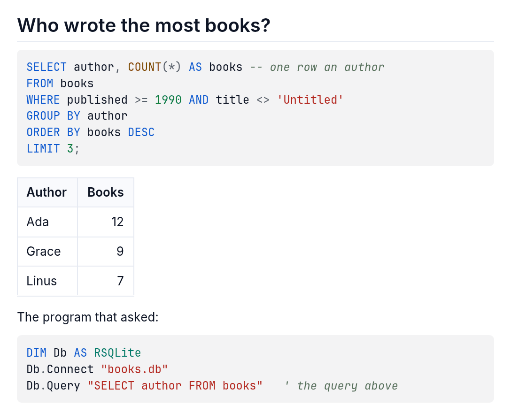
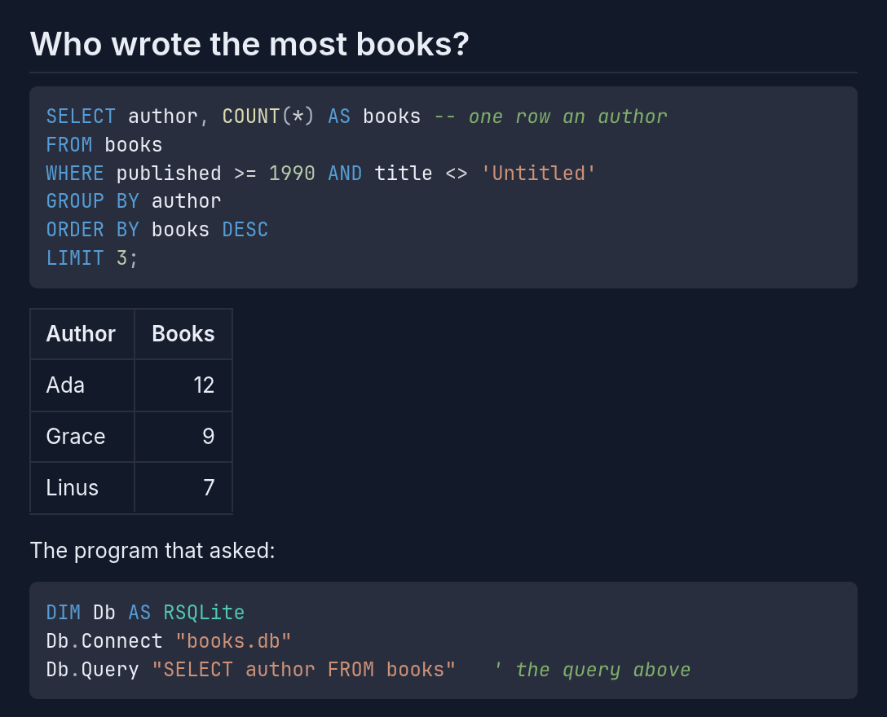

# Markdown files and RMarkdownView

Markdown is the plain-text format of `README.md` files, notes and reports:
`# Heading`, `**bold**`, `- list item`, `` `code` ``, `[link](url)`.
RapidR shows it **formatted**, as a reader sees it — in RapidR Studio, and
in your own programs with the `RMarkdownView` component.

## In RapidR Studio



**Opening a Markdown file.** A file ending in `.md` (or `.markdown`) opens
in **Preview**: headings, lists, tables and code as they are meant to be
read. Open one from the Project pane (double click), with **File > Open
Project or File…** (Ctrl+O; a `.md` file opens on its own, with or without
a project), or by clicking a link to it in another Markdown file. The report
RapidR writes when it imports a RapidQ program (`rapidr-import-report.md`)
opens the same way.



**Preview | Source.** At the right of the document tabs, a Markdown file
has a switch, as a form's file has *Design | Code*:

| Segment | Shortcut | Shows |
|---|---|---|
| **Preview** | Shift+F7 (View > Designer) | the text formatted |
| **Source** | F7 (View > Code) | the Markdown text, to edit |
| **Side by side** (the last button) | View > Designer and Code Side by Side | both: what you type in the source shows in the preview at once |

F12 (View > Toggle Form / Code) switches between Preview and Source.
Changes are saved with **File > Save** (Ctrl+S), as for code; the tab shows
a dot while a change isn't saved.



**Reading.** Scroll with the mouse wheel, the scroll bar or the keys (Up /
Down, Page Up / Page Down, Space, Home / End). Drag across text to select
it, then Ctrl+C (Cmd+C on a Mac) or **Edit > Copy** copies it; Ctrl+A or
**Edit > Select All** selects everything. A table's cells are copied
separated by tabs, so they paste into a spreadsheet as columns.

**Links.** Click a link:

- a web address (`https://…`, `mailto:…`) opens in your browser;
- another file (`notes.md`, `../docs/setup.md`) opens in Studio — a
  Markdown one in Preview, at the heading the link names (`notes.md#install`);
- a heading of the same file (`#running-it`) scrolls there.

Links work from the keyboard too. With the preview focused, **Tab** steps to
its first link, then each next one — a ring marks it, and the preview scrolls
to it — and out of the preview after the last; **Shift+Tab** goes back the
other way. **Enter** or **Space** follows the link, as a click does. The same
holds for an `RMarkdownView` in your own programs (below), where
`OnLinkClick` hears it.

**Outline.** The Outline pane lists the file's headings, nested by level.
Click one: the preview scrolls to it (in Source, the editor goes to its
line).

The source isn't coloured as BASIC: a `'` in a sentence is just an
apostrophe.

## In your programs: RMarkdownView

`RMarkdownView` shows a Markdown text formatted, the same on the desktop
and on the web, in the program's theme (light, dark, high contrast). Screen
readers hear its headings (with their level), lists, tables and links.

```basic
' alClient and alBottom are built in: no include needed in a .rr program

SUB LinkClicked (Url AS STRING)
  Status.Caption = "You clicked " + Url
END SUB

CREATE Form AS RForm
  Caption = "Read me"
  Width = 640: Height = 480
  CREATE Doc AS RMarkdownView
    Align = alClient
    OnLinkClick = LinkClicked
  END CREATE
  CREATE Status AS RLabel
    Align = alBottom
  END CREATE
END CREATE

IF Doc.LoadFromFile("README.md") = 0 THEN
  Doc.Text = "# No README" + CHR$(10) + CHR$(10) + "*README.md* wasn't found."
END IF
Form.ShowModal
```

| Member | What it does |
|---|---|
| `Text` | the Markdown text shown (set it to show another) |
| `LoadFromFile(File)` | shows a file; True when it was read |
| `OnLinkClick(Url)` | a link was clicked; `Url` is its target as written |
| `OpenLinks` | True (the default): a web link opens in the browser by itself |
| `CodeLanguage`, `OnCodeClick(Word, OfType)` | the language of the text's `inline code`, and a click on one of its words: see below |
| `ScrollTo(Heading)` | scrolls a heading to the top, by its text or its anchor (`"#running-it"`) |
| `Headings` | the headings, a line each: level, text, anchor, line, separated by tabs |
| `PlainText`, `SelText` | the text as shown (without the marks), and the selected part |
| `SelectAll`, `Clear`, `LinkCount`, `EmptyText` | as their names say |

The full list is in the [reference](reference/members.md#rmarkdownview).

**What is shown.** CommonMark Markdown, with GitHub's tables and
`~~strikethrough~~`: headings, paragraphs, **bold**, *italic*, inline code,
links, bulleted and numbered lists (nested), block quotes, code blocks
(coloured by their language: see below), tables (columns aligned as the
`:---:` row says) and rules. HTML inside the text is left out, and a
picture shows its description in italics instead of the picture.

### Code blocks in colour

A code block is coloured as RapidR's code editor colours its language, in
the program's theme: keywords, names, strings, numbers and comments each
in their own colour, which follow the theme when it changes. The language
is the word after the opening ```` ``` ````:

| Fence | Coloured as |
|---|---|
| ```` ```sql ```` | SQL: every dialect's words |
| ```` ```sqlite ````, ```` ```mysql ```` (or `mariadb`) | SQL with that dialect's words (`PRAGMA`, `AUTO_INCREMENT` …) |
| ```` ```basic ```` (or `rapidr`, `rr`, `bas`, `rapidq`, `vb` …) | RapidR's BASIC |
| ```` ```json ````, ```` ```html ````, ```` ```css ````, ```` ```javascript ```` (`js`), ```` ```toml ````, ```` ```csv ````, ```` ```rust ````, ```` ```markdown ```` | that language |
| any other word, or none | plain, in the code font |

So a program that shows the SQL it ran — a database tool's history, an
AI's queries — shows it as the editor would:





The example is [examples/gui/markdown_code.rr](../../examples/gui/markdown_code.rr)
(the **Theme** button switches the look). It works the same on the desktop
and on the web.

### Added and removed counts: `<ins>` and `<del>`

A diff's counts — **+11** **−0** — can be shown in the diff's colours:
`<ins>+11</ins> <del>−0</del>`. Text between `<ins>` is added (the theme's
green), between `<del>` removed (its red; not struck out: the signs say it
too), both in the code font so the digits line up, and each made readable
(4.5:1, 7:1 in high contrast) on the view's ground in every look. A `title`
is what a screen reader says instead of the sign:
`<ins title="11 lines added">+11</ins>`. Any other HTML is left out.

### Inline code and its words: `CodeLanguage`

`` `Inline code` `` is monospaced on a tinted ground and otherwise plain.
Set **`CodeLanguage = "rapidr"`** and it is coloured as the editor colours
RapidR's code too — `PRINT`, `RListBox`, `Items.AddItems` — and the words of
RapidR code in the view, inline or in a code block, answer the mouse: where
the program has a language service (RapidR Studio's own assistant chat has
one), the pointer over a word it knows is a hand, resting on it shows its
one-line help as a tooltip, and a click fires **`OnCodeClick(Word,
OfType)`**: the word as written and, for a member after a dot, the component
type it belongs to (`"RListBox"`; `""` for any other word). Studio's chat
opens the word in the Help pane there. A view without a `CodeLanguage`, or
a program without a language service, behaves as before.

`RMarkdownView` is RapidR's own.
