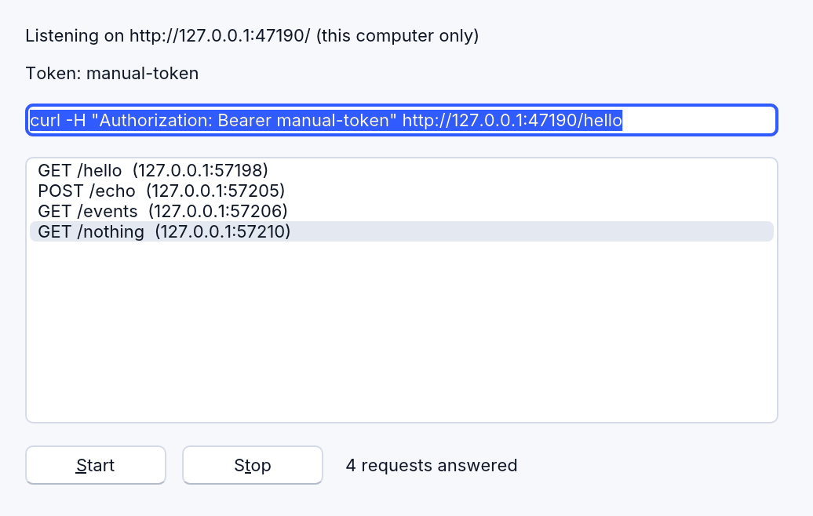

# Networking: sockets and a local web server

A program talks to the network in two directions:

- **as a client**, calling servers: `RHttp` (HTTP and HTTPS `Get` and
  `Post`), `RDownload` (a file, with progress) and `RSocket` (a TCP
  connection; on the web a WebSocket). They're described with the other
  objects in [DirectX and media](directx-and-media.md).
- **as a server**, answering others: `RServerSocket` (TCP, by lines, bytes
  or whole HTTP requests) and `RHttpServer` (a web server: a local API, a
  dashboard, an MCP server). Both are RapidR's own, and desktop only: a
  web page can't listen for connections.

## This computer only, or the whole network

A server listens on an **address** and a **port**. The address decides who
can reach it:

| Address | Who can connect |
|---|---|
| `127.0.0.1` | programs on this computer only — nothing on the network reaches it, and the system doesn't ask about incoming connections |
| `0.0.0.0` | every network interface: other computers too (the firewall may ask) |

A server only your own programs (or an AI app on the same computer) talk to
should always listen on `127.0.0.1`.

| Component | Where it listens |
|---|---|
| `RHttpServer` | `Host`: `127.0.0.1` unless you set another |
| `RServerSocket` | `Host`: `0.0.0.0` unless you set another (as before) |
| `RSocket`'s `Open(Port)` | `0.0.0.0`; `Open(Port, "127.0.0.1")` or `BindAddress = "127.0.0.1"` for this computer only |

```basic
DIM Sock AS RSocket
DIM Server AS INTEGER
Server = Sock.Open(47100, "127.0.0.1")    ' -1 when it can't
```

A port is a number from 1 to 65535; use one above 1024 that no other
program uses. Port 0 lets the system pick a free one: after `Start`,
`Port` says which.

## RServerSocket: a TCP server

`RServerSocket` listens on `Host:Port`, and tells the program what its
clients do through three events — fired when the program calls `Poll`,
so put `Poll` in an `RTimer`:

| Event | When |
|---|---|
| `OnClientConnect (Address)` | a client connected (`Address` is `127.0.0.1:53211`) |
| `OnDataReceived (Address, Data)` | the client sent something (see `Mode`) |
| `OnClientDisconnect (Address)` | the client went away |

`Mode` (RapidR's) says what `Data` is:

| Mode | `Data` is |
|---|---|
| `"lines"` (the default) | one line each time, without its end, trimmed; blank lines are left out. A last line without its end comes when the client closes. |
| `"bytes"` | what arrived, as it arrived: nothing trimmed or left out |
| `"http"` | one whole HTTP request each time: its request line, its headers, a blank line, then its body — however large (up to 4 MB) and however it was sent (its `Content-Length`, or in chunks, which are joined and given a `Content-Length`). A client that waits for "100 Continue" before sending a large body is told to go on. |

`Mode = "http"` checks nothing for you (no token, no Host or Origin check),
and RServerSocket listens on every network interface unless `Host =
"127.0.0.1"`: for a web API use RHttpServer, or at least set `Host =
"127.0.0.1"`.

To answer: `SendTo(Address, Data)` sends Data and a line end, `Send(Address,
Data)` (RapidR's) sends it as it is, `Broadcast(Data)` sends it with a line
end to everyone, `Disconnect(Address)` (RapidR's) closes that client's
connection, `Stop` closes them all.

The [echo server example](../../examples/network/echo_server.rr) answers
web requests itself with `Mode = "http"`: each request's body comes back,
however large.

```basic
SUB Got (Address AS STRING, Data AS STRING)
    DIM body AS STRING
    body = MID$(Data, INSTR(Data, CRLF + CRLF) + 4)
    Srv.Send Address, "HTTP/1.1 200 OK" + CRLF + "Connection: close" + CRLF + CRLF + body
    Srv.Disconnect Address
END SUB
```

```
$ curl --data-binary @big.json http://127.0.0.1:47120/echo
```

For a web API, `RHttpServer` does all the HTTP for you.

## RHttpServer: a web server in your program

`RHttpServer` (RapidR's; desktop only) is a small web server: a local API
for other programs, a dashboard, an [MCP](#an-mcp-server) server for AI
apps. It listens on `127.0.0.1` unless you say otherwise, reads each request
whole, refuses by itself what doesn't belong, and gives you the rest in
`OnRequest` — on your program's own thread, between its other events, so
the window never freezes.



```basic
DIM Web AS RHttpServer

SUB Answer (Method AS STRING, Path AS STRING, Headers AS STRING, Body AS STRING)
    IF Method = "GET" AND Path = "/hello" THEN
        Web.Respond 200, "Content-Type: text/plain", "Hello from RapidR"
    ELSEIF Method = "POST" AND Path = "/echo" THEN
        Web.Respond 200, "Content-Type: application/json", Body
    ELSE
        Web.Respond 404, "", "Not found"
    END IF
END SUB

Web.OnRequest = Answer
Web.Port = 47110
Token$ = Web.NewToken      ' a random token: every request must carry it
IF Web.Start = 0 THEN ShowMessage "Not listening: " + Web.Error
```

```
$ curl -H "Authorization: Bearer 3f9a…" http://127.0.0.1:47110/hello
Hello from RapidR
```

The example is [examples/network/local_api.rr](../../examples/network/local_api.rr).

### A request

`OnRequest (Method, Path, Headers, Body)` gives the method (`GET`, `POST`
…), the path without its query (`/mcp`), the headers (`Name: value` lines,
CR LF between) and the body as text. While it runs, the server also says:

| Property / method | |
|---|---|
| `Query` | what follows the path's `?` (`q=1&n=2`) |
| `Header(Name)` | one header, by name in any case (`Web.Header("Content-Type")`); "" when it has none |
| `Peer` | who asked (`127.0.0.1:53211`) |
| `Request` | the request's number, to answer it later |

Requests come one at a time: the next waits until your handler returns.

### The answer

`Respond Status, Headers, Body` answers: the status (200 OK, 404 Not found
…), your headers (`Name: value` lines, `CHR$(13) + CHR$(10)` or `CHR$(10)`
between) and the body. The server adds `Content-Length` itself, and a
`Content-Type` of plain text when you give none.

**Later.** A request can wait — for the user to approve something, for a
query to finish. Keep its number and answer when you're ready; the client
waits meanwhile:

```basic
Waiting = Web.Request          ' in OnRequest
…
Web.Respond 200, "Content-Type: application/json", Result$, Waiting
```

`Close [Request]` closes a request's connection without an answer.

**Streams of events.** `BeginStream` answers with a stream of
[Server-Sent Events](https://html.spec.whatwg.org/multipage/server-sent-events.html)
(`text/event-stream`); `SendEvent Data [, EventName]` sends each — one now,
another later, from a timer —, and `EndStream` ends it. Each takes the
request's number last, for a stream kept going after `OnRequest`. `SendEvent`
gives False when the client went away.

```basic
Web.BeginStream "", Id
Web.SendEvent "{" + CHR$(34) + "tick" + CHR$(34) + ":1}", "tick", Id
Web.EndStream Id
```

```
$ curl -N -H "Authorization: Bearer …" http://127.0.0.1:47110/events
event: tick
data: {"tick":1}
```

### What the server refuses by itself

Before `OnRequest`, the server answers these itself, and your program never
sees them:

| Request | Answer | Set with |
|---|---|---|
| without the token, or with a wrong one, when `Token` is set: `Authorization: Bearer <token>` | 401 | `Token` |
| anything but GET and HEAD while no `Token` is set | 401 | `Token` |
| from a web page of another site: its `Origin` header, or a browser's `Sec-Fetch-Site: cross-site` | 403 | `AllowedOrigins` (`https://my.site`, commas between; `*` any) |
| for another host name (its `Host` header): a web page can't reach your server by a name of its own (DNS rebinding) | 403 | `AllowedHosts` (`127.0.0.1`, `localhost` and `[::1]` with your port always pass) |
| with a body larger than `MaxRequestSize` (4 MB) | 413 | `MaxRequestSize` |
| that doesn't arrive whole within `Timeout` ms (30 seconds) | 408 | `Timeout` (also how long an idle connection stays open) |
| beyond `MaxConnections` (32) open at once | 503 | `MaxConnections` |
| that isn't HTTP/1.0 or HTTP/1.1 | 400 / 505 | — |

These checks don't stop everything a web page can do. A link, an image or
a script on another site's page makes the browser send a GET to your
server, often with no `Origin` at all (recent browsers mark it
`Sec-Fetch-Site: cross-site`, which is refused; older ones don't). So:

- **A GET must never change anything.** Answer GETs with what can be read;
  change things only on POST, PUT or DELETE.
- **Set a Token for anything beyond harmless reads.** Without one the
  server answers only GET and HEAD (anything else gets 401: "this server
  has no Token"). `Web.NewToken` sets a new one from the operating
  system's secure random source and returns it, to give the program that
  calls you. Never make a token with `RND`: it is not for secrets. Keep it
  with [RSecrets](secrets.md), not in the program.

Requests that don't come from a web page (curl, an AI app, your own
programs) carry no `Origin`, and pass if they carry the token. Set these
before `Start`.

**No TLS.** `RHttpServer` speaks plain HTTP. On `127.0.0.1` nothing goes
over the network, but other programs and other users of the same computer
can still connect: the Token is what keeps them out. With `Host =
"0.0.0.0"` the token travels in clear text over the network, where others
can read it. To serve other computers, put it behind a web server that
speaks HTTPS, and list the names it's reached by in `AllowedHosts`.

### An MCP server

AI apps that speak MCP's *Streamable HTTP* send JSON-RPC messages as POSTs
to one path (`/mcp`) and read the answer either as JSON or as a stream of
events: `Respond 200, "Content-Type: application/json", reply` or
`BeginStream "Content-Type: text/event-stream"` and `SendEvent reply,
"message"`. Give the session's id in a header (`Mcp-Session-Id: …`), check
the token, and keep `Host` at `127.0.0.1`.

### On the web

A web page can't listen for connections, so `RHttpServer` and
`RServerSocket` run on the desktop only (interpreted and native). On the
web `Start` gives False and `Error` says why.

## Members

| | `RHttpServer` |
|---|---|
| Properties | `Host`, `Port`, `Token`, `AllowedOrigins`, `AllowedHosts`, `MaxRequestSize`, `MaxConnections`, `Timeout`; read only: `Listening`, `Url`, `Error`, `Request`, `Method`, `Path`, `Query`, `Peer` |
| Methods | `Start`, `Stop`, `NewToken`, `Respond`, `BeginStream`, `SendEvent`, `EndStream`, `Close`, `Header` |
| Event | `OnRequest (Method, Path, Headers, Body)` |

The full lists, with every argument: [RHttpServer](reference/members.md#rhttpserver),
[RServerSocket](reference/members.md#rserversocket), [RSocket](reference/members.md#rsocket).
