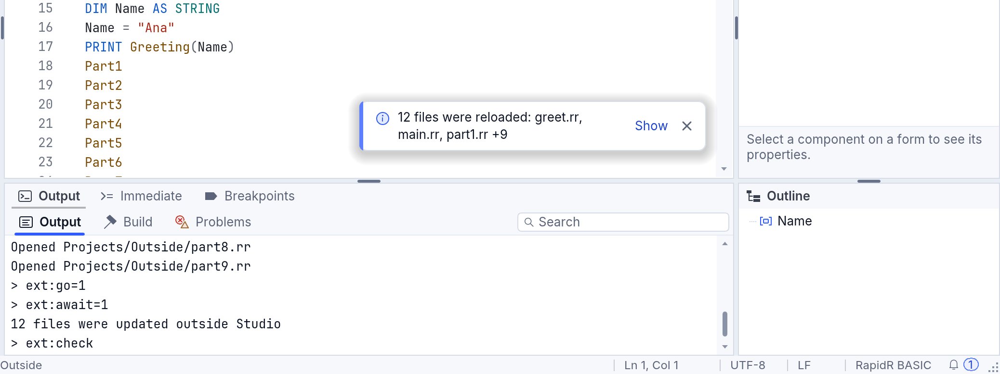
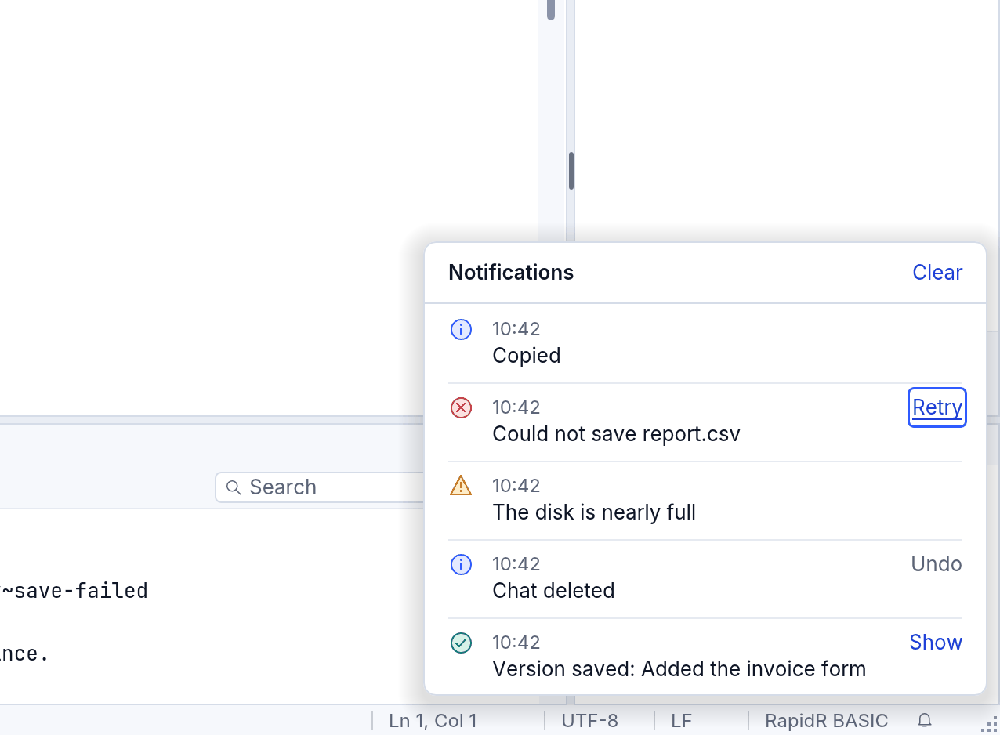
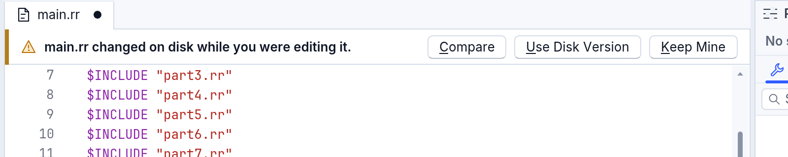
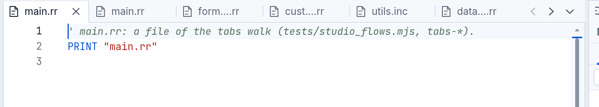
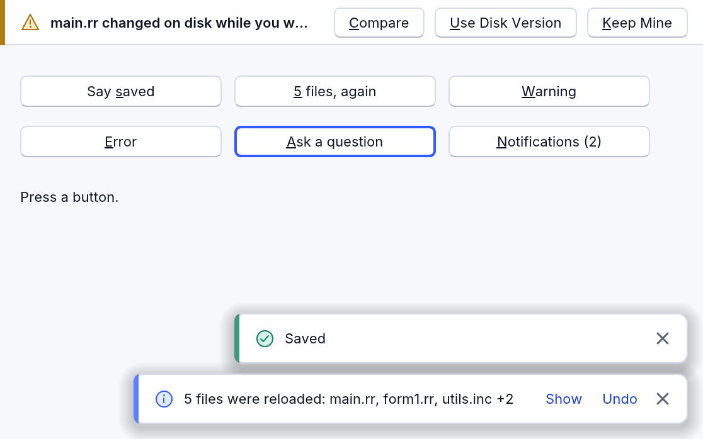

# Notifications: messages that pop up, and questions that wait

A program has three ways to say something to the person using it, and each one has its own size.

| It is | Use it when | What it looks like |
|---|---|---|
| a **toast** | something happened and there is nothing to decide: "Saved", "5 files were reloaded" | a small card in a corner, which goes by itself |
| a **question's strip** | the person must choose before work goes on: "main.rr changed on disk while you were editing it" | one slim line across the top of the thing it is about, with its buttons |
| a **dialog** | something with consequences is about to be turned on or lost | the middle of the window; the safe answer is the default |

Behind the toasts there is a **history**, so a message missed by a second is never lost. RapidR Studio uses all of it, and so can your programs: toasts are the component `RNotify`, the strip is `RNotifyBar`. The rules they follow are in the [design guide](../design-guidelines.md#notifications).



## In RapidR Studio

### Toasts

- **Where:** the bottom right of the editor area, at the left of the editor's scroll bar and above its horizontal one, so a toast never covers what you are reading or a bar you are dragging.
- **What they say:** what happened, with the names. When an agent, an editor or `git` changes many open files at once, Studio says it once: *12 files were reloaded: greet.rr, main.rr, part1.rr +9*. **Show** opens the full list in a searchable card.
- **How many and how long:** three at most (a fourth moves the oldest into the history). A toast stays as long as its words need to be read: 3 seconds and a little more for each character, 2 seconds more when it has a button, at least 5 and at most 20. A warning stays half as long again, and an error until you close it. **The time stops while the mouse is on a toast or the keyboard is.**
- **How you reach one by keyboard:** a toast never takes the keyboard by itself (the one exception: the new program the assistant just made has the keyboard on its first button, so Enter runs it; Escape gives it back). **F6** (Window > Next Area) brings it in after the editor; **Tab** moves between a toast's buttons, **Enter** presses one, **Escape** closes the toast and the keyboard goes back to the editor.
- **Screen readers** say a toast once, politely, when they have finished what they were saying; an error is said at once. Its buttons are in the accessibility tree as buttons.
- **Tools > Settings > General > Notifications stay** makes toasts stay *As long as their words need* (the default), *Longer* (twice as long) or *Until I close them*.

### The bell and the history

The bell at the right end of the status bar shows how many messages you have not looked at. Click it, or press **Ctrl+Shift+N** (View > Notifications), and the history opens: every message with its time, its whole text and its action again. **Clear** empties it; the last 50 are kept. An action that can no longer work (an **Undo** after the thing was deleted for good) is greyed, and its tooltip says why.



### A question on one line

When a file changes on disk **while you have unsaved changes in it**, Studio asks, on that editor only and in one line: *main.rr changed on disk while you were editing it.* **Compare** shows the disk's version beside yours, **Use Disk Version** loads it (yours stays in the local history, and Undo brings it back), **Keep Mine** keeps yours (saving it asks before it replaces the disk's version). Nothing else on the screen repeats it. The strip is announced to a screen reader once, at once; F6 reaches it, **Escape** gives the keyboard back to the editor and leaves the question asked.



### The other messages in Studio

Each one is at the level its words need, and none repeats itself in another place:

- **Deleting a chat** in the Assistant says *Deleted "hello one".* in a toast, with **Undo**. Undo works until another chat is deleted; after that its button in the history is greyed and its tooltip says why.
- **RapidR Studio closed unexpectedly last time** is a question about Studio itself, so its strip runs across the window under the tool bar, on one line: *RapidR Studio closed unexpectedly last time. A report stays on this computer; nothing was sent.* with **View Report**, **Copy Report**, **Save Report...**, **Report on GitHub...** and **Dismiss** ([When RapidR crashes](troubleshooting.md#when-rapidr-crashes)).

### Tabs that keep their names

Every open document is a tab with its icon **and its name**: never narrower than 112 pixels, a long name cut in its middle so its start and its extension stay (*form….rr*), and two files with the same name show their folders (*main.rr · tests*). When the tabs don't all fit, the strip **scrolls**: two arrows at its right end (or the mouse wheel, or a two-finger swipe), the shown tab always in view. The button at the very end, **Open Tabs**, lists every open document in a searchable card: type to narrow it, **Enter** shows the tab, a dot marks a file with unsaved changes.



## In your programs: RNotify

Drop an **RNotify** on a form (the Toolbox's *Additional* group) and call `Show`. It covers the form, takes the mouse only where a toast is, and draws in the program's own look, light, dark or high contrast.

```basic
CREATE Notify AS RNotify
    OnAction = Acted
END CREATE

Notify.Show "Saved", "success"
Notify.Show "5 files were reloaded: main.rr, form1.rr, utils.inc +2", "info", "Show|Undo", -1, "reload"
```

- `Show(Text, [Kind], [Action], [Timeout], [Key])` says it and returns the toast's number. **Kind** is `"info"` (the default), `"success"`, `"warning"` or `"error"`. **Action** is one or two captions separated by `|`; `OnAction(Id, Index, Key)` hears the one pressed. **Timeout** is in milliseconds (-1 fits the text, 0 stays until closed).
- **Key** keeps a burst of the same message to one toast: showing again with the same Key replaces the words and starts the time again, so "5 files" becomes "7 files" instead of a second toast.
- `Position` (`npBottomRight`, `npBottomLeft`, `npTopRight`, `npTopLeft`), `MaxVisible`, `Timeout`, `TimeScale` (a person's "stay longer": 200 is twice as long, 0 until closed) and `Margin` are properties. `SetArea` makes the toasts sit in a part of the form (Studio's editor area).
- **The history:** `ShowHistory` opens it (`ShowHistory Right, Bottom` hangs it from a bell), `UnseenCount` and `OnUnseenChange` say how many messages were not looked at, `HistoryText(i)`, `HistoryTime(i)` and `HistoryAction(i)` read it, `Retire(Key, Reason)` says an action can no longer be done.
- **For RAI and AI apps:** `Count`, `Text(i)`, `Kind(i)`, `ActionText(i)` read what is on screen and `Press(Id, [Index])` does what a click on its action does, the same members a person's program uses.

A message is never a secret: pass nothing a person shouldn't see on a screen.

## In your programs: RNotifyBar

`RNotifyBar` is the question's strip. Its `Align` is `alTop`, so it pushes what is under it down and covers nothing.

```basic
CREATE Bar AS RNotifyBar
    OnChoose = Chose
END CREATE

Bar.Ask "main.rr changed on disk while you were editing it.", "&Compare,&Use Disk Version,&Keep Mine"

SUB Chose (Index AS INTEGER, Caption AS STRING)
    ' Index 1, 2 or 3; the strip has already gone
END SUB
```

`Ask(Text, Buttons, [Kind])` shows the strip and has a screen reader say it once. The buttons are a comma-separated list; an `&` underlines a letter that presses the button. When the width has no room for the question and the buttons on one line, the buttons go under the question. `OnEscape` hears Escape (give the keyboard back; the question stays), `Press(Index)` answers it as a click would.

## Try it

[examples/gui/notify.rr](../../examples/gui/notify.rr) has a button for each of these: a toast, the same message again (one toast, its count up), a warning, an error that stays, a question, and the bell with its history.



Run it with `rapidr run examples/gui/notify.rr`. The pictures on this page are made again with `node tools/manual/shots.mjs notifications`.
