<!-- Generated by `rapidr lang export --manual` from the language registry (crates/rapidr-lang/data). Do not edit: change the registry and run it again. -->

# Components

Every component RapidR creates, by what it is for, under RapidR's name (`RButton`), the way RapidR writes it. Names are not case-sensitive (`RBUTTON` is `RButton`). Unless the last column says otherwise, a component works in native builds, interpreted programs and the browser. Each component's members: [members.md](members.md). The icons are RapidR's own (the IDE's toolbox shows the same ones); every icon is in the [icon catalog](../icons/index.html).

## Forms and containers

| | Component | Where |
|---|---|---|
|  | [`RForm`](members.md#rform) | everywhere |
|  | [`RFormMDI`](members.md#rformmdi) | everywhere |
|  | [`RPanel`](members.md#rpanel) | everywhere |
|  | [`RTabControl`](members.md#rtabcontrol) | everywhere |
|  | [`RToolBar`](members.md#rtoolbar) | everywhere |
|  | [`RStatusBar`](members.md#rstatusbar) | everywhere |
|  | [`RSplitter`](members.md#rsplitter) | everywhere |
|  | [`RScrollBox`](members.md#rscrollbox) | everywhere |
|  | [`RGroupBox`](members.md#rgroupbox) | everywhere |
|  | [`RBevel`](members.md#rbevel) | everywhere |
|  | [`RGlassFrame`](members.md#rglassframe) | everywhere |
|  | [`RDockManager`](members.md#rdockmanager) | everywhere |

## Buttons and input

| | Component | Where |
|---|---|---|
|  | [`RButton`](members.md#rbutton) | everywhere |
|  | [`REdit`](members.md#redit) | everywhere |
|  | [`RCheckBox`](members.md#rcheckbox) | everywhere |
|  | [`RRadioButton`](members.md#rradiobutton) | everywhere |
|  | [`RComboBox`](members.md#rcombobox) | everywhere |
|  | [`RRichEdit`](members.md#rrichedit) | everywhere |
|  | [`RMemo`](members.md#rmemo) | everywhere |
|  | [`RScrollBar`](members.md#rscrollbar) | everywhere |
|  | [`RUpDown`](members.md#rupdown) | everywhere |
|  | [`RDateTimePicker`](members.md#rdatetimepicker) | everywhere |
| 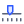 | [`RTrackBar`](members.md#rtrackbar) | everywhere |
|  | [`RCodeEditor`](members.md#rcodeeditor) | everywhere |
|  | [`RDiffView`](members.md#rdiffview) | everywhere |
|  | [`RCoolBtn`](members.md#rcoolbtn) | everywhere |
|  | [`ROvalBtn`](members.md#rovalbtn) | everywhere |

## Display and drawing

| | Component | Where |
|---|---|---|
|  | [`RLabel`](members.md#rlabel) | everywhere |
|  | [`RImage`](members.md#rimage) | everywhere |
|  | [`RCanvas`](members.md#rcanvas) | everywhere |
|  | [`RHeader`](members.md#rheader) | everywhere |
|  | [`RProgress`](members.md#rprogress) | everywhere |
|  | [`RProgressBar`](members.md#rprogressbar) | everywhere |
|  | [`RDesignSurface`](members.md#rdesignsurface) | everywhere |
|  | [`RDigDisplay`](members.md#rdigdisplay) | everywhere |

## Lists, grids and trees

| | Component | Where |
|---|---|---|
|  | [`RListBox`](members.md#rlistbox) | everywhere |
|  | [`RFileListBox`](members.md#rfilelistbox) | everywhere |
| 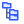 | [`RDirTree`](members.md#rdirtree) | everywhere |
|  | [`RStringGrid`](members.md#rstringgrid) | everywhere |
| 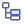 | [`RTreeView`](members.md#rtreeview) | everywhere |
| 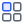 | [`RListView`](members.md#rlistview) | everywhere |

## Menus

| | Component | Where |
|---|---|---|
|  | [`RMainMenu`](members.md#rmainmenu) | everywhere |
|  | [`RMenuItem`](members.md#rmenuitem) | everywhere |
|  | [`RPopupMenu`](members.md#rpopupmenu) | everywhere |

## Dialogs

| | Component | Where |
|---|---|---|
|  | [`ROpenDialog`](members.md#ropendialog) | everywhere |
|  | [`RSaveDialog`](members.md#rsavedialog) | everywhere |
|  | [`RFileDialog`](members.md#rfiledialog) | everywhere |
|  | [`RColorDialog`](members.md#rcolordialog) | everywhere |
|  | [`RFontDialog`](members.md#rfontdialog) | everywhere |

## Non-visual objects

| | Component | Where |
|---|---|---|
|  | [`RTimer`](members.md#rtimer) | everywhere |
| 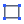 | [`RRect`](members.md#rrect) | everywhere |
|  | [`RFileStream`](members.md#rfilestream) | everywhere |
|  | [`RStringList`](members.md#rstringlist) | everywhere |
|  | [`RPrinter`](members.md#rprinter) | everywhere |
| 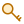 | [`RRegistry`](members.md#rregistry) | everywhere |
|  | [`RSecrets`](members.md#rsecrets) | everywhere |
| 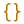 | [`RJson`](members.md#rjson) | everywhere |
|  | [`RFont`](members.md#rfont) | everywhere |
| 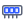 | [`RMemoryStream`](members.md#rmemorystream) | everywhere |
|  | [`RArchive`](members.md#rarchive) | everywhere |
| 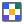 | [`RBitmap`](members.md#rbitmap) | everywhere |
|  | [`RImageList`](members.md#rimagelist) | everywhere |
|  | [`RNotifyIconData`](members.md#rnotifyicondata) | everywhere |

## Databases

| | Component | Where |
|---|---|---|
|  | [`RSQLite`](members.md#rsqlite) | everywhere |
|  | [`RMySQL`](members.md#rmysql) | desktop |

## Network, devices and CGI

| | Component | Where |
|---|---|---|
|  | [`RSocket`](members.md#rsocket) | desktop (TCP); web (WebSocket) |
|  | [`RServerSocket`](members.md#rserversocket) | desktop |
|  | [`RHttpServer`](members.md#rhttpserver) | desktop |
|  | [`RMcpServer`](members.md#rmcpserver) | desktop |
|  | [`RHttp`](members.md#rhttp) | everywhere |
|  | [`RCGI`](members.md#rcgi) | everywhere |
|  | [`RComPort`](members.md#rcomport) | desktop (serial2); web (Web Serial) |
|  | [`RDownload`](members.md#rdownload) | everywhere |

## Media

| | Component | Where |
|---|---|---|
| 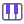 | [`RMIDI`](members.md#rmidi) | everywhere |
|  | [`RWave`](members.md#rwave) | everywhere |
|  | [`RVideo`](members.md#rvideo) | everywhere |
|  | [`RCDAudio`](members.md#rcdaudio) | everywhere |
|  | [`RAudioOut`](members.md#raudioout) | everywhere |

## DirectX 2D

| | Component | Where |
|---|---|---|
|  | [`RDXScreen`](members.md#rdxscreen) | everywhere |
|  | [`RDXImageList`](members.md#rdximagelist) | everywhere |
|  | [`RDXTimer`](members.md#rdxtimer) | everywhere |
|  | [`RDXSound`](members.md#rdxsound) | everywhere |
|  | [`RDXJoystick`](members.md#rdxjoystick) | everywhere |

## Direct3D (retained mode)

| | Component | Where |
|---|---|---|
| 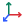 | [`RD3DFrame`](members.md#rd3dframe) | everywhere |
| 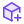 | [`RD3DMeshBuilder`](members.md#rd3dmeshbuilder) | everywhere |
| 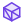 | [`RD3DMesh`](members.md#rd3dmesh) | everywhere |
|  | [`RD3DFace`](members.md#rd3dface) | everywhere |
|  | [`RD3DLight`](members.md#rd3dlight) | everywhere |
| 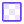 | [`RD3DTexture`](members.md#rd3dtexture) | everywhere |
|  | [`RD3DVisual`](members.md#rd3dvisual) | everywhere |
|  | [`RD3DWrap`](members.md#rd3dwrap) | everywhere |
|  | [`RD3DVector`](members.md#rd3dvector) | everywhere |
| 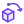 | [`RD3DAnimation`](members.md#rd3danimation) | everywhere |
| 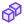 | [`RD3DAnimationSet`](members.md#rd3danimationset) | everywhere |

## Data science

| | Component | Where |
|---|---|---|
| 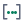 | [`RNum`](members.md#rnum) | everywhere |
|  | [`RDataFrame`](members.md#rdataframe) | everywhere |
|  | [`RCSV`](members.md#rcsv) | everywhere |
| 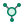 | [`RDataSource`](members.md#rdatasource) | everywhere |
| 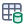 | [`RDBGrid`](members.md#rdbgrid) | everywhere |
| 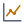 | [`RPlot`](members.md#rplot) | everywhere |

## Web only

| | Component | Where |
|---|---|---|
|  | [`RWebView`](members.md#rwebview) | web |
|  | [`RDOM`](members.md#rdom) | web |
|  | [`RJavaScript`](members.md#rjavascript) | web |
|  | [`RWebStorage`](members.md#rwebstorage) | web |
|  | [`RWebAudio`](members.md#rwebaudio) | web |
|  | [`RWebVideo`](members.md#rwebvideo) | web |
|  | [`RWebNotification`](members.md#rwebnotification) | web |
|  | [`RWebGeolocation`](members.md#rwebgeolocation) | web |
|  | [`RRouter`](members.md#rrouter) | web |

## IDE

| | Component | Where |
|---|---|---|
| 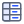 | [`RPropertyInspector`](members.md#rpropertyinspector) | everywhere |
|  | [`RToolbox`](members.md#rtoolbox) | everywhere |
| 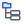 | [`RProjectTree`](members.md#rprojecttree) | everywhere |
|  | [`ROutputConsole`](members.md#routputconsole) | everywhere |
|  | [`RCommandPalette`](members.md#rcommandpalette) | everywhere |
|  | [`RMarkdownView`](members.md#rmarkdownview) | everywhere |
|  | [`RProject`](members.md#rproject) | everywhere |
|  | [`RLanguageService`](members.md#rlanguageservice) | everywhere |
| 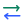 | [`RProgramSession`](members.md#rprogramsession) | everywhere |
|  | [`RAIProjectTools`](members.md#raiprojecttools) | everywhere |

## AI

| | Component | Where |
|---|---|---|
|  | [`RAI`](members.md#rai) | everywhere |
|  | [`RWindowCapture`](members.md#rwindowcapture) | everywhere |
|  | [`RAppHands`](members.md#rapphands) | everywhere |

## Libraries built in

A program that names these (or includes the library) gets RapidR's own implementation, written in BASIC on RapidR's components, on every runtime:

- `QDockForm`
- `QDirListView`

## Not implemented

These objects aren't in RapidR yet. Variables of the OLE types compile as generic objects whose methods print a warning:

- `QOleContainer`: Hosts an embedded OLE object (a document or control of another program) on a form. Planned: RapidR doesn't have it yet.
- `QOleObject`: Drives a COM / OLE automation object (another program's) by calling its methods by name. Planned: RapidR doesn't have it yet.
- `QThread`: Runs its OnExecute code in a background thread. Planned: RapidR doesn't have it yet.
- `QTransImage`: A picture with a transparent colour that can shape and size its form to it. Planned: RapidR doesn't have it yet.

122 components.
