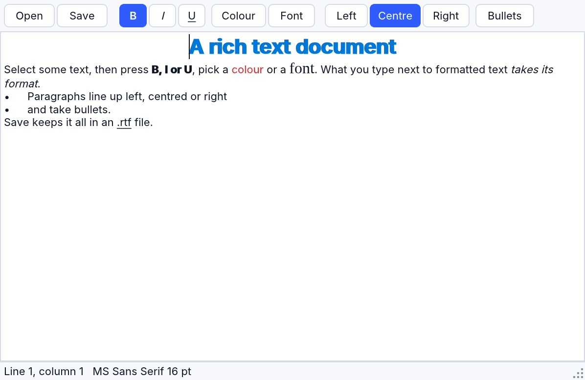

# Rich text: RRichEdit

An `RRichEdit` (older name `QRICHEDIT`) is a text editor whose text is
formatted: each character has its font, size, colour, bold, italic,
underline and strike-out, and each paragraph its alignment, indents and a
bullet. Programs format it through `SelAttributes`, the user types into it,
and it loads and saves rich text files (`.rtf`) that WordPad, Word,
LibreOffice and TextEdit open too. It works the same in native builds, in
the RapidR Runtime and in the browser.



The example above is [examples/gui/richtext.rr](../../examples/gui/richtext.rr):
`rapidr run examples/gui/richtext.rr`.

## Formatting text from a program

Select the text with `SelStart` and `SelLength`, then set `SelAttributes`:

```basic
CREATE Form AS RForm
    Width = 400: Height = 200
    CREATE Notes AS RRichEdit
        Align = alClient
    END CREATE
END CREATE

Notes.Text = "Rich text: bold and red"
Notes.SelStart = 11: Notes.SelLength = 4      ' "bold"
Notes.SelAttributes.Bold = 1
Notes.SelStart = 20: Notes.SelLength = 3      ' "red"
Notes.SelAttributes.Color = &HFF
Form.ShowModal
```

`SelAttributes` has a font's members: `Color`, `Name`, `Size`, `Bold`,
`Italic`, `Underline`, `StrikeOut` (and `AddStyles` / `DelStyles` with
`fsBold`, `fsItalic`, `fsUnderline`, `fsStrikeOut`). You can also give it
a whole `RFont` at once — every setting of the font goes to the selection:

```basic
DIM Title AS RFont
Title.Name = "Arial": Title.Size = 16: Title.Color = &H804000
Title.AddStyles(fsBold)
Notes.SelStart = 0: Notes.SelLength = 9
Notes.SelAttributes = Title
```

Positions count a line break as two characters, as `Text` has them (CR
LF), so a position `INSTR` finds in `Text` selects that text:

```basic
SUB Highlight(Word AS STRING)
    Notes.SelStart = INSTR(Notes.Text, Word) - 1
    Notes.SelLength = LEN(Word)
    Notes.SelAttributes.Color = &HFF0000
END SUB
```

### At the caret: what is typed next

With nothing selected, `SelAttributes` is the format of what is typed or
added at the caret next — until the caret moves. So a log can colour each
line it adds:

```basic
Log.SelStart = LEN(Log.Text)
Log.SelAttributes.Color = &H008000
Log.AddStrings "Connected."
```

`AddStrings` adds its lines at the end of the text and leaves the caret
after them.

### Reading the format

Reading a member of `SelAttributes` gives the format of the selection's
last character, or at a caret the format typed text would get. A tool bar
uses it to show the selection's state:

```basic
SUB ShowState
    BoldBtn.Down = Doc.SelAttributes.Bold
    ItalicBtn.Down = Doc.SelAttributes.Italic
END SUB
```

The automatic colour (the window's text colour, what text has until it is
given another) reads as `&H80000008`.

## What the user types

Typed text takes the format of the character before it — at the start of a
paragraph, of the character after it. Text typed over a selection takes the
format of the selection's first character. `Ctrl+Z` (`Cmd+Z` on macOS)
undoes the last change and gives back its formats too.

Text copied (or cut) from a rich edit and pasted into a rich edit keeps its
formats — with the keys, the right-click menu, or a program's
`CopyToClipboard` / `PasteFromClipboard`. Pasted into a plain text box, or
into another application, it is the text alone.

## Font and Alignment

`Font` is the format of text that was never formatted: while nothing in the
control is formatted, setting `Font` changes all of it. Once part of the
text has its own format, the rest keeps the font it shows, and `Font` only
changes the end of the text (what an empty last line types in).

`Alignment` (`taLeftJustify`, `taCenter`, `taRightJustify`) lines up the
paragraphs that have no alignment of their own; text set with `Text`
afterwards gets it as its own.

These are the classic rules: older programs format and save exactly as they
always did.

## Paragraphs (RapidR's)

`Paragraph` formats the paragraphs the selection is in (at a caret, its
own paragraph):

| Member | What it does |
|---|---|
| `Paragraph.Alignment` | `taLeftJustify`, `taCenter` or `taRightJustify` |
| `Paragraph.LeftIndent` | how far in the lines start, in pixels |
| `Paragraph.FirstIndent` | how much further in the first line starts (less than 0: a hanging indent) |
| `Paragraph.RightIndent` | how far in from the right the lines end |
| `Paragraph.Numbering` | 1: a bullet before the paragraph; 0: none |

```basic
Doc.SelStart = INSTR(Doc.Text, "Shopping") - 1
Doc.Paragraph.Alignment = taCenter
Doc.SelStart = INSTR(Doc.Text, "bread") - 1
Doc.SelLength = 20                       ' bread, milk, eggs …
Doc.Paragraph.Numbering = 1
```

## Files: rich text and plain text

`SaveToFile` writes the text with its formats as RTF, and `LoadFromFile`
reads RTF back — any RTF a word processor writes; a file that isn't RTF
loads as its plain text. With `PlainText = 1` both work with plain text
(lines ending CR LF). `SaveToStream` and `LoadFromStream` do the same with a
stream.

```basic
Doc.SaveToFile "letter.rtf"        ' formats kept
Doc.PlainText = 1
Doc.SaveToFile "letter.txt"        ' the text alone
```

`TextRTF` (RapidR's) is the same RTF as a string: read it to keep a
formatted note in a database, set it to show one.

## Screen readers

A screen reader reads the rich edit's text with its formats: VoiceOver,
NVDA and Narrator report the font, size, bold, italic, underline and colour
of the text under the caret (their "report formatting" commands), and the
control's description tells the format at the caret ("At the caret: Arial
12 point, bold, red"). In the browser the description is the field's
`aria-description`.

## Compatibility

The `QRICHEDIT` members of programs written for RapidQ behave as they always
did (the compatibility suite covers them): `SelAttributes` and its members, `SelFont` (`SelAttributes =
Font`'s other name), `Font`, `Alignment`, `PlainText`, `SelText`,
`AddStrings`, `Line`, `Clear`, `LoadFromFile` / `SaveToFile` and the
streams (the rich text files of those programs, byte for byte). The suite's
example `richedit/syntax` (syntax highlighting) shows its colours as it always
did.

Differences that remain: the classic `LineCount` and `Line(i)` count the lines
as wrapped on screen when `WordWrap` is on, RapidR's count paragraphs (as
the classic ones do with `WordWrap = 0`); after `SelectAll` the classic `SelLength`
counts the end of the text as two more characters; a document loaded from
RTF is saved with RapidR's header (the classic one keeps the loaded file's).
