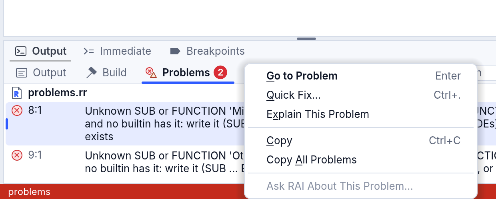
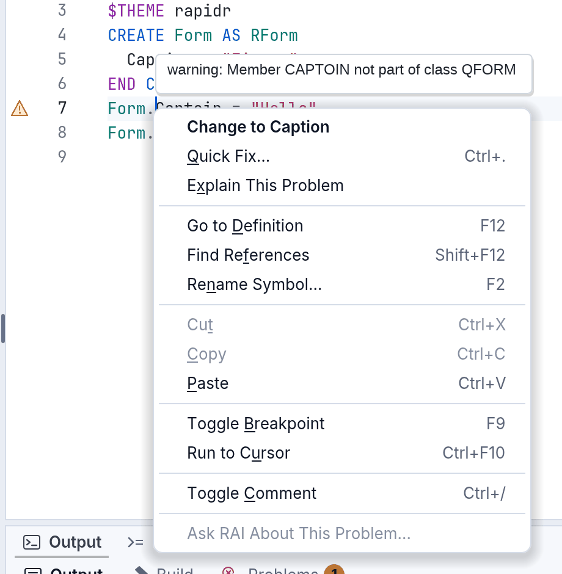
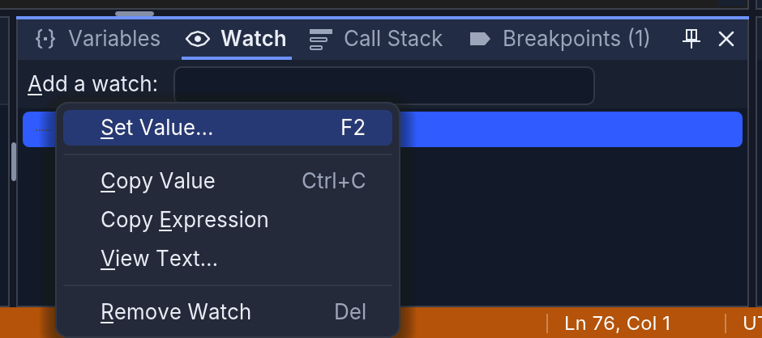
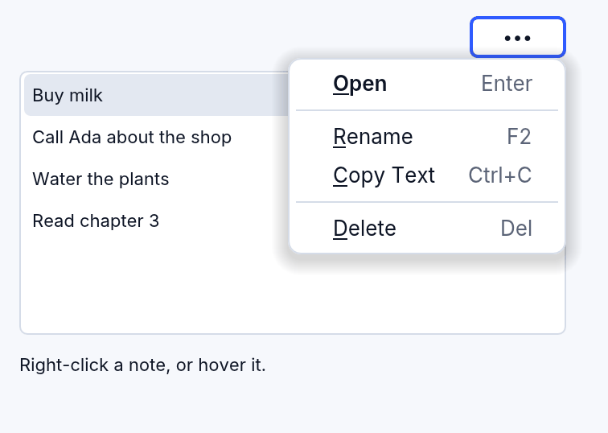

# Right-click menus

Right-click almost anything in RapidR Studio and you get a short menu of
what you can do with it there: a file in the Project tree, a document's
tab, the code, a component on a form, a row of Properties or Events, a
chat in the Assistant, a problem, a line of output, a value while
debugging, a Help page, the status bar, a pane's tab, a recent project, a
component of the Toolbox. The keyboard opens the same menus, and so does a
screen reader. Your own programs get the same thing with one event,
`OnContextMenu`, and lists can show small icon actions on their rows with
`RowActions`.

## Opening a menu

| How | Where the menu opens |
|---|---|
| A right click (on a Mac, also a two-finger click or Control-click) | where you clicked; what you clicked is selected first |
| **Shift+F10** or the **Menu key** | under the selected row, tab or component, or under the caret in code; its first item is already chosen |
| A screen reader's "show menu" (VoiceOver: VO+Shift+M) | the same as the keyboard |

In the menu: the arrow keys move, **Enter** picks, the underlined letter
picks its item, **Esc** closes the menu and puts you back where you were.

Every menu follows the same rules, so you always know where to look:

- **The default action comes first, in bold**: what a double click or
  Enter does there (Open for a file, Edit Value for a property).
- **The keys are shown** beside each item, in a quieter colour: the menu
  teaches you the shortcut.
- **The groups are always in the same order**: what it is for, making
  something new, editing, finding and showing, the mode's own (debugging,
  versions, the designer's alignment), Ask RAI, and **last, what loses
  something** (Remove from Project, Delete).
- **Greyed, not hidden**: an item that can't be used right now is greyed,
  and says why ("Nothing is selected", "The main file stays in the
  project") in a small tip beside the menu when you rest on it or reach it
  with the arrow keys (a screen reader reads it as the item's
  description), so the items never jump around.
- **Ask RAI never sends anything by itself**: it opens the Assistant with
  the file, the code or the problem quoted in the question box; you add
  your question and press Send. With School Lock keeping AI off, the item
  isn't there.

## The menus in RapidR Studio


| Right-click | You get |
|---|---|
| **A file** in the Project tree | **Open**, Open Code (a form) · Add Module, Add Existing File... · Rename (F2), Copy Path, Copy Relative Path, Reveal in Finder (File Explorer, Files) · Show History (a project with versions) · Ask RAI About This File... · Remove from Project (Del: the file stays on the disk) |
| **A folder** or **a group** (Forms, Modules…) | Add Form (a group), Add Module, Add Existing File..., Add Folder... · Copy Path, Copy Relative Path, Reveal (a folder) · Collapse All |
| **The project** (its own row) | Add Form, Add Module, Add Existing File..., Add Folder... · Copy Path, Reveal · Save a Version... (or Start Versioning This Project), Collapse All · Ask RAI About This Project... · Project Options... · Close Project |
| **A document's tab** | Close Document (Ctrl+W), Close Others, Close to the Right, Close Saved, Close All Documents · Copy Path, Copy Relative Path, Reveal, Show in Project · Split Right, Split Down · Local History of This File... |
| **The code** | Go to Definition (F12), Find References (Shift+F12), Rename Symbol... (F2), Quick Fix... (Ctrl+.) · Cut, Copy, Paste · Toggle Breakpoint (F9), Run to Cursor (and, paused, Set Next Statement, Add Watch) · Toggle Comment, Versions ▸ · Ask RAI About This Code... |
| **A component** on a form | **Edit Event Handler**, Edit Caption (F2) · Cut, Copy, Paste, Duplicate · Bring to Front, Send to Back, Center in Form ▸ · Tab Order, Properties (F4) · Ask RAI About This Component... · Delete (Del) |
| **Several components** | Align ▸, Make Same Size ▸, Space Evenly ▸ · Cut, Copy, Paste, Duplicate · Bring to Front, Send to Back · Properties · Ask RAI · Delete |
| **The form** itself | Paste, Select All · Menu Editor, Tab Order · Zoom ▸ · Code (F7), Properties · Ask RAI About This Form... |
| **A property** | **Edit Value** (Enter), Reset to Default (Del) · Copy Value, Copy Name, Copy as Code (`GreetButton.Caption = "Greet"`) · Help: Caption (F1) · Ask RAI About Caption... |
| **An event** | **Go to Handler** (or Create Handler), Remove Handler (Del: the SUB stays in the code) · Copy Name, Copy as Code · Help (F1) · Ask RAI |
| **A chat** in the Assistant | **Open** (Enter) · Rename (F2), Copy as Markdown · Delete (Del) |
| **A problem** (Output's Problems page) | **Go to Problem** (Enter), Quick Fix... (Ctrl+.), Explain This Problem · Copy, Copy All Problems · Ask RAI About This Problem... |
| **A line of output** (Output, Build) | **Go to main.rr, Line 12** (a line that names a place) · Copy, Copy Line, Copy All, Select All · Wrap Long Lines ✓ · Clear |
| **Immediate** | Copy, Paste, Select All · Clear |
| **A value** in Variables or Watch (while paused) | Set Value... (F2) · Copy Value, Copy Expression, View Text... · Add Watch (Variables) or Remove Watch (Watch, Del) |
| **A call** in Call Stack | **Go to This Call** (Enter) · Copy, Copy All |
| **A breakpoint** | **Go to Breakpoint** (Enter), Edit Condition... (Shift+F9), Disable (or Enable) Breakpoint (Space) · Copy, Copy All · Remove Breakpoint (Del), Delete All Breakpoints (Ctrl+Shift+F9) |
| **A Help page** | Back, Forward · Copy, Select All · Open in the Browser (a page of the manual) · Ask RAI About This Page... |
| **A code example** in Help | **Try It** (a copy of the example opens in Studio: F5 runs it), Copy Code, Insert at the Cursor · Ask RAI About This Example... |
| **The status bar** | the message: Copy Message · the project: Reveal in Finder, Project Options... · Versions · Ln, Col: Go to Line... (Ctrl+G) · AI apps: AI Apps Activity, AI Apps Settings... · School Lock's chip: School Lock... |
| **A pane's tab** or title | Close Pane · Float (Dock, when it floats) · Reset Layout |
| **A recent project** on the Welcome page | **Open** · Copy Path, Reveal in Finder · Remove from Recent |
| **A component** of the Toolbox | **Add to the Form** (Enter) · Help: RButton (F1), Open an Example · Ask RAI How to Use RButton... — a group: Collapse All, Expand All |

The Project tree's file also has **Compare With ▸**: the disk's version
(an open file with changes), the last version (a project with versions)
or another file you pick, side by side; and, last, **Delete File...**, which
asks first and moves the file to the system's Trash (the Recycle Bin on
Windows), where you can put it back — never the main file, never a file
outside the project's folder, not in the browser. **Remove from Project**
keeps the file on the disk. A form's component in the tree and one in the
designer have **Help: RButton** (F1).

**On a problem in the code**, the menu starts with the problem's own group:
its fix itself when the language service has one, in bold ("Change to
Caption" for a misspelt `Captoin`), then Quick Fix... (Ctrl+.) and
**Explain This Problem** (a Help page with the problem, where it is and the
help of the name it is on); Ask RAI About This Problem... quotes it.








The menus are drawn by RapidR itself, in Studio's look (light, dark, high
contrast), so they appear in screenshots and recordings, and RAI and AI
apps can see and pick their items as you do.


### The Assistant's chats

Click a chat to open it (the arrow keys only move through the list; Enter
opens). The chats are grouped under **Today**, **Yesterday** and
**Earlier**. The row under the mouse, and the selected row, show three
small buttons: **Rename** (F2: the title is edited in the row itself,
Enter keeps it, Esc leaves it), **Delete** (Del) and **More** (the row's
menu, also Shift+F10, with **Copy as Markdown**: the chat's questions and
answers on the clipboard). Delete takes effect at once and offers **Undo**
beside the list, so it doesn't ask first. With no chats yet, the list
shows **Start a Chat**.

## In your own programs

### OnContextMenu

Every component that can take the keyboard has `OnContextMenu (X, Y,
Key)` (RapidR's):

| Argument | |
|---|---|
| `X`, `Y` | where the menu goes, in the component's own pixels: where the person clicked, or under the selected item when the keyboard asked |
| `Key` | how the person asked: `0` the mouse, `1` Shift+F10 or the Menu key, `3` a screen reader, `4` a row's More button (`X`, `Y` its bottom right corner: open the menu right-aligned there) |

Show your menu with `PopupAt`:

```basic
CREATE NoteMenu AS RPopupMenu
  SystemMenu = 0                 ' RapidR draws it: your look, seen by AI tools
  CREATE OpenItem AS RMenuItem
    Caption = "&Open" + CHR$(9) + "Enter"     ' the keys after a Tab
    Default = 1                  ' bold: what a double click does
  END CREATE
END CREATE

SUB NotesMenu (X AS INTEGER, Y AS INTEGER, Key AS INTEGER, Sender AS RListBox)
  IF Sender.ContextIndex < 0 THEN EXIT SUB
  Sender.ItemIndex = Sender.ContextIndex      ' a right click doesn't select by itself
  IF Key = 4 THEN NoteMenu.Alignment = 1 ELSE NoteMenu.Alignment = 0
  NoteMenu.PopupAt Sender, X, Y
END SUB

Notes.OnContextMenu = NotesMenu
```

- A list box says which item the menu is for in **`ContextIndex`**: the one
  right-clicked (a right click doesn't change the selection, as before), the
  selected one for the keyboard, or the row whose More button was clicked.
- A component with a **`PopupMenu`** and no `OnContextMenu` opens that menu
  by itself, as it always did on a right click, and in a RapidR program
  (`.rr`) from the keyboard too; a classic program (`.bas`, `.rqw`) keeps the
  right click alone. Bind `OnContextMenu` and your handler decides instead.
- **`RMenuItem.Default`** draws an item in bold; **`RPopupMenu.SystemMenu = 0`**
  has RapidR draw the menu on every system (by default macOS and Windows
  show their own); **`RPopupMenu.AccessibleName`** is what a screen reader
  calls it while it is open ("Actions for orders.rr").
- A dock manager says which document's tab was right-clicked in
  **`ContextDocument`**, and which pane's tab or title in **`ContextPane`**
  (**`DockBack Name`** docks a floating pane back where it was).
- A tree view says which node in **`ContextIndex`** (a right click doesn't
  select it either); a toolbox whether it was a component or a group in
  **`ContextKind`**; an output console the place a line names with
  **`PlaceFile(Index)`** and **`PlaceLine(Index)`** (with `ClickedLine`); a
  Markdown view the code block in **`ContextCode`**; a code editor the
  problem at a place with **`ProblemAt(Line, Column)`**, its first fix's
  words with **`FixAt`** and applies it with **`ApplyFixAt`**.


### A menu from a button: the ••• pattern

A menu that drops under a button needs no `OnContextMenu`: open it from the
button's `OnClick` with `PopupAt`, at the button's bottom edge.

```basic
SUB MoreClick (Sender AS RButton)
  NoteMenu.Alignment = 1                       ' its right edge at X
  NoteMenu.PopupAt Sender, Sender.Width, Sender.Height
END SUB
```

The menu is open when the click is over. The same goes for a menu a label's
`OnMouseDown` or `OnMouseUp` opens, or any handler that runs on a mouse
button: **the gesture that opened a menu never picks from it or closes it**.
Press on a label whose `OnMouseDown` calls `PopupAt` and let go a few pixels
off, over the first item: the menu stays open and nothing is picked, as a
system menu does. Press, drag to an item and let go, and it is picked. After
that a click on an item picks it, and a click anywhere else closes the menu
(and does nothing else).



### RowActions: small buttons on a list's rows

```basic
Notes.RowActions = "rename:Rename (F2),delete:Delete (Del),more:More actions (Shift+F10)"
Notes.OnRowAction = NotesAction

SUB NotesAction (Index AS INTEGER, Action AS STRING, Sender AS RListBox)
  IF Action = "delete" THEN Sender.DelItems Index
END SUB
```

Up to three actions, each an icon name from RapidR's icons with its tip
after a colon. They show on the row under the mouse and on the selected row
of a list that has the keyboard — never only under the mouse, so the
keyboard and touch screens have them too. **F2** is `rename` and **Del**
`delete` on the selected row; **`more`** opens the row's `OnContextMenu`
(`Key` 4). Put every row action in the list's menu as well.


### Heading rows and renaming in the row

```basic
Notes.AddItems "Today", "Buy milk", "Earlier", "Read chapter 3"
Notes.Heading 0, 1                 ' a group's title: bold, quieter, never selected
Notes.Heading 2, 1
Notes.OnEdited = NoteRenamed

SUB NotesAction (Index AS INTEGER, Action AS STRING, Sender AS RListBox)
  IF Action = "rename" THEN Sender.EditItem Index      ' the editor over the row
END SUB

SUB NoteRenamed (Index AS INTEGER, S AS STRING)
  ' S is what was typed (Enter); change it, or the item gets it as it is
END SUB
```

**`Heading(i)`** makes an item a heading row: a click doesn't pick it, the
arrow keys, Home and End pass over it, it has no row actions and a screen
reader hears a heading. **`EditItem i`** opens an editor over the item's
text (RTreeView's way): Enter keeps it (**`OnEdited`**), Esc leaves it.

### Moving a file to the Trash

**`MOVETOTRASH(Path$)`** moves a file or a folder to the system's Trash
(the Recycle Bin on Windows) and gives True, where the person can still put
it back — unlike `KILL`. Studio's Delete File... uses it
([the language](language.md#to-the-trash-movetotrash),
[trash.rr](../../examples/basics/trash.rr)).

The whole example is [context_menus.rr](../../examples/gui/context_menus.rr),
with a ••• button above the list that opens the same menu from its `OnClick`:
`rapidr run examples/gui/context_menus.rr`.

### For AI tools

`app_layout` lists an open menu's items, and `app_click` with `menu`
("NoteMenu > Rename") picks one, a right-click included: menus RapidR draws
are seen and used by RAI and AI apps exactly as by a person
([AI apps](ai-apps.md), [eyes and hands](app-eyes-and-hands.md)).
