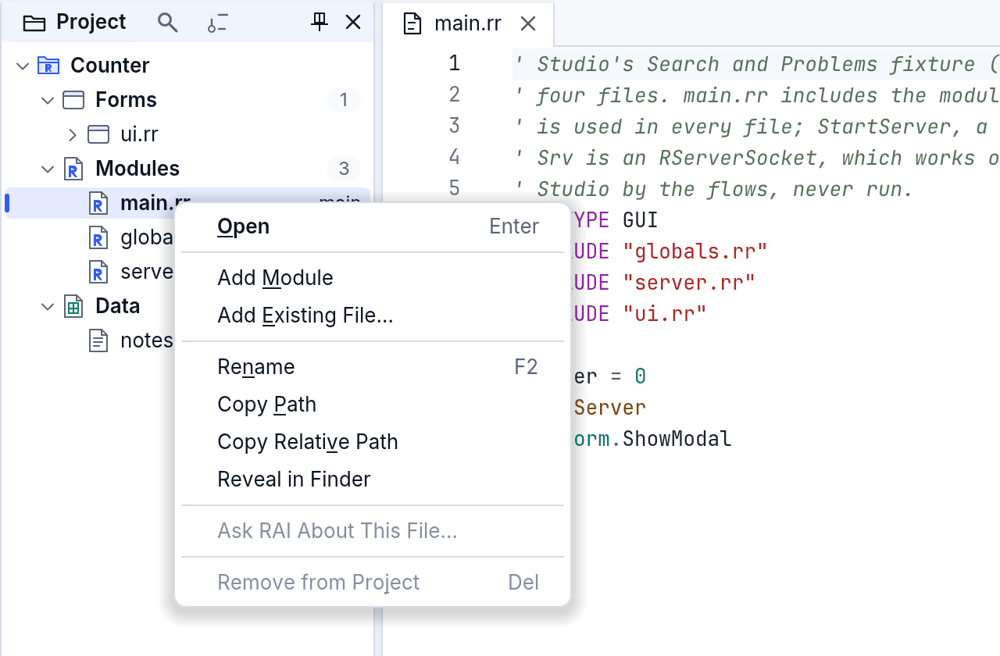
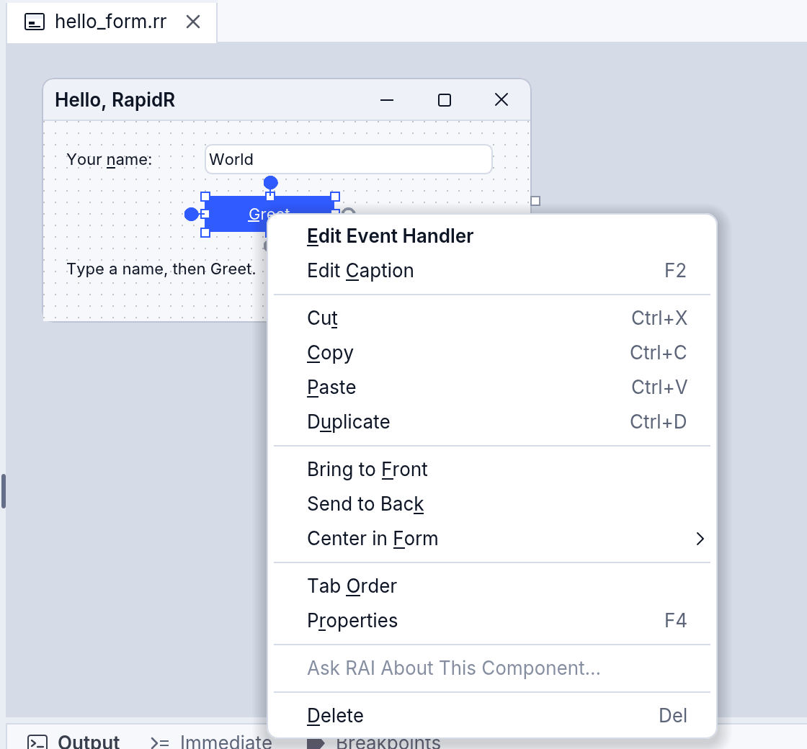
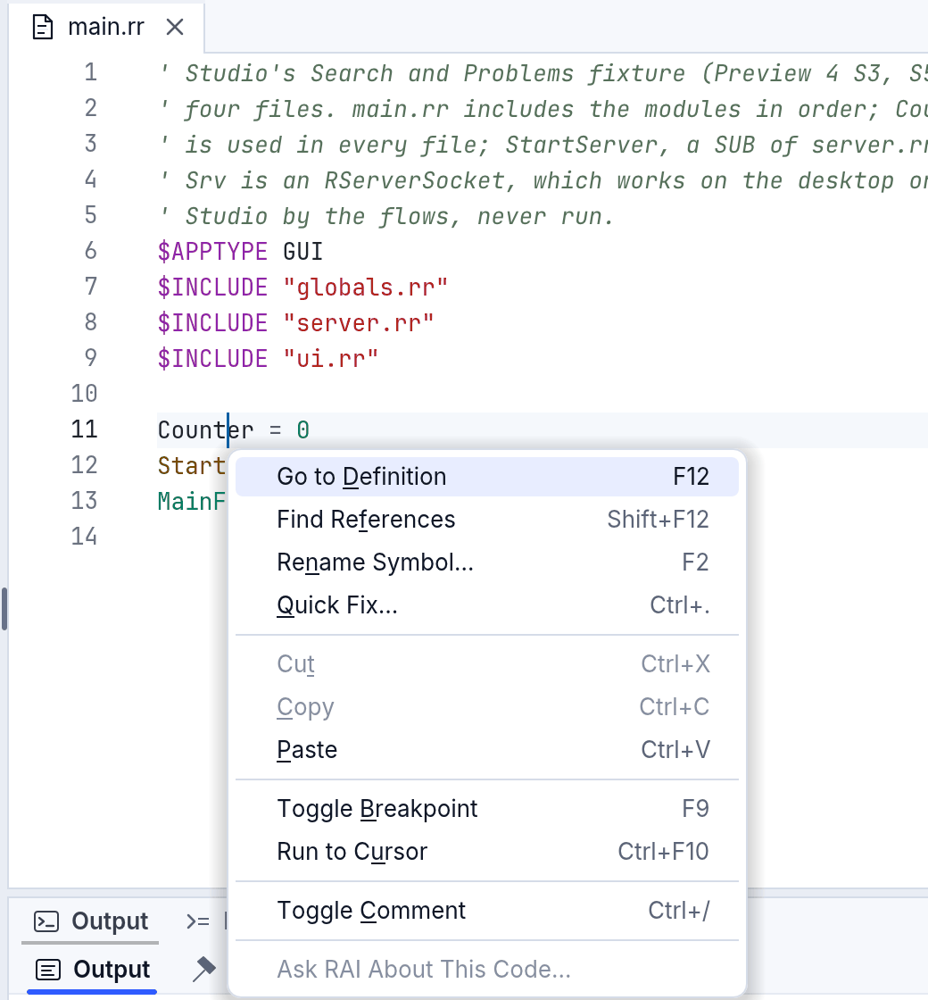
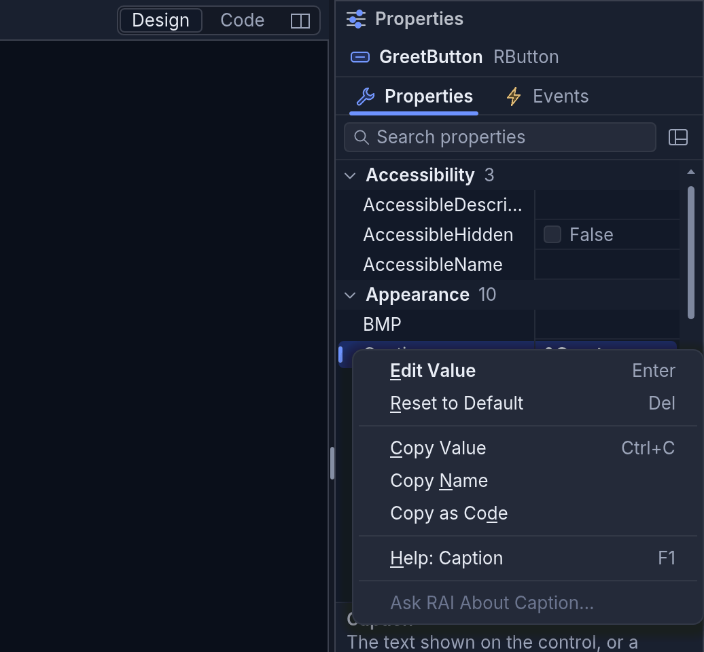
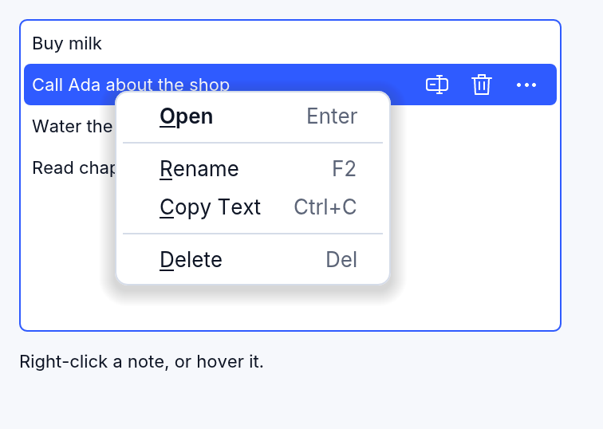
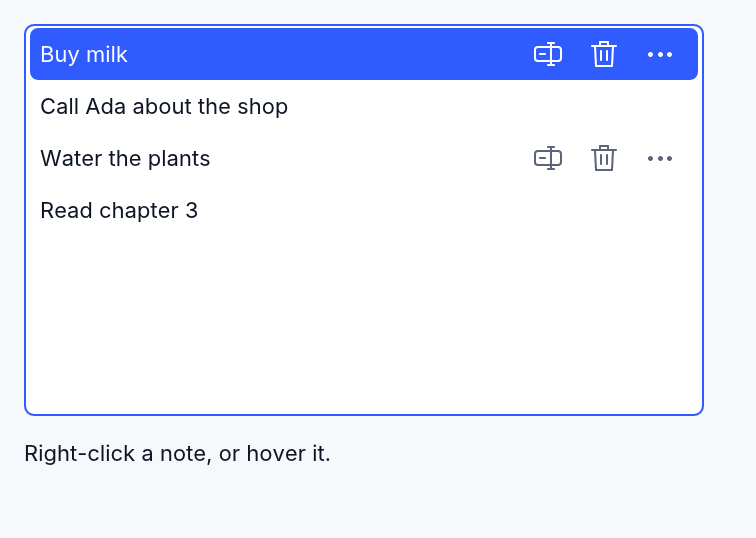

# Right-click menus

Right-click almost anything in RapidR Studio and you get a short menu of
what you can do with it there: a file in the Project tree, a document's
tab, the code, a component on a form, a row of Properties or Events, a
chat in the Assistant. The keyboard opens the same menus, and so does a
screen reader. Your own programs get the same thing with one event,
`OnContextMenu`, and lists can show small icon actions on their rows with
`RowActions`.

## Opening a menu

| How | Where the menu opens |
|---|---|
| A right click (on a Mac, also a two-finger click or Control-click) | where you clicked; what you clicked is selected first |
| **Shift+F10** or the **Menu key** | under the selected row, tab or component, or under the caret in code; its first item is already chosen |
| A screen reader's "show menu" (VoiceOver: VO+Shift+M) | the same as the keyboard |

In the menu: the arrow keys move, **Enter** picks, the underlined letter
picks its item, **Esc** closes the menu and puts you back where you were.

Every menu follows the same rules, so you always know where to look:

- **The default action comes first, in bold**: what a double click or
  Enter does there (Open for a file, Edit Value for a property).
- **The keys are shown** beside each item, in a quieter colour: the menu
  teaches you the shortcut.
- **The groups are always in the same order**: what it is for, making
  something new, editing, finding and showing, the mode's own (debugging,
  versions, the designer's alignment), Ask RAI, and **last, what loses
  something** (Remove from Project, Delete).
- **Greyed, not hidden**: an item that can't be used right now is greyed,
  and its description says why ("Nothing is selected", "The main file
  stays in the project"), so the items never jump around.
- **Ask RAI never sends anything by itself**: it opens the Assistant with
  the file, the code or the problem quoted in the question box; you add
  your question and press Send. With School Lock keeping AI off, the item
  isn't there.

## The menus in RapidR Studio



| Right-click | You get |
|---|---|
| **A file** in the Project tree | **Open**, Open Code (a form) · Add Module, Add Existing File... · Rename (F2), Copy Path, Copy Relative Path, Reveal in Finder (File Explorer, Files) · Show History (a project with versions) · Ask RAI About This File... · Remove from Project (Del: the file stays on the disk) |
| **A folder** or **a group** (Forms, Modules…) | Add Form (a group), Add Module, Add Existing File..., Add Folder... · Copy Path, Copy Relative Path, Reveal (a folder) · Collapse All |
| **The project** (its own row) | Add Form, Add Module, Add Existing File..., Add Folder... · Copy Path, Reveal · Save a Version... (or Start Versioning This Project), Collapse All · Ask RAI About This Project... · Project Options... · Close Project |
| **A document's tab** | Close Document (Ctrl+W), Close Others, Close to the Right, Close Saved, Close All Documents · Copy Path, Copy Relative Path, Reveal, Show in Project · Split Right, Split Down · Local History of This File... |
| **The code** | Go to Definition (F12), Find References (Shift+F12), Rename Symbol... (F2), Quick Fix... (Ctrl+.) · Cut, Copy, Paste · Toggle Breakpoint (F9), Run to Cursor (and, paused, Set Next Statement, Add Watch) · Toggle Comment, Versions ▸ · Ask RAI About This Code... |
| **A component** on a form | **Edit Event Handler**, Edit Caption (F2) · Cut, Copy, Paste, Duplicate · Bring to Front, Send to Back, Center in Form ▸ · Tab Order, Properties (F4) · Ask RAI About This Component... · Delete (Del) |
| **Several components** | Align ▸, Make Same Size ▸, Space Evenly ▸ · Cut, Copy, Paste, Duplicate · Bring to Front, Send to Back · Properties · Ask RAI · Delete |
| **The form** itself | Paste, Select All · Menu Editor, Tab Order · Zoom ▸ · Code (F7), Properties · Ask RAI About This Form... |
| **A property** | **Edit Value** (Enter), Reset to Default (Del) · Copy Value, Copy Name, Copy as Code (`GreetButton.Caption = "Greet"`) · Help: Caption (F1) · Ask RAI About Caption... |
| **An event** | **Go to Handler** (or Create Handler), Remove Handler (Del: the SUB stays in the code) · Copy Name, Copy as Code · Help (F1) · Ask RAI |
| **A chat** in the Assistant | **Open** (Enter) · Rename (F2) · Delete (Del) |





The menus are drawn by RapidR itself, in Studio's look (light, dark, high
contrast), so they appear in screenshots and recordings, and RAI and AI
apps can see and pick their items as you do.



### The Assistant's chats

Click a chat to open it (the arrow keys only move through the list; Enter
opens). The row under the mouse, and the selected row, show three small
buttons: **Rename** (F2), **Delete** (Del) and **More** (the row's menu,
also Shift+F10). Delete takes effect at once and offers **Undo** beside
the list, so it doesn't ask first. With no chats yet, the list shows
**Start a Chat**.

## In your own programs

### OnContextMenu

Every component that can take the keyboard has `OnContextMenu (X, Y,
Key)` (RapidR's):

| Argument | |
|---|---|
| `X`, `Y` | where the menu goes, in the component's own pixels: where the person clicked, or under the selected item when the keyboard asked |
| `Key` | how the person asked: `0` the mouse, `1` Shift+F10 or the Menu key, `3` a screen reader, `4` a row's More button (`X`, `Y` its bottom right corner: open the menu right-aligned there) |

Show your menu with `PopupAt`:

```basic
CREATE NoteMenu AS RPopupMenu
  SystemMenu = 0                 ' RapidR draws it: your look, seen by AI tools
  CREATE OpenItem AS RMenuItem
    Caption = "&Open" + CHR$(9) + "Enter"     ' the keys after a Tab
    Default = 1                  ' bold: what a double click does
  END CREATE
END CREATE

SUB NotesMenu (X AS INTEGER, Y AS INTEGER, Key AS INTEGER, Sender AS RListBox)
  IF Sender.ContextIndex < 0 THEN EXIT SUB
  Sender.ItemIndex = Sender.ContextIndex      ' a right click doesn't select by itself
  IF Key = 4 THEN NoteMenu.Alignment = 1 ELSE NoteMenu.Alignment = 0
  NoteMenu.PopupAt Sender, X, Y
END SUB

Notes.OnContextMenu = NotesMenu
```

- A list box says which item the menu is for in **`ContextIndex`**: the one
  right-clicked (a right click doesn't change the selection, as before), the
  selected one for the keyboard, or the row whose More button was clicked.
- A component with a **`PopupMenu`** and no `OnContextMenu` opens that menu
  by itself, as it always did on a right click, and in a RapidR program
  (`.rr`) from the keyboard too; a classic program (`.bas`, `.rqw`) keeps the
  right click alone. Bind `OnContextMenu` and your handler decides instead.
- **`RMenuItem.Default`** draws an item in bold; **`RPopupMenu.SystemMenu = 0`**
  has RapidR draw the menu on every system (by default macOS and Windows
  show their own).
- A dock manager says which document's tab was right-clicked in
  **`ContextDocument`**.



### RowActions: small buttons on a list's rows

```basic
Notes.RowActions = "rename:Rename (F2),delete:Delete (Del),more:More actions (Shift+F10)"
Notes.OnRowAction = NotesAction

SUB NotesAction (Index AS INTEGER, Action AS STRING, Sender AS RListBox)
  IF Action = "delete" THEN Sender.DelItems Index
END SUB
```

Up to three actions, each an icon name from RapidR's icons with its tip
after a colon. They show on the row under the mouse and on the selected row
of a list that has the keyboard — never only under the mouse, so the
keyboard and touch screens have them too. **F2** is `rename` and **Del**
`delete` on the selected row; **`more`** opens the row's `OnContextMenu`
(`Key` 4). Put every row action in the list's menu as well.



The whole example is [context_menus.rr](../../examples/gui/context_menus.rr):
`rapidr run examples/gui/context_menus.rr`.

### For AI tools

`app_layout` lists an open menu's items, and `app_click` with `menu`
("NoteMenu > Rename") picks one, a right-click included: menus RapidR draws
are seen and used by RAI and AI apps exactly as by a person
([AI apps](ai-apps.md), [eyes and hands](app-eyes-and-hands.md)).
